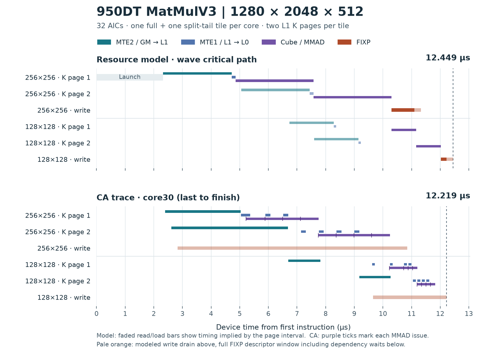

# operator-sim：昇腾算子耗时预测后端

`operator-sim` 给系统仿真器提供单卡算子的**设备耗时（µs）、Cube / Vector 工作量和逻辑读写字节**。调用方传入某个 rank 的算子、shape、dtype、调用属性和目标芯片配置，模型按库实现的分块、分核和流水依赖估时。可以在原来调用 Roofline 的地方接入它；每次预测只运行 Python，无需 NPU、CANN 或调用 CA 仿真器。

| 调用方要了解什么 | 入口 |
|---|---|
| 怎样安装、传入 shape、判断结果可用并接到事件调度器？ | [系统仿真接入指南](docs/integration.md) |
| 某个算子为什么需要这么久？不同 shape 如何改变结果？ | [建模方法：Vector、Cube、CV 三类流程，含逐算子公式与算例](docs/modeling-strategy.md) |
| 哪些算子、shape 和库实现实测过？偏差多大？预测有多快？ | [CA 校验与误差：逐算子摘要、逐 shape 数据及查询墙钟](docs/error-analysis.md) |



同一 BF16 Matmul [1280,2048,512]，32 个 AIC 分两波计算。沿第一行看，首条 MMAD 在模型中于 4.852 µs 发起，CA 记录为 5.215 µs。到最后一个块的第二页，两者只差 0.031 µs。整窗为 12.449 / 12.219 µs。换成 950PR 后会得到 24 个矩形尾块，模型和库都发出 416 条 MMAD，整窗为 14.027 / 13.218 µs。[Matmul 的计算与逐页偏差](docs/examples/matmul.md) · [同一输入的 DT 与 PR 对照图](docs/examples/figures/matmul-tile-pages-dt-pr.png)

[按算子选流水对照图](docs/pipeline-comparisons.md#按算子打开图)。Vector 可以逐块查看 DynamicMXQuant 的量化值和 scale 两路写回、Cast 的缓冲区复用；CV 融合可以对比 FA 的首次 QK/PV 和长循环间隔，或 KDA 三个 kernel 各自的阶段误差。[Quant](docs/examples/quant.md) · [Cast](docs/examples/cast_bf16_fp32.md) · [FA](docs/examples/fa.md) · [KDA 的 64+64+1 三块状态流水](results/v0.23/kda-multiblock/950pr-t129-h3-fwdh.png) · [DeepSeek HcPost 的五个通道块](docs/examples/hc_post_vllm.md)

整批 prefill 的每个 rank 可以从模型规格直接查到各算子的输入、输出、dtype 和层号。按每卡 8 条、每条 32k／128k／256k 导出，模型和 CA 都齐备的单元格可以点开看该 shape 的流水。14 张图复用已完成的正式库采集。[DeepSeek V4.1 Flash](docs/workloads/deepseek-flash.md) · [DeepSeek V4 Pro](docs/workloads/deepseek-pro.md) · [Kimi K3](docs/workloads/kimi-k3.md) · [整批 prefill 的模型与 CA 图集](results/v0.23/prefill/README.md)

新增的 **DeepSeek V4 Pro 单卡 B8×128k** 实测覆盖 950DT 上 50 轮 UB 分块。该层对 64 个 indexer 系数升精度，模型给 99.918 µs，CA 为 105.374 µs。对照图能看到差值从哪一轮开始积累。[大 shape 上下对照图](results/v0.23/pro-prefill/pro-b8-128ki-dt-plot.png) · [首块到尾块的计算过程](docs/examples/cast_bf16_fp32.md#pro-整批-128k-的-50-个-ub-块)

## 试一次预测

在仓库根目录用系统仿真器的 Python 环境安装（Python 3.10 或更新版本）。安装后可在任意工作目录查询。下面的 `9` 表示这个 rank 上的一次 RMSNorm 同时处理 9 个 token，`7168` 是每个 token 的通道数。

```sh
python3 -m pip install .
operator-sim --op rmsnorm --shape 9 7168
```

要对另一款芯片做同一调用，可以在系统仿真器启动时加载芯片 JSON，然后在同一个进程反复调用后端。可以按内置名加载 950DT、950PR 或 970DT 情景。以下示例输出一次本卡 Matmul 的微秒数、Cube 工作量、逻辑输入字节和计时状态。

```python
from operator_model import estimate, load_chip

chip = load_chip("Ascend950PR_957b")
result = estimate("matmul", (128, 256, 512), dtype="bf16", chip=chip)
print(result.latency_us, result.work["cube_ops"], result.work["logical_read_bytes"], result.status)
```

**比较芯片架构时可显式指定 `timing_mode="resource"`。** Quant、RMSNorm、Matmul 和 FA 会按目标配置重新决定分核、tile、读写字节、计算与流水时间。PR 和自定义配置的这四项默认使用该路径。新增的 sigmoid 专家路由、BF16→FP32 Cast 和 Kimi 融合残差也按目标资源估计。其余路线沿用 DT 阶段投影，或仅返回工作量。相同配置更换名称时，显式资源模型给出相同预测。[资源公式与算例](docs/modeling-strategy.md) · [独立 PR 校验与误差](docs/error-analysis.md)

维护 960、970、980 等架构情景时，每个目标使用一份 JSON，分别填写按位宽区分的两类算力、核数、频率、外存容量和带宽。内置 `Ascend970DT` 情景为 120 Cube / 120 Vector、1.8 GHz、288 GB、14.4 TB/s；其中 16 位 Vector 峰值 110.592 TOP/s 已含双发射。这些是架构假设。调用方通过 `extrapolated` 状态识别外推，并决定是否将其交给事件调度器。[970DT 配置及逐项来源](configs/chips/Ascend970DT.json) · [自定义芯片示例](configs/chips/scenario-example.json) · [字段、单位和返回合同](docs/integration.md)

隔离安装的 v0.24 wheel 在三种芯片上核对了 1,716 个常规输入，单次查询 P95 为 0.688 ms、最大 6.012 ms。另外 39 次只见到部分前序的 RMSNorm 流调用最大 11.407 ms。设备延迟按 µs 返回。[安装版开销与逐路由结果](results/v0.24/wheel-check.json) · [本版变化及校准范围](results/v0.24/changes.md)

## 可预测的算子

| 方法 | 路线 |
|---|---|
| Vector | DynamicMXQuant、RMSNorm、mHC Sinkhorn、mHC Post、KDA recurrent、Kimi beta FP32 Sigmoid、MoE sigmoid Top-K、BF16→FP32 Cast、Kimi AttnResFwd 单 token/核驻留分支 |
| Cube | Matmul、Addmm、MoE GMM2 |
| Cube + Vector（CV） | FA、Lightning Indexer、mHC Pre / PreSinkhorn、mHC 组合、GMM1–SwiGLU–MX 量化及 MoE FFN 组合 |

三个模型的 B8 整批与 chunked prefill 输入可直接查每个 rank 的张量形状、dtype、层号和适用的独立 kernel。覆盖每请求 32k、128k、256k，以及 attention TP8 或 DP8、MoE EP8 两种拓扑。[逐模型真实维度与导出器](docs/prefill-shapes.md) · [场景索引](results/v0.20/workloads/index.csv) · [工作负载覆盖](docs/workload-coverage.md)

Kimi 的 FLA 26.9.1 三段 KDA V2 可显式预测阶段耗时、工作量和分核，已在 DT、PR 用新 shape 实测。默认小形使用的融合 V1，完整耗时仍为 `None`。DeepSeek 扩展 `aclnnHcPost` 可显式预测分核、分块与设备耗时；存在数值失败的短尾片仅返回工作量。组合路线与组成它的单个 kernel 在同一调用中只计一次。[KDA 冻结模型与 CA 同轴图](docs/examples/kda_chunk.md) · [DeepSeek HcPost](docs/examples/hc_post_vllm.md) 各路线的 dtype、布局和分支限制见[建模方法](docs/modeling-strategy.md)。模型配置、本地 batch、TP/EP 切分和实际路由共同决定输入 shape，见[如何推导每卡 shape](docs/model-configs.md)。

## 硬件与计时边界

主要校准参考是 **Ascend950DT_9582（A5），CANN 9.2.1，32 AIC / 64 AIV，1.65 GHz**。参考值是安装包实际 kernel 在 CA Model 上从首条到末条设备指令的跨核时间窗；串行组合返回各窗口之和。主机 launch、卡间通信、排队及算子间并发由系统仿真器处理。报告的查询开销是运行预测器花费的真实墙钟时间，与 `predicted_us` 使用的是两条不同的时间轴。

**Ascend950PR_957b** 有 28 AIC / 56 AIV，1.65 GHz，名义片外带宽 1.4 TB/s；DT 为 4.0 TB/s。核数正确时仍可能因每核的发起、写回和共享带宽产生时延偏差。精度按具体库路线与 shape 报告；同一 shape 的两 SKU 实测、开发回放、冻结后留出和 970 外推都标明数据角色。对于 960/970/980 的外推，假设软件实现仍采用当前库路线。[逐算子误差与硬件差异](docs/error-analysis.md) · [970 场景下 FA 的逐 shape 瓶颈](results/v0.17/fa-scenarios.md)

维护模型、复现 CA 或查阅历史版本，请从[开发与验证档案](development/README.md)进入。
