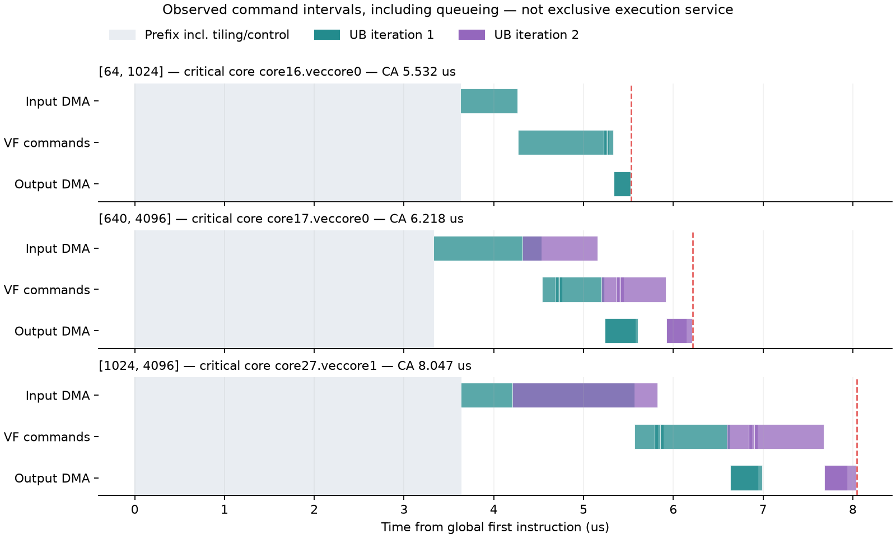

# v0.3：UB 依赖与 FA 指令分段

本次只修正 quant 的 UB 时延模型和 FA 的 MMAD 次数。matmul 与 FA 时延保持冻结的 v0.2 参数及算法，避免混淆指令修复与时延调参。全部 32 个既有输入转为本轮开发/校准数据，未重新运行校准 CA；验证使用 6 个全新 shape。新结果见 [独立验证报告](../results/v0.3/report.md)。

## 使用

```bash
python3 -m operator_model --op quant --shape 768 4096 --instruction-counts
python3 -m operator_model --op fa --shape 17 1153 64 1 1 --instruction-counts
python3 -m unittest discover -s tests -v
python3 scripts/evaluate-v3.py
```

在线 Python 3.10+ 标准库即可；可使用项目内 Conda：`toolchains/envs/cann-9.2.1/bin/python`。从项目根目录加载 `results/v0.3/model.json`；库入口为 `operator_model.model_v3.Case/Predictor`。服务加载一次模型并复用实例，4096 项 LRU 缓存保留。

固定算子属性和 SoC 沿用 [v0.2](model-v2.md)：950DT_9582、CANN9.2.1；quant BF16→E4M3FN、尾轴 block32；FA BF16/SBH、B=1、D64/128、无 mask/dropout。API 可接受范围不是全范围准确性声明。

## quant 的修正依据

从既有 10 个 quant trace 选取最晚结束的核，提取 tiling/POD 读取、输入 DMA、每轮 3 个 VF 命令与两类输出 DMA。每个 trace 的 SHA 与原采集结果核对，原始 trace 不修改。初始 160 字节 MTE2 是 tiling/POD 读取，不能当成输入 tensor 的搬运量。

v0.2 的问题是将 MTE2 聚合占用当作每轮服务成本，同时用 `fill + (loops−1)×max(stage)` 推进。它既混入参数读取/排队，又把已经预取的后续数据当成再次完整等待。VF 命令的时间窗也可能含等待：小输入的 VF span 明显大于实际 RVEC 忙碌区间，不能互换。

### 关键路径与双缓冲

新模型按实际 UB tile（包括尾块）推进少量阶段事件：

```text
read_ready[0] = prefix + first_read_latency(tile0)
read_ready[i] = read_ready[i−1] + read_initiation_interval(tile_i)
read_ready[i>=2] = max(read_ready[i], vector_finish[i−2] + read_latency(tile_i))
vector_finish[i] = max(read_ready[i], vector_finish[i−1], write_finish[i−2]) + vector_service(tile_i)
write_finish[i] = max(vector_finish[i], write_finish[i−1]) + write_drain
T = max(control_floor(active_cores), write_finish[last] + suffix)
```

不存在的前序项取 0。输入槽须等 Vector 消费后复用，输出槽须等写回后复用；第三轮不能无条件预取到仍占用的槽。运行复杂度随 UB tile 数增加，不按动态指令数回放。

| 成本 | 校准依据 | 限制 |
| --- | --- | --- |
| prefix | 全局指令窗起点→首个输入 DMA 开始，对活跃核数对数做非负拟合 | 包含参数、控制和核间起始偏差，不是纯单核 ISA 常数 |
| 首次读延迟 | 实际 payload DMA 的 bytes 与时间 | CA 事件可含排队，不是峰值带宽 |
| 后续读间隔 | 相邻 payload DMA 的完成时间差 | 仅 2 个多 UB 输入，拟合为常数；未识别全部资源竞争 |
| Vector 服务 | RVEC 流水区间并集，对主 VF/scale VF 循环工作量拟合 | 不把 PUSHQ VF 命令窗直接作算术时间 |
| 写回排空 | 多 UB 样本中 y/scale 两类输出 DMA 的合并排空窗中位数 | 很小 shape 的长写回延迟含控制/竞争；不用于推导峰值带宽 |
| control floor | 每核≤1024 元素的小工作量样本，拟合活跃核数与总时延 | 是名义统计控制路径，不是单独测得的 Scalar 忙碌时间，也不保证是真实时延的物理下界 |

这仍是有限证据的低开销代理模型。旧 trace 只有两轮 UB 的大输入；三轮以上虽然显式限制槽复用，尚无 CA 准确性验证。模型不会把训练系数称为跨代硬件常数。



## FA 指令偏差的修正依据

当前普通 BF16、Q tile=64、D=64/128 路径，QK 调用 `MatmulBase<...,128,128,D,...>`，当 KV 外层 tile=256 时，内部转 `MatmulN`，沿 N 每 128 元素执行一条 MMAD；PV 的 K 维同样通过 `MatmulK` 按 128 分段。因此：

```text
QK MMAD / Q tile = ceil(KV / 128)
PV MMAD / Q tile = ceil(KV / 128)
最大核 MMAD 次数 = 2 × ceil(KV / 128) × 最大核 Q tile 数
```

例如 KV=1025 的外层循环数是 5，但实际 MMAD 为 18，不能按 10 条再拟合全局倍率。v0.2 的全局倍率把短 KV 的 2 条也放大到约 3.03 条。v0.3 取消这项拟合，显式输出 QK/PV 分解。

Q tile=128 可能走隐式 Dn 等不同路线，本次不声称公式覆盖；返回 `instruction_count_coverage=unvalidated_q128_route` 和空计数。未带 m/n/k detail 的 trace 仍可从 CSV 核实总 MMAD 次数，但不补造维度或完整执行 FLOPs。当前已有 12 个 FA 输入的结构计数全部匹配；新独立验证另见报告。

## 为什么固定耗时基线曾更好

1. **样本中的工作量增加常被分核吸收。** 总元素、head 或 Q 变大时，活跃核数也增加，每核工作量未必同比变大。全卡 FLOPs/字节数不是该范围内时延的良好单一特征。
2. **许多输入处于头开销主导区。** 旧 quant 样本首条 VF 之前耗时占比的中位数为 71.08%，最大核 Vector family 忙碌占比中位数仅 1.78%。FA 最大核 Cube 忙碌占比中位数仅 2.16%；这不能据此认定纯 Vector bound，也不能直接套峰值吞吐比例。
3. **小样本多参数容易增加误差。** v0.2 共享阶段拟合、整体校正和分组残差，在每个机制仅 1–2 点时难以唯一分离固定开销、工作量与重叠。固定均值在窄时延区间方差更小。
4. **之前的机制近似本身有偏差。** quant 重复计入读等待、FA 把外层循环当成 MMAD 次数；低时延误差不代表这些机制正确。

v0.3 不排斥固定开销，而是把控制路径作为显式下界，与有工作量缩放和双缓冲依赖的流水路径取最大值。它不是纯固定值，也不保证所有分支上都优于固定值。

对旧 quant 的 10 个输入，逐次删除一个 shape 并重新拟合全部 phase 参数，交叉检查 WAPE 为 **7.99%**，每折重新计算的固定均值基线为 **13.77%**。这包括删除一个多 UB 点的敏感性检查，但仍属于已经查看过的数据上的开发诊断，不当作独立验证。详细逐折结果见 [calibration-diagnostics.json](../results/v0.3/calibration-diagnostics.json)。

## 预算、冻结与复现

新增 CA 只有 6 个全新留出点：quant `[512,256]`、`[576,4096]`、`[768,4096]`；FA `[32,129,64,1,4]`、`[17,257,128,1,1]`、`[17,1153,64,1,1]`。分别覆盖控制区、单轮大 UB、双轮 UB、短尾块、D128 和外层 KV256/内部128 分段。

预算：最多 6 次尝试、采集墙钟 20 分钟、5 CPU 小时、6 GiB 原始数据；每例 profiler 4 分钟、外层进程组 300 秒；不自动重试。预算按 case 边界检查，不是 OS 硬配额。仿真耗时与线上查询耗时分别报告。

新预测、清单和实现已在采集前冻结并提交 Git。额外绑定基类、CA 解析器、调用器二进制及源码、trace 摘要和校准快照的 SHA。评估校验 case 输入、环境身份和采集开始时间；不允许改变 shape 后沿用同一 ID。参数不根据新留出结果回调。

重放评估不需要安装 CANN，也不需要原始大 trace；使用已提交的聚合数据。若重新采集，使用 `python3 scripts/collect-v1.py --version 0.3 --split holdout`，但这会要求本地调用器和工具链身份相符。`fit-v3.py` 拒绝覆盖冻结文件。图表可用项目 Conda 执行 `scripts/plot-v1.py --version 0.3` 生成。

源码与知识库证据见 [evidence-v3.json](evidence-v3.json)。知识卡对应 CANN9.1 结构说明，固定源码与安装的 9.2.1 二进制不宣称完全一致；由实际 kernel、核数和指令次数验证限定分支。

## 本轮新留出结论与未解决项

六点均通过数值检查，核数 6/6 匹配，FA MMAD 计数 4、6、20 全部正确。quant 时延 WAPE 为 4.70%，两个大 UB 点 APE 分别为 0.92%、5.08%；小工作量点为 9.21%。同一新集上的旧 quant 模型为 4.93%，因此总体改善仅 0.23 个百分点，不能将旧测试集的 13.85% 与本轮 4.70% 相减作为改善量。

小工作量点由旧模型约 5.74% 误差变为 9.21%，反映新的统计控制路径仍不足以预测一次采集中的写回/核间扰动；它对大 UB 的机制修正并不自动改善每个小 shape。每个新点仅采集一次，没有建立重复统计置信区间，不宣称 0.23 个百分点具有统计显著性。本轮保留回退，不用新留出结果改系数。

新集更新固定均值基线 quant/FA WAPE 分别为 17.24%/11.42%；相比之下模型为 4.70%/5.31%。固定基线在之前窄工作量区占优，遇到本轮每核工作增加的输入便不再占优；优势取决于 workload 分布。应保留固定值作为长期对照，不能凭某一轮胜负移除它。

新增 6 次 CA 尝试全部成功，墙钟 9.29 分钟、累计 CPU 3.43 小时、原始数据 2.52 GiB，无新增校准仿真、无超时/重试。在线未缓存 P95 为 104.05 μs，缓存 P95 为 0.99 μs，批量约 133 万次/秒。显式阶段调度与保留旧版诊断增加了未缓存开销；缓存后的常见重复 shape 查询仍约 1 μs。本机库基准不等于系统仿真端到端开销。
