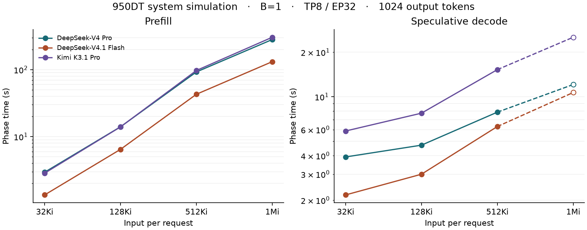
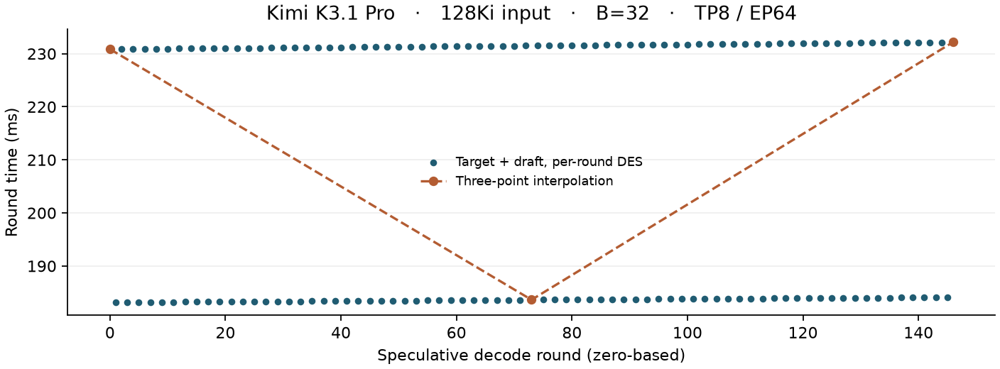

# 950DT 长上下文 prefill 与 decode 的端到端对比

本页对同一张 rank 0 捕获图分别运行历史 Roofline、按执行精度对齐的 Roofline、operator-sim 精细后端。三个模型各有 11 个部署配置，每组都报告读完整 prompt，以及随后生成至总计 1024 个输出 token 的时间。这里的秒数来自系统离散事件仿真（DES）。线上排队、采样器、未捕获的服务端操作和真实多卡抖动均未计入。

**接入 A5 的候选索引模型后，18/33 组比系统原 Roofline 快，33/33 组均满足同精度峰值下界。** 1Mi、B=1 的 Flash 最后一个 prefill 块，完整历史后端为 15.176 s，BF16 全表方案为 0.871 s，A5 MXFP4 稀疏消费方案为 0.480550 s。A5 的源层仍扫描可见 keys，消费层只给候选打分。后者假设已具备 MXFP4 查询和折叠布局的 KV，不另计调用方转换。

v1.12 根据跨团队切行及最终 TopK 归并的代价调整了 11 组 Flash 中的 10 组，147 轮 decode 累计多出 3.647–4.386 ms；128Ki、B=32 与 22 组 Pro、Kimi 的请求耗时不变。原始捕获的执行依赖、各节点使用的执行资源和请求设置均相同。[v1.12 请求对照](../calibration/candidate_indexer/v112_context_requests.csv) · [v1.11 与 BF16 全表对照](../calibration/candidate_indexer/context-sensitivity.md)

### 从实测波次到 4,096 行

末块的每个候选消费节点有 4,096 个查询行、每行最多 2,048 个稀疏候选块。950DT 的 32 个计算团队平分后，每队处理 128 行。为估计持续时间，可以把小窗口重复到 4,096 行，再只替换图上四个候选节点的价格，按原资源和依赖重跑 DES。每次启动的代理成本取普通 QLI 的 8,568 周期，按 1.65 GHz 为 5.193 µs。每段都重付、仅首段支付两种假设分别记作 `n × T` 和 `n × T − (n−1) × S`，其中 `n` 为段数、`T` 为对应段的 CA 整窗、`S` 为启动代理。

**950DT Q32 的完整 CA 时间为 84.792 µs，Q64 为 80.133 µs。** v1.12 分别预测 75.856 和 146.518 µs，前者低估 10.54%，后者高估 82.84%。Q64 的 32,768 个 TopK 位置通过黄金值校验，32 个 AIC 和 64 个 AIV 的指令窗全部退休。下表将短窗当作代表段，保持同图其余节点价格与资源分配，再推算 4,096 行末块。[Q32 原始收据](../calibration/candidate_indexer/prefill-wave.json) · [Q64 原始收据](../calibration/candidate_indexer/v112_wave_dt.json)

| 定价依据 | 启动处理 | 单个 4,096 行候选节点（ms） | 含四个候选的末块 DES（ms） |
|---|---|---:|---:|
| 冻结 v1.12 系统配置 | 模型排程 | 9.262 | 480.550 |
| 128 个 Q32 段 | 每段计启动 | 10.853 | 486.915 |
| 128 个 Q32 段 | 只计首段启动 | 10.194 | 484.277 |
| 64 个 Q64 段 | 每段计启动 | 5.128 | 464.015 |
| 64 个 Q64 段 | 只计首段启动 | 4.801 | 462.707 |

Q32 试验让所有查询共享同一批 256 个候选物理页，一支团队负责一行。Q64 试验让每队连续处理两行，相邻行在 256 页中共用 208 页、在 2,048 块中共用 1,664 块，64 行的并集为 2,176 页。Q64 的 GM→UB 描述符共读 71,303,168 字节，去重后为 9,469,952 字节，每队的地址与重复次数均与输入一致。两种输入同时改变了波次和局部性，现有计数不能区分各级缓存命中、总线冲突或实际 HBM 流量。

两次实测的差为 `T64 − T32 = −4.659 µs`。若把这个差直接当成每增加一波的成本，`T32 + 127 × (T64 − T32)` 会得到 **−506.951 µs** 的单节点耗时，因此该式没有可用的 DES 结果。表中四种重复段情景可检验结论对波长、启动和候选集合的敏感性。4,096 行线上候选分布、跨波缓存驻留、AICPU 元数据和上游索引准备仍缺实测，四种情景不能界定真实耗时范围。[逐场景微秒账](../calibration/candidate_indexer/v112_context_multiwave.csv) · [Q64 逐团队分配与访存集合](../calibration/candidate_indexer/v112_wave_dt_fixture.json)

## 怎么读这次比较

- **历史 Roofline** 直接运行系统原后端，保留它原来的引擎分配、固定效率、缺失实现和占位处理。该时间可用于复现历史决策。节点缺失与失败次数在逐图 CSV 可查。
- **同精度峰值** 使用与精细模型相同的实现合同、分精度有效运算、逻辑读写、通信和图依赖。本地算子按 Cube 时间、Vector 等价工作时间、完整冷读写时间三者的最大值计。**同精度原效率** 再分别使用 60%、60%、80% 的效率系数。这两列可在同一份账上逐项验证。
- **精细模型** 按实际张量和目标资源重新选分核、tile、波次和流水。系统全图默认把冷读和写回计入节点完成时间。输入为系统任务的 950DT 资源配置：Cube 4/8/16/32 位分别 2000/1000/500/125 TOP/s，Vector 8/16/32 位分别 62/31/16 TOP/s，HBM 144 GB、4 TB/s。核数、频率、片上缓冲取 DT 实现模板。因而与单算子 CA 的内置 950DT 参数存在差异。

## 配置和采样

1. 输入长度分别为 32768、131072、524288、1048576。每请求每个 prefill 块最多 4096 token。B 是每个 attention DP 副本的本地请求数，三个模型均复用原任务的权重、激活、KV cache 以及逐层精度规则。TP=8 切 attention 头，DP=EP/8。短上下文比较 B=1/8/16；128Ki 比较 B=1/4/32；512Ki 对 B=4 同时比较 EP32 和 EP64，可单独观察 EP 改变的影响；1Mi 比较 B=1/4。
2. 32Ki 的 8 个 prefill 块全部捕获。较长输入单独捕获首块，再捕获续块索引 1、中点、末点和两个区间内部点；首块独立计价。对未捕获的块按相邻实算位置线性插值，求和得到整段 prefill。先只用三个续块锚点预测内部点，可单独检查插值偏差。
3. Prefill 产出首个 token。Decode 使用原配置的 8 个草稿 token，主模型通常校验 9 个位置，每轮假设产出 7 个有效 token。剩余 1023 个 token 计 147 次完整的 target + draft 调度，最后一轮只消费所需的 1 个。标准组实算首、中、末三轮，其余轮按历史长度插值。Kimi 的三组中点高偏差触发逐轮重放，全部 147 次按各自实际形状重新建模。
4. 三个模型的原预置最大位置均为 1,048,576。1Mi 输入的最后一个 prefill 块可以正常捕获。其后 1Ki 输出超出预置：在合法的历史长度 1,046,528、1,047,039、1,047,550 捕获 decode，在同一算法不变的假设下延伸末段斜率。该组的 decode 与总时间均为**超位置范围外推**，模型质量、可执行性和更远位置的分块未经验证。静态显存由请求预留的 KV 容量和可捕获图的 rank 0 分配决定。

## 逐配置结果

精细模型在 **18/33** 个请求配置中比历史 Roofline 快，相对同工作、同精度、同通信的峰值 Roofline 为 **0/33**。33 个配置的 rank 0 静态内存均落在场景的 144 GB 容量内，最大 129.00 GB。

时间单位为秒，每行覆盖整批请求。差值按 `精细总时间/历史总时间−1` 计算。这里的“历史”是系统原有 Roofline，v1.11 和 v1.12 是同一精细后端的不同版本。星号表示 decode 超过预置最大位置。

| 模型 | 输入 | 本地 B | EP | Prefill 历史 / 精细 | Decode 历史 / 精细 | 总时间 历史 / 同精度峰值 / 精细 | 差值 | 静态峰值 GB |
|---|---:|---:|---:|---:|---:|---:|---:|---:|
| V4 Pro | 32Ki | 1 | 32 | 2.35 / 2.94 | 1.53 / 3.92 | 3.87 / 3.19 / 6.86 | +77.1% | 33.20 |
| V4 Pro | 32Ki | 8 | 32 | 18.77 / 22.73 | 2.27 / 4.99 | 21.04 / 15.54 / 27.72 | +31.7% | 38.87 |
| V4 Pro | 32Ki | 16 | 32 | 37.54 / 45.35 | 3.25 / 6.68 | 40.79 / 29.70 / 52.04 | +27.6% | 47.29 |
| V4 Pro | 128Ki | 1 | 32 | 13.16 / 14.02 | 1.71 / 4.71 | 14.87 / 10.19 / 18.73 | +25.9% | 33.49 |
| V4 Pro | 128Ki | 4 | 32 | 52.63 / 54.63 | 2.56 / 5.41 | 55.19 / 36.33 / 60.04 | +8.8% | 35.72 |
| V4 Pro | 128Ki | 32 | 64 | 420.98 / 434.36 | 10.73 / 14.19 | 431.71 / 279.86 / 448.55 | +3.9% | 67.45 |
| V4 Pro | 512Ki | 1 | 32 | 112.88 / 92.39 | 2.44 / 7.87 | 115.32 / 65.09 / 100.26 | -13.1% | 34.67 |
| V4 Pro | 512Ki | 4 | 32 | 451.46 / 363.09 | 5.48 / 9.53 | 456.94 / 255.25 / 372.62 | -18.5% | 39.93 |
| V4 Pro | 512Ki | 4 | 64 | 451.46 / 363.17 | 4.86 / 9.03 | 456.32 / 254.75 / 372.21 | -18.4% | 28.05 |
| V4 Pro | 1Mi* | 1 | 32 | 386.39 / 281.60 | 3.41 / 12.10 | 389.80 / 205.25 / 293.69 | -24.7% | 36.24 |
| V4 Pro | 1Mi* | 4 | 64 | 1545.38 / 1111.89 | 8.76 / 14.57 | 1554.14 / 814.50 / 1126.46 | -27.5% | 33.66 |
| V4.1 Flash | 32Ki | 1 | 32 | 2.85 / 1.33 | 0.87 / 2.09 | 3.72 / 1.40 / 3.41 | -8.3% | 40.80 |
| V4.1 Flash | 32Ki | 8 | 32 | 22.82 / 10.18 | 3.20 / 3.19 | 26.02 / 7.09 / 13.36 | -48.6% | 44.61 |
| V4.1 Flash | 32Ki | 16 | 32 | 45.64 / 20.30 | 5.93 / 4.62 | 51.57 / 13.65 / 24.92 | -51.7% | 50.33 |
| V4.1 Flash | 128Ki | 1 | 32 | 34.04 / 5.76 | 1.80 / 2.64 | 35.84 / 4.05 / 8.39 | -76.6% | 41.07 |
| V4.1 Flash | 128Ki | 4 | 32 | 136.15 / 22.24 | 5.58 / 3.92 | 141.73 / 14.52 / 26.17 | -81.5% | 42.47 |
| V4.1 Flash | 128Ki | 32 | 64 | 1089.16 / 176.50 | 41.00 / 16.40 | 1130.16 / 111.73 / 192.90 | -82.9% | 73.15 |
| V4.1 Flash | 512Ki | 1 | 32 | 498.16 / 33.42 | 5.52 / 4.84 | 503.68 / 18.85 / 38.27 | -92.4% | 42.15 |
| V4.1 Flash | 512Ki | 4 | 32 | 1992.61 / 130.44 | 20.45 / 9.28 | 2013.06 / 73.29 / 139.72 | -93.1% | 46.48 |
| V4.1 Flash | 512Ki | 4 | 64 | 1992.61 / 130.44 | 20.23 / 9.10 | 2012.83 / 73.12 / 139.55 | -93.1% | 42.58 |
| V4.1 Flash | 1Mi* | 1 | 32 | 1961.75 / 85.31 | 10.47 / 7.76 | 1972.23 / 48.71 / 93.08 | -95.3% | 43.58 |
| V4.1 Flash | 1Mi* | 4 | 64 | 7846.93 / 334.09 | 40.05 / 16.17 | 7886.98 / 192.06 / 350.26 | -95.6% | 47.36 |
| Kimi K3.1 Pro | 32Ki | 1 | 32 | 3.11 / 2.85 | 2.66 / 5.87 | 5.77 / 4.92 / 8.72 | +51.0% | 55.68 |
| Kimi K3.1 Pro | 32Ki | 8 | 32 | 24.87 / 21.28 | 3.85 / 7.62 | 28.72 / 21.82 / 28.91 | +0.7% | 67.02 |
| Kimi K3.1 Pro | 32Ki | 16 | 32 | 49.73 / 42.34 | 5.33 / 10.16 | 55.06 / 41.11 / 52.49 | -4.7% | 80.73 |
| Kimi K3.1 Pro | 128Ki | 1 | 32 | 14.21 / 13.97 | 3.04 / 7.75 | 17.25 / 13.03 / 21.72 | +25.9% | 56.77 |
| Kimi K3.1 Pro | 128Ki | 4 | 32 | 56.83 / 53.25 | 4.68 / 9.46 | 61.50 / 44.43 / 62.71 | +2.0% | 63.69 |
| Kimi K3.1 Pro | 128Ki | 32 | 64 | 454.47 / 420.15 | 20.22 / 30.54 | 474.69 / 336.65 / 450.68 | -5.1% | 129.00 |
| Kimi K3.1 Pro | 512Ki | 1 | 32 | 84.97 / 97.17 | 4.54 / 15.25 | 89.51 / 61.15 / 112.42 | +25.6% | 61.14 |
| Kimi K3.1 Pro | 512Ki | 4 | 32 | 339.75 / 376.29 | 10.69 / 20.92 | 350.44 / 235.90 / 397.21 | +13.3% | 78.85 |
| Kimi K3.1 Pro | 512Ki | 4 | 64 | 339.71 / 375.83 | 9.66 / 20.09 | 349.36 / 235.23 / 395.92 | +13.3% | 57.11 |
| Kimi K3.1 Pro | 1Mi* | 1 | 32 | 244.87 / 304.42 | 6.55 / 25.24 | 251.41 / 164.22 / 329.66 | +31.1% | 66.97 |
| Kimi K3.1 Pro | 1Mi* | 4 | 64 | 979.14 / 1187.06 | 17.68 / 35.36 | 996.81 / 646.32 / 1222.41 | +22.6% | 79.54 |

读取结果时请考虑同一 EP 组内各 rank 的负载差异。容量列沿用原图的预留与 rank 静态峰值，Flash 的 folded cache 映射未重新分配，未仿真集群上最忙 rank 的显存碎片、调度抖动或故障。精细模型和峰值模型均使用整图 DES，节点耗时不能简单相加来替代整图结果。

下图保留原捕获的 BF16 参考曲线，Flash 的 A5 时间读取上表。



## 精细后端升级对 11 组 Flash 请求的影响

以下为 v1.12 减 v1.11。prefill 包含读完 prompt 的所有块，decode 包含 147 轮 target 和 draft。逐轮均摊保留微秒级的变化；调度图、稀疏打分的精度与候选数、其余算子价格和插值位置均复用同一捕获。

| 输入 | 本地 B | EP | Prefill 差值（ms） | Decode 差值（µs，147 轮） | 平均每轮差值（µs） | 整批时间 v1.11 → v1.12（s） |
|---|---:|---:|---:|---:|---:|---:|
| 32Ki | 1 | 32 | +0.0729 | +4265.7290 | +29.01856 | 3.410214 → 3.414552 |
| 32Ki | 8 | 32 | +0.0628 | +4386.0543 | +29.83710 | 13.359653 → 13.364102 |
| 32Ki | 16 | 32 | +0.0496 | +3646.8051 | +24.80820 | 24.913955 → 24.917652 |
| 128Ki | 1 | 32 | +0.0928 | +4265.7290 | +29.01856 | 8.387832 → 8.392190 |
| 128Ki | 4 | 32 | +0.0793 | +4386.0543 | +29.83710 | 26.162768 → 26.167233 |
| 128Ki | 32 | 64 | +0.0000 | +0.0000 | +0.00000 | 192.902762 → 192.902762 |
| 512Ki | 1 | 32 | +0.3314 | +4265.7290 | +29.01856 | 38.262706 → 38.267303 |
| 512Ki | 4 | 32 | +0.2778 | +4386.0543 | +29.83710 | 139.716442 → 139.721106 |
| 512Ki | 4 | 64 | +0.2778 | +4386.0543 | +29.83710 | 139.540437 → 139.545101 |
| 1Mi* | 1 | 32 | +0.6497 | +4265.7290 | +29.01856 | 93.074475 → 93.079391 |
| 1Mi* | 4 | 64 | +0.5424 | +4386.0543 | +29.83710 | 350.253567 → 350.258495 |

128Ki 的首轮能说明 batch 的影响。B=1 时，9 行在 32 个团队之间分配，全部 9 行都被切开，单行最多 5 段；四个 target 节点合计增加 19.346 µs，两个 draft 节点增加 9.673 µs。B=4 时，36 行中的 28 行被切开，单行最多 2 段；两个阶段分别增加 19.891 和 9.946 µs。B=32 时，288 行恰好每队 9 个整行，跨队归并消失，这两个阶段的差值均为零。

已覆盖 72 个 Flash prefill 阶段与 33 对 decode target/draft 阶段，分别命中 288 与 198 个候选消费调用。25 个 prefill、30 个 target 和 30 个 draft 阶段的时间发生变化。各阶段的同精度峰值和原效率报价逐项复现 v1.11，因为分核与归并计时的修订沿用了原有的逻辑计算量和 I/O 口径。11 组 Flash 的已采样位置，用端点预测内部点的最大相对偏差分别为 prefill 4.978%、decode 0.026%。另外 22 组 Pro 和 Kimi 零命中，三条价格账的阶段总时间和请求总时间均复现 v1.11。[33 组数值](../calibration/candidate_indexer/v112_context_requests.csv) · [138 个锚点的形状、候选与整图微秒账](../calibration/candidate_indexer/v112_context_anchors.csv)

## 两个会改变结论的算子

**Flash 的 BF16 全表参考合同。** 在 1Mi、B=1 的最后一个 prefill 块，Q[4096,32,128]、键表[1,1048576,128]。历史后端把矩形全表的点积计入 Vector：一层约 35.18 万亿次运算，按场景的 16 TOP/s × 60% 有效率，仅打分就接近 3.665 s。BF16 参考资源方案保留相同打分范围，把点积交给 Cube，另计候选掩码、归约与排序。A5 的 MXFP4 源码还改变了点积前后顺序与工作量。整图历史预测 15.176 s、精细预测 0.871 s。保持精细后端其他节点及调度不动，只把四个候选索引调用换回历史价，整图变为 **15.104 s**。这解释了长 Flash 在历史对照里出现的巨大差异。四个 BF16 节点在这张图占 427.432 ms。改用 A5 的候选优先 MXFP4 合同，v1.12 四个节点合计 37.048 ms，整块 0.480550 s。这是复用原图其他节点的条件预测；实测覆盖范围在[实现、CA 与计时边界](examples/flash-a5-qsli.md)。[反事实重放、同图节点和输入](../calibration/reference/context-950dt/diagnostics.json)

**Kimi 的 MXFP4 量化。** 在 128Ki、B=32、EP64 的 target 图中，第 0、73、146 轮同一量化节点输入分别为 [32,131081,576]、[32,131592,576]、[32,132103,576]，全部使用 64 AIV。量化器将前两维合并为行，列按最多 512 通道为一段，枚举行分核×列分核并按源策略优先减少切分空洞。第 0 和末轮各核负责一列段并取最多 512 通道，中间轮沿行均分并处理完整 576 通道。三次 UB tile 分别为 92×512、82×576、92×512，各自重复 **1425、803、1436 次**。同一节点的预测为 **4.561、2.584、4.596 ms**；多层重复后，首尾预测中点的轮时高估 26.08%。大 shape 分核仍需匹配库 CA 核验。该配置的最终时间从每轮直接求和得到。[分块实现](../src/operator_model/scheduling/tiling.py) · [逐轮图和耗时](../calibration/reference/context-950dt/graphs.csv)



## 误差、覆盖与复算

- 原始 BF16 参考矩阵捕获 **747 个 phase/位置样本、1,278 张阶段图**，覆盖 86 个原始调用名。精细后端定价 4,687,601 个节点，其中 2,889,647 个是本地计算。按同精度峰值逐一比较，越界 0 个；其中 4,678 个调用按当前冷读写合同延长了设备时间。历史后端有 106,053 次 miss 或 fail，它们以零耗时进入历史账单。
- 原始 BF16 参考矩阵的 prefill 内点检查最大偏差 0.42%。保留三点采样的 decode 配置中，首尾预测中点的最大偏差为 0.83%；这是采样位置的复核，无法限定全部未采样轮的最大误差。1Mi 的合法域外没有可供检验的中点。三组 Kimi 的完整结果如下。
- 原 27 组按原图指纹及节点重新核查：95,689 个本地计算节点中同精度峰值越界从 42 降为 0，整图越界 0/27，27 组单轮耗时总和从 3992.261 ms 增至 3992.431 ms。[逐配置重放](../calibration/reference/context-950dt/original-27.csv) · [逐算子界限](../calibration/reference/context-950dt/original-27-operators.csv)
- 在线查询独立于图捕获与 DES 墙钟。选三个模型 × 三种实际负载的 15,971 个不同 OpFeatures，在常驻后端逐个直接调用 predict，绕过系统预测缓存。中位 0.223 ms、P95 4.543 ms、P99 8.237 ms、最大 75.525 ms。标准参数资源可在进程内复用；这些分位数属于该主机和所选样本。这一批原图覆盖审计没有新增 CA。候选消费层的后续双端采集见[逐算子证据](errors/candidate_filtered_indexer.md)。

| Kimi decode 配置 | 三点插值总时间 s | 全 147 轮总时间 s | 三点估计相对逐轮差值 |
|---|---:|---:|---:|
| 32Ki、B=8、EP32 | 7.462 | 7.625 | -2.14% |
| 32Ki、B=16、EP32 | 9.938 | 10.156 | -2.14% |
| 128Ki、B=32、EP64 | 30.538 | 30.536 | +0.00% |

这三组还有一种节省系统回放时间的办法。每轮扁平行数增加 B×7，64 个 AIV 上的行数余数按 `P=64/gcd(64,7B)` 轮重复。分别用每种余数的首、末两轮做线性插值，再与其余全部轮对照。B=8、16、32 分别只需 16、8、4 张轮级样本，各组剩余 131、139、143 轮的最大偏差分别为 0.0270%、0.0185%、0.0112%；三组 decode 总时间偏差绝对值均低于 0.0023%。这验证了在这里按分核分支采样的可行性。更换位宽、AIV 数、路由或 cache 分页后需要重新检验周期。主表仍使用 147 轮全量结果。[按分核余数的留轮验证](../calibration/reference/context-950dt/decode-tiling-check.csv)

在 512Ki、B=4、TP8 保持相同时，Pro 的 EP32/64 总时长分别为 372.62/372.21 s，对应 prefill 静态峰值为 39.93/28.05 GB。该组扩大 EP 的主要收益体现在单卡容量。更新候选消费层后 Flash 为 139.72/139.55 s，Kimi 为 397.21/395.92 s。通信价格采用本仓的情景配置，部署方可以用其拓扑和互联参数重新定价。

系统图上的覆盖和两个模型的差距不能给出端到端对真机的误差。完整 CA、未校准的融合设计和新形状外推按合同记录。[逐算子校准及数据角色](error-analysis.md) · [逐块与逐轮微秒账单](../calibration/reference/context-950dt/graphs.csv) · [形状、核数及 tile 示例](../calibration/reference/context-950dt/plans.csv) · [各原始算子覆盖次数](../calibration/reference/context-950dt/coverage.csv) · [插值检查](../calibration/reference/context-950dt/interpolation-check.csv)

在安装本仓及同版 SIMPlatform 的 Python 环境运行以下命令。matrix 指向原 27 个目录，里面的硬件路径应可解析；scratch 建议放到版本库外。原始捕获只在本机生成与读取。

```sh
python -m calibration.context_sweep study "$matrix" "$scratch" --workers 6
python -m calibration.context_report "$scratch" "$report_dir"
python -m calibration.context_diagnostics "$scratch" "$report_dir/diagnostics.json"
python -m calibration.context_plot "$report_dir" "$figures_dir"
```

复算本页的 v1.12 对照需使用可信的本地捕获及逐节点成本缓存。缓存可用 v1.11 的 prepare 从原捕获生成。v1.12 的 sweep 校验历史账本哈希、价格与原图的候选身份/形状，再通过公开 estimate 对命中节点定价。末块和 128Ki/B4 首轮也通过系统原生 `evaluate_inference_workload` 全图独立报价，末块为 480,549.648 µs，首轮 target/draft 分别为 22,891.249 和 3,749.592 µs，均与逐节点重放一致。

```sh
python -m calibration.candidate_indexer.v112_context sweep "$scratch" "$node_cache" --workers 6
python -m calibration.candidate_indexer.v112_context waves "$scratch" "$node_cache" --wave64 "$dt_q64_receipt"
```

系统 preview 的汇总时间线在极长绝对时钟下用固定的十亿分之一微秒容差检查两个浮点时间之差，部分长图会在生成统计表时失败。复算器直接调用同一平台的捕获、后端估计和 DES 入口，校验每一段起止时间与执行成本，绝对容差随该时间点的浮点分辨率调整。新配置的结果文件和计时补丁均在本仓，原系统安装包和三份模型预置无需修改。
