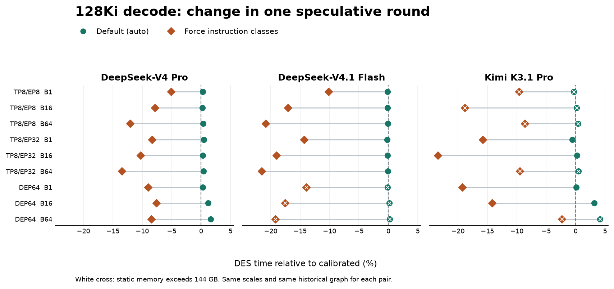

# 128Ki 历史的 27 组 decode：Vector 阶段的选择对整轮有多大影响？

这是 950DT 系统模型的 rank 0 预测。每组有一张 target 图和一张 draft 图，原始节点、依赖、资源容量和精度在各方法之间保持一致。每图按完整资源约束重新调度；比较的是一次推测轮次，没有上板或整网 CA 真值。

## 三个模型各自的变化

| 模型（各 9 组） | 全指令相对原法，单组范围 | 自动相对原法，单组范围 | 自动比同口径峰值慢多少，单组范围 |
|---|---:|---:|---:|
| DeepSeek-V4 Pro | -13.46% 至 -5.07% | +0.23% 至 +1.62% | +54.47% 至 +230.24% |
| DeepSeek-V4.1 Flash | -21.53% 至 -10.13% | -0.21% 至 +0.24% | +65.42% 至 +261.84% |
| Kimi K3.1 Pro | -23.42% 至 -2.36% | -0.56% 至 +4.14% | +36.68% 至 +162.49% |

变化 = (该列方法的整轮耗时 / 参照耗时 − 1) × 100%。负号表示该方法预测得更快，不代表误差更小。各组单独比较；表中区间为九个比值的最小至最大值。



图中每个点对应一个布局和一个本卡 batch。圆点是自动，菱形是全指令；加叉的行超出任务显存。零线表示同一预测，所有 panel 共用一个比例尺。

## 27 组的单轮耗时

| 模型 | 布局 | 单卡 B | 原峰值显存 GB | 历史 Roofline ms | 同精度峰值 ms | 原法 ms | 全指令 ms | 自动 ms | 自动 target / draft ms |
|---|---|---:|---:|---:|---:|---:|---:|---:|---:|
| DeepSeek-V4 Pro | TP8/EP8 | 1 | 114.35 | 36.942 | 31.465 | 52.178 | 49.531 | 52.328 | 50.018 / 2.310 |
| DeepSeek-V4 Pro | TP8/EP8 | 16 | 120.63 | 67.229 | 52.450 | 84.996 | 78.350 | 85.187 | 81.835 / 3.352 |
| DeepSeek-V4 Pro | TP8/EP8 | 64 | 140.73 | 167.170 | 123.140 | 189.553 | 166.719 | 190.213 | 184.051 / 6.162 |
| DeepSeek-V4 Pro | TP8/EP32 | 1 | 33.49 | 11.617 | 10.975 | 31.663 | 29.017 | 31.813 | 30.464 / 1.348 |
| DeepSeek-V4 Pro | TP8/EP32 | 16 | 39.77 | 41.904 | 32.190 | 64.662 | 58.025 | 64.853 | 62.454 / 2.399 |
| DeepSeek-V4 Pro | TP8/EP32 | 64 | 59.88 | 145.378 | 103.178 | 169.591 | 146.758 | 170.252 | 165.026 / 5.226 |
| DeepSeek-V4 Pro | DEP64 | 1 | 37.22 | 12.185 | 9.805 | 32.288 | 29.385 | 32.380 | 30.600 / 1.780 |
| DeepSeek-V4 Pro | DEP64 | 16 | 43.52 | 75.449 | 38.676 | 87.046 | 80.450 | 88.069 | 84.195 / 3.874 |
| DeepSeek-V4 Pro | DEP64 | 64 | 63.67 | 301.436 | 153.310 | 251.255 | 230.089 | 255.335 | 244.752 / 10.583 |
| DeepSeek-V4.1 Flash | TP8/EP8 | 1 | 70.17 | 21.325 | 12.898 | 25.359 | 22.790 | 25.321 | 22.039 / 3.281 |
| DeepSeek-V4.1 Flash | TP8/EP8 | 16 | 75.62 | 150.071 | 40.968 | 71.743 | 59.486 | 71.660 | 61.900 / 9.760 |
| DeepSeek-V4.1 Flash | TP8/EP8 | 64 | 93.07 | 563.583 | 131.682 | 218.039 | 172.639 | 217.824 | 186.616 / 31.208 |
| DeepSeek-V4.1 Flash | TP8/EP32 | 1 | 41.07 | 12.203 | 5.465 | 17.911 | 15.346 | 17.873 | 15.111 / 2.762 |
| DeepSeek-V4.1 Flash | TP8/EP32 | 16 | 46.52 | 140.948 | 33.670 | 64.370 | 52.118 | 64.286 | 55.041 / 9.246 |
| DeepSeek-V4.1 Flash | TP8/EP32 | 64 | 63.97 | 555.703 | 124.527 | 210.884 | 165.484 | 210.669 | 179.961 / 30.709 |
| DeepSeek-V4.1 Flash | DEP64 | 1 | 237.45 † | 12.472 | 5.118 | 18.543 | 15.962 | 18.519 | 15.486 / 3.032 |
| DeepSeek-V4.1 Flash | DEP64 | 16 | 242.91 † | 152.082 | 35.672 | 72.042 | 59.412 | 72.140 | 62.181 / 9.959 |
| DeepSeek-V4.1 Flash | DEP64 | 64 | 260.39 † | 608.151 | 141.753 | 238.980 | 193.085 | 239.547 | 206.067 / 33.480 |
| Kimi K3.1 Pro | TP8/EP8 | 1 | 192.38 † | 63.155 | 54.319 | 86.925 | 78.584 | 86.635 | 85.046 / 1.590 |
| Kimi K3.1 Pro | TP8/EP8 | 16 | 215.32 † | 119.423 | 104.169 | 172.206 | 139.787 | 172.490 | 166.080 / 6.410 |
| Kimi K3.1 Pro | TP8/EP8 | 64 | 288.73 † | 307.727 | 268.289 | 375.425 | 343.102 | 377.004 | 354.134 / 22.871 |
| Kimi K3.1 Pro | TP8/EP32 | 1 | 56.77 | 20.636 | 20.116 | 52.632 | 44.322 | 52.337 | 50.748 / 1.590 |
| Kimi K3.1 Pro | TP8/EP32 | 16 | 79.71 | 76.998 | 70.370 | 138.417 | 106.007 | 138.702 | 132.292 / 6.410 |
| Kimi K3.1 Pro | TP8/EP32 | 64 | 153.13 † | 274.176 | 234.593 | 341.742 | 309.432 | 343.319 | 320.449 / 22.871 |
| Kimi K3.1 Pro | DEP64 | 1 | 71.52 | 26.578 | 22.311 | 58.491 | 47.228 | 58.564 | 50.429 / 8.135 |
| Kimi K3.1 Pro | DEP64 | 16 | 115.50 | 170.302 | 116.121 | 198.758 | 170.523 | 205.043 | 162.940 / 42.103 |
| Kimi K3.1 Pro | DEP64 | 64 | 256.24 † | 680.007 | 462.642 | 607.202 | 592.879 | 632.325 | 469.545 / 162.779 |

**读表。** B 是本卡 batch；† 表示超过当前系统场景的 144 GB（8/27 组），保留图模型时间作容量敏感性参考。原表里的 114.35、33.49 等是显存 GB。三种布局 (TP,DP,EP) 分别是 (8,1,8)、(8,4,32)、(1,64,64)。历史为 131072 token，8 个 draft 加一个 anchor，按接受 6 个 draft 加目标 token 计 7 个产出。单轮含 target 一次、draft 一次；不是完整 1024 token 的 decode 总时间。

**两条基线。** “历史”从原逐节点账本恢复时长与资源再跑 DES，逐阶段对回归档。它保留旧后端的算法、精度代理与未定价节点，不是精细法的物理下界。“同精度峰值”使用当前各节点的 Cube/Vector 工作量及各 dtype 吞吐峰值、冷读写逻辑字节及 HBM 峰值，取最多的资源时间；通信和结构节点沿用同一合同，再跑 DES。三种 VF 方法分别重算峰值，并验证结果一致。

**三种方法。** 原法 `calibrated` 选该实现原有的阶段报价，并不表示每条路径都有 CA；全指令 `instruction_classes` 换算具备 Vector 阶段的工作量；`auto` 按算子合同选择。元数据、纯通信或无 Vector 工作的路径没有可切换的 VF 时间。固定 `cold_io`；Flash 使用 A5 候选投影 `a5_qsli_projection`，PA 块 128、页数从该任务的 KV 容量向上取整。与 [33 组整批请求的三种方法对照](system-vector-e2e.md) 的使用假设一致。

默认路由在节点账本中记录：54,504 次原法，24,351 次指令法，27 次融合节点内混用两种，另有 92,350 次无适用 VF 报价。这里按捕获图中节点次数计数，不是独立算子名。

## 哪些 VF 调价能传到整轮？

对每组先按该算子所有节点的有符号耗时差绝对值选前三，再从“全原法”单独把该算子换成指令法并重跑 DES。下表列每个模型 9 组实验中绝对反事实变化最大的一例。此处反事实列真实包含图中的依赖等待和通信重叠；不同反事实通常不能相加。

| 模型 | 布局 / B | 单独切换的捕获算子 | 该算子节点时长之和变化 ms | 只切换它的整轮变化 ms | 同组所有 VF 都切换的整轮变化 ms |
|---|---|---|---:|---:|---:|
| DeepSeek-V4 Pro | DEP64 / 64 | `npu::npu_dynamic_mx_quant` | -10.470 | -10.470 | -21.166 |
| DeepSeek-V4.1 Flash | DEP64 / 64 | `npu::npu_dynamic_mx_quant` | -37.587 | -37.587 | -45.895 |
| Kimi K3.1 Pro | DEP64 / 64 | `npu::npu_dynamic_mx_quant` | -36.435 | -36.435 | -14.324 |

“节点时长之和变化”不扣除与其他节点重叠的时间；“整轮变化”均为重排后减去原法整轮，反映的是模型敏感性。它不能用来判断哪种方法更准确。应结合逐算子完整 CA 窗口，[查询 VF 误差和证据边界](system-vector-methods.md)。

## 复核与复现

从原任务生成的 54 张图共 171,232 次节点调用。每组三个精细后端均要求所有节点成功解析、执行时长与后端报价一致、逻辑峰值不越界；归档任务和图指纹逐一核对。原始图和 CA 均不进入结果 CSV。

[逐配置数据（微秒，含两阶段与任务、图 SHA-256）](../results/v2.3/system-e2e/original27.csv) · [逐配置单算子切换的反事实](../results/v2.3/system-e2e/original27-operator-swaps.csv) · [分支命中详情](../results/v2.3/system-e2e/original27-routing.json)。CSV 的 `replay_wall_s` 是离线三种方法、同精度基线、反事实和一致性检查的墙钟，不是单次在线算子开销。

使用匹配原任务的 SIMPlatform preview 和本仓源码。当前工作区的命令如下；`/tmp` 承载本机生成的可信捕获，首次形状捕获需与预览环境匹配的 torch_npu 依赖。

```bash
source toolchains/cann/9.2.1/ascend-toolkit/set_env.sh
SIM=system-sim-workspace/preview-0.1.0-preview.1
PYTHONPATH="src:.:$PYTHONPATH" "$SIM/.venv-runtime/bin/python" -m calibration.examples.decode_vector_e2e all "$SIM/experiments/decode-950dt-128k" /tmp/operator-vector-decode27 --workers 6
```

若需重绘图，使用有 matplotlib 的 Python，在相同参数下将 `all` 改成 `figure`；它只读取结果 CSV。
