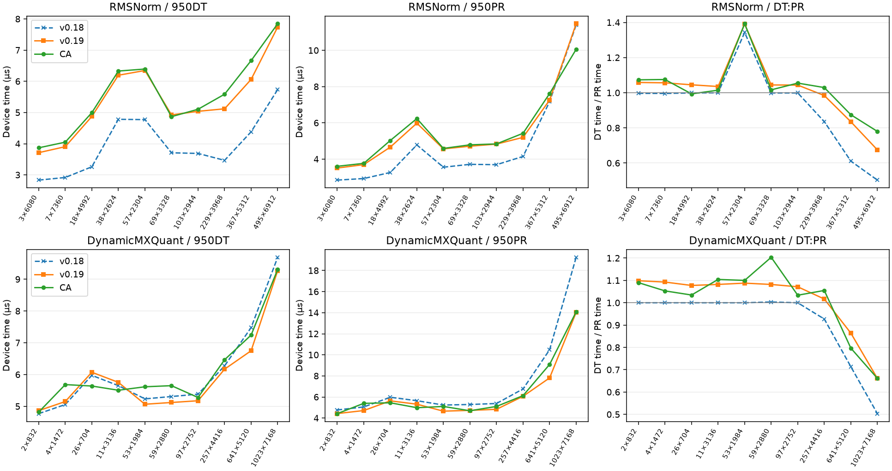
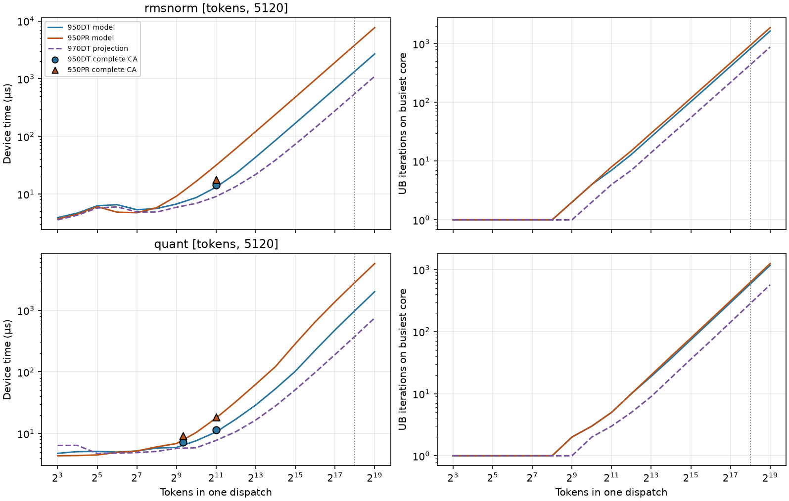

# 算子耗时预测与 CA 校准误差

| 算子 | 950DT 形状数 · WAPE / 最大 | 950PR 形状数 · WAPE / 最大 | 主表数据角色 | 全组验收 DT / PR |
|---|---:|---:|---|---|
| DynamicMXQuant | 10 · 4.1% / 8.2% | 10 · 5.2% / 14.1% | 历史冻结合同 | 达标 / 达标 |
| Matmul | 11 · 5.5% / 9.1% | 11 · 6.4% / 12.6% | 历史冻结合同 | 达标 / 达标 |
| FA | 35 · 1.61% / 12.43% | 41 · 5.61% / 17.72% | 当前资源模型，全部历史回放，40 / 41 窗 | 回放达标 / 回放达标 |
| FA（新形） | 10 · 4.19% / 15.79% | 10 · 6.49% / 13.68% | 两批事前冻结，公开模型；仅合格完整窗 | 达标 / 达标 |
| RMSNorm（仅 shape） | 10 · 26.41% / 57.94% | 10 · 25.56% / 53.97% | 冻结独立，每形两种前序、各 20 窗 | 超限 / 超限 |
| RMSNorm（新十形，仅 shape，公开默认） | 10 · 25.57% / 57.61% | 10 · 25.83% / 52.39% | 每形首次/扩核与同形紧邻复跑，20 窗/端 | 超限 / 超限 |
| RMSNorm（同十形，无前序候选） | 10 · 23.46% / 48.43% | 10 · 23.31% / 47.62% | 同一批冻结独立窗口，合并统计 | 首遇组超限 / 首遇组超限 |
| RMSNorm（同十形，给定前序） | 10 · 4.81% / 11.99% | 10 · 5.90% / 19.47% | 相同 20 窗/端，已有条件排程 | 本组达标 / 本组达标 |
| RMSNorm（给前序 H） | 10 · 5.34% / 15.33% | 10 · 6.10% / 17.73% | 与上一行相同的 40 窗 | 本组达标 / 本组达标 |
| RMSNorm（可见部分前序） | 10 · 6.16% / 29.15% | 10 · 7.11% / 25.20% | 新形冻结，仅给下界 L，全核物理退休 | 本组达标 / 本组达标 |
| RMSNorm（已知纯 AIC 间隔） | 10 · 7.19% / 22.23% | 10 · 7.00% / 21.49% | 新冻结，同一流跨列偏置 Addmm，完整前序及物理退出 | 本组达标 / 本组达标 |
| Addmm | 10 · 7.7% / 12.8% | 10 · 5.6% / 13.5% | v0.21 冻结独立 | 达标 / 达标 |
| Lightning Indexer | 10 · 14.6% / 31.7% | 10 · 11.9% / 26.5% | 历史冻结合同 | 达标 / 达标 |
| mHC Pre | 10 · 3.0% / 6.1% | 10 · 6.1% / 10.7% | 历史冻结合同 | 达标 / 达标 |
| mHC Sinkhorn | 10 · 16.5% / 29.2% | 10 · 11.7% / 19.3% | v0.21 冻结独立 | 多 token 组超限 / 达标 |
| mHC Sinkhorn（给同族前序 H） | 10 · 3.09% / 8.31% | 10 · 3.88% / 12.92% | 同族历史；单 UB 块，独立不同 shape；重复窗计入误差 | 本组达标 / 本组达标 |
| mHC PreSinkhorn | 10 · 9.5% / 18.3% | 10 · 12.3% / 21.9% | v0.21 旧模型独立 | 旧版结果 / 旧版结果 |
| mHC PreSinkhorn（融合新形） | 10 · 3.21% / 10.61% | 10 · 6.11% / 11.37% | 冻结后的独立新形，与 v0.25 同集比较 | 本组达标 / 本组达标 |
| mHC Post | 10 · 40.05% / 76.94% | 10 · 39.00% / 78.11% | 仅 shape，新形独立，同组首次与重复，完整标签窗 | 超限 / 超限 |
| mHC Post（旧版有序前序） | 10 · 13.84% / 54.57% | 10 · 15.37% / 51.95% | 新形独立，首次、重复及回访，含导出终止标签 | 超限 / 超限 |
| mHC Post（有序流，同形紧邻重复） | 12 · 2.88% / 8.90% | 10 · 1.93% / 3.85% | 事前冻结的精确重复，原全核结束标签口径 | 本组达标 / 本组达标 |
| mHC Post（普通换形/首次候选） | 4 · 7.92% / 13.87% | 5 · 5.22% / 13.53% | 已知前序、分入口计价，冻结后新形 | 扩大样本中 / 扩大样本中 |
| mHC 拆分链 | 10 · 2.3% / 5.0% | 10 · 4.2% / 9.4% | 历史冻结合同 | 达标 / 达标 |
| KDA recurrent | 10 · 7.9% / 17.5% | 10 · 4.3% / 10.4% | 历史冻结合同 | 达标 / 达标 |
| KDA chunk，融合 V1 | 0 · N/A | 0 · N/A | 两端小形数值通过，同步异常 | 缺合格 CA / 缺合格 CA |
| KDA chunk，FLA 26.9.1 三段 V2 | 10 · 1.61% / 3.08% | 10 · 0.99% / 2.09% | 冻结后三段净时长；T=248、257 数值未通过的窗另列 | 合格域见逐形表 / 合格域见逐形表 |
| DeepSeek 扩展 HcPost | 10 · 2.72% / 5.33% | 10 · 2.90% / 5.59% | 两批冻结独立，另有 1 形双端数值失败 | 可用域达标 / 可用域达标 |
| GMM1–SwiGLU–MXQuant | 10 · 10.6% / 32.7% | 10 · 10.8% / 34.8% | 历史冻结合同 | 达标 / 达标 |
| MoE GMM2 | 10 · 9.5% / 26.9% | 10 · 7.9% / 20.6% | 历史冻结合同 | 达标 / 达标 |
| MoE FFN 组合 | 10 · 7.3% / 23.0% | 10 · 7.8% / 23.6% | 历史冻结合同 | 达标 / 达标 |
| MoE sigmoid Top-K | 10 · 9.1% / 16.2% | 10 · 5.7% / 11.0% | 历史冻结合同 | 达标 / 达标 |
| Cast BF16→FP32 | 10 · 5.2% / 17.1% | 10 · 11.8% / 19.8% | 双槽冻结后独立 | 达标 / 容量组超限 |
| Cast（Pro B8×256Ki） | 1 · 8.38% / 8.38% | 1 · 1.69% / 1.69% | 完整 64 通道新数据量；逐元素正确、全核退出 | 本例达标 / 本例达标 |
| Kimi KDA beta Sigmoid | 10 · 5.6% / 12.9% | 10 · 17.7% / 27.0% | v0.21 冻结独立 | 达标 / 达标 |
| Kimi AttnResFwd | 10 · 4.4% / 8.1% | 10 · 4.5% / 9.5% | v0.21 冻结独立 | 达标 / 达标 |

主表按指定协议统计。无状态调用使用公开 `estimate`，有序派发使用 `OperatorStream`，候选或旧版单列。每组 WAPE＝Σ|预测−CA|/ΣCA，最大误差＝max |预测/CA−1|。当前验收要求两者分别 ≤25% 和 ≤50%，每端主验证含至少十种 shape；任一跟踪组超限都保留。Cast 的早期四对转入回放，见下表和逐行数据。通过了数值检查且全核指令窗完整，才纳入 CA 耗时。

[本版逐 shape 的 950DT/PR 预测、CA、库 kernel 与 970DT 外推](../results/v0.27/shape-errors.md) · [较早的独立样本和前序合同](../results/v0.22/shape-errors.md) · [双端同形加速比与直接复用 DT](../results/v0.22/pairs.md) · [原始观测、实际库 kernel、正确性与分核字段](../results/v0.22/evaluation.json) · [同一时间轴上的模型与实测](pipeline-comparisons.md)

## 当前公开模型的双端验证

本版按相同的芯片、shape、调用属性比较旧版与新版。冻结独立样本用于检验，历史数据用于解释原因。单片达标与两卡耗时比的准确性分别检验。[全部 854 个旧指令窗按公开 API 回放](../results/v0.27/replay.md) · [冻结登记、独立结果和实际库身份](../results/v0.27/evaluation.json)

| 对象与协议 | 950DT | 950PR | 误差来源、边界 |
|---|---:|---:|---|
| DeepSeek V4 Pro，B8×256Ki，库 `aclnnCast`，预测 / CA µs | 227.018 / 247.788（−8.38%） | 520.357 / 529.287（−1.69%） | 同一调用处理 [2097152,64]，末核分别 100、114 轮，134,217,728 个输出全部正确。DT/PR 耗时比 0.436 / 0.468。970DT 外推 104.673 µs。[逐核与成本](../results/v0.23/pro-prefill/README.md) |
| FA，冻结的 10 个同形，WAPE / 最大 | 4.19% / 15.79% | 6.49% / 13.68% | 比值 WAPE 7.73%→4.38%，最大 28.73%→9.65%，快慢方向从 8/10 降至 2/10。两端绝对误差均较小也可能错判速度接近的芯片。[同形数据](../results/v0.25/coverage/supplement/score.json) |
| 内置 Post，确定紧邻同形成功派发，旧→新 WAPE | 43.17%→2.88% | 46.03%→1.93% | 12/10 个独立形，最大 8.90%/3.85%。在旧 21/22 个混合前序窗做开发回放，新有序入口 WAPE/最大为 9.88%/30.89% 和 10.92%/31.78%。[独立验证](../results/v0.27/post/report.md) |
| PreSinkhorn，10 对相同融合输入，旧→新 WAPE | 20.56%→3.21% | 24.80%→6.11% | 950 的 2:1 工作组，T<128、N=4、D=4096、I=20。比值 WAPE 从 4.68% 增至 6.88%，最大 12.63%，方向两版均 7/10。另有 T127 仅 PR 合格。[逐 shape 和两端回放](../results/v0.27/fusion/public-fused.md) |
| 大 prefill 的原生包络，默认预测 / 64 核 wrapper µs | Flash 全 hidden Cast 2514.820 / 2737.538；Kimi 独立 Quant 1200.415 / 1778.988 | N/A | 均用 B8×32Ki，列数 5120/7168；两次校验全部输出，墙钟 4 小时 18 分 / 4 小时 53 分。逐指令整窗均为 N/A，包络差值独立报告。[Flash](../results/v0.23/full-hidden/v3/flash-retry.json) · [Kimi](../results/v0.20/full-quant/native.json) |

RMSNorm 本轮新留出共十对 shape、每端 20 个合格窗。未知前序候选在首次或扩核协议的 WAPE 为 DT 25.30%、PR 25.22%，仍超过原冻结门槛；同形立即复跑为 20.56%、20.28%。实际活动 AIV≤4 的本批子集即使允许事后挑选单值，两种协议中较差者的 WAPE 也至少为 39.08% / 38.06%。同一形的暖读往往早两微秒以上，设备的正常启动本身也只有数微秒。正式模型保留原默认，同一前序可见时可直接使用条件价格。全组 8 次采集与一次同前序补测累计 24.73 分钟，63 次候选预测最大 2.571 ms。[逐形三芯片与成本](../results/v0.27/rms/report.md) · [理论下界](../results/v0.27/rms/feasibility.json)

**仅输入 shape 的精度边界。** 在同一芯片、同一库和同一 shape 的不同前序上，若每次只能返回一个值，即使事后给每个 shape 选取实测中位数，Post 的最低 WAPE 也为 DT **27.64%**、PR **28.81%**。再要求每窗最大误差 ≤50%，最低 WAPE 分别为 **28.46%**、**29.43%**。这说明这组真实调用无法用无前序单值满足 25% 目标。对 RMSNorm 的相同检验给出 21.52% / 20.99% 的 WAPE 下界，尚有改进余地。系统能观察同一流时可用 `OperatorStream`。独立 Sinkhorn 的可选有序接入，在三芯片 45 次派发上全部恢复了事前冻结的 H，950 两端共 30 个完整 CA 窗，详见[派发顺序复核](../results/v0.27/fusion/stream.md)。[计算、协议与样本数](../results/v0.27/history-bounds.json)

当前仍超限的历史机制组包括 950PR 的 Cast 在输入输出占 1～2 倍 L2 时 WAPE 27.60%、最大 29.95%，以及未给前序的独立 Sinkhorn 在 950DT、T>64、I=10 时 WAPE 25.64%、最大 39.20%。同一容量组的 PR Sigmoid 为 21.53% / 26.96%。对于 PR Cast 新形 [851968,32]，56 核中一核缺物理 END，全窗 N/A。另 55 核单算已需要 1485 GB/s 的区间读服务，超过 1400 GB/s 假设。相同总字节的 PR Sigmoid [1703936,12] 完整 CA 为 63.807 µs（公开预测 78.311 µs，压力候选 62.408 µs），读区间需要 1551 GB/s。初始命中、预取和真实 CA 带宽还不能从这些描述符区分。[读窗口检验](../results/v0.27/memory/README.md)

Kimi 全 hidden Quant 的 128 个 DT 控制器合计读 3,763,522,944 B、写 1,888,006,144 B。只保留严格落在原生包络内的计数区间，其 5,650,042,240 B 按配置的 4.000 TB/s 至少需要 1412.511 µs；按模拟控制器的接口总线 4.096 TB/s，至少需要 1379.405 µs。默认预测低于两者，资源法 1394.986 µs 位于二者之间。包络内各核的 MTE2 忙碌率中位 98.5%。读写工作量差在理想总线上约耗 19.70 µs，小于约 384 µs 的包络差。128 通道逐周期计数中，全程有 77.24% 的数据拍传输有效载荷；在空拍里，DMC 队列非空的比例可界定为 93.96%～94.52%。这是有待服务请求时总线仍会出现空拍的直接证据。读写换向的独占等待周期尚不可辨识。[通道计数与三个大 Cast 的对照](../results/v0.27/quant-channel-service.md)现有 950DT 的 58 种、950PR 的 53 种正式 Quant 指令形状，其逻辑输入与输出均未超过 L2。该差距没有用于拟合新系数。[计数区间、来源与计算](../results/v0.27/quant-envelope.md)

仅用三个大 Cast 的 DDR 服务率给量化定价，Kimi B8×32Ki 的回放区间为 1838.667～1854.728 µs，中位相对已知包络高 3.85%。这个结果是跨算子情景的回放。另一个事前冻结的 Kimi B4×32Ki 输入 [131072,7168] 在 DT 的情景区间为 899.864～907.714 µs，默认 602.614 µs，资源法 683.003 µs。完整原生包络在队列结束后单列；截至本次提交尚无 CA 数字。[冻结价格、验收与当前状态](../results/v0.27/quant-transfer/README.md)

Kimi 的小形融合 KDA V1 已在新宿主对照观察到正式包 4 个主核、全部数值正确和 132 次重复置旗，仍缺合格净耗时。大 prefill 路由到 V2 时，工具可返回三个主核分别和合计的估计，完整调度耗时为 N/A。[V1 核验](../results/v0.27/kda/host-control/report.md) · [单卡 B8 的分派](../results/v0.27/kda/report.md)

## 相同工作块的模型与实测

这一节的完整窗口截止于 2026-11-19 17:31:34 UTC。已采样的形状按数据角色单列；后续队列的实时回执可以在各组报告中查看。[本期逐形数据和原始收据入口](../results/v0.26/evaluation.json) · [全套模型的基础逐形表](../results/v0.22/shape-errors.md) · [旧窗去重审计](../results/v0.25/coverage/audit.json)

| 已定位的差值 | 950DT | 950PR | 解释与证据 |
|---|---:|---:|---|
| Cast，B8×128Ki Pro，预测 / CA | 99.918 / 105.374 µs | 232.748 / 224.719 µs | PR 第二笔读发起只比首笔晚 0.055 µs，首笔描述符历时 2.490 µs；UB29 读起点仍晚 25.689 µs。970DT 外推 42.536 µs。[大 shape 同轴图](../results/v0.26/memory/README.md) |
| 内置 Post，连续 [65,4,5120]，可选预测 / CA | 5.397 / 5.242 µs | 5.481 / 5.278 µs | 每行拆两个 2560 列片。普通热态旧模型分别给 8.613 / 8.707 µs，其中 MTE2 互斥贡献分别高估 2.513 / 2.629 µs。[逐笔写回及两端成对结果](../results/v0.26/post/report.md) |
| 融合 PreSinkhorn，T80、N4、D4096 | 开发误差 14.30% → 0.95% | 16.640 → 14.616 µs，CA 13.653 µs | PR 的 FIXP 描述符在首条 MMAD 前已发起；最后 MMAD 到 FIXP 退休仅剩 0.353 µs。候选的 171 条 MMAD 全部匹配。PR 小 token 组回放 WAPE 由 5.86% 升至 6.93%。[融合算例与独立验证](../results/v0.26/presink/README.md) |
| FLA KDA V2，T193、H2，FwdH / CA | 14.769 / 13.385 µs | 14.800 / 14.076 µs | 四个块前向依赖，末块 W 可预取而 H 要等上块写回。两卡另有同一个元素超差的情形；原合同的 T248、257 均无合格耗时。[逐形两端与 970DT](../results/v0.26/kda/README.md) |

独立 Sinkhorn 的 54 个旧窗把首次发起与后续间隔分开后，已知前序的 DT WAPE 从 12.65% 降至 4.17%，PR 从 9.03% 降至约 3.8%。只有 shape 时两端合并的回放 WAPE 从 11.26% 升至 12.22%，所以保留原默认。新形 T67/I10、DT 首发实测 5.232 µs，已知前序预测 5.319 µs，未知前序候选为 4.408 µs。[逐阶段图、每端 14 个预登记几何及其状态](../results/v0.26/sink/report.md)

KDA T259/H2 的双参考验证也已完成。每端 66,304 个辅助输出与事前冻结的设备精度参考逐位相同，原发布算法参考各有一个 Aqk 超差，T259 原合同计时为 N/A。纠正了误差归因，合格的三段计时仍按原数值门槛汇总。[双端逐位审核和冻结哈希](../results/v0.26/kda/numeric-audit-prospective.json)

在源码目录外安装 0.26.0 wheel 后，1680 个不同单次查询中位数 0.110 ms、P95 0.543 ms、最大 3.532 ms，包含三个 SKU 的 B8×256Ki。每个结果都检查过 100 ms 上限。CA 的小时级墙钟单独记在各实测回执中。[逐算子查询开销](../results/v0.26/wheel-check.json)

## 逐块对照揭示的误差

- **长 prefill 的 Cast。** DeepSeek V4 Pro，单卡 B8 × 128Ki，安装包 `aclnnCast`，输入 BF16 [1048576,64]、输出 FP32。DT 预测 / CA 为 99.918 / 105.374 µs，PR 为 232.748 / 224.719 µs；DT/PR 比值分别为 0.4293 与 0.4689。970DT 仅外推 42.536 µs。两端分别有 50、57 个末核 UB 块，PR 采集用时 30.28 分钟。PR 的第 29 块比模型早 25.689 µs 开始读，写回却比模型晚 1.574 µs。全窗相近不能说明各级搬运发起都准确。[放大中间三块](../results/v0.25/pro-128ki-pr-middle.png) · [本次库调用与数据检查](../results/v0.23/pro-prefill/pro-b8-128ki-pr.json)
- **FA。** DT 与 PR 均采用目标资源排程。冻结后六次 `aclnnFlashAttentionScoreV2` 共 625.2 秒。三个同形 DT/PR 的耗时比 WAPE 由 18.60% 降至 2.85%，但方向从命中 2/3 降为 1/3。Q9/KV1008 的 CA 首条 QK 几乎与模型同时发起，末页 PV 仍比模型晚 1.080 µs。显式历史 DT 路径可供复算。后续七形已查重、冻结，包含 KV=32769 的 129 页及 29 个本卡头的分波边界。[补充七形与实时计分](../results/v0.25/coverage/supplement/score.json) · [逐页对照图](../results/v0.25/coverage/fa-dt-1008-pages.png) · [双端逐形、基线与 970DT](../results/v0.25/coverage/fa-method.md)
- **RMSNorm。** 跨纯 AIC Addmm 的十种新形在采集前冻结，两端分别检查完整有序前缀、真实 kernel 类型、输出张量和全核退出。给系统调度器的附加输入只有中间调用的执行引擎合同。同形两次热态在 950DT 的实际写回结束可差 0.112 µs，属于同一前序模型内的剩余误差。[逐形两代预测、设备窗与加速比](../results/v0.25/mixed-stream/README.md) · [三个派发的末核对照](../results/v0.25/mixed-stream/dt-rms-tile.png)
- **mHC Post 与 KDA。** 内置 Post 的逐 token 候选在紧邻重复的 [67,4,384] 得到 1.990 / 1.998 µs；普通热复用的同形仍高估 27.6%。图中两行 token 的四类读和输出写均可按地址核对。Kimi 融合 KDA V1 的新正式发布仍出现重复 SET，计时不合格。显式三段 V2 单独校准。[Post 的逐行图](../results/v0.25/post/two-token-repeat.png) · [各类前序及候选](../results/v0.25/post/report.md) · [融合 V1 同步复核](../results/v0.25/kda-v1/README.md) · [V2 累计独立样本](../results/v0.24/kda-prefetch/supplement/report.md)

**大输入的阶段归因。** 在 950PR Flash 的 29 个 UB 块上，保持整窗总预测不变，按截至当前块的工作量重算资源成本可把写完成时刻的 MAE 从 10.09 降至 5.64 µs。扩大脏输出留驻的另一候选在过渡区间给出 Cast / Sigmoid 的开发 WAPE 5.51% / 5.24%。独立 156 MiB 成对实验已冻结。[公开模型与候选逐块对比](../results/v0.25/cache/README.md) · [缓存压力候选图](../results/v0.25/cache/flash-128ki-pr-prefix.png)

**全量回放与条件分组。** 这次对 19 条路线的 848 个历史设备窗按原始 trace 指纹去重，另有 6 个冻结后 FA 窗。组合算子与其中一个子 kernel 各按自己的合同统计。RMSNorm、内置 Post 和融合 KDA V1 有单独的状态或计时资格审计。在 PR 的 L2 到两倍 L2 工作集范围，Cast 两形 WAPE 27.60%、Sigmoid 两形 21.53%；DT Sinkhorn 在 T>64、迭代十次的三形为 25.64%，最大 39.20%。PR PreSinkhorn 在 T>64 目前只有一形，误差 21.88%。这些分组已反映在 Summary 的全组验收列。[历史角色、失败记录和各分组](../results/v0.25/coverage/report.md) · [全部逐形、双端与 970 外推](../results/v0.25/coverage/shape-errors.md) · [本次冻结的逐形表](../results/v0.25/shape-errors.md)

## 当前新增的双端证据

- **KDA V2 的当前排程。** T=80/H=1、T=145/H=2 在 950DT/PR 的新形验证均有三个合格 kernel 窗。状态阶段 FwdH 的 WAPE 从 24.92% / 20.49% 降为 7.65% / 3.87%（DT / PR）。三段总和的双端 WAPE 为 2.24% / 1.34%，最大误差 2.82% / 1.88%。每端另有 12 个旧窗重算，三段 WAPE 3.03% / 1.37%。这些旧窗用于识别跨块预读，归为回放。独立四次采集 10.98 分钟。[逐 shape、各阶段和 970DT 外推](../results/v0.24/kda-prefetch/report.md) · [按工作块看新独立图](../results/v0.24/kda-prefetch/dt-145-independent.png)
- **部分可见前序 RMSNorm。** 模拟器中途接入流，第一次调用隐藏，再由连续可见调用累积用核数下界。结果与公开旧版、完全知道前序的预测在每个新 shape 上对照。另有含导出终止标签的严格子集，两种计时各自统计。即便知道前序，逐行写回也有误差，PR [34,1664] 上行 31 的 y 实际 4.587 µs 结束，模型在 3.470 µs 就判定完成。[新独立逐形、两种设备窗和采集成本](../results/v0.24/rms-prefix/README.md) · [按地址对齐的上模型下 CA 图](../results/v0.24/rms-prefix/pr-rms-output-rows.png)
- **内置 mHC Post。** 新冻结组将独立进程首发、扩核、相邻重复、隔形回访分开计分。Summary 的两条内置 Post 行来自本轮 10 个新 shape，DT 21 个、PR 22 个含导出标签的完整窗，43 个窗的活动核数均算对。以物理指令退出为终点时两端各有 22 个完整窗。分阶段候选 WAPE 降至 11.93% / 12.19%，最大误差仍为 54.57% / 51.95%，双端加速比的 WAPE 由旧版 3.73% 升到 4.55%，仍为对照。新 [2,4,448] 从一核扩为四核时，两端最晚的核均为此前未用的 core16.veccore1，物理 CA 约 5.35 / 5.34 µs，模型约 4.21 µs。给之前的活跃核数仍未完全解释新增物理核所在分区的启动开销。DT [257,4,832] 热重复的 5.042 / 3.262 µs 高估 54.57%，主要来自 MTE2 和 MTE3 分别多计 1.234 和 0.502 µs。实际末核第二轮已读，而第一轮仍在写。[五轮按 token 对齐的实测](../results/v0.24/post/multirow.md)[公开版与对照的分态误差](../results/v0.24/post/report.md) · [按物理核核对扩核偏差](../results/v0.24/post/topology.md) · [7168 通道的两次调用如何写回](../results/v0.24/post/post-ordered-pipeline.png)
- **Pro B8×128k 的新实测。** indexer Cast [1048576,64] 在 950DT 的冻结预测 / CA 为 99.918 / 105.374 µs（−5.18%），970DT 外推 42.536 µs。64 个 AIV 完成，全部 67,108,864 个输出通过。末核 50 个 UB 块的元素数、GM/UB 地址与时间已经对应，尾块读比预测晚 4.661 µs。采集墙钟 25.30 分钟。同一 Pro 层从 B8×32k 到 128k，数据量扩四倍，CA 从 17.041 增到 105.374 µs（6.18 倍），跨过 L2 留驻容量的模型给 6.02 倍。此输入的展平工作量与已测 Flash B8×256k 相同，两者可用于检验相同内存流量下的离散。[大 shape 逐块对照图](../results/v0.23/pro-prefill/pro-b8-128ki-dt-plot.png) · [实际内核与回执](../results/v0.23/pro-prefill/pro-b8-128ki-dt.json)

- **整批 prefill。** 对同一模型位置的长输入，Flash B8×256k Cast 在 DT/PR 的模型 / CA 为 99.918 / 106.757、232.748 / 223.493 µs；Pro B8×32k Cast 为 16.592 / 17.041、25.030 / 23.762 µs；Kimi B8×256k beta Sigmoid 为 45.897 / 42.686、104.717 / 88.593 µs。970DT 情景依次为 42.536、9.951、19.353 µs。每一行都能对应实际分块。图集还包含 Flash 和 Kimi 的 32k 与 128k，合计 14 个完整 CA 窗，原采集共花 5.46 小时，重画新增 CA 时间为零。Flash 128k 在 PR 高估 25.8%，末轮读发起比实测晚 19.870 µs。[三模型逐块对照与算子位置](../results/v0.23/prefill/README.md)
- **RMSNorm。** 同一 [2,2944] 在扩核与紧接热态之间，DT 完整窗口为 4.628 / 1.604 µs，PR 为 4.361 / 1.610 µs。公开 shape-only 点预测同时解释这两个窗口时，最大相对误差下界为 48.52% / 46.07%；已知真实前序时，模型分别给 4.317 / 1.850 和 4.319 / 1.852 µs。以 [4,608] 独立重复也分别得到 43.68% / 44.41% 的下界。这项结果将 PR 的全组状态更新为超限。十个新 shape 均完成两种前序。若对“首次到达该 shape”和“立即复跑”分别计算 WAPE，则任何 shape-only 单点策略的较差一组至少为 DT 21.52%、PR 20.99%。显式给 H 的误差和未知 H 的误差单列，区间 API 仅表示模型对历史的敏感性。[独立十形、逐窗结果与设备端证据](../results/rms-unknown23/independent.md) · [读写与 VF 上下图](../results/rms-unknown23/paired-2944.png)
- **KDA V2 的 v0.23 历史基线。** 首批 T3/H1、T5/H2 的双端预测和 CA 均通过各自独立登记。DT/PR 加速比分别预测 0.9987、0.9986，实测 1.0517、1.0190；两例慢快方向均判反。T65/H1 属于开发，官方参考先对每个 16 行 band 的衰减 Q/K 分别舍入为 BF16，再做 MMAD。按这一步复算可解释原数学参考的全部 Aqk/Akk 超限计数；同一输入、原阈值的两端重采合格。融合 V1 的情况另列。两批共 10 个独立 shape，T 从 3 到 129、H 从 1 到 3，覆盖 16、32、64 及续块边界。20 个合格窗共用 CA 墙钟 38.87 分钟；十对 DT/PR 比值的 WAPE 为 1.88%，最大 5.04%，只有 4/10 对快慢方向命中。小于几个百分点的跨卡优势仍辨不稳。PR 在 T=129、H=3 的三个 kernel 合计高估 6.99%，其中 FwdH 单段高估 20.30%。第二块权重读于第 7,049 tick 发起，上一块状态写至 9,358 tick 才完成；冻结模型按块串行服务，后续块的误差从 0.638 µs 累加到 2.258 µs。[对齐 head 2 的上下栏图、地址与偏差](../results/v0.23/kda-multiblock/README.md)。[逐 shape 正确性与真实 ELF](../results/kda-v23/mechanisms.md) · [分阶段计算与实测](../results/kda-resource23/report.md)
- **默认融合 KDA V1。** Kimi 的真实 cu_seqlens 入口在 DT、PR 上以 T=2/H=1 实际调用 `aclnnChunkKdaFwd`，attention、Aqk、Akk 和最终 VK 全部通过金标，宿主返回 0。两端的四组输出逐字节相同；DT 32 个 AIC、PR 28 个 AIC 均观测到重复 SET，两端 42 个错误指令地址完全相同。DT 有 167 个、PR 有 155 个错误，三个置旗点随 AIC 数各少四次。主核的异常观察窗分别为 103.027 / 97.960 µs，正常时延与误差栏保留 N/A。DT 另测的 T64/H2 dense 分支依然报错。[库身份、数值与同步证据](../results/v0.24/kda-v1/README.md)
- **DeepSeek 后处理。** vLLM 的 `aclnnHcPost` 在 [1,3,4,5120] 两端都实际用 3 个 AIV。另有 [1,1,4,1024] 与 [1,5,4,7168] 双端通过全部输出和实际代码段检查。CANN 的 `aclnnMhcPost` 是另一实现，其旧误差独立保留。显式 vLLM 合同还返回逐片资源模型的时延。DT 独立 [1,33,4,7168] 为 6.265 / 6.101 µs，970DT 为模型外推。原 10 形有 9 形双端通过。D=4112 的 16 列尾片在两端各有 333 / 115,136 个 BF16 不符，耗时和误差留空；另行预登记的 D=4160 正好覆盖 64 列尾片，两端都通过。合格独立的 10 个 shape 中，20 窗累计 CA 墙钟 25.31 分钟，10 对快慢方向判对 5 对。[双端独立样本与实际库](../results/v0.23/hc-timing/comparison.md)。[算例、分核与三个双端开发窗口](examples/hc_post_vllm.md)
- [当前 DT/PR 新增逐形计时、误差、970DT 外推](../results/v0.24/shape-errors.md) · [本版变化](../results/v0.24/changes.md) · [v0.23 数据](../results/v0.23/shape-errors.md) · [冻结和运行开销](../results/v0.23/changes.md) · [既有计时合同的全量逐形表](../results/v0.22/shape-errors.md)

## 同一系统调用知道前序时

每个 rank 和每条流分别维护 `OperatorStream`。从空流开始，核数由各芯片自己的分块规则计算。RMSNorm 的有序十形在候选冻结后采集；20 个有效目标包括按原前序补采的两个末点，重复前缀只核验采集条件。表内的首次与连续调用分组各自拥有独立的时间窗口。

| 算子 | 芯片 | 实际前序 | 窗口数 | 无历史 WAPE / 最大 | 已知前序 v0.21 | 已知前序 v0.22 |
|---|---|---|---:|---:|---:|---:|
| mHC Post | 950DT | 独立进程首发 | 10 | 25.73% / 42.02% | 14.59% / 31.72% | 14.59% / 31.72% |
| mHC Post | 950DT | 同一输入连续两次 | 2 | 43.34% / 50.51% | 10.31% / 12.15% | 10.31% / 12.15% |
| mHC Post | 950PR | 独立进程首发 | 10 | 22.94% / 35.37% | 14.90% / 37.49% | 14.90% / 37.49% |
| mHC Post | 950PR | 同一输入连续两次 | 2 | 41.08% / 53.43% | 6.12% / 14.37% | 6.12% / 14.37% |
| RMSNorm | 950DT | 独立进程首发 | 10 | 11.01% / 27.76% | 5.63% / 10.78% | 5.63% / 10.78% |
| RMSNorm | 950DT | 十形连续 | 10 | 20.36% / 37.80% | 19.17% / 47.26% | 6.02% / 15.64% |
| RMSNorm | 950PR | 独立进程首发 | 10 | 16.41% / 23.99% | 12.36% / 23.42% | 12.36% / 23.42% |
| RMSNorm | 950PR | 十形连续 | 10 | 17.97% / 38.10% | 16.07% / 52.16% | 7.03% / 14.47% |

只给相同 shape 和属性时，两次 Post 共享同一预测。实测长窗 L、短窗 S 给出必然的最大相对误差下界 (L−S)/(L+S)，DT 为 43.34%、PR 为 41.08%。这个下界约束包含这对样本的任何整体最大误差；整体 WAPE 依赖其他观测。[同值输入、同一 ELF 与两次完整流水](examples/mhc_post.md) · [RMS 两个有序形状的公开调用和完整推导](examples/rmsnorm.md)

## 仍超限的数据组

| 算子 | 芯片 | 数据组 | WAPE / 最大 | 最差 shape | 预测 / CA µs |
|---|---|---|---:|---|---:|
| RMSNorm | 950DT | DT v0.12 development replay | 24.70% / 54.94% | [128, 1024] | 4.787 / 3.090 |
| RMSNorm | 950DT | v0.17 historical RMS replay | 23.77% / 43.22% | [4, 512] | 2.437 / 4.292 |
| RMSNorm | 950DT | ordered RMS plus matched-prefix target, original plus recovery | 20.36% / 37.80% | [2, 6688] | 2.912 / 4.682 |
| mHC Post | 950DT | DT v0.12 development replay | 28.34% / 47.06% | [34, 4, 512] | 2.811 / 1.912 |
| mHC Post | 950DT | DT v0.12 holdout replay | 26.36% / 36.97% | [31, 4, 256] | 3.120 / 2.278 |
| mHC Post | 950DT | prior published pair replay | 31.86% / 43.97% | [36, 4, 128] | 2.550 / 1.772 |
| mHC Post | 950DT | primary | 25.73% / 42.02% | [7, 4, 1728] | 3.120 / 5.380 |
| mHC Post | 950DT | same-stream repeated Post, shape-only forecast | 43.34% / 50.51% | [3, 4, 5376] | 3.195 / 2.122 |
| mHC Post | 950PR | prior published pair replay | 26.85% / 33.54% | [9, 4, 1024] | 3.124 / 4.700 |
| mHC Post | 950PR | primary | 22.94% / 35.37% | [5, 4, 288] | 3.085 / 4.773 |
| mHC Post | 950PR | same-stream repeated Post, shape-only forecast | 41.08% / 53.43% | [3, 4, 5376] | 3.201 / 2.086 |

## 采集、算例与硬件条件

RMSNorm 未提供历史时，旧 DT 短宽组仍高估部分已热调用；已知前序可拆分同核新增通道和新物理核。Cast 的四槽地址可以核对，但大流式窗口的共享带宽、读写响应与发起间隔仍有误差。B8×32k 全 hidden 的低输出量采集另列原生包络，逐指令主表只统计已完成的指令窗。[两项全尺寸任务的预测与采集状态](../results/v0.22/full-prefill.md)。原 Flash 全 hidden 实验耗时 6 小时 11 分钟，触及 8 GiB 日志预算，64 个 AIV 均开始，31 个完成；同一 wrapper 时钟的下界为 2100.106 µs。未完成全输出核验，该次尝试的设备耗时记 N/A；随后重跑成功，完整原生包络 2737.538 µs。[原采集的核级计数及原始预算](../results/v0.23/full-hidden/previous-partial.json) · [模型与已完成的 31 个 AIV 对照图](../results/v0.23/full-hidden/cast-full-hidden-partial.png)。下方保留历史各算子的库、误差和硬件条件，当前数字见本页开头。[RMS 写线与归一化临界路径](examples/rmsnorm.md) · [Cast 两侧槽地址和实际重叠](examples/cast_bf16_fp32.md) · [v0.22 的开销与变更](../results/v0.22/changes.md)

在能重建实际 Pre → Sinkhorn → Post 顺序的 34 条历史链上，跨族切换的 Post 使用公开入口的未知历史估计。PR 的 10 形 WAPE / 最大为 6.93% / 14.29%。如果直接传入前一个 Sinkhorn 实测的 AIV 数作为 Post 的驻留数，WAPE 升至 24.29%，最大为 30.61%。这项对照检验了调用方可以安全传入什么信息。[DT 与 PR 分组、真实 ELF 与端到端三段误差](../results/v0.22/post-stream/report.md)

Kimi K3 的 FLA 26.9.1 在默认 BF16、64-token 块与 128 维 QK/V 的合同下，按本次提交的各序列长度决定融合 V1 或三段 V2。单例 V1 的 96 个核都有 END，出现 240 次重复置位，数值校验未完成。同一发行包直接调 V2 的 DT 开发小例 [1,2,1,1,128,128]，三段分别为 15.281、4.739、3.221 µs，设备窗和 23.241 µs，含段间空隙为 28.034 µs。显式 V2 模型及后来冻结独立样本见上方。[实际分派与厂商包指纹](../results/chunk-recovery/fla2691/report.md)

v0.22 对 RMSNorm 的历史核查使用了 199 个已去重全窗。同 SKU、同正式 ELF 与相同输入的 14 对重跑都具有相同前序，最大可证的两窗下界仅 1.86%。DT 历史 compact [2,4608] 首发/复用差得更多，但数据库缺少可验证的 ELF 身份。在十条无历史误差超过 40% 的 DT compact 窗口中，提供可重建的前序后 WAPE / 最大为 6.64% / 13.88%；这是定位误差来源的历史子集。[强弱证据分别核验](../results/v0.22/rms-unknown/report.md)

## v0.20 完成时的报告与历史校准明细
| 算子 | 计时资格与数据角色 | DT N | DT WAPE / 最大 | PR N | PR WAPE / 最大 | DT/PR 倍速 WAPE / 最大 | 970DT 外推范围 µs |
|---|---|---|---|---|---|---|---|
| dynamicMXquant | v0.19 冻结留出，DT/PR 阶段定价 | 10 | 5.34% / 9.78% | 10 | 5.22% / 14.06% | 3.86% / 10.11% | 4.459–7.506 |
| Matmul | v0.17 原留出 + v0.20 Flash 投影 双端配对 | 11 | 5.50% / 9.12% | 11 | 6.37% / 12.57% | 2.31% / 6.78% | 2.949–7.287 |
| FA | DT 资源定价，沿用 v0.17 留出 | 10 | 2.23% / 6.68% | 10 | 4.97% / 8.08% | 5.18% / 8.98% | 8.190–39.690 |
| RMSNorm | v0.20 冻结留出，已完成端 / 登记 10 形 | 9 | 8.64% / 12.90% | 9 | 13.65% / 22.55% | 7.83% / 24.47% | 4.268–21.971 |
| Addmm | DT 阶段校准，沿用 v0.17 留出 | 10 | 6.10% / 17.03% | 10 | 20.46% / 51.51% | 11.60% / 32.62% | 3.210–4.314 |
| Lightning Indexer | DT 阶段校准，沿用 v0.17 留出 | 10 | 9.14% / 20.35% | 10 | 11.88% / 26.51% | 3.26% / 5.57% | 5.288–12.188 |
| mHC Pre | DT 阶段校准，沿用 v0.17 留出 | 10 | 3.63% / 9.62% | 10 | 6.10% / 10.75% | 5.81% / 9.02% | 7.679–8.780 |
| mHC Sinkhorn | DT 阶段校准，沿用 v0.17 留出 | 10 | 10.22% / 21.47% | 10 | 12.19% / 61.39% | 12.79% / 50.74% | 2.820–7.134 |
| mHC Sinkhorn（给同族前序 H） | 1 · 1.68% / 1.68% | 0 · N/A | 新形，限定已知历史和单 UB 块；单位为窗 | 分组采集中 / 分组采集中 |
| mHC PreSinkhorn | DT 阶段校准，沿用 v0.17 留出 | 10 | 4.90% / 13.70% | 10 | 25.53% / 35.48% | 23.79% / 31.92% | 8.623–8.628 |
| mHC Post | DT 阶段校准，沿用 v0.17 留出 | 10 | 22.11% / 90.22% | 10 | 16.48% / 36.88% | 21.56% / 90.70% | 1.856–3.859 |
| mHC组合 | DT 阶段校准，沿用 v0.17 留出 | 10 | 2.40% / 7.20% | 10 | 4.19% / 9.37% | 2.40% / 3.98% | 15.494–16.909 |
| KDA recurrent | DT 阶段校准，沿用 v0.17 留出 | 10 | 8.93% / 17.55% | 10 | 4.35% / 10.41% | 9.71% / 23.02% | 13.804–36.081 |
| KDA chunk | 仅结构，CA 同步失败 | 0 | N/A | 0 | N/A | N/A | N/A |
| GMM1–SwiGLU–MX量化 | DT 阶段校准，沿用 v0.17 留出 | 10 | 6.95% / 32.74% | 10 | 10.77% / 34.79% | 3.82% / 7.22% | 6.666–9.104 |
| MoE GMM2 | DT 阶段校准，沿用 v0.17 留出 | 10 | 7.23% / 14.48% | 10 | 7.91% / 20.59% | 4.11% / 13.58% | 3.125–3.387 |
| MoE FFN组合 | DT 阶段校准，沿用 v0.17 留出 | 10 | 4.80% / 22.63% | 10 | 7.83% / 23.61% | 3.27% / 9.30% | 9.792–12.490 |
| MoE sigmoid Top-K | v0.19 冻结留出，DT 阶段校准 | 10 | 9.08% / 16.18% | 10 | 5.72% / 11.02% | 4.60% / 9.71% | 3.506–4.893 |
| Cast BF16→FP32 | v0.20 冻结留出，已完成端 / 登记 4 形 | 4 | 35.15% / 42.53% | 4 | 9.29% / 15.07% | 26.62% / 34.61% | 8.481–23.061 |
| Kimi KDA beta Sigmoid | v0.20 冻结留出，已完成端 / 登记 10 形 | 10 | 28.49% / 55.54% | 10 | 75.37% / 120.50% | 20.70% / 36.03% | 2.558–17.849 |
| Kimi AttnResFwd | v0.19 冻结留出，DT/PR 阶段定价 | 10 | 29.95% / 103.89% | 10 | 33.10% / 108.93% | 4.24% / 7.57% | 6.080–21.610 |

WAPE = Σ|预测−CA| / ΣCA。最大误差为单例最大绝对相对误差。每例加速比为 DT 耗时 / PR 耗时，超过 1 表示 PR 更快。970DT 全部为独立芯片配置驱动的外推。数据角色列标出各路线最近一次冻结验证。配对两端都通过时才计算 DT/PR 比值。Chunk KDA 仍缺完整同步窗口，970DT 全部缺 CA 校准。

<!-- current-v020:start -->
## 整批 prefill、实际库与规模误差

取 8 个请求共用一个本卡 attention 副本的情景。在整批调度下，32k、128k、256k 每次分别提交 262,144、1,048,576、2,097,152 个 token。Flash 的 indexer 权重复制投影固定输出 32 个数；Kimi K3 的 69 个 KDA 层在 TP8 下每个 token 有 12 个 beta；Pro 的 hidden 为 7168。每个 kernel 标明整批或宽通道 chunk，真实部署是否融合需实跑日志确认。[模型逐层形状和并行假设](prefill-shapes.md)

下表两端的每一格均为 **v0.19 预测 / 当前冻结预测 / 完整 CA（当前有符号误差）**，单位 µs。横线表示尚无合格值或旧版没有此路线。独立形状的两端分别采集；加速比只用两端都合格的相同输入。Cast 的 32k 用于定位根因，128k 开始采集时新版尚未冻结，256k 整批、两个宽通道 chunk 以及 Pro 的整批 [262144,64] 均先冻结预测。原生 wrapper 另列，不计入独立误差。

| 算子 | 本卡 shape | 数据角色 | 950DT 旧 / 新 / CA | 950PR 旧 / 新 / CA | DT/PR 新 / CA | 970DT 外推 |
|---|---|---|---|---|---|---:|
| RMSNorm | 32×1280 | 独立 | 6.078 / 6.078 / 6.392 (-4.9%) | 5.865 / 5.865 / 6.309 (-7.0%) | 1.036 / 1.013 | 5.571 |
| RMSNorm | 96×1536 | 独立 | 4.872 / 4.872 / 4.819 (+1.1%) | 4.660 / 4.660 / 4.670 (-0.2%) | 1.045 / 1.032 | 6.102 |
| RMSNorm | 512×1280 | 独立 | 4.642 / 4.642 / 4.827 (-3.8%) | 4.581 / 4.581 / 5.047 (-9.2%) | 1.013 / 0.956 | 4.268 |
| RMSNorm | 768×1536 | 独立 | 5.413 / 5.413 / 5.522 (-2.0%) | 5.440 / 5.440 / 6.008 (-9.4%) | 0.995 / 0.919 | 4.672 |
| RMSNorm | 1024×5120 | 独立 | 8.710 / 8.710 / 10.000 (-12.9%) | 16.672 / 9.661 / 12.051 (-19.8%) | 0.902 / 0.830 | 6.899 |
| RMSNorm | 1536×7168 | 独立 | 14.040 / 14.040 / 14.834 (-5.4%) | 33.154 / 17.421 / 19.896 (-12.4%) | 0.806 / 0.746 | 9.074 |
| RMSNorm | 2048×1280 | 独立 | 6.730 / 6.730 / 6.981 (-3.6%) | 9.180 / 6.977 / 9.008 (-22.5%) | 0.965 / 0.775 | 5.765 |
| RMSNorm | 4096×1536 | 独立 | 9.717 / 9.717 / 10.825 (-10.2%) | 19.672 / 10.709 / 13.522 (-20.8%) | 0.907 / 0.801 | 7.454 |
| RMSNorm | 8192×5120 | 独立 | 43.754 / 39.552 / 44.868 (-11.8%) | 121.550 / 61.608 / 70.485 (-12.6%) | 0.642 / 0.637 | 21.971 |
| RMSNorm | 32768×1280 | 独立 | 43.776 / 39.567 / — | 121.615 / 61.603 / — | 0.642 / — | 21.823 |
| Cast BF16→FP32 | 262144×32 | 开发回放 | 13.645 / 8.363 / 9.970 (-16.1%) | 37.014 / 13.046 / 14.080 (-7.3%) | 0.641 / 0.708 | 6.051 |
| Cast BF16→FP32 | 1048576×32 | 并行回放 | 51.394 / 23.275 / 35.535 (-34.5%) | 144.867 / 64.360 / 70.711 (-9.0%) | 0.362 / 0.503 | 13.341 |
| Cast BF16→FP32 | 2097152×32 | 独立 | 101.726 / 69.523 / 106.757 (-34.9%) | 288.672 / 208.165 / 223.493 (-6.9%) | 0.334 / 0.478 | 23.061 |
| Cast BF16→FP32 | 8192×5120 | 独立 | 63.977 / 31.774 / 55.286 (-42.5%) | 180.818 / 100.311 / 114.128 (-12.1%) | 0.317 / 0.484 | 15.771 |
| Cast BF16→FP32 | 4096×7168 | 独立 | 45.103 / 20.790 / 29.724 (-30.1%) | 126.892 / 46.385 / 54.612 (-15.1%) | 0.448 / 0.544 | 12.126 |
| Cast BF16→FP32 | 262144×64 | 独立 | 26.228 / 13.334 / 17.041 (-21.8%) | 72.965 / 25.030 / 23.762 (+5.3%) | 0.533 / 0.717 | 8.481 |
| Kimi KDA beta Sigmoid | 262144×12 | 独立 | — / 10.279 / 7.759 (+32.5%) | — / 21.728 / 11.428 (+90.1%) | 0.473 / 0.679 | 5.427 |
| Kimi KDA beta Sigmoid | 72×12 | 独立 | — / 2.790 / 3.114 (-10.4%) | — / 2.793 / 2.672 (+4.5%) | 0.999 / 1.166 | 2.558 |
| Kimi KDA beta Sigmoid | 1048576×12 | 独立 | — / 28.858 / 18.553 (+55.5%) | — / 75.597 / 34.285 (+120.5%) | 0.382 / 0.541 | 10.656 |
| Kimi KDA beta Sigmoid | 2048×12 | 独立 | — / 3.345 / 3.176 (+5.3%) | — / 3.404 / 2.793 (+21.9%) | 0.983 / 1.137 | 3.066 |
| Kimi KDA beta Sigmoid | 2097152×12 | 独立 | — / 54.185 / 42.686 (+26.9%) | — / 147.417 / 88.593 (+66.4%) | 0.368 / 0.482 | 17.849 |
| Kimi KDA beta Sigmoid | 32768×12 | 独立 | — / 4.407 / 3.698 (+19.2%) | — / 5.895 / 4.128 (+42.8%) | 0.748 / 0.896 | 3.581 |
| Kimi KDA beta Sigmoid | 9×96 | 独立 | — / 2.790 / 3.032 (-8.0%) | — / 2.793 / 2.658 (+5.1%) | 0.999 / 1.141 | 2.558 |
| Kimi KDA beta Sigmoid | 4096×24 | 独立 | — / 3.643 / 3.425 (+6.3%) | — / 3.982 / 3.187 (+24.9%) | 0.915 / 1.075 | 3.280 |
| Kimi KDA beta Sigmoid | 16384×48 | 独立 | — / 5.426 / 4.855 (+11.8%) | — / 8.427 / 4.823 (+74.7%) | 0.644 / 1.007 | 3.929 |
| Kimi KDA beta Sigmoid | 131072×12 | 独立 | — / 6.863 / 5.987 (+14.6%) | — / 12.856 / 7.882 (+63.1%) | 0.534 / 0.760 | 4.657 |

误差表分母只包含已完成的正式全核指令窗口。下表汇总同组独立样本的 WAPE / 最大绝对相对误差。直接复用 DT 列把当前 DT 预测作为 PR 预测。

| 独立留出 | DT v0.19 → 当前 | PR v0.19 → 当前 | DT/PR v0.19 → 当前 | 直接复用 DT 预测 PR |
|---|---|---|---|---|
| RMSNorm | 4.78% / 12.90% → 8.64% / 12.90% | 52.22% / 72.45% → 13.65% / 22.55% | 18.47% / 43.45% → 7.83% / 24.47% | 32.41% / 43.89% |
| Kimi KDA beta Sigmoid | N/A → 28.49% / 55.54% | N/A → 75.37% / 120.50% | N/A → 20.70% / 36.03% | 27.17% / 38.84% |
| Cast BF16→FP32 | 18.34% / 53.91% → 35.15% / 42.53% | 60.90% / 207.07% → 9.29% / 15.07% | 36.09% / 49.88% → 26.62% / 34.61% | 67.45% / 72.16% |

此前 10 个小 shape 的同集回放另计。RMSNorm 的 DT / PR WAPE 为 3.41% / 9.04%，Cast 为 4.99% / 6.02%。[旧版、本版及配对 CA 明细](../results/v0.20/historical-replay.json)

**RMSNorm。** 安装包 ops-nn 的 `aclnnRmsNorm`，每个样本对全部 BF16 输出和每行 FP32 rstd 做数值核验。开发回放 [2048,5120] 的 PR 从 31.655 改为 16.669 µs，CA 17.820 µs；DT 维持 13.186，对应 CA 14.337 µs。分核、MTE3 描述符与 Vector 价格没有参与重拟合。变化来自全片写出是否必须在末条指令前离开 L2。在 PR 上把全部输出强制写回会高估 77.64%，允许在容量约束内驻留后低估 6.46%。PR 尚无该 kernel 的 HBM 事务分解。[模型与实际临界核](examples/rmsnorm.md) · [冻结预测](../results/v0.20/rms/freeze.json) · [逐核与数值检查](../results/v0.20/rms/records.json) · [各次 CA 墙钟及字节开销](../results/v0.20/rms/costs.json)

**Cast。** CANN 9.2.1 ops-math 的 `aclnnCast`。Flash indexer 的 32k 整批共 8,388,608 个 BF16 输入、同量 FP32 输出。旧模型在 DT/PR 的逻辑流量带宽下界已经超过实际窗口。该 shape 在原生 DT 的 128 个通道中合计读取 16,822,272 B，写命令数为 0，逻辑输入、输出分别为 16 MiB、32 MiB。通道计数包括可能的额外元数据。当前模型分别为 MTE、L2 和片外可见字节定价，PR 的驻留仍是可替换的假设。更宽更长的输入开始溢出时可检验这一规律。[每卡 kernel、全元素金标、容量拐点及两种计时口径](../results/v0.20/large/report.md) · [控制器计数](../results/v0.20/large/cast_262144_32_native-dram.json)

**Kimi beta Sigmoid。** `aclnnSigmoid` 操作连续 FP32 张量，与 MoE router 的 sigmoid Top-K 分属不同的调用。核数命中仍可能出现明显时延偏差，例如 32k 整批的共享带宽按读写全额收费，预测的末轮退休过晚。每端均校验全部输出，图上保留 VF 和 MTE 指令。三颗芯片上的数据量和每核 UB 轮数可从冻结预测复算。[两张卡每个 shape 的 kernel 和正确性、代价](../results/v0.20/newop/measurements.md) · [32k 时间轴与参数](examples/sigmoid_fp32.md)

**读流水图。** Matmul 按两个真实输出块、每块两页 K 对齐；Quant 按五轮 UB 将相同的读/VF/写映射到同一行；FA 按首个 KV 页和稳态 II 绘制。上部仅在模型能确定的粒度定位事件，下部统一从全核首指令对齐，标出最后结束的核。[Matmul](examples/matmul.md) · [Quant](examples/quant.md) · [FA](examples/fa.md)

历史 RMSNorm 十例中，放宽 L2 写出退休约束使 PR WAPE 从 5.16% 上升到 9.04%，DT 保持 3.41%。例如 `[495,6912]` 的 PR 旧版 / 当前 / 实测分别为 11.469 / 7.532 / 10.059 µs。同一修改在新 `[1024,5120]` 的 PR 上把 +38.35% 改为 −19.83%。容量上限不能唯一确定某次写回时刻，偏差方向随驻留和未被遮盖的流水等待而变。[逐例回放](../results/v0.20/historical-replay.json)

### 长度增加后，设备耗时如何增长

下表的增长倍数用同一 SKU 的两个合格 CA 窗口相除。B、TP 和列宽均固定。32k 到 128k 的 token 和逻辑字节增至 4 倍，128k 到 256k 增至 2 倍。

| 算子和每 token 宽度 | 序列长度 | DT CA µs · 倍数 | PR CA µs · 倍数 |
|---|---|---|---|
| Cast BF16→FP32 · 32 | 32k | 9.970 | 14.080 |
| Cast BF16→FP32 · 32 | 128k | 35.535 · 3.56× | 70.711 · 5.02× |
| Cast BF16→FP32 · 32 | 256k | 106.757 · 3.00× | 223.493 · 3.16× |
| Kimi KDA beta Sigmoid · 12 | 32k | 7.759 | 11.428 |
| Kimi KDA beta Sigmoid · 12 | 128k | 18.553 · 2.39× | 34.285 · 3.00× |
| Kimi KDA beta Sigmoid · 12 | 256k | 42.686 · 2.30× | 88.593 · 2.58× |

若 128k 以后的增量成本保持不变，可以用 32k 和 128k 的两个实测点推算 256k。固定 B=8、宽度不变，直线给出 $t_{256}=t_{128}+(256-128)(t_{128}-t_{32})/(128-32)$。这里的 $t$ 是同一张 950 卡的正式 CA 设备时间。这个两点直线仅作同卡规模诊断，需要两个目标卡实测点，系统上线的资源模型始终使用采集前的冻结参数。

| 256k 整批 | 平台 | 两点直线 µs | 冻结资源模型 µs | 完整 CA µs | 直线 / 资源模型的有符号误差 |
|---|---|---:|---:|---:|---:|
| Cast BF16→FP32 | 950DT | 69.621 | 69.523 | 106.757 | -34.8% / -34.9% |
| Cast BF16→FP32 | 950PR | 146.219 | 208.165 | 223.493 | -34.6% / -6.9% |
| Kimi KDA beta Sigmoid | 950DT | 32.946 | 54.185 | 42.686 | -22.8% / +26.9% |
| Kimi KDA beta Sigmoid | 950PR | 64.760 | 147.417 | 88.593 | -26.9% / +66.4% |

Flash 的 128k 在 DT 上已出现片外写。实测 128 个控制器共 94.876 MiB、188,258 条写命令，冻结模型按容量推得约 69.16 MiB 的片外流量。该点的完整 UB 块读 42,240 B、写 84,480 B，末核连续读发起的中位间隔为 DT 1.233 µs、PR 2.319 µs。冻结模型的每核服务均为 0.801 µs，加上共享链路约束后，分别为 0.801 和 2.231 µs。DT 的局部发起仍定价过快，PR 的稳态已更接近实测。单个规模区间不足以确定全程按字节线性增长。[128k 同轴图](../results/v0.20/large/flash-128ki-tiles.png) · [末核发起及在途时间](../results/v0.20/large/tile-intervals.json) · [128k 物理事务](../results/v0.20/large/cast_1048576_32_Ascend950DT_9582-official-dram.json)

Kimi 128k 的 sigmoid 在 950DT 上预测 28.858 µs、实测 18.553 µs。128 个控制器到共同采样时标累计 50,377,472 B，采样截止和 kernel 末指令仍有边界差异。逻辑 FP32 输入 50,331,648 B，外存写命令只有 6 条。冻结模型要求全部输出在设备窗内写回 HBM；允许输出在 L2 接收的事后敏感性预测为 18.943 µs（+2.1%）。PR 具有更低的名义 HBM 带宽，旧假设放大了误差，PR 的物理写回事务尚缺同样的证据。敏感性单列，保留原预测用于独立统计。[两端 128k 首尾各两轮](../results/v0.20/newop/long-timelines.md) · [控制器](../results/v0.20/newop/controller-snapshots.json)

Kimi 的整批 256k 实测把这个容量假设推过了拐点。输入与输出各 96 MiB，DT 共 128 个通道到共同采样时标累计 132,268,160 B、184,186 条写命令，128k 时相应的是 6 条写命令。逻辑工作量翻倍，DT 从 18.553 增至 42.686 µs（2.30×）。按前两点拟合直线会低估这次耗时；长循环的有限启动成本和输出溢出 L2 分别影响斜率。真实 HBM 写字节量不能由命令数乘固定常数得到。[256k 上下流水图](../results/v0.20/newop/long-timelines.md) · [同形芯片与控制器记录](../results/v0.20/newop/controller-snapshots.json)

Flash Cast 的 DT 独立 256k 结果揭示了此次修改的局限。逻辑读写分别是 128、256 MiB，v0.19 预测 101.726 µs，当前 69.523 µs，CA 106.757 µs。旧版在此点更准。当前模型预计 273,842,176 B 离开片上接口，128 个物理通道累计观测 312,226,048 B。即使用观测字节除以配置的 4 TB/s，也只得到约 78.06 µs。满块发起间隔按共享资源折算为 1.379 µs，末核实际读、写均为 1.971 µs。由此可分别检验驻留量和竞争下的服务速度，单一峰值带宽无法解释全部偏差。[256k 同轴流水](../results/v0.20/large/flash-256ki-tiles.png) · [控制器及整个进程的采样范围](../results/v0.20/large/cast_2097152_32_Ascend950DT_9582-official-dram.json)

全宽 `[262144,5120]` 的 950DT 原生运行单列。该输入含 1,342,177,280 个元素、2.5 GiB 输入和 5 GiB 输出，重跑已核验全部输出，64 AIV 原生包络为 2737.538 µs，较默认预测 2514.820 µs 长 222.718 µs。逐指令整窗为 N/A。[全宽回执](../results/v0.23/full-hidden/v3/flash-retry.json)。[长作业预算、进度和计时口径](../results/v0.20/large/report.md)

Kimi 的 KDA mixed-QKV 输入在独立 MXFP8 量化分支使用整批 `[262144,7168]`，一次处理 1,879,048,192 个激活、58,720,256 个 scale。DT 资源法预测 1394.986 µs，默认入口为 1200.415 µs。PR/970DT 的预测为 3992.864 / 527.779 µs。DT 采用 64 AIV，最忙核 820 轮。全核 wrapper 包络为 1778.988 µs，全输出正确，逐指令整窗为 N/A。[回执](../results/v0.20/full-quant/native.json) [范围和预测](../results/v0.20/full-quant/freeze.json)

### Flash prefill 投影的 Cube 验证

每次调度总计 2,048 token，BF16 ND `[M,N,K]=[2048×32×5120]`。950DT 模型 12.123 µs、CA 13.023 µs（-6.9%），kernel 为 `MatMulV3_ND_ND_ND_ND_BF16_BF16_BF16_BF16_high_performance_4098_mix_aic`。950PR 预测 19.016 µs，CA 20.822 µs。该配对是在 DT 完成后选择，沿用最初冻结的 PR 预测。970DT 外推 7.287 µs。该实验检查 indexer 投影的真实维度，RHS 使用连续 ND。整网权重布局和最终派发仍以实际部署为准。DT 分核预测 32 AIC，实际另有 64 个 AIV。模型和实测各 640 次 MMAD，但单条的 [m,n,k] 分别为 [64,32,256] 和 [256,32,64]。实际 tiling key 4098 对应 Stream-K，末个 AIC 的 Cube 结束后到整窗结束，预测 0.256 µs、实测 2.756 µs。同形 DT/PR 耗时比预测 0.6375、CA 0.6255。两端 ELF 相同，DT 的 MMAD 几何及 AIV 归并指令支持四路分 K，PR 支持三路。PR 虽有 28 个活动 AIC，仅 24 个发出 MMAD；56 个 AIV 参与末段。[分块、首次发起与终端核对照](examples/matmul-prefill.md)

<!-- current-v020:end -->

## 芯片资源及模拟条件

| 配置项 | 950DT_9582 | 950PR_957b | 970DT 情景 |
|---|---|---|---|
| 频率 GHz | 1.65 | 1.65 | 1.8 |
| Cube / Vector 核 | 32 / 64 | 28 / 56 | 120 / 120 |
| Cube 32/16/8/4 位 TOP/s | 未知 / 432 / 865 / 1730 | 未知 / 378 / 756 / 1513 | 未知 / 1770 / 3540 / 14160 |
| Vector 32/16/8/4 位 TOP/s | 27 / 54 / 54 / 未知 | 23 / 47 / 47 / 未知 | 55.296 / 110.592 / 110.592 / 未知 |
| 外存容量 GB | 103.08 | 120.26 | 288.00 |
| 整片外存带宽 GB/s | 4000 | 1400 | 14400 |
| L2 容量、整片峰值 | 128 MiB，带宽未知 | 112 MiB，带宽未知 | 200 MB，30000 GB/s |
| 每核 UB / L1 | 248 / 512 KiB | 248 / 512 KiB | 继承 DT 的 248 / 512 KiB |
| 本次 CA 外存子模型 | HBM3、2 通道 | LPDDR5、1 通道 | 无目标 CA |

PR 比 DT 少 12.5% 的 AIC/AIV、名义片外带宽低 65%，单个 BF16 Cube 核的名义吞吐相等。970 的资源与绑定比例来自情景配置；其 Vector 峰值含两路发射，2 operation/MAC 只计一次。PR 的 1400 GB/s 是按容量匹配的档位，CA 日志中的通道仅指其模拟子模型。各 SKU 缺少实际 MTE 峰值、缓存命中或首读延迟时继承阶段假设。严格 FP32 Cube 在三者均未登记。[DT](../configs/chips/Ascend950DT_9582.json) · [PR](../configs/chips/Ascend950PR_957b.json) · [970DT](../configs/chips/Ascend970DT.json) · [模拟器外存日志](../results/v0.13/sku/memory-models.json)

## v0.19 历史冻结的同集比较

两版均显式调用 resource、不传 resident_aiv，在每个 SKU 单独启动。每格为 WAPE / 最大误差。最后一列将本版 DT 微秒数原样用于 PR。

| 算子 | DT v0.18 | DT v0.19 | PR v0.18 | PR v0.19 | 倍速 v0.18 | 倍速 v0.19 | 复用新 DT 预测 PR 的 WAPE |
|---|---|---|---|---|---|---|---|
| RMSNorm | 29.01% / 37.95% | 3.41% / 9.03% | 19.92% / 35.09% | 5.16% / 14.02% | 10.04% / 35.51% | 3.28% / 13.46% | 12.00% |
| DynamicMXQuant | 4.56% / 11.04% | 5.34% / 9.78% | 15.65% / 36.75% | 5.22% / 14.06% | 9.72% / 23.89% | 3.86% / 10.11% | 15.21% |

RMSNorm 在首轮冻结的十例上仍有快慢方向偏差。随后仅用 v0.17/v0.18 的旧流水估计 PR 首次 SCALAR 和有效读发起两项周期，在第二次冻结后另取十个新输入。本节 RMSNorm 的 v0.19 指标来自第二次冻结，Quant 来自第一次冻结。两版预测均先于对应参考时间。

### RMSNorm 的留出样例

10 例合计的 DT/PR 为 CA 0.995×，v0.18 0.833×，v0.19 0.965×。逐例方向命中 4/10 → 8/10。活动核预测匹配 20/20。实际调用 aclnnRmsNorm，安装包 ops-nn。

| 本卡 shape | DT / PR kernel | DT 旧 / 新 / CA µs | DT 误差 | PR 旧 / 新 / CA µs | PR 误差 | DT/PR 旧 / 新 / CA | 970DT 外推 µs | AIV 预测→CA DT / PR |
|---|---|---|---|---|---|---|---|---|
| 3×6080 | K1/K1 | 2.833 / 3.713 / 3.868 | -4.03% | 2.843 / 3.508 / 3.604 | -2.66% | 0.997 / 1.058 / 1.073 | 3.403 | 3→3 / 3→3 |
| 7×7360 | K1/K1 | 2.917 / 3.905 / 4.050 | -3.58% | 2.929 / 3.696 / 3.766 | -1.86% | 0.996 / 1.057 / 1.075 | 3.579 | 7→7 / 7→7 |
| 18×4992 | K1/K1 | 3.260 / 4.874 / 4.995 | -2.42% | 3.263 / 4.664 / 5.028 | -7.24% | 0.999 / 1.045 / 0.993 | 4.468 | 18→18 / 18→18 |
| 38×2624 | K1/K1 | 4.782 / 6.195 / 6.330 | -2.13% | 4.784 / 5.983 / 6.238 | -4.09% | 1.000 / 1.035 / 1.015 | 5.679 | 38→38 / 38→38 |
| 57×2304 | K1/K1 | 4.772 / 6.347 / 6.394 | -0.73% | 3.554 / 4.564 / 4.592 | -0.59% | 1.343 / 1.391 / 1.393 | 5.818 | 57→57 / 29→29 |
| 69×3328 | K1/K1 | 3.709 / 4.924 / 4.867 | 1.16% | 3.713 / 4.714 / 4.788 | -1.55% | 0.999 / 1.044 / 1.016 | 5.959 | 35→35 / 35→35 |
| 103×2944 | K1/K1 | 3.689 / 5.039 / 5.104 | -1.29% | 3.693 / 4.829 / 4.839 | -0.21% | 0.999 / 1.043 / 1.055 | 6.219 | 52→52 / 52→52 |
| 229×3968 | K1/K1 | 3.466 / 5.119 / 5.587 | -8.37% | 4.148 / 5.201 / 5.427 | -4.15% | 0.836 / 0.984 / 1.029 | 5.218 | 58→58 / 46→46 |
| 367×5312 | K1/K1 | 4.382 / 6.063 / 6.665 | -9.03% | 7.171 / 7.261 / 7.618 | -4.68% | 0.611 / 0.835 / 0.875 | 5.444 | 62→62 / 53→53 |
| 495×6912 | K1/K1 | 5.736 / 7.741 / 7.846 | -1.34% | 11.404 / 11.469 / 10.059 | 14.02% | 0.503 / 0.675 / 0.780 | 6.024 | 62→62 / 55→55 |

K1 = RmsNorm_normal_all_bf16_high_performance_5000

若系统对两端均调用 auto，DT 在历史域内使用原参考模型，DT WAPE 为 24.70%；PR 仍走上述资源路线。跨芯片研究应给两端相同的 timing_mode。

新留出中 PR 相对偏差最大的输入及元素最多的输入如下。模型列是全片关键路径上的暴露阶段，CA 列是终止核上有效指令区间的并集，可彼此重叠。两者的差不能直接解释为某个端口的独占延迟。单位 µs。

| shape | 芯片 | 预测 AIV | 预测忙核轮数 | 模型 / CA | 模型暴露阶段 | CA MTE2 / SIMD / MTE3 | CA 写与 SIMD 重叠 |
|---|---|---|---|---|---|---|---|
| 495×6912 | DT | 62 | 2 | 7.741 / 7.846 | arrival 0.541，SCALAR 1.778，MTE2 1.444，SIMD 3.268，MTE3 0.708 | 2.255 / 3.153 / 1.279 | 0.833 |
| 495×6912 | PR | 55 | 3 | 11.469 / 10.059 | arrival 0.479，SCALAR 1.564，MTE2 1.444，SIMD 3.727，MTE3 0.314，shared_io 3.937 | 4.281 / 3.648 / 1.582 | 1.288 |

[逐描述符发起、响应与终止核](../results/v0.19/sku/trace-evidence.json)

第二组的十个调用串行求和后，预测与 CA 的芯片排序一致。对合计 DT−PR 差值影响最大的形状是 495×6912，其差值残差为 -1.515 µs。逐例判错的形状为 18×4992、229×3968。

在同一组第二次冻结留出上，用第一次冻结源码重放，PR WAPE 为 4.93%，倍速 WAPE 为 5.43%，方向 4/10。只替换两项启动价格后，变为 5.16%、3.28% 和 8/10。DT 定价完全相同。 [首版重放](../results/v0.19/rms-confirmation/first-schedule-replay.json)

初调后的首组十例在 DT / PR / 速度上的 WAPE 为 4.44% / 8.17% / 5.80%，方向仍为 3/10。以下是这个问题的诊断，数据角色为第一次冻结。首组中七例模型给出接近 1 的倍速（0.996–1.000），CA 却在 1.016–1.078。例如 [54,1984] 两端都是 54 核、同一 SIMD 工作量，终止核的 MTE3 在途并集 DT 3.266 µs、PR 2.521 µs。采用相同写者价格未能描述所有 SKU 局部波动。对 [507,7168]，初版 PR 本核路径为 8.393 µs，全片冷读写约束又拉长 3.802 µs，预测 12.195 µs、实测 9.806 µs。仅靠指令 trace 无法辨别真实 HBM 写入比例。

第二次冻结使用七组更早的同分块、同 binary、孤立首次双端流水。PR 的独占 SCALAR 周期在七组上均低于 DT，中位差 −353 周期；整片首次有效输入发起中位差 −194 周期。配置分别给出 2580.5、2776 周期。已知热态/扩核保留原参数，970DT 继承 DT。下表保留首轮的原预测以供复核。 [校准来源及按 shape 留一检验](../results/v0.19/rms-followup/crossval.json) · [第二次冻结预测](../results/v0.19/rms-confirmation/freeze.json)

| 本卡 shape | DT / PR kernel | DT 旧 / 新 / CA µs | DT 误差 | PR 旧 / 新 / CA µs | PR 误差 | DT/PR 旧 / 新 / CA | 970DT 外推 µs | AIV 预测→CA DT / PR |
|---|---|---|---|---|---|---|---|---|
| 2×5952 | K1/K1 | 2.825 / 3.692 / 3.620 | 1.98% | 2.834 / 3.701 / 3.452 | 7.20% | 0.997 / 0.998 / 1.049 | 3.384 | 2→2 / 2→2 |
| 9×7488 | K1/K1 | 2.926 / 4.107 / 4.208 | -2.39% | 2.937 / 4.112 / 3.904 | 5.35% | 0.996 / 0.999 / 1.078 | 3.765 | 9→9 / 9→9 |
| 23×6720 | K1/K1 | 3.772 / 5.448 / 5.263 | 3.51% | 3.777 / 5.453 / 5.161 | 5.66% | 0.999 / 0.999 / 1.020 | 4.994 | 23→23 / 23→23 |
| 54×1984 | K1/K1 | 4.766 / 6.307 / 6.518 | -3.23% | 4.767 / 6.309 / 6.053 | 4.22% | 1.000 / 1.000 / 1.077 | 5.782 | 54→54 / 54→54 |
| 58×2176 | K1/K1 | 4.769 / 6.350 / 6.228 | 1.95% | 3.547 / 4.766 / 4.562 | 4.46% | 1.344 / 1.332 / 1.365 | 5.821 | 58→58 / 29→29 |
| 67×2432 | K1/K1 | 3.662 / 4.831 / 5.010 | -3.56% | 3.665 / 4.835 / 4.853 | -0.37% | 0.999 / 0.999 / 1.032 | 5.905 | 34→34 / 34→34 |
| 111×3264 | K1/K1 | 3.709 / 5.107 / 4.976 | 2.64% | 3.713 / 5.111 / 4.861 | 5.16% | 0.999 / 0.999 / 1.024 | 6.299 | 56→56 / 56→56 |
| 209×3712 | K1/K1 | 3.400 / 4.978 / 4.992 | -0.28% | 3.757 / 5.000 / 4.914 | 1.75% | 0.905 / 0.996 / 1.016 | 5.115 | 53→53 / 53→53 |
| 408×4416 | K1/K1 | 4.303 / 5.970 / 6.627 | -9.91% | 6.744 / 6.955 / 7.501 | -7.28% | 0.638 / 0.858 / 0.883 | 5.216 | 59→59 / 51→51 |
| 507×7168 | K1/K1 | 5.856 / 7.910 / 8.734 | -9.43% | 12.014 / 12.195 / 9.806 | 24.36% | 0.487 / 0.649 / 0.891 | 6.130 | 64→64 / 51→51 |

K1 = RmsNorm_normal_all_bf16_high_performance_5000

| 行数组 | N | DT 旧 | DT 新 | PR 旧 | PR 新 | 倍速旧 | 倍速新 | 复制 DT 到 PR |
|---|---|---|---|---|---|---|---|---|
| small | 3 | 30.23% | 3.26% | 27.12% | 4.28% | 5.14% | 2.72% | 3.24% |
| boundary | 4 | 25.31% | 1.34% | 23.04% | 1.79% | 3.09% | 1.39% | 10.43% |
| large | 3 | 32.40% | 5.84% | 13.29% | 8.62% | 27.37% | 7.09% | 18.09% |

small 为少于 32 行，boundary 为 32–128 行，其余为 large。每组均使用该组 CA 的 WAPE 分母。

### DynamicMXQuant 的留出样例

10 例合计的 DT/PR 为 CA 0.950×，v0.18 0.823×，v0.19 0.955×。逐例方向命中 3/10 → 10/10。活动核预测匹配 20/20。实际调用 aclnnDynamicMxQuant，安装包 ops-nn。

| 本卡 shape | DT / PR kernel | DT 旧 / 新 / CA µs | DT 误差 | PR 旧 / 新 / CA µs | PR 误差 | DT/PR 旧 / 新 / CA | 970DT 外推 µs | AIV 预测→CA DT / PR |
|---|---|---|---|---|---|---|---|---|
| 2×832 | K1/K1 | 4.770 / 4.865 / 4.819 | 0.94% | 4.770 / 4.428 / 4.421 | 0.16% | 1.000 / 1.099 / 1.090 | 4.459 | 8→8 / 8→8 |
| 4×1472 | K1/K1 | 5.057 / 5.152 / 5.685 | -9.38% | 5.057 / 4.715 / 5.398 | -12.65% | 1.000 / 1.093 / 1.053 | 4.722 | 24→24 / 24→24 |
| 11×3136 | K1/K1 | 5.652 / 5.755 / 5.507 | 4.51% | 5.652 / 5.319 / 4.986 | 6.67% | 1.000 / 1.082 / 1.104 | 6.353 | 42→42 / 42→42 |
| 26×704 | K1/K1 | 5.976 / 6.073 / 5.640 | 7.68% | 5.976 / 5.636 / 5.452 | 3.39% | 1.000 / 1.077 / 1.035 | 6.430 | 52→52 / 52→52 |
| 53×1984 | K1/K1 | 5.236 / 5.066 / 5.616 | -9.78% | 5.236 / 4.657 / 5.105 | -8.77% | 1.000 / 1.088 / 1.100 | 7.506 | 54→54 / 54→54 |
| 59×2880 | K1/K1 | 5.309 / 5.122 / 5.651 | -9.37% | 5.291 / 4.734 / 4.695 | 0.82% | 1.003 / 1.082 / 1.204 | 5.152 | 60→60 / 40→40 |
| 97×2752 | K1/K1 | 5.384 / 5.176 / 5.279 | -1.94% | 5.384 / 4.831 / 5.107 | -5.40% | 1.000 / 1.071 / 1.034 | 4.781 | 49→49 / 49→49 |
| 257×4416 | K1/K1 | 6.275 / 6.170 / 6.467 | -4.60% | 6.768 / 6.069 / 6.130 | -1.00% | 0.927 / 1.017 / 1.055 | 5.083 | 58→58 / 52→52 |
| 641×5120 | K1/K1 | 7.480 / 6.751 / 7.244 | -6.80% | 10.483 / 7.813 / 9.092 | -14.06% | 0.714 / 0.864 / 0.797 | 6.040 | 62→62 / 56→56 |
| 1023×7168 | K1/K1 | 9.691 / 9.272 / 9.311 | -0.42% | 19.254 / 14.026 / 14.080 | -0.38% | 0.503 / 0.661 / 0.661 | 6.713 | 64→64 / 56→56 |

K1 = DynamicMxQuant_bf16toe4m3_high_performance_33_mix_aiv

若系统对两端均调用 auto，DT 在历史域内使用原参考模型，DT WAPE 为 4.05%；PR 仍走上述资源路线。跨芯片研究应给两端相同的 timing_mode。

新留出中 PR 相对偏差最大的输入及元素最多的输入如下。模型列是全片关键路径上的暴露阶段，CA 列是终止核上有效指令区间的并集，可彼此重叠。两者的差不能直接解释为某个端口的独占延迟。单位 µs。

| shape | 芯片 | 预测 AIV | 预测忙核轮数 | 模型 / CA | 模型暴露阶段 | CA MTE2 / SIMD / MTE3 | CA 写与 SIMD 重叠 |
|---|---|---|---|---|---|---|---|
| 641×5120 | DT | 62 | 2 | 6.751 / 7.244 | dispatch 3.065，ub_pipeline 3.677 | 2.327 / 1.719 / 1.179 | 0.632 |
| 641×5120 | PR | 56 | 2 | 7.813 / 9.092 | dispatch 2.841，ub_pipeline 4.962 | 3.707 / 1.868 / 1.417 | 0.733 |
| 1023×7168 | DT | 64 | 3 | 9.272 / 9.311 | dispatch 3.071，ub_pipeline 6.192 | 5.028 / 3.573 / 2.384 | 1.618 |
| 1023×7168 | PR | 56 | 4 | 14.026 / 14.080 | dispatch 2.841，ub_pipeline 11.175 | 8.791 / 4.141 / 5.335 | 1.691 |

[逐描述符发起、响应与终止核](../results/v0.19/sku/trace-evidence.json)

新版在这组留出上 10/10 个相对方向命中。[1023,7168] 的 DT 与 PR 均在 CA 的 0.5% 内；[641,5120] 的 PR 仍低估 14.06%。DT 整体 WAPE 上升 0.78 个百分点，主要是 32–128 行分核边界区；最大相对误差则由 11.04% 降至 9.78%。PR 直接复制 v0.18 DT 的 WAPE 是 14.03%，直接复制 v0.19 DT 是 15.21%。

| 行数组 | N | DT 旧 | DT 新 | PR 旧 | PR 新 | 倍速旧 | 倍速新 | 复制 DT 到 PR |
|---|---|---|---|---|---|---|---|---|
| small | 4 | 5.35% | 5.82% | 9.28% | 5.96% | 6.59% | 2.65% | 10.27% |
| boundary | 3 | 5.00% | 7.14% | 6.74% | 5.11% | 10.01% | 5.14% | 3.59% |
| large | 3 | 3.52% | 3.60% | 24.58% | 4.76% | 14.68% | 4.22% | 24.54% |

small 为少于 32 行，boundary 为 32–128 行，其余为 large。每组均使用该组 CA 的 WAPE 分母。

## v0.19 历史 prefill 与每核多轮

下表输入按 rank-local 总 token 预算分块。例：8 个 32k 请求共有 262144 行，预算为 2048 时每次执行 [2048,5120]、共 128 个 chunk。表中时间是单次 kernel 的模型值。把 128 次相加需额外假设同一启动上下文；逐层开销还取决于每层的实际调用次数与依赖。

| 场景 | 算子 | 单次 shape | 调用数 | 每忙核 UB 轮数 DT/PR/970 | DT 预测 µs | PR 预测 µs | 970 外推 µs |
|---|---|---|---|---|---|---|---|
| Flash-32k-b8 | RMSNorm | 512×5120 | 512 | 2/2/1 | 6.715 | 9.181 | 5.896 |
| Flash-32k-b8 | DynamicMXQuant | 512×5120 | 512 | 2/2/1 | 5.940 | 6.870 | 5.727 |
| Flash-32k-b8 | RMSNorm | 2048×5120 | 128 | 7/8/4 | 13.186 | 31.655 | 9.065 |
| Flash-32k-b8 | DynamicMXQuant | 2048×5120 | 128 | 5/5/3 | 10.606 | 17.834 | 7.733 |
| Flash-32k-b8 | RMSNorm | 262144×5120 | 1 | 820/937/437 | 1344.242 | 3837.231 | 552.181 |
| Flash-32k-b8 | DynamicMXQuant | 262144×5120 | 1 | 586/625/284 | 988.139 | 2830.361 | 378.079 |
| Kimi-Pro-32k-b8 | RMSNorm | 262144×7168 | 1 | 1024/1171/547 | 1881.114 | 5371.151 | 770.881 |
| Kimi-Pro-32k-b8 | DynamicMXQuant | 262144×7168 | 1 | 820/863/398 | 1394.986 | 3992.864 | 527.779 |
| Flash-128k-b1 | RMSNorm | 131072×5120 | 1 | 410/469/219 | 673.022 | 1919.460 | 278.429 |
| Flash-128k-b1 | DynamicMXQuant | 131072×5120 | 1 | 293/313/142 | 479.579 | 1377.334 | 191.386 |
| Kimi-Pro-512k-b1 | RMSNorm | 524288×7168 | 1 | 2048/2341/1093 | 3760.424 | 10740.609 | 1537.365 |
| Kimi-Pro-512k-b1 | DynamicMXQuant | 524288×7168 | 1 | 1639/1725/795 | 2818.952 | 8061.339 | 1050.130 |

下表给出真正单次执行了全部 2048 行的两端 CA。使用发布模型与相同输入的实测逐端比较；PR RMSNorm 在补测结束后按第二次冻结模型重放，同下方独立留出分开统计。

| 本卡 shape | DT / PR kernel | DT 旧 / 新 / CA µs | DT 误差 | PR 旧 / 新 / CA µs | PR 误差 | DT/PR 旧 / 新 / CA | 970DT 外推 µs | AIV 预测→CA DT / PR |
|---|---|---|---|---|---|---|---|---|
| 2048×5120 | K1/K1 | N/A / 13.186 / 14.337 | -8.03% | N/A / 31.655 / 17.820 | 77.64% | N/A / 0.417 / 0.805 | 9.065 | 64→64 / 56→56 |
| 2048×5120 | K2/K2 | 11.340 / 10.606 / 11.364 | -6.67% | 26.081 / 17.834 / 18.504 | -3.62% | 0.435 / 0.595 / 0.614 | 7.733 | 64→64 / 56→56 |

K1 = RmsNorm_normal_all_bf16_high_performance_5000
K2 = DynamicMxQuant_bf16toe4m3_high_performance_33_mix_aiv

在 PR [2048,5120] 上，v0.19 RMSNorm 预测 31.655 µs，CA 17.820 µs（+77.64%）。晚结束核的本地阶段合计 14.544 µs；共享约束再加 17.111 µs。当前全片冷读 20,981,760 B、写 20,979,712 B，按 1,400 GB/s 服务，再加 2776 周期的首次读发起。如果全部输出都能在末指令前驻留 L2，仅让冷输入走 HBM，这一条件下的时间为 max(14.544,2776/1650+20981760/1400000)=16.669 µs。这个情景展示误差对写回边界的敏感性，CA 指令记录没有给出实际 HBM 字节，v0.19 按冷读写输出点估计；v0.20 默认改按 L2 余量计算。整批约 2.69 GB 的输出超过该 PR 的 112 MiB L2，不能把同一驻留比例移到 262144 行。

- RMSNorm 整批 DT [262144,5120]：N/A µs，wall cap，墙钟 900.3 s，最大临时盘 159.2 MiB。
- DynamicMXQuant 整批 DT [262144,5120]：N/A µs，wall cap，墙钟 900.5 s，最大临时盘 245.9 MiB。

[全核记录、实际每轮行数与整批实验成本](../results/v0.19/prefill/capture-analysis.md)

每核轮数由 UB 容量与分配到该核的行列决定。固定通道、核数、内存供给及 kernel 分支后，足够长的同形 tile 序列按稳态发起间隔增长，首尾占比下降。缓存可容纳量、分核阶梯或 tiling 分支变化都会改变斜率。整批缺少完整 CA 时，线性区间只能作为模型假设。 [场景、预算及冻结预测](../results/v0.19/prefill/forecasts.json)

## 指令记录的完整性

表头 WAPE 衡量模型对官方全核时间窗的误差。正确性逐元素检查、全核窗口资格、逐指令机制完整性分别核验。即使导出成功，少数核也可能缺尾标记或某些搬出描述符；这些形状可以复核 profiler 给出的时长，不能用缺失的指令反推物理写带宽。下列敏感性分析进一步要求每个核都记录了末标记和搬出指令。这一检查仍不能证明每个字节都经过 HBM。

| 算子 | 双端标记完整例数 | DT WAPE | PR WAPE | 倍速 WAPE | 缺标记或缺回写的 shape |
|---|---|---|---|---|---|
| RMSNorm | 10 | 3.41% | 5.16% | 3.28% | 无 |
| DynamicMXQuant | 9 | 4.93% | 4.54% | 3.87% | 4×1472 |

[逐端、逐核标记核对](../results/v0.19/sku/marker-audit.json) · [完整窗口恢复与对照](../results/v0.19/sku/window-recovery.json) · [大 shape 采集分析](../results/v0.19/prefill/capture-analysis.md)

## 开发回放与误差来源

RMSNorm 在旧 10 例上，合计 DT/PR 从 0.919× 变为 1.013×，CA 为 1.033×。只改首次启动为 0.956×，再换每核流水为 0.996×，从首个有效读起计全片带宽才达到 1.013×。每核行数、共享统计量的写者和发起时间分散决定了芯片侧差别。默认给出独立首次调用的点估计。对旧 DT compact 序列，省略驻留信息时，11 个首次、19 个扩核、23 个复用样本的 WAPE 分别为 5.39%、22.07%、47.78%。传入已知高水位时复用组为 10.80%。这三个分组给出了系统仿真中启动上下文的代价。 [阶段与每个开发样例](../results/v0.19/rms-replay.json)

Quant 在旧 10 例上，PR WAPE 由 12.98% 降至 7.40%，复用新版 DT 为 14.75%。一条 PR trace 的两个 52,736 B 读仅隔 695 周期发起，旧版按整片带宽均摊把它拉到约 3480 周期；小 shape 上首个有效读的起点又存在两个 SKU 间可测的差值。新版根据发起、响应、VF 就绪、脏输出驻留分别估计。输出驻留比例及 L2 有效占用仍是假设，970 缺少对应 CA。 [Quant 原理和误差归因](../results/v0.19/quant-method.md) · [开发样例](../results/v0.19/quant-replay.json)

### MoE sigmoid Top-K 的新路线

CANN ops-transformer 的 aclnnMoeGatingTopK。2 个 DT 开发样本定价，10 个新 shape 双端冻结验证。

| 本卡 shape | DT / PR kernel | DT 旧 / 新 / CA µs | DT 误差 | PR 旧 / 新 / CA µs | PR 误差 | DT/PR 旧 / 新 / CA | 970DT 外推 µs | AIV 预测→CA DT / PR |
|---|---|---|---|---|---|---|---|---|
| 1×384×6 | K1/K1 | N/A / 4.330 / 4.239 | 2.14% | N/A / 4.353 / 4.094 | 6.33% | N/A / 0.995 / 1.036 | 3.968 | 1→1 / 1→1 |
| 2×896×16 | K1/K1 | N/A / 5.340 / 5.472 | -2.40% | N/A / 5.391 / 5.446 | -1.02% | N/A / 0.991 / 1.005 | 4.893 | 2→2 / 2→2 |
| 4×256×8 | K1/K1 | N/A / 4.078 / 4.865 | -16.18% | N/A / 4.094 / 4.410 | -7.17% | N/A / 0.996 / 1.103 | 3.737 | 4→4 / 4→4 |
| 7×896×16 | K1/K1 | N/A / 5.340 / 5.576 | -4.23% | N/A / 5.391 / 5.567 | -3.17% | N/A / 0.991 / 1.002 | 4.893 | 7→7 / 7→7 |
| 9×384×8 | K1/K1 | N/A / 4.330 / 4.717 | -8.20% | N/A / 4.353 / 4.535 | -4.01% | N/A / 0.995 / 1.040 | 3.968 | 9→9 / 9→9 |
| 12×896×16 | K1/K1 | N/A / 5.340 / 6.121 | -12.76% | N/A / 5.391 / 5.720 | -5.76% | N/A / 0.991 / 1.070 | 4.893 | 12→12 / 12→12 |
| 16×512×8 | K1/K1 | N/A / 4.583 / 5.278 | -13.18% | N/A / 4.612 / 4.861 | -5.11% | N/A / 0.994 / 1.086 | 4.200 | 16→16 / 16→16 |
| 24×896×16 | K1/K1 | N/A / 5.340 / 5.915 | -9.71% | N/A / 5.391 / 5.682 | -5.12% | N/A / 0.991 / 1.041 | 4.893 | 24→24 / 24→24 |
| 33×384×8 | K1/K1 | N/A / 4.330 / 4.903 | -11.68% | N/A / 4.353 / 4.831 | -9.89% | N/A / 0.995 / 1.015 | 3.968 | 33→33 / 33→33 |
| 65×128×8 | K1/K1 | N/A / 4.162 / 4.598 | -9.47% | N/A / 4.180 / 4.698 | -11.02% | N/A / 0.996 / 0.979 | 3.506 | 33→33 / 33→33 |

K1 = MoeGatingTopK_4ca391a7fc5a94c6f1e7d38c9bb0fa20_10005

### Cast BF16→FP32 的新路线

CANN ops-math 的 aclnnCast。1 个合格 DT 样本定价，10 个新 shape 双端冻结验证。PR [96,7168] 输出位型检查通过，但写描述符只覆盖 6/56 核，官方窗口与全输出写回的机制证据分列。同一冻结输入的第二次 PR CA 写回 56/56 核，3.508 µs（首次 2.875）。仅换这一个观测的敏感性为 PR WAPE 7.36%、倍速 WAPE 5.14%。[逐端 DMA 审计与重复开销](../results/v0.19/workloads/cast-evaluation.json)

| 本卡 shape | DT / PR kernel | DT 旧 / 新 / CA µs | DT 误差 | PR 旧 / 新 / CA µs | PR 误差 | DT/PR 旧 / 新 / CA | 970DT 外推 µs | AIV 预测→CA DT / PR |
|---|---|---|---|---|---|---|---|---|
| 32×4096 | K1/K1 | N/A / 2.736 / 2.771 | -1.25% | N/A / 2.681 / 2.867 | -6.49% | N/A / 1.021 / 0.966 | 2.508 | 64→64 / 56→56 |
| 1×64 | K1/K1 | N/A / 1.957 / 2.172 | -9.89% | N/A / 1.957 / 1.996 | -1.92% | N/A / 1.000 / 1.088 | 1.794 | 1→1 / 1→1 |
| 72×4096 | K1/K1 | N/A / 2.932 / 2.851 | 2.84% | N/A / 2.907 / 2.975 | -2.31% | N/A / 1.009 / 0.958 | 3.049 | 64→64 / 56→56 |
| 1×3584 | K1/K1 | N/A / 2.099 / 2.216 | -5.28% | N/A / 2.100 / 2.104 | -0.17% | N/A / 1.000 / 1.054 | 1.924 | 2→2 / 2→2 |
| 96×7168 | K1/K1 | N/A / 3.401 / 3.096 | 9.87% | N/A / 4.012 / 2.875 | 39.55% | N/A / 0.848 / 1.077 | 3.278 | 64→64 / 56→56 |
| 9×4096 | K1/K1 | N/A / 2.278 / 2.325 | -2.03% | N/A / 2.279 / 2.220 | 2.66% | N/A / 1.000 / 1.048 | 2.088 | 18→18 / 18→18 |
| 48×7168 | K1/K1 | N/A / 2.991 / 2.892 | 3.42% | N/A / 2.972 / 2.914 | 2.01% | N/A / 1.006 / 0.992 | 3.078 | 64→64 / 56→56 |
| 16×7168 | K1/K1 | N/A / 2.657 / 2.722 | -2.40% | N/A / 2.658 / 2.830 | -6.09% | N/A / 1.000 / 0.962 | 2.435 | 56→56 / 56→56 |
| 128×5120 | K1/K1 | N/A / 3.362 / 3.064 | 9.75% | N/A / 3.871 / 3.562 | 8.67% | N/A / 0.869 / 0.860 | 3.260 | 64→64 / 56→56 |
| 144×6144 | K1/K1 | N/A / 3.636 / 3.522 | 3.25% | N/A / 4.854 / 4.111 | 18.08% | N/A / 0.749 / 0.857 | 3.393 | 64→64 / 56→56 |

K1 = Cast_b2717900ea7de2d41ea9c63d23aa269b_high_performance_0

### Kimi AttnResFwd 的新路线

上游 vLLM-Ascend 自定义 aclnnAttnResFwd，驻留分支使用两端小宽度阶段证据定价。先冻结验证 2 对，再选 8 对新 shape 独立于校准数据，模型及价格相同。10 个 shape 在两端的全部 4 路数值均通过，快慢方向为 0/10；固定 1 倍的速度 WAPE 为 3.59%，模型为 4.24%。PR 上原样复用 DT 耗时的 WAPE 为 31.90%，该资源模型为 33.10%。宽通道深 bank 的尾段服务高估。重读分支返回工作量，整体耗时为空。[来源与阶段误差](../results/v0.19/workloads/attn-res-extension-evaluation.json)

| 本卡 shape | DT / PR kernel | DT 旧 / 新 / CA µs | DT 误差 | PR 旧 / 新 / CA µs | PR 误差 | DT/PR 旧 / 新 / CA | 970DT 外推 µs | AIV 预测→CA DT / PR |
|---|---|---|---|---|---|---|---|---|
| 1×7168×8×1 | K1/K1 | N/A / 14.648 / 9.505 | 54.11% | N/A / 14.853 / 9.499 | 56.36% | N/A / 0.986 / 1.001 | 13.418 | 1→1 / 1→1 |
| 2×512×8×1 | K1/K1 | N/A / 6.633 / 7.122 | -6.86% | N/A / 6.648 / 6.598 | 0.76% | N/A / 0.998 / 1.079 | 6.080 | 2→2 / 2→2 |
| 1×7168×8×3 | K1/K1 | N/A / 23.593 / 11.572 | 103.89% | N/A / 24.002 / 11.488 | 108.93% | N/A / 0.983 / 1.007 | 21.610 | 1→1 / 1→1 |
| 2×4096×8×2 | K1/K1 | N/A / 13.743 / 9.398 | 46.23% | N/A / 13.918 / 9.007 | 54.52% | N/A / 0.987 / 1.043 | 12.590 | 2→2 / 2→2 |
| 5×2048×8×1 | K1/K1 | N/A / 8.483 / 7.574 | 12.00% | N/A / 8.541 / 7.433 | 14.91% | N/A / 0.993 / 1.019 | 7.773 | 5→5 / 5→5 |
| 2×1024×8×4 | K1/K1 | N/A / 10.597 / 9.178 | 15.46% | N/A / 10.670 / 8.973 | 18.91% | N/A / 0.993 / 1.023 | 9.711 | 2→2 / 2→2 |
| 8×512×8×2 | K1/K1 | N/A / 7.469 / 7.652 | -2.39% | N/A / 7.491 / 7.223 | 3.71% | N/A / 0.997 / 1.059 | 6.846 | 8→8 / 8→8 |
| 3×512×8×1 | K1/K1 | N/A / 6.633 / 7.010 | -5.37% | N/A / 6.648 / 6.697 | -0.73% | N/A / 0.998 / 1.047 | 6.080 | 3→3 / 3→3 |
| 4×256×8×3 | K1/K1 | N/A / 7.717 / 7.585 | 1.74% | N/A / 7.732 / 7.368 | 4.94% | N/A / 0.998 / 1.030 | 7.074 | 4→4 / 4→4 |
| 1×256×8×2 | K1/K1 | N/A / 7.021 / 7.004 | 0.25% | N/A / 7.032 / 6.583 | 6.82% | N/A / 0.998 / 1.064 | 6.436 | 1→1 / 1→1 |

K1 = AttnResFwd_9dfad72fc51beb0819dd59ab91fb1abf_40020

## v0.19 及更早的采集与预测成本

首轮 10+10 个主留出及两个补充 chunk（含一次同合同补采）共启动 45 次 CA，取得合格设备窗口 44 个，首个启动至最后结束 48.62 分钟，产物 39.29 GiB。第二次 RMSNorm 独立验证另计。整批长任务、新算子和基础设施尝试在成本表单列。

| 范围 | 物理尝试 | 合格窗口 | 逐次墙钟之和 min | 留存 GiB | 已记 CPU h（下界） |
|---|---|---|---|---|---|
| 主留出与 2048 行补测 | 45 | 44 | 171.0 | 39.29 | 54.248 |
| RMSNorm 第二次冻结独立验证 | 20 | 20 | 37.4 | 8.54 | 13.488 |
| 受限 socket 的首次启动 | 10 | 0 | 7.6 | 0.07 | 1.499 |
| 262144 行整批试跑 | 2 | 0 | 30.0 | 0.40 | N/A |
| MoE 路由（含开发） | 26 | 22 | 41.5 | 1.58 | 6.405 |
| Cast（含开发与写回复测） | 26 | 22 | 52.0 | 1.67 | 9.887 |
| AttnResFwd（含开发及补充形状） | 27 | 22 | 42.0 | 1.47 | 6.834 |
| 总计（含试跑、失败、校准和复核） | 156 | 130 | 381.5 | 53.02 | 92.361 |

同一进程已有内层导出并通过恢复核查时只计一次。并行尝试的墙钟求和包含重叠，仅表示采集工作量。CPU 缺失的终止任务不计入下界。

隔离安装的 v0.19 wheel 共 614 次查询，中位 0.152 ms、P95 0.616 ms、最大 5.875 ms。导入另计 34.72 ms。

两个主算子使用同一版 msopprof 模拟器，关闭重复的原始指令文本导出，保留完整跨核事件窗。数值、SKU、模拟内存、kernel 身份、所有活动核及其时长均通过后才纳入统计。此前沙箱阻止 profiler 的本机 socket，10 个基础设施尝试（含中止）单列；已退出但无流水的 host 不能充当设备参考。[物理尝试](../results/v0.19/sku/costs.json) · [早期采集成本](../results/v0.19/sku/sandbox-costs.json) · [逐核窗口](../results/v0.19/sku/final-records.json)

## 其余路线逐例与库身份

下列路线的 v0.17 预测及 CA 至今适用。D 为两端新采同宿主，A 为同后端复用历史 DT，M 为跨后端配对。旧资料标注的“本轮”指 v0.17 验证。

### Matmul

ops-nn · aclnnMatmul。

| 本卡 shape 与可变属性 | DT / PR kernel | DT 预测 / CA | DT 误差 | PR 预测 / CA | PR 误差 | 970 外推 | 倍速预测 / CA | PR 核数 | 配对 |
|---|---|---|---|---|---|---|---|---|---|
| 3×64×64 | K1 / K1 | 3.217 / 3.065 | +4.94% | 3.217 / 2.858 | +12.57% | 2.949 | 1.000 / 1.073 | 1/0→1/0 | D |
| 8×96×256 | K1 / K1 | 3.702 / 3.755 | -1.41% | 3.702 / 3.620 | +2.27% | 3.393 | 1.000 / 1.037 | 2/0→2/0 | D |
| 33×128×129 | K1 / K1 | 3.513 / 3.671 | -4.30% | 3.513 / 3.679 | -4.50% | 3.220 | 1.000 / 0.998 | 6/0→6/0 | D |
| 127×384×256 | K1 / K1 | 3.954 / 3.819 | +3.52% | 3.956 / 3.793 | +4.31% | 3.630 | 0.999 / 1.007 | 24/0→24/0 | D |
| 225×512×256 | K1 / K1 | 4.079 / 4.113 | -0.81% | 4.225 / 4.116 | +2.64% | 3.697 | 0.966 / 0.999 | 24/0→24/0 | D |
| 449×512×256 | K1 / K1 | 4.759 / 4.361 | +9.12% | 4.826 / 4.595 | +5.04% | 3.740 | 0.986 / 0.949 | 24/0→24/0 | D |
| 1024×1792×32 | K1 / K1 | 4.610 / 4.260 | +8.22% | 4.709 / 4.347 | +8.33% | 3.477 | 0.979 / 0.980 | 28/0→28/0 | D |
| 1536×1792×16 | K1 / K1 | 4.680 / 4.438 | +5.45% | 4.818 / 4.540 | +6.13% | 3.490 | 0.971 / 0.978 | 28/0→28/0 | D |
| 1024×2304×16 | K1 / K1 | 4.531 / 4.258 | +6.43% | 4.648 / 4.419 | +5.19% | 3.450 | 0.975 / 0.964 | 28/0→28/0 | D |
| 1280×2048×16 | K1 / K1 | 4.630 / 4.397 | +5.31% | 4.762 / 4.633 | +2.78% | 3.481 | 0.972 / 0.949 | 28/0→28/0 | D |

K1 · MatMulV3_ND_ND_ND_ND_BF16_BF16_BF16_BF16_high_performance_2

PR 最大误差 [3, 64, 64] 的设备预测 3.217、CA 2.858 µs（+12.57%）；CA 的串行 kernel 窗口依次 2.858 µs，记录 1 条 MMAD。新尾波分块和跨波重复发起可用 MMAD/FIX 时间线核查。剩余的 A/B 复用、写回暴露比例和全片有效带宽仍是近似。

PR 芯片上，预测活动 AIC/AIV 同时与 CA 对齐 10/10 例。

此例 PR 模型的阶段分解（µs）为 read_fill 0.816、l0_lead 0.048、page_intervals 0.000、last_mmad 0.070、write_tail 0.233、additional_output_waves 0.000、shared_link_floor 0.000、launch 2.049。

在所有有效核上加总 MMAD，模型与 PR trace 总数相同 10/10 例；最大时延误差的这个 shape 预测 1、实测 1 条。

在本轮大 shape 上逐条读取 MMAD 的实际 (m,n,k) 并按形状计数。已有 4 个不同 shape、8 个 DT/PR 窗口；其中 8/8 个窗口的尺寸直方图与冻结模型完全相同。

### FA

ops-transformer · aclnnFlashAttentionScoreV2。

| 本卡 shape 与可变属性 | DT / PR kernel | DT 预测 / CA | DT 误差 | PR 预测 / CA | PR 误差 | 970 外推 | 倍速预测 / CA | PR 核数 | 配对 |
|---|---|---|---|---|---|---|---|---|---|
| 17×192×128×1×1 | K1 / K1 | 9.266 / 9.050 | +2.38% | 9.269 / 8.833 | +4.94% | 8.670 | 1.000 / 1.025 | 1/2→1/2 | A |
| 4×160×64×1×1 | K2 / K3 | 8.956 / 9.461 | -5.34% | 8.956 / 8.657 | +3.46% | 8.220 | 1.000 / 1.093 | 1/2→1/2 | M |
| 8×128×128×1×1 | K4 / K1 | 8.889 / 9.136 | -2.70% | 8.890 / 8.317 | +6.89% | 8.190 | 1.000 / 1.098 | 1/2→1/2 | M |
| 3×192×64×1×2 | K3 / K3 | 8.955 / 9.167 | -2.31% | 8.955 / 8.766 | +2.15% | 8.214 | 1.000 / 1.046 | 2/4→2/4 | D |
| 9×384×64×1×1 | K3 / K3 | 9.239 / 9.455 | -2.28% | 9.240 / 8.834 | +4.60% | 8.490 | 1.000 / 1.070 | 1/2→1/2 | D |
| 17×512×128×1×1 | K1 / K1 | 10.496 / 10.595 | -0.94% | 10.498 / 10.058 | +4.38% | 9.777 | 1.000 / 1.053 | 1/2→1/2 | D |
| 9×1023×64×1×1 | K3 / K3 | 10.532 / 11.287 | -6.68% | 10.533 / 10.985 | -4.11% | 9.676 | 1.000 / 1.027 | 1/2→1/2 | D |
| 9×3072×64×1×1 | K5 / K5 | 16.380 / 16.010 | +2.31% | 16.380 / 15.156 | +8.08% | 15.036 | 1.000 / 1.056 | 1/2→1/2 | D |
| 9×8191×64×1×1 | K5 / K5 | 26.724 / 26.269 | +1.73% | 26.725 / 25.197 | +6.06% | 24.518 | 1.000 / 1.043 | 1/2→1/2 | D |
| 9×16384×64×1×1 | K5 / K5 | 43.275 / 42.932 | +0.80% | 43.276 / 41.556 | +4.14% | 39.690 | 1.000 / 1.033 | 1/2→1/2 | D |

K1 · FlashAttentionScore_50348df09d0b3ee451d3693a6b2ab3f5_2328361009230643744_mix_aic

K2 · entry_kernel_2050000040100220

K3 · FlashAttentionScore_50348df09d0b3ee451d3693a6b2ab3f5_2328361008425337376_mix_aic

K4 · entry_kernel_2050000070100220

K5 · FlashAttentionScore_50348df09d0b3ee451d3693a6b2ab3f5_2328361008425599520_mix_aic

PR 最大误差 [9, 3072, 64, 1, 1] 的设备预测 16.380、CA 15.156 µs（+8.08%）；CA 的串行 kernel 窗口依次 15.156 µs，记录 48 条 MMAD。KV 小块中首发、同步及排空权重大，长循环对稳态间隔更敏感；单条完整窗口不能分离不同端口反压。

PR 芯片上，预测活动 AIC/AIV 同时与 CA 对齐 10/10 例。

此例 PR 模型的阶段分解（µs）为 launch 6.479、first_tile 3.877、steady 5.689、drain 0.335。

在所有有效核上加总 MMAD，模型与 PR trace 总数相同 10/10 例；最大时延误差的这个 shape 预测 48、实测 48 条。

### Addmm

ops-nn · aclnnAddmm。

| 本卡 shape 与可变属性 | DT / PR kernel | DT 预测 / CA | DT 误差 | PR 预测 / CA | PR 误差 | 970 外推 | 倍速预测 / CA | PR 核数 | 配对 |
|---|---|---|---|---|---|---|---|---|---|
| 16×64×256 self_shape=[64] | K1 / K1 | 3.650 / 3.588 | +1.72% | 3.650 / 3.215 | +13.54% | 3.345 | 1.000 / 1.116 | 1/0→1/0 | D |
| 9×64×128 self_shape=[64] | K2 / K1 | 3.578 / 3.342 | +7.04% | 3.578 / 3.059 | +16.95% | 3.279 | 1.000 / 1.093 | 1/0→1/0 | M |
| 2×16×16 self_shape=[16] | K2 / K1 | 3.502 / 2.992 | +17.03% | 3.502 / 2.728 | +28.36% | 3.210 | 1.000 / 1.097 | 1/0→1/0 | M |
| 128×192×256 self_shape=[192] | K2 / K1 | 3.861 / 3.763 | +2.59% | 3.864 / 3.753 | +2.94% | 3.538 | 0.999 / 1.003 | 24/0→24/0 | M |
| 16×192×384 self_shape=[192] | K2 / K1 | 3.745 / 3.877 | -3.40% | 3.748 / 3.741 | +0.20% | 3.432 | 0.999 / 1.036 | 3/0→3/0 | M |
| 256×512×256 self_shape=[512] | K2 / K1 | 4.237 / 4.327 | -2.09% | 6.146 / 4.230 | +45.30% | 3.880 | 0.689 / 1.023 | 28/0→24/0 | M |
| 4×80×48 self_shape=[80] | K2 / K1 | 3.577 / 3.625 | -1.33% | 3.577 / 3.307 | +8.18% | 3.279 | 1.000 / 1.096 | 2/0→2/0 | M |
| 512×512×256 self_shape=[512] | K2 / K1 | 4.713 / 4.479 | +5.22% | 7.101 / 4.687 | +51.51% | 4.314 | 0.664 / 0.956 | 28/0→28/0 | M |
| 64×128×512 self_shape=[128] | K2 / K1 | 3.835 / 4.519 | -15.15% | 3.871 / 4.293 | -9.82% | 3.512 | 0.991 / 1.053 | 8/0→8/0 | M |
| 1×32×16 self_shape=[32] | K2 / K1 | 3.502 / 3.288 | +6.51% | 3.502 / 3.002 | +16.66% | 3.210 | 1.000 / 1.095 | 1/0→1/0 | M |

K1 · MatMulV3_ND_ND_ND_ND_BF16_BF16_BF16_BF16_high_performance_2

K2 · entry_kernel_2

PR 最大误差 [512, 512, 256] 的设备预测 7.101、CA 4.687 µs（+51.51%）；CA 的串行 kernel 窗口依次 4.687 µs，记录 56 条 MMAD。目标沿用参考分块的启动与队列重叠比例，偏置/矩阵输入的读流量不同；有限目标样本未辨识目标页级调度。

PR 芯片上，预测活动 AIC/AIV 同时与 CA 对齐 9/10 例。

### Lightning Indexer

ops-transformer · aclnnLightningIndexer。

| 本卡 shape 与可变属性 | DT / PR kernel | DT 预测 / CA | DT 误差 | PR 预测 / CA | PR 误差 | 970 外推 | 倍速预测 / CA | PR 核数 | 配对 |
|---|---|---|---|---|---|---|---|---|---|
| 1×1×512×8×128 | K1 / K1 | 5.771 / 5.862 | -1.56% | 5.790 / 5.779 | +0.20% | 5.288 | 0.997 / 1.014 | 1/2→28/56 | D |
| 1×1×1024×8×128 | K2 / K1 | 6.755 / 6.741 | +0.21% | 6.822 / 6.493 | +5.07% | 6.178 | 0.990 / 1.038 | 1/2→28/56 | M |
| 1×2×768×8×128 | K2 / K1 | 6.682 / 6.365 | +4.97% | 6.733 / 6.171 | +9.11% | 6.120 | 0.992 / 1.032 | 2/4→28/56 | M |
| 1×1×640×8×128 | K2 / K1 | 6.652 / 6.200 | +7.28% | 6.700 / 5.935 | +12.90% | 6.093 | 0.993 / 1.045 | 1/2→28/56 | M |
| 1×1×896×8×128 | K2 / K1 | 6.711 / 6.439 | +4.23% | 6.765 / 6.129 | +10.38% | 6.146 | 0.992 / 1.051 | 1/2→28/56 | M |
| 1×2×1024×8×128 | K2 / K1 | 6.755 / 6.516 | +3.66% | 6.823 / 6.570 | +3.85% | 6.178 | 0.990 / 0.992 | 2/4→28/56 | M |
| 1×4×1024×8×128 | K2 / K1 | 6.755 / 8.043 | -16.01% | 6.824 / 8.030 | -15.01% | 6.178 | 0.990 / 1.002 | 4/8→28/56 | M |
| 1×8×1536×8×128 | K2 / K1 | 8.396 / 8.862 | -5.26% | 8.521 / 8.829 | -3.49% | 7.671 | 0.985 / 1.004 | 8/16→28/56 | M |
| 1×1×2048×8×128 | K2 / K1 | 10.051 / 8.614 | +16.68% | 10.220 / 8.455 | +20.87% | 9.178 | 0.983 / 1.019 | 1/2→28/56 | M |
| 1×2×3072×8×128 | K2 / K1 | 13.361 / 11.101 | +20.35% | 13.633 / 10.776 | +26.51% | 12.188 | 0.980 / 1.030 | 2/4→28/56 | M |

K1 · LightningIndexer_2517851d7f53b28f971ff94bfa4b7037_203547_mix_aic

K2 · entry_kernel_31b1b

PR 最大误差 [1, 2, 3072, 8, 128] 的设备预测 13.633、CA 10.776 µs（+26.51%）；CA 的串行 kernel 窗口依次 10.776 µs，记录 24 条 MMAD。此路线以 32 个 Q 行为一波、每 128 个 KV 位置估一次点积块、每 512 个位置估一次选择工作。若真实 TopK 合并的跨核工作由序列长度或并发触发，宏块计数不能逐条还原这部分开销。限定于 dense G8/D128、top512。

PR 芯片上，预测活动 AIC/AIV 同时与 CA 对齐 0/10 例。

### mHC Pre

ops-transformer · aclnnMhcPre。

| 本卡 shape 与可变属性 | DT / PR kernel | DT 预测 / CA | DT 误差 | PR 预测 / CA | PR 误差 | 970 外推 | 倍速预测 / CA | PR 核数 | 配对 |
|---|---|---|---|---|---|---|---|---|---|
| 1×4×128 | K1 / K1 | 8.378 / 7.879 | +6.33% | 8.378 / 7.638 | +9.69% | 7.679 | 1.000 / 1.032 | 2/1→28/56 | D |
| 8×4×128 | K2 / K1 | 8.394 / 8.542 | -1.74% | 8.394 / 8.072 | +4.00% | 7.694 | 1.000 / 1.058 | 2/8→28/56 | M |
| 3×4×128 | K2 / K1 | 8.382 / 8.312 | +0.84% | 8.383 / 7.921 | +5.82% | 7.684 | 1.000 / 1.049 | 2/3→28/56 | M |
| 1×4×64 | K3 / K4 | 9.579 / 9.482 | +1.02% | 9.579 / 8.952 | +7.01% | 8.780 | 1.000 / 1.059 | 1/1→28/56 | M |
| 2×4×128 | K2 / K1 | 8.380 / 8.005 | +4.68% | 8.380 / 7.644 | +9.64% | 7.681 | 1.000 / 1.047 | 2/2→28/56 | M |
| 4×4×256 | K2 / K1 | 8.505 / 8.421 | +1.00% | 8.506 / 8.085 | +5.21% | 7.796 | 1.000 / 1.042 | 4/4→28/56 | M |
| 16×4×128 | K2 / K1 | 8.412 / 9.308 | -9.62% | 8.413 / 8.696 | -3.26% | 7.711 | 1.000 / 1.070 | 2/16→28/56 | M |
| 1×4×512 | K2 / K1 | 8.717 / 8.544 | +2.03% | 8.722 / 7.876 | +10.75% | 7.989 | 0.999 / 1.085 | 8/1→28/56 | M |
| 4×4×1024 | K2 / K1 | 9.226 / 8.730 | +5.68% | 9.247 / 9.420 | -1.84% | 8.450 | 0.998 / 0.927 | 16/4→28/56 | M |
| 9×4×1024 | K2 / K1 | 9.318 / 9.024 | +3.26% | 9.344 / 9.865 | -5.28% | 8.533 | 0.997 / 0.915 | 16/9→28/56 | M |

K1 · MhcPre_52e042c374f575edbe357a32523dba2c_2_mix_aic

K2 · entry_kernel_2

K3 · entry_kernel_1

K4 · MhcPre_52e042c374f575edbe357a32523dba2c_1_mix_aic

PR 最大误差 [1, 4, 512] 的设备预测 8.722、CA 7.876 µs（+10.75%）；CA 的串行 kernel 窗口依次 7.876 µs，记录 64 条 MMAD。预测按 ceil(T/16)×ceil(4D/256) 估 Cube 并行任务、按 T 估 Vector 任务；该校准只能约束临界核时间。active AIC/AIV 的逐例对照有助于区分并行工作映射问题。

PR 芯片上，预测活动 AIC/AIV 同时与 CA 对齐 0/10 例。

### mHC Sinkhorn

ops-transformer · aclnnMhcSinkhorn。

| 本卡 shape 与可变属性 | DT / PR kernel | DT 预测 / CA | DT 误差 | PR 预测 / CA | PR 误差 | 970 外推 | 倍速预测 / CA | PR 核数 | 配对 |
|---|---|---|---|---|---|---|---|---|---|
| 1×4 num_iters=20 | K1 / K1 | 5.786 / 6.149 | -5.91% | 5.885 / 5.948 | -1.07% | 5.299 | 0.983 / 1.034 | 0/1→0/1 | D |
| 64×4 num_iters=20 | K2 / K1 | 6.040 / 7.598 | -20.50% | 10.543 / 6.533 | +61.39% | 5.533 | 0.573 / 1.163 | 0/32→0/32 | M |
| 17×4 num_iters=20 | K2 / K1 | 5.959 / 6.532 | -8.77% | 6.058 / 6.280 | -3.53% | 5.458 | 0.984 / 1.040 | 0/17→0/17 | M |
| 2×4 num_iters=2 | K2 / K1 | 3.077 / 3.593 | -14.35% | 3.102 / 3.697 | -16.10% | 2.820 | 0.992 / 0.972 | 0/2→0/2 | M |
| 4×4 num_iters=5 | K2 / K1 | 3.578 / 2.945 | +21.47% | 3.615 / 3.938 | -8.21% | 3.278 | 0.990 / 0.748 | 0/4→0/4 | M |
| 8×4 num_iters=10 | K2 / K1 | 4.385 / 4.995 | -12.22% | 4.442 / 4.719 | -5.87% | 4.017 | 0.987 / 1.058 | 0/8→0/8 | M |
| 9×4 num_iters=20 | K2 / K1 | 5.920 / 6.212 | -4.70% | 6.019 / 6.268 | -3.97% | 5.423 | 0.983 / 0.991 | 0/9→0/9 | M |
| 16×4 num_iters=32 | K2 / K1 | 7.789 / 8.156 | -4.50% | 7.939 / 8.328 | -4.67% | 7.134 | 0.981 / 0.979 | 0/16→0/16 | M |
| 31×4 num_iters=20 | K2 / K1 | 5.996 / 6.333 | -5.32% | 6.095 / 6.634 | -8.12% | 5.492 | 0.984 / 0.955 | 0/31→0/31 | M |
| 32×4 num_iters=20 | K2 / K1 | 5.998 / 5.336 | +12.39% | 6.097 / 6.616 | -7.84% | 5.494 | 0.984 / 0.807 | 0/32→0/32 | M |

K1 · MhcSinkhorn_8997d9c5c22e82688b98bc25d8daa9cd_0

K2 · entry_kernel_0

PR 最大误差 [64, 4] 的设备预测 10.543、CA 6.533 µs（+61.39%）；CA 的串行 kernel 窗口依次 6.533 µs，记录 0 条 MMAD。归一化迭代之间串行，小矩阵跨 token 向量打包；独立调用的发射成本和历史多次调用状态可不同。

PR 芯片上，预测活动 AIC/AIV 同时与 CA 对齐 10/10 例。

### mHC PreSinkhorn

ops-transformer · aclnnMhcPreSinkhorn。

| 本卡 shape 与可变属性 | DT / PR kernel | DT 预测 / CA | DT 误差 | PR 预测 / CA | PR 误差 | 970 外推 | 倍速预测 / CA | PR 核数 | 配对 |
|---|---|---|---|---|---|---|---|---|---|
| 1×4×4096 num_iters=20 | K1 / K1 | 9.939 / 10.108 | -1.67% | 11.872 / 8.763 | +35.48% | 8.628 | 0.837 / 1.154 | 28/1→22/44 | D |
| 4×4×4096 num_iters=20 | K2 / K1 | 9.939 / 9.939 | +0.00% | 11.887 / 9.470 | +25.51% | 8.627 | 0.836 / 1.050 | 28/4→22/44 | M |
| 2×4×4096 num_iters=20 | K2 / K1 | 9.939 / 10.648 | -6.66% | 11.877 / 10.198 | +16.47% | 8.628 | 0.837 / 1.044 | 28/2→22/44 | M |
| 3×4×4096 num_iters=20 | K2 / K1 | 9.939 / 10.373 | -4.18% | 11.882 / 9.250 | +28.46% | 8.627 | 0.837 / 1.121 | 28/3→22/44 | M |
| 5×4×4096 num_iters=20 | K2 / K1 | 9.939 / 9.761 | +1.83% | 11.891 / 9.495 | +25.24% | 8.626 | 0.836 / 1.028 | 28/5→22/44 | M |
| 6×4×4096 num_iters=20 | K2 / K1 | 9.939 / 9.785 | +1.57% | 11.896 / 9.405 | +26.49% | 8.626 | 0.836 / 1.040 | 28/6→22/44 | M |
| 7×4×4096 num_iters=20 | K2 / K1 | 9.939 / 11.518 | -13.70% | 11.901 / 9.388 | +26.76% | 8.626 | 0.835 / 1.227 | 28/7→22/44 | M |
| 8×4×4096 num_iters=20 | K2 / K1 | 9.939 / 10.529 | -5.60% | 11.906 / 9.713 | +22.57% | 8.625 | 0.835 / 1.084 | 28/8→22/44 | M |
| 9×4×4096 num_iters=20 | K2 / K1 | 9.939 / 10.202 | -2.57% | 11.910 / 9.390 | +26.85% | 8.625 | 0.835 / 1.086 | 28/9→22/44 | M |
| 12×4×4096 num_iters=20 | K2 / K1 | 9.939 / 10.952 | -9.24% | 11.925 / 9.686 | +23.11% | 8.623 | 0.834 / 1.131 | 28/12→22/44 | M |

K1 · MhcPreSinkhorn_bd8e37c67f2294e1437f03bb2bace96c_1000_mix_aic

K2 · entry_kernel_3e8

PR 最大误差 [1, 4, 4096] 的设备预测 11.872、CA 8.763 µs（+35.48%）；CA 的串行 kernel 窗口依次 8.763 µs，记录 64 条 MMAD。融合后单 kernel 包含输入归约与迭代工作，两类队列在同一设备窗口内重叠。按同族 DT trace 的临界活动区间外推；即使总算术量相同，子块交接和线程分配仍影响尾部。

PR 芯片上，预测活动 AIC/AIV 同时与 CA 对齐 0/10 例。

### mHC Post

ops-transformer · aclnnMhcPost。

| 本卡 shape 与可变属性 | DT / PR kernel | DT 预测 / CA | DT 误差 | PR 预测 / CA | PR 误差 | 970 外推 | 倍速预测 / CA | PR 核数 | 配对 |
|---|---|---|---|---|---|---|---|---|---|
| 1×4×128 | K1 / K1 | 4.144 / 4.752 | -12.79% | 4.167 / 4.255 | -2.05% | 3.798 | 0.994 / 1.117 | 0/1→0/1 | D |
| 32×4×128 | K2 / K3 | 2.031 / 3.408 | -40.42% | 2.048 / 3.245 | -36.88% | 1.857 | 0.991 / 1.050 | 0/32→0/32 | M |
| 9×4×128 | K4 / K1 | 4.144 / 4.613 | -10.16% | 4.169 / 4.313 | -3.34% | 3.797 | 0.994 / 1.070 | 0/9→0/9 | M |
| 1×4×64 | K4 / K1 | 4.111 / 4.588 | -10.40% | 4.133 / 4.132 | +0.02% | 3.767 | 0.995 / 1.110 | 0/1→0/1 | M |
| 2×4×256 | K4 / K1 | 4.211 / 5.276 | -20.18% | 4.237 / 4.415 | -4.02% | 3.859 | 0.994 / 1.195 | 0/2→0/2 | M |
| 4×4×512 | K4 / K1 | 3.120 / 4.108 | -24.06% | 3.149 / 4.501 | -30.04% | 2.857 | 0.991 / 0.913 | 0/8→0/8 | M |
| 9×4×1024 | K4 / K1 | 3.120 / 3.966 | -21.34% | 3.166 / 4.700 | -32.64% | 2.851 | 0.985 / 0.844 | 0/36→0/36 | M |
| 16×4×256 | K4 / K1 | 4.211 / 2.214 | +90.22% | 4.244 / 4.255 | -0.25% | 3.857 | 0.992 / 0.520 | 0/16→0/16 | M |
| 32×4×512 | K2 / K3 | 2.277 / 2.388 | -4.68% | 2.336 / 3.323 | -29.70% | 2.069 | 0.975 / 0.719 | 0/32→0/32 | M |
| 36×4×128 | K2 / K3 | 2.031 / 1.772 | +14.63% | 2.050 / 3.210 | -36.14% | 1.856 | 0.991 / 0.552 | 0/36→0/36 | M |

K1 · MhcPost_59130ccee6717ff2c0f15b485e731162_5

K2 · entry_kernel_6

K3 · MhcPost_59130ccee6717ff2c0f15b485e731162_6

K4 · entry_kernel_5

PR 最大误差 [32, 4, 128] 的设备预测 2.048、CA 3.245 µs（-36.88%）；CA 的串行 kernel 窗口依次 3.245 µs，记录 0 条 MMAD。DT 对首次/扩核/复用分开估时。独立调用和同序列历史样本可有不同前序状态，跨芯片搬运按暴露比例缩放，无法单从总时长判定微观根因。

PR 芯片上，预测活动 AIC/AIV 同时与 CA 对齐 10/10 例。

### mHC组合

ops-transformer · aclnnMhcPre + aclnnMhcSinkhorn + aclnnMhcPost。

| 本卡 shape 与可变属性 | DT / PR kernel | DT 预测 / CA | DT 误差 | PR 预测 / CA | PR 误差 | 970 外推 | 倍速预测 / CA | PR 核数 | 配对 |
|---|---|---|---|---|---|---|---|---|---|
| 1×4×128 num_iters=20 | K1 / K1 | 16.903 / 15.768 | +7.20% | 16.909 / 15.496 | +9.12% | 15.494 | 1.000 / 1.018 | 2/1→28/56 | D |
| 8×4×128 num_iters=20 | K2 / K1 | 17.040 / 16.791 | +1.48% | 17.046 / 16.738 | +1.84% | 15.620 | 1.000 / 1.003 | 2/8→28/56 | M |
| 3×4×128 num_iters=20 | K2 / K1 | 16.942 / 16.835 | +0.64% | 16.948 / 16.406 | +3.30% | 15.530 | 1.000 / 1.026 | 2/3→28/56 | M |
| 1×4×64 num_iters=20 | K3 / K4 | 18.002 / 17.143 | +5.01% | 18.006 / 16.464 | +9.37% | 16.502 | 1.000 / 1.041 | 1/1→28/56 | M |
| 2×4×128 num_iters=20 | K2 / K1 | 16.923 / 16.416 | +3.09% | 16.929 / 16.054 | +5.45% | 15.512 | 1.000 / 1.023 | 2/2→28/56 | M |
| 4×4×256 num_iters=20 | K2 / K1 | 17.300 / 17.344 | -0.25% | 17.312 / 17.061 | +1.48% | 15.857 | 0.999 / 1.017 | 4/4→28/56 | M |
| 16×4×128 num_iters=20 | K2 / K1 | 17.196 / 18.202 | -5.53% | 17.202 / 17.677 | -2.68% | 15.762 | 1.000 / 1.030 | 2/16→28/56 | M |
| 1×4×512 num_iters=20 | K2 / K1 | 17.457 / 17.343 | +0.66% | 17.473 / 16.794 | +4.04% | 16.000 | 0.999 / 1.033 | 8/2→28/56 | M |
| 4×4×1024 num_iters=20 | K2 / K1 | 18.127 / 18.220 | -0.51% | 18.160 / 18.525 | -1.97% | 16.608 | 0.998 / 0.984 | 16/16→28/56 | M |
| 9×4×1024 num_iters=20 | K2 / K1 | 18.458 / 18.482 | -0.13% | 18.502 / 19.199 | -3.63% | 16.909 | 0.998 / 0.963 | 16/36→28/56 | M |

K1 · MhcPre_52e042c374f575edbe357a32523dba2c_2_mix_aic+MhcSinkhorn_8997d9c5c22e82688b98bc25d8daa9cd_0+MhcPost_59130ccee6717ff2c0f15b485e731162_5

K2 · entry_kernel_2+entry_kernel_0+entry_kernel_5

K3 · entry_kernel_1+entry_kernel_0+entry_kernel_5

K4 · MhcPre_52e042c374f575edbe357a32523dba2c_1_mix_aic+MhcSinkhorn_8997d9c5c22e82688b98bc25d8daa9cd_0+MhcPost_59130ccee6717ff2c0f15b485e731162_5

PR 最大误差 [1, 4, 64] 的设备预测 18.006、CA 16.464 µs（+9.37%）；CA 的串行 kernel 窗口依次 8.952、4.858、2.654 µs，记录 26 条 MMAD。这是 Pre、Sinkhorn、Post 串行的完整调用链。表中列出的三段实测窗口与模型阶段分别相加，单个阶段高低误差可能抵消；组合与由它抽取的 Pre 共用一次捕获。

PR 芯片上，预测活动 AIC/AIV 同时与 CA 对齐 0/10 例。

### KDA recurrent

ops-transformer · aclnnRecurrentKda。

| 本卡 shape 与可变属性 | DT / PR kernel | DT 预测 / CA | DT 误差 | PR 预测 / CA | PR 误差 | 970 外推 | 倍速预测 / CA | PR 核数 | 配对 |
|---|---|---|---|---|---|---|---|---|---|
| 1×1×1×1×128×128 | K1 / K1 | 15.072 / 14.834 | +1.60% | 15.277 / 14.622 | +4.48% | 13.804 | 0.987 / 1.014 | 0/1→0/1 | D |
| 1×2×1×1×128×128 | K2 / K1 | 18.547 / 18.467 | +0.43% | 18.832 / 18.048 | +4.34% | 16.987 | 0.985 / 1.023 | 0/1→0/1 | M |
| 1×4×1×1×128×128 | K2 / K1 | 25.498 / 25.430 | +0.27% | 25.943 / 25.084 | +3.42% | 23.352 | 0.983 / 1.014 | 0/1→0/1 | M |
| 1×3×1×1×128×128 | K2 / K1 | 22.022 / 21.932 | +0.41% | 22.388 / 21.221 | +5.50% | 20.169 | 0.984 / 1.034 | 0/1→0/1 | M |
| 1×5×1×1×128×128 | K2 / K1 | 28.973 / 24.648 | +17.55% | 29.498 / 28.819 | +2.36% | 26.534 | 0.982 / 0.855 | 0/1→0/1 | M |
| 1×6×1×1×128×128 | K2 / K1 | 32.449 / 28.441 | +14.09% | 33.054 / 31.955 | +3.44% | 29.716 | 0.982 / 0.890 | 0/1→0/1 | M |
| 1×7×1×1×128×128 | K2 / K1 | 35.924 / 31.195 | +15.16% | 36.609 / 35.718 | +2.49% | 32.899 | 0.981 / 0.873 | 0/1→0/1 | M |
| 1×8×1×1×128×128 | K2 / K1 | 39.399 / 35.396 | +11.31% | 40.164 / 39.450 | +1.81% | 36.081 | 0.981 / 0.897 | 0/1→0/1 | M |
| 1×1×1×1×128×256 | K2 / K1 | 18.547 / 17.434 | +6.38% | 18.841 / 21.030 | -10.41% | 16.984 | 0.984 / 0.829 | 0/1→0/1 | M |
| 1×2×1×1×128×256 | K2 / K1 | 25.498 / 22.684 | +12.41% | 25.951 / 28.402 | -8.63% | 23.349 | 0.983 / 0.799 | 0/1→0/1 | M |

K1 · RecurrentKda_06bba6860f70bfd6aa54df1d4ed1928e_0

K2 · entry_kernel_0

PR 最大误差 [1, 1, 1, 1, 128, 256] 的设备预测 18.841、CA 21.030 µs（-10.41%）；CA 的串行 kernel 窗口依次 21.030 µs，记录 0 条 MMAD。只校准单状态链，token 递推串行。旧 DT 样本数小，控制/带宽的分项来自重叠后的临界核暴露时间。

PR 芯片上，预测活动 AIC/AIV 同时与 CA 对齐 10/10 例。

### KDA chunk

ops-transformer · aclnnChunkKdaFwd。

| 本卡 shape 与可变属性 | DT / PR kernel | DT 预测 / CA | DT 误差 | PR 预测 / CA | PR 误差 | 970 外推 | 倍速预测 / CA | PR 核数 | 配对 |
|---|---|---|---|---|---|---|---|---|---|
| 1×64×2×2×128×128 | — / — | N/A / N/A | N/A | N/A / N/A | N/A | N/A | N/A / N/A | N/A | — |

本轮主机对 ChunkKdaFwd 启用了 safe gate 与 lower bound，而预注册合同未给这两个属性（raw_unsafe 路线）。因此该运行不能与预注册合同精确配对；运行本身也报重复 set_flag，同步失败，无法给安全门控路线或 raw 路线提供合格窗口。两种合同的耗时误差和加速比均为 N/A。[实际主机参数](../scripts/cube-v8-kda-safe.cpp)

### GMM1–SwiGLU–MX量化

ops-transformer · aclnnGroupedMatmulSwigluQuantV2。

| 本卡 shape 与可变属性 | DT / PR kernel | DT 预测 / CA | DT 误差 | PR 预测 / CA | PR 误差 | 970 外推 | 倍速预测 / CA | PR 核数 | 配对 |
|---|---|---|---|---|---|---|---|---|---|
| 2×64×64×1 expert_counts=[2] | K1 / K1 | 7.272 / 7.105 | +2.35% | 7.272 / 6.885 | +5.63% | 6.666 | 1.000 / 1.032 | 1/1→28/56 | D |
| 2×64×128×1 expert_counts=[2] | K2 / K1 | 7.272 / 7.280 | -0.11% | 7.272 / 6.755 | +7.66% | 6.666 | 1.000 / 1.078 | 2/1→28/56 | M |
| 4×128×64×2 expert_counts=[1, 3] | K2 / K1 | 7.858 / 7.364 | +6.71% | 7.862 / 7.064 | +11.30% | 7.202 | 1.000 / 1.042 | 2/2→28/56 | M |
| 6×128×128×2 expert_counts=[1, 5] | K2 / K1 | 7.858 / 7.390 | +6.34% | 7.865 / 7.030 | +11.88% | 7.201 | 0.999 / 1.051 | 4/4→28/56 | M |
| 1×64×64×1 expert_counts=[1] | K2 / K1 | 7.272 / 7.044 | +3.24% | 7.272 / 6.785 | +7.18% | 6.666 | 1.000 / 1.038 | 1/1→28/56 | M |
| 3×64×64×2 expert_counts=[1, 2] | K2 / K1 | 7.272 / 7.081 | +2.70% | 7.272 / 6.862 | +5.97% | 6.666 | 1.000 / 1.032 | 2/2→28/56 | M |
| 8×64×128×1 expert_counts=[8] | K2 / K1 | 7.272 / 7.405 | -1.79% | 7.272 / 7.159 | +1.58% | 6.666 | 1.000 / 1.034 | 2/4→28/56 | M |
| 16×128×128×2 expert_counts=[1, 15] | K2 / K1 | 7.858 / 7.372 | +6.60% | 7.866 / 7.073 | +11.20% | 7.201 | 0.999 / 1.042 | 4/9→28/56 | M |
| 17×128×64×2 expert_counts=[8, 9] | K2 / K1 | 7.858 / 7.414 | +5.99% | 7.862 / 7.210 | +9.05% | 7.202 | 0.999 / 1.028 | 2/5→28/56 | M |
| 8×256×128×2 expert_counts=[1, 7] | K2 / K1 | 9.941 / 7.489 | +32.74% | 9.964 / 7.393 | +34.79% | 9.104 | 0.998 / 1.013 | 4/5→28/56 | M |

K1 · GroupedMatmulSwigluQuantV2_201ac99772cea936e22117f5ac241d38_0_mix_aic

K2 · entry_kernel_0

PR 最大误差 [8, 256, 128, 2] 的设备预测 9.964、CA 7.393 µs（+34.79%）；CA 的串行 kernel 窗口依次 7.393 µs，记录 0 条 MMAD。令 eᵢ 是每个专家实际行数，输出 2F 列。模型以 Σceil(eᵢ/16)×ceil(2F/128) 估 Cube 任务，随专家尾片、门控和重新量化的 Vector 工作定价。活动核不同意味着这一任务到核映射存在偏差。

PR 芯片上，预测活动 AIC/AIV 同时与 CA 对齐 0/10 例。

### MoE GMM2

ops-transformer · aclnnGroupedMatmulV5。

| 本卡 shape 与可变属性 | DT / PR kernel | DT 预测 / CA | DT 误差 | PR 预测 / CA | PR 误差 | 970 外推 | 倍速预测 / CA | PR 核数 | 配对 |
|---|---|---|---|---|---|---|---|---|---|
| 2×64×64×1 expert_counts=[2] | K1 / K1 | 3.410 / 3.090 | +10.34% | 3.410 / 3.107 | +9.76% | 3.126 | 1.000 / 0.995 | 1/0→28/0 | D |
| 2×64×128×1 expert_counts=[2] | K2 / K1 | 3.695 / 3.545 | +4.22% | 3.696 / 3.065 | +20.59% | 3.387 | 1.000 / 1.157 | 1/0→28/0 | M |
| 4×128×64×2 expert_counts=[1, 3] | K2 / K1 | 3.410 / 3.707 | -8.01% | 3.410 / 3.664 | -6.92% | 3.125 | 1.000 / 1.012 | 2/0→28/0 | M |
| 6×128×128×2 expert_counts=[1, 5] | K2 / K1 | 3.695 / 3.697 | -0.05% | 3.698 / 3.812 | -2.98% | 3.386 | 0.999 / 0.970 | 2/0→28/0 | M |
| 1×64×64×1 expert_counts=[1] | K2 / K1 | 3.410 / 3.151 | +8.21% | 3.410 / 3.210 | +6.24% | 3.126 | 1.000 / 0.982 | 1/0→28/0 | M |
| 3×64×64×2 expert_counts=[1, 2] | K2 / K1 | 3.410 / 3.771 | -9.58% | 3.410 / 3.404 | +0.17% | 3.125 | 1.000 / 1.108 | 2/0→28/0 | M |
| 8×64×128×1 expert_counts=[8] | K2 / K1 | 3.695 / 3.228 | +14.48% | 3.696 / 3.164 | +16.81% | 3.387 | 1.000 / 1.020 | 1/0→28/0 | M |
| 16×128×128×2 expert_counts=[1, 15] | K2 / K1 | 3.695 / 3.838 | -3.71% | 3.699 / 3.979 | -7.05% | 3.386 | 0.999 / 0.964 | 2/0→28/0 | M |
| 17×128×64×2 expert_counts=[8, 9] | K2 / K1 | 3.410 / 3.921 | -13.04% | 3.410 / 3.812 | -10.54% | 3.125 | 1.000 / 1.029 | 2/0→28/0 | M |
| 8×256×128×2 expert_counts=[1, 7] | K2 / K1 | 3.695 / 3.630 | +1.79% | 3.701 / 3.663 | +1.05% | 3.385 | 0.998 / 0.991 | 4/0→28/0 | M |

K1 · GroupedMatmul_037cec40685a17f15b75759e999767c3_0

K2 · entry_kernel_0

PR 最大误差 [2, 64, 128, 1] 的设备预测 3.696、CA 3.065 µs（+20.59%）；CA 的串行 kernel 窗口依次 3.065 µs，记录 0 条 MMAD。第二个 kernel 读取分专家的 FP8 激活并进行下投影，输出 K 列。按 Σceil(eᵢ/16)×ceil(K/128) 估输出任务；实际分组描述符、写回或核分配的代价未独立测定。

PR 芯片上，预测活动 AIC/AIV 同时与 CA 对齐 0/10 例。

### MoE FFN组合

ops-transformer · aclnnGroupedMatmulSwigluQuantV2 + aclnnGroupedMatmulV5。

| 本卡 shape 与可变属性 | DT / PR kernel | DT 预测 / CA | DT 误差 | PR 预测 / CA | PR 误差 | 970 外推 | 倍速预测 / CA | PR 核数 | 配对 |
|---|---|---|---|---|---|---|---|---|---|
| 2×64×64×1 expert_counts=[2] | K1 / K1 | 10.682 / 10.195 | +4.77% | 10.682 / 9.992 | +6.91% | 9.792 | 1.000 / 1.020 | 1/1→28/56 | D |
| 2×64×128×1 expert_counts=[2] | K2 / K1 | 10.967 / 10.825 | +1.31% | 10.968 / 9.819 | +11.70% | 10.053 | 1.000 / 1.102 | 2/1→28/56 | M |
| 4×128×64×2 expert_counts=[1, 3] | K2 / K1 | 11.268 / 11.070 | +1.78% | 11.272 / 10.727 | +5.08% | 10.328 | 1.000 / 1.032 | 2/2→28/56 | M |
| 6×128×128×2 expert_counts=[1, 5] | K2 / K1 | 11.553 / 11.087 | +4.21% | 11.564 / 10.842 | +6.65% | 10.588 | 0.999 / 1.023 | 4/4→28/56 | M |
| 1×64×64×1 expert_counts=[1] | K2 / K1 | 10.682 / 10.195 | +4.78% | 10.682 / 9.995 | +6.88% | 9.792 | 1.000 / 1.020 | 1/1→28/56 | M |
| 3×64×64×2 expert_counts=[1, 2] | K2 / K1 | 10.682 / 10.852 | -1.56% | 10.682 / 10.267 | +4.05% | 9.792 | 1.000 / 1.057 | 2/2→28/56 | M |
| 8×64×128×1 expert_counts=[8] | K2 / K1 | 10.967 / 10.633 | +3.15% | 10.968 / 10.324 | +6.25% | 10.053 | 1.000 / 1.030 | 2/4→28/56 | M |
| 16×128×128×2 expert_counts=[1, 15] | K2 / K1 | 11.553 / 11.209 | +3.07% | 11.564 / 11.053 | +4.63% | 10.587 | 0.999 / 1.014 | 4/9→28/56 | M |
| 17×128×64×2 expert_counts=[8, 9] | K2 / K1 | 11.268 / 11.335 | -0.60% | 11.272 / 11.022 | +2.27% | 10.327 | 1.000 / 1.028 | 2/5→28/56 | M |
| 8×256×128×2 expert_counts=[1, 7] | K2 / K1 | 13.636 / 11.119 | +22.63% | 13.666 / 11.056 | +23.61% | 12.490 | 0.998 / 1.006 | 4/5→28/56 | M |

K1 · GroupedMatmulSwigluQuantV2_201ac99772cea936e22117f5ac241d38_0_mix_aic+GroupedMatmul_037cec40685a17f15b75759e999767c3_0

K2 · entry_kernel_0+entry_kernel_0

PR 最大误差 [8, 256, 128, 2] 的设备预测 13.666、CA 11.056 µs（+23.61%）；CA 的串行 kernel 窗口依次 7.393、3.663 µs，记录 0 条 MMAD。此项是先 GroupedMatmulSwigluQuantV2 再 GroupedMatmulV5 的设备窗口和。两个组件可单独在上表核对，链式调用可能受中间数据驻留影响。组件内的偏差可抵消，组合误差不能视作新的一份独立采集。

PR 芯片上，预测活动 AIC/AIV 同时与 CA 对齐 0/10 例。

## 950DT 参考校准路线的历史摘要

此表记录保留的 DT 校准入口。新增的资源模式和旧校准入口使用不同的分核、状态与服务规则；其独立集分别列示。

| 算子 | 开发 N | 历史独立 N | DT 历史独立 WAPE / 最大 |
|---|---|---|---|
| dynamicMXquant | 19 | 10 | 3.47% / 5.92% |
| Matmul | 10 | 10 | 6.29% / 10.43% |
| FA | 16 | 12 | 1.14% / 13.61% |
| RMSNorm | 43 | 10 | 17.04% / 45.96% |
| Addmm | 13 | 10 | 6.09% / 11.54% |
| Lightning Indexer | 3 | 10 | 14.56% / 31.71% |
| mHC Pre | 13 | 10 | 2.97% / 6.09% |
| mHC Sinkhorn | 13 | 10 | 10.37% / 39.20% |
| mHC Sinkhorn（给同族前序 H） | 1 · 1.68% / 1.68% | 0 · N/A | 新形，限定已知历史和单 UB 块；单位为窗 | 分组采集中 / 分组采集中 |
| mHC PreSinkhorn | 3 | 10 | 8.05% / 14.19% |
| mHC Post | 43 | 10 | 27.28% / 84.91% |
| mHC组合 | 13 | 10 | 2.34% / 5.02% |
| KDA recurrent | 3 | 10 | 7.94% / 17.55% |
| KDA chunk | 0 | 0 | N/A |
| GMM1–SwiGLU–MX量化 | 4 | 10 | 10.59% / 32.74% |
| MoE GMM2 | 4 | 10 | 9.55% / 26.86% |
| MoE FFN组合 | 4 | 10 | 7.31% / 23.01% |

## 950DT 参考校准路线的全量历史

以下 356 条是当前 950DT 校准路线保留的历史记录。开发与原冻结留出按采集时的版本标记。部分旧 trace 已用于后续阶段诊断；旧留出的准确性只对应其原冻结模型。上面的显式资源路径在 DT 的误差单独统计。身份、正确性、分核、指令比对和离线成本保存在逐点 JSON。[完整历史](../results/v0.12/evaluation.json)

### dynamicMXquant · DT 历史

| 记录 | shape | kernel | 角色 | DT CA µs | DT 校准 µs | 误差 |
|---|---|---|---|---|---|---|
| q4_test_tiny | 1×128 | K1 | 开发 | 4.325 | 4.231 | -2.18% |
| q4_test_small | 36×512 | K1 | 开发 | 5.646 | 5.430 | -3.83% |
| q4_test_flash_decode | 9×5120 | K1 | 开发 | 4.867 | 4.980 | +2.31% |
| q4_test_pro_decode | 144×7168 | K1 | 开发 | 6.332 | 6.207 | -1.96% |
| q4_test_prefill | 512×5120 | K1 | 开发 | 6.299 | 6.364 | +1.04% |
| q4_test_batch128 | 1152×5120 | K1 | 开发 | 8.684 | 8.942 | +2.97% |
| q3_test_small | 512×256 | K1 | 开发 | 5.208 | 5.430 | +4.26% |
| q3_test_one_ub | 576×4096 | K1 | 开发 | 6.948 | 7.470 | +7.51% |
| q3_test_two_ub | 768×4096 | K1 | 开发 | 7.202 | 6.743 | -6.37% |
| q2_cal_tiny | 1×64 | K1 | 开发 | 4.326 | 4.231 | -2.21% |
| q2_cal_saturation | 65×256 | K1 | 开发 | 4.898 | 5.430 | +10.85% |
| q2_cal_ub_loop | 1024×4096 | K1 | 开发 | 8.047 | 7.502 | -6.78% |
| q2_test_wide | 1×4096 | K1 | 开发 | 5.686 | 5.430 | -4.51% |
| q2_test_ub_loop | 640×4096 | K1 | 开发 | 6.218 | 6.364 | +2.36% |
| import_v1_q_test_wave | 33×768 | K1 | 开发 | 5.210 | 5.430 | +4.22% |
| import_v1_q_cal_small | 4×256 | K1 | 开发 | 4.588 | 4.759 | +3.72% |
| import_v1_q_cal_decode | 17×512 | K1 | 开发 | 5.790 | 5.430 | -6.23% |
| import_v1_q_test_tail | 8×384 | K1 | 开发 | 5.760 | 5.430 | -5.73% |
| import_v1_q_cal_prefill | 64×1024 | K1 | 开发 | 5.532 | 5.214 | -5.73% |
| q6_verify_batch4 | 36×5120 | K2 | 原留出 | 5.584 | 5.292 | -5.22% |
| q6_verify_batch32 | 288×7168 | K2 | 原留出 | 6.876 | 7.181 | +4.42% |
| q6_prefill_ub | 1024×7168 | K2 | 原留出 | 9.332 | 9.586 | +2.73% |
| quant_1024_6144 | 1024×6144 | K2 | 原留出 | 8.704 | 8.935 | +2.65% |
| quant_128_5120 | 128×5120 | K2 | 原留出 | 5.885 | 5.794 | -1.54% |
| quant_17_1024 | 17×1024 | K2 | 原留出 | 5.772 | 5.430 | -5.92% |
| quant_1_192 | 1×192 | K2 | 原留出 | 4.129 | 4.231 | +2.46% |
| quant_36_3072 | 36×3072 | K2 | 原留出 | 4.971 | 5.156 | +3.72% |
| quant_576_7168 | 576×7168 | K2 | 原留出 | 7.758 | 7.577 | -2.33% |
| quant_7_320 | 7×320 | K2 | 原留出 | 5.146 | 5.393 | +4.79% |

K1 · DynamicMxQuant_bf16toe4m3_high_performance_33_mix_aiv

K2 · entry_kernel_21

### Matmul · DT 历史

| 记录 | shape | kernel | 角色 | DT CA µs | DT 校准 µs | 误差 |
|---|---|---|---|---|---|---|
| m2_cal_skinny_k | 1×256×1024 | K1 | 开发 | 4.624 | 4.560 | -1.38% |
| m2_cal_k_tail | 65×128×129 | K1 | 开发 | 3.712 | 3.628 | -2.26% |
| m2_cal_full | 128×512×512 | K1 | 开发 | 4.382 | 4.506 | +2.84% |
| m2_test_m_tail | 129×256×256 | K1 | 开发 | 3.664 | 3.947 | +7.71% |
| m2_test_k_work | 17×256×1024 | K1 | 开发 | 4.742 | 5.040 | +6.29% |
| import_v1_m_cal_prefill | 128×256×512 | K1 | 开发 | 4.393 | 4.261 | -3.01% |
| import_v1_m_cal_decode | 1×128×128 | K1 | 开发 | 3.356 | 3.370 | +0.42% |
| import_v1_m_cal_small | 32×64×64 | K1 | 开发 | 3.292 | 3.368 | +2.32% |
| import_v1_m_test_prefill | 48×128×192 | K1 | 开发 | 3.575 | 3.633 | +1.61% |
| import_v1_m_test_tail | 17×96×128 | K1 | 开发 | 3.494 | 3.505 | +0.33% |
| matmul_128_192_256 | 128×192×256 | K2 | 原留出 | 3.798 | 3.816 | +0.48% |
| matmul_1_32_16 | 1×32×16 | K2 | 原留出 | 3.030 | 3.188 | +5.23% |
| matmul_256_512_256 | 256×512×256 | K2 | 原留出 | 4.192 | 4.368 | +4.21% |
| matmul_31_64_257 | 31×64×257 | K2 | 原留出 | 4.091 | 3.764 | -7.98% |
| matmul_4_80_48 | 4×80×48 | K2 | 原留出 | 3.524 | 3.257 | -7.58% |
| matmul_512_512_256 | 512×512×256 | K2 | 原留出 | 4.799 | 5.156 | +7.43% |
| matmul_64_128_512 | 64×128×512 | K2 | 原留出 | 4.437 | 4.183 | -5.72% |
| matmul_192_384_256 | 192×384×256 | K2 | 原留出 | 3.925 | 4.335 | +10.43% |
| matmul_2_32_32 | 2×32×32 | K2 | 原留出 | 3.244 | 3.171 | -2.26% |
| matmul_9_128_256 | 9×128×256 | K2 | 原留出 | 4.019 | 3.603 | -10.35% |

K1 · MatMulV3_ND_ND_ND_ND_BF16_BF16_BF16_BF16_high_performance_2

K2 · entry_kernel_2

### FA · DT 历史

| 记录 | shape | kernel | 角色 | DT CA µs | DT 校准 µs | 误差 |
|---|---|---|---|---|---|---|
| f4_test_batch4 | 9×256×128×4×1 | K1 | 原留出 | 9.690 | 9.767 | +0.79% |
| f3_test_short_tail | 32×129×64×1×4 | K2 | 开发 | 9.150 | 9.720 | +6.23% |
| f3_test_d128_tail | 17×257×128×1×1 | K1 | 开发 | 9.551 | 10.471 | +9.63% |
| f3_test_longkv | 17×1153×64×1×1 | K3 | 开发 | 12.487 | 12.322 | -1.32% |
| f2_cal_q128 | 128×128×64×1×1 | K2 | 开发 | 9.498 | 9.248 | -2.64% |
| f2_cal_longkv | 16×1025×64×1×1 | K3 | 开发 | 12.384 | 12.313 | -0.58% |
| f2_cal_heads4 | 16×128×64×1×4 | K2 | 开发 | 8.758 | 8.894 | +1.56% |
| f2_cal_d128 | 16×128×128×1×1 | K1 | 开发 | 8.715 | 8.829 | +1.31% |
| f2_test_q129 | 129×128×64×1×1 | K2 | 开发 | 8.871 | 9.081 | +2.37% |
| f2_test_heads8 | 16×128×64×1×8 | K2 | 开发 | 9.402 | 8.992 | -4.36% |
| f2_test_d128 | 17×192×128×1×1 | K1 | 开发 | 9.050 | 9.653 | +6.66% |
| import_v1_f_test_verify | 17×96×64×1×1 | K2 | 开发 | 9.162 | 8.692 | -5.14% |
| import_v1_f_cal_small | 16×64×64×1×1 | K2 | 开发 | 9.052 | 8.657 | -4.37% |
| import_v1_f_test_context | 8×192×64×1×1 | K2 | 开发 | 8.805 | 9.425 | +7.04% |
| import_v1_f_cal_prefill | 64×256×64×1×1 | K2 | 开发 | 9.409 | 9.703 | +3.12% |
| import_v1_f_cal_decode | 1×128×64×1×1 | K2 | 开发 | 8.784 | 8.718 | -0.75% |
| kv32k-compact-complete | 9×32768×64×1×1 | K4 | 开发 | 75.980 | 76.184 | +0.27% |
| f5_holdout_128k | 9×131072×64×1×1 | K4 | 原留出 | 274.821 | 274.794 | -0.01% |
| f5_holdout_tail16k | 9×16385×64×1×1 | K4 | 原留出 | 43.219 | 43.599 | +0.88% |
| fa_17_384_64_1_2 | 17×384×64×1×2 | K5 | 原留出 | 9.757 | 10.301 | +5.57% |
| fa_1_64_64_1_1 | 1×64×64×1×1 | K5 | 原留出 | 8.937 | 8.657 | -3.13% |
| fa_32_512_64_1_1 | 32×512×64×1×1 | K5 | 原留出 | 9.722 | 11.046 | +13.61% |
| fa_4_256_128_1_1 | 4×256×128×1×1 | K6 | 原留出 | 9.367 | 9.551 | +1.97% |
| fa_64_320_128_1_1 | 64×320×128×1×1 | K6 | 原留出 | 9.968 | 10.863 | +8.98% |
| fa_9_4096_64_1_1 | 9×4096×64×1×1 | K4 | 原留出 | 18.226 | 18.256 | +0.16% |
| fa_reserve_1 | 1×224×64×1×1 | K5 | 原留出 | 8.826 | 9.465 | +7.24% |
| fa_reserve_2 | 4×160×64×1×1 | K5 | 原留出 | 9.461 | 9.406 | -0.59% |
| fa_reserve_3 | 8×128×128×1×1 | K6 | 原留出 | 9.136 | 8.770 | -4.00% |

K1 · FlashAttentionScore_50348df09d0b3ee451d3693a6b2ab3f5_2328361009230643744_mix_aic

K2 · FlashAttentionScore_50348df09d0b3ee451d3693a6b2ab3f5_2328361008425337376_mix_aic

K3 · FlashAttentionScore_50348df09d0b3ee451d3693a6b2ab3f5_2328361008425599520_mix_aic

K4 · entry_kernel_2050000040140220

K5 · entry_kernel_2050000040100220

K6 · entry_kernel_2050000070100220

### RMSNorm · DT 历史

| 记录 | shape | kernel | 角色 | DT CA µs | DT 校准 µs | 误差 |
|---|---|---|---|---|---|---|
| r7_cal_wide | 9×5120 | K1 | 开发 | 4.188 | 2.709 | -35.33% |
| r7_hold_batch4 | 36×7168 | K1 | 开发 | 6.614 | 5.122 | -22.56% |
| reused_rmsnorm | 1×128 | K1 | 开发 | 3.454 | 2.027 | -41.33% |
| rmsnorm_0 | 1×256 | K1 | 开发 | 3.637 | 2.034 | -44.06% |
| rmsnorm_1 | 4×512 | K1 | 开发 | 4.292 | 2.276 | -46.98% |
| rmsnorm_2 | 16×1024 | K1 | 开发 | 3.815 | 3.002 | -21.30% |
| rmsnorm_3 | 9×7168 | K1 | 开发 | 2.790 | 2.834 | +1.57% |
| rmsnorm_4 | 36×5120 | K1 | 开发 | 5.289 | 5.071 | -4.12% |
| rmsnorm_5 | 32×4096 | K1 | 开发 | 4.581 | 5.046 | +10.16% |
| rmsnorm_6 | 64×2048 | K1 | 开发 | 4.352 | 5.371 | +23.42% |
| rmsnorm_7 | 65×128 | K1 | 开发 | 3.084 | 3.816 | +23.75% |
| rmsnorm_8 | 128×1024 | K1 | 开发 | 3.090 | 4.237 | +37.12% |
| rmsnorm_9 | 1×8192 | K1 | 开发 | 2.055 | 2.521 | +22.65% |
| v9_rmsnorm_0 | 2×128 | K1 | 开发 | 3.407 | 2.102 | -38.30% |
| v9_rmsnorm_1 | 3×384 | K1 | 开发 | 2.870 | 2.193 | -23.59% |
| v9_rmsnorm_2 | 8×1536 | K1 | 开发 | 3.772 | 2.456 | -34.87% |
| v9_rmsnorm_3 | 15×3072 | K1 | 开发 | 3.682 | 2.911 | -20.93% |
| v9_rmsnorm_4 | 17×7168 | K1 | 开发 | 3.867 | 3.376 | -12.71% |
| v9_rmsnorm_5 | 24×4096 | K1 | 开发 | 4.310 | 3.995 | -7.29% |
| v9_rmsnorm_6 | 63×512 | K1 | 开发 | 4.432 | 5.108 | +15.25% |
| v9_rmsnorm_7 | 66×256 | K1 | 开发 | 2.831 | 3.822 | +35.02% |
| v9_rmsnorm_8 | 96×2048 | K1 | 开发 | 3.448 | 4.062 | +17.78% |
| v9_rmsnorm_9 | 1×6144 | K1 | 开发 | 1.937 | 2.395 | +23.65% |
| v10_rmsnorm_0 | 2×4608 | K1 | 开发 | 3.819 | 2.376 | -37.78% |
| v10_rmsnorm_1 | 7×640 | K1 | 开发 | 3.388 | 2.403 | -29.08% |
| v10_rmsnorm_2 | 1×5120 | K1 | 开发 | 1.927 | 2.332 | +21.06% |
| v10_rmsnorm_3 | 34×1536 | K1 | 开发 | 5.576 | 4.982 | -10.65% |
| v10_rmsnorm_4 | 4×8192 | K1 | 开发 | 2.395 | 2.746 | +14.66% |
| v10_rmsnorm_5 | 64×768 | K1 | 开发 | 4.410 | 5.340 | +21.07% |
| v10_rmsnorm_6 | 65×384 | K1 | 开发 | 3.073 | 3.829 | +24.60% |
| v10_rmsnorm_7 | 2×7168 | K1 | 开发 | 2.127 | 2.533 | +19.11% |
| v10_rmsnorm_8 | 96×1280 | K1 | 开发 | 3.601 | 4.024 | +11.75% |
| v10_rmsnorm_9 | 3×3072 | K1 | 开发 | 1.840 | 2.357 | +28.12% |
| v11_rms_0 | 3×5120 | K1 | 开发 | 3.808 | 2.483 | -34.80% |
| v11_rms_1 | 2×5376 | K1 | 开发 | 1.979 | 2.423 | +22.46% |
| v11_rms_2 | 4×4608 | K1 | 开发 | 2.633 | 2.527 | -4.02% |
| v11_rms_3 | 1×6912 | K1 | 开发 | 2.008 | 2.442 | +21.59% |
| v11_rms_4 | 33×1536 | K1 | 开发 | 5.548 | 4.982 | -10.19% |
| v11_rms_5 | 38×1536 | K1 | 开发 | 4.921 | 5.133 | +4.30% |
| v11_rms_6 | 64×4096 | K1 | 开发 | 6.457 | 5.422 | -16.03% |
| v11_rms_7 | 128×4096 | K1 | 开发 | 3.838 | 4.389 | +14.37% |
| v11_rms_8 | 256×4096 | K1 | 开发 | 3.589 | 4.151 | +15.67% |
| v11_rms_9 | 512×4096 | K1 | 开发 | 4.851 | 4.969 | +2.43% |
| v12_rms_0 | 1×4352 | K1 | 原留出 | 3.837 | 2.285 | -40.44% |
| v12_rms_1 | 2×5888 | K1 | 原留出 | 4.542 | 2.455 | -45.96% |
| v12_rms_2 | 4×5632 | K1 | 原留出 | 2.841 | 2.590 | -8.84% |
| v12_rms_3 | 3×6656 | K1 | 原留出 | 2.119 | 2.577 | +21.59% |
| v12_rms_4 | 37×1536 | K1 | 原留出 | 5.454 | 5.133 | -5.89% |
| v12_rms_5 | 192×3072 | K1 | 原留出 | 4.850 | 4.036 | -16.77% |
| v12_rms_6 | 448×4096 | K1 | 原留出 | 4.968 | 4.904 | -1.28% |
| v12_rms_7 | 480×4096 | K1 | 原留出 | 5.175 | 4.743 | -8.35% |
| v12_rms_8 | 384×6144 | K1 | 原留出 | 6.838 | 5.214 | -23.75% |
| v12_rms_9 | 512×6144 | K1 | 原留出 | 6.374 | 5.967 | -6.39% |

K1 · entry_kernel_1388

### Addmm · DT 历史

| 记录 | shape | kernel | 角色 | DT CA µs | DT 校准 µs | 误差 |
|---|---|---|---|---|---|---|
| a7_cal_k256 | 16×64×256 | K1 | 开发 | 3.447 | 3.650 | +5.89% |
| a7_hold_q9 | 9×64×128 | K1 | 开发 | 3.342 | 3.578 | +7.04% |
| reused_addmm | 2×16×16 | K1 | 开发 | 2.992 | 3.502 | +17.03% |
| addmm_128_192_256 | 128×192×256 | K1 | 开发 | 3.763 | 3.861 | +2.59% |
| addmm_16_192_384 | 16×192×384 | K1 | 开发 | 3.877 | 3.745 | -3.40% |
| addmm_256_512_256 | 256×512×256 | K1 | 开发 | 4.327 | 4.237 | -2.09% |
| addmm_4_80_48 | 4×80×48 | K1 | 开发 | 3.625 | 3.577 | -1.33% |
| addmm_512_512_256 | 512×512×256 | K1 | 开发 | 4.479 | 4.713 | +5.22% |
| addmm_64_128_512 | 64×128×512 | K1 | 开发 | 4.519 | 3.835 | -15.15% |
| addmm_1_32_16 | 1×32×16 | K1 | 开发 | 3.288 | 3.502 | +6.51% |
| addmm_2_32_32 | 2×32×32 | K1 | 开发 | 3.408 | 3.507 | +2.88% |
| addmm_31_64_257 | 31×64×257 | K1 | 开发 | 4.253 | 3.699 | -13.03% |
| addmm_9_128_256 | 9×128×256 | K1 | 开发 | 3.756 | 3.644 | -3.00% |
| addmm_128_256_384 | 128×256×384 | K1 | 原留出 | 4.275 | 3.902 | -8.72% |
| addmm_17_128_128 | 17×128×128 | K1 | 原留出 | 3.393 | 3.719 | +9.62% |
| addmm_1_64_32 | 1×64×32 | K1 | 原留出 | 3.145 | 3.509 | +11.54% |
| addmm_256_384_256 | 256×384×256 | K1 | 原留出 | 4.381 | 4.218 | -3.72% |
| addmm_2_64_32 | 2×64×32 | K1 | 原留出 | 3.423 | 3.515 | +2.70% |
| addmm_32_80_272 | 32×80×272 | K1 | 原留出 | 4.228 | 3.745 | -11.43% |
| addmm_3_48_96 | 3×48×96 | K1 | 原留出 | 3.352 | 3.523 | +5.11% |
| addmm_48_256_384 | 48×256×384 | K1 | 原留出 | 4.027 | 3.837 | -4.70% |
| addmm_8_96_192 | 8×96×192 | K1 | 原留出 | 3.687 | 3.626 | -1.65% |
| addmm_96_192_256 | 96×192×256 | K1 | 原留出 | 3.925 | 3.842 | -2.12% |

K1 · entry_kernel_2

### Lightning Indexer · DT 历史

| 记录 | shape | kernel | 角色 | DT CA µs | DT 校准 µs | 误差 |
|---|---|---|---|---|---|---|
| result.json | 1×1×512×8×128 | K1 | 开发 | 6.093 | 5.771 | -5.29% |
| result.json | 1×1×1024×8×128 | K1 | 开发 | 6.741 | 6.755 | +0.21% |
| result.json | 1×2×768×8×128 | K1 | 开发 | 6.365 | 6.682 | +4.97% |
| result.json | 1×1×640×8×128 | K1 | 原留出 | 6.200 | 6.652 | +7.28% |
| result.json | 1×1×896×8×128 | K1 | 原留出 | 6.439 | 6.711 | +4.23% |
| result.json | 1×2×1024×8×128 | K1 | 原留出 | 6.516 | 6.755 | +3.66% |
| result.json | 1×4×1024×8×128 | K1 | 原留出 | 8.043 | 6.755 | -16.01% |
| result.json | 1×8×1536×8×128 | K1 | 原留出 | 8.862 | 8.396 | -5.26% |
| result.json | 1×1×2048×8×128 | K1 | 原留出 | 8.614 | 10.051 | +16.68% |
| result.json | 1×2×3072×8×128 | K1 | 原留出 | 11.101 | 13.361 | +20.35% |
| result.json | 1×4×4096×8×128 | K1 | 原留出 | 15.674 | 16.670 | +6.36% |
| result.json | 1×9×4096×8×128 | K1 | 原留出 | 15.334 | 16.670 | +8.72% |
| result.json | 1×1×8192×8×128 | K1 | 原留出 | 22.709 | 29.909 | +31.71% |

K1 · entry_kernel_31b1b

### mHC Pre · DT 历史

| 记录 | shape | kernel | 角色 | DT CA µs | DT 校准 µs | 误差 |
|---|---|---|---|---|---|---|
| result.json | 1×4×128 | K1 | 开发 | 8.271 | 8.378 | +1.29% |
| result.json | 8×4×128 | K1 | 开发 | 8.542 | 8.394 | -1.74% |
| result.json | 3×4×128 | K1 | 开发 | 8.312 | 8.382 | +0.84% |
| result.json | 1×4×64 | K2 | 开发 | 9.482 | 9.579 | +1.02% |
| result.json | 2×4×128 | K1 | 开发 | 8.005 | 8.380 | +4.68% |
| result.json | 4×4×256 | K1 | 开发 | 8.421 | 8.505 | +1.00% |
| result.json | 16×4×128 | K1 | 开发 | 9.308 | 8.412 | -9.62% |
| result.json | 1×4×512 | K1 | 开发 | 8.544 | 8.717 | +2.03% |
| result.json | 4×4×1024 | K1 | 开发 | 8.730 | 9.226 | +5.68% |
| result.json | 9×4×1024 | K1 | 开发 | 9.024 | 9.318 | +3.26% |
| result.json | 16×4×512 | K1 | 开发 | 9.385 | 8.856 | -5.64% |
| result.json | 32×4×1024 | K1 | 开发 | 11.368 | 10.996 | -3.27% |
| result.json | 1×4×80 | K2 | 开发 | 9.802 | 9.705 | -0.99% |
| result.json | 2×4×64 | K2 | 原留出 | 9.962 | 9.589 | -3.74% |
| result.json | 4×4×96 | K2 | 原留出 | 9.312 | 9.879 | +6.09% |
| result.json | 6×4×128 | K1 | 原留出 | 8.410 | 8.389 | -0.24% |
| result.json | 5×4×256 | K1 | 原留出 | 8.251 | 8.509 | +3.13% |
| result.json | 12×4×384 | K1 | 原留出 | 9.137 | 8.680 | -5.00% |
| result.json | 8×4×512 | K1 | 原留出 | 8.866 | 8.782 | -0.95% |
| result.json | 12×4×768 | K1 | 原留出 | 9.058 | 9.097 | +0.42% |
| result.json | 6×4×1024 | K1 | 原留出 | 8.973 | 9.263 | +3.23% |
| result.json | 17×4×512 | K1 | 原留出 | 10.095 | 10.118 | +0.23% |
| result.json | 24×4×1536 | K1 | 原留出 | 12.201 | 11.514 | -5.63% |

K1 · entry_kernel_2

K2 · entry_kernel_1

### mHC Sinkhorn · DT 历史

| 记录 | shape | kernel | 角色 | DT CA µs | DT 校准 µs | 误差 |
|---|---|---|---|---|---|---|
| mhc_sinkhorn_v7_1 | 1×4 | K1 | 开发 | 6.296 | 5.786 | -8.11% |
| mhc_sinkhorn_v7_2 | 64×4 | K1 | 开发 | 7.598 | 6.040 | -20.50% |
| mhc_sinkhorn_v7_3 | 17×4 | K1 | 开发 | 6.532 | 5.959 | -8.77% |
| mhc_sinkhorn_0 | 2×4 | K1 | 开发 | 3.593 | 3.077 | -14.35% |
| mhc_sinkhorn_1 | 4×4 | K1 | 开发 | 2.945 | 3.578 | +21.47% |
| mhc_sinkhorn_2 | 8×4 | K1 | 开发 | 4.995 | 4.385 | -12.22% |
| mhc_sinkhorn_3 | 9×4 | K1 | 开发 | 6.212 | 5.920 | -4.70% |
| mhc_sinkhorn_4 | 16×4 | K1 | 开发 | 8.156 | 7.789 | -4.50% |
| mhc_sinkhorn_5 | 31×4 | K1 | 开发 | 6.333 | 5.996 | -5.32% |
| mhc_sinkhorn_6 | 32×4 | K1 | 开发 | 5.336 | 5.998 | +12.39% |
| mhc_sinkhorn_7 | 63×4 | K1 | 开发 | 4.101 | 3.747 | -8.64% |
| mhc_sinkhorn_8 | 65×4 | K1 | 开发 | 3.258 | 4.471 | +37.23% |
| mhc_sinkhorn_9 | 128×4 | K1 | 开发 | 5.475 | 6.040 | +10.33% |
| v9_mhc_sinkhorn_0 | 3×4 | K1 | 原留出 | 3.730 | 3.102 | -16.83% |
| v9_mhc_sinkhorn_1 | 5×4 | K1 | 原留出 | 4.066 | 3.744 | -7.91% |
| v9_mhc_sinkhorn_2 | 7×4 | K1 | 原留出 | 5.142 | 4.682 | -8.94% |
| v9_mhc_sinkhorn_3 | 11×4 | K1 | 原留出 | 6.406 | 5.932 | -7.39% |
| v9_mhc_sinkhorn_4 | 15×4 | K1 | 原留出 | 6.967 | 6.563 | -5.80% |
| v9_mhc_sinkhorn_5 | 21×4 | K1 | 原留出 | 5.597 | 5.361 | -4.22% |
| v9_mhc_sinkhorn_6 | 33×4 | K1 | 原留出 | 6.377 | 6.000 | -5.92% |
| v9_mhc_sinkhorn_7 | 47×4 | K1 | 原留出 | 3.996 | 3.576 | -10.52% |
| v9_mhc_sinkhorn_8 | 66×4 | K1 | 原留出 | 3.212 | 4.471 | +39.20% |
| v9_mhc_sinkhorn_9 | 96×4 | K1 | 原留出 | 5.334 | 6.023 | +12.91% |

K1 · entry_kernel_0

### mHC PreSinkhorn · DT 历史

| 记录 | shape | kernel | 角色 | DT CA µs | DT 校准 µs | 误差 |
|---|---|---|---|---|---|---|
| result.json | 1×4×4096 | K1 | 开发 | 9.701 | 9.939 | +2.46% |
| result.json | 4×4×4096 | K1 | 开发 | 9.939 | 9.939 | +0.00% |
| result.json | 2×4×4096 | K1 | 开发 | 10.648 | 9.939 | -6.66% |
| result.json | 3×4×4096 | K1 | 原留出 | 10.373 | 9.939 | -4.18% |
| result.json | 5×4×4096 | K1 | 原留出 | 9.761 | 9.939 | +1.83% |
| result.json | 6×4×4096 | K1 | 原留出 | 9.785 | 9.939 | +1.57% |
| result.json | 7×4×4096 | K1 | 原留出 | 11.518 | 9.939 | -13.70% |
| result.json | 8×4×4096 | K1 | 原留出 | 10.529 | 9.939 | -5.60% |
| result.json | 9×4×4096 | K1 | 原留出 | 10.202 | 9.939 | -2.57% |
| result.json | 12×4×4096 | K1 | 原留出 | 10.952 | 9.939 | -9.24% |
| result.json | 16×4×4096 | K1 | 原留出 | 11.560 | 9.939 | -14.02% |
| result.json | 24×4×4096 | K1 | 原留出 | 11.583 | 9.939 | -14.19% |
| result.json | 32×4×4096 | K1 | 原留出 | 11.114 | 9.939 | -10.57% |

K1 · entry_kernel_3e8

### mHC Post · DT 历史

| 记录 | shape | kernel | 角色 | DT CA µs | DT 校准 µs | 误差 |
|---|---|---|---|---|---|---|
| mhc_post_v7_1 | 1×4×128 | K1 | 开发 | 4.646 | 4.144 | -10.80% |
| mhc_post_v7_2 | 32×4×128 | K2 | 开发 | 3.408 | 2.031 | -40.42% |
| mhc_post_v7_3 | 9×4×128 | K1 | 开发 | 4.613 | 4.144 | -10.16% |
| mhc_post_0 | 1×4×64 | K1 | 开发 | 4.588 | 4.111 | -10.40% |
| mhc_post_1 | 2×4×256 | K1 | 开发 | 5.276 | 4.211 | -20.18% |
| mhc_post_2 | 4×4×512 | K1 | 开发 | 4.108 | 3.120 | -24.06% |
| mhc_post_3 | 9×4×1024 | K1 | 开发 | 3.966 | 3.120 | -21.34% |
| mhc_post_4 | 16×4×256 | K1 | 开发 | 2.214 | 4.211 | +90.22% |
| mhc_post_5 | 32×4×512 | K2 | 开发 | 2.388 | 2.277 | -4.68% |
| mhc_post_6 | 36×4×128 | K2 | 开发 | 1.772 | 2.031 | +14.63% |
| mhc_post_7 | 64×4×256 | K2 | 开发 | 3.007 | 2.113 | -29.73% |
| mhc_post_8 | 65×4×128 | K2 | 开发 | 2.110 | 2.220 | +5.23% |
| mhc_post_9 | 1×4×7168 | K1 | 开发 | 2.430 | 3.120 | +28.39% |
| v9_mhc_post_0 | 1×4×96 | K1 | 开发 | 4.745 | 4.144 | -12.66% |
| v9_mhc_post_1 | 3×4×256 | K1 | 开发 | 5.496 | 4.211 | -23.38% |
| v9_mhc_post_2 | 6×4×512 | K1 | 开发 | 3.996 | 3.120 | -21.94% |
| v9_mhc_post_3 | 11×4×1024 | K1 | 开发 | 4.087 | 3.120 | -23.66% |
| v9_mhc_post_4 | 17×4×256 | K1 | 开发 | 2.276 | 4.211 | +85.01% |
| v9_mhc_post_5 | 31×4×512 | K1 | 开发 | 3.996 | 3.120 | -21.94% |
| v9_mhc_post_6 | 33×4×256 | K2 | 开发 | 2.483 | 2.113 | -14.91% |
| v9_mhc_post_7 | 63×4×512 | K2 | 开发 | 2.502 | 2.277 | -9.02% |
| v9_mhc_post_8 | 66×4×128 | K2 | 开发 | 2.018 | 2.220 | +10.00% |
| v9_mhc_post_9 | 2×4×4096 | K1 | 开发 | 2.130 | 3.120 | +46.44% |
| v10_mhc_post_0 | 2×4×6144 | K1 | 开发 | 4.838 | 3.082 | -36.29% |
| v10_mhc_post_1 | 7×4×384 | K1 | 开发 | 2.144 | 3.082 | +43.77% |
| v10_mhc_post_2 | 1×4×4096 | K1 | 开发 | 2.256 | 3.120 | +38.26% |
| v10_mhc_post_3 | 30×4×768 | K1 | 开发 | 2.719 | 3.195 | +17.50% |
| v10_mhc_post_4 | 4×4×8192 | K1 | 开发 | 2.794 | 3.269 | +17.01% |
| v10_mhc_post_5 | 32×4×384 | K2 | 开发 | 2.292 | 2.195 | -4.25% |
| v10_mhc_post_6 | 34×4×512 | K2 | 开发 | 1.912 | 2.277 | +19.10% |
| v10_mhc_post_7 | 3×4×3072 | K1 | 开发 | 2.238 | 3.082 | +37.74% |
| v10_mhc_post_8 | 72×4×256 | K2 | 开发 | 2.221 | 2.384 | +7.35% |
| v10_mhc_post_9 | 1×4×5120 | K1 | 开发 | 2.167 | 3.082 | +42.20% |
| v11_mhc_post_0 | 3×4×4352 | K1 | 开发 | 5.288 | 3.157 | -40.30% |
| v11_mhc_post_1 | 8×4×640 | K1 | 开发 | 2.332 | 3.082 | +32.19% |
| v11_mhc_post_2 | 2×4×3328 | K1 | 开发 | 2.573 | 3.120 | +21.25% |
| v11_mhc_post_3 | 4×4×6144 | K1 | 开发 | 4.095 | 3.195 | -21.99% |
| v11_mhc_post_4 | 1×4×2304 | K1 | 开发 | 2.349 | 3.082 | +31.20% |
| v11_mhc_post_5 | 1×4×7680 | K1 | 开发 | 2.298 | 3.120 | +35.74% |
| v11_mhc_post_6 | 64×4×1024 | K2 | 开发 | 3.019 | 2.604 | -13.72% |
| v11_mhc_post_7 | 128×4×1024 | K2 | 开发 | 3.715 | 3.367 | -9.36% |
| v11_mhc_post_8 | 192×4×1024 | K2 | 开发 | 4.177 | 4.130 | -1.11% |
| v11_mhc_post_9 | 256×4×1024 | K2 | 开发 | 4.646 | 4.893 | +5.32% |
| v12_post_0_0 | 1×4×3456 | K1 | 原留出 | 4.797 | 3.120 | -34.97% |
| v12_post_0_1 | 2×4×4480 | K1 | 原留出 | 4.292 | 3.082 | -28.18% |
| v12_post_0_2 | 3×4×3840 | K1 | 原留出 | 2.892 | 3.120 | +7.86% |
| v12_post_1_0 | 1×4×2816 | K1 | 原留出 | 4.877 | 3.082 | -36.81% |
| v12_post_1_1 | 4×4×5888 | K1 | 原留出 | 4.520 | 3.195 | -29.32% |
| v12_post_1_2 | 12×4×1024 | K1 | 原留出 | 2.346 | 3.120 | +32.97% |
| v12_post_1_3 | 31×4×256 | K1 | 原留出 | 2.278 | 4.211 | +84.91% |
| v12_post_1_4 | 64×4×1536 | K2 | 原留出 | 3.459 | 2.932 | -15.22% |
| v12_post_2_1 | 128×4×1536 | K2 | 原留出 | 3.959 | 4.023 | +1.61% |
| v12_post_3_1 | 256×4×1536 | K2 | 原留出 | 5.201 | 6.205 | +19.31% |

K1 · entry_kernel_5

K2 · entry_kernel_6

### mHC组合 · DT 历史

| 记录 | shape | kernel | 角色 | DT CA µs | DT 校准 µs | 误差 |
|---|---|---|---|---|---|---|
| result.json | 1×4×128 | K1 | 开发 | 15.970 | 16.903 | +5.84% |
| result.json | 8×4×128 | K1 | 开发 | 16.791 | 17.040 | +1.48% |
| result.json | 3×4×128 | K1 | 开发 | 16.835 | 16.942 | +0.64% |
| result.json | 1×4×64 | K2 | 开发 | 17.143 | 18.002 | +5.01% |
| result.json | 2×4×128 | K1 | 开发 | 16.416 | 16.923 | +3.09% |
| result.json | 4×4×256 | K1 | 开发 | 17.344 | 17.300 | -0.25% |
| result.json | 16×4×128 | K1 | 开发 | 18.202 | 17.196 | -5.53% |
| result.json | 1×4×512 | K1 | 开发 | 17.343 | 17.457 | +0.66% |
| result.json | 4×4×1024 | K1 | 开发 | 18.220 | 18.127 | -0.51% |
| result.json | 9×4×1024 | K1 | 开发 | 18.482 | 18.458 | -0.13% |
| result.json | 16×4×512 | K1 | 开发 | 18.691 | 18.051 | -3.43% |
| result.json | 32×4×1024 | K3 | 开发 | 20.070 | 19.558 | -2.55% |
| result.json | 1×4×80 | K2 | 开发 | 17.559 | 18.230 | +3.82% |
| result.json | 2×4×64 | K2 | 原留出 | 17.935 | 18.028 | +0.52% |
| result.json | 4×4×96 | K2 | 原留出 | 17.570 | 18.452 | +5.02% |
| result.json | 6×4×128 | K1 | 原留出 | 17.016 | 17.001 | -0.09% |
| result.json | 5×4×256 | K1 | 原留出 | 17.125 | 17.326 | +1.17% |
| result.json | 12×4×384 | K1 | 原留出 | 18.486 | 17.601 | -4.79% |
| result.json | 8×4×512 | K1 | 原留出 | 18.652 | 17.734 | -4.92% |
| result.json | 12×4×768 | K1 | 原留出 | 18.787 | 18.175 | -3.26% |
| result.json | 6×4×1024 | K1 | 原留出 | 18.361 | 18.259 | -0.56% |
| result.json | 17×4×512 | K1 | 原留出 | 19.328 | 19.343 | +0.08% |
| result.json | 24×4×1536 | K1 | 原留出 | 21.986 | 22.595 | +2.77% |

K1 · entry_kernel_2+entry_kernel_0+entry_kernel_5

K2 · entry_kernel_1+entry_kernel_0+entry_kernel_5

K3 · entry_kernel_2+entry_kernel_0+entry_kernel_6

### KDA recurrent · DT 历史

| 记录 | shape | kernel | 角色 | DT CA µs | DT 校准 µs | 误差 |
|---|---|---|---|---|---|---|
| kda_recurrent_b1_s1_h1_k128_v128 | 1×1×1×1×128×128 | K1 | 开发 | 15.219 | 15.072 | -0.97% |
| kda_recurrent_b1_s2_h1_k128_v128 | 1×2×1×1×128×128 | K1 | 开发 | 18.467 | 18.547 | +0.43% |
| kda_recurrent_b1_s4_h1_k128_v128 | 1×4×1×1×128×128 | K1 | 开发 | 25.430 | 25.498 | +0.27% |
| kda_recurrent_0 | 1×3×1×1×128×128 | K1 | 原留出 | 21.932 | 22.022 | +0.41% |
| kda_recurrent_1 | 1×5×1×1×128×128 | K1 | 原留出 | 24.648 | 28.973 | +17.55% |
| kda_recurrent_2 | 1×6×1×1×128×128 | K1 | 原留出 | 28.441 | 32.449 | +14.09% |
| kda_recurrent_3 | 1×7×1×1×128×128 | K1 | 原留出 | 31.195 | 35.924 | +15.16% |
| kda_recurrent_4 | 1×8×1×1×128×128 | K1 | 原留出 | 35.396 | 39.399 | +11.31% |
| kda_recurrent_5 | 1×1×1×1×128×256 | K1 | 原留出 | 17.434 | 18.547 | +6.38% |
| kda_recurrent_6 | 1×2×1×1×128×256 | K1 | 原留出 | 22.684 | 25.498 | +12.41% |
| kda_recurrent_7 | 1×3×1×1×128×256 | K1 | 原留出 | 31.071 | 32.449 | +4.43% |
| kda_recurrent_8 | 1×4×1×1×128×256 | K1 | 原留出 | 38.342 | 39.399 | +2.76% |
| kda_recurrent_9 | 1×6×1×1×128×256 | K1 | 原留出 | 52.691 | 53.301 | +1.16% |

K1 · entry_kernel_0

### GMM1–SwiGLU–MX量化 · DT 历史

| 记录 | shape | kernel | 角色 | DT CA µs | DT 校准 µs | 误差 |
|---|---|---|---|---|---|---|
| result.json | 2×64×64×1 | K1 | 开发 | 7.005 | 7.272 | +3.82% |
| result.json | 2×64×128×1 | K1 | 开发 | 7.280 | 7.272 | -0.11% |
| result.json | 4×128×64×2 | K1 | 开发 | 7.364 | 7.858 | +6.71% |
| result.json | 6×128×128×2 | K1 | 开发 | 7.390 | 7.858 | +6.34% |
| result.json | 1×64×64×1 | K1 | 原留出 | 7.044 | 7.272 | +3.24% |
| result.json | 3×64×64×2 | K1 | 原留出 | 7.081 | 7.272 | +2.70% |
| result.json | 8×64×128×1 | K1 | 原留出 | 7.405 | 7.272 | -1.79% |
| result.json | 16×128×128×2 | K1 | 原留出 | 7.372 | 7.858 | +6.60% |
| result.json | 17×128×64×2 | K1 | 原留出 | 7.414 | 7.858 | +5.99% |
| result.json | 8×256×128×2 | K1 | 原留出 | 7.489 | 9.941 | +32.74% |
| result.json | 32×128×128×4 | K1 | 原留出 | 7.686 | 7.858 | +2.24% |
| result.json | 16×256×256×1 | K1 | 原留出 | 8.193 | 9.941 | +21.34% |
| result.json | 32×256×128×2 | K1 | 原留出 | 8.214 | 9.941 | +21.02% |
| result.json | 64×128×256×4 | K1 | 原留出 | 8.355 | 7.858 | -5.94% |

K1 · entry_kernel_0

### MoE GMM2 · DT 历史

| 记录 | shape | kernel | 角色 | DT CA µs | DT 校准 µs | 误差 |
|---|---|---|---|---|---|---|
| result.json | 2×64×64×1 | K1 | 开发 | 3.248 | 3.410 | +4.98% |
| result.json | 2×64×128×1 | K1 | 开发 | 3.545 | 3.695 | +4.22% |
| result.json | 4×128×64×2 | K1 | 开发 | 3.707 | 3.410 | -8.01% |
| result.json | 6×128×128×2 | K1 | 开发 | 3.697 | 3.695 | -0.05% |
| result.json | 1×64×64×1 | K1 | 原留出 | 3.151 | 3.410 | +8.21% |
| result.json | 3×64×64×2 | K1 | 原留出 | 3.771 | 3.410 | -9.58% |
| result.json | 8×64×128×1 | K1 | 原留出 | 3.228 | 3.695 | +14.48% |
| result.json | 16×128×128×2 | K1 | 原留出 | 3.838 | 3.695 | -3.71% |
| result.json | 17×128×64×2 | K1 | 原留出 | 3.921 | 3.410 | -13.04% |
| result.json | 8×256×128×2 | K1 | 原留出 | 3.630 | 3.695 | +1.79% |
| result.json | 32×128×128×4 | K1 | 原留出 | 3.885 | 3.695 | -4.88% |
| result.json | 16×256×256×1 | K1 | 原留出 | 3.560 | 4.516 | +26.86% |
| result.json | 32×256×128×2 | K1 | 原留出 | 3.905 | 3.695 | -5.37% |
| result.json | 64×128×256×4 | K1 | 原留出 | 4.142 | 4.516 | +9.04% |

K1 · entry_kernel_0

### MoE FFN组合 · DT 历史

| 记录 | shape | kernel | 角色 | DT CA µs | DT 校准 µs | 误差 |
|---|---|---|---|---|---|---|
| result.json | 2×64×64×1 | K1 | 开发 | 10.253 | 10.682 | +4.19% |
| result.json | 2×64×128×1 | K1 | 开发 | 10.825 | 10.967 | +1.31% |
| result.json | 4×128×64×2 | K1 | 开发 | 11.070 | 11.268 | +1.78% |
| result.json | 6×128×128×2 | K1 | 开发 | 11.087 | 11.553 | +4.21% |
| result.json | 1×64×64×1 | K1 | 原留出 | 10.195 | 10.682 | +4.78% |
| result.json | 3×64×64×2 | K1 | 原留出 | 10.852 | 10.682 | -1.56% |
| result.json | 8×64×128×1 | K1 | 原留出 | 10.633 | 10.967 | +3.15% |
| result.json | 16×128×128×2 | K1 | 原留出 | 11.209 | 11.553 | +3.07% |
| result.json | 17×128×64×2 | K1 | 原留出 | 11.335 | 11.268 | -0.60% |
| result.json | 8×256×128×2 | K1 | 原留出 | 11.119 | 13.636 | +22.63% |
| result.json | 32×128×128×4 | K1 | 原留出 | 11.571 | 11.553 | -0.15% |
| result.json | 16×256×256×1 | K1 | 原留出 | 11.753 | 14.457 | +23.01% |
| result.json | 32×256×128×2 | K1 | 原留出 | 12.119 | 13.636 | +12.52% |
| result.json | 64×128×256×4 | K1 | 原留出 | 12.496 | 12.374 | -0.98% |

K1 · entry_kernel_0+entry_kernel_0
