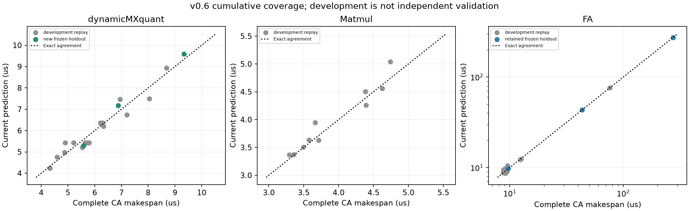

# 当前整套算子建模：误差、证据与成本

## Summary：逐算子误差情况

| 算子 | 完整CA唯一shape | 开发回放n | 开发WAPE | 冻结验证n | 冻结验证WAPE | 验证最大APE | 同集固定基线WAPE | 当前状态 |
|---|---|---|---|---|---|---|---|---|
| dynamicMXquant | 22 | 19 | 4.52% | 3 | 3.90% | 5.22% | 22.13% | 已有局部校准；域外仍需验证 |
| Matmul | 10 | 10 | 2.92% | 0 | N/A | N/A | N/A | 已有局部校准；域外仍需验证 |
| FA | 19 | 16 | 2.51% | 3 | 0.15% | 0.88% | 91.27% | 已有局部校准；域外仍需验证 |
| RMSNorm | 1 | 0 | N/A | 0 | N/A | N/A | N/A | 仅1个库调用验证；无耗时模型 |
| Addmm | 1 | 0 | N/A | 0 | N/A | N/A | N/A | 仅1个库调用验证；无耗时模型 |
| Lightning Indexer | 0 | 0 | N/A | 0 | N/A | N/A | N/A | 结构模型；TopK、实际tiling及耗时未验证 |
| mHC Pre | 0 | 0 | N/A | 0 | N/A | N/A | N/A | 结构模型；投影/混合及分核未校准 |
| mHC Sinkhorn | 0 | 0 | N/A | 0 | N/A | N/A | N/A | 结构模型；FP32迭代归一化未校准 |
| mHC PreSinkhorn | 0 | 0 | N/A | 0 | N/A | N/A | N/A | 结构模型；融合路径不能与拆分路径重复计时 |
| mHC Post | 0 | 0 | N/A | 0 | N/A | N/A | N/A | 结构模型；Vector路径未校准 |
| mHC组合 | 0 | 0 | N/A | 0 | N/A | N/A | N/A | 结构模型；不含外部Attention/MLP主体 |
| KDA recurrent | 0 | 0 | N/A | 0 | N/A | N/A | N/A | 结构模型；S≤8，Q9路由未解决 |
| KDA chunk | 0 | 0 | N/A | 0 | N/A | N/A | N/A | 结构模型；内部阶段不等于多次公开launch |
| GMM1–SwiGLU–MX量化 | 0 | 0 | N/A | 0 | N/A | N/A | N/A | 结构模型；需本rank专家token直方图 |
| MoE GMM2 | 0 | 0 | N/A | 0 | N/A | N/A | N/A | 仅数学工作及候选API；量化scale ABI尚未串联 |
| MoE FFN组合 | 0 | 0 | N/A | 0 | N/A | N/A | N/A | 组合工作量；路由/通信/第二GMM未验证，不是单一kernel |

当前模型 **v0.6**。此表覆盖全部已接入算子族，而非只统计最新一轮。N/A表示没有可计算的误差，**不表示0误差**。完整CA数包含仅调用验证的RMSNorm/Addmm；组合入口共享组成算子，不累计为额外独立实测。

开发回放用于说明模型对已见数据的拟合情况；冻结验证仅含预测冻结后采集、且未被当前版本用作参数拟合或模型选择的shape。保守地将旧开发池保留为开发；原来是留出的shape一旦被本轮用作开发，立即改变角色。不同算子不合成一个WAPE，避免长FA把其他算子的误差掩盖。

总方法、公式与适用域见 [整体建模方法](modeling-strategy.md)；机器可读逐点证据见 [当前数据快照](../results/current/evaluation.json)。本页由 `python3 scripts/report-current.py` 从已提交聚合结果生成，不启动CA。每轮方法/误差变化单独存放，历史报告保持不变。



## 1. 统一口径、版本与数据角色

- 参考平台为CANN9.2.1 / Ascend950DT_9582。预测目标是实际执行核共同时间轴上的完整指令窗口，不是主机CA运行墙钟，也不是整个ACLNN调用的端到端时间。多kernel调用必须另核对跨launch时钟。
- APE=|预测−实测|/实测；WAPE=Σ|预测−实测|/Σ实测；同时给出最大APE。小样本、通常每点一次，没有跨运行统计置信区间。
- quant是BF16→FP8 E4M3动态MX量化；matmul是BF16稠密ND；FA是BF16/SBH、无mask/dropout的普通非因果代理。它们不代表所有量化格式、布局、真实模型注意力或vLLM dispatch。
- compact DB未重新导出运行时ELF时，binary SHA明确为null。安装包对象SHA不能代替每次运行的二进制身份；entry名也未必全域唯一。
- 数值检查通过与耗时误差达标是不同证据；未校准结构模型不以FLOPs/峰值冒充预测耗时或利用率。

| 当前数据角色 | 点数 |
|---|---|
| development_replay | 45 |
| retained_frozen_holdout | 3 |
| new_frozen_holdout | 3 |
| invocation_only | 2 |

### 历史独立验证保留记录

| 冻结版本 | 算子 | 当时独立n | WAPE | 最大APE |
|---|---|---|---|---|
| v0.2 | dynamicMXquant | 2 | 13.85% | 19.95% |
| v0.2 | Matmul | 2 | 6.91% | 7.71% |
| v0.2 | FA | 3 | 4.47% | 6.66% |
| v0.3 | dynamicMXquant | 3 | 4.70% | 9.21% |
| v0.3 | FA | 3 | 5.31% | 9.63% |
| v0.4 | dynamicMXquant | 6 | 5.54% | 12.75% |
| v0.4 | FA | 1 | 0.79% | 0.79% |
| v0.5 | FA新长循环 | 2 | 0.13% | 0.88% |

上表是当时冻结模型的独立结果，仅保留历史事实。不能与当前不同样本集直接相减宣称收益；当前新旧版本对比见下文同集表。Matmul本轮没有新增独立CA，不能把开发回放当作新验证。

## 2. 当前模型与旧版、固定基线的同集对比

| 算子 | 当前独立n | 当前WAPE | v0.5同集WAPE | 固定同集WAPE | 数据范围 |
|---|---|---|---|---|---|
| dynamicMXquant | 3 | 3.90% | 3.88% | 22.13% | 当前仍未参与开发的冻结shape；见逐点角色 |
| FA | 3 | 0.15% | 0.15% | 91.27% | 当前仍未参与开发的冻结shape；见逐点角色 |

固定耗时沿用v0.4/v0.5旧校准池的每算子均值，本轮不重算。小shape启动/标量开销占比较大且分核可吸收工作增长时，常数可能胜过复杂模型；长FA的单核循环随KV增长，常数会系统性低估。不能先看到留出结果再重新选常数或修正参数。

## 3. 全部已完成唯一shape：耗时、误差和实际库实现

### dynamicMXquant

实际接口：`aclnnDynamicMxQuant`；安装库组件：**ops-nn**。shape约定：[R,C]。

| ID / shape | 角色 | CA µs | 当前预测 µs | APE | v0.5 µs | 固定 µs | 实际kernel entry |
|---|---|---|---|---|---|---|---|
| q4_test_tiny [1, 128] | development_replay | 4.325 | 4.231 | 2.18% | 4.231 | 5.801 | DynamicMxQuant_bf16toe4m3_high_performance_33_mix_aiv |
| q4_test_small [36, 512] | development_replay | 5.646 | 5.430 | 3.83% | 5.430 | 5.801 | DynamicMxQuant_bf16toe4m3_high_performance_33_mix_aiv |
| q4_test_flash_decode [9, 5120] | development_replay | 4.867 | 4.980 | 2.31% | 5.430 | 5.801 | DynamicMxQuant_bf16toe4m3_high_performance_33_mix_aiv |
| q4_test_pro_decode [144, 7168] | development_replay | 6.332 | 6.207 | 1.96% | 5.524 | 5.801 | DynamicMxQuant_bf16toe4m3_high_performance_33_mix_aiv |
| q4_test_prefill [512, 5120] | development_replay | 6.299 | 6.364 | 1.04% | 6.364 | 5.801 | DynamicMxQuant_bf16toe4m3_high_performance_33_mix_aiv |
| q4_test_batch128 [1152, 5120] | development_replay | 8.684 | 8.942 | 2.97% | 8.942 | 5.801 | DynamicMxQuant_bf16toe4m3_high_performance_33_mix_aiv |
| q3_test_small [512, 256] | development_replay | 5.208 | 5.430 | 4.26% | 5.430 | 5.801 | DynamicMxQuant_bf16toe4m3_high_performance_33_mix_aiv |
| q3_test_one_ub [576, 4096] | development_replay | 6.948 | 7.470 | 7.51% | 6.729 | 5.801 | DynamicMxQuant_bf16toe4m3_high_performance_33_mix_aiv |
| q3_test_two_ub [768, 4096] | development_replay | 7.202 | 6.743 | 6.37% | 6.743 | 5.801 | DynamicMxQuant_bf16toe4m3_high_performance_33_mix_aiv |
| q2_cal_tiny [1, 64] | development_replay | 4.326 | 4.231 | 2.21% | 4.231 | 5.801 | DynamicMxQuant_bf16toe4m3_high_performance_33_mix_aiv |
| q2_cal_saturation [65, 256] | development_replay | 4.898 | 5.430 | 10.85% | 5.430 | 5.801 | DynamicMxQuant_bf16toe4m3_high_performance_33_mix_aiv |
| q2_cal_ub_loop [1024, 4096] | development_replay | 8.047 | 7.502 | 6.78% | 7.502 | 5.801 | DynamicMxQuant_bf16toe4m3_high_performance_33_mix_aiv |
| q2_test_wide [1, 4096] | development_replay | 5.686 | 5.430 | 4.51% | 5.430 | 5.801 | DynamicMxQuant_bf16toe4m3_high_performance_33_mix_aiv |
| q2_test_ub_loop [640, 4096] | development_replay | 6.218 | 6.364 | 2.36% | 6.364 | 5.801 | DynamicMxQuant_bf16toe4m3_high_performance_33_mix_aiv |
| import_v1_q_test_wave [33, 768] | development_replay | 5.210 | 5.430 | 4.22% | 5.430 | 5.801 | DynamicMxQuant_bf16toe4m3_high_performance_33_mix_aiv |
| import_v1_q_cal_small [4, 256] | development_replay | 4.588 | 4.759 | 3.72% | 4.759 | 5.801 | DynamicMxQuant_bf16toe4m3_high_performance_33_mix_aiv |
| import_v1_q_cal_decode [17, 512] | development_replay | 5.790 | 5.430 | 6.23% | 5.430 | 5.801 | DynamicMxQuant_bf16toe4m3_high_performance_33_mix_aiv |
| import_v1_q_test_tail [8, 384] | development_replay | 5.760 | 5.430 | 5.73% | 5.430 | 5.801 | DynamicMxQuant_bf16toe4m3_high_performance_33_mix_aiv |
| import_v1_q_cal_prefill [64, 1024] | development_replay | 5.532 | 5.214 | 5.73% | 5.430 | 5.801 | DynamicMxQuant_bf16toe4m3_high_performance_33_mix_aiv |
| q6_verify_batch4 [36, 5120] | new_frozen_holdout | 5.584 | 5.292 | 5.22% | 5.430 | 5.801 | entry_kernel_21 |
| q6_verify_batch32 [288, 7168] | new_frozen_holdout | 6.876 | 7.181 | 4.42% | 6.439 | 5.801 | entry_kernel_21 |
| q6_prefill_ub [1024, 7168] | new_frozen_holdout | 9.332 | 9.586 | 2.73% | 9.586 | 5.801 | entry_kernel_21 |

| ID | 预测/实际 AIC,AIV | 预测/实际所选指令数 | 指令APE | 运行时二进制SHA256 | trace/DB SHA256 |
|---|---|---|---|---|---|
| q4_test_tiny | [0, 1] / [0, 1] | 136.00 / 136 | 0.00% | 17d48c749a27b6d68751ec25f76dc1e9feba37df2052be7b53a7cbd36e86a661 | 1a6f11b9069bc316afb250a69bb663e9f0b15416f75b01a4c243c5ac4017a079 |
| q4_test_small | [0, 36] / [0, 36] | 180.00 / 180 | 0.00% | 17d48c749a27b6d68751ec25f76dc1e9feba37df2052be7b53a7cbd36e86a661 | 7f3efd90e47fc17690622f1b61c76bf016661776add8f45cb25748f9ae0583c6 |
| q4_test_flash_decode | [0, 45] / [0, 45] | 268.00 / 268 | 0.00% | 17d48c749a27b6d68751ec25f76dc1e9feba37df2052be7b53a7cbd36e86a661 | 6438411436f36bef4d4b9660e8befc269a467bbff45cfcd5f92a02bc05bc1b8b |
| q4_test_pro_decode | [0, 58] / [0, 58] | 3300.00 / 3300 | 0.00% | 17d48c749a27b6d68751ec25f76dc1e9feba37df2052be7b53a7cbd36e86a661 | a964b5449b59bc0ed9d04919510e7599e30c1ec3aa87eadeeb4c750aaed78fcb |
| q4_test_prefill | [0, 64] / [0, 64] | 7480.00 / 7480 | 0.00% | 17d48c749a27b6d68751ec25f76dc1e9feba37df2052be7b53a7cbd36e86a661 | 25c24f660610696bea14e099e65c7dfc8afe04da475f7a480ad2ec9a6c1efd85 |
| q4_test_batch128 | [0, 64] / [0, 64] | 16788.00 / 16788 | 0.00% | 17d48c749a27b6d68751ec25f76dc1e9feba37df2052be7b53a7cbd36e86a661 | 9688f30626ece2a4924e02c55cd37a445b392a12d8a7b1713521abfe9000e516 |
| q3_test_small | [0, 64] / [0, 64] | 444.00 / 444 | 0.00% | 17d48c749a27b6d68751ec25f76dc1e9feba37df2052be7b53a7cbd36e86a661 | d083b899d40a3628f4736640c1a11e2665b268944f6ecce9a3d0f98838736262 |
| q3_test_one_ub | [0, 64] / [0, 64] | 6684.00 / 6684 | 0.00% | 17d48c749a27b6d68751ec25f76dc1e9feba37df2052be7b53a7cbd36e86a661 | b14575b50f4967d7fd973bdb4cda7946fad7078fd578252d15ce653f24a65d1d |
| q3_test_two_ub | [0, 64] / [0, 64] | 8952.00 / 8952 | 0.00% | 17d48c749a27b6d68751ec25f76dc1e9feba37df2052be7b53a7cbd36e86a661 | 5783842a28e7e7c3d2bc9208f35790eade883d00b6be46911150c328786ea592 |
| q2_cal_tiny | [0, 1] / [0, 1] | 136.00 / 136 | 0.00% | 17d48c749a27b6d68751ec25f76dc1e9feba37df2052be7b53a7cbd36e86a661 | 04b158ae9579564c3073968d6714ddc482cc8b89e466bb90a34d4d343908bcd3 |
| q2_cal_saturation | [0, 33] / [0, 33] | 180.00 / 180 | 0.00% | 17d48c749a27b6d68751ec25f76dc1e9feba37df2052be7b53a7cbd36e86a661 | fbd9aefb299e5180d18deed36c48740cd937ae5df05783f43e915b02985de449 |
| q2_cal_ub_loop | [0, 64] / [0, 64] | 11896.00 / 11896 | 0.00% | 17d48c749a27b6d68751ec25f76dc1e9feba37df2052be7b53a7cbd36e86a661 | b0c6541e17f3249f58bc99d85925b142d0ec2efa545fa19f2fecc969cea207fa |
| q2_test_wide | [0, 16] / [0, 16] | 136.00 / 136 | 0.00% | 17d48c749a27b6d68751ec25f76dc1e9feba37df2052be7b53a7cbd36e86a661 | 5f53c3afe7623ac54df82c022939e9293ca54ed11124d10617d9a0e08612bcf3 |
| q2_test_ub_loop | [0, 64] / [0, 64] | 7480.00 / 7480 | 0.00% | 17d48c749a27b6d68751ec25f76dc1e9feba37df2052be7b53a7cbd36e86a661 | 997c3db4b3a304366ba0d379ea08fe7593d014df876a155038fad791153c59f3 |
| import_v1_q_test_wave | [0, 34] / [0, 34] | 268.00 / 268 | 0.00% | 17d48c749a27b6d68751ec25f76dc1e9feba37df2052be7b53a7cbd36e86a661 | 01a023a25495ecec2b0f202fdbecd83140acd60c1da71072ceeef572ed0b8b96 |
| import_v1_q_cal_small | [0, 4] / [0, 4] | 136.00 / 136 | 0.00% | 17d48c749a27b6d68751ec25f76dc1e9feba37df2052be7b53a7cbd36e86a661 | 624d1d077cc802d35f4cba1ffb939d129bfd14b3e45bc2bf939f1538e30801c3 |
| import_v1_q_cal_decode | [0, 34] / [0, 34] | 136.00 / 136 | 0.00% | 17d48c749a27b6d68751ec25f76dc1e9feba37df2052be7b53a7cbd36e86a661 | 50d49db1f983a565f018717147caef1a7c2b0d374d5b5443aff0cc1058f655b7 |
| import_v1_q_test_tail | [0, 16] / [0, 16] | 136.00 / 136 | 0.00% | 17d48c749a27b6d68751ec25f76dc1e9feba37df2052be7b53a7cbd36e86a661 | a5e98b6f195adfcf686ed66da474a338cd5e1c2c891629852c5dc690f219eab3 |
| import_v1_q_cal_prefill | [0, 64] / [0, 64] | 268.00 / 268 | 0.00% | 17d48c749a27b6d68751ec25f76dc1e9feba37df2052be7b53a7cbd36e86a661 | 4208b2c1638b8d079c87ccbee28b57c71147ac743cd329765341c8799fe4bbf0 |
| q6_verify_batch4 | [0, 60] / [0, 60] | 620.00 / 310 | N/A | 未导出 | b346f9a38c98c19b81a874a0158a197a2599960b79dd8bbcdd14e5ae273655f4 |
| q6_verify_batch32 | [0, 64] / [0, 64] | 5860.00 / 2930 | N/A | 未导出 | 132401f1554474e22e20e02d0c31a6324270489a25243142b8a5aee5ee772110 |
| q6_prefill_ub | [0, 64] / [0, 64] | 20848.00 / 10424 | N/A | 未导出 | a446f47b325a5278de46b181adc7792960b3fb1afe184ab148605f93d99fbe15 |

当前quant的修正与参数见总方法；19个旧quant点均归入开发诊断，不再称独立留出。本轮冻结验证WAPE基本持平、最大APE下降，不能宣称全域精度改善；full诊断接口也没有整体提速。新compact quant的RV数是ExecutedInstructions记录，而历史CSV把成对日志事件都计入；跨口径计数APE标N/A，不把观测值乘2。已证实：旧trace可区分UB搬入、VF、双缓冲复用和写回；所选RV_*计数包括load/store/control，并非纯算术指令。剩余误差来自控制成本、分核策略、UB边界与流水近似的组合；在逐点trace证据不足时，不能把所有残差都归因于访存。

当前该算子最大残差点（包含开发回放，不能作为独立准确率）：

| shape / 角色 | 有符号偏差 µs | APE | 预测分支 / tile | 核数吻合 | 指令计数证据 |
|---|---|---|---|---|---|
| [65, 256] / development_replay | +0.5316 | 10.85% | slice512 / (2, 256) | 是 | APE 0.00% |
| [576, 4096] / development_replay | +0.5219 | 7.51% | slice512 / (9, 4096) | 是 | APE 0.00% |
| [1024, 4096] / development_replay | -0.5456 | 6.78% | ub_loop / (8, 4096) | 是 | APE 0.00% |
正偏差为高估、负偏差为低估。核数/指令吻合只能排除部分工作划分错误，不能证明启动、等待和流水重叠时序正确。

quant指令表：旧CSV日志事件预测与新DB执行记录不是同一计数口径，新点指令APE为N/A；原始数值分别保留。
数值检查：correctness quant_elements=1024 scale_elements=32 bad=0 comparison=exact_bytes; correctness quant_elements=1032192 scale_elements=32256 bad=0 comparison=exact_bytes; correctness quant_elements=128 scale_elements=4 bad=0 comparison=exact_bytes; correctness quant_elements=131072 scale_elements=4096 bad=0 comparison=exact_bytes; correctness quant_elements=16640 scale_elements=520 bad=0 comparison=exact_bytes; correctness quant_elements=18432 scale_elements=576 bad=0 comparison=exact_bytes; correctness quant_elements=184320 scale_elements=5760 bad=0 comparison=exact_bytes; correctness quant_elements=2064384 scale_elements=64512 bad=0 comparison=exact_bytes; correctness quant_elements=2359296 scale_elements=73728 bad=0 comparison=exact_bytes; correctness quant_elements=25344 scale_elements=792 bad=0 comparison=exact_bytes; correctness quant_elements=2621440 scale_elements=81920 bad=0 comparison=exact_bytes; correctness quant_elements=3072 scale_elements=96 bad=0 comparison=exact_bytes; correctness quant_elements=3145728 scale_elements=98304 bad=0 comparison=exact_bytes; correctness quant_elements=4096 scale_elements=128 bad=0 comparison=exact_bytes; correctness quant_elements=4194304 scale_elements=131072 bad=0 comparison=exact_bytes; correctness quant_elements=46080 scale_elements=1440 bad=0 comparison=exact_bytes; correctness quant_elements=5898240 scale_elements=184320 bad=0 comparison=exact_bytes; correctness quant_elements=64 scale_elements=2 bad=0 comparison=exact_bytes; correctness quant_elements=65536 scale_elements=2048 bad=0 comparison=exact_bytes; correctness quant_elements=7340032 scale_elements=229376 bad=0 comparison=exact_bytes; correctness quant_elements=8704 scale_elements=272 bad=0 comparison=exact_bytes。

### Matmul

实际接口：`aclnnMatmul → MatMulV3`；安装库组件：**ops-nn**。shape约定：[M,N,K]。

| ID / shape | 角色 | CA µs | 当前预测 µs | APE | v0.5 µs | 固定 µs | 实际kernel entry |
|---|---|---|---|---|---|---|---|
| m2_cal_skinny_k [1, 256, 1024] | development_replay | 4.624 | 4.560 | 1.38% | 4.560 | 3.923 | MatMulV3_ND_ND_ND_ND_BF16_BF16_BF16_BF16_high_performance_2 |
| m2_cal_k_tail [65, 128, 129] | development_replay | 3.712 | 3.628 | 2.26% | 3.628 | 3.923 | MatMulV3_ND_ND_ND_ND_BF16_BF16_BF16_BF16_high_performance_2 |
| m2_cal_full [128, 512, 512] | development_replay | 4.382 | 4.506 | 2.84% | 4.506 | 3.923 | MatMulV3_ND_ND_ND_ND_BF16_BF16_BF16_BF16_high_performance_2 |
| m2_test_m_tail [129, 256, 256] | development_replay | 3.664 | 3.947 | 7.71% | 3.947 | 3.923 | MatMulV3_ND_ND_ND_ND_BF16_BF16_BF16_BF16_high_performance_2 |
| m2_test_k_work [17, 256, 1024] | development_replay | 4.742 | 5.040 | 6.29% | 5.040 | 3.923 | MatMulV3_ND_ND_ND_ND_BF16_BF16_BF16_BF16_high_performance_2 |
| import_v1_m_cal_prefill [128, 256, 512] | development_replay | 4.393 | 4.261 | 3.01% | 4.261 | 3.923 | MatMulV3_ND_ND_ND_ND_BF16_BF16_BF16_BF16_high_performance_2 |
| import_v1_m_cal_decode [1, 128, 128] | development_replay | 3.356 | 3.370 | 0.42% | 3.370 | 3.923 | MatMulV3_ND_ND_ND_ND_BF16_BF16_BF16_BF16_high_performance_2 |
| import_v1_m_cal_small [32, 64, 64] | development_replay | 3.292 | 3.368 | 2.32% | 3.368 | 3.923 | MatMulV3_ND_ND_ND_ND_BF16_BF16_BF16_BF16_high_performance_2 |
| import_v1_m_test_prefill [48, 128, 192] | development_replay | 3.575 | 3.633 | 1.61% | 3.633 | 3.923 | MatMulV3_ND_ND_ND_ND_BF16_BF16_BF16_BF16_high_performance_2 |
| import_v1_m_test_tail [17, 96, 128] | development_replay | 3.494 | 3.505 | 0.33% | 3.505 | 3.923 | MatMulV3_ND_ND_ND_ND_BF16_BF16_BF16_BF16_high_performance_2 |

| ID | 预测/实际 AIC,AIV | 预测/实际所选指令数 | 指令APE | 运行时二进制SHA256 | trace/DB SHA256 |
|---|---|---|---|---|---|
| m2_cal_skinny_k | [4, 0] / [4, 0] | 4.00 / 4 | 0.00% | e6899fbaa2659b7778bee81deb00b64b009dafcb7ad350f06576767fdeba2bf7 | a00d37638bacccd423af301be229e584dd2b20a0442050752a4f4f285d5e1b6b |
| m2_cal_k_tail | [10, 0] / [10, 0] | 1.00 / 1 | 0.00% | e6899fbaa2659b7778bee81deb00b64b009dafcb7ad350f06576767fdeba2bf7 | 8c0980c6d8125ec76fc31bd870a5096a46bfe8981068e6fa384ba2ee11a8f4de |
| m2_cal_full | [32, 0] / [32, 0] | 2.00 / 2 | 0.00% | e6899fbaa2659b7778bee81deb00b64b009dafcb7ad350f06576767fdeba2bf7 | 20eff520ec15be218ba112579feeeb7800946a10324486a56fcad4e52d38c33f |
| m2_test_m_tail | [20, 0] / [20, 0] | 1.00 / 1 | 0.00% | e6899fbaa2659b7778bee81deb00b64b009dafcb7ad350f06576767fdeba2bf7 | abd6159bf8d28ad6cef5ad443b3f7e6bfac92fb346e912d0c6b18d73ae935b12 |
| m2_test_k_work | [8, 0] / [8, 0] | 4.00 / 4 | 0.00% | e6899fbaa2659b7778bee81deb00b64b009dafcb7ad350f06576767fdeba2bf7 | de5799bbb96e976bd07d9cb2d8968595ae5991e30080cc79a522b89baa1cdb91 |
| import_v1_m_cal_prefill | [32, 0] / [32, 0] | 2.00 / 2 | 0.00% | e6899fbaa2659b7778bee81deb00b64b009dafcb7ad350f06576767fdeba2bf7 | 296b53296a9d02ca50e10b342254dc322b444fcc94a17a8bee0b586b377a9a0e |
| import_v1_m_cal_decode | [2, 0] / [2, 0] | 1.00 / 1 | 0.00% | e6899fbaa2659b7778bee81deb00b64b009dafcb7ad350f06576767fdeba2bf7 | 828432bad7bbb134d1f17a190fbfb22db3843dd00a7b9178d3b5292858045c87 |
| import_v1_m_cal_small | [2, 0] / [2, 0] | 1.00 / 1 | 0.00% | e6899fbaa2659b7778bee81deb00b64b009dafcb7ad350f06576767fdeba2bf7 | 3d5e25291d60f21324179a9de4ef4e0e07bf3188be9163f0c74174597356bbe3 |
| import_v1_m_test_prefill | [6, 0] / [6, 0] | 1.00 / 1 | 0.00% | e6899fbaa2659b7778bee81deb00b64b009dafcb7ad350f06576767fdeba2bf7 | 2c9071ddfbfd3a5e779f2873d8d733c45a9c10ea3dc233277740d90b4f11f0c2 |
| import_v1_m_test_tail | [4, 0] / [4, 0] | 1.00 / 1 | 0.00% | e6899fbaa2659b7778bee81deb00b64b009dafcb7ad350f06576767fdeba2bf7 | 6d0c0e2f370dcd065878251cb814d2a70f047cf4b1b73c9edd6742da2fcae9b5 |

当前仍是已校准资源服务时间加分支残差；分核tile是源码启发式，并非完整库tiling移植。M/N/K尾块、GEMV路径、粗tile与启动成本可改变误差；无新独立CA。本表指令数是最大核MMAD，不代表指令形状、利用率或总FLOPs全都正确。

当前该算子最大残差点（包含开发回放，不能作为独立准确率）：

| shape / 角色 | 有符号偏差 µs | APE | 预测分支 / tile | 核数吻合 | 指令计数证据 |
|---|---|---|---|---|---|
| [129, 256, 256] / development_replay | +0.2827 | 7.71% | coarse_tile / (32, 64, 256) | 是 | APE 0.00% |
| [17, 256, 1024] / development_replay | +0.2984 | 6.29% | dense / (16, 64, 256) | 是 | APE 0.00% |
| [128, 256, 512] / development_replay | -0.1324 | 3.01% | dense / (16, 64, 256) | 是 | APE 0.00% |
正偏差为高估、负偏差为低估。核数/指令吻合只能排除部分工作划分错误，不能证明启动、等待和流水重叠时序正确。

数值检查：correctness elements=128 bad=0 max_abs_error=0 atol=0.01 rtol=0.005; correctness elements=1632 bad=0 max_abs_error=0.015625 atol=0.01 rtol=0.005; correctness elements=2048 bad=0 max_abs_error=0.015625 atol=0.01 rtol=0.005; correctness elements=256 bad=0 max_abs_error=0.015625 atol=0.01 rtol=0.005; correctness elements=32768 bad=0 max_abs_error=0.015625 atol=0.01 rtol=0.005; correctness elements=33024 bad=0 max_abs_error=0.015625 atol=0.01 rtol=0.005; correctness elements=4352 bad=0 max_abs_error=0.015625 atol=0.01 rtol=0.005; correctness elements=6144 bad=0 max_abs_error=0.015625 atol=0.01 rtol=0.005; correctness elements=65536 bad=0 max_abs_error=0.03125 atol=0.01 rtol=0.005; correctness elements=8320 bad=0 max_abs_error=0.015625 atol=0.01 rtol=0.005。

### FA

实际接口：`aclnnFlashAttentionScoreV2`；安装库组件：**ops-transformer**。shape约定：[Q,KV,D,B,H]。

| ID / shape | 角色 | CA µs | 当前预测 µs | APE | v0.5 µs | 固定 µs | 实际kernel entry |
|---|---|---|---|---|---|---|---|
| f4_test_batch4 [9, 256, 128, 4, 1] | retained_frozen_holdout | 9.690 | 9.767 | 0.79% | 9.767 | 9.539 | FlashAttentionScore_50348df09d0b3ee451d3693a6b2ab3f5_2328361009230643744_mix_aic |
| f3_test_short_tail [32, 129, 64, 1, 4] | development_replay | 9.150 | 9.720 | 6.23% | 9.720 | 9.539 | FlashAttentionScore_50348df09d0b3ee451d3693a6b2ab3f5_2328361008425337376_mix_aic |
| f3_test_d128_tail [17, 257, 128, 1, 1] | development_replay | 9.551 | 10.471 | 9.63% | 10.471 | 9.539 | FlashAttentionScore_50348df09d0b3ee451d3693a6b2ab3f5_2328361009230643744_mix_aic |
| f3_test_longkv [17, 1153, 64, 1, 1] | development_replay | 12.487 | 12.322 | 1.32% | 12.322 | 9.539 | FlashAttentionScore_50348df09d0b3ee451d3693a6b2ab3f5_2328361008425599520_mix_aic |
| f2_cal_q128 [128, 128, 64, 1, 1] | development_replay | 9.498 | 9.248 | 2.64% | 9.248 | 9.539 | FlashAttentionScore_50348df09d0b3ee451d3693a6b2ab3f5_2328361008425337376_mix_aic |
| f2_cal_longkv [16, 1025, 64, 1, 1] | development_replay | 12.384 | 12.313 | 0.58% | 12.313 | 9.539 | FlashAttentionScore_50348df09d0b3ee451d3693a6b2ab3f5_2328361008425599520_mix_aic |
| f2_cal_heads4 [16, 128, 64, 1, 4] | development_replay | 8.758 | 8.894 | 1.56% | 8.894 | 9.539 | FlashAttentionScore_50348df09d0b3ee451d3693a6b2ab3f5_2328361008425337376_mix_aic |
| f2_cal_d128 [16, 128, 128, 1, 1] | development_replay | 8.715 | 8.829 | 1.31% | 8.829 | 9.539 | FlashAttentionScore_50348df09d0b3ee451d3693a6b2ab3f5_2328361009230643744_mix_aic |
| f2_test_q129 [129, 128, 64, 1, 1] | development_replay | 8.871 | 9.081 | 2.37% | 9.081 | 9.539 | FlashAttentionScore_50348df09d0b3ee451d3693a6b2ab3f5_2328361008425337376_mix_aic |
| f2_test_heads8 [16, 128, 64, 1, 8] | development_replay | 9.402 | 8.992 | 4.36% | 8.992 | 9.539 | FlashAttentionScore_50348df09d0b3ee451d3693a6b2ab3f5_2328361008425337376_mix_aic |
| f2_test_d128 [17, 192, 128, 1, 1] | development_replay | 9.050 | 9.653 | 6.66% | 9.653 | 9.539 | FlashAttentionScore_50348df09d0b3ee451d3693a6b2ab3f5_2328361009230643744_mix_aic |
| import_v1_f_test_verify [17, 96, 64, 1, 1] | development_replay | 9.162 | 8.692 | 5.14% | 8.692 | 9.539 | FlashAttentionScore_50348df09d0b3ee451d3693a6b2ab3f5_2328361008425337376_mix_aic |
| import_v1_f_cal_small [16, 64, 64, 1, 1] | development_replay | 9.052 | 8.657 | 4.37% | 8.657 | 9.539 | FlashAttentionScore_50348df09d0b3ee451d3693a6b2ab3f5_2328361008425337376_mix_aic |
| import_v1_f_test_context [8, 192, 64, 1, 1] | development_replay | 8.805 | 9.425 | 7.04% | 9.425 | 9.539 | FlashAttentionScore_50348df09d0b3ee451d3693a6b2ab3f5_2328361008425337376_mix_aic |
| import_v1_f_cal_prefill [64, 256, 64, 1, 1] | development_replay | 9.409 | 9.703 | 3.12% | 9.703 | 9.539 | FlashAttentionScore_50348df09d0b3ee451d3693a6b2ab3f5_2328361008425337376_mix_aic |
| import_v1_f_cal_decode [1, 128, 64, 1, 1] | development_replay | 8.784 | 8.718 | 0.75% | 8.718 | 9.539 | FlashAttentionScore_50348df09d0b3ee451d3693a6b2ab3f5_2328361008425337376_mix_aic |
| kv32k-compact-complete [9, 32768, 64, 1, 1] | development_replay | 75.980 | 76.184 | 0.27% | 76.184 | 9.539 | entry_kernel_2050000040140220 |
| f5_holdout_128k [9, 131072, 64, 1, 1] | retained_frozen_holdout | 274.821 | 274.794 | 0.01% | 274.794 | 9.539 | entry_kernel_2050000040140220 |
| f5_holdout_tail16k [9, 16385, 64, 1, 1] | retained_frozen_holdout | 43.219 | 43.599 | 0.88% | 43.599 | 9.539 | entry_kernel_2050000040140220 |

| ID | 预测/实际 AIC,AIV | 预测/实际所选指令数 | 指令APE | 运行时二进制SHA256 | trace/DB SHA256 |
|---|---|---|---|---|---|
| f4_test_batch4 | [4, 8] / [4, 8] | 4.00 / 4 | 0.00% | ac006aee669c8696aeab3bb3fe64fc29e5f3c8e2d172bf75f46db7176a2d4580 | 8873a7b52cc94122ba3693611cc00e4c9e7004fa8eb9a568c38b0eac4697aa74 |
| f3_test_short_tail | [4, 8] / [4, 8] | 4.00 / 4 | 0.00% | ac006aee669c8696aeab3bb3fe64fc29e5f3c8e2d172bf75f46db7176a2d4580 | 24793ce83b214b370657add7a0faea5069dd0ab04ecd26f060bfc1c376c41863 |
| f3_test_d128_tail | [1, 2] / [1, 2] | 6.00 / 6 | 0.00% | ac006aee669c8696aeab3bb3fe64fc29e5f3c8e2d172bf75f46db7176a2d4580 | 27d101e6566e377cc4f3faa00d9c2153d979feb898a83ecf19eaea409631f7e8 |
| f3_test_longkv | [1, 2] / [1, 2] | 20.00 / 20 | 0.00% | ac006aee669c8696aeab3bb3fe64fc29e5f3c8e2d172bf75f46db7176a2d4580 | fc39175969367c4a3fd87ce279d181679f8badac5654d9c03137133a16439c49 |
| f2_cal_q128 | [2, 4] / [2, 4] | 2.00 / 2 | 0.00% | ac006aee669c8696aeab3bb3fe64fc29e5f3c8e2d172bf75f46db7176a2d4580 | 090c6f608f5abb73e208a6c73f9383a5842bd1aa8e5a164e7ac58811e101d5a9 |
| f2_cal_longkv | [1, 2] / [1, 2] | 18.00 / 18 | 0.00% | ac006aee669c8696aeab3bb3fe64fc29e5f3c8e2d172bf75f46db7176a2d4580 | e5bf411eb977ce36e24facea984aee26fdff26430a968e720248aa7ae5c2abf2 |
| f2_cal_heads4 | [4, 8] / [4, 8] | 2.00 / 2 | 0.00% | ac006aee669c8696aeab3bb3fe64fc29e5f3c8e2d172bf75f46db7176a2d4580 | 4b64bcddd4748baa5a9892f69a9a2893a9f0a4cb71cec8802be8fa04b5836553 |
| f2_cal_d128 | [1, 2] / [1, 2] | 2.00 / 2 | 0.00% | ac006aee669c8696aeab3bb3fe64fc29e5f3c8e2d172bf75f46db7176a2d4580 | 485b80fc3c1f7e0b951f7d37bfd71523b6fe4fc5632b94d4ceab1f9eac787f8c |
| f2_test_q129 | [3, 6] / [3, 6] | 2.00 / 2 | 0.00% | ac006aee669c8696aeab3bb3fe64fc29e5f3c8e2d172bf75f46db7176a2d4580 | 50d6d8587b9076c1f3dad4bcf23f3100703f8cc6102139fa18ada2354e94fc21 |
| f2_test_heads8 | [8, 16] / [8, 16] | 2.00 / 2 | 0.00% | ac006aee669c8696aeab3bb3fe64fc29e5f3c8e2d172bf75f46db7176a2d4580 | 6c216df61c866ec82c18cd847bd5774a408dc746ffe481cde77a5afdddf05496 |
| f2_test_d128 | [1, 2] / [1, 2] | 4.00 / 4 | 0.00% | ac006aee669c8696aeab3bb3fe64fc29e5f3c8e2d172bf75f46db7176a2d4580 | 233e88541e2915c1781d5683a03eb0fc46b8d570008e8360af4292e734619b09 |
| import_v1_f_test_verify | [1, 2] / [1, 2] | 2.00 / 2 | 0.00% | ac006aee669c8696aeab3bb3fe64fc29e5f3c8e2d172bf75f46db7176a2d4580 | d4ca1639a81706cecee9d5bb697498ad528158e0bdb47dbd34739c18e7edc281 |
| import_v1_f_cal_small | [1, 2] / [1, 2] | 2.00 / 2 | 0.00% | ac006aee669c8696aeab3bb3fe64fc29e5f3c8e2d172bf75f46db7176a2d4580 | 2ed78a97c32fee64acbfe0acf924f7c6c87807ef2c14bbba2c9c882569e2d143 |
| import_v1_f_test_context | [1, 2] / [1, 2] | 4.00 / 4 | 0.00% | ac006aee669c8696aeab3bb3fe64fc29e5f3c8e2d172bf75f46db7176a2d4580 | 71de992c26a5e68ffe0bec446fa9359df2a3b60f2a220bc9c22a069135319703 |
| import_v1_f_cal_prefill | [1, 2] / [1, 2] | 4.00 / 4 | 0.00% | ac006aee669c8696aeab3bb3fe64fc29e5f3c8e2d172bf75f46db7176a2d4580 | 0d81e63d513d99a2984d2141054cd79667186227409d130b6dd3ca030a94b062 |
| import_v1_f_cal_decode | [1, 2] / [1, 2] | 2.00 / 2 | 0.00% | ac006aee669c8696aeab3bb3fe64fc29e5f3c8e2d172bf75f46db7176a2d4580 | 026d74c860f58bcbf63b54188a246fd418d892e8e2f9f08fa13f5afb1529b79b |
| kv32k-compact-complete | [1, 2] / [1, 2] | 512.00 / 512 | 0.00% | 未导出 | 9220bb8932f4f4464a75c005fdc9dd1fd485928938c1be3d2bc916dd37f0c220 |
| f5_holdout_128k | [1, 2] / [1, 2] | 2048.00 / 2048 | 0.00% | 未导出 | 4633540ddcae28e4bfb7ced11bff2eaecb1cc65be0219ee1bcc375a1d4f4b6ff |
| f5_holdout_tail16k | [1, 2] / [1, 2] | 258.00 / 258 | 0.00% | 未导出 | 499fb83e1cc6c3d56b44293bedec55edbd46afb0e8a4c8e55752f4ab836a4862 |

长Q9/D64/B1/H1路径从旧32k DB分离首轮读延迟与稳态II；32k因此属于开发。128k/16k+1是先冻结后采集的两点，未重新拟合。短KV、多head/batch、D128仍走旧模型；其更高误差不能被长FA较低WAPE掩盖。尾块按完整256 tile计时是保守近似；尚不能把小幅残差唯一归因为尾块、噪声或同步。

当前该算子最大残差点（包含开发回放，不能作为独立准确率）：

| shape / 角色 | 有符号偏差 µs | APE | 预测分支 / tile | 核数吻合 | 指令计数证据 |
|---|---|---|---|---|---|
| [17, 257, 128, 1, 1] / development_replay | +0.9197 | 9.63% | d128_kv128 / (17, 128, 128) | 是 | APE 0.00% |
| [8, 192, 64, 1, 1] / development_replay | +0.6200 | 7.04% | d64_kv128 / (8, 128, 64) | 是 | APE 0.00% |
| [17, 192, 128, 1, 1] / development_replay | +0.6030 | 6.66% | d128_kv128 / (17, 128, 128) | 是 | APE 0.00% |
正偏差为高估、负偏差为低估。核数/指令吻合只能排除部分工作划分错误，不能证明启动、等待和流水重叠时序正确。

数值检查：correctness elements=1024 bad=0 max_abs_error=0.000380432538 atol=0.002 rtol=0.01; correctness elements=1024 bad=0 max_abs_error=2.02875434e-05 atol=0.002 rtol=0.01; correctness elements=1088 bad=0 max_abs_error=0.000245860856 atol=0.002 rtol=0.01; correctness elements=1088 bad=0 max_abs_error=1.85941898e-05 atol=0.002 rtol=0.01; correctness elements=2048 bad=0 max_abs_error=0.000138708808 atol=0.002 rtol=0.01; correctness elements=2176 bad=0 max_abs_error=6.89647513e-05 atol=0.002 rtol=0.01; correctness elements=2176 bad=0 max_abs_error=8.42484365e-05 atol=0.002 rtol=0.01; correctness elements=4096 bad=0 max_abs_error=0.000166487626 atol=0.002 rtol=0.01; correctness elements=4096 bad=0 max_abs_error=8.81786764e-05 atol=0.002 rtol=0.01; correctness elements=4608 bad=0 max_abs_error=8.45420004e-05 atol=0.002 rtol=0.01; correctness elements=512 bad=0 max_abs_error=7.81671582e-05 atol=0.002 rtol=0.01; correctness elements=576 bad=0 max_abs_error=1.05939405e-06 atol=0.002 rtol=0.01; correctness elements=576 bad=0 max_abs_error=1.26169927e-07 atol=0.002 rtol=0.01; correctness elements=576 bad=0 max_abs_error=3.51277034e-07 atol=0.002 rtol=0.01; correctness elements=64 bad=0 max_abs_error=0.000131970225 atol=0.002 rtol=0.01; correctness elements=8192 bad=0 max_abs_error=0.000158893929 atol=0.002 rtol=0.01; correctness elements=8192 bad=0 max_abs_error=0.000165152005 atol=0.002 rtol=0.01; correctness elements=8192 bad=0 max_abs_error=0.000181533805 atol=0.002 rtol=0.01; correctness elements=8256 bad=0 max_abs_error=0.000181533805 atol=0.002 rtol=0.01。

### RMSNorm

实际接口：`aclnnRmsNorm`；安装库组件：**ops-nn**。shape约定：[R,C]，gamma[C]。

| ID / shape | 角色 | CA µs | 当前预测 µs | APE | v0.5 µs | 固定 µs | 实际kernel entry |
|---|---|---|---|---|---|---|---|
| invocation_rmsnorm [1, 128] | invocation_only | 3.454 | N/A | N/A | N/A | N/A | entry_kernel_1388 |

| ID | 预测/实际 AIC,AIV | 预测/实际所选指令数 | 指令APE | 运行时二进制SHA256 | trace/DB SHA256 |
|---|---|---|---|---|---|
| invocation_rmsnorm | None / [0, 1] | N/A / 0 | N/A | 未导出 | d61d09bee61de005d39d67914a9526c378167243187ffb3f749b760a2c2f37b9 |

该小case实测0 AIC/1 AIV；entry 0x1388=5000与NORMAL源码候选key一致，但不能推断其他shape都走同一路径。尚无耗时模型，后续需覆盖归约长度、UB/分核切换及多核尾波。

尚无逐shape预测值，因此没有残差排序；单点实测不能估计泛化误差。

数值检查：correctness count=1 bad=0 max_abs_error=9.23429e-08 atol=1.52588e-05 rtol=0.000976562 hard_limit=0.01; correctness count=128 bad=0 max_abs_error=0.00135139 atol=0.015625 rtol=0.015625 hard_limit=1。

### Addmm

实际接口：`aclnnAddmm`；安装库组件：**ops-nn**。shape约定：[M,N,K]，self=[N]、alpha=beta=1。

| ID / shape | 角色 | CA µs | 当前预测 µs | APE | v0.5 µs | 固定 µs | 实际kernel entry |
|---|---|---|---|---|---|---|---|
| invocation_addmm [2, 16, 16] | invocation_only | 2.992 | N/A | N/A | N/A | N/A | entry_kernel_2 |

| ID | 预测/实际 AIC,AIV | 预测/实际所选指令数 | 指令APE | 运行时二进制SHA256 | trace/DB SHA256 |
|---|---|---|---|---|---|
| invocation_addmm | None / [1, 0] | N/A / 1 | N/A | 未导出 | 94b166d69ab0c8e6e2e8974d4a0ba905b85ea55430133f7ddf141d019d201800 |

该bias小case观察到1 AIC/0 AIV、1条MMAD、一个kernel；entry_kernel_2不是唯一二进制身份。完整矩阵self、不同alpha/beta/dtype可能采用其他融合或多kernel路径，不能将普通Matmul时延直接当作Addmm总时延。

尚无逐shape预测值，因此没有残差排序；单点实测不能估计泛化误差。

数值检查：correctness count=32 bad=0 max_abs_error=0.00390625 atol=0.015625 rtol=0.015625 hard_limit=1。

## 4. 已接入但尚无时延误差的算子

| 算子 | 950库接口/组合 | 状态与主要误差缺口 |
|---|---|---|
| Lightning Indexer | aclnnLightningIndexer | 结构模型；TopK、实际tiling及耗时未验证 |
| mHC Pre | aclnnMhcPre | 结构模型；投影/混合及分核未校准 |
| mHC Sinkhorn | aclnnMhcSinkhorn | 结构模型；FP32迭代归一化未校准 |
| mHC PreSinkhorn | aclnnMhcPreSinkhorn | 结构模型；融合路径不能与拆分路径重复计时 |
| mHC Post | aclnnMhcPost | 结构模型；Vector路径未校准 |
| mHC组合 | 上述Mhc接口组合 | 结构模型；不含外部Attention/MLP主体 |
| KDA recurrent | aclnnRecurrentKda | 结构模型；S≤8，Q9路由未解决 |
| KDA chunk | aclnnChunkKdaFwd | 结构模型；内部阶段不等于多次公开launch |
| GMM1–SwiGLU–MX量化 | aclnnGroupedMatmulSwigluQuantV2 | 结构模型；需本rank专家token直方图 |
| MoE GMM2 | aclnnGroupedMatmulV5（候选） | 仅数学工作及候选API；量化scale ABI尚未串联 |
| MoE FFN组合 | GMM1融合 + GMM2候选 | 组合工作量；路由/通信/第二GMM未验证，不是单一kernel |

这些入口返回结构工作量及证据支持的shape约束，预测耗时和利用率为null。具体数学公式、dtype/layout/分组约束及候选二进制清单见 [扩展算子目录](extensions/README.md)。RMSNorm与Addmm虽各有一次小case完整实测，仍缺跨shape校准及冻结验证；其误差同样是N/A。

## 5. 失败、部分trace与重复采集

| ID / shape | 状态 | 墙钟s | 排除原因 |
|---|---|---|---|
| f4_test_batch16 [9, 4096, 64, 16, 1] | failed | 156.10 | Incomplete/incorrect CA run: inspect run.log |
| f4_test_32k [9, 32768, 64, 1, 1] | failed | 132.14 | Incomplete/incorrect CA run: inspect run.log |
| f4_test_512k_end [9, 525312, 64, 1, 1] | failed | 131.76 | Incomplete/incorrect CA run: inspect run.log |
| bridge-1153-native [17, 1153, 64, 1, 1] | failed | 12.63 | Capture or identity qualification did not pass |
| bridge-1153-native-dirs [17, 1153, 64, 1, 1] | correctness_only | 61.50 | Capture or identity qualification did not pass |
| bridge-1153-npusim [17, 1153, 64, 1, 1] | failed | 70.99 | Capture or identity qualification did not pass |
| bridge-1153-npusim-adapter [17, 1153, 64, 1, 1] | failed | 0.03 | Capture or identity qualification did not pass |
| bridge-1153-npusim-adapter-env [17, 1153, 64, 1, 1] | failed | 77.76 | Capture or identity qualification did not pass |
| bridge-1153-npusim-dt [17, 1153, 64, 1, 1] | failed | 72.40 | Capture or identity qualification did not pass |
| bridge-1153-thread1 [17, 1153, 64, 1, 1] | failed | 126.21 | Incomplete/incorrect CA run: inspect run.log |
| kv32k-no-raw [9, 32768, 64, 1, 1] | failed | 130.89 | Incomplete/incorrect CA run: inspect run.log |
| kv32k-npusim [9, 32768, 64, 1, 1] | failed | 120.02 | Capture or identity qualification did not pass |

失败或身份不匹配的记录没有CA误差值。相同旧shape用于采集方式一致性校验的重复运行不增加唯一shape样本数；其成本仍记录在对应轮次。早期重试和重复样本明细保留在历史dataset/evaluation，当前表列出v0.4以后相关失败与采集资格问题。

## 6. 仿真采集成本与在线预测效率

| 轮次 | 尝试次数 | 墙钟分钟 | CPU小时 | 保留MiB | 口径 |
|---|---|---|---|---|---|
| v0.1 | 18 | 17.79 | 4.11 | 1032.94 | 历史采集聚合，包含该轮失败/重试 |
| v0.2 | 18 | 23.02 | 7.41 | 4930.99 | 历史采集聚合，包含该轮失败/重试 |
| v0.3 | 6 | 9.29 | 3.43 | 2581.00 | 历史采集聚合，包含该轮失败/重试 |
| v0.4 | 10 | 18.33 | 7.32 | 5796.11 | 历史采集聚合，包含该轮失败/重试 |
| long-fa | 14 | 20.50 | 5.80 | 757.07 | CPU仅记录下界 |
| v0.5 | 2 | 15.71 | 8.04 | 469.48 | 历史采集聚合，包含该轮失败/重试 |
| v0.6 | 3 | 4.14 | 1.10 | 379.59 | 历史采集聚合，包含该轮失败/重试 |
| extension_invocations | 2 | 1.33 | 0.22 | 0.81 | 历史采集聚合，包含该轮失败/重试 |

本轮quant三个原始采集记录因正确性日志字段不同而被旧提取器拒绝；CA进程和逐字节检查均已成功。离线qualifier校验quant_elements/scale_elements/bad=0、日志和DB哈希后另存qualified-result，原记录不覆盖，没有新增CA。恢复审计见v0.6 dataset的recovery字段。

每轮列自己的新增采集成本，复用历史数据不再次计费。保留字节数不是运行中峰值临时空间；线程并发会使CPU时间远大于墙钟。轻量SQL归约节省trace转换与存储，不能消除CA指令执行成本。

当前版本查询基准（模型预加载、未启动CANN；单位和样本数以该轮evaluation为准）：

```json
{
  "uncached_scalar": {
    "v06": {
      "median_us": 33.245000000000005,
      "p95_us": 57.28
    },
    "v05": {
      "median_us": 44.54,
      "p95_us": 66.48
    }
  },
  "uncached_full": {
    "v06": {
      "median_us": 97.625,
      "p95_us": 133.72
    },
    "v05": {
      "median_us": 92.56,
      "p95_us": 133.09
    }
  },
  "cached_full": {
    "v06": {
      "median_us": 2.41,
      "p95_us": 2.51
    },
    "v05": {
      "median_us": 2.4,
      "p95_us": 2.49
    }
  }
}
```

长FA公式查询对KV循环数为O(1)；quant完整诊断路径按UB tile数展开，当前多UB标量路径仅保留两轮状态、临时空间O(1)，scalar-only优化及边界详见总方法。缓存命中与未缓存查询分别报告，不以缓存成绩掩盖首次预测开销。

## 7. 场景外推与当前整体边界

| 普通FA [Q,KV,D,B,H] | 当前预测 µs | CA µs | 数据角色 |
|---|---|---|---|
| [9, 32768, 64, 1, 1] | 76.184 | 75.980 | development_replay |
| [9, 131072, 64, 1, 1] | 274.794 | 274.821 | retained_frozen_holdout |
| [9, 132096, 64, 1, 1] | 276.863 | 未实测 | unvalidated_extrapolation |
| [9, 262144, 64, 1, 1] | 539.608 | 未实测 | unvalidated_extrapolation |
| [9, 263168, 64, 1, 1] | 541.677 | 未实测 | unvalidated_extrapolation |
| [9, 524288, 64, 1, 1] | 1069.237 | 未实测 | unvalidated_extrapolation |
| [9, 525312, 64, 1, 1] | 1071.305 | 未实测 | unvalidated_extrapolation |

用户场景包括prefill单卡batch=1/4/16、decode=1/4/16/32/128/256，32k/128k/256k/512k输入、1k输出、推测8个时Q=9。已建立场景映射，但表中的少量代表shape远未覆盖全部batch/TP/EP、prefill chunk、mask和量化组合。配置能给候选shape，运行时分发、专家负载及融合路径还需实际调用证据。

256k/512k没有完整CA的项仍是外推；A7/A8、独立ISA峰值利用率和整网系统误差尚未验证。整体误差表中的N/A和这些外推边界应随版本持续保留，直到相应证据补齐。

当前模型SHA256：`bad9ec3eb0fb313b6e16d37487433d626c008331d4aabdf8a4dc37751e28cf23`。各逐点source SHA、数值检查、身份与分核信息见 [evaluation.json](../results/current/evaluation.json)，当前方法见 [modeling-strategy.md](modeling-strategy.md)。
