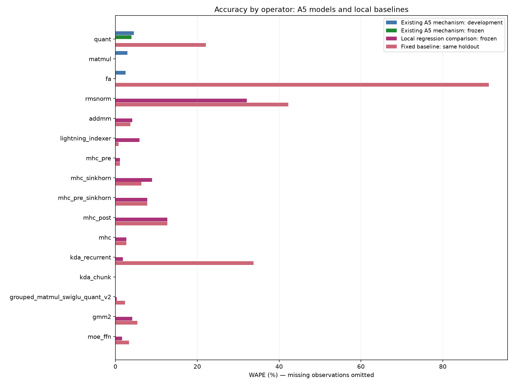
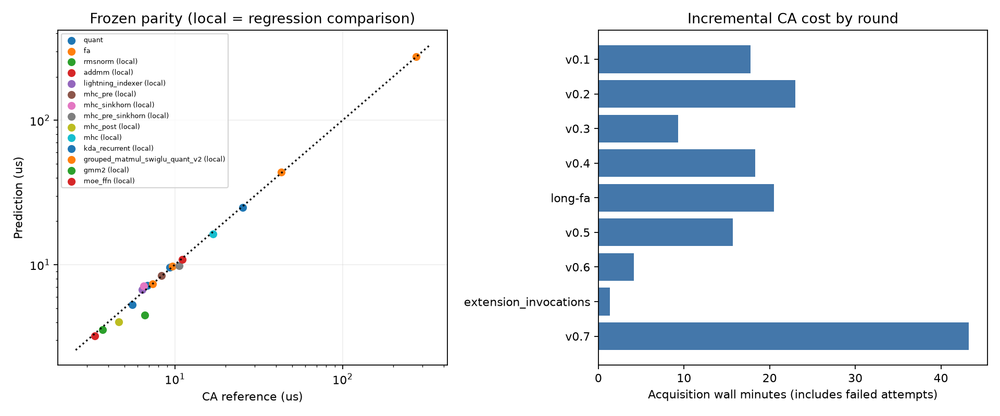

# 当前整套算子建模：误差、证据与成本

## Summary：逐算子误差情况

| 算子 | 完整CA shape | 开发/独立样本 | 机制开发WAPE / max | 机制独立WAPE / max | 局部回归开发WAPE | 局部回归独立WAPE / max | 固定独立WAPE | 状态 |
|---|---|---|---|---|---|---|---|---|
| dynamicMXquant | 22 | 19/3 | 4.52% / 10.85% | 3.90% / 5.22% | N/A | N/A / N/A | 22.13% | A5机制有局部验证；跨代未验证 |
| Matmul | 10 | 10/0 | 2.92% / 7.71% | N/A / N/A | N/A | N/A / N/A | N/A | A5机制只有开发回放 |
| FA | 19 | 16/3 | 2.51% / 9.63% | 0.15% / 0.88% | N/A | N/A / N/A | 91.27% | A5机制有局部验证；跨代未验证 |
| RMSNorm | 3 | 2/1 | N/A / N/A | N/A / N/A | 0.00% | 32.12% / 32.12% | 42.22% | 局部回归对照已校准；通用机制缺证据 |
| Addmm | 3 | 2/1 | N/A / N/A | N/A / N/A | 0.00% | 4.13% / 4.13% | 3.68% | 局部回归对照已校准；通用机制缺证据 |
| Lightning Indexer | 3 | 2/1 | N/A / N/A | N/A / N/A | 0.00% | 5.90% / 5.90% | 0.81% | 局部回归对照已校准；通用机制缺证据 |
| mHC Pre | 3 | 2/1 | N/A / N/A | N/A / N/A | 1.61% | 1.14% / 1.14% | 1.14% | 局部回归对照已校准；通用机制缺证据 |
| mHC Sinkhorn | 3 | 2/1 | N/A / N/A | N/A / N/A | 0.00% | 8.96% / 8.96% | 6.35% | 局部回归对照已校准；通用机制缺证据 |
| mHC PreSinkhorn | 3 | 2/1 | N/A / N/A | N/A / N/A | 1.22% | 7.78% / 7.78% | 7.78% | 局部回归对照已校准；通用机制缺证据 |
| mHC Post | 3 | 2/1 | N/A / N/A | N/A / N/A | 15.36% | 12.70% / 12.70% | 12.70% | 局部回归对照已校准；通用机制缺证据 |
| mHC组合 | 3 | 2/1 | N/A / N/A | N/A / N/A | 2.50% | 2.70% / 2.70% | 2.70% | 局部回归对照已校准；通用机制缺证据 |
| KDA recurrent | 3 | 2/1 | N/A / N/A | N/A / N/A | 0.00% | 1.84% / 1.84% | 33.77% | 局部回归对照已校准；通用机制缺证据 |
| KDA chunk | 0 | 0/0 | N/A / N/A | N/A / N/A | N/A | N/A / N/A | N/A | 无合格完整CA |
| GMM1–SwiGLU–MX量化 | 4 | 3/1 | N/A / N/A | N/A / N/A | 1.27% | 0.35% / 0.35% | 2.35% | 局部回归对照已校准；通用机制缺证据 |
| MoE GMM2 | 4 | 3/1 | N/A / N/A | N/A / N/A | 4.37% | 4.10% / 4.10% | 5.33% | 局部回归对照已校准；通用机制缺证据 |
| MoE FFN组合 | 4 | 3/1 | N/A / N/A | N/A / N/A | 2.28% | 1.60% / 1.60% | 3.34% | 局部回归对照已校准；通用机制缺证据 |

当前 **v0.7** 包括不改动参数的 v0.6 quant/Matmul/FA（有tiling/流水机制，但仍只在A5校准，未验证跨架构），以及本轮真实库调用的小 shape 局部回归对照。扩展的 a+bW 不作为跨形状/跨硬件的通用机制默认；mechanism 列在物理映射、吞吐/发起间隔等独立资源参数未获证据时为 N/A；当前真实硬件profile不填虚构吞吐。N/A 表示没有合格误差证据，不代表0误差。组合入口和组件共享原始采集；完整shape列逐算子统计，不能跨行相加当作独立CA次数。表中保留旧族仍未用于开发的冻结验证，新扩展仅以本轮冻结后的独立shape统计。





完整公式、逐参数解释及适用域见 [整体建模方法](modeling-strategy.md)；每例 JSON 证据见 [v0.7 evaluation](../results/v0.7/evaluation.json)，本轮变化见 [changes.md](../results/v0.7/changes.md)。本页由 `scripts/report-v7.py` 生成，不启动 CA、不重新拟合。

## 1. 统计口径、冻结与误差归因边界

模型冻结时间：`2026-11-17T12:08:05.316919+00:00`；模型SHA256：`672f99013218b27fae2019eb1e5b31662065bd1d78ece3d95009e92f4eabc6b5`。新留出的预测直接读取 `frozen-predictions.json`，未根据留出实测重新预测、选模或调参。旧扩展在v0.6只有结构模型或单次调用，旧版耗时必须为N/A；不能把0或Roofline补成旧版精度。

APE=|预测−CA|/CA；WAPE=Σ|预测−CA|/ΣCA。开发数据用于校准或机制判断，与独立验证分开；通常每shape仅采一次，未估计重复运行噪声或置信区间。当前测量为950DT/1.65GHz CA完整指令窗口，不是硬件实测。多kernel值为串行单stream各kernel净指令窗口求和，**不含host启动、API初始化、launch间空闲，也不声称跨DB时钟已经对齐**。

新扩展每条路由只拟合非负固定项和一个工作量系数。若两例校准工作量相同，模型只能辨识常数；若最优系数为0，也可能只是固定tile/启动占主导。固定基线取校准集均值且与模型一起冻结。低局部误差不等于已获得指令吞吐、跨代利用率或全shape精度。实测指令数用于证据审计，扩展算子的预测指令误差仍N/A。

| 角色 | 行数 |
|---|---|
| development_replay | 45 |
| retained_v6_frozen_holdout | 6 |
| development_calibration | 27 |
| v7_frozen_holdout | 12 |


### 当前与旧版、固定基线：同一冻结集合

| 算子 | 独立样本n | 机制WAPE | 局部回归WAPE | v0.6同集WAPE | 固定同集WAPE |
|---|---|---|---|---|---|
| dynamicMXquant | 3 | 3.90% | N/A | 3.90% | 22.13% |
| Matmul | 0 | N/A | N/A | N/A | N/A |
| FA | 3 | 0.15% | N/A | 0.15% | 91.27% |
| RMSNorm | 1 | N/A | 32.12% | N/A | 42.22% |
| Addmm | 1 | N/A | 4.13% | N/A | 3.68% |
| Lightning Indexer | 1 | N/A | 5.90% | N/A | 0.81% |
| mHC Pre | 1 | N/A | 1.14% | N/A | 1.14% |
| mHC Sinkhorn | 1 | N/A | 8.96% | N/A | 6.35% |
| mHC PreSinkhorn | 1 | N/A | 7.78% | N/A | 7.78% |
| mHC Post | 1 | N/A | 12.70% | N/A | 12.70% |
| mHC组合 | 1 | N/A | 2.70% | N/A | 2.70% |
| KDA recurrent | 1 | N/A | 1.84% | N/A | 33.77% |
| KDA chunk | 0 | N/A | N/A | N/A | N/A |
| GMM1–SwiGLU–MX量化 | 1 | N/A | 0.35% | N/A | 2.35% |
| MoE GMM2 | 1 | N/A | 4.10% | N/A | 5.33% |
| MoE FFN组合 | 1 | N/A | 1.60% | N/A | 3.34% |


## 2. 原有 quant / Matmul / FA：全部逐shape证据

三族参数及预测与v0.6一致；下列完整逐shape表与机制诊断沿用归档内容，其中“v0.5”是历史比较列。原有开发/独立角色不因版本号变化自动重置。

### dynamicMXquant

实际接口：`aclnnDynamicMxQuant`；安装库组件：**ops-nn**。shape约定：[R,C]。

| ID / shape | 角色 | CA µs | 当前预测 µs | APE | v0.5 µs | 固定 µs | 实际kernel entry |
|---|---|---|---|---|---|---|---|
| q4_test_tiny [1, 128] | development_replay | 4.325 | 4.231 | 2.18% | 4.231 | 5.801 | DynamicMxQuant_bf16toe4m3_high_performance_33_mix_aiv |
| q4_test_small [36, 512] | development_replay | 5.646 | 5.430 | 3.83% | 5.430 | 5.801 | DynamicMxQuant_bf16toe4m3_high_performance_33_mix_aiv |
| q4_test_flash_decode [9, 5120] | development_replay | 4.867 | 4.980 | 2.31% | 5.430 | 5.801 | DynamicMxQuant_bf16toe4m3_high_performance_33_mix_aiv |
| q4_test_pro_decode [144, 7168] | development_replay | 6.332 | 6.207 | 1.96% | 5.524 | 5.801 | DynamicMxQuant_bf16toe4m3_high_performance_33_mix_aiv |
| q4_test_prefill [512, 5120] | development_replay | 6.299 | 6.364 | 1.04% | 6.364 | 5.801 | DynamicMxQuant_bf16toe4m3_high_performance_33_mix_aiv |
| q4_test_batch128 [1152, 5120] | development_replay | 8.684 | 8.942 | 2.97% | 8.942 | 5.801 | DynamicMxQuant_bf16toe4m3_high_performance_33_mix_aiv |
| q3_test_small [512, 256] | development_replay | 5.208 | 5.430 | 4.26% | 5.430 | 5.801 | DynamicMxQuant_bf16toe4m3_high_performance_33_mix_aiv |
| q3_test_one_ub [576, 4096] | development_replay | 6.948 | 7.470 | 7.51% | 6.729 | 5.801 | DynamicMxQuant_bf16toe4m3_high_performance_33_mix_aiv |
| q3_test_two_ub [768, 4096] | development_replay | 7.202 | 6.743 | 6.37% | 6.743 | 5.801 | DynamicMxQuant_bf16toe4m3_high_performance_33_mix_aiv |
| q2_cal_tiny [1, 64] | development_replay | 4.326 | 4.231 | 2.21% | 4.231 | 5.801 | DynamicMxQuant_bf16toe4m3_high_performance_33_mix_aiv |
| q2_cal_saturation [65, 256] | development_replay | 4.898 | 5.430 | 10.85% | 5.430 | 5.801 | DynamicMxQuant_bf16toe4m3_high_performance_33_mix_aiv |
| q2_cal_ub_loop [1024, 4096] | development_replay | 8.047 | 7.502 | 6.78% | 7.502 | 5.801 | DynamicMxQuant_bf16toe4m3_high_performance_33_mix_aiv |
| q2_test_wide [1, 4096] | development_replay | 5.686 | 5.430 | 4.51% | 5.430 | 5.801 | DynamicMxQuant_bf16toe4m3_high_performance_33_mix_aiv |
| q2_test_ub_loop [640, 4096] | development_replay | 6.218 | 6.364 | 2.36% | 6.364 | 5.801 | DynamicMxQuant_bf16toe4m3_high_performance_33_mix_aiv |
| import_v1_q_test_wave [33, 768] | development_replay | 5.210 | 5.430 | 4.22% | 5.430 | 5.801 | DynamicMxQuant_bf16toe4m3_high_performance_33_mix_aiv |
| import_v1_q_cal_small [4, 256] | development_replay | 4.588 | 4.759 | 3.72% | 4.759 | 5.801 | DynamicMxQuant_bf16toe4m3_high_performance_33_mix_aiv |
| import_v1_q_cal_decode [17, 512] | development_replay | 5.790 | 5.430 | 6.23% | 5.430 | 5.801 | DynamicMxQuant_bf16toe4m3_high_performance_33_mix_aiv |
| import_v1_q_test_tail [8, 384] | development_replay | 5.760 | 5.430 | 5.73% | 5.430 | 5.801 | DynamicMxQuant_bf16toe4m3_high_performance_33_mix_aiv |
| import_v1_q_cal_prefill [64, 1024] | development_replay | 5.532 | 5.214 | 5.73% | 5.430 | 5.801 | DynamicMxQuant_bf16toe4m3_high_performance_33_mix_aiv |
| q6_verify_batch4 [36, 5120] | new_frozen_holdout | 5.584 | 5.292 | 5.22% | 5.430 | 5.801 | entry_kernel_21 |
| q6_verify_batch32 [288, 7168] | new_frozen_holdout | 6.876 | 7.181 | 4.42% | 6.439 | 5.801 | entry_kernel_21 |
| q6_prefill_ub [1024, 7168] | new_frozen_holdout | 9.332 | 9.586 | 2.73% | 9.586 | 5.801 | entry_kernel_21 |

| ID | 预测/实际 AIC,AIV | 预测/实际所选指令数 | 指令APE | 运行时二进制SHA256 | trace/DB SHA256 |
|---|---|---|---|---|---|
| q4_test_tiny | [0, 1] / [0, 1] | 136.00 / 136 | 0.00% | 17d48c749a27b6d68751ec25f76dc1e9feba37df2052be7b53a7cbd36e86a661 | 1a6f11b9069bc316afb250a69bb663e9f0b15416f75b01a4c243c5ac4017a079 |
| q4_test_small | [0, 36] / [0, 36] | 180.00 / 180 | 0.00% | 17d48c749a27b6d68751ec25f76dc1e9feba37df2052be7b53a7cbd36e86a661 | 7f3efd90e47fc17690622f1b61c76bf016661776add8f45cb25748f9ae0583c6 |
| q4_test_flash_decode | [0, 45] / [0, 45] | 268.00 / 268 | 0.00% | 17d48c749a27b6d68751ec25f76dc1e9feba37df2052be7b53a7cbd36e86a661 | 6438411436f36bef4d4b9660e8befc269a467bbff45cfcd5f92a02bc05bc1b8b |
| q4_test_pro_decode | [0, 58] / [0, 58] | 3300.00 / 3300 | 0.00% | 17d48c749a27b6d68751ec25f76dc1e9feba37df2052be7b53a7cbd36e86a661 | a964b5449b59bc0ed9d04919510e7599e30c1ec3aa87eadeeb4c750aaed78fcb |
| q4_test_prefill | [0, 64] / [0, 64] | 7480.00 / 7480 | 0.00% | 17d48c749a27b6d68751ec25f76dc1e9feba37df2052be7b53a7cbd36e86a661 | 25c24f660610696bea14e099e65c7dfc8afe04da475f7a480ad2ec9a6c1efd85 |
| q4_test_batch128 | [0, 64] / [0, 64] | 16788.00 / 16788 | 0.00% | 17d48c749a27b6d68751ec25f76dc1e9feba37df2052be7b53a7cbd36e86a661 | 9688f30626ece2a4924e02c55cd37a445b392a12d8a7b1713521abfe9000e516 |
| q3_test_small | [0, 64] / [0, 64] | 444.00 / 444 | 0.00% | 17d48c749a27b6d68751ec25f76dc1e9feba37df2052be7b53a7cbd36e86a661 | d083b899d40a3628f4736640c1a11e2665b268944f6ecce9a3d0f98838736262 |
| q3_test_one_ub | [0, 64] / [0, 64] | 6684.00 / 6684 | 0.00% | 17d48c749a27b6d68751ec25f76dc1e9feba37df2052be7b53a7cbd36e86a661 | b14575b50f4967d7fd973bdb4cda7946fad7078fd578252d15ce653f24a65d1d |
| q3_test_two_ub | [0, 64] / [0, 64] | 8952.00 / 8952 | 0.00% | 17d48c749a27b6d68751ec25f76dc1e9feba37df2052be7b53a7cbd36e86a661 | 5783842a28e7e7c3d2bc9208f35790eade883d00b6be46911150c328786ea592 |
| q2_cal_tiny | [0, 1] / [0, 1] | 136.00 / 136 | 0.00% | 17d48c749a27b6d68751ec25f76dc1e9feba37df2052be7b53a7cbd36e86a661 | 04b158ae9579564c3073968d6714ddc482cc8b89e466bb90a34d4d343908bcd3 |
| q2_cal_saturation | [0, 33] / [0, 33] | 180.00 / 180 | 0.00% | 17d48c749a27b6d68751ec25f76dc1e9feba37df2052be7b53a7cbd36e86a661 | fbd9aefb299e5180d18deed36c48740cd937ae5df05783f43e915b02985de449 |
| q2_cal_ub_loop | [0, 64] / [0, 64] | 11896.00 / 11896 | 0.00% | 17d48c749a27b6d68751ec25f76dc1e9feba37df2052be7b53a7cbd36e86a661 | b0c6541e17f3249f58bc99d85925b142d0ec2efa545fa19f2fecc969cea207fa |
| q2_test_wide | [0, 16] / [0, 16] | 136.00 / 136 | 0.00% | 17d48c749a27b6d68751ec25f76dc1e9feba37df2052be7b53a7cbd36e86a661 | 5f53c3afe7623ac54df82c022939e9293ca54ed11124d10617d9a0e08612bcf3 |
| q2_test_ub_loop | [0, 64] / [0, 64] | 7480.00 / 7480 | 0.00% | 17d48c749a27b6d68751ec25f76dc1e9feba37df2052be7b53a7cbd36e86a661 | 997c3db4b3a304366ba0d379ea08fe7593d014df876a155038fad791153c59f3 |
| import_v1_q_test_wave | [0, 34] / [0, 34] | 268.00 / 268 | 0.00% | 17d48c749a27b6d68751ec25f76dc1e9feba37df2052be7b53a7cbd36e86a661 | 01a023a25495ecec2b0f202fdbecd83140acd60c1da71072ceeef572ed0b8b96 |
| import_v1_q_cal_small | [0, 4] / [0, 4] | 136.00 / 136 | 0.00% | 17d48c749a27b6d68751ec25f76dc1e9feba37df2052be7b53a7cbd36e86a661 | 624d1d077cc802d35f4cba1ffb939d129bfd14b3e45bc2bf939f1538e30801c3 |
| import_v1_q_cal_decode | [0, 34] / [0, 34] | 136.00 / 136 | 0.00% | 17d48c749a27b6d68751ec25f76dc1e9feba37df2052be7b53a7cbd36e86a661 | 50d49db1f983a565f018717147caef1a7c2b0d374d5b5443aff0cc1058f655b7 |
| import_v1_q_test_tail | [0, 16] / [0, 16] | 136.00 / 136 | 0.00% | 17d48c749a27b6d68751ec25f76dc1e9feba37df2052be7b53a7cbd36e86a661 | a5e98b6f195adfcf686ed66da474a338cd5e1c2c891629852c5dc690f219eab3 |
| import_v1_q_cal_prefill | [0, 64] / [0, 64] | 268.00 / 268 | 0.00% | 17d48c749a27b6d68751ec25f76dc1e9feba37df2052be7b53a7cbd36e86a661 | 4208b2c1638b8d079c87ccbee28b57c71147ac743cd329765341c8799fe4bbf0 |
| q6_verify_batch4 | [0, 60] / [0, 60] | 620.00 / 310 | N/A | 未导出 | b346f9a38c98c19b81a874a0158a197a2599960b79dd8bbcdd14e5ae273655f4 |
| q6_verify_batch32 | [0, 64] / [0, 64] | 5860.00 / 2930 | N/A | 未导出 | 132401f1554474e22e20e02d0c31a6324270489a25243142b8a5aee5ee772110 |
| q6_prefill_ub | [0, 64] / [0, 64] | 20848.00 / 10424 | N/A | 未导出 | a446f47b325a5278de46b181adc7792960b3fb1afe184ab148605f93d99fbe15 |

当前quant的修正与参数见总方法；19个旧quant点均归入开发诊断，不再称独立留出。本轮冻结验证WAPE基本持平、最大APE下降，不能宣称全域精度改善；full诊断接口也没有整体提速。新compact quant的RV数是ExecutedInstructions记录，而历史CSV把成对日志事件都计入；跨口径计数APE标N/A，不把观测值乘2。已证实：旧trace可区分UB搬入、VF、双缓冲复用和写回；所选RV_*计数包括load/store/control，并非纯算术指令。剩余误差来自控制成本、分核策略、UB边界与流水近似的组合；在逐点trace证据不足时，不能把所有残差都归因于访存。

当前该算子最大残差点（包含开发回放，不能作为独立准确率）：

| shape / 角色 | 有符号偏差 µs | APE | 预测分支 / tile | 核数吻合 | 指令计数证据 |
|---|---|---|---|---|---|
| [65, 256] / development_replay | +0.5316 | 10.85% | slice512 / (2, 256) | 是 | APE 0.00% |
| [576, 4096] / development_replay | +0.5219 | 7.51% | slice512 / (9, 4096) | 是 | APE 0.00% |
| [1024, 4096] / development_replay | -0.5456 | 6.78% | ub_loop / (8, 4096) | 是 | APE 0.00% |
正偏差为高估、负偏差为低估。核数/指令吻合只能排除部分工作划分错误，不能证明启动、等待和流水重叠时序正确。

quant指令表：旧CSV日志事件预测与新DB执行记录不是同一计数口径，新点指令APE为N/A；原始数值分别保留。
数值检查：correctness quant_elements=1024 scale_elements=32 bad=0 comparison=exact_bytes; correctness quant_elements=1032192 scale_elements=32256 bad=0 comparison=exact_bytes; correctness quant_elements=128 scale_elements=4 bad=0 comparison=exact_bytes; correctness quant_elements=131072 scale_elements=4096 bad=0 comparison=exact_bytes; correctness quant_elements=16640 scale_elements=520 bad=0 comparison=exact_bytes; correctness quant_elements=18432 scale_elements=576 bad=0 comparison=exact_bytes; correctness quant_elements=184320 scale_elements=5760 bad=0 comparison=exact_bytes; correctness quant_elements=2064384 scale_elements=64512 bad=0 comparison=exact_bytes; correctness quant_elements=2359296 scale_elements=73728 bad=0 comparison=exact_bytes; correctness quant_elements=25344 scale_elements=792 bad=0 comparison=exact_bytes; correctness quant_elements=2621440 scale_elements=81920 bad=0 comparison=exact_bytes; correctness quant_elements=3072 scale_elements=96 bad=0 comparison=exact_bytes; correctness quant_elements=3145728 scale_elements=98304 bad=0 comparison=exact_bytes; correctness quant_elements=4096 scale_elements=128 bad=0 comparison=exact_bytes; correctness quant_elements=4194304 scale_elements=131072 bad=0 comparison=exact_bytes; correctness quant_elements=46080 scale_elements=1440 bad=0 comparison=exact_bytes; correctness quant_elements=5898240 scale_elements=184320 bad=0 comparison=exact_bytes; correctness quant_elements=64 scale_elements=2 bad=0 comparison=exact_bytes; correctness quant_elements=65536 scale_elements=2048 bad=0 comparison=exact_bytes; correctness quant_elements=7340032 scale_elements=229376 bad=0 comparison=exact_bytes; correctness quant_elements=8704 scale_elements=272 bad=0 comparison=exact_bytes。

### Matmul

实际接口：`aclnnMatmul → MatMulV3`；安装库组件：**ops-nn**。shape约定：[M,N,K]。

| ID / shape | 角色 | CA µs | 当前预测 µs | APE | v0.5 µs | 固定 µs | 实际kernel entry |
|---|---|---|---|---|---|---|---|
| m2_cal_skinny_k [1, 256, 1024] | development_replay | 4.624 | 4.560 | 1.38% | 4.560 | 3.923 | MatMulV3_ND_ND_ND_ND_BF16_BF16_BF16_BF16_high_performance_2 |
| m2_cal_k_tail [65, 128, 129] | development_replay | 3.712 | 3.628 | 2.26% | 3.628 | 3.923 | MatMulV3_ND_ND_ND_ND_BF16_BF16_BF16_BF16_high_performance_2 |
| m2_cal_full [128, 512, 512] | development_replay | 4.382 | 4.506 | 2.84% | 4.506 | 3.923 | MatMulV3_ND_ND_ND_ND_BF16_BF16_BF16_BF16_high_performance_2 |
| m2_test_m_tail [129, 256, 256] | development_replay | 3.664 | 3.947 | 7.71% | 3.947 | 3.923 | MatMulV3_ND_ND_ND_ND_BF16_BF16_BF16_BF16_high_performance_2 |
| m2_test_k_work [17, 256, 1024] | development_replay | 4.742 | 5.040 | 6.29% | 5.040 | 3.923 | MatMulV3_ND_ND_ND_ND_BF16_BF16_BF16_BF16_high_performance_2 |
| import_v1_m_cal_prefill [128, 256, 512] | development_replay | 4.393 | 4.261 | 3.01% | 4.261 | 3.923 | MatMulV3_ND_ND_ND_ND_BF16_BF16_BF16_BF16_high_performance_2 |
| import_v1_m_cal_decode [1, 128, 128] | development_replay | 3.356 | 3.370 | 0.42% | 3.370 | 3.923 | MatMulV3_ND_ND_ND_ND_BF16_BF16_BF16_BF16_high_performance_2 |
| import_v1_m_cal_small [32, 64, 64] | development_replay | 3.292 | 3.368 | 2.32% | 3.368 | 3.923 | MatMulV3_ND_ND_ND_ND_BF16_BF16_BF16_BF16_high_performance_2 |
| import_v1_m_test_prefill [48, 128, 192] | development_replay | 3.575 | 3.633 | 1.61% | 3.633 | 3.923 | MatMulV3_ND_ND_ND_ND_BF16_BF16_BF16_BF16_high_performance_2 |
| import_v1_m_test_tail [17, 96, 128] | development_replay | 3.494 | 3.505 | 0.33% | 3.505 | 3.923 | MatMulV3_ND_ND_ND_ND_BF16_BF16_BF16_BF16_high_performance_2 |

| ID | 预测/实际 AIC,AIV | 预测/实际所选指令数 | 指令APE | 运行时二进制SHA256 | trace/DB SHA256 |
|---|---|---|---|---|---|
| m2_cal_skinny_k | [4, 0] / [4, 0] | 4.00 / 4 | 0.00% | e6899fbaa2659b7778bee81deb00b64b009dafcb7ad350f06576767fdeba2bf7 | a00d37638bacccd423af301be229e584dd2b20a0442050752a4f4f285d5e1b6b |
| m2_cal_k_tail | [10, 0] / [10, 0] | 1.00 / 1 | 0.00% | e6899fbaa2659b7778bee81deb00b64b009dafcb7ad350f06576767fdeba2bf7 | 8c0980c6d8125ec76fc31bd870a5096a46bfe8981068e6fa384ba2ee11a8f4de |
| m2_cal_full | [32, 0] / [32, 0] | 2.00 / 2 | 0.00% | e6899fbaa2659b7778bee81deb00b64b009dafcb7ad350f06576767fdeba2bf7 | 20eff520ec15be218ba112579feeeb7800946a10324486a56fcad4e52d38c33f |
| m2_test_m_tail | [20, 0] / [20, 0] | 1.00 / 1 | 0.00% | e6899fbaa2659b7778bee81deb00b64b009dafcb7ad350f06576767fdeba2bf7 | abd6159bf8d28ad6cef5ad443b3f7e6bfac92fb346e912d0c6b18d73ae935b12 |
| m2_test_k_work | [8, 0] / [8, 0] | 4.00 / 4 | 0.00% | e6899fbaa2659b7778bee81deb00b64b009dafcb7ad350f06576767fdeba2bf7 | de5799bbb96e976bd07d9cb2d8968595ae5991e30080cc79a522b89baa1cdb91 |
| import_v1_m_cal_prefill | [32, 0] / [32, 0] | 2.00 / 2 | 0.00% | e6899fbaa2659b7778bee81deb00b64b009dafcb7ad350f06576767fdeba2bf7 | 296b53296a9d02ca50e10b342254dc322b444fcc94a17a8bee0b586b377a9a0e |
| import_v1_m_cal_decode | [2, 0] / [2, 0] | 1.00 / 1 | 0.00% | e6899fbaa2659b7778bee81deb00b64b009dafcb7ad350f06576767fdeba2bf7 | 828432bad7bbb134d1f17a190fbfb22db3843dd00a7b9178d3b5292858045c87 |
| import_v1_m_cal_small | [2, 0] / [2, 0] | 1.00 / 1 | 0.00% | e6899fbaa2659b7778bee81deb00b64b009dafcb7ad350f06576767fdeba2bf7 | 3d5e25291d60f21324179a9de4ef4e0e07bf3188be9163f0c74174597356bbe3 |
| import_v1_m_test_prefill | [6, 0] / [6, 0] | 1.00 / 1 | 0.00% | e6899fbaa2659b7778bee81deb00b64b009dafcb7ad350f06576767fdeba2bf7 | 2c9071ddfbfd3a5e779f2873d8d733c45a9c10ea3dc233277740d90b4f11f0c2 |
| import_v1_m_test_tail | [4, 0] / [4, 0] | 1.00 / 1 | 0.00% | e6899fbaa2659b7778bee81deb00b64b009dafcb7ad350f06576767fdeba2bf7 | 6d0c0e2f370dcd065878251cb814d2a70f047cf4b1b73c9edd6742da2fcae9b5 |

当前仍是已校准资源服务时间加分支残差；分核tile是源码启发式，并非完整库tiling移植。M/N/K尾块、GEMV路径、粗tile与启动成本可改变误差；无新独立CA。本表指令数是最大核MMAD，不代表指令形状、利用率或总FLOPs全都正确。

当前该算子最大残差点（包含开发回放，不能作为独立准确率）：

| shape / 角色 | 有符号偏差 µs | APE | 预测分支 / tile | 核数吻合 | 指令计数证据 |
|---|---|---|---|---|---|
| [129, 256, 256] / development_replay | +0.2827 | 7.71% | coarse_tile / (32, 64, 256) | 是 | APE 0.00% |
| [17, 256, 1024] / development_replay | +0.2984 | 6.29% | dense / (16, 64, 256) | 是 | APE 0.00% |
| [128, 256, 512] / development_replay | -0.1324 | 3.01% | dense / (16, 64, 256) | 是 | APE 0.00% |
正偏差为高估、负偏差为低估。核数/指令吻合只能排除部分工作划分错误，不能证明启动、等待和流水重叠时序正确。

数值检查：correctness elements=128 bad=0 max_abs_error=0 atol=0.01 rtol=0.005; correctness elements=1632 bad=0 max_abs_error=0.015625 atol=0.01 rtol=0.005; correctness elements=2048 bad=0 max_abs_error=0.015625 atol=0.01 rtol=0.005; correctness elements=256 bad=0 max_abs_error=0.015625 atol=0.01 rtol=0.005; correctness elements=32768 bad=0 max_abs_error=0.015625 atol=0.01 rtol=0.005; correctness elements=33024 bad=0 max_abs_error=0.015625 atol=0.01 rtol=0.005; correctness elements=4352 bad=0 max_abs_error=0.015625 atol=0.01 rtol=0.005; correctness elements=6144 bad=0 max_abs_error=0.015625 atol=0.01 rtol=0.005; correctness elements=65536 bad=0 max_abs_error=0.03125 atol=0.01 rtol=0.005; correctness elements=8320 bad=0 max_abs_error=0.015625 atol=0.01 rtol=0.005。

### FA

实际接口：`aclnnFlashAttentionScoreV2`；安装库组件：**ops-transformer**。shape约定：[Q,KV,D,B,H]。

| ID / shape | 角色 | CA µs | 当前预测 µs | APE | v0.5 µs | 固定 µs | 实际kernel entry |
|---|---|---|---|---|---|---|---|
| f4_test_batch4 [9, 256, 128, 4, 1] | retained_frozen_holdout | 9.690 | 9.767 | 0.79% | 9.767 | 9.539 | FlashAttentionScore_50348df09d0b3ee451d3693a6b2ab3f5_2328361009230643744_mix_aic |
| f3_test_short_tail [32, 129, 64, 1, 4] | development_replay | 9.150 | 9.720 | 6.23% | 9.720 | 9.539 | FlashAttentionScore_50348df09d0b3ee451d3693a6b2ab3f5_2328361008425337376_mix_aic |
| f3_test_d128_tail [17, 257, 128, 1, 1] | development_replay | 9.551 | 10.471 | 9.63% | 10.471 | 9.539 | FlashAttentionScore_50348df09d0b3ee451d3693a6b2ab3f5_2328361009230643744_mix_aic |
| f3_test_longkv [17, 1153, 64, 1, 1] | development_replay | 12.487 | 12.322 | 1.32% | 12.322 | 9.539 | FlashAttentionScore_50348df09d0b3ee451d3693a6b2ab3f5_2328361008425599520_mix_aic |
| f2_cal_q128 [128, 128, 64, 1, 1] | development_replay | 9.498 | 9.248 | 2.64% | 9.248 | 9.539 | FlashAttentionScore_50348df09d0b3ee451d3693a6b2ab3f5_2328361008425337376_mix_aic |
| f2_cal_longkv [16, 1025, 64, 1, 1] | development_replay | 12.384 | 12.313 | 0.58% | 12.313 | 9.539 | FlashAttentionScore_50348df09d0b3ee451d3693a6b2ab3f5_2328361008425599520_mix_aic |
| f2_cal_heads4 [16, 128, 64, 1, 4] | development_replay | 8.758 | 8.894 | 1.56% | 8.894 | 9.539 | FlashAttentionScore_50348df09d0b3ee451d3693a6b2ab3f5_2328361008425337376_mix_aic |
| f2_cal_d128 [16, 128, 128, 1, 1] | development_replay | 8.715 | 8.829 | 1.31% | 8.829 | 9.539 | FlashAttentionScore_50348df09d0b3ee451d3693a6b2ab3f5_2328361009230643744_mix_aic |
| f2_test_q129 [129, 128, 64, 1, 1] | development_replay | 8.871 | 9.081 | 2.37% | 9.081 | 9.539 | FlashAttentionScore_50348df09d0b3ee451d3693a6b2ab3f5_2328361008425337376_mix_aic |
| f2_test_heads8 [16, 128, 64, 1, 8] | development_replay | 9.402 | 8.992 | 4.36% | 8.992 | 9.539 | FlashAttentionScore_50348df09d0b3ee451d3693a6b2ab3f5_2328361008425337376_mix_aic |
| f2_test_d128 [17, 192, 128, 1, 1] | development_replay | 9.050 | 9.653 | 6.66% | 9.653 | 9.539 | FlashAttentionScore_50348df09d0b3ee451d3693a6b2ab3f5_2328361009230643744_mix_aic |
| import_v1_f_test_verify [17, 96, 64, 1, 1] | development_replay | 9.162 | 8.692 | 5.14% | 8.692 | 9.539 | FlashAttentionScore_50348df09d0b3ee451d3693a6b2ab3f5_2328361008425337376_mix_aic |
| import_v1_f_cal_small [16, 64, 64, 1, 1] | development_replay | 9.052 | 8.657 | 4.37% | 8.657 | 9.539 | FlashAttentionScore_50348df09d0b3ee451d3693a6b2ab3f5_2328361008425337376_mix_aic |
| import_v1_f_test_context [8, 192, 64, 1, 1] | development_replay | 8.805 | 9.425 | 7.04% | 9.425 | 9.539 | FlashAttentionScore_50348df09d0b3ee451d3693a6b2ab3f5_2328361008425337376_mix_aic |
| import_v1_f_cal_prefill [64, 256, 64, 1, 1] | development_replay | 9.409 | 9.703 | 3.12% | 9.703 | 9.539 | FlashAttentionScore_50348df09d0b3ee451d3693a6b2ab3f5_2328361008425337376_mix_aic |
| import_v1_f_cal_decode [1, 128, 64, 1, 1] | development_replay | 8.784 | 8.718 | 0.75% | 8.718 | 9.539 | FlashAttentionScore_50348df09d0b3ee451d3693a6b2ab3f5_2328361008425337376_mix_aic |
| kv32k-compact-complete [9, 32768, 64, 1, 1] | development_replay | 75.980 | 76.184 | 0.27% | 76.184 | 9.539 | entry_kernel_2050000040140220 |
| f5_holdout_128k [9, 131072, 64, 1, 1] | retained_frozen_holdout | 274.821 | 274.794 | 0.01% | 274.794 | 9.539 | entry_kernel_2050000040140220 |
| f5_holdout_tail16k [9, 16385, 64, 1, 1] | retained_frozen_holdout | 43.219 | 43.599 | 0.88% | 43.599 | 9.539 | entry_kernel_2050000040140220 |

| ID | 预测/实际 AIC,AIV | 预测/实际所选指令数 | 指令APE | 运行时二进制SHA256 | trace/DB SHA256 |
|---|---|---|---|---|---|
| f4_test_batch4 | [4, 8] / [4, 8] | 4.00 / 4 | 0.00% | ac006aee669c8696aeab3bb3fe64fc29e5f3c8e2d172bf75f46db7176a2d4580 | 8873a7b52cc94122ba3693611cc00e4c9e7004fa8eb9a568c38b0eac4697aa74 |
| f3_test_short_tail | [4, 8] / [4, 8] | 4.00 / 4 | 0.00% | ac006aee669c8696aeab3bb3fe64fc29e5f3c8e2d172bf75f46db7176a2d4580 | 24793ce83b214b370657add7a0faea5069dd0ab04ecd26f060bfc1c376c41863 |
| f3_test_d128_tail | [1, 2] / [1, 2] | 6.00 / 6 | 0.00% | ac006aee669c8696aeab3bb3fe64fc29e5f3c8e2d172bf75f46db7176a2d4580 | 27d101e6566e377cc4f3faa00d9c2153d979feb898a83ecf19eaea409631f7e8 |
| f3_test_longkv | [1, 2] / [1, 2] | 20.00 / 20 | 0.00% | ac006aee669c8696aeab3bb3fe64fc29e5f3c8e2d172bf75f46db7176a2d4580 | fc39175969367c4a3fd87ce279d181679f8badac5654d9c03137133a16439c49 |
| f2_cal_q128 | [2, 4] / [2, 4] | 2.00 / 2 | 0.00% | ac006aee669c8696aeab3bb3fe64fc29e5f3c8e2d172bf75f46db7176a2d4580 | 090c6f608f5abb73e208a6c73f9383a5842bd1aa8e5a164e7ac58811e101d5a9 |
| f2_cal_longkv | [1, 2] / [1, 2] | 18.00 / 18 | 0.00% | ac006aee669c8696aeab3bb3fe64fc29e5f3c8e2d172bf75f46db7176a2d4580 | e5bf411eb977ce36e24facea984aee26fdff26430a968e720248aa7ae5c2abf2 |
| f2_cal_heads4 | [4, 8] / [4, 8] | 2.00 / 2 | 0.00% | ac006aee669c8696aeab3bb3fe64fc29e5f3c8e2d172bf75f46db7176a2d4580 | 4b64bcddd4748baa5a9892f69a9a2893a9f0a4cb71cec8802be8fa04b5836553 |
| f2_cal_d128 | [1, 2] / [1, 2] | 2.00 / 2 | 0.00% | ac006aee669c8696aeab3bb3fe64fc29e5f3c8e2d172bf75f46db7176a2d4580 | 485b80fc3c1f7e0b951f7d37bfd71523b6fe4fc5632b94d4ceab1f9eac787f8c |
| f2_test_q129 | [3, 6] / [3, 6] | 2.00 / 2 | 0.00% | ac006aee669c8696aeab3bb3fe64fc29e5f3c8e2d172bf75f46db7176a2d4580 | 50d6d8587b9076c1f3dad4bcf23f3100703f8cc6102139fa18ada2354e94fc21 |
| f2_test_heads8 | [8, 16] / [8, 16] | 2.00 / 2 | 0.00% | ac006aee669c8696aeab3bb3fe64fc29e5f3c8e2d172bf75f46db7176a2d4580 | 6c216df61c866ec82c18cd847bd5774a408dc746ffe481cde77a5afdddf05496 |
| f2_test_d128 | [1, 2] / [1, 2] | 4.00 / 4 | 0.00% | ac006aee669c8696aeab3bb3fe64fc29e5f3c8e2d172bf75f46db7176a2d4580 | 233e88541e2915c1781d5683a03eb0fc46b8d570008e8360af4292e734619b09 |
| import_v1_f_test_verify | [1, 2] / [1, 2] | 2.00 / 2 | 0.00% | ac006aee669c8696aeab3bb3fe64fc29e5f3c8e2d172bf75f46db7176a2d4580 | d4ca1639a81706cecee9d5bb697498ad528158e0bdb47dbd34739c18e7edc281 |
| import_v1_f_cal_small | [1, 2] / [1, 2] | 2.00 / 2 | 0.00% | ac006aee669c8696aeab3bb3fe64fc29e5f3c8e2d172bf75f46db7176a2d4580 | 2ed78a97c32fee64acbfe0acf924f7c6c87807ef2c14bbba2c9c882569e2d143 |
| import_v1_f_test_context | [1, 2] / [1, 2] | 4.00 / 4 | 0.00% | ac006aee669c8696aeab3bb3fe64fc29e5f3c8e2d172bf75f46db7176a2d4580 | 71de992c26a5e68ffe0bec446fa9359df2a3b60f2a220bc9c22a069135319703 |
| import_v1_f_cal_prefill | [1, 2] / [1, 2] | 4.00 / 4 | 0.00% | ac006aee669c8696aeab3bb3fe64fc29e5f3c8e2d172bf75f46db7176a2d4580 | 0d81e63d513d99a2984d2141054cd79667186227409d130b6dd3ca030a94b062 |
| import_v1_f_cal_decode | [1, 2] / [1, 2] | 2.00 / 2 | 0.00% | ac006aee669c8696aeab3bb3fe64fc29e5f3c8e2d172bf75f46db7176a2d4580 | 026d74c860f58bcbf63b54188a246fd418d892e8e2f9f08fa13f5afb1529b79b |
| kv32k-compact-complete | [1, 2] / [1, 2] | 512.00 / 512 | 0.00% | 未导出 | 9220bb8932f4f4464a75c005fdc9dd1fd485928938c1be3d2bc916dd37f0c220 |
| f5_holdout_128k | [1, 2] / [1, 2] | 2048.00 / 2048 | 0.00% | 未导出 | 4633540ddcae28e4bfb7ced11bff2eaecb1cc65be0219ee1bcc375a1d4f4b6ff |
| f5_holdout_tail16k | [1, 2] / [1, 2] | 258.00 / 258 | 0.00% | 未导出 | 499fb83e1cc6c3d56b44293bedec55edbd46afb0e8a4c8e55752f4ab836a4862 |

长Q9/D64/B1/H1路径从旧32k DB分离首轮读延迟与稳态II；32k因此属于开发。128k/16k+1是先冻结后采集的两点，未重新拟合。短KV、多head/batch、D128仍走旧模型；其更高误差不能被长FA较低WAPE掩盖。尾块按完整256 tile计时是保守近似；尚不能把小幅残差唯一归因为尾块、噪声或同步。

当前该算子最大残差点（包含开发回放，不能作为独立准确率）：

| shape / 角色 | 有符号偏差 µs | APE | 预测分支 / tile | 核数吻合 | 指令计数证据 |
|---|---|---|---|---|---|
| [17, 257, 128, 1, 1] / development_replay | +0.9197 | 9.63% | d128_kv128 / (17, 128, 128) | 是 | APE 0.00% |
| [8, 192, 64, 1, 1] / development_replay | +0.6200 | 7.04% | d64_kv128 / (8, 128, 64) | 是 | APE 0.00% |
| [17, 192, 128, 1, 1] / development_replay | +0.6030 | 6.66% | d128_kv128 / (17, 128, 128) | 是 | APE 0.00% |
正偏差为高估、负偏差为低估。核数/指令吻合只能排除部分工作划分错误，不能证明启动、等待和流水重叠时序正确。

数值检查：correctness elements=1024 bad=0 max_abs_error=0.000380432538 atol=0.002 rtol=0.01; correctness elements=1024 bad=0 max_abs_error=2.02875434e-05 atol=0.002 rtol=0.01; correctness elements=1088 bad=0 max_abs_error=0.000245860856 atol=0.002 rtol=0.01; correctness elements=1088 bad=0 max_abs_error=1.85941898e-05 atol=0.002 rtol=0.01; correctness elements=2048 bad=0 max_abs_error=0.000138708808 atol=0.002 rtol=0.01; correctness elements=2176 bad=0 max_abs_error=6.89647513e-05 atol=0.002 rtol=0.01; correctness elements=2176 bad=0 max_abs_error=8.42484365e-05 atol=0.002 rtol=0.01; correctness elements=4096 bad=0 max_abs_error=0.000166487626 atol=0.002 rtol=0.01; correctness elements=4096 bad=0 max_abs_error=8.81786764e-05 atol=0.002 rtol=0.01; correctness elements=4608 bad=0 max_abs_error=8.45420004e-05 atol=0.002 rtol=0.01; correctness elements=512 bad=0 max_abs_error=7.81671582e-05 atol=0.002 rtol=0.01; correctness elements=576 bad=0 max_abs_error=1.05939405e-06 atol=0.002 rtol=0.01; correctness elements=576 bad=0 max_abs_error=1.26169927e-07 atol=0.002 rtol=0.01; correctness elements=576 bad=0 max_abs_error=3.51277034e-07 atol=0.002 rtol=0.01; correctness elements=64 bad=0 max_abs_error=0.000131970225 atol=0.002 rtol=0.01; correctness elements=8192 bad=0 max_abs_error=0.000158893929 atol=0.002 rtol=0.01; correctness elements=8192 bad=0 max_abs_error=0.000165152005 atol=0.002 rtol=0.01; correctness elements=8192 bad=0 max_abs_error=0.000181533805 atol=0.002 rtol=0.01; correctness elements=8256 bad=0 max_abs_error=0.000181533805 atol=0.002 rtol=0.01。


## 3. 扩展算子：真实库实现、逐shape预测/CA与误差来源

库组件是本机CANN9.2.1实际ACLNN安装包；开源ops-nn/ops-transformer目录只用于合同与机制核对，不代表重新编译替换了kernel。`entry_kernel_N` 是DB记录的运行入口，必须连同DB SHA、launch序号和caller身份理解，不能单凭入口名判断二进制相同。未导出的运行时ELF SHA仍为null。正确性覆盖接口契约定义为有效的全部请求输出；need_backward=false时文档明确无效的saved辅助输出只保证ABI分配，不把未定义值当作参考数值验证。表中AIC/AIV与指令数为**每kernel**实际活跃核和最大核MMAD/RV记录；helper记录口径与早期成对日志计数不同，不混算误差。

### RMSNorm

实际接口：`aclnnRmsNorm`，库组件 **ops-nn**。固定行宽的核内归约和分核波次代理；少量点无法辨识不同 UB 切分、尾行与调度开销。

| ID / shape | 数据角色 | CA µs | 机制预测 µs | 局部回归 µs | 局部回归APE | 固定 µs | 实际kernel |
|---|---|---|---|---|---|---|---|
| r7_cal_wide [9, 5120] | development_calibration | 4.188 | N/A | 4.188 | 0.00% | 3.821 | entry_kernel_1388 |
| r7_hold_batch4 [36, 7168] | v7_frozen_holdout | 6.614 | N/A | 4.490 | 32.12% | 3.821 | entry_kernel_1388 |
| reused_rmsnorm [1, 128] | development_calibration | 3.454 | N/A | 3.454 | 0.00% | 3.821 | entry_kernel_1388 |

| ID | AIC/AIV逐kernel | MMAD/RV最大核计数 | 正确性检查组 | CA墙钟s | 记录CPU s | DB/日志MiB |
|---|---|---|---|---|---|---|
| r7_cal_wide | [[0, 9]] | [{'mmad': 0, 'rv': 1183}] | 2 | 43.121 | 540.387 | 6.961 |
| r7_hold_batch4 | [[0, 36]] | [{'mmad': 0, 'rv': 1631}] | 2 | 55.165 | 768.312 | 32.763 |
| reused_rmsnorm | [[0, 1]] | [{'mmad': 0, 'rv': None}] | 2 | 0.000 | 0.000 | 0.000 |

重点偏差：冻结新留出[36,7168]的CA为6.61394µs，局部回归仅4.48984µs，低估约32.1%。下面是冻结后诊断，未修改该模型或留出预测：
| ID | shape | 角色 | entry | AIV | 临界RV | MTE3 union µs | MTE2 union µs | SIMD union µs | 核启动spread µs | CA µs |
|---|---|---|---|---|---|---|---|---|---|---|
| r7_cal_wide | [9, 5120] | development_calibration | entry_kernel_1388 | 9 | 1183 | 0.947 | 0.784 | 0.465 | 0.156 | 4.188 |
| r7_hold_batch4 | [36, 7168] | v7_frozen_holdout | entry_kernel_1388 | 36 | 1631 | 3.014 | 1.302 | 0.586 | 0.386 | 6.614 |

已证实：由校准[9,5120]到留出[36,7168]，同entry_kernel_1388的活跃AIV9→36，临界RV1183→1631；MTE3 union约0.94727→3.01394µs、MTE2约0.78424→1.30182µs，SIMD仅约0.46545→0.58606µs，核起始时间spread约0.15576→0.38606µs。最大的已观测变化是写出区间扩张，不能归为纯计算量或固定启动差。它提示需要显式刻画多核共享搬运/等待与流水，但仅这两点不能证明某个带宽瓶颈或给出其因果占比。此点仍是v0.7独立留出；下一轮若据其调参，必须转为开发数据并另留新验证。


<details><summary>r7_cal_wide：参数、数值检查与逐kernel流水证据</summary>


调用属性：`{}`。证据：`runs/model-v7/r7_cal_wide/result.json`。时间口径：`cross-core instruction makespan`。

机制证据状态：`{"status": "unqualified_mechanism_candidate", "predicted_us": null, "candidate_us": null, "missing_evidence": ["logical work requires ISA expansion and physical traffic qualification", "launch/control and synchronization costs not independently calibrated", "unique logical tensor bytes are not physical DRAM/cache traffic", "hardware resource missing: memory", "hardware resource missing: vector_alu", "hardware resource missing: vector_rsqrt", "physical tiling / ISA expansion / overlap is not fully qualified"]}`。

```text
correctness count=46080 bad=0 max_abs_error=0.00157092 atol=0.015625 rtol=0.015625 hard_limit=1
correctness count=9 bad=0 max_abs_error=1.29276e-07 atol=1.52588e-05 rtol=0.000976562 hard_limit=0.01
```

| kernel | blockDim | AIC/AIV | MMAD/RV最大核 | DB SHA256 | 各core-type临界核流水union µs |
|---|---|---|---|---|---|
| entry_kernel_1388 | 9 | [0, 9] | [0, 1183] | 50592f2f746b6235038ab37b1e6e840190128a244375b53c75c66287464e2d06 | type2/core17: {"SCALAR": 2.4739, "MTE2": 0.7915, "SIMD": 0.5806, "MTE3": 0.9994}; type3/core17: {"SCALAR": 2.5927, "MTE2": 0.7842, "SIMD": 0.4655, "MTE3": 0.9473} |

表内每个core-type仅展示最晚结束的临界核（type1为AIC，其余为AIV），完整全部核流水保存在evaluation.json的kernels/cores。流水union时间在不同流水间会重叠，不能求和当作kernel耗时。`max_core`是各计数的最大核，未必同一核；不据此伪造全核指令总数。

</details>


<details><summary>r7_hold_batch4：参数、数值检查与逐kernel流水证据</summary>


调用属性：`{}`。证据：`runs/model-v7/r7_hold_batch4/result.json`。时间口径：`cross-core instruction makespan`。

机制证据状态：`{"status": "unqualified_mechanism_candidate", "predicted_us": null, "candidate_us": null, "missing_evidence": ["logical work requires ISA expansion and physical traffic qualification", "launch/control and synchronization costs not independently calibrated", "unique logical tensor bytes are not physical DRAM/cache traffic", "hardware resource missing: memory", "hardware resource missing: vector_alu", "hardware resource missing: vector_rsqrt", "physical tiling / ISA expansion / overlap is not fully qualified"]}`。

```text
correctness count=258048 bad=0 max_abs_error=0.00141852 atol=0.015625 rtol=0.015625 hard_limit=1
correctness count=36 bad=0 max_abs_error=1.93012e-07 atol=1.52588e-05 rtol=0.000976562 hard_limit=0.01
```

| kernel | blockDim | AIC/AIV | MMAD/RV最大核 | DB SHA256 | 各core-type临界核流水union µs |
|---|---|---|---|---|---|
| entry_kernel_1388 | 36 | [0, 36] | [0, 1631] | 5b70445769dc1bf397cc7bbf81a2268bec5aa6662a0f7f7cb330039b5dcc0554 | type2/core3: {"SCALAR": 2.7794, "MTE2": 1.3018, "SIMD": 0.5861, "MTE3": 3.0139}; type3/core8: {"SCALAR": 2.4758, "MTE2": 1.0679, "SIMD": 0.6739, "MTE3": 2.837} |

表内每个core-type仅展示最晚结束的临界核（type1为AIC，其余为AIV），完整全部核流水保存在evaluation.json的kernels/cores。流水union时间在不同流水间会重叠，不能求和当作kernel耗时。`max_core`是各计数的最大核，未必同一核；不据此伪造全核指令总数。

</details>


<details><summary>reused_rmsnorm：参数、数值检查与逐kernel流水证据</summary>


调用属性：`{}`。证据：`docs/extensions/smoke-950dt.json`。时间口径：`cross-core instruction makespan`。

机制证据状态：`{"status": "unqualified_mechanism_candidate", "predicted_us": null, "candidate_us": null, "missing_evidence": ["logical work requires ISA expansion and physical traffic qualification", "launch/control and synchronization costs not independently calibrated", "unique logical tensor bytes are not physical DRAM/cache traffic", "hardware resource missing: memory", "hardware resource missing: vector_alu", "hardware resource missing: vector_rsqrt", "physical tiling / ISA expansion / overlap is not fully qualified"]}`。

```text
correctness count=128 bad=0 max_abs_error=0.00135139 atol=0.015625 rtol=0.015625 hard_limit=1
correctness count=1 bad=0 max_abs_error=9.23429e-08 atol=1.52588e-05 rtol=0.000976562 hard_limit=0.01
```

| kernel | blockDim | AIC/AIV | MMAD/RV最大核 | DB SHA256 | 各core-type临界核流水union µs |
|---|---|---|---|---|---|
| entry_kernel_1388 | 1 | [0, 1] | [0, None] | d61d09bee61de005d39d67914a9526c378167243187ffb3f749b760a2c2f37b9 | type2/core0: {} |

表内每个core-type仅展示最晚结束的临界核（type1为AIC，其余为AIV），完整全部核流水保存在evaluation.json的kernels/cores。流水union时间在不同流水间会重叠，不能求和当作kernel耗时。`max_core`是各计数的最大核，未必同一核；不据此伪造全核指令总数。

</details>

本路由局部回归对照的最大已观测APE为 32.12%（`r7_hold_batch4`，v7_frozen_holdout）。这说明受限代理的偏差大小；固定tile、启动、流水填充/尾部、分核变化是待进一步区分的候选来源，**未经对照实验不指定为已证实根因**。数值正确通过不等于该时延误差已经达标。

### Addmm

实际接口：`aclnnAddmm`，库组件 **ops-nn**。含矩阵乘和 self 融合的 tile 波次代理；小矩阵启动/搬运可能主导，不能直接沿用大 Matmul 的利用率。

| ID / shape | 数据角色 | CA µs | 机制预测 µs | 局部回归 µs | 局部回归APE | 固定 µs | 实际kernel |
|---|---|---|---|---|---|---|---|
| a7_cal_k256 [16, 64, 256] | development_calibration | 3.447 | N/A | 3.447 | 0.00% | 3.219 | entry_kernel_2 |
| a7_hold_q9 [9, 64, 128] | v7_frozen_holdout | 3.342 | N/A | 3.204 | 4.13% | 3.219 | entry_kernel_2 |
| reused_addmm [2, 16, 16] | development_calibration | 2.992 | N/A | 2.992 | 0.00% | 3.219 | entry_kernel_2 |

| ID | AIC/AIV逐kernel | MMAD/RV最大核计数 | 正确性检查组 | CA墙钟s | 记录CPU s | DB/日志MiB |
|---|---|---|---|---|---|---|
| a7_cal_k256 | [[1, 0]] | [{'mmad': 1, 'rv': 0}] | 1 | 41.110 | 397.201 | 0.369 |
| a7_hold_q9 | [[1, 0]] | [{'mmad': 1, 'rv': 0}] | 1 | 46.130 | 414.297 | 0.369 |
| reused_addmm | [[1, 0]] | [{'mmad': 1, 'rv': None}] | 1 | 0.000 | 0.000 | 0.000 |


<details><summary>a7_cal_k256：参数、数值检查与逐kernel流水证据</summary>


调用属性：`{"self_shape": [64], "alpha": 1, "beta": 1}`。证据：`runs/model-v7/a7_cal_k256/result.json`。时间口径：`cross-core instruction makespan`。

机制证据状态：`{"status": "unqualified_mechanism_candidate", "predicted_us": null, "candidate_us": null, "missing_evidence": ["logical work requires ISA expansion and physical traffic qualification", "launch/control and synchronization costs not independently calibrated", "unique logical tensor bytes are not physical DRAM/cache traffic", "matmul tile task count / add fusion / launch count unresolved", "hardware resource missing: cube_bf16", "hardware resource missing: memory", "hardware resource missing: vector_alu", "physical tiling / ISA expansion / overlap is not fully qualified"]}`。

```text
correctness count=1024 bad=0 max_abs_error=0.03125 atol=0.015625 rtol=0.015625 hard_limit=1
```

| kernel | blockDim | AIC/AIV | MMAD/RV最大核 | DB SHA256 | 各core-type临界核流水union µs |
|---|---|---|---|---|---|
| entry_kernel_2 | 1 | [1, 0] | [1, 0] | 9f23189dc23429d6b27ba49f789c5b1e0d873982f7e4aed7af5a254b80fb4994 | type1/core0: {"SCALAR": 2.1958, "MTE1": 0.1206, "MTE2": 0.977, "FIXP": 1.2636, "CUBE": 0.0994} |

表内每个core-type仅展示最晚结束的临界核（type1为AIC，其余为AIV），完整全部核流水保存在evaluation.json的kernels/cores。流水union时间在不同流水间会重叠，不能求和当作kernel耗时。`max_core`是各计数的最大核，未必同一核；不据此伪造全核指令总数。

</details>


<details><summary>a7_hold_q9：参数、数值检查与逐kernel流水证据</summary>


调用属性：`{"self_shape": [64], "alpha": 1, "beta": 1}`。证据：`runs/model-v7/a7_hold_q9/result.json`。时间口径：`cross-core instruction makespan`。

机制证据状态：`{"status": "unqualified_mechanism_candidate", "predicted_us": null, "candidate_us": null, "missing_evidence": ["logical work requires ISA expansion and physical traffic qualification", "launch/control and synchronization costs not independently calibrated", "unique logical tensor bytes are not physical DRAM/cache traffic", "matmul tile task count / add fusion / launch count unresolved", "hardware resource missing: cube_bf16", "hardware resource missing: memory", "hardware resource missing: vector_alu", "physical tiling / ISA expansion / overlap is not fully qualified"]}`。

```text
correctness count=576 bad=0 max_abs_error=0.015625 atol=0.015625 rtol=0.015625 hard_limit=1
```

| kernel | blockDim | AIC/AIV | MMAD/RV最大核 | DB SHA256 | 各core-type临界核流水union µs |
|---|---|---|---|---|---|
| entry_kernel_2 | 1 | [1, 0] | [1, 0] | d911336a24632fb90072224d208bb8e4714ff6c9cc80b4462e38e9afca59beb8 | type1/core0: {"SCALAR": 2.2394, "MTE1": 0.0721, "MTE2": 0.8806, "FIXP": 1.1158, "CUBE": 0.0752} |

表内每个core-type仅展示最晚结束的临界核（type1为AIC，其余为AIV），完整全部核流水保存在evaluation.json的kernels/cores。流水union时间在不同流水间会重叠，不能求和当作kernel耗时。`max_core`是各计数的最大核，未必同一核；不据此伪造全核指令总数。

</details>


<details><summary>reused_addmm：参数、数值检查与逐kernel流水证据</summary>


调用属性：`{"self_shape": [16], "alpha": 1, "beta": 1}`。证据：`docs/extensions/smoke-950dt.json`。时间口径：`cross-core instruction makespan`。

机制证据状态：`{"status": "unqualified_mechanism_candidate", "predicted_us": null, "candidate_us": null, "missing_evidence": ["logical work requires ISA expansion and physical traffic qualification", "launch/control and synchronization costs not independently calibrated", "unique logical tensor bytes are not physical DRAM/cache traffic", "matmul tile task count / add fusion / launch count unresolved", "hardware resource missing: cube_bf16", "hardware resource missing: memory", "hardware resource missing: vector_alu", "physical tiling / ISA expansion / overlap is not fully qualified"]}`。

```text
correctness count=32 bad=0 max_abs_error=0.00390625 atol=0.015625 rtol=0.015625 hard_limit=1
```

| kernel | blockDim | AIC/AIV | MMAD/RV最大核 | DB SHA256 | 各core-type临界核流水union µs |
|---|---|---|---|---|---|
| entry_kernel_2 | 1 | [1, 0] | [1, None] | 94b166d69ab0c8e6e2e8974d4a0ba905b85ea55430133f7ddf141d019d201800 | type1/core0: {} |

表内每个core-type仅展示最晚结束的临界核（type1为AIC，其余为AIV），完整全部核流水保存在evaluation.json的kernels/cores。流水union时间在不同流水间会重叠，不能求和当作kernel耗时。`max_core`是各计数的最大核，未必同一核；不据此伪造全核指令总数。

</details>

本路由局部回归对照的最大已观测APE为 4.13%（`a7_hold_q9`，v7_frozen_holdout）。这说明受限代理的偏差大小；固定tile、启动、流水填充/尾部、分核变化是待进一步区分的候选来源，**未经对照实验不指定为已证实根因**。数值正确通过不等于该时延误差已经达标。

### Lightning Indexer

实际接口：`aclnnLightningIndexer`，库组件 **ops-transformer**。实际 BF16 LightningIndexer，包含 scoring 与 TopK；受限形状上的 tile 工作代理不能证明真实稀疏注意力或 FP8 路由覆盖。

| ID / shape | 数据角色 | CA µs | 机制预测 µs | 局部回归 µs | 局部回归APE | 固定 µs | 实际kernel |
|---|---|---|---|---|---|---|---|
| lightning_indexer_v7_1 [1, 1, 512, 8, 128] | development_calibration | 6.093 | N/A | 6.093 | 0.00% | 6.417 | entry_kernel_31b1b |
| lightning_indexer_v7_2 [1, 1, 1024, 8, 128] | development_calibration | 6.741 | N/A | 6.741 | 0.00% | 6.417 | entry_kernel_31b1b |
| lightning_indexer_v7_3 [1, 2, 768, 8, 128] | v7_frozen_holdout | 6.365 | N/A | 6.741 | 5.90% | 6.417 | entry_kernel_31b1b |

| ID | AIC/AIV逐kernel | MMAD/RV最大核计数 | 正确性检查组 | CA墙钟s | 记录CPU s | DB/日志MiB |
|---|---|---|---|---|---|---|
| lightning_indexer_v7_1 | [[32, 64]] | [{'mmad': 4, 'rv': 840}] | 1 | 51.135 | 739.184 | 26.766 |
| lightning_indexer_v7_2 | [[32, 64]] | [{'mmad': 8, 'rv': 1402}] | 1 | 56.154 | 786.208 | 27.660 |
| lightning_indexer_v7_3 | [[32, 64]] | [{'mmad': 6, 'rv': 1129}] | 1 | 56.178 | 810.961 | 27.684 |


<details><summary>lightning_indexer_v7_1：参数、数值检查与逐kernel流水证据</summary>


调用属性：`{"dtype": "bf16", "layout": "BSND", "sparse_count": 512, "sparse_mode": 3, "return_values": false}`。证据：`runs/model-v7/lightning_indexer_v7_1/result.json`。时间口径：`cross-core instruction makespan`。

机制证据状态：`{"status": "unqualified_mechanism_candidate", "predicted_us": null, "candidate_us": null, "missing_evidence": ["logical work requires ISA expansion and physical traffic qualification", "launch/control and synchronization costs not independently calibrated", "unique logical tensor bytes are not physical DRAM/cache traffic", "topk work is unknown", "TopK sort/merge algorithm and padded score tiles unknown", "hardware resource missing: cube_bf16", "hardware resource missing: memory", "hardware resource missing: vector_alu", "physical tiling / ISA expansion / overlap is not fully qualified"]}`。

```text
correctness name=topk_set count=512 bad=0 exact_integer_set=true all_indices_checked=true
```

| kernel | blockDim | AIC/AIV | MMAD/RV最大核 | DB SHA256 | 各core-type临界核流水union µs |
|---|---|---|---|---|---|
| entry_kernel_31b1b | 32 | [32, 64] | [4, 840] | ca20856c04c930a67b3ba5c79541ec1bb4116a11a13f2a4c7c6ae650762a0889 | type1/core0: {"SCALAR": 2.5127, "MTE1": 0.5242, "MTE2": 1.717, "CUBE": 0.3176, "FIXP": 0.2091}; type2/core0: {"SCALAR": 4.6012, "SIMD": 1.0006, "MTE2": 0.9855, "MTE3": 0.7333}; type3/core0: {"SCALAR": 3.9745, "SIMD": 0.0121, "MTE2": 0.2327, "MTE3": 0.003} |

表内每个core-type仅展示最晚结束的临界核（type1为AIC，其余为AIV），完整全部核流水保存在evaluation.json的kernels/cores。流水union时间在不同流水间会重叠，不能求和当作kernel耗时。`max_core`是各计数的最大核，未必同一核；不据此伪造全核指令总数。

</details>


<details><summary>lightning_indexer_v7_2：参数、数值检查与逐kernel流水证据</summary>


调用属性：`{"dtype": "bf16", "layout": "BSND", "sparse_count": 512, "sparse_mode": 3, "return_values": false}`。证据：`runs/model-v7/lightning_indexer_v7_2/result.json`。时间口径：`cross-core instruction makespan`。

机制证据状态：`{"status": "unqualified_mechanism_candidate", "predicted_us": null, "candidate_us": null, "missing_evidence": ["logical work requires ISA expansion and physical traffic qualification", "launch/control and synchronization costs not independently calibrated", "unique logical tensor bytes are not physical DRAM/cache traffic", "topk work is unknown", "TopK sort/merge algorithm and padded score tiles unknown", "hardware resource missing: cube_bf16", "hardware resource missing: memory", "hardware resource missing: vector_alu", "physical tiling / ISA expansion / overlap is not fully qualified"]}`。

```text
correctness name=topk_set count=512 bad=0 exact_integer_set=true all_indices_checked=true
```

| kernel | blockDim | AIC/AIV | MMAD/RV最大核 | DB SHA256 | 各core-type临界核流水union µs |
|---|---|---|---|---|---|
| entry_kernel_31b1b | 32 | [32, 64] | [8, 1402] | eb58dd4e7557a9313c424f75c497517f7b8680c7886ffdbacb7e2f1d75ef98cc | type1/core0: {"SCALAR": 2.9515, "MTE1": 1.04, "MTE2": 2.7867, "CUBE": 0.6448, "FIXP": 0.42}; type2/core0: {"SCALAR": 4.7855, "SIMD": 1.3806, "MTE2": 1.717, "MTE3": 1.1479}; type3/core0: {"SCALAR": 3.9794, "SIMD": 0.0121, "MTE2": 0.5412, "MTE3": 0.003} |

表内每个core-type仅展示最晚结束的临界核（type1为AIC，其余为AIV），完整全部核流水保存在evaluation.json的kernels/cores。流水union时间在不同流水间会重叠，不能求和当作kernel耗时。`max_core`是各计数的最大核，未必同一核；不据此伪造全核指令总数。

</details>


<details><summary>lightning_indexer_v7_3：参数、数值检查与逐kernel流水证据</summary>


调用属性：`{"dtype": "bf16", "layout": "BSND", "sparse_count": 512, "sparse_mode": 3, "return_values": false}`。证据：`runs/model-v7/lightning_indexer_v7_3/result.json`。时间口径：`cross-core instruction makespan`。

机制证据状态：`{"status": "unqualified_mechanism_candidate", "predicted_us": null, "candidate_us": null, "missing_evidence": ["logical work requires ISA expansion and physical traffic qualification", "launch/control and synchronization costs not independently calibrated", "unique logical tensor bytes are not physical DRAM/cache traffic", "topk work is unknown", "TopK sort/merge algorithm and padded score tiles unknown", "hardware resource missing: cube_bf16", "hardware resource missing: memory", "hardware resource missing: vector_alu", "physical tiling / ISA expansion / overlap is not fully qualified"]}`。

```text
correctness name=topk_set count=1024 bad=0 exact_integer_set=true all_indices_checked=true
```

| kernel | blockDim | AIC/AIV | MMAD/RV最大核 | DB SHA256 | 各core-type临界核流水union µs |
|---|---|---|---|---|---|
| entry_kernel_31b1b | 32 | [32, 64] | [6, 1129] | 7c872260a8de395dde1a4cdd7db2535ee1b3a0d6059ad8bd1cd607d8c3d7f920 | type1/core0: {"SCALAR": 2.7042, "MTE1": 0.7879, "MTE2": 2.2691, "CUBE": 0.4764, "FIXP": 0.3139}; type2/core0: {"SCALAR": 4.6461, "SIMD": 1.1836, "MTE2": 1.1691, "MTE3": 1.0552}; type3/core0: {"SCALAR": 4.4576, "SIMD": 1.2412, "MTE2": 1.1164, "MTE3": 0.9824} |

表内每个core-type仅展示最晚结束的临界核（type1为AIC，其余为AIV），完整全部核流水保存在evaluation.json的kernels/cores。流水union时间在不同流水间会重叠，不能求和当作kernel耗时。`max_core`是各计数的最大核，未必同一核；不据此伪造全核指令总数。

</details>

本路由局部回归对照的最大已观测APE为 5.90%（`lightning_indexer_v7_3`，v7_frozen_holdout）。这说明受限代理的偏差大小；固定tile、启动、流水填充/尾部、分核变化是待进一步区分的候选来源，**未经对照实验不指定为已证实根因**。数值正确通过不等于该时延误差已经达标。

### mHC Pre

实际接口：`aclnnMhcPre`，库组件 **ops-transformer**。Pre 包含投影/混合以及相关输出；该路径与 PreSinkhorn 不可相加，输出和 FP32 投影属性影响路由。

| ID / shape | 数据角色 | CA µs | 机制预测 µs | 局部回归 µs | 局部回归APE | 固定 µs | 实际kernel |
|---|---|---|---|---|---|---|---|
| mhc_pre_v7_1 [1, 4, 128] | development_calibration | 8.271 | N/A | 8.407 | 1.64% | 8.407 | entry_kernel_2 |
| mhc_pre_v7_2 [8, 4, 128] | development_calibration | 8.542 | N/A | 8.407 | 1.59% | 8.407 | entry_kernel_2 |
| mhc_pre_v7_3 [3, 4, 128] | v7_frozen_holdout | 8.312 | N/A | 8.407 | 1.14% | 8.407 | entry_kernel_2 |

| ID | AIC/AIV逐kernel | MMAD/RV最大核计数 | 正确性检查组 | CA墙钟s | 记录CPU s | DB/日志MiB |
|---|---|---|---|---|---|---|
| mhc_pre_v7_1 | [[32, 64]] | [{'mmad': 8, 'rv': 339}] | 6 | 53.146 | 762.017 | 18.931 |
| mhc_pre_v7_2 | [[32, 64]] | [{'mmad': 8, 'rv': 579}] | 6 | 49.133 | 794.638 | 21.665 |
| mhc_pre_v7_3 | [[32, 64]] | [{'mmad': 8, 'rv': 509}] | 6 | 46.131 | 754.231 | 20.091 |


<details><summary>mhc_pre_v7_1：参数、数值检查与逐kernel流水证据</summary>


调用属性：`{"dtype": "bf16", "alpha_count": 3, "has_gamma": false, "return_intermediates": true}`。证据：`runs/model-v7/mhc_pre_v7_1/result.json`。时间口径：`cross-core instruction makespan`。

机制证据状态：`{"status": "unqualified_mechanism_candidate", "predicted_us": null, "candidate_us": null, "missing_evidence": ["logical work requires ISA expansion and physical traffic qualification", "launch/control and synchronization costs not independently calibrated", "unique logical tensor bytes are not physical DRAM/cache traffic", "hardware resource missing: cube_hf32", "hardware resource missing: memory", "hardware resource missing: vector_alu", "hardware resource missing: vector_rsqrt", "hardware resource missing: vector_sigmoid", "physical tiling / ISA expansion / overlap is not fully qualified"]}`。

```text
correctness name=hin count=128 bad=0 max_abs_error=0.000922135 atol=0.015625 rtol=0.015625 hard_limit=1
correctness name=hpost count=4 bad=0 max_abs_error=3.73175e-08 atol=1.52588e-05 rtol=0.000976562 hard_limit=0.01
correctness name=hres count=16 bad=0 max_abs_error=4.16239e-08 atol=1.52588e-05 rtol=0.000976562 hard_limit=0.01
correctness name=inv_rms count=1 bad=0 max_abs_error=1.93959e-07 atol=1.52588e-05 rtol=0.000976562 hard_limit=0.01
correctness name=hmix count=24 bad=0 max_abs_error=0 atol=1.52588e-05 rtol=0.000976562 hard_limit=0.01
correctness name=hpre count=4 bad=0 max_abs_error=2.90029e-08 atol=1.52588e-05 rtol=0.000976562 hard_limit=0.01
```

| kernel | blockDim | AIC/AIV | MMAD/RV最大核 | DB SHA256 | 各core-type临界核流水union µs |
|---|---|---|---|---|---|
| entry_kernel_2 | 32 | [32, 64] | [8, 339] | f70940d8b9a8dad30671a613ca216b0688d8bc3f91e75f55b203a5efb3b540d9 | type1/core27: {"SCALAR": 3.1006, "MTE1": 0.0048, "MTE2": 0.0048}; type2/core0: {"SCALAR": 4.6964, "MTE2": 1.7127, "SIMD": 1.0958, "MTE3": 0.8982}; type3/core16: {"SCALAR": 3.6806, "MTE2": 0.9739, "SIMD": 0.0242, "MTE3": 0.0061} |

表内每个core-type仅展示最晚结束的临界核（type1为AIC，其余为AIV），完整全部核流水保存在evaluation.json的kernels/cores。流水union时间在不同流水间会重叠，不能求和当作kernel耗时。`max_core`是各计数的最大核，未必同一核；不据此伪造全核指令总数。

</details>


<details><summary>mhc_pre_v7_2：参数、数值检查与逐kernel流水证据</summary>


调用属性：`{"dtype": "bf16", "alpha_count": 3, "has_gamma": false, "return_intermediates": true}`。证据：`runs/model-v7/mhc_pre_v7_2/result.json`。时间口径：`cross-core instruction makespan`。

机制证据状态：`{"status": "unqualified_mechanism_candidate", "predicted_us": null, "candidate_us": null, "missing_evidence": ["logical work requires ISA expansion and physical traffic qualification", "launch/control and synchronization costs not independently calibrated", "unique logical tensor bytes are not physical DRAM/cache traffic", "hardware resource missing: cube_hf32", "hardware resource missing: memory", "hardware resource missing: vector_alu", "hardware resource missing: vector_rsqrt", "hardware resource missing: vector_sigmoid", "physical tiling / ISA expansion / overlap is not fully qualified"]}`。

```text
correctness name=hin count=1024 bad=0 max_abs_error=0.000929246 atol=0.015625 rtol=0.015625 hard_limit=1
correctness name=hpost count=32 bad=0 max_abs_error=9.30212e-08 atol=1.52588e-05 rtol=0.000976562 hard_limit=0.01
correctness name=hres count=128 bad=0 max_abs_error=4.16239e-08 atol=1.52588e-05 rtol=0.000976562 hard_limit=0.01
correctness name=inv_rms count=8 bad=0 max_abs_error=2.33421e-07 atol=1.52588e-05 rtol=0.000976562 hard_limit=0.01
correctness name=hmix count=192 bad=0 max_abs_error=0 atol=1.52588e-05 rtol=0.000976562 hard_limit=0.01
correctness name=hpre count=32 bad=0 max_abs_error=5.93675e-08 atol=1.52588e-05 rtol=0.000976562 hard_limit=0.01
```

| kernel | blockDim | AIC/AIV | MMAD/RV最大核 | DB SHA256 | 各core-type临界核流水union µs |
|---|---|---|---|---|---|
| entry_kernel_2 | 32 | [32, 64] | [8, 579] | 95d15be2e3a3b6c64b030c2fd1bb5a8c610bf693c09fc261e825683c1f35cdda | type1/core19: {"SCALAR": 3.7503, "MTE1": 0.0048, "MTE2": 0.0048}; type2/core0: {"SCALAR": 4.4121, "MTE2": 1.8467, "SIMD": 1.0376, "MTE3": 1.6655}; type3/core0: {"SCALAR": 4.7964, "MTE2": 1.3782, "SIMD": 0.9982, "MTE3": 1.3115} |

表内每个core-type仅展示最晚结束的临界核（type1为AIC，其余为AIV），完整全部核流水保存在evaluation.json的kernels/cores。流水union时间在不同流水间会重叠，不能求和当作kernel耗时。`max_core`是各计数的最大核，未必同一核；不据此伪造全核指令总数。

</details>


<details><summary>mhc_pre_v7_3：参数、数值检查与逐kernel流水证据</summary>


调用属性：`{"dtype": "bf16", "alpha_count": 3, "has_gamma": false, "return_intermediates": true}`。证据：`runs/model-v7/mhc_pre_v7_3/result.json`。时间口径：`cross-core instruction makespan`。

机制证据状态：`{"status": "unqualified_mechanism_candidate", "predicted_us": null, "candidate_us": null, "missing_evidence": ["logical work requires ISA expansion and physical traffic qualification", "launch/control and synchronization costs not independently calibrated", "unique logical tensor bytes are not physical DRAM/cache traffic", "hardware resource missing: cube_hf32", "hardware resource missing: memory", "hardware resource missing: vector_alu", "hardware resource missing: vector_rsqrt", "hardware resource missing: vector_sigmoid", "physical tiling / ISA expansion / overlap is not fully qualified"]}`。

```text
correctness name=hin count=384 bad=0 max_abs_error=0.000922135 atol=0.015625 rtol=0.015625 hard_limit=1
correctness name=hpost count=12 bad=0 max_abs_error=8.43412e-08 atol=1.52588e-05 rtol=0.000976562 hard_limit=0.01
correctness name=hres count=48 bad=0 max_abs_error=4.16239e-08 atol=1.52588e-05 rtol=0.000976562 hard_limit=0.01
correctness name=inv_rms count=3 bad=0 max_abs_error=2.33421e-07 atol=1.52588e-05 rtol=0.000976562 hard_limit=0.01
correctness name=hmix count=72 bad=0 max_abs_error=0 atol=1.52588e-05 rtol=0.000976562 hard_limit=0.01
correctness name=hpre count=12 bad=0 max_abs_error=3.73303e-08 atol=1.52588e-05 rtol=0.000976562 hard_limit=0.01
```

| kernel | blockDim | AIC/AIV | MMAD/RV最大核 | DB SHA256 | 各core-type临界核流水union µs |
|---|---|---|---|---|---|
| entry_kernel_2 | 32 | [32, 64] | [8, 509] | 104a2c5b00e22434cfba75f5ccd099fd3a0fa9fd0ef42ba2afd9bd9a196fb674 | type1/core27: {"SCALAR": 3.4661, "MTE1": 0.0048, "MTE2": 0.0048}; type2/core0: {"SCALAR": 4.5812, "MTE2": 2.017, "SIMD": 0.9776, "MTE3": 1.2103}; type3/core0: {"SCALAR": 4.2588, "MTE2": 1.877, "SIMD": 1.1121, "MTE3": 1.2388} |

表内每个core-type仅展示最晚结束的临界核（type1为AIC，其余为AIV），完整全部核流水保存在evaluation.json的kernels/cores。流水union时间在不同流水间会重叠，不能求和当作kernel耗时。`max_core`是各计数的最大核，未必同一核；不据此伪造全核指令总数。

</details>

本路由局部回归对照的最大已观测APE为 1.64%（`mhc_pre_v7_1`，development_calibration）。这说明受限代理的偏差大小；固定tile、启动、流水填充/尾部、分核变化是待进一步区分的候选来源，**未经对照实验不指定为已证实根因**。数值正确通过不等于该时延误差已经达标。

### mHC Sinkhorn

实际接口：`aclnnMhcSinkhorn`，库组件 **ops-transformer**。FP32 迭代归一化。固定 num_iters 的每轮开销与头部同步未独立辨识。

| ID / shape | 数据角色 | CA µs | 机制预测 µs | 局部回归 µs | 局部回归APE | 固定 µs | 实际kernel |
|---|---|---|---|---|---|---|---|
| mhc_sinkhorn_v7_1 [1, 4] | development_calibration | 6.296 | N/A | 6.296 | 0.00% | 6.947 | entry_kernel_0 |
| mhc_sinkhorn_v7_2 [64, 4] | development_calibration | 7.598 | N/A | 7.598 | 0.00% | 6.947 | entry_kernel_0 |
| mhc_sinkhorn_v7_3 [17, 4] | v7_frozen_holdout | 6.532 | N/A | 7.118 | 8.96% | 6.947 | entry_kernel_0 |

| ID | AIC/AIV逐kernel | MMAD/RV最大核计数 | 正确性检查组 | CA墙钟s | 记录CPU s | DB/日志MiB |
|---|---|---|---|---|---|---|
| mhc_sinkhorn_v7_1 | [[0, 1]] | [{'mmad': 0, 'rv': 1903}] | 1 | 45.118 | 545.035 | 2.291 |
| mhc_sinkhorn_v7_2 | [[0, 64]] | [{'mmad': 0, 'rv': 1903}] | 1 | 78.215 | 1113.571 | 139.097 |
| mhc_sinkhorn_v7_3 | [[0, 17]] | [{'mmad': 0, 'rv': 1903}] | 1 | 54.150 | 752.550 | 37.316 |

校准集临界核证据（未用于留出后重新拟合）：
| ID | T | entry | 活跃AIV | 临界核 | RV记录 | SIMD union µs | SCALAR union µs | kernel窗口 µs |
|---|---|---|---|---|---|---|---|---|
| mhc_sinkhorn_v7_1 | 1 | entry_kernel_0 | 1 | 0 | 1903 | 3.826 | 4.440 | 6.296 |
| mhc_sinkhorn_v7_2 | 64 | entry_kernel_0 | 64 | 19 | 1903 | 4.758 | 4.558 | 7.598 |

已证实：T=1与T=64的临界核RV记录均为1903，SIMD union却约3.8261→4.7582µs，总窗口6.2964→7.5976µs。同指令次数不保证同耗时；流水重叠、等待和共享资源竞争仍需独立证据。当前尚未分离其因果贡献，不能把该变化直接写成某一类争用已被证实，也不能把指令duration当成发起间隔。局部常量/激活核数log只是对照，不能替代该机制。


<details><summary>mhc_sinkhorn_v7_1：参数、数值检查与逐kernel流水证据</summary>


调用属性：`{"dtype": "fp32", "num_iters": 20, "return_intermediates": false}`。证据：`runs/model-v7/mhc_sinkhorn_v7_1/result.json`。时间口径：`cross-core instruction makespan`。

机制证据状态：`{"status": "unqualified_mechanism_candidate", "predicted_us": null, "candidate_us": null, "missing_evidence": ["logical work requires ISA expansion and physical traffic qualification", "launch/control and synchronization costs not independently calibrated", "unique logical tensor bytes are not physical DRAM/cache traffic", "aggregate reduction/divide stages do not capture per-pass interleaving", "hardware resource missing: memory", "hardware resource missing: vector_alu", "hardware resource missing: vector_div", "hardware resource missing: vector_exp", "physical tiling / ISA expansion / overlap is not fully qualified"]}`。

```text
correctness name=output count=16 bad=0 max_abs_error=1.15814e-08 atol=1.52588e-05 rtol=0.000976562 hard_limit=0.01
```

| kernel | blockDim | AIC/AIV | MMAD/RV最大核 | DB SHA256 | 各core-type临界核流水union µs |
|---|---|---|---|---|---|
| entry_kernel_0 | 1 | [0, 1] | [0, 1903] | fa1da2112ba080516991e9aa989465a5b1104ef4c836bd035a78dfbf99aa9551 | type2/core0: {"SCALAR": 4.44, "SIMD": 3.8261, "MTE2": 1.057, "MTE3": 0.0958} |

表内每个core-type仅展示最晚结束的临界核（type1为AIC，其余为AIV），完整全部核流水保存在evaluation.json的kernels/cores。流水union时间在不同流水间会重叠，不能求和当作kernel耗时。`max_core`是各计数的最大核，未必同一核；不据此伪造全核指令总数。

</details>


<details><summary>mhc_sinkhorn_v7_2：参数、数值检查与逐kernel流水证据</summary>


调用属性：`{"dtype": "fp32", "num_iters": 20, "return_intermediates": false}`。证据：`runs/model-v7/mhc_sinkhorn_v7_2/result.json`。时间口径：`cross-core instruction makespan`。

机制证据状态：`{"status": "unqualified_mechanism_candidate", "predicted_us": null, "candidate_us": null, "missing_evidence": ["logical work requires ISA expansion and physical traffic qualification", "launch/control and synchronization costs not independently calibrated", "unique logical tensor bytes are not physical DRAM/cache traffic", "aggregate reduction/divide stages do not capture per-pass interleaving", "hardware resource missing: memory", "hardware resource missing: vector_alu", "hardware resource missing: vector_div", "hardware resource missing: vector_exp", "physical tiling / ISA expansion / overlap is not fully qualified"]}`。

```text
correctness name=output count=1024 bad=0 max_abs_error=4.97686e-08 atol=1.52588e-05 rtol=0.000976562 hard_limit=0.01
```

| kernel | blockDim | AIC/AIV | MMAD/RV最大核 | DB SHA256 | 各core-type临界核流水union µs |
|---|---|---|---|---|---|
| entry_kernel_0 | 64 | [0, 64] | [0, 1903] | aefa4c4775dbbf47476a4b6040fc3a8bc62ce94b6b262d1009fa0c5e0fe1d045 | type2/core23: {"SCALAR": 4.3594, "SIMD": 4.6152, "MTE2": 0.6794, "MTE3": 0.0939}; type3/core19: {"SCALAR": 4.5582, "SIMD": 4.7582, "MTE2": 0.8685, "MTE3": 0.2194} |

表内每个core-type仅展示最晚结束的临界核（type1为AIC，其余为AIV），完整全部核流水保存在evaluation.json的kernels/cores。流水union时间在不同流水间会重叠，不能求和当作kernel耗时。`max_core`是各计数的最大核，未必同一核；不据此伪造全核指令总数。

</details>


<details><summary>mhc_sinkhorn_v7_3：参数、数值检查与逐kernel流水证据</summary>


调用属性：`{"dtype": "fp32", "num_iters": 20, "return_intermediates": false}`。证据：`runs/model-v7/mhc_sinkhorn_v7_3/result.json`。时间口径：`cross-core instruction makespan`。

机制证据状态：`{"status": "unqualified_mechanism_candidate", "predicted_us": null, "candidate_us": null, "missing_evidence": ["logical work requires ISA expansion and physical traffic qualification", "launch/control and synchronization costs not independently calibrated", "unique logical tensor bytes are not physical DRAM/cache traffic", "aggregate reduction/divide stages do not capture per-pass interleaving", "hardware resource missing: memory", "hardware resource missing: vector_alu", "hardware resource missing: vector_div", "hardware resource missing: vector_exp", "physical tiling / ISA expansion / overlap is not fully qualified"]}`。

```text
correctness name=output count=272 bad=0 max_abs_error=4.78737e-08 atol=1.52588e-05 rtol=0.000976562 hard_limit=0.01
```

| kernel | blockDim | AIC/AIV | MMAD/RV最大核 | DB SHA256 | 各core-type临界核流水union µs |
|---|---|---|---|---|---|
| entry_kernel_0 | 17 | [0, 17] | [0, 1903] | 275351e16ecb74e69b3d98f96e1507dbd29a31f996ecbff777dea76f07f95491 | type2/core3: {"SCALAR": 4.3582, "SIMD": 3.8539, "MTE2": 1.0552, "MTE3": 0.2345}; type3/core2: {"SCALAR": 4.3152, "SIMD": 3.8667, "MTE2": 0.9558, "MTE3": 0.2248} |

表内每个core-type仅展示最晚结束的临界核（type1为AIC，其余为AIV），完整全部核流水保存在evaluation.json的kernels/cores。流水union时间在不同流水间会重叠，不能求和当作kernel耗时。`max_core`是各计数的最大核，未必同一核；不据此伪造全核指令总数。

</details>

本路由局部回归对照的最大已观测APE为 8.96%（`mhc_sinkhorn_v7_3`，v7_frozen_holdout）。这说明受限代理的偏差大小；固定tile、启动、流水填充/尾部、分核变化是待进一步区分的候选来源，**未经对照实验不指定为已证实根因**。数值正确通过不等于该时延误差已经达标。

### mHC PreSinkhorn

实际接口：`aclnnMhcPreSinkhorn`，库组件 **ops-transformer**。真实融合 PreSinkhorn 调用，不能以独立 Pre+Sinkhorn 的计时相加代替。

| ID / shape | 数据角色 | CA µs | 机制预测 µs | 局部回归 µs | 局部回归APE | 固定 µs | 实际kernel |
|---|---|---|---|---|---|---|---|
| mhc_pre_sinkhorn_v7_1_r3 [1, 4, 4096] | development_calibration | 9.701 | N/A | 9.820 | 1.23% | 9.820 | entry_kernel_3e8 |
| mhc_pre_sinkhorn_v7_2_r3 [4, 4, 4096] | development_calibration | 9.939 | N/A | 9.820 | 1.20% | 9.820 | entry_kernel_3e8 |
| mhc_pre_sinkhorn_v7_3 [2, 4, 4096] | v7_frozen_holdout | 10.648 | N/A | 9.820 | 7.78% | 9.820 | entry_kernel_3e8 |

| ID | AIC/AIV逐kernel | MMAD/RV最大核计数 | 正确性检查组 | CA墙钟s | 记录CPU s | DB/日志MiB |
|---|---|---|---|---|---|---|
| mhc_pre_sinkhorn_v7_1_r3 | [[32, 64]] | [{'mmad': 2, 'rv': 2418}] | 3 | 65.206 | 1170.800 | 44.946 |
| mhc_pre_sinkhorn_v7_2_r3 | [[32, 64]] | [{'mmad': 2, 'rv': 2659}] | 3 | 64.206 | 1199.279 | 51.462 |
| mhc_pre_sinkhorn_v7_3 | [[32, 64]] | [{'mmad': 2, 'rv': 2605}] | 3 | 71.209 | 1245.388 | 48.228 |


<details><summary>mhc_pre_sinkhorn_v7_1_r3：参数、数值检查与逐kernel流水证据</summary>


调用属性：`{"dtype": "bf16", "num_iters": 20, "need_backward": false}`。证据：`runs/model-v7/mhc_pre_sinkhorn_v7_1_r3/result.json`。时间口径：`cross-core instruction makespan`。

机制证据状态：`{"status": "unqualified_mechanism_candidate", "predicted_us": null, "candidate_us": null, "missing_evidence": ["logical work requires ISA expansion and physical traffic qualification", "launch/control and synchronization costs not independently calibrated", "unique logical tensor bytes are not physical DRAM/cache traffic", "hardware resource missing: cube_hf32", "hardware resource missing: memory", "hardware resource missing: vector_alu", "hardware resource missing: vector_div", "hardware resource missing: vector_exp", "hardware resource missing: vector_rsqrt", "hardware resource missing: vector_sigmoid", "physical tiling / ISA expansion / overlap is not fully qualified"]}`。

```text
correctness name=hin count=4096 bad=0 max_abs_error=0.00180695 atol=0.015625 rtol=0.015625 hard_limit=1
correctness name=hpost count=4 bad=0 max_abs_error=7.47497e-08 atol=1.52588e-05 rtol=0.000976562 hard_limit=0.01
correctness name=hres count=16 bad=0 max_abs_error=1.00993e-07 atol=1.52588e-05 rtol=0.000976562 hard_limit=0.01
```

| kernel | blockDim | AIC/AIV | MMAD/RV最大核 | DB SHA256 | 各core-type临界核流水union µs |
|---|---|---|---|---|---|
| entry_kernel_3e8 | 32 | [32, 64] | [2, 2418] | fef139c03eefc1f27f703c353a89914302f574767d17a2a2e2a1bc0be5e8fd40 | type1/core0: {"SCALAR": 3.5848, "MTE1": 0.2564, "MTE2": 0.9576, "FIXP": 1.9745, "CUBE": 0.1976}; type2/core0: {"SCALAR": 3.9048, "SIMD": 2.1273, "MTE2": 1.6067, "MTE3": 0.4406}; type3/core3: {"SCALAR": 3.6206, "SIMD": 0.2321, "MTE2": 1.0624, "MTE3": 0.2921} |

表内每个core-type仅展示最晚结束的临界核（type1为AIC，其余为AIV），完整全部核流水保存在evaluation.json的kernels/cores。流水union时间在不同流水间会重叠，不能求和当作kernel耗时。`max_core`是各计数的最大核，未必同一核；不据此伪造全核指令总数。

</details>


<details><summary>mhc_pre_sinkhorn_v7_2_r3：参数、数值检查与逐kernel流水证据</summary>


调用属性：`{"dtype": "bf16", "num_iters": 20, "need_backward": false}`。证据：`runs/model-v7/mhc_pre_sinkhorn_v7_2_r3/result.json`。时间口径：`cross-core instruction makespan`。

机制证据状态：`{"status": "unqualified_mechanism_candidate", "predicted_us": null, "candidate_us": null, "missing_evidence": ["logical work requires ISA expansion and physical traffic qualification", "launch/control and synchronization costs not independently calibrated", "unique logical tensor bytes are not physical DRAM/cache traffic", "hardware resource missing: cube_hf32", "hardware resource missing: memory", "hardware resource missing: vector_alu", "hardware resource missing: vector_div", "hardware resource missing: vector_exp", "hardware resource missing: vector_rsqrt", "hardware resource missing: vector_sigmoid", "physical tiling / ISA expansion / overlap is not fully qualified"]}`。

```text
correctness name=hin count=16384 bad=0 max_abs_error=0.00275226 atol=0.015625 rtol=0.015625 hard_limit=1
correctness name=hpost count=16 bad=0 max_abs_error=1.39029e-07 atol=1.52588e-05 rtol=0.000976562 hard_limit=0.01
correctness name=hres count=64 bad=0 max_abs_error=1.00993e-07 atol=1.52588e-05 rtol=0.000976562 hard_limit=0.01
```

| kernel | blockDim | AIC/AIV | MMAD/RV最大核 | DB SHA256 | 各core-type临界核流水union µs |
|---|---|---|---|---|---|
| entry_kernel_3e8 | 32 | [32, 64] | [2, 2659] | 75824a4e69e0ce9911607e0788d024ec5af913d17d9892b6e29e3d6b9bcad0a9 | type1/core19: {"SCALAR": 4.2533, "MTE1": 0.2564, "MTE2": 0.9164, "FIXP": 1.9745, "CUBE": 0.1976}; type2/core1: {"SCALAR": 4.2291, "SIMD": 1.8515, "MTE2": 2.2448, "MTE3": 1.0503}; type3/core1: {"SCALAR": 4.097, "SIMD": 1.8515, "MTE2": 2.5424, "MTE3": 0.8752} |

表内每个core-type仅展示最晚结束的临界核（type1为AIC，其余为AIV），完整全部核流水保存在evaluation.json的kernels/cores。流水union时间在不同流水间会重叠，不能求和当作kernel耗时。`max_core`是各计数的最大核，未必同一核；不据此伪造全核指令总数。

</details>


<details><summary>mhc_pre_sinkhorn_v7_3：参数、数值检查与逐kernel流水证据</summary>


调用属性：`{"dtype": "bf16", "num_iters": 20, "need_backward": false}`。证据：`runs/model-v7/mhc_pre_sinkhorn_v7_3/result.json`。时间口径：`cross-core instruction makespan`。

机制证据状态：`{"status": "unqualified_mechanism_candidate", "predicted_us": null, "candidate_us": null, "missing_evidence": ["logical work requires ISA expansion and physical traffic qualification", "launch/control and synchronization costs not independently calibrated", "unique logical tensor bytes are not physical DRAM/cache traffic", "hardware resource missing: cube_hf32", "hardware resource missing: memory", "hardware resource missing: vector_alu", "hardware resource missing: vector_div", "hardware resource missing: vector_exp", "hardware resource missing: vector_rsqrt", "hardware resource missing: vector_sigmoid", "physical tiling / ISA expansion / overlap is not fully qualified"]}`。

```text
correctness name=hin count=8192 bad=0 max_abs_error=0.00186385 atol=0.015625 rtol=0.015625 hard_limit=1
correctness name=hpost count=8 bad=0 max_abs_error=7.47497e-08 atol=1.52588e-05 rtol=0.000976562 hard_limit=0.01
correctness name=hres count=32 bad=0 max_abs_error=1.00993e-07 atol=1.52588e-05 rtol=0.000976562 hard_limit=0.01
```

| kernel | blockDim | AIC/AIV | MMAD/RV最大核 | DB SHA256 | 各core-type临界核流水union µs |
|---|---|---|---|---|---|
| entry_kernel_3e8 | 32 | [32, 64] | [2, 2605] | 22de1f91593a01931f9414c7d269dd1b276e949a92c54e4e0b916dbe2ad2e62f | type1/core19: {"SCALAR": 4.7236, "MTE1": 0.2564, "MTE2": 0.8576, "FIXP": 1.9006, "CUBE": 0.1976}; type2/core0: {"SCALAR": 4.137, "SIMD": 1.8588, "MTE2": 2.9103, "MTE3": 1.7564}; type3/core0: {"SCALAR": 4.1176, "SIMD": 1.8412, "MTE2": 2.9915, "MTE3": 1.8376} |

表内每个core-type仅展示最晚结束的临界核（type1为AIC，其余为AIV），完整全部核流水保存在evaluation.json的kernels/cores。流水union时间在不同流水间会重叠，不能求和当作kernel耗时。`max_core`是各计数的最大核，未必同一核；不据此伪造全核指令总数。

</details>

本路由局部回归对照的最大已观测APE为 7.78%（`mhc_pre_sinkhorn_v7_3`，v7_frozen_holdout）。这说明受限代理的偏差大小；固定tile、启动、流水填充/尾部、分核变化是待进一步区分的候选来源，**未经对照实验不指定为已证实根因**。数值正确通过不等于该时延误差已经达标。

### mHC Post

实际接口：`aclnnMhcPost`，库组件 **ops-transformer**。Vector 混合/归约，工作量相同的核内尾部和核数波次仍可能产生不同耗时。

| ID / shape | 数据角色 | CA µs | 机制预测 µs | 局部回归 µs | 局部回归APE | 固定 µs | 实际kernel |
|---|---|---|---|---|---|---|---|
| mhc_post_v7_1 [1, 4, 128] | development_calibration | 4.646 | N/A | 4.027 | 13.32% | 4.027 | entry_kernel_5 |
| mhc_post_v7_2 [32, 4, 128] | development_calibration | 3.408 | N/A | 4.027 | 18.15% | 4.027 | entry_kernel_6 |
| mhc_post_v7_3 [9, 4, 128] | v7_frozen_holdout | 4.613 | N/A | 4.027 | 12.70% | 4.027 | entry_kernel_5 |

| ID | AIC/AIV逐kernel | MMAD/RV最大核计数 | 正确性检查组 | CA墙钟s | 记录CPU s | DB/日志MiB |
|---|---|---|---|---|---|---|
| mhc_post_v7_1 | [[0, 1]] | [{'mmad': 0, 'rv': 396}] | 1 | 47.127 | 470.295 | 0.799 |
| mhc_post_v7_2 | [[0, 32]] | [{'mmad': 0, 'rv': 208}] | 1 | 44.115 | 452.229 | 14.188 |
| mhc_post_v7_3 | [[0, 9]] | [{'mmad': 0, 'rv': 396}] | 1 | 44.126 | 507.835 | 6.106 |

校准集临界核证据（未用于留出后重新拟合）：
| ID | T | entry | 活跃AIV | 临界核 | RV记录 | SIMD union µs | SCALAR union µs | kernel窗口 µs |
|---|---|---|---|---|---|---|---|---|
| mhc_post_v7_1 | 1 | entry_kernel_5 | 1 | 0 | 396 | 1.195 | 3.429 | 4.646 |
| mhc_post_v7_2 | 32 | entry_kernel_6 | 32 | 17 | 208 | 0.132 | 2.268 | 3.408 |

已证实：T=1与T=32同为entry_kernel_5，临界核RV记录396→208，SIMD union约1.1945→0.1315µs，SCALAR约3.4291→2.2679µs，总窗口4.6461→3.4085µs。因此“每核只处理一个token，所以每核工作固定”的代理假设遗漏了真实指令/分支变化。尚未独立隔离具体哪项tiling或实现分支造成差异，不能笼统归因噪声、频率或核启动。局部常量和激活核数log对照都没有捕获这个执行机制。完整校准诊断见 [机制缺口证据](../results/v0.7/calibration-mechanism-gaps.json)，该诊断没有修改冻结参数。


<details><summary>mhc_post_v7_1：参数、数值检查与逐kernel流水证据</summary>


调用属性：`{"dtype": "bf16", "has_h_res": true}`。证据：`runs/model-v7/mhc_post_v7_1/result.json`。时间口径：`cross-core instruction makespan`。

机制证据状态：`{"status": "unqualified_mechanism_candidate", "predicted_us": null, "candidate_us": null, "missing_evidence": ["logical work requires ISA expansion and physical traffic qualification", "launch/control and synchronization costs not independently calibrated", "unique logical tensor bytes are not physical DRAM/cache traffic", "hardware resource missing: memory", "hardware resource missing: vector_alu", "hardware resource missing: vector_cast", "physical tiling / ISA expansion / overlap is not fully qualified"]}`。

```text
correctness name=output count=512 bad=0 max_abs_error=0 atol=0.015625 rtol=0.015625 hard_limit=1
```

| kernel | blockDim | AIC/AIV | MMAD/RV最大核 | DB SHA256 | 各core-type临界核流水union µs |
|---|---|---|---|---|---|
| entry_kernel_5 | 1 | [0, 1] | [0, 396] | 9f9eb61a7a4340be2a6b759ea3a989ba42b77fdce5f551e6f8193e32a81d7d8a | type2/core0: {"SCALAR": 3.4291, "SIMD": 1.1945, "MTE2": 1.2418, "MTE3": 0.4915} |

表内每个core-type仅展示最晚结束的临界核（type1为AIC，其余为AIV），完整全部核流水保存在evaluation.json的kernels/cores。流水union时间在不同流水间会重叠，不能求和当作kernel耗时。`max_core`是各计数的最大核，未必同一核；不据此伪造全核指令总数。

</details>


<details><summary>mhc_post_v7_2：参数、数值检查与逐kernel流水证据</summary>


调用属性：`{"dtype": "bf16", "has_h_res": true}`。证据：`runs/model-v7/mhc_post_v7_2/result.json`。时间口径：`cross-core instruction makespan`。

机制证据状态：`{"status": "unqualified_mechanism_candidate", "predicted_us": null, "candidate_us": null, "missing_evidence": ["logical work requires ISA expansion and physical traffic qualification", "launch/control and synchronization costs not independently calibrated", "unique logical tensor bytes are not physical DRAM/cache traffic", "hardware resource missing: memory", "hardware resource missing: vector_alu", "hardware resource missing: vector_cast", "physical tiling / ISA expansion / overlap is not fully qualified"]}`。

```text
correctness name=output count=16384 bad=0 max_abs_error=0 atol=0.015625 rtol=0.015625 hard_limit=1
```

| kernel | blockDim | AIC/AIV | MMAD/RV最大核 | DB SHA256 | 各core-type临界核流水union µs |
|---|---|---|---|---|---|
| entry_kernel_6 | 32 | [0, 32] | [0, 208] | 7fa42503232460a636f40c6ac5ed70bf464c7da5ab75288b38815cb6be433ffb | type2/core17: {"SCALAR": 2.2915, "SIMD": 0.1315, "MTE2": 0.9861, "MTE3": 0.2036}; type3/core17: {"SCALAR": 2.2679, "SIMD": 0.1315, "MTE2": 1.0564, "MTE3": 0.2048} |

表内每个core-type仅展示最晚结束的临界核（type1为AIC，其余为AIV），完整全部核流水保存在evaluation.json的kernels/cores。流水union时间在不同流水间会重叠，不能求和当作kernel耗时。`max_core`是各计数的最大核，未必同一核；不据此伪造全核指令总数。

</details>


<details><summary>mhc_post_v7_3：参数、数值检查与逐kernel流水证据</summary>


调用属性：`{"dtype": "bf16", "has_h_res": true}`。证据：`runs/model-v7/mhc_post_v7_3/result.json`。时间口径：`cross-core instruction makespan`。

机制证据状态：`{"status": "unqualified_mechanism_candidate", "predicted_us": null, "candidate_us": null, "missing_evidence": ["logical work requires ISA expansion and physical traffic qualification", "launch/control and synchronization costs not independently calibrated", "unique logical tensor bytes are not physical DRAM/cache traffic", "hardware resource missing: memory", "hardware resource missing: vector_alu", "hardware resource missing: vector_cast", "physical tiling / ISA expansion / overlap is not fully qualified"]}`。

```text
correctness name=output count=4608 bad=0 max_abs_error=0 atol=0.015625 rtol=0.015625 hard_limit=1
```

| kernel | blockDim | AIC/AIV | MMAD/RV最大核 | DB SHA256 | 各core-type临界核流水union µs |
|---|---|---|---|---|---|
| entry_kernel_5 | 9 | [0, 9] | [0, 396] | 182dad0c31245f48c45dca6e66245f2a424f1a21ef0fbbb4200bf02c08fcfea2 | type2/core0: {"SCALAR": 3.4661, "SIMD": 1.0703, "MTE2": 1.1952, "MTE3": 0.4958}; type3/core0: {"SCALAR": 3.3661, "SIMD": 1.1176, "MTE2": 1.1267, "MTE3": 0.5291} |

表内每个core-type仅展示最晚结束的临界核（type1为AIC，其余为AIV），完整全部核流水保存在evaluation.json的kernels/cores。流水union时间在不同流水间会重叠，不能求和当作kernel耗时。`max_core`是各计数的最大核，未必同一核；不据此伪造全核指令总数。

</details>

本路由局部回归对照的最大已观测APE为 18.15%（`mhc_post_v7_2`，development_calibration）。这说明受限代理的偏差大小；固定tile、启动、流水填充/尾部、分核变化是待进一步区分的候选来源，**未经对照实验不指定为已证实根因**。数值正确通过不等于该时延误差已经达标。

### mHC组合

实际接口：`aclnnMhcPre + aclnnMhcSinkhorn + aclnnMhcPost`，库组件 **ops-transformer**。组合调用的净串行 kernel 窗口求和，外部 Attention/MLP 主体不在测量范围；不可作为整网 mHC 层端到端耗时。

| ID / shape | 数据角色 | CA µs | 机制预测 µs | 局部回归 µs | 局部回归APE | 固定 µs | 实际kernel |
|---|---|---|---|---|---|---|---|
| mhc_v7_1 [1, 4, 128] | development_calibration | 15.970 | N/A | 16.381 | 2.57% | 16.381 | entry_kernel_2 + entry_kernel_0 + entry_kernel_5 |
| mhc_v7_2 [8, 4, 128] | development_calibration | 16.791 | N/A | 16.381 | 2.44% | 16.381 | entry_kernel_2 + entry_kernel_0 + entry_kernel_5 |
| mhc_v7_3 [3, 4, 128] | v7_frozen_holdout | 16.835 | N/A | 16.381 | 2.70% | 16.381 | entry_kernel_2 + entry_kernel_0 + entry_kernel_5 |

| ID | AIC/AIV逐kernel | MMAD/RV最大核计数 | 正确性检查组 | CA墙钟s | 记录CPU s | DB/日志MiB |
|---|---|---|---|---|---|---|
| mhc_v7_1 | [[32, 64], [0, 1], [0, 1]] | [{'mmad': 8, 'rv': 339}, {'mmad': 0, 'rv': 1903}, {'mmad': 0, 'rv': 396}] | 9 | 64.179 | 1382.132 | 21.902 |
| mhc_v7_2 | [[32, 64], [0, 8], [0, 8]] | [{'mmad': 8, 'rv': 579}, {'mmad': 0, 'rv': 1903}, {'mmad': 0, 'rv': 396}] | 9 | 73.199 | 1709.557 | 44.673 |
| mhc_v7_3 | [[32, 64], [0, 3], [0, 3]] | [{'mmad': 8, 'rv': 509}, {'mmad': 0, 'rv': 1903}, {'mmad': 0, 'rv': 396}] | 9 | 71.208 | 1468.943 | 28.865 |


<details><summary>mhc_v7_1：参数、数值检查与逐kernel流水证据</summary>


调用属性：`{"dtype": "bf16", "implementation": "split", "num_iters": 20}`。证据：`runs/model-v7/mhc_v7_1/result.json`。时间口径：`serial kernel instruction sum (inter-launch gaps excluded)`。

机制证据状态：`{"status": "unqualified_mechanism_candidate", "predicted_us": null, "candidate_us": null, "missing_evidence": ["logical work requires ISA expansion and physical traffic qualification", "launch/control and synchronization costs not independently calibrated", "logical and physical tensor traffic are incomplete", "compose component DAGs explicitly; external attention/MLP excluded", "unique logical tensor bytes are not physical DRAM/cache traffic", "aggregate reduction/divide stages do not capture per-pass interleaving", "hardware resource missing: cube_hf32", "hardware resource missing: memory", "hardware resource missing: vector_alu", "hardware resource missing: vector_cast", "hardware resource missing: vector_div", "hardware resource missing: vector_exp", "hardware resource missing: vector_rsqrt", "hardware resource missing: vector_sigmoid", "physical tiling / ISA expansion / overlap is not fully qualified"]}`。

```text
correctness name=hin count=128 bad=0 max_abs_error=0.000922135 atol=0.015625 rtol=0.015625 hard_limit=1
correctness name=hpost count=4 bad=0 max_abs_error=3.73175e-08 atol=1.52588e-05 rtol=0.000976562 hard_limit=0.01
correctness name=hres count=16 bad=0 max_abs_error=4.16239e-08 atol=1.52588e-05 rtol=0.000976562 hard_limit=0.01
correctness name=inv_rms count=1 bad=0 max_abs_error=1.93959e-07 atol=1.52588e-05 rtol=0.000976562 hard_limit=0.01
correctness name=hmix count=24 bad=0 max_abs_error=0 atol=1.52588e-05 rtol=0.000976562 hard_limit=0.01
correctness name=hpre count=4 bad=0 max_abs_error=2.90029e-08 atol=1.52588e-05 rtol=0.000976562 hard_limit=0.01
correctness name=chain_sinkhorn count=16 bad=0 max_abs_error=4.6103e-08 atol=1.52588e-05 rtol=0.000976562 hard_limit=0.01
correctness name=chain_post count=512 bad=0 max_abs_error=0.00188338 atol=0.015625 rtol=0.015625 hard_limit=1
correctness name=chain_end_to_end count=512 bad=0 max_abs_error=0.00188338 atol=0.015625 rtol=0.015625 hard_limit=1
```

| kernel | blockDim | AIC/AIV | MMAD/RV最大核 | DB SHA256 | 各core-type临界核流水union µs |
|---|---|---|---|---|---|
| entry_kernel_2 | 32 | [32, 64] | [8, 339] | a4e242bd67ba1b41f0643e59d3a000e6216cfe9615196eb9821f80cf8ff7dd78 | type1/core27: {"SCALAR": 3.0412, "MTE1": 0.0048, "MTE2": 0.0048}; type2/core0: {"SCALAR": 4.5903, "MTE2": 1.9218, "SIMD": 1.0909, "MTE3": 0.8909}; type3/core16: {"SCALAR": 3.5279, "MTE2": 1.0588, "SIMD": 0.0242, "MTE3": 0.0061} |
| entry_kernel_0 | 1 | [0, 1] | [0, 1903] | 7311488d4b3593ed4554020dd26452cd9c636d5ae7d795236dde3f70e0dc4ffb | type2/core0: {"SCALAR": 3.4218, "SIMD": 3.9788, "MTE2": 0.2133, "MTE3": 0.2358} |
| entry_kernel_5 | 1 | [0, 1] | [0, 396] | ed4f0db1b65dc67e60563a82ee79f40454e3755d348adcb24c9dc53e3d5d50ab | type2/core0: {"SCALAR": 1.6127, "SIMD": 1.0182, "MTE2": 0.3333, "MTE3": 0.4382} |

表内每个core-type仅展示最晚结束的临界核（type1为AIC，其余为AIV），完整全部核流水保存在evaluation.json的kernels/cores。流水union时间在不同流水间会重叠，不能求和当作kernel耗时。`max_core`是各计数的最大核，未必同一核；不据此伪造全核指令总数。

</details>


<details><summary>mhc_v7_2：参数、数值检查与逐kernel流水证据</summary>


调用属性：`{"dtype": "bf16", "implementation": "split", "num_iters": 20}`。证据：`runs/model-v7/mhc_v7_2/result.json`。时间口径：`serial kernel instruction sum (inter-launch gaps excluded)`。

机制证据状态：`{"status": "unqualified_mechanism_candidate", "predicted_us": null, "candidate_us": null, "missing_evidence": ["logical work requires ISA expansion and physical traffic qualification", "launch/control and synchronization costs not independently calibrated", "logical and physical tensor traffic are incomplete", "compose component DAGs explicitly; external attention/MLP excluded", "unique logical tensor bytes are not physical DRAM/cache traffic", "aggregate reduction/divide stages do not capture per-pass interleaving", "hardware resource missing: cube_hf32", "hardware resource missing: memory", "hardware resource missing: vector_alu", "hardware resource missing: vector_cast", "hardware resource missing: vector_div", "hardware resource missing: vector_exp", "hardware resource missing: vector_rsqrt", "hardware resource missing: vector_sigmoid", "physical tiling / ISA expansion / overlap is not fully qualified"]}`。

```text
correctness name=hin count=1024 bad=0 max_abs_error=0.000929246 atol=0.015625 rtol=0.015625 hard_limit=1
correctness name=hpost count=32 bad=0 max_abs_error=9.30212e-08 atol=1.52588e-05 rtol=0.000976562 hard_limit=0.01
correctness name=hres count=128 bad=0 max_abs_error=4.16239e-08 atol=1.52588e-05 rtol=0.000976562 hard_limit=0.01
correctness name=inv_rms count=8 bad=0 max_abs_error=2.33421e-07 atol=1.52588e-05 rtol=0.000976562 hard_limit=0.01
correctness name=hmix count=192 bad=0 max_abs_error=0 atol=1.52588e-05 rtol=0.000976562 hard_limit=0.01
correctness name=hpre count=32 bad=0 max_abs_error=5.93675e-08 atol=1.52588e-05 rtol=0.000976562 hard_limit=0.01
correctness name=chain_sinkhorn count=128 bad=0 max_abs_error=7.51358e-08 atol=1.52588e-05 rtol=0.000976562 hard_limit=0.01
correctness name=chain_post count=4096 bad=0 max_abs_error=0.00194787 atol=0.015625 rtol=0.015625 hard_limit=1
correctness name=chain_end_to_end count=4096 bad=0 max_abs_error=0.00194788 atol=0.015625 rtol=0.015625 hard_limit=1
```

| kernel | blockDim | AIC/AIV | MMAD/RV最大核 | DB SHA256 | 各core-type临界核流水union µs |
|---|---|---|---|---|---|
| entry_kernel_2 | 32 | [32, 64] | [8, 579] | 4649cd37ef3d5880805753c83dc4617c57909db6ce519cf2750533fb60c78b5b | type1/core19: {"SCALAR": 3.6782, "MTE1": 0.0048, "MTE2": 0.0048}; type2/core1: {"SCALAR": 4.6867, "MTE2": 1.4667, "SIMD": 0.8109, "MTE3": 1.3267}; type3/core0: {"SCALAR": 4.4206, "MTE2": 1.7388, "SIMD": 0.9715, "MTE3": 1.5418} |
| entry_kernel_0 | 8 | [0, 8] | [0, 1903] | eaf381f6073982620ed8a83472b49dd84bd925ca1aaddaffe467071ac8a58610 | type2/core17: {"SCALAR": 3.4473, "SIMD": 3.6661, "MTE2": 0.5127, "MTE3": 0.3552}; type3/core16: {"SCALAR": 3.3758, "SIMD": 3.7315, "MTE2": 0.5236, "MTE3": 0.32} |
| entry_kernel_5 | 8 | [0, 8] | [0, 396] | ca684e6aeb75fd45dbb3aaff637820d9f5fb2aa44dd70b5a8502d00a29395884 | type2/core17: {"SCALAR": 1.96, "SIMD": 1.2994, "MTE2": 0.5758, "MTE3": 0.5236}; type3/core17: {"SCALAR": 1.9345, "SIMD": 1.2885, "MTE2": 0.5764, "MTE3": 0.5121} |

表内每个core-type仅展示最晚结束的临界核（type1为AIC，其余为AIV），完整全部核流水保存在evaluation.json的kernels/cores。流水union时间在不同流水间会重叠，不能求和当作kernel耗时。`max_core`是各计数的最大核，未必同一核；不据此伪造全核指令总数。

</details>


<details><summary>mhc_v7_3：参数、数值检查与逐kernel流水证据</summary>


调用属性：`{"dtype": "bf16", "implementation": "split", "num_iters": 20}`。证据：`runs/model-v7/mhc_v7_3/result.json`。时间口径：`serial kernel instruction sum (inter-launch gaps excluded)`。

机制证据状态：`{"status": "unqualified_mechanism_candidate", "predicted_us": null, "candidate_us": null, "missing_evidence": ["logical work requires ISA expansion and physical traffic qualification", "launch/control and synchronization costs not independently calibrated", "logical and physical tensor traffic are incomplete", "compose component DAGs explicitly; external attention/MLP excluded", "unique logical tensor bytes are not physical DRAM/cache traffic", "aggregate reduction/divide stages do not capture per-pass interleaving", "hardware resource missing: cube_hf32", "hardware resource missing: memory", "hardware resource missing: vector_alu", "hardware resource missing: vector_cast", "hardware resource missing: vector_div", "hardware resource missing: vector_exp", "hardware resource missing: vector_rsqrt", "hardware resource missing: vector_sigmoid", "physical tiling / ISA expansion / overlap is not fully qualified"]}`。

```text
correctness name=hin count=384 bad=0 max_abs_error=0.000922135 atol=0.015625 rtol=0.015625 hard_limit=1
correctness name=hpost count=12 bad=0 max_abs_error=8.43412e-08 atol=1.52588e-05 rtol=0.000976562 hard_limit=0.01
correctness name=hres count=48 bad=0 max_abs_error=4.16239e-08 atol=1.52588e-05 rtol=0.000976562 hard_limit=0.01
correctness name=inv_rms count=3 bad=0 max_abs_error=2.33421e-07 atol=1.52588e-05 rtol=0.000976562 hard_limit=0.01
correctness name=hmix count=72 bad=0 max_abs_error=0 atol=1.52588e-05 rtol=0.000976562 hard_limit=0.01
correctness name=hpre count=12 bad=0 max_abs_error=3.73303e-08 atol=1.52588e-05 rtol=0.000976562 hard_limit=0.01
correctness name=chain_sinkhorn count=48 bad=0 max_abs_error=7.51358e-08 atol=1.52588e-05 rtol=0.000976562 hard_limit=0.01
correctness name=chain_post count=1536 bad=0 max_abs_error=0.00194585 atol=0.015625 rtol=0.015625 hard_limit=1
correctness name=chain_end_to_end count=1536 bad=0 max_abs_error=0.00194589 atol=0.015625 rtol=0.015625 hard_limit=1
```

| kernel | blockDim | AIC/AIV | MMAD/RV最大核 | DB SHA256 | 各core-type临界核流水union µs |
|---|---|---|---|---|---|
| entry_kernel_2 | 32 | [32, 64] | [8, 509] | 3ab64c13fbd18d57bf8533349519d3315edce432ea0081c283da16404fedebd6 | type1/core19: {"SCALAR": 2.9145, "MTE1": 0.0048, "MTE2": 0.0048}; type2/core0: {"SCALAR": 4.5909, "MTE2": 1.8655, "SIMD": 0.9612, "MTE3": 1.4067}; type3/core0: {"SCALAR": 4.7182, "MTE2": 1.5794, "SIMD": 1.1012, "MTE3": 1.1158} |
| entry_kernel_0 | 3 | [0, 3] | [0, 1903] | ddf0b82c1c4c69375defb1381bd7dd68dc376fc5787cc2906fb4a93b024f3abc | type2/core0: {"SCALAR": 3.48, "SIMD": 3.9533, "MTE2": 0.2139, "MTE3": 0.3285}; type3/core0: {"SCALAR": 3.3855, "SIMD": 3.9576, "MTE2": 0.2188, "MTE3": 0.2291} |
| entry_kernel_5 | 3 | [0, 3] | [0, 396] | 82b479a18ad88a28ab1a8e60f79367836ae2e1eac01ad1509d45c92b979b8bb7 | type2/core16: {"SCALAR": 1.877, "SIMD": 1.3176, "MTE2": 0.5358, "MTE3": 0.5279}; type3/core0: {"SCALAR": 1.6139, "SIMD": 1.0321, "MTE2": 0.3339, "MTE3": 0.5358} |

表内每个core-type仅展示最晚结束的临界核（type1为AIC，其余为AIV），完整全部核流水保存在evaluation.json的kernels/cores。流水union时间在不同流水间会重叠，不能求和当作kernel耗时。`max_core`是各计数的最大核，未必同一核；不据此伪造全核指令总数。

</details>

本路由局部回归对照的最大已观测APE为 2.70%（`mhc_v7_3`，v7_frozen_holdout）。这说明受限代理的偏差大小；固定tile、启动、流水填充/尾部、分核变化是待进一步区分的候选来源，**未经对照实验不指定为已证实根因**。数值正确通过不等于该时延误差已经达标。

### KDA recurrent

实际接口：`aclnnRecurrentKda`，库组件 **ops-transformer**。同一 state 的 token 更新串行；S 项不能简单除以全部 AIV 核数。当前仅 K=V=128、B/H=1、预激活 gate；S≤8，Q9 不静默拆分。

| ID / shape | 数据角色 | CA µs | 机制预测 µs | 局部回归 µs | 局部回归APE | 固定 µs | 实际kernel |
|---|---|---|---|---|---|---|---|
| kda_recurrent_b1_s1_h1_k128_v128 [1, 1, 1, 1, 128, 128] | development_calibration | 15.219 | N/A | 15.219 | 0.00% | 16.843 | entry_kernel_0 |
| kda_recurrent_b1_s2_h1_k128_v128 [1, 2, 1, 1, 128, 128] | development_calibration | 18.467 | N/A | 18.467 | 0.00% | 16.843 | entry_kernel_0 |
| kda_recurrent_b1_s4_h1_k128_v128 [1, 4, 1, 1, 128, 128] | v7_frozen_holdout | 25.430 | N/A | 24.963 | 1.84% | 16.843 | entry_kernel_0 |

| ID | AIC/AIV逐kernel | MMAD/RV最大核计数 | 正确性检查组 | CA墙钟s | 记录CPU s | DB/日志MiB |
|---|---|---|---|---|---|---|
| kda_recurrent_b1_s1_h1_k128_v128 | [[0, 1]] | [{'mmad': 0, 'rv': 4258}] | 3 | 63.171 | 1112.177 | 6.452 |
| kda_recurrent_b1_s2_h1_k128_v128 | [[0, 1]] | [{'mmad': 0, 'rv': 7436}] | 3 | 68.187 | 1312.826 | 8.210 |
| kda_recurrent_b1_s4_h1_k128_v128 | [[0, 1]] | [{'mmad': 0, 'rv': 13792}] | 3 | 79.248 | 1749.406 | 13.425 |


<details><summary>kda_recurrent_b1_s1_h1_k128_v128：参数、数值检查与逐kernel流水证据</summary>


调用属性：`{"layout": "BSND", "dtype": "BF16", "gate_dtype": "FP32", "state_dtype": "FP32", "state_v_first": false, "use_gate_in_kernel": false, "chunk_size": null, "output_final_state": true, "export_gk": false}`。证据：`runs/model-v7/kda_recurrent_b1_s1_h1_k128_v128/result.json`。时间口径：`cross-core instruction makespan`。

机制证据状态：`{"status": "unqualified_mechanism_candidate", "predicted_us": null, "candidate_us": null, "missing_evidence": ["logical work requires ISA expansion and physical traffic qualification", "launch/control and synchronization costs not independently calibrated", "gate dtype fp32 preserved in call_attrs; gate instruction/traffic expansion unresolved", "use_gate_in_kernel=False: caller gate is prepared; internal decay/exp instruction expansion still unresolved", "output_final_state=True: final state storage traffic not yet expanded", "export_gk=False: Gk export work/traffic is separate from generic export_intermediates", "logical and physical tensor traffic are incomplete", "gate/beta, qk normalization and per-token state handoff omitted", "hardware resource missing: vector_alu", "physical tiling / ISA expansion / overlap is not fully qualified"]}`。

```text
correctness name=attn_out count=128 bad=0 max_abs_error=1.886e-07 atol=2e-06 rtol=0.015625 hard_limit=1
correctness name=final_state count=16384 bad=0 max_abs_error=1.16933e-10 atol=1.52588e-05 rtol=0.000976562 hard_limit=0.01
correctness name=initial_state_unchanged count=16384 bad=0 max_abs_error=0 atol=1.52588e-05 rtol=0.000976562 hard_limit=0.01
```

| kernel | blockDim | AIC/AIV | MMAD/RV最大核 | DB SHA256 | 各core-type临界核流水union µs |
|---|---|---|---|---|---|
| entry_kernel_0 | 1 | [0, 1] | [0, 4258] | 358db35f9382463ea1f5a1821967ebc5e106eaf14438a5950d544da59e6c1a35 | type2/core0: {"SCALAR": 9.8073, "MTE2": 2.0448, "SIMD": 7.2933, "MTE3": 0.9333} |

表内每个core-type仅展示最晚结束的临界核（type1为AIC，其余为AIV），完整全部核流水保存在evaluation.json的kernels/cores。流水union时间在不同流水间会重叠，不能求和当作kernel耗时。`max_core`是各计数的最大核，未必同一核；不据此伪造全核指令总数。

</details>


<details><summary>kda_recurrent_b1_s2_h1_k128_v128：参数、数值检查与逐kernel流水证据</summary>


调用属性：`{"layout": "BSND", "dtype": "BF16", "gate_dtype": "FP32", "state_dtype": "FP32", "state_v_first": false, "use_gate_in_kernel": false, "chunk_size": null, "output_final_state": true, "export_gk": false}`。证据：`runs/model-v7/kda_recurrent_b1_s2_h1_k128_v128/result.json`。时间口径：`cross-core instruction makespan`。

机制证据状态：`{"status": "unqualified_mechanism_candidate", "predicted_us": null, "candidate_us": null, "missing_evidence": ["logical work requires ISA expansion and physical traffic qualification", "launch/control and synchronization costs not independently calibrated", "gate dtype fp32 preserved in call_attrs; gate instruction/traffic expansion unresolved", "use_gate_in_kernel=False: caller gate is prepared; internal decay/exp instruction expansion still unresolved", "output_final_state=True: final state storage traffic not yet expanded", "export_gk=False: Gk export work/traffic is separate from generic export_intermediates", "logical and physical tensor traffic are incomplete", "gate/beta, qk normalization and per-token state handoff omitted", "hardware resource missing: vector_alu", "physical tiling / ISA expansion / overlap is not fully qualified"]}`。

```text
correctness name=attn_out count=256 bad=0 max_abs_error=1.886e-07 atol=2e-06 rtol=0.015625 hard_limit=1
correctness name=final_state count=16384 bad=0 max_abs_error=2.23318e-10 atol=1.52588e-05 rtol=0.000976562 hard_limit=0.01
correctness name=initial_state_unchanged count=16384 bad=0 max_abs_error=0 atol=1.52588e-05 rtol=0.000976562 hard_limit=0.01
```

| kernel | blockDim | AIC/AIV | MMAD/RV最大核 | DB SHA256 | 各core-type临界核流水union µs |
|---|---|---|---|---|---|
| entry_kernel_0 | 1 | [0, 1] | [0, 7436] | 8d4a34f54870354f9686c56f4b669ac73da926de037a3be43f5cc122f0a051dc | type2/core0: {"SCALAR": 11.8909, "MTE2": 1.7703, "SIMD": 10.097, "MTE3": 1.2479} |

表内每个core-type仅展示最晚结束的临界核（type1为AIC，其余为AIV），完整全部核流水保存在evaluation.json的kernels/cores。流水union时间在不同流水间会重叠，不能求和当作kernel耗时。`max_core`是各计数的最大核，未必同一核；不据此伪造全核指令总数。

</details>


<details><summary>kda_recurrent_b1_s4_h1_k128_v128：参数、数值检查与逐kernel流水证据</summary>


调用属性：`{"layout": "BSND", "dtype": "BF16", "gate_dtype": "FP32", "state_dtype": "FP32", "state_v_first": false, "use_gate_in_kernel": false, "chunk_size": null, "output_final_state": true, "export_gk": false}`。证据：`runs/model-v7/kda_recurrent_b1_s4_h1_k128_v128/result.json`。时间口径：`cross-core instruction makespan`。

机制证据状态：`{"status": "unqualified_mechanism_candidate", "predicted_us": null, "candidate_us": null, "missing_evidence": ["logical work requires ISA expansion and physical traffic qualification", "launch/control and synchronization costs not independently calibrated", "gate dtype fp32 preserved in call_attrs; gate instruction/traffic expansion unresolved", "use_gate_in_kernel=False: caller gate is prepared; internal decay/exp instruction expansion still unresolved", "output_final_state=True: final state storage traffic not yet expanded", "export_gk=False: Gk export work/traffic is separate from generic export_intermediates", "logical and physical tensor traffic are incomplete", "gate/beta, qk normalization and per-token state handoff omitted", "hardware resource missing: vector_alu", "physical tiling / ISA expansion / overlap is not fully qualified"]}`。

```text
correctness name=attn_out count=512 bad=0 max_abs_error=1.886e-07 atol=2e-06 rtol=0.015625 hard_limit=1
correctness name=final_state count=16384 bad=0 max_abs_error=3.33501e-10 atol=1.52588e-05 rtol=0.000976562 hard_limit=0.01
correctness name=initial_state_unchanged count=16384 bad=0 max_abs_error=0 atol=1.52588e-05 rtol=0.000976562 hard_limit=0.01
```

| kernel | blockDim | AIC/AIV | MMAD/RV最大核 | DB SHA256 | 各core-type临界核流水union µs |
|---|---|---|---|---|---|
| entry_kernel_0 | 1 | [0, 1] | [0, 13792] | 93bf1b2864aeb0fb3b8c8e6a571da5fbcb84ddf7ef1121194e18d654567752ae | type2/core0: {"SCALAR": 15.9248, "MTE2": 2.0545, "SIMD": 16.0788, "MTE3": 2.6085} |

表内每个core-type仅展示最晚结束的临界核（type1为AIC，其余为AIV），完整全部核流水保存在evaluation.json的kernels/cores。流水union时间在不同流水间会重叠，不能求和当作kernel耗时。`max_core`是各计数的最大核，未必同一核；不据此伪造全核指令总数。

</details>

本路由局部回归对照的最大已观测APE为 1.84%（`kda_recurrent_b1_s4_h1_k128_v128`，v7_frozen_holdout）。这说明受限代理的偏差大小；固定tile、启动、流水填充/尾部、分核变化是待进一步区分的候选来源，**未经对照实验不指定为已证实根因**。数值正确通过不等于该时延误差已经达标。

### KDA chunk

实际接口：`aclnnChunkKdaFwd`，库组件 **ops-transformer**。Gate/Prepare/Post-WU/FwdH/Finalize 属于真实 ChunkKdaFwd 的内部阶段。尝试C64/K16 generic与K128 key2 arch35尾块候选；key2不代表内联Gate/融合head-pair/dense FwdH全部启用。S16/Hv1/safeGate=false不满足这些额外条件，CA同步告警与未完整结束的项排除。

尚无合格完整CA，耗时/误差 N/A；失败或未采集情况见后文。

### GMM1–SwiGLU–MX量化

实际接口：`aclnnGroupedMatmulSwigluQuantV2`，库组件 **ops-transformer**。第一 GMM + SwiGLU + MX 量化融合。专家 token 直方图影响 tile 数和负载，不可用总 M/EP 代替。

| ID / shape | 数据角色 | CA µs | 机制预测 µs | 局部回归 µs | 局部回归APE | 固定 µs | 实际kernel |
|---|---|---|---|---|---|---|---|
| moe_cal_e1_chain_r3__grouped_matmul_swiglu_quant_v2 [2, 64, 64, 1] | development_calibration | 7.005 | N/A | 7.142 | 1.96% | 7.216 | entry_kernel_0 |
| moe_cal_e1_f128_chain_r3__grouped_matmul_swiglu_quant_v2 [2, 64, 128, 1] | development_calibration | 7.280 | N/A | 7.142 | 1.89% | 7.216 | entry_kernel_0 |
| moe_cal_e2_skew_chain_r3__grouped_matmul_swiglu_quant_v2 [4, 128, 64, 2] | development_calibration | 7.364 | N/A | 7.364 | 0.00% | 7.216 | entry_kernel_0 |
| moe_holdout_e2_wide_chain_r3__grouped_matmul_swiglu_quant_v2 [6, 128, 128, 2] | v7_frozen_holdout | 7.390 | N/A | 7.364 | 0.35% | 7.216 | entry_kernel_0 |

| ID | AIC/AIV逐kernel | MMAD/RV最大核计数 | 正确性检查组 | CA墙钟s | 记录CPU s | DB/日志MiB |
|---|---|---|---|---|---|---|
| moe_cal_e1_chain_r3__grouped_matmul_swiglu_quant_v2 | [[32, 64]] | [{'mmad': 0, 'rv': 147}] | 3 | 68.205 | 1275.653 | 45.325 |
| moe_cal_e1_f128_chain_r3__grouped_matmul_swiglu_quant_v2 | [[32, 64]] | [{'mmad': 0, 'rv': 189}] | 3 | 68.210 | 1365.689 | 45.575 |
| moe_cal_e2_skew_chain_r3__grouped_matmul_swiglu_quant_v2 | [[32, 64]] | [{'mmad': 0, 'rv': 196}] | 3 | 63.200 | 1378.409 | 54.914 |
| moe_holdout_e2_wide_chain_r3__grouped_matmul_swiglu_quant_v2 | [[32, 64]] | [{'mmad': 0, 'rv': 402}] | 3 | 68.214 | 1393.958 | 57.430 |


<details><summary>moe_cal_e1_chain_r3__grouped_matmul_swiglu_quant_v2：参数、数值检查与逐kernel流水证据</summary>


调用属性：`{"expert_counts": [2]}`。证据：`runs/model-v7/moe_cal_e1_chain_r3/result.json`。时间口径：`cross-core instruction makespan`。

机制证据状态：`{"status": "unqualified_mechanism_candidate", "predicted_us": null, "candidate_us": null, "missing_evidence": ["logical work requires ISA expansion and physical traffic qualification", "launch/control and synchronization costs not independently calibrated", "logical and physical tensor traffic are incomplete", "MX exponent reduction / scale traffic / expert tile scheduler unknown", "hardware resource missing: cube_fp8", "hardware resource missing: vector_alu", "hardware resource missing: vector_cast", "hardware resource missing: vector_div", "hardware resource missing: vector_exp", "physical tiling / ISA expansion / overlap is not fully qualified"]}`。

```text
correctness name=gmm1_output count=128 bad=0 max_abs_error=0 atol=0.0625 rtol=0.25 hard_limit=4
correctness name=gmm1_mx_scale count=4 bad=0 max_abs_error=0 atol=0 rtol=0 hard_limit=0
correctness name=gmm2_output count=128 bad=0 max_abs_error=0.00269413 atol=0.015625 rtol=0.015625 hard_limit=1
```

| kernel | blockDim | AIC/AIV | MMAD/RV最大核 | DB SHA256 | 各core-type临界核流水union µs |
|---|---|---|---|---|---|
| entry_kernel_0 | 32 | [32, 64] | [0, 147] | 13cae4827228ce8c11cd8f6b4fe2b9eee916c15cbb22d95865b33451420ee8ed | type1/core0: {"SCALAR": 6.637, "MTE1": 0.0727, "MTE2": 1.16, "CUBE": 0.0909, "FIXP": 0.0691}; type2/core0: {"SCALAR": 3.4945, "SIMD": 0.2321, "MTE2": 0.6255, "MTE3": 0.3576}; type3/core0: {"SCALAR": 3.4376, "SIMD": 0.2418, "MTE2": 0.5236, "MTE3": 0.1836} |

表内每个core-type仅展示最晚结束的临界核（type1为AIC，其余为AIV），完整全部核流水保存在evaluation.json的kernels/cores。流水union时间在不同流水间会重叠，不能求和当作kernel耗时。`max_core`是各计数的最大核，未必同一核；不据此伪造全核指令总数。

</details>


<details><summary>moe_cal_e1_f128_chain_r3__grouped_matmul_swiglu_quant_v2：参数、数值检查与逐kernel流水证据</summary>


调用属性：`{"expert_counts": [2]}`。证据：`runs/model-v7/moe_cal_e1_f128_chain_r3/result.json`。时间口径：`cross-core instruction makespan`。

机制证据状态：`{"status": "unqualified_mechanism_candidate", "predicted_us": null, "candidate_us": null, "missing_evidence": ["logical work requires ISA expansion and physical traffic qualification", "launch/control and synchronization costs not independently calibrated", "logical and physical tensor traffic are incomplete", "MX exponent reduction / scale traffic / expert tile scheduler unknown", "hardware resource missing: cube_fp8", "hardware resource missing: vector_alu", "hardware resource missing: vector_cast", "hardware resource missing: vector_div", "hardware resource missing: vector_exp", "physical tiling / ISA expansion / overlap is not fully qualified"]}`。

```text
correctness name=gmm1_output count=256 bad=0 max_abs_error=0 atol=0.0625 rtol=0.25 hard_limit=4
correctness name=gmm1_mx_scale count=8 bad=0 max_abs_error=0 atol=0 rtol=0 hard_limit=0
correctness name=gmm2_output count=128 bad=0 max_abs_error=0.00259399 atol=0.015625 rtol=0.015625 hard_limit=1
```

| kernel | blockDim | AIC/AIV | MMAD/RV最大核 | DB SHA256 | 各core-type临界核流水union µs |
|---|---|---|---|---|---|
| entry_kernel_0 | 32 | [32, 64] | [0, 189] | 848bc7c3d94e59b8fb492957a0b8e0b5338236da00a0221cbb27c5aec8709641 | type1/core0: {"SCALAR": 6.8764, "MTE1": 0.097, "MTE2": 1.0794, "CUBE": 0.1006, "FIXP": 0.0788}; type2/core0: {"SCALAR": 3.5236, "SIMD": 0.2442, "MTE2": 0.517, "MTE3": 0.357}; type3/core0: {"SCALAR": 3.477, "SIMD": 0.2539, "MTE2": 0.4873, "MTE3": 0.2927} |

表内每个core-type仅展示最晚结束的临界核（type1为AIC，其余为AIV），完整全部核流水保存在evaluation.json的kernels/cores。流水union时间在不同流水间会重叠，不能求和当作kernel耗时。`max_core`是各计数的最大核，未必同一核；不据此伪造全核指令总数。

</details>


<details><summary>moe_cal_e2_skew_chain_r3__grouped_matmul_swiglu_quant_v2：参数、数值检查与逐kernel流水证据</summary>


调用属性：`{"expert_counts": [1, 3]}`。证据：`runs/model-v7/moe_cal_e2_skew_chain_r3/result.json`。时间口径：`cross-core instruction makespan`。

机制证据状态：`{"status": "unqualified_mechanism_candidate", "predicted_us": null, "candidate_us": null, "missing_evidence": ["logical work requires ISA expansion and physical traffic qualification", "launch/control and synchronization costs not independently calibrated", "logical and physical tensor traffic are incomplete", "MX exponent reduction / scale traffic / expert tile scheduler unknown", "hardware resource missing: cube_fp8", "hardware resource missing: vector_alu", "hardware resource missing: vector_cast", "hardware resource missing: vector_div", "hardware resource missing: vector_exp", "physical tiling / ISA expansion / overlap is not fully qualified"]}`。

```text
correctness name=gmm1_output count=256 bad=0 max_abs_error=0 atol=0.0625 rtol=0.25 hard_limit=4
correctness name=gmm1_mx_scale count=8 bad=0 max_abs_error=0 atol=0 rtol=0 hard_limit=0
correctness name=gmm2_output count=512 bad=0 max_abs_error=0.0141296 atol=0.015625 rtol=0.015625 hard_limit=1
```

| kernel | blockDim | AIC/AIV | MMAD/RV最大核 | DB SHA256 | 各core-type临界核流水union µs |
|---|---|---|---|---|---|
| entry_kernel_0 | 32 | [32, 64] | [0, 196] | fcdcf6d69b847ae6019407d15e9e1918df60b5a1fbbdbbd24ec187561c391fe3 | type1/core1: {"SCALAR": 6.7594, "MTE1": 0.103, "MTE2": 1.1158, "CUBE": 0.1006, "FIXP": 0.0715}; type2/core1: {"SCALAR": 3.2491, "SIMD": 0.2509, "MTE2": 0.8109, "MTE3": 0.5376}; type3/core1: {"SCALAR": 2.9242, "SIMD": 0.2418, "MTE2": 0.7424, "MTE3": 0.4448} |

表内每个core-type仅展示最晚结束的临界核（type1为AIC，其余为AIV），完整全部核流水保存在evaluation.json的kernels/cores。流水union时间在不同流水间会重叠，不能求和当作kernel耗时。`max_core`是各计数的最大核，未必同一核；不据此伪造全核指令总数。

</details>


<details><summary>moe_holdout_e2_wide_chain_r3__grouped_matmul_swiglu_quant_v2：参数、数值检查与逐kernel流水证据</summary>


调用属性：`{"expert_counts": [1, 5]}`。证据：`runs/model-v7/moe_holdout_e2_wide_chain_r3/result.json`。时间口径：`cross-core instruction makespan`。

机制证据状态：`{"status": "unqualified_mechanism_candidate", "predicted_us": null, "candidate_us": null, "missing_evidence": ["logical work requires ISA expansion and physical traffic qualification", "launch/control and synchronization costs not independently calibrated", "logical and physical tensor traffic are incomplete", "MX exponent reduction / scale traffic / expert tile scheduler unknown", "hardware resource missing: cube_fp8", "hardware resource missing: vector_alu", "hardware resource missing: vector_cast", "hardware resource missing: vector_div", "hardware resource missing: vector_exp", "physical tiling / ISA expansion / overlap is not fully qualified"]}`。

```text
correctness name=gmm1_output count=768 bad=0 max_abs_error=0 atol=0.0625 rtol=0.25 hard_limit=4
correctness name=gmm1_mx_scale count=24 bad=0 max_abs_error=0 atol=0 rtol=0 hard_limit=0
correctness name=gmm2_output count=768 bad=0 max_abs_error=0.0139265 atol=0.015625 rtol=0.015625 hard_limit=1
```

| kernel | blockDim | AIC/AIV | MMAD/RV最大核 | DB SHA256 | 各core-type临界核流水union µs |
|---|---|---|---|---|---|
| entry_kernel_0 | 32 | [32, 64] | [0, 402] | b2fafc5ae69674e1049cc63d05b661d35ab0e719f520ba76e6767f85cde7a49c | type1/core1: {"SCALAR": 6.8491, "MTE1": 0.1515, "MTE2": 1.2545, "CUBE": 0.12, "FIXP": 0.0836}; type2/core1: {"SCALAR": 3.1745, "SIMD": 0.3297, "MTE2": 0.9491, "MTE3": 0.4442}; type3/core1: {"SCALAR": 3.1879, "SIMD": 0.2903, "MTE2": 0.7812, "MTE3": 0.3982} |

表内每个core-type仅展示最晚结束的临界核（type1为AIC，其余为AIV），完整全部核流水保存在evaluation.json的kernels/cores。流水union时间在不同流水间会重叠，不能求和当作kernel耗时。`max_core`是各计数的最大核，未必同一核；不据此伪造全核指令总数。

</details>

本路由局部回归对照的最大已观测APE为 1.96%（`moe_cal_e1_chain_r3__grouped_matmul_swiglu_quant_v2`，development_calibration）。这说明受限代理的偏差大小；固定tile、启动、流水填充/尾部、分核变化是待进一步区分的候选来源，**未经对照实验不指定为已证实根因**。数值正确通过不等于该时延误差已经达标。

### MoE GMM2

实际接口：`aclnnGroupedMatmulV5`，库组件 **ops-transformer**。实际消费同一caller第一融合阶段产生的量化输出及尺度；该组件计时复用完整链第二个DB，未额外计CA。早期TensorList双重释放的失败尝试仅计成本；r3修复后完整链重新采集。

| ID / shape | 数据角色 | CA µs | 机制预测 µs | 局部回归 µs | 局部回归APE | 固定 µs | 实际kernel |
|---|---|---|---|---|---|---|---|
| moe_cal_e1_chain_r3__gmm2 [2, 64, 64, 1] | development_calibration | 3.248 | N/A | 3.477 | 7.06% | 3.500 | entry_kernel_0 |
| moe_cal_e1_f128_chain_r3__gmm2 [2, 64, 128, 1] | development_calibration | 3.545 | N/A | 3.545 | 0.00% | 3.500 | entry_kernel_0 |
| moe_cal_e2_skew_chain_r3__gmm2 [4, 128, 64, 2] | development_calibration | 3.707 | N/A | 3.477 | 6.19% | 3.500 | entry_kernel_0 |
| moe_holdout_e2_wide_chain_r3__gmm2 [6, 128, 128, 2] | v7_frozen_holdout | 3.697 | N/A | 3.545 | 4.10% | 3.500 | entry_kernel_0 |

| ID | AIC/AIV逐kernel | MMAD/RV最大核计数 | 正确性检查组 | CA墙钟s | 记录CPU s | DB/日志MiB |
|---|---|---|---|---|---|---|
| moe_cal_e1_chain_r3__gmm2 | [[32, 0]] | [{'mmad': 0, 'rv': 0}] | 3 | 68.205 | 1275.653 | 45.325 |
| moe_cal_e1_f128_chain_r3__gmm2 | [[32, 0]] | [{'mmad': 0, 'rv': 0}] | 3 | 68.210 | 1365.689 | 45.575 |
| moe_cal_e2_skew_chain_r3__gmm2 | [[32, 0]] | [{'mmad': 0, 'rv': 0}] | 3 | 63.200 | 1378.409 | 54.914 |
| moe_holdout_e2_wide_chain_r3__gmm2 | [[32, 0]] | [{'mmad': 0, 'rv': 0}] | 3 | 68.214 | 1393.958 | 57.430 |


<details><summary>moe_cal_e1_chain_r3__gmm2：参数、数值检查与逐kernel流水证据</summary>


调用属性：`{"expert_counts": [2]}`。证据：`runs/model-v7/moe_cal_e1_chain_r3/result.json`。时间口径：`cross-core instruction makespan`。

机制证据状态：`{"status": "unqualified_mechanism_candidate", "predicted_us": null, "candidate_us": null, "missing_evidence": ["logical work requires ISA expansion and physical traffic qualification", "launch/control and synchronization costs not independently calibrated", "unique logical tensor bytes are not physical DRAM/cache traffic", "MX tensor traffic / expert tile scheduler unknown", "hardware resource missing: cube_fp8", "hardware resource missing: memory", "physical tiling / ISA expansion / overlap is not fully qualified"]}`。

```text
correctness name=gmm1_output count=128 bad=0 max_abs_error=0 atol=0.0625 rtol=0.25 hard_limit=4
correctness name=gmm1_mx_scale count=4 bad=0 max_abs_error=0 atol=0 rtol=0 hard_limit=0
correctness name=gmm2_output count=128 bad=0 max_abs_error=0.00269413 atol=0.015625 rtol=0.015625 hard_limit=1
```

| kernel | blockDim | AIC/AIV | MMAD/RV最大核 | DB SHA256 | 各core-type临界核流水union µs |
|---|---|---|---|---|---|
| entry_kernel_0 | 32 | [32, 0] | [0, 0] | 5d807ce297eff93f43f04714a68c28528ef4b52e68c14247f45aa92a50fa787d | type1/core0: {"SCALAR": 2.5358, "MTE1": 0.0315, "MTE2": 0.3564, "CUBE": 0.06, "FIXP": 0.3727} |

表内每个core-type仅展示最晚结束的临界核（type1为AIC，其余为AIV），完整全部核流水保存在evaluation.json的kernels/cores。流水union时间在不同流水间会重叠，不能求和当作kernel耗时。`max_core`是各计数的最大核，未必同一核；不据此伪造全核指令总数。

</details>


<details><summary>moe_cal_e1_f128_chain_r3__gmm2：参数、数值检查与逐kernel流水证据</summary>


调用属性：`{"expert_counts": [2]}`。证据：`runs/model-v7/moe_cal_e1_f128_chain_r3/result.json`。时间口径：`cross-core instruction makespan`。

机制证据状态：`{"status": "unqualified_mechanism_candidate", "predicted_us": null, "candidate_us": null, "missing_evidence": ["logical work requires ISA expansion and physical traffic qualification", "launch/control and synchronization costs not independently calibrated", "unique logical tensor bytes are not physical DRAM/cache traffic", "MX tensor traffic / expert tile scheduler unknown", "hardware resource missing: cube_fp8", "hardware resource missing: memory", "physical tiling / ISA expansion / overlap is not fully qualified"]}`。

```text
correctness name=gmm1_output count=256 bad=0 max_abs_error=0 atol=0.0625 rtol=0.25 hard_limit=4
correctness name=gmm1_mx_scale count=8 bad=0 max_abs_error=0 atol=0 rtol=0 hard_limit=0
correctness name=gmm2_output count=128 bad=0 max_abs_error=0.00259399 atol=0.015625 rtol=0.015625 hard_limit=1
```

| kernel | blockDim | AIC/AIV | MMAD/RV最大核 | DB SHA256 | 各core-type临界核流水union µs |
|---|---|---|---|---|---|
| entry_kernel_0 | 32 | [32, 0] | [0, 0] | 383d7fa64f66192763b636d9a4945b2288f9ba4d0aa1a1f458deb81414401011 | type1/core0: {"SCALAR": 2.6297, "MTE1": 0.0406, "MTE2": 0.5515, "CUBE": 0.0709, "FIXP": 0.3673} |

表内每个core-type仅展示最晚结束的临界核（type1为AIC，其余为AIV），完整全部核流水保存在evaluation.json的kernels/cores。流水union时间在不同流水间会重叠，不能求和当作kernel耗时。`max_core`是各计数的最大核，未必同一核；不据此伪造全核指令总数。

</details>


<details><summary>moe_cal_e2_skew_chain_r3__gmm2：参数、数值检查与逐kernel流水证据</summary>


调用属性：`{"expert_counts": [1, 3]}`。证据：`runs/model-v7/moe_cal_e2_skew_chain_r3/result.json`。时间口径：`cross-core instruction makespan`。

机制证据状态：`{"status": "unqualified_mechanism_candidate", "predicted_us": null, "candidate_us": null, "missing_evidence": ["logical work requires ISA expansion and physical traffic qualification", "launch/control and synchronization costs not independently calibrated", "unique logical tensor bytes are not physical DRAM/cache traffic", "MX tensor traffic / expert tile scheduler unknown", "hardware resource missing: cube_fp8", "hardware resource missing: memory", "physical tiling / ISA expansion / overlap is not fully qualified"]}`。

```text
correctness name=gmm1_output count=256 bad=0 max_abs_error=0 atol=0.0625 rtol=0.25 hard_limit=4
correctness name=gmm1_mx_scale count=8 bad=0 max_abs_error=0 atol=0 rtol=0 hard_limit=0
correctness name=gmm2_output count=512 bad=0 max_abs_error=0.0141296 atol=0.015625 rtol=0.015625 hard_limit=1
```

| kernel | blockDim | AIC/AIV | MMAD/RV最大核 | DB SHA256 | 各core-type临界核流水union µs |
|---|---|---|---|---|---|
| entry_kernel_0 | 32 | [32, 0] | [0, 0] | 321369f9d63fb4f4c631a17d19127a4350646168885426cce15098f11a61a718 | type1/core5: {"SCALAR": 2.7388, "MTE1": 0.0461, "MTE2": 0.5473, "CUBE": 0.0612, "FIXP": 0.3709} |

表内每个core-type仅展示最晚结束的临界核（type1为AIC，其余为AIV），完整全部核流水保存在evaluation.json的kernels/cores。流水union时间在不同流水间会重叠，不能求和当作kernel耗时。`max_core`是各计数的最大核，未必同一核；不据此伪造全核指令总数。

</details>


<details><summary>moe_holdout_e2_wide_chain_r3__gmm2：参数、数值检查与逐kernel流水证据</summary>


调用属性：`{"expert_counts": [1, 5]}`。证据：`runs/model-v7/moe_holdout_e2_wide_chain_r3/result.json`。时间口径：`cross-core instruction makespan`。

机制证据状态：`{"status": "unqualified_mechanism_candidate", "predicted_us": null, "candidate_us": null, "missing_evidence": ["logical work requires ISA expansion and physical traffic qualification", "launch/control and synchronization costs not independently calibrated", "unique logical tensor bytes are not physical DRAM/cache traffic", "MX tensor traffic / expert tile scheduler unknown", "hardware resource missing: cube_fp8", "hardware resource missing: memory", "physical tiling / ISA expansion / overlap is not fully qualified"]}`。

```text
correctness name=gmm1_output count=768 bad=0 max_abs_error=0 atol=0.0625 rtol=0.25 hard_limit=4
correctness name=gmm1_mx_scale count=24 bad=0 max_abs_error=0 atol=0 rtol=0 hard_limit=0
correctness name=gmm2_output count=768 bad=0 max_abs_error=0.0139265 atol=0.015625 rtol=0.015625 hard_limit=1
```

| kernel | blockDim | AIC/AIV | MMAD/RV最大核 | DB SHA256 | 各core-type临界核流水union µs |
|---|---|---|---|---|---|
| entry_kernel_0 | 32 | [32, 0] | [0, 0] | 31855cc022da94341c25e55e25e8f19b94e1836702a1d7471302e4bb5842d480 | type1/core1: {"SCALAR": 2.6685, "MTE1": 0.0406, "MTE2": 0.6436, "CUBE": 0.0691, "FIXP": 0.3794} |

表内每个core-type仅展示最晚结束的临界核（type1为AIC，其余为AIV），完整全部核流水保存在evaluation.json的kernels/cores。流水union时间在不同流水间会重叠，不能求和当作kernel耗时。`max_core`是各计数的最大核，未必同一核；不据此伪造全核指令总数。

</details>

本路由局部回归对照的最大已观测APE为 7.06%（`moe_cal_e1_chain_r3__gmm2`，development_calibration）。这说明受限代理的偏差大小；固定tile、启动、流水填充/尾部、分核变化是待进一步区分的候选来源，**未经对照实验不指定为已证实根因**。数值正确通过不等于该时延误差已经达标。

### MoE FFN组合

实际接口：`aclnnGroupedMatmulSwigluQuantV2 + aclnnGroupedMatmulV5`，库组件 **ops-transformer**。r3实际串联GMM1–SwiGLU–MX量化与消费其输出/尺度的GMM2，两个DB完整后按stream/task/launch匹配，链时延为净kernel窗口求和。组件共用同一采集；不含dispatch/combine/EP通信和host间隔，不宣称整网FFN端到端。旧生命周期失败仍排除。

| ID / shape | 数据角色 | CA µs | 机制预测 µs | 局部回归 µs | 局部回归APE | 固定 µs | 实际kernel |
|---|---|---|---|---|---|---|---|
| moe_cal_e1_chain_r3 [2, 64, 64, 1] | development_calibration | 10.253 | N/A | 10.620 | 3.58% | 10.716 | entry_kernel_0 + entry_kernel_0 |
| moe_cal_e1_f128_chain_r3 [2, 64, 128, 1] | development_calibration | 10.825 | N/A | 10.688 | 1.27% | 10.716 | entry_kernel_0 + entry_kernel_0 |
| moe_cal_e2_skew_chain_r3 [4, 128, 64, 2] | development_calibration | 11.070 | N/A | 10.841 | 2.07% | 10.716 | entry_kernel_0 + entry_kernel_0 |
| moe_holdout_e2_wide_chain_r3 [6, 128, 128, 2] | v7_frozen_holdout | 11.087 | N/A | 10.909 | 1.60% | 10.716 | entry_kernel_0 + entry_kernel_0 |

| ID | AIC/AIV逐kernel | MMAD/RV最大核计数 | 正确性检查组 | CA墙钟s | 记录CPU s | DB/日志MiB |
|---|---|---|---|---|---|---|
| moe_cal_e1_chain_r3 | [[32, 64], [32, 0]] | [{'mmad': 0, 'rv': 147}, {'mmad': 0, 'rv': 0}] | 3 | 68.205 | 1275.653 | 45.325 |
| moe_cal_e1_f128_chain_r3 | [[32, 64], [32, 0]] | [{'mmad': 0, 'rv': 189}, {'mmad': 0, 'rv': 0}] | 3 | 68.210 | 1365.689 | 45.575 |
| moe_cal_e2_skew_chain_r3 | [[32, 64], [32, 0]] | [{'mmad': 0, 'rv': 196}, {'mmad': 0, 'rv': 0}] | 3 | 63.200 | 1378.409 | 54.914 |
| moe_holdout_e2_wide_chain_r3 | [[32, 64], [32, 0]] | [{'mmad': 0, 'rv': 402}, {'mmad': 0, 'rv': 0}] | 3 | 68.214 | 1393.958 | 57.430 |


<details><summary>moe_cal_e1_chain_r3：参数、数值检查与逐kernel流水证据</summary>


调用属性：`{"expert_counts": [2]}`。证据：`runs/model-v7/moe_cal_e1_chain_r3/result.json`。时间口径：`serial kernel instruction sum (inter-launch gaps excluded)`。

机制证据状态：`{"status": "unqualified_mechanism_candidate", "predicted_us": null, "candidate_us": null, "missing_evidence": ["logical work requires ISA expansion and physical traffic qualification", "launch/control and synchronization costs not independently calibrated", "logical and physical tensor traffic are incomplete", "MX exponent reduction / scale traffic / expert tile scheduler unknown", "hardware resource missing: cube_fp8", "hardware resource missing: vector_alu", "hardware resource missing: vector_cast", "hardware resource missing: vector_div", "hardware resource missing: vector_exp", "physical tiling / ISA expansion / overlap is not fully qualified"]}`。

```text
correctness name=gmm1_output count=128 bad=0 max_abs_error=0 atol=0.0625 rtol=0.25 hard_limit=4
correctness name=gmm1_mx_scale count=4 bad=0 max_abs_error=0 atol=0 rtol=0 hard_limit=0
correctness name=gmm2_output count=128 bad=0 max_abs_error=0.00269413 atol=0.015625 rtol=0.015625 hard_limit=1
```

| kernel | blockDim | AIC/AIV | MMAD/RV最大核 | DB SHA256 | 各core-type临界核流水union µs |
|---|---|---|---|---|---|
| entry_kernel_0 | 32 | [32, 64] | [0, 147] | 13cae4827228ce8c11cd8f6b4fe2b9eee916c15cbb22d95865b33451420ee8ed | type1/core0: {"SCALAR": 6.637, "MTE1": 0.0727, "MTE2": 1.16, "CUBE": 0.0909, "FIXP": 0.0691}; type2/core0: {"SCALAR": 3.4945, "SIMD": 0.2321, "MTE2": 0.6255, "MTE3": 0.3576}; type3/core0: {"SCALAR": 3.4376, "SIMD": 0.2418, "MTE2": 0.5236, "MTE3": 0.1836} |
| entry_kernel_0 | 32 | [32, 0] | [0, 0] | 5d807ce297eff93f43f04714a68c28528ef4b52e68c14247f45aa92a50fa787d | type1/core0: {"SCALAR": 2.5358, "MTE1": 0.0315, "MTE2": 0.3564, "CUBE": 0.06, "FIXP": 0.3727} |

表内每个core-type仅展示最晚结束的临界核（type1为AIC，其余为AIV），完整全部核流水保存在evaluation.json的kernels/cores。流水union时间在不同流水间会重叠，不能求和当作kernel耗时。`max_core`是各计数的最大核，未必同一核；不据此伪造全核指令总数。

</details>


<details><summary>moe_cal_e1_f128_chain_r3：参数、数值检查与逐kernel流水证据</summary>


调用属性：`{"expert_counts": [2]}`。证据：`runs/model-v7/moe_cal_e1_f128_chain_r3/result.json`。时间口径：`serial kernel instruction sum (inter-launch gaps excluded)`。

机制证据状态：`{"status": "unqualified_mechanism_candidate", "predicted_us": null, "candidate_us": null, "missing_evidence": ["logical work requires ISA expansion and physical traffic qualification", "launch/control and synchronization costs not independently calibrated", "logical and physical tensor traffic are incomplete", "MX exponent reduction / scale traffic / expert tile scheduler unknown", "hardware resource missing: cube_fp8", "hardware resource missing: vector_alu", "hardware resource missing: vector_cast", "hardware resource missing: vector_div", "hardware resource missing: vector_exp", "physical tiling / ISA expansion / overlap is not fully qualified"]}`。

```text
correctness name=gmm1_output count=256 bad=0 max_abs_error=0 atol=0.0625 rtol=0.25 hard_limit=4
correctness name=gmm1_mx_scale count=8 bad=0 max_abs_error=0 atol=0 rtol=0 hard_limit=0
correctness name=gmm2_output count=128 bad=0 max_abs_error=0.00259399 atol=0.015625 rtol=0.015625 hard_limit=1
```

| kernel | blockDim | AIC/AIV | MMAD/RV最大核 | DB SHA256 | 各core-type临界核流水union µs |
|---|---|---|---|---|---|
| entry_kernel_0 | 32 | [32, 64] | [0, 189] | 848bc7c3d94e59b8fb492957a0b8e0b5338236da00a0221cbb27c5aec8709641 | type1/core0: {"SCALAR": 6.8764, "MTE1": 0.097, "MTE2": 1.0794, "CUBE": 0.1006, "FIXP": 0.0788}; type2/core0: {"SCALAR": 3.5236, "SIMD": 0.2442, "MTE2": 0.517, "MTE3": 0.357}; type3/core0: {"SCALAR": 3.477, "SIMD": 0.2539, "MTE2": 0.4873, "MTE3": 0.2927} |
| entry_kernel_0 | 32 | [32, 0] | [0, 0] | 383d7fa64f66192763b636d9a4945b2288f9ba4d0aa1a1f458deb81414401011 | type1/core0: {"SCALAR": 2.6297, "MTE1": 0.0406, "MTE2": 0.5515, "CUBE": 0.0709, "FIXP": 0.3673} |

表内每个core-type仅展示最晚结束的临界核（type1为AIC，其余为AIV），完整全部核流水保存在evaluation.json的kernels/cores。流水union时间在不同流水间会重叠，不能求和当作kernel耗时。`max_core`是各计数的最大核，未必同一核；不据此伪造全核指令总数。

</details>


<details><summary>moe_cal_e2_skew_chain_r3：参数、数值检查与逐kernel流水证据</summary>


调用属性：`{"expert_counts": [1, 3]}`。证据：`runs/model-v7/moe_cal_e2_skew_chain_r3/result.json`。时间口径：`serial kernel instruction sum (inter-launch gaps excluded)`。

机制证据状态：`{"status": "unqualified_mechanism_candidate", "predicted_us": null, "candidate_us": null, "missing_evidence": ["logical work requires ISA expansion and physical traffic qualification", "launch/control and synchronization costs not independently calibrated", "logical and physical tensor traffic are incomplete", "MX exponent reduction / scale traffic / expert tile scheduler unknown", "hardware resource missing: cube_fp8", "hardware resource missing: vector_alu", "hardware resource missing: vector_cast", "hardware resource missing: vector_div", "hardware resource missing: vector_exp", "physical tiling / ISA expansion / overlap is not fully qualified"]}`。

```text
correctness name=gmm1_output count=256 bad=0 max_abs_error=0 atol=0.0625 rtol=0.25 hard_limit=4
correctness name=gmm1_mx_scale count=8 bad=0 max_abs_error=0 atol=0 rtol=0 hard_limit=0
correctness name=gmm2_output count=512 bad=0 max_abs_error=0.0141296 atol=0.015625 rtol=0.015625 hard_limit=1
```

| kernel | blockDim | AIC/AIV | MMAD/RV最大核 | DB SHA256 | 各core-type临界核流水union µs |
|---|---|---|---|---|---|
| entry_kernel_0 | 32 | [32, 64] | [0, 196] | fcdcf6d69b847ae6019407d15e9e1918df60b5a1fbbdbbd24ec187561c391fe3 | type1/core1: {"SCALAR": 6.7594, "MTE1": 0.103, "MTE2": 1.1158, "CUBE": 0.1006, "FIXP": 0.0715}; type2/core1: {"SCALAR": 3.2491, "SIMD": 0.2509, "MTE2": 0.8109, "MTE3": 0.5376}; type3/core1: {"SCALAR": 2.9242, "SIMD": 0.2418, "MTE2": 0.7424, "MTE3": 0.4448} |
| entry_kernel_0 | 32 | [32, 0] | [0, 0] | 321369f9d63fb4f4c631a17d19127a4350646168885426cce15098f11a61a718 | type1/core5: {"SCALAR": 2.7388, "MTE1": 0.0461, "MTE2": 0.5473, "CUBE": 0.0612, "FIXP": 0.3709} |

表内每个core-type仅展示最晚结束的临界核（type1为AIC，其余为AIV），完整全部核流水保存在evaluation.json的kernels/cores。流水union时间在不同流水间会重叠，不能求和当作kernel耗时。`max_core`是各计数的最大核，未必同一核；不据此伪造全核指令总数。

</details>


<details><summary>moe_holdout_e2_wide_chain_r3：参数、数值检查与逐kernel流水证据</summary>


调用属性：`{"expert_counts": [1, 5]}`。证据：`runs/model-v7/moe_holdout_e2_wide_chain_r3/result.json`。时间口径：`serial kernel instruction sum (inter-launch gaps excluded)`。

机制证据状态：`{"status": "unqualified_mechanism_candidate", "predicted_us": null, "candidate_us": null, "missing_evidence": ["logical work requires ISA expansion and physical traffic qualification", "launch/control and synchronization costs not independently calibrated", "logical and physical tensor traffic are incomplete", "MX exponent reduction / scale traffic / expert tile scheduler unknown", "hardware resource missing: cube_fp8", "hardware resource missing: vector_alu", "hardware resource missing: vector_cast", "hardware resource missing: vector_div", "hardware resource missing: vector_exp", "physical tiling / ISA expansion / overlap is not fully qualified"]}`。

```text
correctness name=gmm1_output count=768 bad=0 max_abs_error=0 atol=0.0625 rtol=0.25 hard_limit=4
correctness name=gmm1_mx_scale count=24 bad=0 max_abs_error=0 atol=0 rtol=0 hard_limit=0
correctness name=gmm2_output count=768 bad=0 max_abs_error=0.0139265 atol=0.015625 rtol=0.015625 hard_limit=1
```

| kernel | blockDim | AIC/AIV | MMAD/RV最大核 | DB SHA256 | 各core-type临界核流水union µs |
|---|---|---|---|---|---|
| entry_kernel_0 | 32 | [32, 64] | [0, 402] | b2fafc5ae69674e1049cc63d05b661d35ab0e719f520ba76e6767f85cde7a49c | type1/core1: {"SCALAR": 6.8491, "MTE1": 0.1515, "MTE2": 1.2545, "CUBE": 0.12, "FIXP": 0.0836}; type2/core1: {"SCALAR": 3.1745, "SIMD": 0.3297, "MTE2": 0.9491, "MTE3": 0.4442}; type3/core1: {"SCALAR": 3.1879, "SIMD": 0.2903, "MTE2": 0.7812, "MTE3": 0.3982} |
| entry_kernel_0 | 32 | [32, 0] | [0, 0] | 31855cc022da94341c25e55e25e8f19b94e1836702a1d7471302e4bb5842d480 | type1/core1: {"SCALAR": 2.6685, "MTE1": 0.0406, "MTE2": 0.6436, "CUBE": 0.0691, "FIXP": 0.3794} |

表内每个core-type仅展示最晚结束的临界核（type1为AIC，其余为AIV），完整全部核流水保存在evaluation.json的kernels/cores。流水union时间在不同流水间会重叠，不能求和当作kernel耗时。`max_core`是各计数的最大核，未必同一核；不据此伪造全核指令总数。

</details>

本路由局部回归对照的最大已观测APE为 3.58%（`moe_cal_e1_chain_r3`，development_calibration）。这说明受限代理的偏差大小；固定tile、启动、流水填充/尾部、分核变化是待进一步区分的候选来源，**未经对照实验不指定为已证实根因**。数值正确通过不等于该时延误差已经达标。


## 4. 失败、部分trace和未采集项

| ID / shape | 状态 | 墙钟s | 排除原因 |
|---|---|---|---|
| f4_test_batch16 [9, 4096, 64, 16, 1] | failed | 156.097 | Incomplete/incorrect CA run: inspect run.log |
| f4_test_32k [9, 32768, 64, 1, 1] | failed | 132.142 | Incomplete/incorrect CA run: inspect run.log |
| f4_test_512k_end [9, 525312, 64, 1, 1] | failed | 131.760 | Incomplete/incorrect CA run: inspect run.log |
| bridge-1153-native [17, 1153, 64, 1, 1] | failed | 12.634 | Capture or identity qualification did not pass |
| bridge-1153-native-dirs [17, 1153, 64, 1, 1] | correctness_only | 61.503 | Capture or identity qualification did not pass |
| bridge-1153-npusim [17, 1153, 64, 1, 1] | failed | 70.995 | Capture or identity qualification did not pass |
| bridge-1153-npusim-adapter [17, 1153, 64, 1, 1] | failed | 0.034 | Capture or identity qualification did not pass |
| bridge-1153-npusim-adapter-env [17, 1153, 64, 1, 1] | failed | 77.758 | Capture or identity qualification did not pass |
| bridge-1153-npusim-dt [17, 1153, 64, 1, 1] | failed | 72.400 | Capture or identity qualification did not pass |
| bridge-1153-thread1 [17, 1153, 64, 1, 1] | failed | 126.208 | Incomplete/incorrect CA run: inspect run.log |
| kv32k-no-raw [9, 32768, 64, 1, 1] | failed | 130.892 | Incomplete/incorrect CA run: inspect run.log |
| kv32k-npusim [9, 32768, 64, 1, 1] | failed | 120.019 | Capture or identity qualification did not pass |
| kda_chunk_b1_s16_h1_k128_v128_r2 [1, 16, 1, 1, 128, 128] | failed | 180.547 | wall budget |
| kda_chunk_b1_s32_h1_k16_v16 [1, 32, 1, 1, 16, 16] | failed | 180.548 | wall budget |
| mhc_pre_sinkhorn_v7_1 [1, 4, 4096] | failed | 26.070 | inspect run.log |
| mhc_pre_sinkhorn_v7_1_r2 [1, 4, 4096] | failed | 27.071 | inspect run.log |
| moe_cal_e1 [2, 64, 64, 1] | failed | 180.520 | wall budget |
| moe_cal_e1_gmm1_r2 [2, 64, 64, 1] | failed | 180.535 | wall budget |
| moe_cal_e1_gmm2_r2 [2, 64, 64, 1] | failed | 123.400 | Confirmed caller TensorList double destruction; stop pre-fix run to avoid known invalid cleanup and wasted budget |


<details><summary>kda_chunk_b1_s16_h1_k128_v128_r2：失败与部分采集证据</summary>


caller SMOKE_PASS：False；重复set_flag告警数：73。这些字段只说明已有证据，不将部分DB窗口当完整算子耗时。

| 保留DB | 字节 | 具有完整KernelInfo |
|---|---|---|
| runs/model-v7/kda_chunk_b1_s16_h1_k128_v128_r2/profile/npusim_20261117194940_extension_kda/record/0000_entry_kernel_2710.db | 258048 | True |
| runs/model-v7/kda_chunk_b1_s16_h1_k128_v128_r2/profile/npusim_20261117194940_extension_kda/record/0001_entry_kernel_2.db | 28672 | False |


</details>


<details><summary>kda_chunk_b1_s32_h1_k16_v16：失败与部分采集证据</summary>


caller SMOKE_PASS：False；重复set_flag告警数：73。这些字段只说明已有证据，不将部分DB窗口当完整算子耗时。

| 保留DB | 字节 | 具有完整KernelInfo |
|---|---|---|
| runs/model-v7/kda_chunk_b1_s32_h1_k16_v16/profile/npusim_20261117194155_extension_kda/record/0000_entry_kernel_2710.db | 258048 | True |
| runs/model-v7/kda_chunk_b1_s32_h1_k16_v16/profile/npusim_20261117194155_extension_kda/record/0001_entry_kernel_1.db | 28672 | False |


</details>


<details><summary>mhc_pre_sinkhorn_v7_1：失败与部分采集证据</summary>


caller SMOKE_PASS：False；重复set_flag告警数：0。这些字段只说明已有证据，不将部分DB窗口当完整算子耗时。

| 保留DB | 字节 | 具有完整KernelInfo |
|---|---|---|


</details>


<details><summary>mhc_pre_sinkhorn_v7_1_r2：失败与部分采集证据</summary>


caller SMOKE_PASS：False；重复set_flag告警数：0。这些字段只说明已有证据，不将部分DB窗口当完整算子耗时。

| 保留DB | 字节 | 具有完整KernelInfo |
|---|---|---|


</details>


<details><summary>moe_cal_e1：失败与部分采集证据</summary>


caller SMOKE_PASS：True；重复set_flag告警数：0。这些字段只说明已有证据，不将部分DB窗口当完整算子耗时。

| 保留DB | 字节 | 具有完整KernelInfo |
|---|---|---|
| runs/model-v7/moe_cal_e1/profile/npusim_20261117194456_extension_moe/record/0000_entry_kernel_0.db | 39129088 | True |
| runs/model-v7/moe_cal_e1/profile/npusim_20261117194456_extension_moe/record/0001_entry_kernel_0.db | 28672 | False |

```text
[npusim 00:39.5] [user] » correctness name=gmm1_output count=128 bad=0 max_abs_error=0 atol=0.0625 rtol=0.25 hard_limit=4
[npusim 00:39.5] [user] » correctness name=gmm1_mx_scale count=4 bad=0 max_abs_error=0 atol=0 rtol=0 hard_limit=0
[npusim 00:51.4] [user] » correctness name=gmm2_output count=128 bad=0 max_abs_error=0.00269413 atol=0.015625 rtol=0.015625 hard_limit=1
```


</details>


<details><summary>moe_cal_e1_gmm1_r2：失败与部分采集证据</summary>


caller SMOKE_PASS：True；重复set_flag告警数：0。这些字段只说明已有证据，不将部分DB窗口当完整算子耗时。

| 保留DB | 字节 | 具有完整KernelInfo |
|---|---|---|
| runs/model-v7/moe_cal_e1_gmm1_r2/profile/npusim_20261117195240_extension_moe/record/0000_entry_kernel_0.db | 28672 | False |

```text
[npusim 00:40.4] [user] » correctness name=gmm1_output count=128 bad=0 max_abs_error=0 atol=0.0625 rtol=0.25 hard_limit=4
[npusim 00:40.4] [user] » correctness name=gmm1_mx_scale count=4 bad=0 max_abs_error=0 atol=0 rtol=0 hard_limit=0
```


</details>


<details><summary>moe_cal_e1_gmm2_r2：失败与部分采集证据</summary>


caller SMOKE_PASS：True；重复set_flag告警数：0。这些字段只说明已有证据，不将部分DB窗口当完整算子耗时。

| 保留DB | 字节 | 具有完整KernelInfo |
|---|---|---|
| runs/model-v7/moe_cal_e1_gmm2_r2/profile/npusim_20261117195541_extension_moe/record/0000_entry_kernel_0.db | 28672 | False |

```text
[npusim 00:33.9] [user] » correctness name=gmm2_output count=128 bad=0 max_abs_error=0.0078125 atol=0.015625 rtol=0.015625 hard_limit=1
```


</details>

本轮失败、撤销或被失败门禁阻止的预设计划（不计合格完整实测；实际失败尝试成本已计入）：
| ID / shape | 计划状态 | 原因 |
|---|---|---|
| kda_chunk_b1_s32_h1_k16_v16 [1, 32, 1, 1, 16, 16] | failed_attempt | K16 generic route S32 exceeded 180s with repeated CA set_flag errors; retry different key2 arch35 tail candidate instead of extending timeout |
| kda_chunk_b1_s64_h1_k16_v16 [1, 64, 1, 1, 16, 16] | superseded | K16 generic route S32 exceeded 180s with repeated CA set_flag errors; retry different key2 arch35 tail candidate instead of extending timeout |
| kda_chunk_b1_s48_h1_k16_v16 [1, 48, 1, 1, 16, 16] | superseded | K16 generic route S32 exceeded 180s with repeated CA set_flag errors; retry different key2 arch35 tail candidate instead of extending timeout |
| kda_chunk_b1_s16_h1_k128_v128_r2 [1, 16, 1, 1, 128, 128] | failed_attempt | key2 arch35 tail candidate S16 also exceeded180s with repeated CA set_flag errors and incomplete main DB; stop branch without extending budget |
| kda_chunk_b1_s32_h1_k128_v128_r2 [1, 32, 1, 1, 128, 128] | blocked_after_failed_first_candidate | key2 arch35 tail candidate S16 also exceeded180s with repeated CA set_flag errors and incomplete main DB; stop branch without extending budget |
| kda_chunk_b1_s24_h1_k128_v128_r2 [1, 24, 1, 1, 128, 128] | blocked_after_failed_first_candidate | key2 arch35 tail candidate S16 also exceeded180s with repeated CA set_flag errors and incomplete main DB; stop branch without extending budget |
| moe_cal_e1 [2, 64, 64, 1] | failed_export_after_numeric_pass | Separate per-primitive capture avoids same-process second-launch helper shutdown hang; chain numeric correctness retained separately |
| moe_cal_e2_skew [4, 128, 64, 2] | superseded_before_execution | Separate per-primitive capture avoids same-process second-launch helper shutdown hang; chain numeric correctness retained separately |
| moe_cal_e1_f128 [2, 64, 128, 1] | superseded_before_execution | Separate per-primitive capture avoids same-process second-launch helper shutdown hang; chain numeric correctness retained separately |
| moe_holdout_e2_wide [6, 128, 128, 2] | superseded_before_execution | Separate per-primitive capture avoids same-process second-launch helper shutdown hang; chain numeric correctness retained separately |
| moe_cal_e1_gmm1_r2 [2, 64, 64, 1] | failed_cleanup | TensorList also owns member aclTensor metadata; old caller destroyed it twice. r3 transfers ownership and adds cleanup markers. |
| moe_cal_e1_gmm2_r2 [2, 64, 64, 1] | manually_aborted_known_cleanup_bug | TensorList also owns member aclTensor metadata; old caller destroyed it twice. r3 transfers ownership and adds cleanup markers. |
| moe_cal_e2_skew_gmm1_r2 [4, 128, 64, 2] | superseded_before_execution | TensorList also owns member aclTensor metadata; old caller destroyed it twice. r3 transfers ownership and adds cleanup markers. |
| moe_cal_e2_skew_gmm2_r2 [4, 128, 64, 2] | superseded_before_execution | TensorList also owns member aclTensor metadata; old caller destroyed it twice. r3 transfers ownership and adds cleanup markers. |
| moe_cal_e1_f128_gmm1_r2 [2, 64, 128, 1] | superseded_before_execution | TensorList also owns member aclTensor metadata; old caller destroyed it twice. r3 transfers ownership and adds cleanup markers. |
| moe_cal_e1_f128_gmm2_r2 [2, 64, 128, 1] | superseded_before_execution | TensorList also owns member aclTensor metadata; old caller destroyed it twice. r3 transfers ownership and adds cleanup markers. |
| moe_holdout_e2_wide_gmm1_r2 [6, 128, 128, 2] | superseded_before_execution | TensorList also owns member aclTensor metadata; old caller destroyed it twice. r3 transfers ownership and adds cleanup markers. |
| moe_holdout_e2_wide_gmm2_r2 [6, 128, 128, 2] | superseded_before_execution | TensorList also owns member aclTensor metadata; old caller destroyed it twice. r3 transfers ownership and adds cleanup markers. |
| moe_cal_e1_gmm1_r3 [2, 64, 64, 1] | superseded_before_execution | ownership-fixed chain captures both full kernel DBs successfully; avoid duplicate primitive CA |
| moe_cal_e1_gmm2_r3 [2, 64, 64, 1] | superseded_before_execution | ownership-fixed chain captures both full kernel DBs successfully; avoid duplicate primitive CA |
| moe_cal_e2_skew_gmm1_r3 [4, 128, 64, 2] | superseded_before_execution | ownership-fixed chain captures both full kernel DBs successfully; avoid duplicate primitive CA |
| moe_cal_e2_skew_gmm2_r3 [4, 128, 64, 2] | superseded_before_execution | ownership-fixed chain captures both full kernel DBs successfully; avoid duplicate primitive CA |
| moe_cal_e1_f128_gmm1_r3 [2, 64, 128, 1] | superseded_before_execution | ownership-fixed chain captures both full kernel DBs successfully; avoid duplicate primitive CA |
| moe_cal_e1_f128_gmm2_r3 [2, 64, 128, 1] | superseded_before_execution | ownership-fixed chain captures both full kernel DBs successfully; avoid duplicate primitive CA |
| moe_holdout_e2_wide_gmm1_r3 [6, 128, 128, 2] | superseded_before_execution | ownership-fixed chain captures both full kernel DBs successfully; avoid duplicate primitive CA |
| moe_holdout_e2_wide_gmm2_r3 [6, 128, 128, 2] | superseded_before_execution | ownership-fixed chain captures both full kernel DBs successfully; avoid duplicate primitive CA |
| mhc_pre_sinkhorn_v7_1 [1, 4, 4096] | failed_attempt | Preserved ABI-invalid attempted calibration; no timing observation |
| mhc_pre_sinkhorn_v7_2 [4, 4, 4096] | superseded | Not executed; replaced before collection by correct flattened hRes caller |
| mhc_pre_sinkhorn_v7_1_r2 [1, 4, 4096] | failed_attempt | r2 correctly flattened hRes but null auxiliary descriptors caused inner-nullptr status 561103; no kernel |
| mhc_pre_sinkhorn_v7_2_r2 [4, 4, 4096] | superseded | Not executed; replaced before collection with required auxiliary output descriptors |

PreSinkhorn两次失败为已定位的caller ABI问题：r1的hRes descriptor rank与接口不符，返回161002；r2把5个必需saved输出传nullptr，返回561103。r3提供全部8个输出descriptor；在need_backward=false时只有3个输出按契约有效，因此只对这3组做数值验证，不验证未定义saved值。两次失败均保留并计成本，不是数值误差或时延模型样本。

MoE旧失败存在已定位的caller生命周期根因：aclDestroyTensorList同时销毁成员aclTensor，而原RAII再次销毁造成BlockCache退出挂起；r3转移metadata所有权，1000次无设备元数据自测通过，重新CA才可进入计时。诊断见 [MoE生命周期诊断](../results/v0.7/moe-lifecycle-diagnosis.json)。这与KDA重复set_flag/未结束的未定界同步资格问题不同，不能统称算子数值错误或CA算力慢。

失败、超时、仅部分trace、身份不完整和数值检查失败的项不能进入WAPE。旧文件名中的 bridge 仅为历史采集方式一致性校验的任务名，不是一个算子；同shape重复采集只计成本，不增加唯一shape覆盖。


## 5. 仿真采集开销与预测效率

| 轮次 | 尝试 | CA墙钟分钟 | 记录CPU小时（部分下界） | 保留MiB |
|---|---|---|---|---|
| v0.1 | 18 | 17.787 | 4.113 | 1032.942 |
| v0.2 | 18 | 23.019 | 7.414 | 4930.992 |
| v0.3 | 6 | 9.291 | 3.433 | 2581.002 |
| v0.4 | 10 | 18.331 | 7.318 | 5796.108 |
| long-fa | 14 | 20.496 | 5.800 | 757.075 |
| v0.5 | 2 | 15.710 | 8.042 | 469.482 |
| v0.6 | 3 | 4.141 | 1.102 | 379.590 |
| extension_invocations | 2 | 1.326 | 0.217 | 0.807 |
| v0.7 | 36 | 43.276 | 7.956 | 893.671 |

成本按实际collector调用累计，含失败，组件和组合不重复收费；复用旧RMSNorm/Addmm和原51个quant/Matmul/FA的旧trace没有本轮新增CA成本。保留字节不是峰值临时占用。CPU可因多线程高于墙钟；CPU仅为已记录的子进程时间，含lower_bound_unreaped_descendants或手动终止时可能漏计未回收后代，因此部分为下界，累计CPU不宣称精确完整；墙钟按实际collector时段累计。轻量SQL从现有DB提取，不导出巨大逐指令CSV，也不通过不断延长超时伪造效率改善。

局部回归对照/原三族模型的完整查询：
| 算子 | 预测次数 | 中位µs | p95 µs |
|---|---|---|---|
| quant | 300 | 3.970 | 4.630 |
| matmul | 300 | 4.390 | 4.630 |
| fa | 300 | 4.440 | 4.820 |
| rmsnorm | 300 | 3.810 | 4.260 |
| addmm | 300 | 4.700 | 5.070 |
| lightning_indexer | 300 | 4.940 | 5.150 |
| mhc_pre | 300 | 4.560 | 5.040 |
| mhc_sinkhorn | 300 | 3.460 | 3.750 |
| mhc_pre_sinkhorn | 300 | 4.570 | 4.920 |
| mhc_post | 300 | 3.480 | 3.640 |
| mhc | 300 | 4.590 | 4.760 |
| kda_recurrent | 300 | 5.190 | 5.580 |
| grouped_matmul_swiglu_quant_v2 | 300 | 5.670 | 6.470 |
| gmm2 | 300 | 5.565 | 5.940 |
| moe_ffn | 300 | 14.450 | 15.130 |

独立机制引擎建图与资源证据资格检查（当前资源参数不全，输出时延仍为N/A；该项仅衡量软件处理开销）：
| 算子 | 次数 | 中位µs | p95 µs | 返回状态 |
|---|---|---|---|---|
| rmsnorm | 100 | 46.130 | 58.570 | unqualified_mechanism_candidate |
| addmm | 100 | 63.910 | 71.010 | unqualified_mechanism_candidate |
| lightning_indexer | 100 | 55.925 | 61.600 | unqualified_mechanism_candidate |
| mhc_pre | 100 | 72.120 | 89.740 | unqualified_mechanism_candidate |
| mhc_sinkhorn | 100 | 55.625 | 58.760 | unqualified_mechanism_candidate |
| mhc_pre_sinkhorn | 100 | 90.550 | 95.980 | unqualified_mechanism_candidate |
| mhc_post | 100 | 47.855 | 53.400 | unqualified_mechanism_candidate |
| mhc | 100 | 154.660 | 166.650 | unqualified_mechanism_candidate |
| kda_recurrent | 100 | 57.245 | 64.840 | unqualified_mechanism_candidate |
| kda_chunk | 100 | 79.560 | 83.580 | unqualified_mechanism_candidate |
| grouped_matmul_swiglu_quant_v2 | 100 | 69.450 | 74.390 | unqualified_mechanism_candidate |
| gmm2 | 100 | 58.235 | 62.000 | unqualified_mechanism_candidate |
| moe_ffn | 100 | 72.705 | 75.840 | unqualified_mechanism_candidate |

上述是本机同Python进程、模型预加载的完整predict调用（包括Python对象和域检查），不包含CA、模型加载和DB解析；量化/Matmul/FA的旧路径可能已命中进程内缓存，不能把此列当成其未缓存首次预测。旧v0.6专门区分scalar/full/cache的未缓存基准保留如下，单位µs、不是本轮重测：
```json
{
  "uncached_scalar": {
    "v06": {
      "median_us": 33.245000000000005,
      "p95_us": 57.28
    },
    "v05": {
      "median_us": 44.54,
      "p95_us": 66.48
    }
  },
  "uncached_full": {
    "v06": {
      "median_us": 97.625,
      "p95_us": 133.72
    },
    "v05": {
      "median_us": 92.56,
      "p95_us": 133.09
    }
  },
  "cached_full": {
    "v06": {
      "median_us": 2.41,
      "p95_us": 2.51
    },
    "v05": {
      "median_us": 2.4,
      "p95_us": 2.49
    }
  }
}
```


## 6. 场景覆盖与外推边界


| 普通FA [Q,KV,D,B,H] | 当前预测 µs | CA µs | 数据角色 |
|---|---|---|---|
| [9, 32768, 64, 1, 1] | 76.184 | 75.980 | development_replay |
| [9, 131072, 64, 1, 1] | 274.794 | 274.821 | retained_frozen_holdout |
| [9, 132096, 64, 1, 1] | 276.863 | 未实测 | unvalidated_extrapolation |
| [9, 262144, 64, 1, 1] | 539.608 | 未实测 | unvalidated_extrapolation |
| [9, 263168, 64, 1, 1] | 541.677 | 未实测 | unvalidated_extrapolation |
| [9, 524288, 64, 1, 1] | 1069.237 | 未实测 | unvalidated_extrapolation |
| [9, 525312, 64, 1, 1] | 1071.305 | 未实测 | unvalidated_extrapolation |

用户场景包括prefill单卡batch=1/4/16、decode=1/4/16/32/128/256，32k/128k/256k/512k输入、1k输出、推测8个时Q=9。已建立场景映射，但表中的少量代表shape远未覆盖全部batch/TP/EP、prefill chunk、mask和量化组合。配置能给候选shape，运行时分发、专家负载及融合路径还需实际调用证据。

256k/512k没有完整CA的项仍是外推；A7/A8、独立ISA峰值利用率和整网系统误差尚未验证。整体误差表中的N/A和这些外推边界应随版本持续保留，直到相应证据补齐。


本轮扩展验证为少量机制代表shape，未完整覆盖用户全部prefill/decode batch、TP/DP/EP、专家不均衡、长序列或不同dtype。KDA recurrent Q9超出当前公开接口单序列≤8限制；KDA chunk的key2尾块候选不等于完整融合快流水，失败采集不能充当已验证路由。A7/A8仍是架构参数假设，不能把A5局部拟合系数按频率/核数简单缩放即宣布跨代准确。
