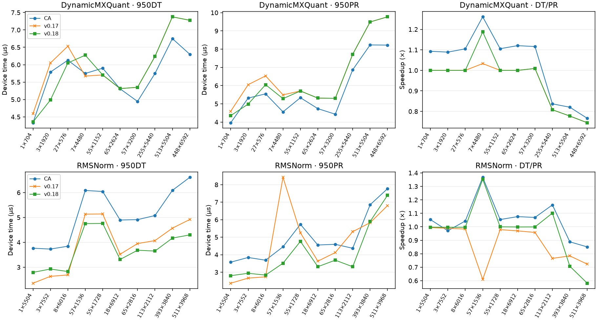

# 算子耗时预测与 CA 校准误差

| 算子 | 计时资格与数据角色 | DT N | DT WAPE / 最大 | PR N | PR WAPE / 最大 | DT/PR 倍速 WAPE / 最大 | 970DT 外推范围 µs |
|---|---|---|---|---|---|---|---|
| dynamicMXquant | DT 阶段定价，v0.18 双端冻结留出 | 10 | 7.25% / 15.51% | 10 | 12.98% / 19.65% | 7.63% / 10.76% | 3.990–6.711 |
| Matmul | DT 资源定价，沿用 v0.17 留出 | 10 | 5.05% / 9.12% | 10 | 5.20% / 12.57% | 2.34% / 6.78% | 2.949–3.740 |
| FA | DT 资源定价，沿用 v0.17 留出 | 10 | 2.23% / 6.68% | 10 | 4.97% / 8.08% | 5.18% / 8.98% | 8.190–39.690 |
| RMSNorm | DT 阶段定价，v0.18 双端冻结留出 | 10 | 27.20% / 35.01% | 10 | 18.16% / 27.20% | 8.12% / 31.68% | 2.559–4.387 |
| Addmm | DT 阶段校准，沿用 v0.17 留出 | 10 | 6.10% / 17.03% | 10 | 20.46% / 51.51% | 11.60% / 32.62% | 3.210–4.314 |
| Lightning Indexer | DT 阶段校准，沿用 v0.17 留出 | 10 | 9.14% / 20.35% | 10 | 11.88% / 26.51% | 3.26% / 5.57% | 5.288–12.188 |
| mHC Pre | DT 阶段校准，沿用 v0.17 留出 | 10 | 3.63% / 9.62% | 10 | 6.10% / 10.75% | 5.81% / 9.02% | 7.679–8.780 |
| mHC Sinkhorn | DT 阶段校准，沿用 v0.17 留出 | 10 | 10.22% / 21.47% | 10 | 12.19% / 61.39% | 12.79% / 50.74% | 2.820–7.134 |
| mHC PreSinkhorn | DT 阶段校准，沿用 v0.17 留出 | 10 | 4.90% / 13.70% | 10 | 25.53% / 35.48% | 23.79% / 31.92% | 8.623–8.628 |
| mHC Post | DT 阶段校准，沿用 v0.17 留出 | 10 | 22.11% / 90.22% | 10 | 16.48% / 36.88% | 21.56% / 90.70% | 1.856–3.859 |
| mHC组合 | DT 阶段校准，沿用 v0.17 留出 | 10 | 2.40% / 7.20% | 10 | 4.19% / 9.37% | 2.40% / 3.98% | 15.494–16.909 |
| KDA recurrent | DT 阶段校准，沿用 v0.17 留出 | 10 | 8.93% / 17.55% | 10 | 4.35% / 10.41% | 9.71% / 23.02% | 13.804–36.081 |
| KDA chunk | 仅结构，CA 同步失败 | 0 | N/A | 0 | N/A | N/A | N/A |
| GMM1–SwiGLU–MX量化 | DT 阶段校准，沿用 v0.17 留出 | 10 | 6.95% / 32.74% | 10 | 10.77% / 34.79% | 3.82% / 7.22% | 6.666–9.104 |
| MoE GMM2 | DT 阶段校准，沿用 v0.17 留出 | 10 | 7.23% / 14.48% | 10 | 7.91% / 20.59% | 4.11% / 13.58% | 3.125–3.387 |
| MoE FFN组合 | DT 阶段校准，沿用 v0.17 留出 | 10 | 4.80% / 22.63% | 10 | 7.83% / 23.61% | 3.27% / 9.30% | 9.792–12.490 |

WAPE = Σ|预测−观测| / Σ观测；最大值是单例绝对相对误差。逐例倍速为同一 shape 的 DT 时间 / PR 时间，大于 1 表示 PR 更快。970DT 全列均为沿用 950 实现策略及部分每核成本的外推。

两条更新路线的汇总只使用新留出。另 13 条可计时路线的实现和验证集沿用 v0.17；其中部分配对使用历史 DT compact trace 和 PR 官方 trace，采集方式有别。Chunk KDA 的设备时间继续为 N/A。

| 配置项 | 950DT_9582 | 950PR_957b | 970DT 情景 |
|---|---|---|---|
| 频率 GHz | 1.65 | 1.65 | 1.8 |
| Cube / Vector 核 | 32 / 64 | 28 / 56 | 120 / 120 |
| Cube 32/16/8/4 位 TOP/s | 未知 / 432 / 865 / 1730 | 未知 / 378 / 756 / 1513 | 未知 / 1770 / 3540 / 14160 |
| Vector 32/16/8/4 位 TOP/s | 27 / 54 / 54 / 未知 | 23 / 47 / 47 / 未知 | 55.296 / 110.592 / 110.592 / 未知 |
| 外存容量 GB | 103.08 | 120.26 | 288.00 |
| 整片外存带宽 GB/s | 4000 | 1400 | 14400 |
| L2 容量、整片峰值 | 128 MiB，带宽未知 | 112 MiB，带宽未知 | 200 MB，30000 GB/s |
| 每核 UB / L1 | 248 / 512 KiB | 248 / 512 KiB | 继承 DT 的 248 / 512 KiB |
| 本次 CA 外存子模型 | HBM3、2 通道 | LPDDR5、1 通道 | 无目标 CA |

PR 比 DT 少 12.5% 的 AIC/AIV、名义片外带宽低 65%，单个 BF16 Cube 核的名义吞吐相等。970 的资源与绑定比例来自情景配置；其 Vector 峰值含两路发射，2 operation/MAC 只计一次。PR 的 1400 GB/s 是按容量匹配的档位，CA 日志中的通道仅指其模拟子模型。各 SKU 缺少实际 MTE 峰值、缓存命中或首读延迟时继承阶段假设。严格 FP32 Cube 在三者均未登记。[DT](../configs/chips/Ascend950DT_9582.json) · [PR](../configs/chips/Ascend950PR_957b.json) · [970DT](../configs/chips/Ascend970DT.json) · [模拟器外存日志](../results/v0.13/sku/memory-models.json)

## 冻结后同集比较

每个单元格为 WAPE / 最大绝对相对误差。Quant 两版都用 resource。RMSNorm 旧版使用当时可用的 auto，新版在两端使用 resource；沿用旧 DT auto 的应用仍可复现历史校准值。

| 算子 | DT v0.17 | DT v0.18 | PR v0.17 | PR v0.18 | 倍速 v0.17 | 倍速 v0.18 |
|---|---|---|---|---|---|---|
| DynamicMXQuant | 6.50% / 15.51% | 7.25% / 15.51% | 15.31% / 20.45% | 12.98% / 19.65% | 9.13% / 18.07% | 7.63% / 10.76% |
| RMSNorm | 23.66% / 37.39% | 27.20% / 35.01% | 24.53% / 89.17% | 18.16% / 27.20% | 17.23% / 55.41% | 8.12% / 31.68% |

图中每个点都是同一 shape 的完整 CA 窗口。横轴按元素数排序；分核、尾块和核的首发偏斜都可使相邻点的时间不单调。

### DynamicMXQuant

ops-nn · `aclnnDynamicMxQuant`。BF16，本卡 [行,通道]，设备窗口取全核最早指令到最晚指令。

| shape | DT/PR kernel | DT 旧/新/CA µs | 新误差 | PR 旧/新/CA µs | 新误差 | DT/PR 旧/新/CA | 970 外推 µs | AIV 预测→CA DT / PR |
|---|---|---|---|---|---|---|---|---|
| 1×704 | K1/K1 | 4.593 / 4.352 / 4.332 | +0.5% | 4.593 / 4.352 / 3.964 | +9.8% | 1.000 / 1.000 / 1.093 | 3.990 | 3→3 / 3→3 |
| 3×1920 | K1/K1 | 6.049 / 4.985 / 5.788 | -13.9% | 6.049 / 4.985 / 5.315 | -6.2% | 1.000 / 1.000 / 1.089 | 4.570 | 24→24 / 24→24 |
| 7×4480 | K1/K1 | 5.673 / 6.274 / 5.748 | +9.1% | 5.491 / 5.284 / 4.559 | +15.9% | 1.033 / 1.187 / 1.261 | 5.751 | 63→63 / 35→35 |
| 27×576 | K1/K1 | 6.532 / 6.050 / 6.130 | -1.3% | 6.532 / 6.050 / 5.547 | +9.1% | 1.000 / 1.000 / 1.105 | 6.474 | 54→54 / 54→54 |
| 55×1152 | K1/K1 | 5.705 / 5.705 / 5.900 | -3.3% | 5.705 / 5.705 / 5.336 | +6.9% | 1.000 / 1.000 / 1.106 | 6.547 | 56→56 / 56→56 |
| 57×3200 | K1/K1 | 5.350 / 5.350 / 4.945 | +8.2% | 5.301 / 5.301 / 4.430 | +19.7% | 1.009 / 1.009 / 1.116 | 5.464 | 58→58 / 29→29 |
| 65×2624 | K1/K1 | 5.314 / 5.314 / 5.306 | +0.1% | 5.314 / 5.314 / 4.736 | +12.2% | 1.000 / 1.000 / 1.120 | 5.413 | 44→44 / 44→44 |
| 255×5440 | K1/K1 | 6.237 / 6.237 / 5.747 | +8.5% | 7.719 / 7.719 / 6.868 | +12.4% | 0.808 / 0.808 / 0.837 | 6.069 | 64→64 / 48→48 |
| 448×6592 | K1/K1 | 7.277 / 7.277 / 6.300 | +15.5% | 9.771 / 9.771 / 8.222 | +18.8% | 0.745 / 0.745 / 0.766 | 6.711 | 64→64 / 56→56 |
| 513×5504 | K1/K1 | 7.376 / 7.376 / 6.751 | +9.3% | 9.491 / 9.491 / 8.230 | +15.3% | 0.777 / 0.777 / 0.820 | 6.077 | 64→64 / 56→56 |

K1 · DynamicMxQuant_bf16toe4m3_high_performance_33_mix_aiv

新留出 DT / PR 的活动 AIV 数分别吻合 10/10、10/10。PR 最大误差为 [57, 3200]，v0.17、新模型和 CA 分别为 5.301、5.301、4.430 µs。十例合计时延的 DT/PR 比值为 CA 0.995×、模型 0.921×。

[队列、参数与原始偏差来源](../results/v0.18/quant-method.md) · [工作量到设备时间的算例](examples/quant.md)

### RMSNorm

ops-nn · `aclnnRmsNorm`。BF16，本卡 [行,通道]，设备窗口取全核最早指令到最晚指令。

| shape | DT/PR kernel | DT 旧/新/CA µs | 新误差 | PR 旧/新/CA µs | 新误差 | DT/PR 旧/新/CA | 970 外推 µs | AIV 预测→CA DT / PR |
|---|---|---|---|---|---|---|---|---|
| 1×5504 | K1/K1 | 2.356 / 2.792 / 3.763 | -25.8% | 2.370 / 2.800 / 3.573 | -21.6% | 0.994 / 0.997 / 1.053 | 2.559 | 1→1 / 1→1 |
| 3×7552 | K1/K1 | 2.632 / 2.926 / 3.728 | -21.5% | 2.662 / 2.938 / 3.841 | -23.5% | 0.989 / 0.996 / 0.971 | 2.682 | 3→3 / 3→3 |
| 8×6016 | K1/K1 | 2.688 / 2.825 / 3.844 | -26.5% | 2.733 / 2.835 / 3.685 | -23.1% | 0.984 / 0.997 / 1.043 | 2.589 | 8→8 / 8→8 |
| 18×6912 | K1/K1 | 3.520 / 3.310 / 4.897 | -32.4% | 3.630 / 3.315 / 4.553 | -27.2% | 0.970 / 0.999 / 1.075 | 3.034 | 18→18 / 18→18 |
| 55×1728 | K1/K1 | 5.139 / 4.759 / 6.044 | -21.3% | 5.250 / 4.761 / 5.736 | -17.0% | 0.979 / 1.000 / 1.054 | 4.363 | 55→55 / 55→55 |
| 57×1536 | K1/K1 | 5.133 / 4.753 / 6.085 | -21.9% | 8.420 / 3.513 / 4.451 | -21.1% | 0.610 / 1.353 / 1.367 | 4.357 | 57→57 / 29→29 |
| 65×2816 | K1/K1 | 3.949 / 3.682 / 4.912 | -25.0% | 4.121 / 3.686 / 4.593 | -19.8% | 0.958 / 0.999 / 1.069 | 4.387 | 33→33 / 33→33 |
| 113×2112 | K1/K1 | 4.068 / 3.649 / 5.076 | -28.1% | 5.314 / 3.313 / 4.367 | -24.2% | 0.765 / 1.102 / 1.162 | 4.372 | 57→57 / 38→38 |
| 393×3840 | K1/K1 | 4.569 / 4.170 / 6.088 | -31.5% | 5.828 / 5.897 / 6.853 | -14.0% | 0.784 / 0.707 / 0.888 | 3.146 | 57→57 / 50→50 |
| 511×3968 | K1/K1 | 4.918 / 4.298 / 6.613 | -35.0% | 6.804 / 7.395 / 7.773 | -4.9% | 0.723 / 0.581 / 0.851 | 3.410 | 64→64 / 52→52 |

K1 · RmsNorm_normal_all_bf16_high_performance_5000

新留出 DT / PR 的活动 AIV 数分别吻合 10/10、10/10。PR 最大误差为 [18, 6912]，v0.17、新模型和 CA 分别为 3.630、3.315、4.553 µs。十例合计时延的 DT/PR 比值为 CA 1.033×、模型 0.919×。

[队列、参数与原始偏差来源](../results/v0.18/rms-method.md) · [工作量到设备时间的算例](examples/rmsnorm.md)

## 系统调用默认模式时的实际差别

950DT 的 auto 保留原来的 DT 校准入口，950PR 的 auto 对这两条路线等同新版 resource。默认调用会同时使用两种模型。下表在同一新留出上对照，列中均为 WAPE / 最大绝对相对误差。

| 算子 | DT auto | DT resource | 两端 auto 的倍速 | 两端 resource 的倍速 |
|---|---|---|---|---|
| DynamicMXQuant | 7.35% / 13.49% | 7.25% / 15.51% | 10.73% / 18.78% | 7.63% / 10.76% |
| RMSNorm | 23.66% / 37.39% | 27.20% / 35.01% | 8.37% / 21.82% | 8.12% / 31.68% |

## 新留出的流水与分组误差

末核指该次 CA 最后发完的 AIV。MTE3 忙时取其有效指令的时间并集，减去与 SIMD 的交集后得到暴露写窗口。DMA 在途可包含等待；下表单位为 µs。

### DynamicMXQuant

| 预登记组 | N | DT 旧 | DT 新 | PR 旧 | PR 新 | 倍速旧 | 倍速新 |
|---|---|---|---|---|---|---|---|
| core-boundary | 3 | 3.76% / 8.20% | 3.76% / 8.20% | 12.53% / 19.65% | 12.53% / 19.65% | 9.96% / 10.76% | 9.96% / 10.76% |
| large | 3 | 11.13% / 15.51% | 11.13% / 15.51% | 15.70% / 18.85% | 15.70% / 18.85% | 3.85% / 5.25% | 3.85% / 5.25% |
| ordinary | 1 | 6.56% / 6.56% | 1.30% / 1.30% | 17.75% / 17.75% | 9.07% / 9.07% | 9.50% / 9.50% | 9.50% / 9.50% |
| small-wide | 2 | 2.92% / 4.52% | 11.51% / 13.86% | 16.88% / 20.45% | 10.68% / 15.90% | 13.48% / 18.07% | 6.92% / 8.17% |
| tiny | 1 | 6.01% / 6.01% | 0.47% / 0.47% | 15.87% / 15.87% | 9.81% / 9.81% | 8.51% / 8.51% | 8.51% / 8.51% |

| shape | 模型路径 | 最忙核轮数 | 峰值写者数 | 模型排队 µs | 末核写描述符数 | MTE2 CA | MTE3 CA | 与 SIMD 重叠 CA |
|---|---|---|---|---|---|---|---|---|
| [1, 704] | 按核写粒度排队 | 1 | 3 | 0.276 | 2 | 0.773 | 0.245 | 0.000 |
| [3, 1920] | 按核写粒度排队 | 1 | 5 | 0.764 | 2 | 0.936 | 1.799 | 0.000 |
| [7, 4480] | 按核写粒度排队 | 1 | 3 | 0.992 | 2 | 0.964 | 0.654 | 0.000 |
| [27, 576] | 按核写粒度排队 | 1 | 5 | 1.661 | 2 | 0.904 | 1.128 | 0.000 |
| [55, 1152] | 原 UB 流水 | 1 | 3 | 0.921 | 2 | 0.838 | 0.762 | 0.000 |
| [57, 3200] | 原 UB 流水 | 1 | 2 | 0.385 | 2 | 1.009 | 0.452 | 0.000 |
| [65, 2624] | 原 UB 流水 | 1 | 2 | 0.433 | 2 | 0.852 | 0.669 | 0.000 |
| [255, 5440] | 原 UB 流水 | 1 | 3 | 0.886 | 2 | 1.958 | 0.693 | 0.000 |
| [448, 6592] | 原 UB 流水 | 2 | 2 | 0.461 | 4 | 3.062 | 0.757 | 0.408 |
| [513, 5504] | 原 UB 流水 | 2 | 2 | 0.461 | 2 | 2.647 | 1.018 | 0.000 |

峰值写者数按地址计算，不能直接推断关键核一定等待所有这些核。模型排队列是一次关键请求的增量，CA 忙时列是全窗口指令并集，两者口径不同。仍走原 UB 流水的样例可检验通用修正是否越过证据覆盖的范围。

PR 的 4 个短写输入实际改变了预测，这组 PR WAPE 从 16.92% 到 10.04%。其余 6 例仍走原 UB 流水。DT [3,1920] 从高估变为低估，[7,4480] 的估计则往相反方向移动；这两点拉高了 DT 整组 WAPE。当前发起顺序和排队间隔仍是按 DT 指令归纳的有效值，不能解释成硬件仲裁顺序的测量。

### RMSNorm

| 预登记组 | N | DT 旧 | DT 新 | PR 旧 | PR 新 | 倍速旧 | 倍速新 |
|---|---|---|---|---|---|---|---|
| core-boundary | 3 | 16.54% / 19.60% | 22.57% / 25.04% | 33.33% / 89.17% | 19.08% / 21.07% | 27.03% / 55.41% | 3.97% / 6.59% |
| large | 2 | 25.31% / 25.63% | 33.33% / 35.01% | 13.64% / 14.96% | 9.12% / 13.95% | 13.36% / 15.03% | 25.92% / 31.68% |
| ordinary | 1 | 19.86% / 19.86% | 28.12% / 28.12% | 21.68% / 21.68% | 24.15% / 24.15% | 34.14% / 34.14% | 5.24% / 5.24% |
| small-wide | 4 | 31.02% / 37.39% | 26.98% / 32.40% | 27.19% / 33.66% | 24.05% / 27.20% | 5.86% / 9.84% | 4.95% / 7.16% |

| shape | PR 最忙核行数 | UB 各轮行数 | 末核写描述符数 | MTE3 CA | 重叠 CA | 暴露 CA | 暴露预测 | 首次 / 扩核 / 热态预测 |
|---|---|---|---|---|---|---|---|---|
| [1, 5504] | 1 | [1] | 2 | 0.343 | 0.000 | 0.343 | 0.226 | 3.857 / 3.703 / 2.198 |
| [3, 7552] | 1 | [1] | 2 | 0.542 | 0.130 | 0.412 | 0.242 | 3.985 / 3.832 / 2.326 |
| [8, 6016] | 1 | [1] | 2 | 0.727 | 0.203 | 0.524 | 0.230 | 3.889 / 3.735 / 2.230 |
| [18, 6912] | 1 | [1] | 2 | 1.402 | 0.228 | 1.175 | 0.633 | 4.340 / 4.187 / 2.682 |
| [55, 1728] | 1 | [1] | 2 | 2.610 | 0.073 | 2.536 | 2.304 | 5.730 / 5.577 / 4.071 |
| [57, 1536] | 2 | [2] | 2 | 1.582 | 0.113 | 1.468 | 1.032 | 4.528 / 4.375 / 2.870 |
| [65, 2816] | 2 | [2] | 2 | 1.361 | 0.189 | 1.172 | 1.056 | 4.693 / 4.540 / 3.035 |
| [113, 2112] | 3 | [3] | 2 | 1.176 | 0.210 | 0.965 | 0.651 | 4.338 / 4.184 / 2.679 |
| [393, 3840] | 8 | [7, 1] | 4 | 1.095 | 0.505 | 0.590 | 0.258 | 6.312 / 6.673 / 5.282 |
| [511, 3968] | 10 | [7, 3] | 4 | 1.097 | 0.764 | 0.333 | 0.276 | 7.794 / 8.155 / 6.764 |

这批 CA 的采集条件为隔离首次调用。若系统调度器显式传入 resident_aiv=0，DT 和 PR WAPE 分别为 8.83%、3.28%。主表保留未提供该信息时的预测；未知态和首次态回答不同的系统问题。

未知驻留的单值按三态极端误差平衡，包含热态的较短控制时长。新 CA 每个都是独立进程的首次调用；即使分核正确，这种比较仍可能表现为系统性低估。提供状态后的结果检验的是同一模型的条件分支。

[两端逐核 DMA 指令、忙时、地址对应程序计数器与 trace 校验值](../results/v0.18/sku/trace-evidence.json)

## 开发回放及误差来源

RMSNorm [64,2048] 在 PR 上由 32 核各处理两行。旧版虽给出正确核数，却放大了 DT 上每核一行、64 个写者的写回成本。旧版、新版和 CA 的暴露写回分别是 4.640、1.101 和 0.968 µs。新版未知态的剩余低估主要在 SCALAR 和核到达；已知首次 H=0 的预测为 4.654 µs。

Quant [5,320] 的 PR 最晚核写 2 B scale，与 4 个生产者共享该区段（含自身）；全片最拥挤区段有 7 个写者。旧版对最忙核叠加最坏竞争。新版按请求就绪次序定价，仍预测了不同的末核，因此残余误差不能全部归为写回。32 B 区段及请求返回间隔是模型假设，实际物理仲裁器尚未确定。

下列旧样本参与了本轮诊断。表中的 CA 沿用原归档，倍速受采集方式与调用状态影响。
### DynamicMXQuant

ops-nn · `aclnnDynamicMxQuant`。BF16，本卡 [行,通道]，设备窗口取全核最早指令到最晚指令。

| shape | DT/PR kernel | DT 旧/新/CA µs | 新误差 | PR 旧/新/CA µs | 新误差 | DT/PR 旧/新/CA | 970 外推 µs | AIV 预测→CA DT / PR |
|---|---|---|---|---|---|---|---|---|
| 1×256 | K1/K1 | 4.207 / 4.207 / 4.493 | -6.4% | 4.207 / 4.207 / 3.859 | +9.0% | 1.000 / 1.000 / 1.164 | 3.857 | 1→1 / 1→1 |
| 5×320 | K1/K1 | 6.069 / 5.188 / 4.662 | +11.3% | 6.069 / 5.188 / 4.592 | +13.0% | 1.000 / 1.000 / 1.015 | 4.756 | 10→10 / 10→10 |
| 19×1024 | K1/K1 | 5.936 / 5.441 / 6.230 | -12.7% | 5.936 / 5.441 / 5.983 | -9.1% | 1.000 / 1.000 / 1.041 | 6.169 | 40→40 / 40→40 |
| 30×768 | K1/K1 | 5.656 / 6.141 / 5.472 | +12.2% | 5.437 / 5.104 / 4.917 | +3.8% | 1.040 / 1.203 / 1.113 | 6.647 | 60→60 / 30→30 |
| 9×4096 | K1/K1 | 5.116 / 5.405 / 5.465 | -1.1% | 5.116 / 5.406 / 4.825 | +12.0% | 1.000 / 1.000 / 1.133 | 6.038 | 40→40 / 40→40 |
| 56×4096 | K1/K1 | 5.349 / 5.349 / 6.285 | -14.9% | 4.882 / 4.882 / 4.513 | +8.2% | 1.096 / 1.096 / 1.393 | 4.462 | 64→64 / 56→56 |
| 144×5120 | K1/K1 | 5.778 / 5.778 / 5.905 | -2.2% | 5.486 / 5.486 / 5.984 | -8.3% | 1.053 / 1.053 / 0.987 | 4.653 | 58→58 / 55→55 |
| 384×4096 | K1/K1 | 5.895 / 5.895 / 6.673 | -11.7% | 7.469 / 7.469 / 7.332 | +1.9% | 0.789 / 0.789 / 0.910 | 5.009 | 64→64 / 56→56 |
| 512×5120 | K1/K1 | 6.564 / 6.564 / 6.299 | +4.2% | 9.049 / 9.049 / 7.690 | +17.7% | 0.725 / 0.725 / 0.819 | 5.864 | 64→64 / 54→54 |
| 576×7168 | K2/K1 | 7.406 / 7.406 / 7.758 | -4.5% | 12.317 / 12.317 / 10.007 | +23.1% | 0.601 / 0.601 / 0.775 | 6.524 | 64→64 / 56→56 |

K1 · DynamicMxQuant_bf16toe4m3_high_performance_33_mix_aiv
K2 · entry_kernel_21

### RMSNorm

ops-nn · `aclnnRmsNorm`。BF16，本卡 [行,通道]，设备窗口取全核最早指令到最晚指令。

| shape | DT/PR kernel | DT 旧/新/CA µs | 新误差 | PR 旧/新/CA µs | 新误差 | DT/PR 旧/新/CA | 970 外推 µs | AIV 预测→CA DT / PR |
|---|---|---|---|---|---|---|---|---|
| 9×5120 | K1/K1 | 2.709 / 2.766 / 4.161 | -33.5% | 2.750 / 2.774 / 3.748 | -26.0% | 0.985 / 0.997 / 1.110 | 2.535 | 9→9 / 9→9 |
| 36×7168 | K2/K1 | 5.122 / 4.896 / 6.614 | -26.0% | 5.418 / 4.901 / 6.468 | -24.2% | 0.945 / 0.999 / 1.023 | 4.488 | 36→36 / 36→36 |
| 1×128 | K2/K1 | 2.027 / 2.434 / 3.454 | -29.5% | 2.031 / 2.435 / 3.129 | -22.2% | 0.998 / 1.000 / 1.104 | 2.231 | 1→1 / 1→1 |
| 1×256 | K2/K1 | 2.034 / 2.443 / 3.637 | -32.8% | 2.039 / 2.443 / 3.155 | -22.5% | 0.998 / 1.000 / 1.153 | 2.239 | 1→1 / 1→1 |
| 4×512 | K2/K1 | 2.276 / 2.460 / 4.292 | -42.7% | 2.282 / 2.461 / 3.473 | -29.1% | 0.997 / 1.000 / 1.236 | 2.255 | 4→4 / 4→4 |
| 16×1024 | K2/K1 | 3.002 / 3.000 / 3.815 | -21.4% | 3.021 / 3.001 / 4.242 | -29.3% | 0.994 / 1.000 / 0.899 | 2.750 | 16→16 / 16→16 |
| 9×7168 | K2/K1 | 2.834 / 2.901 / 2.790 | +4.0% | 2.892 / 2.912 / 3.776 | -22.9% | 0.980 / 0.996 / 0.739 | 2.659 | 9→9 / 9→9 |
| 36×5120 | K2/K1 | 5.071 / 4.844 / 5.289 | -8.4% | 5.286 / 4.848 / 6.183 | -21.6% | 0.959 / 0.999 / 0.855 | 4.440 | 36→36 / 36→36 |
| 32×4096 | K2/K1 | 5.046 / 4.818 / 4.581 | +5.2% | 5.201 / 4.821 / 6.096 | -20.9% | 0.970 / 0.999 / 0.751 | 4.416 | 32→32 / 32→32 |
| 64×2048 | K2/K1 | 5.371 / 4.766 / 4.352 | +9.5% | 8.709 / 3.645 / 4.568 | -20.2% | 0.617 / 1.307 / 0.953 | 4.369 | 64→64 / 32→32 |

K1 · RmsNorm_normal_all_bf16_high_performance_5000
K2 · entry_kernel_1388

## 仿真成本与计时资格

隔离安装 wheel 后的 453 次预测，中位 0.199 ms、P95 0.640 ms、最大 9.294 ms，导入另计 39.62 ms。

本次 CA 共 41 次物理尝试，实际并行历时 17.85 分钟，原始数据 16.19 GiB，其中 40 次通过完整窗口与数值检查。两端沿用同一 host 参数；每条记录包含 SKU、实际 kernel、数值检查、二进制摘要与逐核窗口。 [新留出双端证据](../results/v0.18/sku/pairs.json) · [预算与采集成本](../results/v0.18/sku/campaign-completion.json) · [预测开销](../results/v0.18/wheel-smoke.json)

## 其余路线逐例与库身份

下列路线的 v0.17 预测及 CA 至今适用。D 为两端新采同宿主，A 为同后端复用历史 DT，M 为跨后端配对。旧资料标注的“本轮”指 v0.17 验证。

### Matmul

ops-nn · aclnnMatmul。

| 本卡 shape 与可变属性 | DT / PR kernel | DT 预测 / CA | DT 误差 | PR 预测 / CA | PR 误差 | 970 外推 | 倍速预测 / CA | PR 核数 | 配对 |
|---|---|---|---|---|---|---|---|---|---|
| 3×64×64 | K1 / K1 | 3.217 / 3.065 | +4.94% | 3.217 / 2.858 | +12.57% | 2.949 | 1.000 / 1.073 | 1/0→1/0 | D |
| 8×96×256 | K1 / K1 | 3.702 / 3.755 | -1.41% | 3.702 / 3.620 | +2.27% | 3.393 | 1.000 / 1.037 | 2/0→2/0 | D |
| 33×128×129 | K1 / K1 | 3.513 / 3.671 | -4.30% | 3.513 / 3.679 | -4.50% | 3.220 | 1.000 / 0.998 | 6/0→6/0 | D |
| 127×384×256 | K1 / K1 | 3.954 / 3.819 | +3.52% | 3.956 / 3.793 | +4.31% | 3.630 | 0.999 / 1.007 | 24/0→24/0 | D |
| 225×512×256 | K1 / K1 | 4.079 / 4.113 | -0.81% | 4.225 / 4.116 | +2.64% | 3.697 | 0.966 / 0.999 | 24/0→24/0 | D |
| 449×512×256 | K1 / K1 | 4.759 / 4.361 | +9.12% | 4.826 / 4.595 | +5.04% | 3.740 | 0.986 / 0.949 | 24/0→24/0 | D |
| 1024×1792×32 | K1 / K1 | 4.610 / 4.260 | +8.22% | 4.709 / 4.347 | +8.33% | 3.477 | 0.979 / 0.980 | 28/0→28/0 | D |
| 1536×1792×16 | K1 / K1 | 4.680 / 4.438 | +5.45% | 4.818 / 4.540 | +6.13% | 3.490 | 0.971 / 0.978 | 28/0→28/0 | D |
| 1024×2304×16 | K1 / K1 | 4.531 / 4.258 | +6.43% | 4.648 / 4.419 | +5.19% | 3.450 | 0.975 / 0.964 | 28/0→28/0 | D |
| 1280×2048×16 | K1 / K1 | 4.630 / 4.397 | +5.31% | 4.762 / 4.633 | +2.78% | 3.481 | 0.972 / 0.949 | 28/0→28/0 | D |

K1 · MatMulV3_ND_ND_ND_ND_BF16_BF16_BF16_BF16_high_performance_2

PR 最大误差 [3, 64, 64] 的设备预测 3.217、CA 2.858 µs（+12.57%）；CA 的串行 kernel 窗口依次 2.858 µs，记录 1 条 MMAD。新尾波分块和跨波重复发起可用 MMAD/FIX 时间线核查。剩余的 A/B 复用、写回暴露比例和全片有效带宽仍是近似。

PR 芯片上，预测活动 AIC/AIV 同时与 CA 对齐 10/10 例。

此例 PR 模型的阶段分解（µs）为 read_fill 0.816、l0_lead 0.048、page_intervals 0.000、last_mmad 0.070、write_tail 0.233、additional_output_waves 0.000、shared_link_floor 0.000、launch 2.049。

在所有有效核上加总 MMAD，模型与 PR trace 总数相同 10/10 例；最大时延误差的这个 shape 预测 1、实测 1 条。

在本轮大 shape 上逐条读取 MMAD 的实际 (m,n,k) 并按形状计数。已有 4 个不同 shape、8 个 DT/PR 窗口；其中 8/8 个窗口的尺寸直方图与冻结模型完全相同。

### FA

ops-transformer · aclnnFlashAttentionScoreV2。

| 本卡 shape 与可变属性 | DT / PR kernel | DT 预测 / CA | DT 误差 | PR 预测 / CA | PR 误差 | 970 外推 | 倍速预测 / CA | PR 核数 | 配对 |
|---|---|---|---|---|---|---|---|---|---|
| 17×192×128×1×1 | K1 / K1 | 9.266 / 9.050 | +2.38% | 9.269 / 8.833 | +4.94% | 8.670 | 1.000 / 1.025 | 1/2→1/2 | A |
| 4×160×64×1×1 | K2 / K3 | 8.956 / 9.461 | -5.34% | 8.956 / 8.657 | +3.46% | 8.220 | 1.000 / 1.093 | 1/2→1/2 | M |
| 8×128×128×1×1 | K4 / K1 | 8.889 / 9.136 | -2.70% | 8.890 / 8.317 | +6.89% | 8.190 | 1.000 / 1.098 | 1/2→1/2 | M |
| 3×192×64×1×2 | K3 / K3 | 8.955 / 9.167 | -2.31% | 8.955 / 8.766 | +2.15% | 8.214 | 1.000 / 1.046 | 2/4→2/4 | D |
| 9×384×64×1×1 | K3 / K3 | 9.239 / 9.455 | -2.28% | 9.240 / 8.834 | +4.60% | 8.490 | 1.000 / 1.070 | 1/2→1/2 | D |
| 17×512×128×1×1 | K1 / K1 | 10.496 / 10.595 | -0.94% | 10.498 / 10.058 | +4.38% | 9.777 | 1.000 / 1.053 | 1/2→1/2 | D |
| 9×1023×64×1×1 | K3 / K3 | 10.532 / 11.287 | -6.68% | 10.533 / 10.985 | -4.11% | 9.676 | 1.000 / 1.027 | 1/2→1/2 | D |
| 9×3072×64×1×1 | K5 / K5 | 16.380 / 16.010 | +2.31% | 16.380 / 15.156 | +8.08% | 15.036 | 1.000 / 1.056 | 1/2→1/2 | D |
| 9×8191×64×1×1 | K5 / K5 | 26.724 / 26.269 | +1.73% | 26.725 / 25.197 | +6.06% | 24.518 | 1.000 / 1.043 | 1/2→1/2 | D |
| 9×16384×64×1×1 | K5 / K5 | 43.275 / 42.932 | +0.80% | 43.276 / 41.556 | +4.14% | 39.690 | 1.000 / 1.033 | 1/2→1/2 | D |

K1 · FlashAttentionScore_50348df09d0b3ee451d3693a6b2ab3f5_2328361009230643744_mix_aic

K2 · entry_kernel_2050000040100220

K3 · FlashAttentionScore_50348df09d0b3ee451d3693a6b2ab3f5_2328361008425337376_mix_aic

K4 · entry_kernel_2050000070100220

K5 · FlashAttentionScore_50348df09d0b3ee451d3693a6b2ab3f5_2328361008425599520_mix_aic

PR 最大误差 [9, 3072, 64, 1, 1] 的设备预测 16.380、CA 15.156 µs（+8.08%）；CA 的串行 kernel 窗口依次 15.156 µs，记录 48 条 MMAD。KV 小块中首发、同步及排空权重大，长循环对稳态间隔更敏感；单条完整窗口不能分离不同端口反压。

PR 芯片上，预测活动 AIC/AIV 同时与 CA 对齐 10/10 例。

此例 PR 模型的阶段分解（µs）为 launch 6.479、first_tile 3.877、steady 5.689、drain 0.335。

在所有有效核上加总 MMAD，模型与 PR trace 总数相同 10/10 例；最大时延误差的这个 shape 预测 48、实测 48 条。

### Addmm

ops-nn · aclnnAddmm。

| 本卡 shape 与可变属性 | DT / PR kernel | DT 预测 / CA | DT 误差 | PR 预测 / CA | PR 误差 | 970 外推 | 倍速预测 / CA | PR 核数 | 配对 |
|---|---|---|---|---|---|---|---|---|---|
| 16×64×256 self_shape=[64] | K1 / K1 | 3.650 / 3.588 | +1.72% | 3.650 / 3.215 | +13.54% | 3.345 | 1.000 / 1.116 | 1/0→1/0 | D |
| 9×64×128 self_shape=[64] | K2 / K1 | 3.578 / 3.342 | +7.04% | 3.578 / 3.059 | +16.95% | 3.279 | 1.000 / 1.093 | 1/0→1/0 | M |
| 2×16×16 self_shape=[16] | K2 / K1 | 3.502 / 2.992 | +17.03% | 3.502 / 2.728 | +28.36% | 3.210 | 1.000 / 1.097 | 1/0→1/0 | M |
| 128×192×256 self_shape=[192] | K2 / K1 | 3.861 / 3.763 | +2.59% | 3.864 / 3.753 | +2.94% | 3.538 | 0.999 / 1.003 | 24/0→24/0 | M |
| 16×192×384 self_shape=[192] | K2 / K1 | 3.745 / 3.877 | -3.40% | 3.748 / 3.741 | +0.20% | 3.432 | 0.999 / 1.036 | 3/0→3/0 | M |
| 256×512×256 self_shape=[512] | K2 / K1 | 4.237 / 4.327 | -2.09% | 6.146 / 4.230 | +45.30% | 3.880 | 0.689 / 1.023 | 28/0→24/0 | M |
| 4×80×48 self_shape=[80] | K2 / K1 | 3.577 / 3.625 | -1.33% | 3.577 / 3.307 | +8.18% | 3.279 | 1.000 / 1.096 | 2/0→2/0 | M |
| 512×512×256 self_shape=[512] | K2 / K1 | 4.713 / 4.479 | +5.22% | 7.101 / 4.687 | +51.51% | 4.314 | 0.664 / 0.956 | 28/0→28/0 | M |
| 64×128×512 self_shape=[128] | K2 / K1 | 3.835 / 4.519 | -15.15% | 3.871 / 4.293 | -9.82% | 3.512 | 0.991 / 1.053 | 8/0→8/0 | M |
| 1×32×16 self_shape=[32] | K2 / K1 | 3.502 / 3.288 | +6.51% | 3.502 / 3.002 | +16.66% | 3.210 | 1.000 / 1.095 | 1/0→1/0 | M |

K1 · MatMulV3_ND_ND_ND_ND_BF16_BF16_BF16_BF16_high_performance_2

K2 · entry_kernel_2

PR 最大误差 [512, 512, 256] 的设备预测 7.101、CA 4.687 µs（+51.51%）；CA 的串行 kernel 窗口依次 4.687 µs，记录 56 条 MMAD。目标沿用参考分块的启动与队列重叠比例，偏置/矩阵输入的读流量不同；有限目标样本未辨识目标页级调度。

PR 芯片上，预测活动 AIC/AIV 同时与 CA 对齐 9/10 例。

### Lightning Indexer

ops-transformer · aclnnLightningIndexer。

| 本卡 shape 与可变属性 | DT / PR kernel | DT 预测 / CA | DT 误差 | PR 预测 / CA | PR 误差 | 970 外推 | 倍速预测 / CA | PR 核数 | 配对 |
|---|---|---|---|---|---|---|---|---|---|
| 1×1×512×8×128 | K1 / K1 | 5.771 / 5.862 | -1.56% | 5.790 / 5.779 | +0.20% | 5.288 | 0.997 / 1.014 | 1/2→28/56 | D |
| 1×1×1024×8×128 | K2 / K1 | 6.755 / 6.741 | +0.21% | 6.822 / 6.493 | +5.07% | 6.178 | 0.990 / 1.038 | 1/2→28/56 | M |
| 1×2×768×8×128 | K2 / K1 | 6.682 / 6.365 | +4.97% | 6.733 / 6.171 | +9.11% | 6.120 | 0.992 / 1.032 | 2/4→28/56 | M |
| 1×1×640×8×128 | K2 / K1 | 6.652 / 6.200 | +7.28% | 6.700 / 5.935 | +12.90% | 6.093 | 0.993 / 1.045 | 1/2→28/56 | M |
| 1×1×896×8×128 | K2 / K1 | 6.711 / 6.439 | +4.23% | 6.765 / 6.129 | +10.38% | 6.146 | 0.992 / 1.051 | 1/2→28/56 | M |
| 1×2×1024×8×128 | K2 / K1 | 6.755 / 6.516 | +3.66% | 6.823 / 6.570 | +3.85% | 6.178 | 0.990 / 0.992 | 2/4→28/56 | M |
| 1×4×1024×8×128 | K2 / K1 | 6.755 / 8.043 | -16.01% | 6.824 / 8.030 | -15.01% | 6.178 | 0.990 / 1.002 | 4/8→28/56 | M |
| 1×8×1536×8×128 | K2 / K1 | 8.396 / 8.862 | -5.26% | 8.521 / 8.829 | -3.49% | 7.671 | 0.985 / 1.004 | 8/16→28/56 | M |
| 1×1×2048×8×128 | K2 / K1 | 10.051 / 8.614 | +16.68% | 10.220 / 8.455 | +20.87% | 9.178 | 0.983 / 1.019 | 1/2→28/56 | M |
| 1×2×3072×8×128 | K2 / K1 | 13.361 / 11.101 | +20.35% | 13.633 / 10.776 | +26.51% | 12.188 | 0.980 / 1.030 | 2/4→28/56 | M |

K1 · LightningIndexer_2517851d7f53b28f971ff94bfa4b7037_203547_mix_aic

K2 · entry_kernel_31b1b

PR 最大误差 [1, 2, 3072, 8, 128] 的设备预测 13.633、CA 10.776 µs（+26.51%）；CA 的串行 kernel 窗口依次 10.776 µs，记录 24 条 MMAD。此路线以 32 个 Q 行为一波、每 128 个 KV 位置估一次点积块、每 512 个位置估一次选择工作。若真实 TopK 合并的跨核工作由序列长度或并发触发，宏块计数不能逐条还原这部分开销。限定于 dense G8/D128、top512。

PR 芯片上，预测活动 AIC/AIV 同时与 CA 对齐 0/10 例。

### mHC Pre

ops-transformer · aclnnMhcPre。

| 本卡 shape 与可变属性 | DT / PR kernel | DT 预测 / CA | DT 误差 | PR 预测 / CA | PR 误差 | 970 外推 | 倍速预测 / CA | PR 核数 | 配对 |
|---|---|---|---|---|---|---|---|---|---|
| 1×4×128 | K1 / K1 | 8.378 / 7.879 | +6.33% | 8.378 / 7.638 | +9.69% | 7.679 | 1.000 / 1.032 | 2/1→28/56 | D |
| 8×4×128 | K2 / K1 | 8.394 / 8.542 | -1.74% | 8.394 / 8.072 | +4.00% | 7.694 | 1.000 / 1.058 | 2/8→28/56 | M |
| 3×4×128 | K2 / K1 | 8.382 / 8.312 | +0.84% | 8.383 / 7.921 | +5.82% | 7.684 | 1.000 / 1.049 | 2/3→28/56 | M |
| 1×4×64 | K3 / K4 | 9.579 / 9.482 | +1.02% | 9.579 / 8.952 | +7.01% | 8.780 | 1.000 / 1.059 | 1/1→28/56 | M |
| 2×4×128 | K2 / K1 | 8.380 / 8.005 | +4.68% | 8.380 / 7.644 | +9.64% | 7.681 | 1.000 / 1.047 | 2/2→28/56 | M |
| 4×4×256 | K2 / K1 | 8.505 / 8.421 | +1.00% | 8.506 / 8.085 | +5.21% | 7.796 | 1.000 / 1.042 | 4/4→28/56 | M |
| 16×4×128 | K2 / K1 | 8.412 / 9.308 | -9.62% | 8.413 / 8.696 | -3.26% | 7.711 | 1.000 / 1.070 | 2/16→28/56 | M |
| 1×4×512 | K2 / K1 | 8.717 / 8.544 | +2.03% | 8.722 / 7.876 | +10.75% | 7.989 | 0.999 / 1.085 | 8/1→28/56 | M |
| 4×4×1024 | K2 / K1 | 9.226 / 8.730 | +5.68% | 9.247 / 9.420 | -1.84% | 8.450 | 0.998 / 0.927 | 16/4→28/56 | M |
| 9×4×1024 | K2 / K1 | 9.318 / 9.024 | +3.26% | 9.344 / 9.865 | -5.28% | 8.533 | 0.997 / 0.915 | 16/9→28/56 | M |

K1 · MhcPre_52e042c374f575edbe357a32523dba2c_2_mix_aic

K2 · entry_kernel_2

K3 · entry_kernel_1

K4 · MhcPre_52e042c374f575edbe357a32523dba2c_1_mix_aic

PR 最大误差 [1, 4, 512] 的设备预测 8.722、CA 7.876 µs（+10.75%）；CA 的串行 kernel 窗口依次 7.876 µs，记录 64 条 MMAD。预测按 ceil(T/16)×ceil(4D/256) 估 Cube 并行任务、按 T 估 Vector 任务；该校准只能约束临界核时间。active AIC/AIV 的逐例对照有助于区分并行工作映射问题。

PR 芯片上，预测活动 AIC/AIV 同时与 CA 对齐 0/10 例。

### mHC Sinkhorn

ops-transformer · aclnnMhcSinkhorn。

| 本卡 shape 与可变属性 | DT / PR kernel | DT 预测 / CA | DT 误差 | PR 预测 / CA | PR 误差 | 970 外推 | 倍速预测 / CA | PR 核数 | 配对 |
|---|---|---|---|---|---|---|---|---|---|
| 1×4 num_iters=20 | K1 / K1 | 5.786 / 6.149 | -5.91% | 5.885 / 5.948 | -1.07% | 5.299 | 0.983 / 1.034 | 0/1→0/1 | D |
| 64×4 num_iters=20 | K2 / K1 | 6.040 / 7.598 | -20.50% | 10.543 / 6.533 | +61.39% | 5.533 | 0.573 / 1.163 | 0/32→0/32 | M |
| 17×4 num_iters=20 | K2 / K1 | 5.959 / 6.532 | -8.77% | 6.058 / 6.280 | -3.53% | 5.458 | 0.984 / 1.040 | 0/17→0/17 | M |
| 2×4 num_iters=2 | K2 / K1 | 3.077 / 3.593 | -14.35% | 3.102 / 3.697 | -16.10% | 2.820 | 0.992 / 0.972 | 0/2→0/2 | M |
| 4×4 num_iters=5 | K2 / K1 | 3.578 / 2.945 | +21.47% | 3.615 / 3.938 | -8.21% | 3.278 | 0.990 / 0.748 | 0/4→0/4 | M |
| 8×4 num_iters=10 | K2 / K1 | 4.385 / 4.995 | -12.22% | 4.442 / 4.719 | -5.87% | 4.017 | 0.987 / 1.058 | 0/8→0/8 | M |
| 9×4 num_iters=20 | K2 / K1 | 5.920 / 6.212 | -4.70% | 6.019 / 6.268 | -3.97% | 5.423 | 0.983 / 0.991 | 0/9→0/9 | M |
| 16×4 num_iters=32 | K2 / K1 | 7.789 / 8.156 | -4.50% | 7.939 / 8.328 | -4.67% | 7.134 | 0.981 / 0.979 | 0/16→0/16 | M |
| 31×4 num_iters=20 | K2 / K1 | 5.996 / 6.333 | -5.32% | 6.095 / 6.634 | -8.12% | 5.492 | 0.984 / 0.955 | 0/31→0/31 | M |
| 32×4 num_iters=20 | K2 / K1 | 5.998 / 5.336 | +12.39% | 6.097 / 6.616 | -7.84% | 5.494 | 0.984 / 0.807 | 0/32→0/32 | M |

K1 · MhcSinkhorn_8997d9c5c22e82688b98bc25d8daa9cd_0

K2 · entry_kernel_0

PR 最大误差 [64, 4] 的设备预测 10.543、CA 6.533 µs（+61.39%）；CA 的串行 kernel 窗口依次 6.533 µs，记录 0 条 MMAD。归一化迭代之间串行，小矩阵跨 token 向量打包；独立调用的发射成本和历史多次调用状态可不同。

PR 芯片上，预测活动 AIC/AIV 同时与 CA 对齐 10/10 例。

### mHC PreSinkhorn

ops-transformer · aclnnMhcPreSinkhorn。

| 本卡 shape 与可变属性 | DT / PR kernel | DT 预测 / CA | DT 误差 | PR 预测 / CA | PR 误差 | 970 外推 | 倍速预测 / CA | PR 核数 | 配对 |
|---|---|---|---|---|---|---|---|---|---|
| 1×4×4096 num_iters=20 | K1 / K1 | 9.939 / 10.108 | -1.67% | 11.872 / 8.763 | +35.48% | 8.628 | 0.837 / 1.154 | 28/1→22/44 | D |
| 4×4×4096 num_iters=20 | K2 / K1 | 9.939 / 9.939 | +0.00% | 11.887 / 9.470 | +25.51% | 8.627 | 0.836 / 1.050 | 28/4→22/44 | M |
| 2×4×4096 num_iters=20 | K2 / K1 | 9.939 / 10.648 | -6.66% | 11.877 / 10.198 | +16.47% | 8.628 | 0.837 / 1.044 | 28/2→22/44 | M |
| 3×4×4096 num_iters=20 | K2 / K1 | 9.939 / 10.373 | -4.18% | 11.882 / 9.250 | +28.46% | 8.627 | 0.837 / 1.121 | 28/3→22/44 | M |
| 5×4×4096 num_iters=20 | K2 / K1 | 9.939 / 9.761 | +1.83% | 11.891 / 9.495 | +25.24% | 8.626 | 0.836 / 1.028 | 28/5→22/44 | M |
| 6×4×4096 num_iters=20 | K2 / K1 | 9.939 / 9.785 | +1.57% | 11.896 / 9.405 | +26.49% | 8.626 | 0.836 / 1.040 | 28/6→22/44 | M |
| 7×4×4096 num_iters=20 | K2 / K1 | 9.939 / 11.518 | -13.70% | 11.901 / 9.388 | +26.76% | 8.626 | 0.835 / 1.227 | 28/7→22/44 | M |
| 8×4×4096 num_iters=20 | K2 / K1 | 9.939 / 10.529 | -5.60% | 11.906 / 9.713 | +22.57% | 8.625 | 0.835 / 1.084 | 28/8→22/44 | M |
| 9×4×4096 num_iters=20 | K2 / K1 | 9.939 / 10.202 | -2.57% | 11.910 / 9.390 | +26.85% | 8.625 | 0.835 / 1.086 | 28/9→22/44 | M |
| 12×4×4096 num_iters=20 | K2 / K1 | 9.939 / 10.952 | -9.24% | 11.925 / 9.686 | +23.11% | 8.623 | 0.834 / 1.131 | 28/12→22/44 | M |

K1 · MhcPreSinkhorn_bd8e37c67f2294e1437f03bb2bace96c_1000_mix_aic

K2 · entry_kernel_3e8

PR 最大误差 [1, 4, 4096] 的设备预测 11.872、CA 8.763 µs（+35.48%）；CA 的串行 kernel 窗口依次 8.763 µs，记录 64 条 MMAD。融合后单 kernel 包含输入归约与迭代工作，两类队列在同一设备窗口内重叠。按同族 DT trace 的临界活动区间外推；即使总算术量相同，子块交接和线程分配仍影响尾部。

PR 芯片上，预测活动 AIC/AIV 同时与 CA 对齐 0/10 例。

### mHC Post

ops-transformer · aclnnMhcPost。

| 本卡 shape 与可变属性 | DT / PR kernel | DT 预测 / CA | DT 误差 | PR 预测 / CA | PR 误差 | 970 外推 | 倍速预测 / CA | PR 核数 | 配对 |
|---|---|---|---|---|---|---|---|---|---|
| 1×4×128 | K1 / K1 | 4.144 / 4.752 | -12.79% | 4.167 / 4.255 | -2.05% | 3.798 | 0.994 / 1.117 | 0/1→0/1 | D |
| 32×4×128 | K2 / K3 | 2.031 / 3.408 | -40.42% | 2.048 / 3.245 | -36.88% | 1.857 | 0.991 / 1.050 | 0/32→0/32 | M |
| 9×4×128 | K4 / K1 | 4.144 / 4.613 | -10.16% | 4.169 / 4.313 | -3.34% | 3.797 | 0.994 / 1.070 | 0/9→0/9 | M |
| 1×4×64 | K4 / K1 | 4.111 / 4.588 | -10.40% | 4.133 / 4.132 | +0.02% | 3.767 | 0.995 / 1.110 | 0/1→0/1 | M |
| 2×4×256 | K4 / K1 | 4.211 / 5.276 | -20.18% | 4.237 / 4.415 | -4.02% | 3.859 | 0.994 / 1.195 | 0/2→0/2 | M |
| 4×4×512 | K4 / K1 | 3.120 / 4.108 | -24.06% | 3.149 / 4.501 | -30.04% | 2.857 | 0.991 / 0.913 | 0/8→0/8 | M |
| 9×4×1024 | K4 / K1 | 3.120 / 3.966 | -21.34% | 3.166 / 4.700 | -32.64% | 2.851 | 0.985 / 0.844 | 0/36→0/36 | M |
| 16×4×256 | K4 / K1 | 4.211 / 2.214 | +90.22% | 4.244 / 4.255 | -0.25% | 3.857 | 0.992 / 0.520 | 0/16→0/16 | M |
| 32×4×512 | K2 / K3 | 2.277 / 2.388 | -4.68% | 2.336 / 3.323 | -29.70% | 2.069 | 0.975 / 0.719 | 0/32→0/32 | M |
| 36×4×128 | K2 / K3 | 2.031 / 1.772 | +14.63% | 2.050 / 3.210 | -36.14% | 1.856 | 0.991 / 0.552 | 0/36→0/36 | M |

K1 · MhcPost_59130ccee6717ff2c0f15b485e731162_5

K2 · entry_kernel_6

K3 · MhcPost_59130ccee6717ff2c0f15b485e731162_6

K4 · entry_kernel_5

PR 最大误差 [32, 4, 128] 的设备预测 2.048、CA 3.245 µs（-36.88%）；CA 的串行 kernel 窗口依次 3.245 µs，记录 0 条 MMAD。DT 对首次/扩核/复用分开估时。独立调用和同序列历史样本可有不同前序状态，跨芯片搬运按暴露比例缩放，无法单从总时长判定微观根因。

PR 芯片上，预测活动 AIC/AIV 同时与 CA 对齐 10/10 例。

### mHC组合

ops-transformer · aclnnMhcPre + aclnnMhcSinkhorn + aclnnMhcPost。

| 本卡 shape 与可变属性 | DT / PR kernel | DT 预测 / CA | DT 误差 | PR 预测 / CA | PR 误差 | 970 外推 | 倍速预测 / CA | PR 核数 | 配对 |
|---|---|---|---|---|---|---|---|---|---|
| 1×4×128 num_iters=20 | K1 / K1 | 16.903 / 15.768 | +7.20% | 16.909 / 15.496 | +9.12% | 15.494 | 1.000 / 1.018 | 2/1→28/56 | D |
| 8×4×128 num_iters=20 | K2 / K1 | 17.040 / 16.791 | +1.48% | 17.046 / 16.738 | +1.84% | 15.620 | 1.000 / 1.003 | 2/8→28/56 | M |
| 3×4×128 num_iters=20 | K2 / K1 | 16.942 / 16.835 | +0.64% | 16.948 / 16.406 | +3.30% | 15.530 | 1.000 / 1.026 | 2/3→28/56 | M |
| 1×4×64 num_iters=20 | K3 / K4 | 18.002 / 17.143 | +5.01% | 18.006 / 16.464 | +9.37% | 16.502 | 1.000 / 1.041 | 1/1→28/56 | M |
| 2×4×128 num_iters=20 | K2 / K1 | 16.923 / 16.416 | +3.09% | 16.929 / 16.054 | +5.45% | 15.512 | 1.000 / 1.023 | 2/2→28/56 | M |
| 4×4×256 num_iters=20 | K2 / K1 | 17.300 / 17.344 | -0.25% | 17.312 / 17.061 | +1.48% | 15.857 | 0.999 / 1.017 | 4/4→28/56 | M |
| 16×4×128 num_iters=20 | K2 / K1 | 17.196 / 18.202 | -5.53% | 17.202 / 17.677 | -2.68% | 15.762 | 1.000 / 1.030 | 2/16→28/56 | M |
| 1×4×512 num_iters=20 | K2 / K1 | 17.457 / 17.343 | +0.66% | 17.473 / 16.794 | +4.04% | 16.000 | 0.999 / 1.033 | 8/2→28/56 | M |
| 4×4×1024 num_iters=20 | K2 / K1 | 18.127 / 18.220 | -0.51% | 18.160 / 18.525 | -1.97% | 16.608 | 0.998 / 0.984 | 16/16→28/56 | M |
| 9×4×1024 num_iters=20 | K2 / K1 | 18.458 / 18.482 | -0.13% | 18.502 / 19.199 | -3.63% | 16.909 | 0.998 / 0.963 | 16/36→28/56 | M |

K1 · MhcPre_52e042c374f575edbe357a32523dba2c_2_mix_aic+MhcSinkhorn_8997d9c5c22e82688b98bc25d8daa9cd_0+MhcPost_59130ccee6717ff2c0f15b485e731162_5

K2 · entry_kernel_2+entry_kernel_0+entry_kernel_5

K3 · entry_kernel_1+entry_kernel_0+entry_kernel_5

K4 · MhcPre_52e042c374f575edbe357a32523dba2c_1_mix_aic+MhcSinkhorn_8997d9c5c22e82688b98bc25d8daa9cd_0+MhcPost_59130ccee6717ff2c0f15b485e731162_5

PR 最大误差 [1, 4, 64] 的设备预测 18.006、CA 16.464 µs（+9.37%）；CA 的串行 kernel 窗口依次 8.952、4.858、2.654 µs，记录 26 条 MMAD。这是 Pre、Sinkhorn、Post 串行的完整调用链。表中列出的三段实测窗口与模型阶段分别相加，单个阶段高低误差可能抵消；组合与由它抽取的 Pre 共用一次捕获。

PR 芯片上，预测活动 AIC/AIV 同时与 CA 对齐 0/10 例。

### KDA recurrent

ops-transformer · aclnnRecurrentKda。

| 本卡 shape 与可变属性 | DT / PR kernel | DT 预测 / CA | DT 误差 | PR 预测 / CA | PR 误差 | 970 外推 | 倍速预测 / CA | PR 核数 | 配对 |
|---|---|---|---|---|---|---|---|---|---|
| 1×1×1×1×128×128 | K1 / K1 | 15.072 / 14.834 | +1.60% | 15.277 / 14.622 | +4.48% | 13.804 | 0.987 / 1.014 | 0/1→0/1 | D |
| 1×2×1×1×128×128 | K2 / K1 | 18.547 / 18.467 | +0.43% | 18.832 / 18.048 | +4.34% | 16.987 | 0.985 / 1.023 | 0/1→0/1 | M |
| 1×4×1×1×128×128 | K2 / K1 | 25.498 / 25.430 | +0.27% | 25.943 / 25.084 | +3.42% | 23.352 | 0.983 / 1.014 | 0/1→0/1 | M |
| 1×3×1×1×128×128 | K2 / K1 | 22.022 / 21.932 | +0.41% | 22.388 / 21.221 | +5.50% | 20.169 | 0.984 / 1.034 | 0/1→0/1 | M |
| 1×5×1×1×128×128 | K2 / K1 | 28.973 / 24.648 | +17.55% | 29.498 / 28.819 | +2.36% | 26.534 | 0.982 / 0.855 | 0/1→0/1 | M |
| 1×6×1×1×128×128 | K2 / K1 | 32.449 / 28.441 | +14.09% | 33.054 / 31.955 | +3.44% | 29.716 | 0.982 / 0.890 | 0/1→0/1 | M |
| 1×7×1×1×128×128 | K2 / K1 | 35.924 / 31.195 | +15.16% | 36.609 / 35.718 | +2.49% | 32.899 | 0.981 / 0.873 | 0/1→0/1 | M |
| 1×8×1×1×128×128 | K2 / K1 | 39.399 / 35.396 | +11.31% | 40.164 / 39.450 | +1.81% | 36.081 | 0.981 / 0.897 | 0/1→0/1 | M |
| 1×1×1×1×128×256 | K2 / K1 | 18.547 / 17.434 | +6.38% | 18.841 / 21.030 | -10.41% | 16.984 | 0.984 / 0.829 | 0/1→0/1 | M |
| 1×2×1×1×128×256 | K2 / K1 | 25.498 / 22.684 | +12.41% | 25.951 / 28.402 | -8.63% | 23.349 | 0.983 / 0.799 | 0/1→0/1 | M |

K1 · RecurrentKda_06bba6860f70bfd6aa54df1d4ed1928e_0

K2 · entry_kernel_0

PR 最大误差 [1, 1, 1, 1, 128, 256] 的设备预测 18.841、CA 21.030 µs（-10.41%）；CA 的串行 kernel 窗口依次 21.030 µs，记录 0 条 MMAD。只校准单状态链，token 递推串行。旧 DT 样本数小，控制/带宽的分项来自重叠后的临界核暴露时间。

PR 芯片上，预测活动 AIC/AIV 同时与 CA 对齐 10/10 例。

### KDA chunk

ops-transformer · aclnnChunkKdaFwd。

| 本卡 shape 与可变属性 | DT / PR kernel | DT 预测 / CA | DT 误差 | PR 预测 / CA | PR 误差 | 970 外推 | 倍速预测 / CA | PR 核数 | 配对 |
|---|---|---|---|---|---|---|---|---|---|
| 1×64×2×2×128×128 | — / — | N/A / N/A | N/A | N/A / N/A | N/A | N/A | N/A / N/A | N/A | — |

本轮主机对 ChunkKdaFwd 启用了 safe gate 与 lower bound，而预注册合同未给这两个属性（raw_unsafe 路线）。因此该运行不能与预注册合同精确配对；运行本身也报重复 set_flag，同步失败，无法给安全门控路线或 raw 路线提供合格窗口。两种合同的耗时误差和加速比均为 N/A。[实际主机参数](../scripts/cube-v8-kda-safe.cpp)

### GMM1–SwiGLU–MX量化

ops-transformer · aclnnGroupedMatmulSwigluQuantV2。

| 本卡 shape 与可变属性 | DT / PR kernel | DT 预测 / CA | DT 误差 | PR 预测 / CA | PR 误差 | 970 外推 | 倍速预测 / CA | PR 核数 | 配对 |
|---|---|---|---|---|---|---|---|---|---|
| 2×64×64×1 expert_counts=[2] | K1 / K1 | 7.272 / 7.105 | +2.35% | 7.272 / 6.885 | +5.63% | 6.666 | 1.000 / 1.032 | 1/1→28/56 | D |
| 2×64×128×1 expert_counts=[2] | K2 / K1 | 7.272 / 7.280 | -0.11% | 7.272 / 6.755 | +7.66% | 6.666 | 1.000 / 1.078 | 2/1→28/56 | M |
| 4×128×64×2 expert_counts=[1, 3] | K2 / K1 | 7.858 / 7.364 | +6.71% | 7.862 / 7.064 | +11.30% | 7.202 | 1.000 / 1.042 | 2/2→28/56 | M |
| 6×128×128×2 expert_counts=[1, 5] | K2 / K1 | 7.858 / 7.390 | +6.34% | 7.865 / 7.030 | +11.88% | 7.201 | 0.999 / 1.051 | 4/4→28/56 | M |
| 1×64×64×1 expert_counts=[1] | K2 / K1 | 7.272 / 7.044 | +3.24% | 7.272 / 6.785 | +7.18% | 6.666 | 1.000 / 1.038 | 1/1→28/56 | M |
| 3×64×64×2 expert_counts=[1, 2] | K2 / K1 | 7.272 / 7.081 | +2.70% | 7.272 / 6.862 | +5.97% | 6.666 | 1.000 / 1.032 | 2/2→28/56 | M |
| 8×64×128×1 expert_counts=[8] | K2 / K1 | 7.272 / 7.405 | -1.79% | 7.272 / 7.159 | +1.58% | 6.666 | 1.000 / 1.034 | 2/4→28/56 | M |
| 16×128×128×2 expert_counts=[1, 15] | K2 / K1 | 7.858 / 7.372 | +6.60% | 7.866 / 7.073 | +11.20% | 7.201 | 0.999 / 1.042 | 4/9→28/56 | M |
| 17×128×64×2 expert_counts=[8, 9] | K2 / K1 | 7.858 / 7.414 | +5.99% | 7.862 / 7.210 | +9.05% | 7.202 | 0.999 / 1.028 | 2/5→28/56 | M |
| 8×256×128×2 expert_counts=[1, 7] | K2 / K1 | 9.941 / 7.489 | +32.74% | 9.964 / 7.393 | +34.79% | 9.104 | 0.998 / 1.013 | 4/5→28/56 | M |

K1 · GroupedMatmulSwigluQuantV2_201ac99772cea936e22117f5ac241d38_0_mix_aic

K2 · entry_kernel_0

PR 最大误差 [8, 256, 128, 2] 的设备预测 9.964、CA 7.393 µs（+34.79%）；CA 的串行 kernel 窗口依次 7.393 µs，记录 0 条 MMAD。令 eᵢ 是每个专家实际行数，输出 2F 列。模型以 Σceil(eᵢ/16)×ceil(2F/128) 估 Cube 任务，随专家尾片、门控和重新量化的 Vector 工作定价。活动核不同意味着这一任务到核映射存在偏差。

PR 芯片上，预测活动 AIC/AIV 同时与 CA 对齐 0/10 例。

### MoE GMM2

ops-transformer · aclnnGroupedMatmulV5。

| 本卡 shape 与可变属性 | DT / PR kernel | DT 预测 / CA | DT 误差 | PR 预测 / CA | PR 误差 | 970 外推 | 倍速预测 / CA | PR 核数 | 配对 |
|---|---|---|---|---|---|---|---|---|---|
| 2×64×64×1 expert_counts=[2] | K1 / K1 | 3.410 / 3.090 | +10.34% | 3.410 / 3.107 | +9.76% | 3.126 | 1.000 / 0.995 | 1/0→28/0 | D |
| 2×64×128×1 expert_counts=[2] | K2 / K1 | 3.695 / 3.545 | +4.22% | 3.696 / 3.065 | +20.59% | 3.387 | 1.000 / 1.157 | 1/0→28/0 | M |
| 4×128×64×2 expert_counts=[1, 3] | K2 / K1 | 3.410 / 3.707 | -8.01% | 3.410 / 3.664 | -6.92% | 3.125 | 1.000 / 1.012 | 2/0→28/0 | M |
| 6×128×128×2 expert_counts=[1, 5] | K2 / K1 | 3.695 / 3.697 | -0.05% | 3.698 / 3.812 | -2.98% | 3.386 | 0.999 / 0.970 | 2/0→28/0 | M |
| 1×64×64×1 expert_counts=[1] | K2 / K1 | 3.410 / 3.151 | +8.21% | 3.410 / 3.210 | +6.24% | 3.126 | 1.000 / 0.982 | 1/0→28/0 | M |
| 3×64×64×2 expert_counts=[1, 2] | K2 / K1 | 3.410 / 3.771 | -9.58% | 3.410 / 3.404 | +0.17% | 3.125 | 1.000 / 1.108 | 2/0→28/0 | M |
| 8×64×128×1 expert_counts=[8] | K2 / K1 | 3.695 / 3.228 | +14.48% | 3.696 / 3.164 | +16.81% | 3.387 | 1.000 / 1.020 | 1/0→28/0 | M |
| 16×128×128×2 expert_counts=[1, 15] | K2 / K1 | 3.695 / 3.838 | -3.71% | 3.699 / 3.979 | -7.05% | 3.386 | 0.999 / 0.964 | 2/0→28/0 | M |
| 17×128×64×2 expert_counts=[8, 9] | K2 / K1 | 3.410 / 3.921 | -13.04% | 3.410 / 3.812 | -10.54% | 3.125 | 1.000 / 1.029 | 2/0→28/0 | M |
| 8×256×128×2 expert_counts=[1, 7] | K2 / K1 | 3.695 / 3.630 | +1.79% | 3.701 / 3.663 | +1.05% | 3.385 | 0.998 / 0.991 | 4/0→28/0 | M |

K1 · GroupedMatmul_037cec40685a17f15b75759e999767c3_0

K2 · entry_kernel_0

PR 最大误差 [2, 64, 128, 1] 的设备预测 3.696、CA 3.065 µs（+20.59%）；CA 的串行 kernel 窗口依次 3.065 µs，记录 0 条 MMAD。第二个 kernel 读取分专家的 FP8 激活并进行下投影，输出 K 列。按 Σceil(eᵢ/16)×ceil(K/128) 估输出任务；实际分组描述符、写回或核分配的代价未独立测定。

PR 芯片上，预测活动 AIC/AIV 同时与 CA 对齐 0/10 例。

### MoE FFN组合

ops-transformer · aclnnGroupedMatmulSwigluQuantV2 + aclnnGroupedMatmulV5。

| 本卡 shape 与可变属性 | DT / PR kernel | DT 预测 / CA | DT 误差 | PR 预测 / CA | PR 误差 | 970 外推 | 倍速预测 / CA | PR 核数 | 配对 |
|---|---|---|---|---|---|---|---|---|---|
| 2×64×64×1 expert_counts=[2] | K1 / K1 | 10.682 / 10.195 | +4.77% | 10.682 / 9.992 | +6.91% | 9.792 | 1.000 / 1.020 | 1/1→28/56 | D |
| 2×64×128×1 expert_counts=[2] | K2 / K1 | 10.967 / 10.825 | +1.31% | 10.968 / 9.819 | +11.70% | 10.053 | 1.000 / 1.102 | 2/1→28/56 | M |
| 4×128×64×2 expert_counts=[1, 3] | K2 / K1 | 11.268 / 11.070 | +1.78% | 11.272 / 10.727 | +5.08% | 10.328 | 1.000 / 1.032 | 2/2→28/56 | M |
| 6×128×128×2 expert_counts=[1, 5] | K2 / K1 | 11.553 / 11.087 | +4.21% | 11.564 / 10.842 | +6.65% | 10.588 | 0.999 / 1.023 | 4/4→28/56 | M |
| 1×64×64×1 expert_counts=[1] | K2 / K1 | 10.682 / 10.195 | +4.78% | 10.682 / 9.995 | +6.88% | 9.792 | 1.000 / 1.020 | 1/1→28/56 | M |
| 3×64×64×2 expert_counts=[1, 2] | K2 / K1 | 10.682 / 10.852 | -1.56% | 10.682 / 10.267 | +4.05% | 9.792 | 1.000 / 1.057 | 2/2→28/56 | M |
| 8×64×128×1 expert_counts=[8] | K2 / K1 | 10.967 / 10.633 | +3.15% | 10.968 / 10.324 | +6.25% | 10.053 | 1.000 / 1.030 | 2/4→28/56 | M |
| 16×128×128×2 expert_counts=[1, 15] | K2 / K1 | 11.553 / 11.209 | +3.07% | 11.564 / 11.053 | +4.63% | 10.587 | 0.999 / 1.014 | 4/9→28/56 | M |
| 17×128×64×2 expert_counts=[8, 9] | K2 / K1 | 11.268 / 11.335 | -0.60% | 11.272 / 11.022 | +2.27% | 10.327 | 1.000 / 1.028 | 2/5→28/56 | M |
| 8×256×128×2 expert_counts=[1, 7] | K2 / K1 | 13.636 / 11.119 | +22.63% | 13.666 / 11.056 | +23.61% | 12.490 | 0.998 / 1.006 | 4/5→28/56 | M |

K1 · GroupedMatmulSwigluQuantV2_201ac99772cea936e22117f5ac241d38_0_mix_aic+GroupedMatmul_037cec40685a17f15b75759e999767c3_0

K2 · entry_kernel_0+entry_kernel_0

PR 最大误差 [8, 256, 128, 2] 的设备预测 13.666、CA 11.056 µs（+23.61%）；CA 的串行 kernel 窗口依次 7.393、3.663 µs，记录 0 条 MMAD。此项是先 GroupedMatmulSwigluQuantV2 再 GroupedMatmulV5 的设备窗口和。两个组件可单独在上表核对，链式调用可能受中间数据驻留影响。组件内的偏差可抵消，组合误差不能视作新的一份独立采集。

PR 芯片上，预测活动 AIC/AIV 同时与 CA 对齐 0/10 例。

## 950DT 参考校准路线的历史摘要

此表记录保留的 DT 校准入口。新增的资源模式和旧校准入口使用不同的分核、状态与服务规则；其独立集分别列示。

| 算子 | 开发 N | 历史独立 N | DT 历史独立 WAPE / 最大 |
|---|---|---|---|
| dynamicMXquant | 19 | 10 | 3.47% / 5.92% |
| Matmul | 10 | 10 | 6.29% / 10.43% |
| FA | 16 | 12 | 1.14% / 13.61% |
| RMSNorm | 43 | 10 | 17.04% / 45.96% |
| Addmm | 13 | 10 | 6.09% / 11.54% |
| Lightning Indexer | 3 | 10 | 14.56% / 31.71% |
| mHC Pre | 13 | 10 | 2.97% / 6.09% |
| mHC Sinkhorn | 13 | 10 | 10.37% / 39.20% |
| mHC PreSinkhorn | 3 | 10 | 8.05% / 14.19% |
| mHC Post | 43 | 10 | 27.28% / 84.91% |
| mHC组合 | 13 | 10 | 2.34% / 5.02% |
| KDA recurrent | 3 | 10 | 7.94% / 17.55% |
| KDA chunk | 0 | 0 | N/A |
| GMM1–SwiGLU–MX量化 | 4 | 10 | 10.59% / 32.74% |
| MoE GMM2 | 4 | 10 | 9.55% / 26.86% |
| MoE FFN组合 | 4 | 10 | 7.31% / 23.01% |

## 950DT 参考校准路线的全量历史

以下 356 条是当前 950DT 校准路线保留的历史记录。开发与原冻结留出按采集时的版本标记。部分旧 trace 已用于后续阶段诊断；旧留出的准确性只对应其原冻结模型。上面的显式资源路径在 DT 的误差单独统计。身份、正确性、分核、指令比对和离线成本保存在逐点 JSON。[完整历史](../results/v0.12/evaluation.json)

### dynamicMXquant · DT 历史

| 记录 | shape | kernel | 角色 | DT CA µs | DT 校准 µs | 误差 |
|---|---|---|---|---|---|---|
| q4_test_tiny | 1×128 | K1 | 开发 | 4.325 | 4.231 | -2.18% |
| q4_test_small | 36×512 | K1 | 开发 | 5.646 | 5.430 | -3.83% |
| q4_test_flash_decode | 9×5120 | K1 | 开发 | 4.867 | 4.980 | +2.31% |
| q4_test_pro_decode | 144×7168 | K1 | 开发 | 6.332 | 6.207 | -1.96% |
| q4_test_prefill | 512×5120 | K1 | 开发 | 6.299 | 6.364 | +1.04% |
| q4_test_batch128 | 1152×5120 | K1 | 开发 | 8.684 | 8.942 | +2.97% |
| q3_test_small | 512×256 | K1 | 开发 | 5.208 | 5.430 | +4.26% |
| q3_test_one_ub | 576×4096 | K1 | 开发 | 6.948 | 7.470 | +7.51% |
| q3_test_two_ub | 768×4096 | K1 | 开发 | 7.202 | 6.743 | -6.37% |
| q2_cal_tiny | 1×64 | K1 | 开发 | 4.326 | 4.231 | -2.21% |
| q2_cal_saturation | 65×256 | K1 | 开发 | 4.898 | 5.430 | +10.85% |
| q2_cal_ub_loop | 1024×4096 | K1 | 开发 | 8.047 | 7.502 | -6.78% |
| q2_test_wide | 1×4096 | K1 | 开发 | 5.686 | 5.430 | -4.51% |
| q2_test_ub_loop | 640×4096 | K1 | 开发 | 6.218 | 6.364 | +2.36% |
| import_v1_q_test_wave | 33×768 | K1 | 开发 | 5.210 | 5.430 | +4.22% |
| import_v1_q_cal_small | 4×256 | K1 | 开发 | 4.588 | 4.759 | +3.72% |
| import_v1_q_cal_decode | 17×512 | K1 | 开发 | 5.790 | 5.430 | -6.23% |
| import_v1_q_test_tail | 8×384 | K1 | 开发 | 5.760 | 5.430 | -5.73% |
| import_v1_q_cal_prefill | 64×1024 | K1 | 开发 | 5.532 | 5.214 | -5.73% |
| q6_verify_batch4 | 36×5120 | K2 | 原留出 | 5.584 | 5.292 | -5.22% |
| q6_verify_batch32 | 288×7168 | K2 | 原留出 | 6.876 | 7.181 | +4.42% |
| q6_prefill_ub | 1024×7168 | K2 | 原留出 | 9.332 | 9.586 | +2.73% |
| quant_1024_6144 | 1024×6144 | K2 | 原留出 | 8.704 | 8.935 | +2.65% |
| quant_128_5120 | 128×5120 | K2 | 原留出 | 5.885 | 5.794 | -1.54% |
| quant_17_1024 | 17×1024 | K2 | 原留出 | 5.772 | 5.430 | -5.92% |
| quant_1_192 | 1×192 | K2 | 原留出 | 4.129 | 4.231 | +2.46% |
| quant_36_3072 | 36×3072 | K2 | 原留出 | 4.971 | 5.156 | +3.72% |
| quant_576_7168 | 576×7168 | K2 | 原留出 | 7.758 | 7.577 | -2.33% |
| quant_7_320 | 7×320 | K2 | 原留出 | 5.146 | 5.393 | +4.79% |

K1 · DynamicMxQuant_bf16toe4m3_high_performance_33_mix_aiv

K2 · entry_kernel_21

### Matmul · DT 历史

| 记录 | shape | kernel | 角色 | DT CA µs | DT 校准 µs | 误差 |
|---|---|---|---|---|---|---|
| m2_cal_skinny_k | 1×256×1024 | K1 | 开发 | 4.624 | 4.560 | -1.38% |
| m2_cal_k_tail | 65×128×129 | K1 | 开发 | 3.712 | 3.628 | -2.26% |
| m2_cal_full | 128×512×512 | K1 | 开发 | 4.382 | 4.506 | +2.84% |
| m2_test_m_tail | 129×256×256 | K1 | 开发 | 3.664 | 3.947 | +7.71% |
| m2_test_k_work | 17×256×1024 | K1 | 开发 | 4.742 | 5.040 | +6.29% |
| import_v1_m_cal_prefill | 128×256×512 | K1 | 开发 | 4.393 | 4.261 | -3.01% |
| import_v1_m_cal_decode | 1×128×128 | K1 | 开发 | 3.356 | 3.370 | +0.42% |
| import_v1_m_cal_small | 32×64×64 | K1 | 开发 | 3.292 | 3.368 | +2.32% |
| import_v1_m_test_prefill | 48×128×192 | K1 | 开发 | 3.575 | 3.633 | +1.61% |
| import_v1_m_test_tail | 17×96×128 | K1 | 开发 | 3.494 | 3.505 | +0.33% |
| matmul_128_192_256 | 128×192×256 | K2 | 原留出 | 3.798 | 3.816 | +0.48% |
| matmul_1_32_16 | 1×32×16 | K2 | 原留出 | 3.030 | 3.188 | +5.23% |
| matmul_256_512_256 | 256×512×256 | K2 | 原留出 | 4.192 | 4.368 | +4.21% |
| matmul_31_64_257 | 31×64×257 | K2 | 原留出 | 4.091 | 3.764 | -7.98% |
| matmul_4_80_48 | 4×80×48 | K2 | 原留出 | 3.524 | 3.257 | -7.58% |
| matmul_512_512_256 | 512×512×256 | K2 | 原留出 | 4.799 | 5.156 | +7.43% |
| matmul_64_128_512 | 64×128×512 | K2 | 原留出 | 4.437 | 4.183 | -5.72% |
| matmul_192_384_256 | 192×384×256 | K2 | 原留出 | 3.925 | 4.335 | +10.43% |
| matmul_2_32_32 | 2×32×32 | K2 | 原留出 | 3.244 | 3.171 | -2.26% |
| matmul_9_128_256 | 9×128×256 | K2 | 原留出 | 4.019 | 3.603 | -10.35% |

K1 · MatMulV3_ND_ND_ND_ND_BF16_BF16_BF16_BF16_high_performance_2

K2 · entry_kernel_2

### FA · DT 历史

| 记录 | shape | kernel | 角色 | DT CA µs | DT 校准 µs | 误差 |
|---|---|---|---|---|---|---|
| f4_test_batch4 | 9×256×128×4×1 | K1 | 原留出 | 9.690 | 9.767 | +0.79% |
| f3_test_short_tail | 32×129×64×1×4 | K2 | 开发 | 9.150 | 9.720 | +6.23% |
| f3_test_d128_tail | 17×257×128×1×1 | K1 | 开发 | 9.551 | 10.471 | +9.63% |
| f3_test_longkv | 17×1153×64×1×1 | K3 | 开发 | 12.487 | 12.322 | -1.32% |
| f2_cal_q128 | 128×128×64×1×1 | K2 | 开发 | 9.498 | 9.248 | -2.64% |
| f2_cal_longkv | 16×1025×64×1×1 | K3 | 开发 | 12.384 | 12.313 | -0.58% |
| f2_cal_heads4 | 16×128×64×1×4 | K2 | 开发 | 8.758 | 8.894 | +1.56% |
| f2_cal_d128 | 16×128×128×1×1 | K1 | 开发 | 8.715 | 8.829 | +1.31% |
| f2_test_q129 | 129×128×64×1×1 | K2 | 开发 | 8.871 | 9.081 | +2.37% |
| f2_test_heads8 | 16×128×64×1×8 | K2 | 开发 | 9.402 | 8.992 | -4.36% |
| f2_test_d128 | 17×192×128×1×1 | K1 | 开发 | 9.050 | 9.653 | +6.66% |
| import_v1_f_test_verify | 17×96×64×1×1 | K2 | 开发 | 9.162 | 8.692 | -5.14% |
| import_v1_f_cal_small | 16×64×64×1×1 | K2 | 开发 | 9.052 | 8.657 | -4.37% |
| import_v1_f_test_context | 8×192×64×1×1 | K2 | 开发 | 8.805 | 9.425 | +7.04% |
| import_v1_f_cal_prefill | 64×256×64×1×1 | K2 | 开发 | 9.409 | 9.703 | +3.12% |
| import_v1_f_cal_decode | 1×128×64×1×1 | K2 | 开发 | 8.784 | 8.718 | -0.75% |
| kv32k-compact-complete | 9×32768×64×1×1 | K4 | 开发 | 75.980 | 76.184 | +0.27% |
| f5_holdout_128k | 9×131072×64×1×1 | K4 | 原留出 | 274.821 | 274.794 | -0.01% |
| f5_holdout_tail16k | 9×16385×64×1×1 | K4 | 原留出 | 43.219 | 43.599 | +0.88% |
| fa_17_384_64_1_2 | 17×384×64×1×2 | K5 | 原留出 | 9.757 | 10.301 | +5.57% |
| fa_1_64_64_1_1 | 1×64×64×1×1 | K5 | 原留出 | 8.937 | 8.657 | -3.13% |
| fa_32_512_64_1_1 | 32×512×64×1×1 | K5 | 原留出 | 9.722 | 11.046 | +13.61% |
| fa_4_256_128_1_1 | 4×256×128×1×1 | K6 | 原留出 | 9.367 | 9.551 | +1.97% |
| fa_64_320_128_1_1 | 64×320×128×1×1 | K6 | 原留出 | 9.968 | 10.863 | +8.98% |
| fa_9_4096_64_1_1 | 9×4096×64×1×1 | K4 | 原留出 | 18.226 | 18.256 | +0.16% |
| fa_reserve_1 | 1×224×64×1×1 | K5 | 原留出 | 8.826 | 9.465 | +7.24% |
| fa_reserve_2 | 4×160×64×1×1 | K5 | 原留出 | 9.461 | 9.406 | -0.59% |
| fa_reserve_3 | 8×128×128×1×1 | K6 | 原留出 | 9.136 | 8.770 | -4.00% |

K1 · FlashAttentionScore_50348df09d0b3ee451d3693a6b2ab3f5_2328361009230643744_mix_aic

K2 · FlashAttentionScore_50348df09d0b3ee451d3693a6b2ab3f5_2328361008425337376_mix_aic

K3 · FlashAttentionScore_50348df09d0b3ee451d3693a6b2ab3f5_2328361008425599520_mix_aic

K4 · entry_kernel_2050000040140220

K5 · entry_kernel_2050000040100220

K6 · entry_kernel_2050000070100220

### RMSNorm · DT 历史

| 记录 | shape | kernel | 角色 | DT CA µs | DT 校准 µs | 误差 |
|---|---|---|---|---|---|---|
| r7_cal_wide | 9×5120 | K1 | 开发 | 4.188 | 2.709 | -35.33% |
| r7_hold_batch4 | 36×7168 | K1 | 开发 | 6.614 | 5.122 | -22.56% |
| reused_rmsnorm | 1×128 | K1 | 开发 | 3.454 | 2.027 | -41.33% |
| rmsnorm_0 | 1×256 | K1 | 开发 | 3.637 | 2.034 | -44.06% |
| rmsnorm_1 | 4×512 | K1 | 开发 | 4.292 | 2.276 | -46.98% |
| rmsnorm_2 | 16×1024 | K1 | 开发 | 3.815 | 3.002 | -21.30% |
| rmsnorm_3 | 9×7168 | K1 | 开发 | 2.790 | 2.834 | +1.57% |
| rmsnorm_4 | 36×5120 | K1 | 开发 | 5.289 | 5.071 | -4.12% |
| rmsnorm_5 | 32×4096 | K1 | 开发 | 4.581 | 5.046 | +10.16% |
| rmsnorm_6 | 64×2048 | K1 | 开发 | 4.352 | 5.371 | +23.42% |
| rmsnorm_7 | 65×128 | K1 | 开发 | 3.084 | 3.816 | +23.75% |
| rmsnorm_8 | 128×1024 | K1 | 开发 | 3.090 | 4.237 | +37.12% |
| rmsnorm_9 | 1×8192 | K1 | 开发 | 2.055 | 2.521 | +22.65% |
| v9_rmsnorm_0 | 2×128 | K1 | 开发 | 3.407 | 2.102 | -38.30% |
| v9_rmsnorm_1 | 3×384 | K1 | 开发 | 2.870 | 2.193 | -23.59% |
| v9_rmsnorm_2 | 8×1536 | K1 | 开发 | 3.772 | 2.456 | -34.87% |
| v9_rmsnorm_3 | 15×3072 | K1 | 开发 | 3.682 | 2.911 | -20.93% |
| v9_rmsnorm_4 | 17×7168 | K1 | 开发 | 3.867 | 3.376 | -12.71% |
| v9_rmsnorm_5 | 24×4096 | K1 | 开发 | 4.310 | 3.995 | -7.29% |
| v9_rmsnorm_6 | 63×512 | K1 | 开发 | 4.432 | 5.108 | +15.25% |
| v9_rmsnorm_7 | 66×256 | K1 | 开发 | 2.831 | 3.822 | +35.02% |
| v9_rmsnorm_8 | 96×2048 | K1 | 开发 | 3.448 | 4.062 | +17.78% |
| v9_rmsnorm_9 | 1×6144 | K1 | 开发 | 1.937 | 2.395 | +23.65% |
| v10_rmsnorm_0 | 2×4608 | K1 | 开发 | 3.819 | 2.376 | -37.78% |
| v10_rmsnorm_1 | 7×640 | K1 | 开发 | 3.388 | 2.403 | -29.08% |
| v10_rmsnorm_2 | 1×5120 | K1 | 开发 | 1.927 | 2.332 | +21.06% |
| v10_rmsnorm_3 | 34×1536 | K1 | 开发 | 5.576 | 4.982 | -10.65% |
| v10_rmsnorm_4 | 4×8192 | K1 | 开发 | 2.395 | 2.746 | +14.66% |
| v10_rmsnorm_5 | 64×768 | K1 | 开发 | 4.410 | 5.340 | +21.07% |
| v10_rmsnorm_6 | 65×384 | K1 | 开发 | 3.073 | 3.829 | +24.60% |
| v10_rmsnorm_7 | 2×7168 | K1 | 开发 | 2.127 | 2.533 | +19.11% |
| v10_rmsnorm_8 | 96×1280 | K1 | 开发 | 3.601 | 4.024 | +11.75% |
| v10_rmsnorm_9 | 3×3072 | K1 | 开发 | 1.840 | 2.357 | +28.12% |
| v11_rms_0 | 3×5120 | K1 | 开发 | 3.808 | 2.483 | -34.80% |
| v11_rms_1 | 2×5376 | K1 | 开发 | 1.979 | 2.423 | +22.46% |
| v11_rms_2 | 4×4608 | K1 | 开发 | 2.633 | 2.527 | -4.02% |
| v11_rms_3 | 1×6912 | K1 | 开发 | 2.008 | 2.442 | +21.59% |
| v11_rms_4 | 33×1536 | K1 | 开发 | 5.548 | 4.982 | -10.19% |
| v11_rms_5 | 38×1536 | K1 | 开发 | 4.921 | 5.133 | +4.30% |
| v11_rms_6 | 64×4096 | K1 | 开发 | 6.457 | 5.422 | -16.03% |
| v11_rms_7 | 128×4096 | K1 | 开发 | 3.838 | 4.389 | +14.37% |
| v11_rms_8 | 256×4096 | K1 | 开发 | 3.589 | 4.151 | +15.67% |
| v11_rms_9 | 512×4096 | K1 | 开发 | 4.851 | 4.969 | +2.43% |
| v12_rms_0 | 1×4352 | K1 | 原留出 | 3.837 | 2.285 | -40.44% |
| v12_rms_1 | 2×5888 | K1 | 原留出 | 4.542 | 2.455 | -45.96% |
| v12_rms_2 | 4×5632 | K1 | 原留出 | 2.841 | 2.590 | -8.84% |
| v12_rms_3 | 3×6656 | K1 | 原留出 | 2.119 | 2.577 | +21.59% |
| v12_rms_4 | 37×1536 | K1 | 原留出 | 5.454 | 5.133 | -5.89% |
| v12_rms_5 | 192×3072 | K1 | 原留出 | 4.850 | 4.036 | -16.77% |
| v12_rms_6 | 448×4096 | K1 | 原留出 | 4.968 | 4.904 | -1.28% |
| v12_rms_7 | 480×4096 | K1 | 原留出 | 5.175 | 4.743 | -8.35% |
| v12_rms_8 | 384×6144 | K1 | 原留出 | 6.838 | 5.214 | -23.75% |
| v12_rms_9 | 512×6144 | K1 | 原留出 | 6.374 | 5.967 | -6.39% |

K1 · entry_kernel_1388

### Addmm · DT 历史

| 记录 | shape | kernel | 角色 | DT CA µs | DT 校准 µs | 误差 |
|---|---|---|---|---|---|---|
| a7_cal_k256 | 16×64×256 | K1 | 开发 | 3.447 | 3.650 | +5.89% |
| a7_hold_q9 | 9×64×128 | K1 | 开发 | 3.342 | 3.578 | +7.04% |
| reused_addmm | 2×16×16 | K1 | 开发 | 2.992 | 3.502 | +17.03% |
| addmm_128_192_256 | 128×192×256 | K1 | 开发 | 3.763 | 3.861 | +2.59% |
| addmm_16_192_384 | 16×192×384 | K1 | 开发 | 3.877 | 3.745 | -3.40% |
| addmm_256_512_256 | 256×512×256 | K1 | 开发 | 4.327 | 4.237 | -2.09% |
| addmm_4_80_48 | 4×80×48 | K1 | 开发 | 3.625 | 3.577 | -1.33% |
| addmm_512_512_256 | 512×512×256 | K1 | 开发 | 4.479 | 4.713 | +5.22% |
| addmm_64_128_512 | 64×128×512 | K1 | 开发 | 4.519 | 3.835 | -15.15% |
| addmm_1_32_16 | 1×32×16 | K1 | 开发 | 3.288 | 3.502 | +6.51% |
| addmm_2_32_32 | 2×32×32 | K1 | 开发 | 3.408 | 3.507 | +2.88% |
| addmm_31_64_257 | 31×64×257 | K1 | 开发 | 4.253 | 3.699 | -13.03% |
| addmm_9_128_256 | 9×128×256 | K1 | 开发 | 3.756 | 3.644 | -3.00% |
| addmm_128_256_384 | 128×256×384 | K1 | 原留出 | 4.275 | 3.902 | -8.72% |
| addmm_17_128_128 | 17×128×128 | K1 | 原留出 | 3.393 | 3.719 | +9.62% |
| addmm_1_64_32 | 1×64×32 | K1 | 原留出 | 3.145 | 3.509 | +11.54% |
| addmm_256_384_256 | 256×384×256 | K1 | 原留出 | 4.381 | 4.218 | -3.72% |
| addmm_2_64_32 | 2×64×32 | K1 | 原留出 | 3.423 | 3.515 | +2.70% |
| addmm_32_80_272 | 32×80×272 | K1 | 原留出 | 4.228 | 3.745 | -11.43% |
| addmm_3_48_96 | 3×48×96 | K1 | 原留出 | 3.352 | 3.523 | +5.11% |
| addmm_48_256_384 | 48×256×384 | K1 | 原留出 | 4.027 | 3.837 | -4.70% |
| addmm_8_96_192 | 8×96×192 | K1 | 原留出 | 3.687 | 3.626 | -1.65% |
| addmm_96_192_256 | 96×192×256 | K1 | 原留出 | 3.925 | 3.842 | -2.12% |

K1 · entry_kernel_2

### Lightning Indexer · DT 历史

| 记录 | shape | kernel | 角色 | DT CA µs | DT 校准 µs | 误差 |
|---|---|---|---|---|---|---|
| result.json | 1×1×512×8×128 | K1 | 开发 | 6.093 | 5.771 | -5.29% |
| result.json | 1×1×1024×8×128 | K1 | 开发 | 6.741 | 6.755 | +0.21% |
| result.json | 1×2×768×8×128 | K1 | 开发 | 6.365 | 6.682 | +4.97% |
| result.json | 1×1×640×8×128 | K1 | 原留出 | 6.200 | 6.652 | +7.28% |
| result.json | 1×1×896×8×128 | K1 | 原留出 | 6.439 | 6.711 | +4.23% |
| result.json | 1×2×1024×8×128 | K1 | 原留出 | 6.516 | 6.755 | +3.66% |
| result.json | 1×4×1024×8×128 | K1 | 原留出 | 8.043 | 6.755 | -16.01% |
| result.json | 1×8×1536×8×128 | K1 | 原留出 | 8.862 | 8.396 | -5.26% |
| result.json | 1×1×2048×8×128 | K1 | 原留出 | 8.614 | 10.051 | +16.68% |
| result.json | 1×2×3072×8×128 | K1 | 原留出 | 11.101 | 13.361 | +20.35% |
| result.json | 1×4×4096×8×128 | K1 | 原留出 | 15.674 | 16.670 | +6.36% |
| result.json | 1×9×4096×8×128 | K1 | 原留出 | 15.334 | 16.670 | +8.72% |
| result.json | 1×1×8192×8×128 | K1 | 原留出 | 22.709 | 29.909 | +31.71% |

K1 · entry_kernel_31b1b

### mHC Pre · DT 历史

| 记录 | shape | kernel | 角色 | DT CA µs | DT 校准 µs | 误差 |
|---|---|---|---|---|---|---|
| result.json | 1×4×128 | K1 | 开发 | 8.271 | 8.378 | +1.29% |
| result.json | 8×4×128 | K1 | 开发 | 8.542 | 8.394 | -1.74% |
| result.json | 3×4×128 | K1 | 开发 | 8.312 | 8.382 | +0.84% |
| result.json | 1×4×64 | K2 | 开发 | 9.482 | 9.579 | +1.02% |
| result.json | 2×4×128 | K1 | 开发 | 8.005 | 8.380 | +4.68% |
| result.json | 4×4×256 | K1 | 开发 | 8.421 | 8.505 | +1.00% |
| result.json | 16×4×128 | K1 | 开发 | 9.308 | 8.412 | -9.62% |
| result.json | 1×4×512 | K1 | 开发 | 8.544 | 8.717 | +2.03% |
| result.json | 4×4×1024 | K1 | 开发 | 8.730 | 9.226 | +5.68% |
| result.json | 9×4×1024 | K1 | 开发 | 9.024 | 9.318 | +3.26% |
| result.json | 16×4×512 | K1 | 开发 | 9.385 | 8.856 | -5.64% |
| result.json | 32×4×1024 | K1 | 开发 | 11.368 | 10.996 | -3.27% |
| result.json | 1×4×80 | K2 | 开发 | 9.802 | 9.705 | -0.99% |
| result.json | 2×4×64 | K2 | 原留出 | 9.962 | 9.589 | -3.74% |
| result.json | 4×4×96 | K2 | 原留出 | 9.312 | 9.879 | +6.09% |
| result.json | 6×4×128 | K1 | 原留出 | 8.410 | 8.389 | -0.24% |
| result.json | 5×4×256 | K1 | 原留出 | 8.251 | 8.509 | +3.13% |
| result.json | 12×4×384 | K1 | 原留出 | 9.137 | 8.680 | -5.00% |
| result.json | 8×4×512 | K1 | 原留出 | 8.866 | 8.782 | -0.95% |
| result.json | 12×4×768 | K1 | 原留出 | 9.058 | 9.097 | +0.42% |
| result.json | 6×4×1024 | K1 | 原留出 | 8.973 | 9.263 | +3.23% |
| result.json | 17×4×512 | K1 | 原留出 | 10.095 | 10.118 | +0.23% |
| result.json | 24×4×1536 | K1 | 原留出 | 12.201 | 11.514 | -5.63% |

K1 · entry_kernel_2

K2 · entry_kernel_1

### mHC Sinkhorn · DT 历史

| 记录 | shape | kernel | 角色 | DT CA µs | DT 校准 µs | 误差 |
|---|---|---|---|---|---|---|
| mhc_sinkhorn_v7_1 | 1×4 | K1 | 开发 | 6.296 | 5.786 | -8.11% |
| mhc_sinkhorn_v7_2 | 64×4 | K1 | 开发 | 7.598 | 6.040 | -20.50% |
| mhc_sinkhorn_v7_3 | 17×4 | K1 | 开发 | 6.532 | 5.959 | -8.77% |
| mhc_sinkhorn_0 | 2×4 | K1 | 开发 | 3.593 | 3.077 | -14.35% |
| mhc_sinkhorn_1 | 4×4 | K1 | 开发 | 2.945 | 3.578 | +21.47% |
| mhc_sinkhorn_2 | 8×4 | K1 | 开发 | 4.995 | 4.385 | -12.22% |
| mhc_sinkhorn_3 | 9×4 | K1 | 开发 | 6.212 | 5.920 | -4.70% |
| mhc_sinkhorn_4 | 16×4 | K1 | 开发 | 8.156 | 7.789 | -4.50% |
| mhc_sinkhorn_5 | 31×4 | K1 | 开发 | 6.333 | 5.996 | -5.32% |
| mhc_sinkhorn_6 | 32×4 | K1 | 开发 | 5.336 | 5.998 | +12.39% |
| mhc_sinkhorn_7 | 63×4 | K1 | 开发 | 4.101 | 3.747 | -8.64% |
| mhc_sinkhorn_8 | 65×4 | K1 | 开发 | 3.258 | 4.471 | +37.23% |
| mhc_sinkhorn_9 | 128×4 | K1 | 开发 | 5.475 | 6.040 | +10.33% |
| v9_mhc_sinkhorn_0 | 3×4 | K1 | 原留出 | 3.730 | 3.102 | -16.83% |
| v9_mhc_sinkhorn_1 | 5×4 | K1 | 原留出 | 4.066 | 3.744 | -7.91% |
| v9_mhc_sinkhorn_2 | 7×4 | K1 | 原留出 | 5.142 | 4.682 | -8.94% |
| v9_mhc_sinkhorn_3 | 11×4 | K1 | 原留出 | 6.406 | 5.932 | -7.39% |
| v9_mhc_sinkhorn_4 | 15×4 | K1 | 原留出 | 6.967 | 6.563 | -5.80% |
| v9_mhc_sinkhorn_5 | 21×4 | K1 | 原留出 | 5.597 | 5.361 | -4.22% |
| v9_mhc_sinkhorn_6 | 33×4 | K1 | 原留出 | 6.377 | 6.000 | -5.92% |
| v9_mhc_sinkhorn_7 | 47×4 | K1 | 原留出 | 3.996 | 3.576 | -10.52% |
| v9_mhc_sinkhorn_8 | 66×4 | K1 | 原留出 | 3.212 | 4.471 | +39.20% |
| v9_mhc_sinkhorn_9 | 96×4 | K1 | 原留出 | 5.334 | 6.023 | +12.91% |

K1 · entry_kernel_0

### mHC PreSinkhorn · DT 历史

| 记录 | shape | kernel | 角色 | DT CA µs | DT 校准 µs | 误差 |
|---|---|---|---|---|---|---|
| result.json | 1×4×4096 | K1 | 开发 | 9.701 | 9.939 | +2.46% |
| result.json | 4×4×4096 | K1 | 开发 | 9.939 | 9.939 | +0.00% |
| result.json | 2×4×4096 | K1 | 开发 | 10.648 | 9.939 | -6.66% |
| result.json | 3×4×4096 | K1 | 原留出 | 10.373 | 9.939 | -4.18% |
| result.json | 5×4×4096 | K1 | 原留出 | 9.761 | 9.939 | +1.83% |
| result.json | 6×4×4096 | K1 | 原留出 | 9.785 | 9.939 | +1.57% |
| result.json | 7×4×4096 | K1 | 原留出 | 11.518 | 9.939 | -13.70% |
| result.json | 8×4×4096 | K1 | 原留出 | 10.529 | 9.939 | -5.60% |
| result.json | 9×4×4096 | K1 | 原留出 | 10.202 | 9.939 | -2.57% |
| result.json | 12×4×4096 | K1 | 原留出 | 10.952 | 9.939 | -9.24% |
| result.json | 16×4×4096 | K1 | 原留出 | 11.560 | 9.939 | -14.02% |
| result.json | 24×4×4096 | K1 | 原留出 | 11.583 | 9.939 | -14.19% |
| result.json | 32×4×4096 | K1 | 原留出 | 11.114 | 9.939 | -10.57% |

K1 · entry_kernel_3e8

### mHC Post · DT 历史

| 记录 | shape | kernel | 角色 | DT CA µs | DT 校准 µs | 误差 |
|---|---|---|---|---|---|---|
| mhc_post_v7_1 | 1×4×128 | K1 | 开发 | 4.646 | 4.144 | -10.80% |
| mhc_post_v7_2 | 32×4×128 | K2 | 开发 | 3.408 | 2.031 | -40.42% |
| mhc_post_v7_3 | 9×4×128 | K1 | 开发 | 4.613 | 4.144 | -10.16% |
| mhc_post_0 | 1×4×64 | K1 | 开发 | 4.588 | 4.111 | -10.40% |
| mhc_post_1 | 2×4×256 | K1 | 开发 | 5.276 | 4.211 | -20.18% |
| mhc_post_2 | 4×4×512 | K1 | 开发 | 4.108 | 3.120 | -24.06% |
| mhc_post_3 | 9×4×1024 | K1 | 开发 | 3.966 | 3.120 | -21.34% |
| mhc_post_4 | 16×4×256 | K1 | 开发 | 2.214 | 4.211 | +90.22% |
| mhc_post_5 | 32×4×512 | K2 | 开发 | 2.388 | 2.277 | -4.68% |
| mhc_post_6 | 36×4×128 | K2 | 开发 | 1.772 | 2.031 | +14.63% |
| mhc_post_7 | 64×4×256 | K2 | 开发 | 3.007 | 2.113 | -29.73% |
| mhc_post_8 | 65×4×128 | K2 | 开发 | 2.110 | 2.220 | +5.23% |
| mhc_post_9 | 1×4×7168 | K1 | 开发 | 2.430 | 3.120 | +28.39% |
| v9_mhc_post_0 | 1×4×96 | K1 | 开发 | 4.745 | 4.144 | -12.66% |
| v9_mhc_post_1 | 3×4×256 | K1 | 开发 | 5.496 | 4.211 | -23.38% |
| v9_mhc_post_2 | 6×4×512 | K1 | 开发 | 3.996 | 3.120 | -21.94% |
| v9_mhc_post_3 | 11×4×1024 | K1 | 开发 | 4.087 | 3.120 | -23.66% |
| v9_mhc_post_4 | 17×4×256 | K1 | 开发 | 2.276 | 4.211 | +85.01% |
| v9_mhc_post_5 | 31×4×512 | K1 | 开发 | 3.996 | 3.120 | -21.94% |
| v9_mhc_post_6 | 33×4×256 | K2 | 开发 | 2.483 | 2.113 | -14.91% |
| v9_mhc_post_7 | 63×4×512 | K2 | 开发 | 2.502 | 2.277 | -9.02% |
| v9_mhc_post_8 | 66×4×128 | K2 | 开发 | 2.018 | 2.220 | +10.00% |
| v9_mhc_post_9 | 2×4×4096 | K1 | 开发 | 2.130 | 3.120 | +46.44% |
| v10_mhc_post_0 | 2×4×6144 | K1 | 开发 | 4.838 | 3.082 | -36.29% |
| v10_mhc_post_1 | 7×4×384 | K1 | 开发 | 2.144 | 3.082 | +43.77% |
| v10_mhc_post_2 | 1×4×4096 | K1 | 开发 | 2.256 | 3.120 | +38.26% |
| v10_mhc_post_3 | 30×4×768 | K1 | 开发 | 2.719 | 3.195 | +17.50% |
| v10_mhc_post_4 | 4×4×8192 | K1 | 开发 | 2.794 | 3.269 | +17.01% |
| v10_mhc_post_5 | 32×4×384 | K2 | 开发 | 2.292 | 2.195 | -4.25% |
| v10_mhc_post_6 | 34×4×512 | K2 | 开发 | 1.912 | 2.277 | +19.10% |
| v10_mhc_post_7 | 3×4×3072 | K1 | 开发 | 2.238 | 3.082 | +37.74% |
| v10_mhc_post_8 | 72×4×256 | K2 | 开发 | 2.221 | 2.384 | +7.35% |
| v10_mhc_post_9 | 1×4×5120 | K1 | 开发 | 2.167 | 3.082 | +42.20% |
| v11_mhc_post_0 | 3×4×4352 | K1 | 开发 | 5.288 | 3.157 | -40.30% |
| v11_mhc_post_1 | 8×4×640 | K1 | 开发 | 2.332 | 3.082 | +32.19% |
| v11_mhc_post_2 | 2×4×3328 | K1 | 开发 | 2.573 | 3.120 | +21.25% |
| v11_mhc_post_3 | 4×4×6144 | K1 | 开发 | 4.095 | 3.195 | -21.99% |
| v11_mhc_post_4 | 1×4×2304 | K1 | 开发 | 2.349 | 3.082 | +31.20% |
| v11_mhc_post_5 | 1×4×7680 | K1 | 开发 | 2.298 | 3.120 | +35.74% |
| v11_mhc_post_6 | 64×4×1024 | K2 | 开发 | 3.019 | 2.604 | -13.72% |
| v11_mhc_post_7 | 128×4×1024 | K2 | 开发 | 3.715 | 3.367 | -9.36% |
| v11_mhc_post_8 | 192×4×1024 | K2 | 开发 | 4.177 | 4.130 | -1.11% |
| v11_mhc_post_9 | 256×4×1024 | K2 | 开发 | 4.646 | 4.893 | +5.32% |
| v12_post_0_0 | 1×4×3456 | K1 | 原留出 | 4.797 | 3.120 | -34.97% |
| v12_post_0_1 | 2×4×4480 | K1 | 原留出 | 4.292 | 3.082 | -28.18% |
| v12_post_0_2 | 3×4×3840 | K1 | 原留出 | 2.892 | 3.120 | +7.86% |
| v12_post_1_0 | 1×4×2816 | K1 | 原留出 | 4.877 | 3.082 | -36.81% |
| v12_post_1_1 | 4×4×5888 | K1 | 原留出 | 4.520 | 3.195 | -29.32% |
| v12_post_1_2 | 12×4×1024 | K1 | 原留出 | 2.346 | 3.120 | +32.97% |
| v12_post_1_3 | 31×4×256 | K1 | 原留出 | 2.278 | 4.211 | +84.91% |
| v12_post_1_4 | 64×4×1536 | K2 | 原留出 | 3.459 | 2.932 | -15.22% |
| v12_post_2_1 | 128×4×1536 | K2 | 原留出 | 3.959 | 4.023 | +1.61% |
| v12_post_3_1 | 256×4×1536 | K2 | 原留出 | 5.201 | 6.205 | +19.31% |

K1 · entry_kernel_5

K2 · entry_kernel_6

### mHC组合 · DT 历史

| 记录 | shape | kernel | 角色 | DT CA µs | DT 校准 µs | 误差 |
|---|---|---|---|---|---|---|
| result.json | 1×4×128 | K1 | 开发 | 15.970 | 16.903 | +5.84% |
| result.json | 8×4×128 | K1 | 开发 | 16.791 | 17.040 | +1.48% |
| result.json | 3×4×128 | K1 | 开发 | 16.835 | 16.942 | +0.64% |
| result.json | 1×4×64 | K2 | 开发 | 17.143 | 18.002 | +5.01% |
| result.json | 2×4×128 | K1 | 开发 | 16.416 | 16.923 | +3.09% |
| result.json | 4×4×256 | K1 | 开发 | 17.344 | 17.300 | -0.25% |
| result.json | 16×4×128 | K1 | 开发 | 18.202 | 17.196 | -5.53% |
| result.json | 1×4×512 | K1 | 开发 | 17.343 | 17.457 | +0.66% |
| result.json | 4×4×1024 | K1 | 开发 | 18.220 | 18.127 | -0.51% |
| result.json | 9×4×1024 | K1 | 开发 | 18.482 | 18.458 | -0.13% |
| result.json | 16×4×512 | K1 | 开发 | 18.691 | 18.051 | -3.43% |
| result.json | 32×4×1024 | K3 | 开发 | 20.070 | 19.558 | -2.55% |
| result.json | 1×4×80 | K2 | 开发 | 17.559 | 18.230 | +3.82% |
| result.json | 2×4×64 | K2 | 原留出 | 17.935 | 18.028 | +0.52% |
| result.json | 4×4×96 | K2 | 原留出 | 17.570 | 18.452 | +5.02% |
| result.json | 6×4×128 | K1 | 原留出 | 17.016 | 17.001 | -0.09% |
| result.json | 5×4×256 | K1 | 原留出 | 17.125 | 17.326 | +1.17% |
| result.json | 12×4×384 | K1 | 原留出 | 18.486 | 17.601 | -4.79% |
| result.json | 8×4×512 | K1 | 原留出 | 18.652 | 17.734 | -4.92% |
| result.json | 12×4×768 | K1 | 原留出 | 18.787 | 18.175 | -3.26% |
| result.json | 6×4×1024 | K1 | 原留出 | 18.361 | 18.259 | -0.56% |
| result.json | 17×4×512 | K1 | 原留出 | 19.328 | 19.343 | +0.08% |
| result.json | 24×4×1536 | K1 | 原留出 | 21.986 | 22.595 | +2.77% |

K1 · entry_kernel_2+entry_kernel_0+entry_kernel_5

K2 · entry_kernel_1+entry_kernel_0+entry_kernel_5

K3 · entry_kernel_2+entry_kernel_0+entry_kernel_6

### KDA recurrent · DT 历史

| 记录 | shape | kernel | 角色 | DT CA µs | DT 校准 µs | 误差 |
|---|---|---|---|---|---|---|
| kda_recurrent_b1_s1_h1_k128_v128 | 1×1×1×1×128×128 | K1 | 开发 | 15.219 | 15.072 | -0.97% |
| kda_recurrent_b1_s2_h1_k128_v128 | 1×2×1×1×128×128 | K1 | 开发 | 18.467 | 18.547 | +0.43% |
| kda_recurrent_b1_s4_h1_k128_v128 | 1×4×1×1×128×128 | K1 | 开发 | 25.430 | 25.498 | +0.27% |
| kda_recurrent_0 | 1×3×1×1×128×128 | K1 | 原留出 | 21.932 | 22.022 | +0.41% |
| kda_recurrent_1 | 1×5×1×1×128×128 | K1 | 原留出 | 24.648 | 28.973 | +17.55% |
| kda_recurrent_2 | 1×6×1×1×128×128 | K1 | 原留出 | 28.441 | 32.449 | +14.09% |
| kda_recurrent_3 | 1×7×1×1×128×128 | K1 | 原留出 | 31.195 | 35.924 | +15.16% |
| kda_recurrent_4 | 1×8×1×1×128×128 | K1 | 原留出 | 35.396 | 39.399 | +11.31% |
| kda_recurrent_5 | 1×1×1×1×128×256 | K1 | 原留出 | 17.434 | 18.547 | +6.38% |
| kda_recurrent_6 | 1×2×1×1×128×256 | K1 | 原留出 | 22.684 | 25.498 | +12.41% |
| kda_recurrent_7 | 1×3×1×1×128×256 | K1 | 原留出 | 31.071 | 32.449 | +4.43% |
| kda_recurrent_8 | 1×4×1×1×128×256 | K1 | 原留出 | 38.342 | 39.399 | +2.76% |
| kda_recurrent_9 | 1×6×1×1×128×256 | K1 | 原留出 | 52.691 | 53.301 | +1.16% |

K1 · entry_kernel_0

### GMM1–SwiGLU–MX量化 · DT 历史

| 记录 | shape | kernel | 角色 | DT CA µs | DT 校准 µs | 误差 |
|---|---|---|---|---|---|---|
| result.json | 2×64×64×1 | K1 | 开发 | 7.005 | 7.272 | +3.82% |
| result.json | 2×64×128×1 | K1 | 开发 | 7.280 | 7.272 | -0.11% |
| result.json | 4×128×64×2 | K1 | 开发 | 7.364 | 7.858 | +6.71% |
| result.json | 6×128×128×2 | K1 | 开发 | 7.390 | 7.858 | +6.34% |
| result.json | 1×64×64×1 | K1 | 原留出 | 7.044 | 7.272 | +3.24% |
| result.json | 3×64×64×2 | K1 | 原留出 | 7.081 | 7.272 | +2.70% |
| result.json | 8×64×128×1 | K1 | 原留出 | 7.405 | 7.272 | -1.79% |
| result.json | 16×128×128×2 | K1 | 原留出 | 7.372 | 7.858 | +6.60% |
| result.json | 17×128×64×2 | K1 | 原留出 | 7.414 | 7.858 | +5.99% |
| result.json | 8×256×128×2 | K1 | 原留出 | 7.489 | 9.941 | +32.74% |
| result.json | 32×128×128×4 | K1 | 原留出 | 7.686 | 7.858 | +2.24% |
| result.json | 16×256×256×1 | K1 | 原留出 | 8.193 | 9.941 | +21.34% |
| result.json | 32×256×128×2 | K1 | 原留出 | 8.214 | 9.941 | +21.02% |
| result.json | 64×128×256×4 | K1 | 原留出 | 8.355 | 7.858 | -5.94% |

K1 · entry_kernel_0

### MoE GMM2 · DT 历史

| 记录 | shape | kernel | 角色 | DT CA µs | DT 校准 µs | 误差 |
|---|---|---|---|---|---|---|
| result.json | 2×64×64×1 | K1 | 开发 | 3.248 | 3.410 | +4.98% |
| result.json | 2×64×128×1 | K1 | 开发 | 3.545 | 3.695 | +4.22% |
| result.json | 4×128×64×2 | K1 | 开发 | 3.707 | 3.410 | -8.01% |
| result.json | 6×128×128×2 | K1 | 开发 | 3.697 | 3.695 | -0.05% |
| result.json | 1×64×64×1 | K1 | 原留出 | 3.151 | 3.410 | +8.21% |
| result.json | 3×64×64×2 | K1 | 原留出 | 3.771 | 3.410 | -9.58% |
| result.json | 8×64×128×1 | K1 | 原留出 | 3.228 | 3.695 | +14.48% |
| result.json | 16×128×128×2 | K1 | 原留出 | 3.838 | 3.695 | -3.71% |
| result.json | 17×128×64×2 | K1 | 原留出 | 3.921 | 3.410 | -13.04% |
| result.json | 8×256×128×2 | K1 | 原留出 | 3.630 | 3.695 | +1.79% |
| result.json | 32×128×128×4 | K1 | 原留出 | 3.885 | 3.695 | -4.88% |
| result.json | 16×256×256×1 | K1 | 原留出 | 3.560 | 4.516 | +26.86% |
| result.json | 32×256×128×2 | K1 | 原留出 | 3.905 | 3.695 | -5.37% |
| result.json | 64×128×256×4 | K1 | 原留出 | 4.142 | 4.516 | +9.04% |

K1 · entry_kernel_0

### MoE FFN组合 · DT 历史

| 记录 | shape | kernel | 角色 | DT CA µs | DT 校准 µs | 误差 |
|---|---|---|---|---|---|---|
| result.json | 2×64×64×1 | K1 | 开发 | 10.253 | 10.682 | +4.19% |
| result.json | 2×64×128×1 | K1 | 开发 | 10.825 | 10.967 | +1.31% |
| result.json | 4×128×64×2 | K1 | 开发 | 11.070 | 11.268 | +1.78% |
| result.json | 6×128×128×2 | K1 | 开发 | 11.087 | 11.553 | +4.21% |
| result.json | 1×64×64×1 | K1 | 原留出 | 10.195 | 10.682 | +4.78% |
| result.json | 3×64×64×2 | K1 | 原留出 | 10.852 | 10.682 | -1.56% |
| result.json | 8×64×128×1 | K1 | 原留出 | 10.633 | 10.967 | +3.15% |
| result.json | 16×128×128×2 | K1 | 原留出 | 11.209 | 11.553 | +3.07% |
| result.json | 17×128×64×2 | K1 | 原留出 | 11.335 | 11.268 | -0.60% |
| result.json | 8×256×128×2 | K1 | 原留出 | 11.119 | 13.636 | +22.63% |
| result.json | 32×128×128×4 | K1 | 原留出 | 11.571 | 11.553 | -0.15% |
| result.json | 16×256×256×1 | K1 | 原留出 | 11.753 | 14.457 | +23.01% |
| result.json | 32×256×128×2 | K1 | 原留出 | 12.119 | 13.636 | +12.52% |
| result.json | 64×128×256×4 | K1 | 原留出 | 12.496 | 12.374 | -0.98% |

K1 · entry_kernel_0+entry_kernel_0
