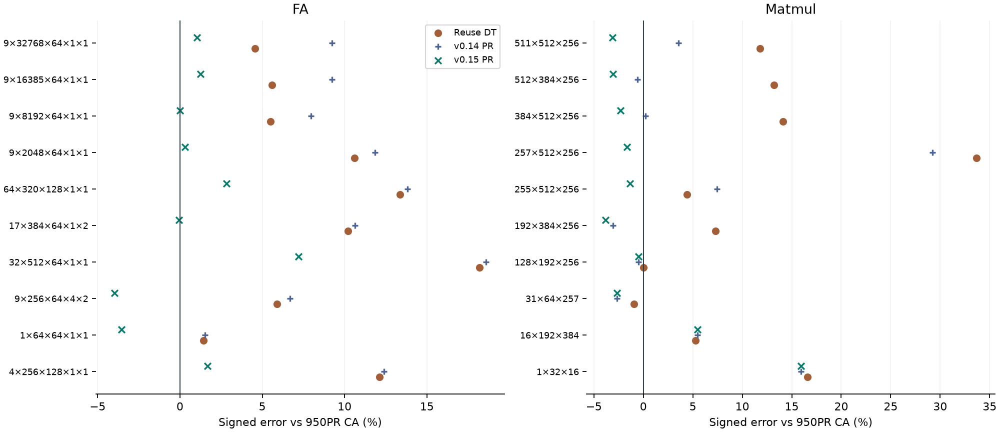
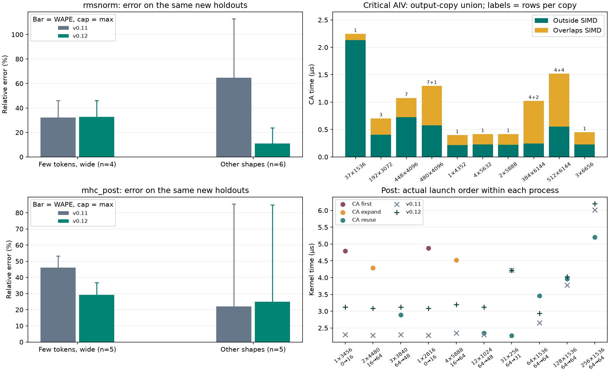

# 算子耗时预测与 CA 校准误差

| 算子 | DT 开发 / 独立 | DT 独立 WAPE / 最大误差 | PR 开发 / 独立 | PR 独立 WAPE / 最大误差 | 最慢查询 ms（DT / PR） | 校准状态 |
|---|---:|---:|---:|---:|---:|---|
| dynamicMXquant | 19 / 10 | 3.47% / 5.92% | 2 / 10 | 5.34% / 14.48% | 1.631 / 1.321 | 两端 CA |
| Matmul | 10 / 10 | 6.29% / 10.43% | 12 / 10 | 3.55% / 15.92% | 0.300 / 1.350 | 两端 CA |
| FA | 16 / 12 | 1.14% / 13.61% | 11 / 10 | 1.49% / 7.19% | 0.208 / 0.773 | 两端 CA |
| RMSNorm | 43 / 10 | 17.04% / 45.96% | 0 / 0 | N/A | 1.049 / 0.121 | DT 有 CA，PR 待测 |
| Addmm | 13 / 10 | 6.09% / 11.54% | 0 / 0 | N/A | 2.743 / 0.099 | DT 有 CA，PR 待测 |
| Lightning Indexer | 3 / 10 | 14.56% / 31.71% | 0 / 0 | N/A | 0.925 / 1.032 | DT 有 CA，PR 待测 |
| mHC Pre | 13 / 10 | 2.97% / 6.09% | 0 / 0 | N/A | 0.655 / 0.277 | DT 有 CA，PR 待测 |
| mHC Sinkhorn | 13 / 10 | 10.37% / 39.20% | 0 / 0 | N/A | 0.813 / 0.133 | DT 有 CA，PR 待测 |
| mHC PreSinkhorn | 3 / 10 | 8.05% / 14.19% | 0 / 0 | N/A | 0.246 / 0.364 | DT 有 CA，PR 待测 |
| mHC Post | 43 / 10 | 27.28% / 84.91% | 0 / 0 | N/A | 1.037 / 0.136 | DT 有 CA，PR 待测 |
| mHC组合 | 13 / 10 | 2.34% / 5.02% | 0 / 0 | N/A | 0.273 / 0.516 | DT 有 CA，PR 待测 |
| KDA recurrent | 3 / 10 | 7.94% / 17.55% | 0 / 0 | N/A | 1.798 / 0.192 | DT 有 CA，PR 待测 |
| KDA chunk | 0 / 0 | N/A | 0 / 0 | N/A | N/A | 仅结构 |
| GMM1–SwiGLU–MX量化 | 4 / 10 | 10.59% / 32.74% | 0 / 0 | N/A | 0.150 / 0.297 | DT 有 CA，PR 待测 |
| MoE GMM2 | 4 / 10 | 9.55% / 26.86% | 0 / 0 | N/A | 0.074 / 0.156 | DT 有 CA，PR 待测 |
| MoE FFN组合 | 4 / 10 | 7.31% / 23.01% | 0 / 0 | N/A | 0.243 / 0.446 | DT 有 CA，PR 待测 |

WAPE 是同组绝对误差之和除以 CA 总耗时，最大误差是最差单例的绝对相对误差。FA 和 Matmul 旧 PR 点已转入开发，这两项的独立误差只来自本轮冻结之后首次采集的各 10 个 shape。Quant 沿用 v0.14 的 10 个独立点，DT 沿用已验证的参考路线。查询时间为安装包在同一进程内的实测墙钟。

## 两款芯片的配置与 CA 差异

下表使用后端单芯片配置的稠密峰值。算力单位为万亿标量操作/秒（TOP/s，浮点时也称 TFLOPS，FMA 计两次）。带宽为十进制 GB/s，容量显式区分 GiB 和 GB。差异列以 DT 为基准。

| 项目 | Ascend950DT_9582 | Ascend950PR_957b | PR 相对 DT 及对建模的影响 |
|---|---:|---:|---|
| CANN、CA 架构、时钟 | 9.2.1、DAV_3510、1.65 GHz | 9.2.1、DAV_3510、1.65 GHz | 相同时钟允许按周期比较库内控制与流水 |
| Cube / Vector 核 | 32 / 64 | 28 / 56 | 各少 12.5%，核数比均为 1:2。目标核数可能触发另一种分块 |
| Cube 峰值，32 / 16 / 8 / 4 位 | 未知 / 432 / 865 / 1730 | 未知 / 378 / 756 / 1513 | 16 位少 12.5%，BF16 单 Cube 核均为 13.5 TOP/s。严格 FP32 峰值未登记 |
| Vector 峰值，32 / 16 / 8 / 4 位 | 27 / 54 / 54 / 未知 | 23 / 47 / 47 / 未知 | FP32 整片少 14.8%，16 位少 13.0%。8 位项来自 INT8 |
| 片外容量 | 96 GiB（103.08 GB） | 112 GiB（120.26 GB） | 多 16 GiB，可容纳更大的工作集 |
| 片外名义峰值带宽 | 4000 GB/s | 1400 GB/s | 少 65%。PR 的带宽档位按容量匹配，持续实测带宽未知 |
| CA 实际载入的外存子模型 | HBM3，2 channels | LPDDR5，1 channel | 来自模拟器日志；通道数仅指 CA 子模型 |
| L2 | 128 MiB | 112 MiB | 少 12.5%，本次缺少实际命中率和 L2 带宽 |
| 本地缓冲 | UB 248 KiB，L1 512 KiB，L0A/B 各 64 KiB，L0C 256 KiB | 同 DT | 每核容量相同，每核分到的工作量仍可能改变 UB 轮数 |
| MTE2 / MTE3 带宽 | 未知 / 未知 | 未知 / 未知 | 预测使用参考阶段成本和假设的带宽敏感度 |

核数、时钟与缓冲容量对应安装包的精确 SKU 配置。16 位 Cube 为 FP16/BF16，8 位 Cube 为 FP8/INT8，4 位为 MXFP4；具体算子仍受已测 dtype 合同约束。两端复用同一顶层 CA 配置并能选中不同的外存子模型。单次 kernel 的总耗时不能反推整片外存峰值利用率。[DT 配置与来源](../configs/chips/Ascend950DT_9582.json) · [PR 配置与来源](../configs/chips/Ascend950PR_957b.json) · [CA 外存日志摘录](../results/v0.13/sku/memory-models.json)

## 新 PR 留出集与两套基线

三种预测均在采集前冻结，使用相同的单卡 BF16 输入和同一个 PR CA 分母。“复用 DT”取 DT 模型估时。Matmul 使用 ops-nn 的 `aclnnMatmul`，FA 使用 ops-transformer 的 `aclnnFlashAttentionScoreV2`。逐点记录保存实际安装包启动的 kernel、主程序、数值检查和全核时间窗。

| 算子 | 新 shape | v0.15 WAPE / 最大 | v0.14 WAPE / 最大 | 复用 DT WAPE / 最大 | 核数命中 |
|---|---:|---:|---:|---:|---:|
| FA | 10 | 1.49% / 7.19% | 9.65% / 18.58% | 6.79% / 18.20% | 10/10 |
| Matmul | 10 | 3.55% / 15.92% | 6.53% / 29.23% | 10.86% / 33.67% | 10/10 |

### 用新芯片时，多少精度依赖 PR 的校准数据

另外做了一次事后检验：完整保留 950PR 的核数、精度算力、时钟、带宽及缓冲配置，仅隐去 SKU 身份，让已冻结的程序执行未知芯片的阶段迁移。这使两种预测的分块与核数完全一致，差别来自以 DT 为参考的阶段成本及其校准方式。这组对照复用了同一批 20 个 CA，没有增加采集，也没有用它选参数。

| 算子 | 只给资源配置 WAPE / 最大 | 启用已知 PR 校准 WAPE / 最大 |
|---|---:|---:|
| FA | 7.25% / 18.72% | 1.49% / 7.19% |
| Matmul | 13.15% / 37.81% | 3.55% / 15.92% |

PR 与 DT 仍属于同代架构；两边均已用于开发库策略，这个模拟未知 SKU 的对照不能建立未来代际的误差界。[逐点资源配置对照](../results/v0.15/resource-only.json) · [单参数敏感性实验](../results/v0.15/scenarios.json)

### FA 的首条 MMAD 和循环间隔

在同一个非因果 BF16 输入 `[Q,KV,D,B,H]=[9,32768,64,1,1]` 上，PR CA 实测 **72.856 µs**，v0.15 **73.620 µs（+1.05%）**，v0.14 为 79.581 µs，直接复用 DT 为 76.184 µs。这里用 4k PR 推得的阶段参数预测 32k PR；DT 32k 早已用于开发。PR 的 1 个 AIC、2 个 AIV、128 轮各读一块 K 和 V、512 次 MMAD 均有完整时间线支持。不同粒度的读与计算分块解释了读轮数和指令数的差异。

| 32k PR 阶段 | v0.15 冻结值 | PR CA | 含义 |
|---|---:|---:|---|
| 全局首指令 → 首个 MMAD（µs） | 6.895 | 6.901 | 首发误差仅 −0.006 µs |
| KV 发起间隔（µs/256 token） | 0.50485 | K 0.50093、V 0.50070 | 冻结值来自 4k；32k 用两流稳定区间检验 |
| 首 MMAD → 末 MMAD 结束（µs） | 66.400 | 65.592 | 含填充和 127 次续发，是总高估的主要来源 |
| 末 MMAD → 末核结束（µs） | 0.325 | 0.362 | 排空低估约 0.037 µs |

首发已接近 CA；4k 上略高的发起间隔在长循环里逐轮累积。32k 的稳态间隔比 DT 32k 的 0.51721 µs 短。短输入仍有另一种误差：`[32,512,64,1,1]` 共 8 次 MMAD，模型前缀 / 中段 / 排空分别高估 0.214 / 0.355 / 0.104 µs，合计 +7.19%。这些区间能定位时间差，尚不能唯一识别下层的缓存、同步或发射原因。[K/V 流、尾部与最差点逐段复核](../results/v0.15/fa-independent.md)

### 大 Matmul 的分块及误差

在新十例上，活跃核数、完整 MMAD 的 `(m,n,k) → 次数` 和逐核计算量分布均 **10/10** 与 CA 相符。对 `[511,512,256]`，v0.14 预测 16 核，v0.15 和 CA 都是 28 核：24 核各算 80 行、4 核各算 31 行，N 片为 128，每核两次 K=128 的 MMAD。PR CA 为 4.612 µs，v0.15 为 4.468 µs，v0.14 和 DT 分别为 4.776、5.156 µs。对 `[384,512,256]`，两版都算对 24 核，但只有新版算对 MMAD 尺寸；新版仍低估 2.29%，旧版误差仅 +0.20%。分核、工作分布、总时延三项分别验收。

最大百分比误差是小矩阵 `[1,32,16]` 的 +15.92%。一个核只执行一次 MMAD，PR CA 为 2.734 µs；两版均预测 3.169 µs。其中首读前和尾段分别高估 0.225、0.138 µs。该输入的算术工作只有 1,024 ops，调整分块难以修正这两段固定成本。[逐点读窗、尾段、每核计算量与指令直方图](../results/v0.15/matmul-independent.md)

### 未来芯片与规模边界

资源配置对照揭示两种迁移风险。在 Matmul `[257,512,256]` 上，隐去 PR 身份仍能预测正确的 24 核；通用路径将 DT 估计 5.610 µs 按阶段窗口比 4.127/4.004 迁移，结果 5.784 µs，而 PR CA 是 4.197 µs。此例缺少配对 DT CA，不能据此区分 DT 基线误差和硬件差异的实际贡献。FA `[32,512,64,1,1]` 的 DT CA 为 9.722 µs，DT 模型本身为 11.046 µs。把这一参考估计按目标资源缩放，结果仍为 11.094 µs，超过 PR CA 的 9.345 µs。即使工作分块能迁移，阶段成本和参考估计的偏差仍会传播。

每个算子十点不足以建立其他 SKU 的误差界。PR 的 FA 已测到本合同的 32k，128k–512k PR 仍属外推。Matmul 本轮覆盖单波 BF16 路线；更大规模的多波重新分块、split-K 和不同 kernel 分支仍有不确定性。所有独立点都检查精确 SKU、LPDDR5 子模型、完整设备时间窗与数值正确性。Matmul 校验全部 BF16 输出，FA 校验全部注意力主输出，辅助统计张量未经数值校验。[实际安装包与逐例时间线摘要](../results/v0.15/sku/posthoc.md)

### 逐 shape 与库 kernel

| 算子 / 每卡 shape | DT CA µs | PR CA µs | v0.15 PR µs | v0.14 PR µs | 复用 DT µs | v0.15 有符号误差 | 活跃 AIC/AIV 预测 → CA | PR kernel |
|---|---:|---:|---:|---:|---:|---:|---|---|
| FA `[9, 32768, 64, 1, 1]` | 75.980 | 72.856 | 73.620 | 79.581 | 76.184 | +1.05% | 1/2 → 1/2 | `FlashAttentionScore_50348df09d0b3ee451d3693a6b2ab3f5_2328361008425599520_mix_aic` |
| FA `[9, 16385, 64, 1, 1]` | 43.219 | 41.293 | 41.813 | 45.112 | 43.599 | +1.26% | 1/2 → 1/2 | `FlashAttentionScore_50348df09d0b3ee451d3693a6b2ab3f5_2328361008425599520_mix_aic` |
| FA `[9, 8192, 64, 1, 1]` | N/A | 25.149 | 25.151 | 27.148 | 26.531 | +0.01% | 1/2 → 1/2 | `FlashAttentionScore_50348df09d0b3ee451d3693a6b2ab3f5_2328361008425599520_mix_aic` |
| FA `[9, 2048, 64, 1, 1]` | N/A | 13.273 | 13.313 | 14.847 | 14.680 | +0.30% | 1/2 → 1/2 | `FlashAttentionScore_50348df09d0b3ee451d3693a6b2ab3f5_2328361008425599520_mix_aic` |
| FA `[32, 512, 64, 1, 1]` | 9.722 | 9.345 | 10.017 | 11.082 | 11.046 | +7.19% | 1/2 → 1/2 | `FlashAttentionScore_50348df09d0b3ee451d3693a6b2ab3f5_2328361008425337376_mix_aic` |
| FA `[4, 256, 128, 1, 1]` | 9.367 | 8.520 | 8.662 | 9.576 | 9.551 | +1.66% | 1/2 → 1/2 | `FlashAttentionScore_50348df09d0b3ee451d3693a6b2ab3f5_2328361009230643744_mix_aic` |
| FA `[17, 384, 64, 1, 2]` | 9.757 | 9.347 | 9.341 | 10.341 | 10.301 | -0.06% | 2/4 → 2/4 | `FlashAttentionScore_50348df09d0b3ee451d3693a6b2ab3f5_2328361008425337376_mix_aic` |
| FA `[64, 320, 128, 1, 1]` | 9.968 | 9.582 | 9.851 | 10.907 | 10.863 | +2.81% | 1/2 → 1/2 | `FlashAttentionScore_50348df09d0b3ee451d3693a6b2ab3f5_2328361009230643744_mix_aic` |
| FA `[1, 64, 64, 1, 1]` | 8.937 | 8.535 | 8.232 | 8.665 | 8.657 | -3.55% | 1/2 → 1/2 | `FlashAttentionScore_50348df09d0b3ee451d3693a6b2ab3f5_2328361008425337376_mix_aic` |
| FA `[9, 256, 64, 4, 2]` | N/A | 9.164 | 8.800 | 9.777 | 9.704 | -3.97% | 8/16 → 8/16 | `FlashAttentionScore_50348df09d0b3ee451d3693a6b2ab3f5_2328361008425337376_mix_aic` |
| Matmul `[1, 32, 16]` | 3.030 | 2.734 | 3.169 | 3.169 | 3.188 | +15.92% | 1/0 → 1/0 | `MatMulV3_ND_ND_ND_ND_BF16_BF16_BF16_BF16_high_performance_2` |
| Matmul `[31, 64, 257]` | 4.091 | 3.801 | 3.699 | 3.699 | 3.764 | -2.68% | 2/0 → 2/0 | `MatMulV3_ND_ND_ND_ND_BF16_BF16_BF16_BF16_high_performance_2` |
| Matmul `[16, 192, 384]` | N/A | 3.724 | 3.927 | 3.927 | 3.921 | +5.46% | 3/0 → 3/0 | `MatMulV3_ND_ND_ND_ND_BF16_BF16_BF16_BF16_high_performance_2` |
| Matmul `[128, 192, 256]` | 3.798 | 3.815 | 3.796 | 3.796 | 3.816 | -0.51% | 24/0 → 24/0 | `MatMulV3_ND_ND_ND_ND_BF16_BF16_BF16_BF16_high_performance_2` |
| Matmul `[192, 384, 256]` | 3.925 | 4.040 | 3.885 | 3.916 | 4.335 | -3.85% | 24/0 → 24/0 | `MatMulV3_ND_ND_ND_ND_BF16_BF16_BF16_BF16_high_performance_2` |
| Matmul `[255, 512, 256]` | N/A | 4.183 | 4.127 | 4.495 | 4.368 | -1.33% | 24/0 → 24/0 | `MatMulV3_ND_ND_ND_ND_BF16_BF16_BF16_BF16_high_performance_2` |
| Matmul `[257, 512, 256]` | N/A | 4.197 | 4.127 | 5.424 | 5.610 | -1.66% | 24/0 → 24/0 | `MatMulV3_ND_ND_ND_ND_BF16_BF16_BF16_BF16_high_performance_2` |
| Matmul `[384, 512, 256]` | N/A | 4.504 | 4.401 | 4.513 | 5.140 | -2.29% | 24/0 → 24/0 | `MatMulV3_ND_ND_ND_ND_BF16_BF16_BF16_BF16_high_performance_2` |
| Matmul `[512, 384, 256]` | N/A | 4.541 | 4.401 | 4.513 | 5.140 | -3.08% | 24/0 → 24/0 | `MatMulV3_ND_ND_ND_ND_BF16_BF16_BF16_BF16_high_performance_2` |
| Matmul `[511, 512, 256]` | N/A | 4.612 | 4.468 | 4.776 | 5.156 | -3.11% | 28/0 → 28/0 | `MatMulV3_ND_ND_ND_ND_BF16_BF16_BF16_BF16_high_performance_2` |

### 旧 PR trace 的开发回放

| 算子 / shape | PR CA µs | 当前预测 µs | 误差 | AIC/AIV 预测 → CA |
|---|---:|---:|---:|---|
| Matmul `[128, 256, 512]` | 4.368 | 4.280 | -2.03% | 16/0 → 16/0 |
| FA `[16, 64, 64]` | 8.472 | 8.232 | -2.83% | 1/2 → 1/2 |
| Matmul `[129, 256, 256]` | 3.609 | 3.832 | +6.18% | 20/0 → 20/0 |
| Matmul `[1, 128, 128]` | 3.138 | 3.414 | +8.80% | 2/0 → 2/0 |
| Matmul `[32, 64, 64]` | 3.158 | 3.304 | +4.64% | 2/0 → 2/0 |
| Matmul `[17, 96, 128]` | 3.414 | 3.459 | +1.31% | 4/0 → 4/0 |
| Matmul `[48, 128, 192]` | 3.481 | 3.606 | +3.57% | 6/0 → 6/0 |
| Matmul `[65, 128, 129]` | 3.733 | 3.497 | -6.32% | 10/0 → 10/0 |
| Matmul `[1, 256, 1024]` | 4.612 | 4.763 | +3.29% | 4/0 → 4/0 |
| Matmul `[17, 256, 1024]` | 4.687 | 4.856 | +3.62% | 8/0 → 8/0 |
| Matmul `[128, 512, 512]` | 4.604 | 4.368 | -5.14% | 24/0 → 24/0 |
| Matmul `[256, 512, 256]` | 4.239 | 4.127 | -2.64% | 24/0 → 24/0 |
| Matmul `[512, 512, 256]` | 4.656 | 4.468 | -4.04% | 28/0 → 28/0 |
| FA `[1, 128, 64, 1, 1]` | 8.190 | 8.290 | +1.22% | 1/2 → 1/2 |
| FA `[17, 96, 64, 1, 1]` | 8.736 | 8.265 | -5.39% | 1/2 → 1/2 |
| FA `[16, 128, 128, 1, 1]` | 8.224 | 8.395 | +2.08% | 1/2 → 1/2 |
| FA `[16, 128, 64, 1, 4]` | 8.539 | 8.458 | -0.96% | 4/8 → 4/8 |
| FA `[128, 128, 64, 1, 1]` | 8.793 | 8.794 | +0.00% | 2/4 → 2/4 |
| FA `[129, 128, 64, 1, 1]` | 8.508 | 8.635 | +1.49% | 3/6 → 3/6 |
| FA `[16, 1025, 64, 1, 1]` | 11.365 | 11.166 | -1.76% | 1/2 → 1/2 |
| FA `[17, 1153, 64, 1, 1]` | 11.489 | 11.174 | -2.74% | 1/2 → 1/2 |
| FA `[9, 256, 128, 4, 1]` | 9.058 | 8.857 | -2.22% | 4/8 → 4/8 |
| FA `[9, 4096, 64, 1, 1]` | 16.880 | 17.071 | +1.13% | 1/2 → 1/2 |

### DynamicMXQuant 在 PR 的逐例校验

| 每卡 shape | PR CA µs | v0.15 µs | 有符号误差 | 角色 |
|---|---:|---:|---:|---|
| `[64, 1024]` | 5.373 | 5.188 | -3.44% | 开发 |
| `[512, 256]` | 5.090 | 5.275 | +3.63% | 开发 |
| `[1, 64]` | 3.946 | 4.231 | +7.21% | 独立（v0.14） |
| `[4, 256]` | 4.157 | 4.759 | +14.48% | 独立（v0.14） |
| `[8, 384]` | 5.136 | 4.968 | -3.28% | 独立（v0.14） |
| `[1, 4096]` | 4.945 | 4.968 | +0.45% | 独立（v0.14） |
| `[33, 768]` | 4.915 | 5.120 | +4.18% | 独立（v0.14） |
| `[65, 256]` | 4.609 | 5.084 | +10.31% | 独立（v0.14） |
| `[9, 5120]` | 5.025 | 4.993 | -0.64% | 独立（v0.14） |
| `[144, 7168]` | 6.415 | 6.581 | +2.59% | 独立（v0.14） |
| `[576, 4096]` | 7.692 | 7.180 | -6.64% | 独立（v0.14） |
| `[640, 4096]` | 8.108 | 7.642 | -5.76% | 独立（v0.14） |

Quant 使用 `aclnnDynamicMxQuant` 的 BF16 → E4M3FN、block32 路线，十个留出点的 AIV 数均命中，最大偏差来自低并发 [4,256] 的读写窗。[逐例关键路径](../results/v0.14/quant-independent.md)

## CA 成本与系统查询开销

**采集。** 本轮有 11 个独立 PR 输入能配到历史 DT 窗口，另外 9 个沿用同 shape 的 DT 预测作为比较基线。DT 新采集 0 次。在正式验证之前，用旧 4k 输入测了轻量 helper 链路：17.222 µs，对应正式 msopprof 16.880 µs，差 2.03%，超过事先设的 2% 相对容差，且一个核的时间窗也超限。该次花费 75.1 s、15.2 MiB，未计入独立集。20 个新点统一走官方 PR 模拟器，读取原始全核时间线；对长 FA 流式解析、另存关键事件，以便后续诊断复用。[轻量链路预检](../results/v0.15/sku/preflight.json) · [验收门槛](../results/v0.15/sku/preflight-gate.json)

4 路并发，20 次正式尝试、20 次合格。正式采集实际墙钟 **452.9 秒（7.55 分钟）**，累计 CA 进程墙钟 1697.4 s，原始目录合计 2.56 GiB。加上前述旧 shape 预检，两部分实际运行墙钟共 8.80 分钟。32k FA 单例用 266.4 s、707.9 MiB。正式预算为 30 分钟和 10 GiB。各样例只采一次，模拟器运行间波动未估计。[全部尝试](../results/v0.15/sku/attempts.json) · [总成本](../results/v0.15/sku/campaign-cost.json)

**在线预测。** 隔离环境安装 v0.15.0 wheel，两芯片各查询 488 次，包括 356 条历史输入、12 条 Quant 回归输入、24 个冻结输入（含备用，每条 5 次）。同一进程中调用公开 `estimate`，包括分块、耗时、工作量和输出组装。DT 中位数 / 最大 0.101 / 2.743 ms，PR 为 0.181 / 1.350 ms；均低于 100 ms。模块首次导入另计 29.9 ms。输入和命令行进程的创建开销由系统仿真器的接入方式决定。[逐算子查询开销](../results/v0.15/wheel-check.json)

[冻结预测](../results/v0.15/sku/freeze.json) · [逐点 CA 核验记录](../results/v0.15/sku/holdout.json) · [当前评估 JSON](../results/v0.15/evaluation.json) · [本轮变更](../results/v0.15/changes.md)

## 950DT 已校准路线的同集对照

默认调用只传 shape。少 token 宽通道组在冻结时定义为 T≤4 且末维 D≥2048，普通组为其余输入。两个版本使用相同库调用的 CA 窗口。

| 算子 | 独立分组 | shape 数 | v0.11 WAPE → 当前 | v0.11 最大误差 → 当前 |
|---|---|---:|---:|---:|
| RMSNorm | 全部 | 10 | 55.54% → 17.04% | 112.89% → 45.96% |
| RMSNorm | 少 token 宽通道 | 4 | 32.31% → 32.60% | 46.04% → 45.96% |
| RMSNorm | 普通 | 6 | 64.75% → 10.88% | 112.89% → 23.75% |
| mHC Post | 全部 | 10 | 35.34% → 27.28% | 85.49% → 84.91% |
| mHC Post | 少 token 宽通道 | 5 | 46.15% → 29.17% | 53.25% → 36.81% |
| mHC Post | 普通 | 5 | 21.95% → 24.95% | 85.49% → 84.91% |

### mHC Post 小宽组按发射前状态拆分

前三列比较不传 `resident_aiv` 时的表现，最后一列使用发射前可知的高水位。分组只用于评价；默认调用没有读取验证序列。

| 状态（shape 数） | 旧版默认 WAPE | 当前默认 WAPE | 当前显式历史 WAPE |
|---|---:|---:|---:|
| 首次（2） | 52.63% | 35.89% | 1.35% |
| 扩核（2） | 47.49% | 28.77% | 4.03% |
| 热态（1） | 20.39% | 7.86% | 20.01% |

### RMSNorm 的写回与向量计算怎样重叠

`[512,4096]` 是开发回放。CA 的关键核分两轮处理 7 行和 1 行，四笔写操作依次为 28、57,344、4、8,192 B。先对所有 MTE3 区间求并集，再减去并集与 SIMD 忙区的交集，得到实际暴露的写回时间：(2230−1057)/1650 = **0.711 µs**。同一核的 SIMD 占 2.045 µs。v0.11 把按全片输出字节增加的成本投到该点，仅写回就估了 5.825 µs，整例估 10.163 µs，CA 为 4.851 µs。当前并集预测为 1788 tick，覆盖预测为 1371 tick，合起来低估了写回暴露时间，预测为 **0.253 µs**。整例预测 **4.969 µs**，其中 SCALAR 高估约 0.584 µs、发射偏移高估约 0.493 µs，部分抵消了写回与读阶段的低估。这 43 个旧 shape 在本次开发中使用，独立误差只来自采集前冻结的十个新点。[分轮与覆盖模型](../results/v0.12/rms/method.md) · [独立写回核查](../results/v0.12/rms/diagnosis.md)

独立集中有五个主输出超过 1 MiB 的 RMSNorm 输入。对三个真正跨 UB 轮次的目标，v0.11 → v0.12 的默认 WAPE 为 **86.23% → 13.40%**。下表列出的 CA 由完整数据库求得；每核分块来自实际写回字节。输出字节超过 16 KiB 时，单笔固有服务仍有辨识限制。

| 独立 shape | 最忙核每轮行数 | CA µs | v0.11 → 当前 µs | MTE3 暴露预测 / 实测 µs |
|---|---|---:|---:|---:|
| [448,4096] | 7（单轮边界） | 4.968 | 9.337 → 4.904 | 0.408 / 0.727 |
| [480,4096] | 7+1 | 5.175 | 9.599 → 4.743 | 0.253 / 0.577 |
| [384,6144] | 4+2 | 6.838 | 11.074 → 5.214 | 0.279 / 0.246 |
| [512,6144] | 4+4 | 6.374 | 13.569 → 5.967 | 0.376 / 0.552 |

`[384,6144]` 是首次发射，`[512,6144]` 发射前已有 64 核覆盖。两点各自的 CA 不能直接用来求宽度 6144 的稳态单位行耗时。普通组共 6 例显著改善；小宽组 4 例多为单轮，默认 WAPE 从 32.31% 变为 32.60%，未知启动历史仍是主要误差之一。

### mHC Post 默认估计在哪些状态起作用

分通道时，用三种条件时间中最快和最慢值的调和平均平衡相对误差。五个小宽新样例是两次首次、两次扩核、一次热态。这个抽样比例用于验证状态差异，不代表用户业务分布。新点 `[1,4,3456]` 首次发射，v0.11 估 2.302 µs，当前估 3.120 µs，CA 为 4.797 µs；`[3,4,3840]` 已有覆盖，旧估 2.302 µs，当前估 3.120 µs，CA 为 2.892 µs。默认输入仍不可能区分相同 shape 的不同历史。旧的同形配对 `[2,4,6144]` 在批首/批尾分别为 4.838/2.905 µs，任何只返回一个值的模型对其中至少一次的相对误差约为 25% 或更高。

普通组的 `[31,4,256]` 没有切通道，采用开发状态分布的加权中位数。该次实际是热态，预测仍接近扩核条件的时间。它与 `[12,4,1024]` 这样的切通道热态应分别看待。固定宽度 D=1536 且已有 64 核覆盖的 T=64、128、256 三例，主输出 0.75、1.5、3 MiB，CA 为 3.459、3.959、5.201 µs。该组默认 WAPE 从 14.21% 降到 12.64%，最大点仍高估 19.31%。逐次输出、条件时间和前序覆盖数均在明细中。[方法与算例](../results/v0.12/post/method.md) · [误差和状态明细](../results/v0.12/post/diagnosis.md)

### 大 shape、正确性与计时资格

RMSNorm 同时核对 BF16 主输出与 FP32 行统计量，Post 核对所有残差流的输出。数值 golden 通过后，再按本次 launch 核对设备指令窗口、DB 记录数、活跃 AIV、输出写入量及地址覆盖。相同 CA 进程中的前序核覆盖只用于分组和显式历史预测。各算子的主要方法使用 shape 和冻结参数，不读验证 trace。[按状态、分块及输出字节的独立审计](../results/v0.12/audit/summary.md)

本轮 RMSNorm 原批拒收四次计时。两个目标的 helper 报负时长且数据库为空，紧随其后的两个目标虽然有指令，实际写入字节分别为 7,604,320 和 10,963,528 B，超出相应的 3,934,080 和 6,293,504 B。四例按原预测和前序核覆盖条件隔离重采，保留其他合格点。mHC Post 的十个新点全部首采合格。两族共 **29 次发射、20 个独立 shape**：五次额外发射用于预热/重建前序覆盖，四次用于替代不合格计时。RMSNorm 与 Post 各自的 CA 进程累计墙钟分别为 1080.7 s 和 450.6 s；进程存在并行。采集开销含不合格尝试和预热，在线查询不启动 CA。[RMSNorm 采集成本](../results/v0.12/rms/costs.json) · [mHC Post 采集成本](../results/v0.12/post/costs.json)

### 其他算子的覆盖边界

| 路线 | 已有完整 CA 示例 | 扩大到系统负载时还缺什么 |
|---|---|---|
| DynamicMXQuant | `[1024,7168]`，9.332 µs | 已有宽行、多轮 UB 实测。放大行数跨分块边界时仍需重新确定尾轮。 |
| Matmul / Addmm | `[512,512,256]` 分别为 4.799 / 4.479 µs | 现有集合对大型投影 K 维的多段归约和大输出块覆盖有限。 |
| 普通 FA / Lightning Indexer | FA `[9,131072,64,1,1]` 为 274.821 µs，Indexer `[1,1,8192,8,128]` 为 22.709 µs | FA 的 128k 点是 B=H=1 的非因果路线，256k、512k 仍属外推。Indexer 的大 L 不能套用普通 FA 的斜率。 |
| mHC Pre / Sinkhorn / 组链 | Pre `[24,4,1536]` 为 12.201 µs，融合 PreSinkhorn `[32,4,4096]` 为 11.114 µs | Pre 投影、逐 token 小矩阵归约及串行链各有不同扩展规律。 |
| KDA / MoE | 递推 `[1,8,1,1,128,128]` 为 35.396 µs，GMM1 / GMM2 在 `[64,128,256,4]` 为 8.355 / 4.142 µs | 长序列、生产规模专家数及倾斜负载缺少覆盖；KDA chunk 缺少合格计时。 |

Addmm 的小输出块仍受 FIXP 尾部影响。拆分 mHC 链中，Pre 低估和后续阶段高估可以抵消。Indexer 的 L=8192 例分段数与 64 条 MMAD 一致，时间模板仍高估约 32%。MoE 的两次 GMM 分别受本地专家负载和尾块影响。这些路线沿用原模型的冻结独立数据，本轮无新增 CA。

## 逐算子与逐 shape 的证据

### dynamicMXquant

安装包调用 ops-nn 的 `aclnnDynamicMxQuant`。

| shape 与属性 | 用途 | 预测 µs | CA µs | 有符号误差 | 实际 kernel | 活跃 AIC / AIV |
|---|---|---:|---:|---:|---|---|
| `[36, 5120]` | 独立 | 5.292 | 5.584 | -5.2% | entry_kernel_21 | 0 / 60 |
| `[288, 7168]` | 独立 | 7.181 | 6.876 | +4.4% | entry_kernel_21 | 0 / 64 |
| `[1024, 7168]` | 独立 | 9.586 | 9.332 | +2.7% | entry_kernel_21 | 0 / 64 |
| `[1024, 6144]` | 独立 | 8.935 | 8.704 | +2.7% | entry_kernel_21 | 0 / 64 |
| `[128, 5120]` | 独立 | 5.794 | 5.885 | -1.5% | entry_kernel_21 | 0 / 64 |
| `[17, 1024]` | 独立 | 5.430 | 5.772 | -5.9% | entry_kernel_21 | 0 / 36 |
| `[1, 192]` | 独立 | 4.231 | 4.129 | +2.5% | entry_kernel_21 | 0 / 1 |
| `[36, 3072]` | 独立 | 5.156 | 4.971 | +3.7% | entry_kernel_21 | 0 / 54 |
| `[576, 7168]` | 独立 | 7.577 | 7.758 | -2.3% | entry_kernel_21 | 0 / 64 |
| `[7, 320]` | 独立 | 5.393 | 5.146 | +4.8% | entry_kernel_21 | 0 / 14 |
| `[1, 128]` | 开发 | 4.231 | 4.325 | -2.2% | DynamicMxQuant_bf16toe4m3_high_performance_33_mix_aiv | 0 / 1 |
| `[36, 512]` | 开发 | 5.430 | 5.646 | -3.8% | DynamicMxQuant_bf16toe4m3_high_performance_33_mix_aiv | 0 / 36 |
| `[9, 5120]` | 开发 | 4.980 | 4.867 | +2.3% | DynamicMxQuant_bf16toe4m3_high_performance_33_mix_aiv | 0 / 45 |
| `[144, 7168]` | 开发 | 6.207 | 6.332 | -2.0% | DynamicMxQuant_bf16toe4m3_high_performance_33_mix_aiv | 0 / 58 |
| `[512, 5120]` | 开发 | 6.364 | 6.299 | +1.0% | DynamicMxQuant_bf16toe4m3_high_performance_33_mix_aiv | 0 / 64 |
| `[1152, 5120]` | 开发 | 8.942 | 8.684 | +3.0% | DynamicMxQuant_bf16toe4m3_high_performance_33_mix_aiv | 0 / 64 |
| `[512, 256]` | 开发 | 5.430 | 5.208 | +4.3% | DynamicMxQuant_bf16toe4m3_high_performance_33_mix_aiv | 0 / 64 |
| `[576, 4096]` | 开发 | 7.470 | 6.948 | +7.5% | DynamicMxQuant_bf16toe4m3_high_performance_33_mix_aiv | 0 / 64 |
| `[768, 4096]` | 开发 | 6.743 | 7.202 | -6.4% | DynamicMxQuant_bf16toe4m3_high_performance_33_mix_aiv | 0 / 64 |
| `[1, 64]` | 开发 | 4.231 | 4.326 | -2.2% | DynamicMxQuant_bf16toe4m3_high_performance_33_mix_aiv | 0 / 1 |
| `[65, 256]` | 开发 | 5.430 | 4.898 | +10.9% | DynamicMxQuant_bf16toe4m3_high_performance_33_mix_aiv | 0 / 33 |
| `[1024, 4096]` | 开发 | 7.502 | 8.047 | -6.8% | DynamicMxQuant_bf16toe4m3_high_performance_33_mix_aiv | 0 / 64 |
| `[1, 4096]` | 开发 | 5.430 | 5.686 | -4.5% | DynamicMxQuant_bf16toe4m3_high_performance_33_mix_aiv | 0 / 16 |
| `[640, 4096]` | 开发 | 6.364 | 6.218 | +2.4% | DynamicMxQuant_bf16toe4m3_high_performance_33_mix_aiv | 0 / 64 |
| `[33, 768]` | 开发 | 5.430 | 5.210 | +4.2% | DynamicMxQuant_bf16toe4m3_high_performance_33_mix_aiv | 0 / 34 |
| `[4, 256]` | 开发 | 4.759 | 4.588 | +3.7% | DynamicMxQuant_bf16toe4m3_high_performance_33_mix_aiv | 0 / 4 |
| `[17, 512]` | 开发 | 5.430 | 5.790 | -6.2% | DynamicMxQuant_bf16toe4m3_high_performance_33_mix_aiv | 0 / 34 |
| `[8, 384]` | 开发 | 5.430 | 5.760 | -5.7% | DynamicMxQuant_bf16toe4m3_high_performance_33_mix_aiv | 0 / 16 |
| `[64, 1024]` | 开发 | 5.214 | 5.532 | -5.7% | DynamicMxQuant_bf16toe4m3_high_performance_33_mix_aiv | 0 / 64 |

### Matmul

安装包调用 ops-nn 的 `aclnnMatmul → MatMulV3`。

| shape 与属性 | 用途 | 预测 µs | CA µs | 有符号误差 | 实际 kernel | 活跃 AIC / AIV |
|---|---|---:|---:|---:|---|---|
| `[128, 192, 256]` | 独立 | 3.816 | 3.798 | +0.5% | entry_kernel_2 | 24 / 0 |
| `[1, 32, 16]` | 独立 | 3.188 | 3.030 | +5.2% | entry_kernel_2 | 1 / 0 |
| `[256, 512, 256]` | 独立 | 4.368 | 4.192 | +4.2% | entry_kernel_2 | 32 / 0 |
| `[31, 64, 257]` | 独立 | 3.764 | 4.091 | -8.0% | entry_kernel_2 | 2 / 0 |
| `[4, 80, 48]` | 独立 | 3.257 | 3.524 | -7.6% | entry_kernel_2 | 2 / 0 |
| `[512, 512, 256]` | 独立 | 5.156 | 4.799 | +7.4% | entry_kernel_2 | 32 / 0 |
| `[64, 128, 512]` | 独立 | 4.183 | 4.437 | -5.7% | entry_kernel_2 | 8 / 0 |
| `[192, 384, 256]` | 独立 | 4.335 | 3.925 | +10.4% | entry_kernel_2 | 24 / 0 |
| `[2, 32, 32]` | 独立 | 3.171 | 3.244 | -2.3% | entry_kernel_2 | 1 / 0 |
| `[9, 128, 256]` | 独立 | 3.603 | 4.019 | -10.3% | entry_kernel_2 | 2 / 0 |
| `[1, 256, 1024]` | 开发 | 4.560 | 4.624 | -1.4% | MatMulV3_ND_ND_ND_ND_BF16_BF16_BF16_BF16_high_performance_2 | 4 / 0 |
| `[65, 128, 129]` | 开发 | 3.628 | 3.712 | -2.3% | MatMulV3_ND_ND_ND_ND_BF16_BF16_BF16_BF16_high_performance_2 | 10 / 0 |
| `[128, 512, 512]` | 开发 | 4.506 | 4.382 | +2.8% | MatMulV3_ND_ND_ND_ND_BF16_BF16_BF16_BF16_high_performance_2 | 32 / 0 |
| `[129, 256, 256]` | 开发 | 3.947 | 3.664 | +7.7% | MatMulV3_ND_ND_ND_ND_BF16_BF16_BF16_BF16_high_performance_2 | 20 / 0 |
| `[17, 256, 1024]` | 开发 | 5.040 | 4.742 | +6.3% | MatMulV3_ND_ND_ND_ND_BF16_BF16_BF16_BF16_high_performance_2 | 8 / 0 |
| `[128, 256, 512]` | 开发 | 4.261 | 4.393 | -3.0% | MatMulV3_ND_ND_ND_ND_BF16_BF16_BF16_BF16_high_performance_2 | 32 / 0 |
| `[1, 128, 128]` | 开发 | 3.370 | 3.356 | +0.4% | MatMulV3_ND_ND_ND_ND_BF16_BF16_BF16_BF16_high_performance_2 | 2 / 0 |
| `[32, 64, 64]` | 开发 | 3.368 | 3.292 | +2.3% | MatMulV3_ND_ND_ND_ND_BF16_BF16_BF16_BF16_high_performance_2 | 2 / 0 |
| `[48, 128, 192]` | 开发 | 3.633 | 3.575 | +1.6% | MatMulV3_ND_ND_ND_ND_BF16_BF16_BF16_BF16_high_performance_2 | 6 / 0 |
| `[17, 96, 128]` | 开发 | 3.505 | 3.494 | +0.3% | MatMulV3_ND_ND_ND_ND_BF16_BF16_BF16_BF16_high_performance_2 | 4 / 0 |

### FA

安装包调用 ops-transformer 的 `aclnnFlashAttentionScoreV2`。

| shape 与属性 | 用途 | 预测 µs | CA µs | 有符号误差 | 实际 kernel | 活跃 AIC / AIV |
|---|---|---:|---:|---:|---|---|
| `[9, 256, 128, 4, 1]` | 独立 | 9.767 | 9.690 | +0.8% | FlashAttentionScore_50348df09d0b3ee451d3693a6b2ab3f5_2328361009230643744_mix_aic | 4 / 8 |
| `[9, 131072, 64, 1, 1]` | 独立 | 274.794 | 274.821 | -0.0% | entry_kernel_2050000040140220 | 1 / 2 |
| `[9, 16385, 64, 1, 1]` | 独立 | 43.599 | 43.219 | +0.9% | entry_kernel_2050000040140220 | 1 / 2 |
| `[17, 384, 64, 1, 2]` | 独立 | 10.301 | 9.757 | +5.6% | entry_kernel_2050000040100220 | 2 / 4 |
| `[1, 64, 64, 1, 1]` | 独立 | 8.657 | 8.937 | -3.1% | entry_kernel_2050000040100220 | 1 / 2 |
| `[32, 512, 64, 1, 1]` | 独立 | 11.046 | 9.722 | +13.6% | entry_kernel_2050000040100220 | 1 / 2 |
| `[4, 256, 128, 1, 1]` | 独立 | 9.551 | 9.367 | +2.0% | entry_kernel_2050000070100220 | 1 / 2 |
| `[64, 320, 128, 1, 1]` | 独立 | 10.863 | 9.968 | +9.0% | entry_kernel_2050000070100220 | 1 / 2 |
| `[9, 4096, 64, 1, 1]` | 独立 | 18.256 | 18.226 | +0.2% | entry_kernel_2050000040140220 | 1 / 2 |
| `[1, 224, 64, 1, 1]` | 独立 | 9.465 | 8.826 | +7.2% | entry_kernel_2050000040100220 | 1 / 2 |
| `[4, 160, 64, 1, 1]` | 独立 | 9.406 | 9.461 | -0.6% | entry_kernel_2050000040100220 | 1 / 2 |
| `[8, 128, 128, 1, 1]` | 独立 | 8.770 | 9.136 | -4.0% | entry_kernel_2050000070100220 | 1 / 2 |
| `[32, 129, 64, 1, 4]` | 开发 | 9.720 | 9.150 | +6.2% | FlashAttentionScore_50348df09d0b3ee451d3693a6b2ab3f5_2328361008425337376_mix_aic | 4 / 8 |
| `[17, 257, 128, 1, 1]` | 开发 | 10.471 | 9.551 | +9.6% | FlashAttentionScore_50348df09d0b3ee451d3693a6b2ab3f5_2328361009230643744_mix_aic | 1 / 2 |
| `[17, 1153, 64, 1, 1]` | 开发 | 12.322 | 12.487 | -1.3% | FlashAttentionScore_50348df09d0b3ee451d3693a6b2ab3f5_2328361008425599520_mix_aic | 1 / 2 |
| `[128, 128, 64, 1, 1]` | 开发 | 9.248 | 9.498 | -2.6% | FlashAttentionScore_50348df09d0b3ee451d3693a6b2ab3f5_2328361008425337376_mix_aic | 2 / 4 |
| `[16, 1025, 64, 1, 1]` | 开发 | 12.313 | 12.384 | -0.6% | FlashAttentionScore_50348df09d0b3ee451d3693a6b2ab3f5_2328361008425599520_mix_aic | 1 / 2 |
| `[16, 128, 64, 1, 4]` | 开发 | 8.894 | 8.758 | +1.6% | FlashAttentionScore_50348df09d0b3ee451d3693a6b2ab3f5_2328361008425337376_mix_aic | 4 / 8 |
| `[16, 128, 128, 1, 1]` | 开发 | 8.829 | 8.715 | +1.3% | FlashAttentionScore_50348df09d0b3ee451d3693a6b2ab3f5_2328361009230643744_mix_aic | 1 / 2 |
| `[129, 128, 64, 1, 1]` | 开发 | 9.081 | 8.871 | +2.4% | FlashAttentionScore_50348df09d0b3ee451d3693a6b2ab3f5_2328361008425337376_mix_aic | 3 / 6 |
| `[16, 128, 64, 1, 8]` | 开发 | 8.992 | 9.402 | -4.4% | FlashAttentionScore_50348df09d0b3ee451d3693a6b2ab3f5_2328361008425337376_mix_aic | 8 / 16 |
| `[17, 192, 128, 1, 1]` | 开发 | 9.653 | 9.050 | +6.7% | FlashAttentionScore_50348df09d0b3ee451d3693a6b2ab3f5_2328361009230643744_mix_aic | 1 / 2 |
| `[17, 96, 64, 1, 1]` | 开发 | 8.692 | 9.162 | -5.1% | FlashAttentionScore_50348df09d0b3ee451d3693a6b2ab3f5_2328361008425337376_mix_aic | 1 / 2 |
| `[16, 64, 64, 1, 1]` | 开发 | 8.657 | 9.052 | -4.4% | FlashAttentionScore_50348df09d0b3ee451d3693a6b2ab3f5_2328361008425337376_mix_aic | 1 / 2 |
| `[8, 192, 64, 1, 1]` | 开发 | 9.425 | 8.805 | +7.0% | FlashAttentionScore_50348df09d0b3ee451d3693a6b2ab3f5_2328361008425337376_mix_aic | 1 / 2 |
| `[64, 256, 64, 1, 1]` | 开发 | 9.703 | 9.409 | +3.1% | FlashAttentionScore_50348df09d0b3ee451d3693a6b2ab3f5_2328361008425337376_mix_aic | 1 / 2 |
| `[1, 128, 64, 1, 1]` | 开发 | 8.718 | 8.784 | -0.7% | FlashAttentionScore_50348df09d0b3ee451d3693a6b2ab3f5_2328361008425337376_mix_aic | 1 / 2 |
| `[9, 32768, 64, 1, 1]` | 开发 | 76.184 | 75.980 | +0.3% | entry_kernel_2050000040140220 | 1 / 2 |

### RMSNorm

安装包调用 ops-nn 的 `aclnnRmsNorm`。

| shape 与属性 | 用途 | 预测 µs | CA µs | 有符号误差 | 实际 kernel | 活跃 AIC / AIV |
|---|---|---:|---:|---:|---|---|
| `[1, 4352]` | 独立 | 2.285 | 3.837 | -40.4% | entry_kernel_1388 | 0 / 1 |
| `[2, 5888]` | 独立 | 2.455 | 4.542 | -46.0% | entry_kernel_1388 | 0 / 2 |
| `[4, 5632]` | 独立 | 2.590 | 2.841 | -8.8% | entry_kernel_1388 | 0 / 4 |
| `[3, 6656]` | 独立 | 2.577 | 2.119 | +21.6% | entry_kernel_1388 | 0 / 3 |
| `[37, 1536]` | 独立 | 5.133 | 5.454 | -5.9% | entry_kernel_1388 | 0 / 37 |
| `[192, 3072]` | 独立 | 4.036 | 4.850 | -16.8% | entry_kernel_1388 | 0 / 64 |
| `[448, 4096]` | 独立 | 4.904 | 4.968 | -1.3% | entry_kernel_1388 | 0 / 64 |
| `[480, 4096]` | 独立 | 4.743 | 5.175 | -8.3% | entry_kernel_1388 | 0 / 60 |
| `[384, 6144]` | 独立 | 5.214 | 6.838 | -23.8% | entry_kernel_1388 | 0 / 64 |
| `[512, 6144]` | 独立 | 5.967 | 6.374 | -6.4% | entry_kernel_1388 | 0 / 64 |
| `[9, 5120]` | 开发 | 2.709 | 4.188 | -35.3% | entry_kernel_1388 | 0 / 9 |
| `[36, 7168]` | 开发 | 5.122 | 6.614 | -22.6% | entry_kernel_1388 | 0 / 36 |
| `[1, 128]` | 开发 | 2.027 | 3.454 | -41.3% | entry_kernel_1388 | 0 / 1 |
| `[1, 256]` | 开发 | 2.034 | 3.637 | -44.1% | entry_kernel_1388 | 0 / 1 |
| `[4, 512]` | 开发 | 2.276 | 4.292 | -47.0% | entry_kernel_1388 | 0 / 4 |
| `[16, 1024]` | 开发 | 3.002 | 3.815 | -21.3% | entry_kernel_1388 | 0 / 16 |
| `[9, 7168]` | 开发 | 2.834 | 2.790 | +1.6% | entry_kernel_1388 | 0 / 9 |
| `[36, 5120]` | 开发 | 5.071 | 5.289 | -4.1% | entry_kernel_1388 | 0 / 36 |
| `[32, 4096]` | 开发 | 5.046 | 4.581 | +10.2% | entry_kernel_1388 | 0 / 32 |
| `[64, 2048]` | 开发 | 5.371 | 4.352 | +23.4% | entry_kernel_1388 | 0 / 64 |
| `[65, 128]` | 开发 | 3.816 | 3.084 | +23.7% | entry_kernel_1388 | 0 / 33 |
| `[128, 1024]` | 开发 | 4.237 | 3.090 | +37.1% | entry_kernel_1388 | 0 / 64 |
| `[1, 8192]` | 开发 | 2.521 | 2.055 | +22.6% | entry_kernel_1388 | 0 / 1 |
| `[2, 128]` | 开发 | 2.102 | 3.407 | -38.3% | entry_kernel_1388 | 0 / 2 |
| `[3, 384]` | 开发 | 2.193 | 2.870 | -23.6% | entry_kernel_1388 | 0 / 3 |
| `[8, 1536]` | 开发 | 2.456 | 3.772 | -34.9% | entry_kernel_1388 | 0 / 8 |
| `[15, 3072]` | 开发 | 2.911 | 3.682 | -20.9% | entry_kernel_1388 | 0 / 15 |
| `[17, 7168]` | 开发 | 3.376 | 3.867 | -12.7% | entry_kernel_1388 | 0 / 17 |
| `[24, 4096]` | 开发 | 3.995 | 4.310 | -7.3% | entry_kernel_1388 | 0 / 24 |
| `[63, 512]` | 开发 | 5.108 | 4.432 | +15.3% | entry_kernel_1388 | 0 / 63 |
| `[66, 256]` | 开发 | 3.822 | 2.831 | +35.0% | entry_kernel_1388 | 0 / 33 |
| `[96, 2048]` | 开发 | 4.062 | 3.448 | +17.8% | entry_kernel_1388 | 0 / 48 |
| `[1, 6144]` | 开发 | 2.395 | 1.937 | +23.7% | entry_kernel_1388 | 0 / 1 |
| `[2, 4608]` | 开发 | 2.376 | 3.819 | -37.8% | entry_kernel_1388 | 0 / 2 |
| `[7, 640]` | 开发 | 2.403 | 3.388 | -29.1% | entry_kernel_1388 | 0 / 7 |
| `[1, 5120]` | 开发 | 2.332 | 1.927 | +21.1% | entry_kernel_1388 | 0 / 1 |
| `[34, 1536]` | 开发 | 4.982 | 5.576 | -10.7% | entry_kernel_1388 | 0 / 34 |
| `[4, 8192]` | 开发 | 2.746 | 2.395 | +14.7% | entry_kernel_1388 | 0 / 4 |
| `[64, 768]` | 开发 | 5.340 | 4.410 | +21.1% | entry_kernel_1388 | 0 / 64 |
| `[65, 384]` | 开发 | 3.829 | 3.073 | +24.6% | entry_kernel_1388 | 0 / 33 |
| `[2, 7168]` | 开发 | 2.533 | 2.127 | +19.1% | entry_kernel_1388 | 0 / 2 |
| `[96, 1280]` | 开发 | 4.024 | 3.601 | +11.7% | entry_kernel_1388 | 0 / 48 |
| `[3, 3072]` | 开发 | 2.357 | 1.840 | +28.1% | entry_kernel_1388 | 0 / 3 |
| `[3, 5120]` | 开发 | 2.483 | 3.808 | -34.8% | entry_kernel_1388 | 0 / 3 |
| `[2, 5376]` | 开发 | 2.423 | 1.979 | +22.5% | entry_kernel_1388 | 0 / 2 |
| `[4, 4608]` | 开发 | 2.527 | 2.633 | -4.0% | entry_kernel_1388 | 0 / 4 |
| `[1, 6912]` | 开发 | 2.442 | 2.008 | +21.6% | entry_kernel_1388 | 0 / 1 |
| `[33, 1536]` | 开发 | 4.982 | 5.548 | -10.2% | entry_kernel_1388 | 0 / 33 |
| `[38, 1536]` | 开发 | 5.133 | 4.921 | +4.3% | entry_kernel_1388 | 0 / 38 |
| `[64, 4096]` | 开发 | 5.422 | 6.457 | -16.0% | entry_kernel_1388 | 0 / 64 |
| `[128, 4096]` | 开发 | 4.389 | 3.838 | +14.4% | entry_kernel_1388 | 0 / 64 |
| `[256, 4096]` | 开发 | 4.151 | 3.589 | +15.7% | entry_kernel_1388 | 0 / 64 |
| `[512, 4096]` | 开发 | 4.969 | 4.851 | +2.4% | entry_kernel_1388 | 0 / 64 |

### Addmm

安装包调用 ops-nn 的 `aclnnAddmm`。

| shape 与属性 | 用途 | 预测 µs | CA µs | 有符号误差 | 实际 kernel | 活跃 AIC / AIV |
|---|---|---:|---:|---:|---|---|
| `[128, 256, 384]` | 独立 | 3.902 | 4.275 | -8.7% | entry_kernel_2 | 32 / 0 |
| `[17, 128, 128]` | 独立 | 3.719 | 3.393 | +9.6% | entry_kernel_2 | 4 / 0 |
| `[1, 64, 32]` | 独立 | 3.509 | 3.145 | +11.5% | entry_kernel_2 | 1 / 0 |
| `[256, 384, 256]` | 独立 | 4.218 | 4.381 | -3.7% | entry_kernel_2 | 24 / 0 |
| `[2, 64, 32]` | 独立 | 3.515 | 3.423 | +2.7% | entry_kernel_2 | 1 / 0 |
| `[32, 80, 272]` | 独立 | 3.745 | 4.228 | -11.4% | entry_kernel_2 | 4 / 0 |
| `[3, 48, 96]` | 独立 | 3.523 | 3.352 | +5.1% | entry_kernel_2 | 1 / 0 |
| `[48, 256, 384]` | 独立 | 3.837 | 4.027 | -4.7% | entry_kernel_2 | 12 / 0 |
| `[8, 96, 192]` | 独立 | 3.626 | 3.687 | -1.7% | entry_kernel_2 | 2 / 0 |
| `[96, 192, 256]` | 独立 | 3.842 | 3.925 | -2.1% | entry_kernel_2 | 18 / 0 |
| `[16, 64, 256]` | 开发 | 3.650 | 3.447 | +5.9% | entry_kernel_2 | 1 / 0 |
| `[9, 64, 128]` | 开发 | 3.578 | 3.342 | +7.0% | entry_kernel_2 | 1 / 0 |
| `[2, 16, 16]` | 开发 | 3.502 | 2.992 | +17.0% | entry_kernel_2 | 1 / 0 |
| `[128, 192, 256]` | 开发 | 3.861 | 3.763 | +2.6% | entry_kernel_2 | 24 / 0 |
| `[16, 192, 384]` | 开发 | 3.745 | 3.877 | -3.4% | entry_kernel_2 | 3 / 0 |
| `[256, 512, 256]` | 开发 | 4.237 | 4.327 | -2.1% | entry_kernel_2 | 32 / 0 |
| `[4, 80, 48]` | 开发 | 3.577 | 3.625 | -1.3% | entry_kernel_2 | 2 / 0 |
| `[512, 512, 256]` | 开发 | 4.713 | 4.479 | +5.2% | entry_kernel_2 | 32 / 0 |
| `[64, 128, 512]` | 开发 | 3.835 | 4.519 | -15.1% | entry_kernel_2 | 8 / 0 |
| `[1, 32, 16]` | 开发 | 3.502 | 3.288 | +6.5% | entry_kernel_2 | 1 / 0 |
| `[2, 32, 32]` | 开发 | 3.507 | 3.408 | +2.9% | entry_kernel_2 | 1 / 0 |
| `[31, 64, 257]` | 开发 | 3.699 | 4.253 | -13.0% | entry_kernel_2 | 2 / 0 |
| `[9, 128, 256]` | 开发 | 3.644 | 3.756 | -3.0% | entry_kernel_2 | 2 / 0 |

### Lightning Indexer

安装包调用 ops-transformer 的 `aclnnLightningIndexer`。

| shape 与属性 | 用途 | 预测 µs | CA µs | 有符号误差 | 实际 kernel | 活跃 AIC / AIV |
|---|---|---:|---:|---:|---|---|
| `[1, 1, 640, 8, 128]` | 独立 | 6.652 | 6.200 | +7.3% | entry_kernel_31b1b | [32] / [64] |
| `[1, 1, 896, 8, 128]` | 独立 | 6.711 | 6.439 | +4.2% | entry_kernel_31b1b | [32] / [64] |
| `[1, 2, 1024, 8, 128]` | 独立 | 6.755 | 6.516 | +3.7% | entry_kernel_31b1b | [32] / [64] |
| `[1, 4, 1024, 8, 128]` | 独立 | 6.755 | 8.043 | -16.0% | entry_kernel_31b1b | [32] / [64] |
| `[1, 8, 1536, 8, 128]` | 独立 | 8.396 | 8.862 | -5.3% | entry_kernel_31b1b | [32] / [64] |
| `[1, 1, 2048, 8, 128]` | 独立 | 10.051 | 8.614 | +16.7% | entry_kernel_31b1b | [32] / [64] |
| `[1, 2, 3072, 8, 128]` | 独立 | 13.361 | 11.101 | +20.4% | entry_kernel_31b1b | [32] / [64] |
| `[1, 4, 4096, 8, 128]` | 独立 | 16.670 | 15.674 | +6.4% | entry_kernel_31b1b | [32] / [64] |
| `[1, 9, 4096, 8, 128]` | 独立 | 16.670 | 15.334 | +8.7% | entry_kernel_31b1b | [32] / [64] |
| `[1, 1, 8192, 8, 128]` | 独立 | 29.909 | 22.709 | +31.7% | entry_kernel_31b1b | [32] / [64] |
| `[1, 1, 512, 8, 128]` | 开发 | 5.771 | 6.093 | -5.3% | entry_kernel_31b1b | [32] / [64] |
| `[1, 1, 1024, 8, 128]` | 开发 | 6.755 | 6.741 | +0.2% | entry_kernel_31b1b | [32] / [64] |
| `[1, 2, 768, 8, 128]` | 开发 | 6.682 | 6.365 | +5.0% | entry_kernel_31b1b | [32] / [64] |

### mHC Pre

安装包调用 ops-transformer 的 `aclnnMhcPre`。

| shape 与属性 | 用途 | 预测 µs | CA µs | 有符号误差 | 实际 kernel | 活跃 AIC / AIV |
|---|---|---:|---:|---:|---|---|
| `[2, 4, 64]` | 独立 | 9.589 | 9.962 | -3.7% | entry_kernel_1 | [32] / [64] |
| `[4, 4, 96]` | 独立 | 9.879 | 9.312 | +6.1% | entry_kernel_1 | [32] / [64] |
| `[6, 4, 128]` | 独立 | 8.389 | 8.410 | -0.2% | entry_kernel_2 | [32] / [64] |
| `[5, 4, 256]` | 独立 | 8.509 | 8.251 | +3.1% | entry_kernel_2 | [32] / [64] |
| `[12, 4, 384]` | 独立 | 8.680 | 9.137 | -5.0% | entry_kernel_2 | [32] / [64] |
| `[8, 4, 512]` | 独立 | 8.782 | 8.866 | -0.9% | entry_kernel_2 | [32] / [64] |
| `[12, 4, 768]` | 独立 | 9.097 | 9.058 | +0.4% | entry_kernel_2 | [32] / [64] |
| `[6, 4, 1024]` | 独立 | 9.263 | 8.973 | +3.2% | entry_kernel_2 | [32] / [64] |
| `[17, 4, 512]` | 独立 | 10.118 | 10.095 | +0.2% | entry_kernel_2 | [32] / [64] |
| `[24, 4, 1536]` | 独立 | 11.514 | 12.201 | -5.6% | entry_kernel_2 | [32] / [64] |
| `[1, 4, 128]` | 开发 | 8.378 | 8.271 | +1.3% | entry_kernel_2 | [32] / [64] |
| `[8, 4, 128]` | 开发 | 8.394 | 8.542 | -1.7% | entry_kernel_2 | [32] / [64] |
| `[3, 4, 128]` | 开发 | 8.382 | 8.312 | +0.8% | entry_kernel_2 | [32] / [64] |
| `[1, 4, 64]` | 开发 | 9.579 | 9.482 | +1.0% | entry_kernel_1 | [32] / [64] |
| `[2, 4, 128]` | 开发 | 8.380 | 8.005 | +4.7% | entry_kernel_2 | [32] / [64] |
| `[4, 4, 256]` | 开发 | 8.505 | 8.421 | +1.0% | entry_kernel_2 | [32] / [64] |
| `[16, 4, 128]` | 开发 | 8.412 | 9.308 | -9.6% | entry_kernel_2 | [32] / [64] |
| `[1, 4, 512]` | 开发 | 8.717 | 8.544 | +2.0% | entry_kernel_2 | [32] / [64] |
| `[4, 4, 1024]` | 开发 | 9.226 | 8.730 | +5.7% | entry_kernel_2 | [32] / [64] |
| `[9, 4, 1024]` | 开发 | 9.318 | 9.024 | +3.3% | entry_kernel_2 | [32] / [64] |
| `[16, 4, 512]` | 开发 | 8.856 | 9.385 | -5.6% | entry_kernel_2 | [32] / [64] |
| `[32, 4, 1024]` | 开发 | 10.996 | 11.368 | -3.3% | entry_kernel_2 | [32] / [64] |
| `[1, 4, 80]` | 开发 | 9.705 | 9.802 | -1.0% | entry_kernel_1 | [32] / [64] |

### mHC Sinkhorn

安装包调用 ops-transformer 的 `aclnnMhcSinkhorn`。

| shape 与属性 | 用途 | 预测 µs | CA µs | 有符号误差 | 实际 kernel | 活跃 AIC / AIV |
|---|---|---:|---:|---:|---|---|
| `[3, 4]`，I=2 | 独立 | 3.102 | 3.730 | -16.8% | entry_kernel_0 | 0 / 3 |
| `[5, 4]`，I=6 | 独立 | 3.744 | 4.066 | -7.9% | entry_kernel_0 | 0 / 5 |
| `[7, 4]`，I=12 | 独立 | 4.682 | 5.142 | -8.9% | entry_kernel_0 | 0 / 7 |
| `[11, 4]`，I=20 | 独立 | 5.932 | 6.406 | -7.4% | entry_kernel_0 | 0 / 11 |
| `[15, 4]`，I=24 | 独立 | 6.563 | 6.967 | -5.8% | entry_kernel_0 | 0 / 15 |
| `[21, 4]`，I=16 | 独立 | 5.361 | 5.597 | -4.2% | entry_kernel_0 | 0 / 21 |
| `[33, 4]`，I=20 | 独立 | 6.000 | 6.377 | -5.9% | entry_kernel_0 | 0 / 33 |
| `[47, 4]`，I=4 | 独立 | 3.576 | 3.996 | -10.5% | entry_kernel_0 | 0 / 47 |
| `[66, 4]`，I=10 | 独立 | 4.471 | 3.212 | +39.2% | entry_kernel_0 | 0 / 33 |
| `[96, 4]`，I=20 | 独立 | 6.023 | 5.334 | +12.9% | entry_kernel_0 | 0 / 48 |
| `[1, 4]`，I=20 | 开发 | 5.786 | 6.296 | -8.1% | entry_kernel_0 | 0 / 1 |
| `[64, 4]`，I=20 | 开发 | 6.040 | 7.598 | -20.5% | entry_kernel_0 | 0 / 64 |
| `[17, 4]`，I=20 | 开发 | 5.959 | 6.532 | -8.8% | entry_kernel_0 | 0 / 17 |
| `[2, 4]`，I=2 | 开发 | 3.077 | 3.593 | -14.4% | entry_kernel_0 | 0 / 2 |
| `[4, 4]`，I=5 | 开发 | 3.578 | 2.945 | +21.5% | entry_kernel_0 | 0 / 4 |
| `[8, 4]`，I=10 | 开发 | 4.385 | 4.995 | -12.2% | entry_kernel_0 | 0 / 8 |
| `[9, 4]`，I=20 | 开发 | 5.920 | 6.212 | -4.7% | entry_kernel_0 | 0 / 9 |
| `[16, 4]`，I=32 | 开发 | 7.789 | 8.156 | -4.5% | entry_kernel_0 | 0 / 16 |
| `[31, 4]`，I=20 | 开发 | 5.996 | 6.333 | -5.3% | entry_kernel_0 | 0 / 31 |
| `[32, 4]`，I=20 | 开发 | 5.998 | 5.336 | +12.4% | entry_kernel_0 | 0 / 32 |
| `[63, 4]`，I=5 | 开发 | 3.747 | 4.101 | -8.6% | entry_kernel_0 | 0 / 63 |
| `[65, 4]`，I=10 | 开发 | 4.471 | 3.258 | +37.2% | entry_kernel_0 | 0 / 33 |
| `[128, 4]`，I=20 | 开发 | 6.040 | 5.475 | +10.3% | entry_kernel_0 | 0 / 64 |

### mHC PreSinkhorn

安装包调用 ops-transformer 的 `aclnnMhcPreSinkhorn`。

| shape 与属性 | 用途 | 预测 µs | CA µs | 有符号误差 | 实际 kernel | 活跃 AIC / AIV |
|---|---|---:|---:|---:|---|---|
| `[3, 4, 4096]`，I=20 | 独立 | 9.939 | 10.373 | -4.2% | entry_kernel_3e8 | [32] / [64] |
| `[5, 4, 4096]`，I=20 | 独立 | 9.939 | 9.761 | +1.8% | entry_kernel_3e8 | [32] / [64] |
| `[6, 4, 4096]`，I=20 | 独立 | 9.939 | 9.785 | +1.6% | entry_kernel_3e8 | [32] / [64] |
| `[7, 4, 4096]`，I=20 | 独立 | 9.939 | 11.518 | -13.7% | entry_kernel_3e8 | [32] / [64] |
| `[8, 4, 4096]`，I=20 | 独立 | 9.939 | 10.529 | -5.6% | entry_kernel_3e8 | [32] / [64] |
| `[9, 4, 4096]`，I=20 | 独立 | 9.939 | 10.202 | -2.6% | entry_kernel_3e8 | [32] / [64] |
| `[12, 4, 4096]`，I=20 | 独立 | 9.939 | 10.952 | -9.2% | entry_kernel_3e8 | [32] / [64] |
| `[16, 4, 4096]`，I=20 | 独立 | 9.939 | 11.560 | -14.0% | entry_kernel_3e8 | [32] / [64] |
| `[24, 4, 4096]`，I=20 | 独立 | 9.939 | 11.583 | -14.2% | entry_kernel_3e8 | [32] / [64] |
| `[32, 4, 4096]`，I=20 | 独立 | 9.939 | 11.114 | -10.6% | entry_kernel_3e8 | [32] / [64] |
| `[1, 4, 4096]`，I=20 | 开发 | 9.939 | 9.701 | +2.5% | entry_kernel_3e8 | [32] / [64] |
| `[4, 4, 4096]`，I=20 | 开发 | 9.939 | 9.939 | +0.0% | entry_kernel_3e8 | [32] / [64] |
| `[2, 4, 4096]`，I=20 | 开发 | 9.939 | 10.648 | -6.7% | entry_kernel_3e8 | [32] / [64] |

### mHC Post

安装包调用 ops-transformer 的 `aclnnMhcPost`。

| shape 与属性 | 用途 | 预测 µs | CA µs | 有符号误差 | 实际 kernel | 活跃 AIC / AIV |
|---|---|---:|---:|---:|---|---|
| `[1, 4, 3456]` | 独立 | 3.120 | 4.797 | -35.0% | entry_kernel_5 | 0 / 16 |
| `[2, 4, 4480]` | 独立 | 3.082 | 4.292 | -28.2% | entry_kernel_5 | 0 / 64 |
| `[3, 4, 3840]` | 独立 | 3.120 | 2.892 | +7.9% | entry_kernel_5 | 0 / 48 |
| `[1, 4, 2816]` | 独立 | 3.082 | 4.877 | -36.8% | entry_kernel_5 | 0 / 16 |
| `[4, 4, 5888]` | 独立 | 3.195 | 4.520 | -29.3% | entry_kernel_5 | 0 / 64 |
| `[12, 4, 1024]` | 独立 | 3.120 | 2.346 | +33.0% | entry_kernel_5 | 0 / 48 |
| `[31, 4, 256]` | 独立 | 4.211 | 2.278 | +84.9% | entry_kernel_5 | 0 / 31 |
| `[64, 4, 1536]` | 独立 | 2.932 | 3.459 | -15.2% | entry_kernel_6 | 0 / 64 |
| `[128, 4, 1536]` | 独立 | 4.023 | 3.959 | +1.6% | entry_kernel_6 | 0 / 64 |
| `[256, 4, 1536]` | 独立 | 6.205 | 5.201 | +19.3% | entry_kernel_6 | 0 / 64 |
| `[1, 4, 128]` | 开发 | 4.144 | 4.646 | -10.8% | entry_kernel_5 | 0 / 1 |
| `[32, 4, 128]` | 开发 | 2.031 | 3.408 | -40.4% | entry_kernel_6 | 0 / 32 |
| `[9, 4, 128]` | 开发 | 4.144 | 4.613 | -10.2% | entry_kernel_5 | 0 / 9 |
| `[1, 4, 64]` | 开发 | 4.111 | 4.588 | -10.4% | entry_kernel_5 | 0 / 1 |
| `[2, 4, 256]` | 开发 | 4.211 | 5.276 | -20.2% | entry_kernel_5 | 0 / 2 |
| `[4, 4, 512]` | 开发 | 3.120 | 4.108 | -24.1% | entry_kernel_5 | 0 / 8 |
| `[9, 4, 1024]` | 开发 | 3.120 | 3.966 | -21.3% | entry_kernel_5 | 0 / 36 |
| `[16, 4, 256]` | 开发 | 4.211 | 2.214 | +90.2% | entry_kernel_5 | 0 / 16 |
| `[32, 4, 512]` | 开发 | 2.277 | 2.388 | -4.7% | entry_kernel_6 | 0 / 32 |
| `[36, 4, 128]` | 开发 | 2.031 | 1.772 | +14.6% | entry_kernel_6 | 0 / 36 |
| `[64, 4, 256]` | 开发 | 2.113 | 3.007 | -29.7% | entry_kernel_6 | 0 / 64 |
| `[65, 4, 128]` | 开发 | 2.220 | 2.110 | +5.2% | entry_kernel_6 | 0 / 33 |
| `[1, 4, 7168]` | 开发 | 3.120 | 2.430 | +28.4% | entry_kernel_5 | 0 / 32 |
| `[1, 4, 96]` | 开发 | 4.144 | 4.745 | -12.7% | entry_kernel_5 | 0 / 1 |
| `[3, 4, 256]` | 开发 | 4.211 | 5.496 | -23.4% | entry_kernel_5 | 0 / 3 |
| `[6, 4, 512]` | 开发 | 3.120 | 3.996 | -21.9% | entry_kernel_5 | 0 / 12 |
| `[11, 4, 1024]` | 开发 | 3.120 | 4.087 | -23.7% | entry_kernel_5 | 0 / 44 |
| `[17, 4, 256]` | 开发 | 4.211 | 2.276 | +85.0% | entry_kernel_5 | 0 / 17 |
| `[31, 4, 512]` | 开发 | 3.120 | 3.996 | -21.9% | entry_kernel_5 | 0 / 62 |
| `[33, 4, 256]` | 开发 | 2.113 | 2.483 | -14.9% | entry_kernel_6 | 0 / 33 |
| `[63, 4, 512]` | 开发 | 2.277 | 2.502 | -9.0% | entry_kernel_6 | 0 / 63 |
| `[66, 4, 128]` | 开发 | 2.220 | 2.018 | +10.0% | entry_kernel_6 | 0 / 33 |
| `[2, 4, 4096]` | 开发 | 3.120 | 2.130 | +46.4% | entry_kernel_5 | 0 / 32 |
| `[2, 4, 6144]` | 开发 | 3.082 | 4.838 | -36.3% | entry_kernel_5 | 0 / 64 |
| `[7, 4, 384]` | 开发 | 3.082 | 2.144 | +43.8% | entry_kernel_5 | 0 / 14 |
| `[1, 4, 4096]` | 开发 | 3.120 | 2.256 | +38.3% | entry_kernel_5 | 0 / 16 |
| `[30, 4, 768]` | 开发 | 3.195 | 2.719 | +17.5% | entry_kernel_5 | 0 / 60 |
| `[4, 4, 8192]` | 开发 | 3.269 | 2.794 | +17.0% | entry_kernel_5 | 0 / 64 |
| `[32, 4, 384]` | 开发 | 2.195 | 2.292 | -4.3% | entry_kernel_6 | 0 / 32 |
| `[34, 4, 512]` | 开发 | 2.277 | 1.912 | +19.1% | entry_kernel_6 | 0 / 34 |
| `[3, 4, 3072]` | 开发 | 3.082 | 2.238 | +37.7% | entry_kernel_5 | 0 / 48 |
| `[72, 4, 256]` | 开发 | 2.384 | 2.221 | +7.4% | entry_kernel_6 | 0 / 36 |
| `[1, 4, 5120]` | 开发 | 3.082 | 2.167 | +42.2% | entry_kernel_5 | 0 / 32 |
| `[3, 4, 4352]` | 开发 | 3.157 | 5.288 | -40.3% | entry_kernel_5 | 0 / 48 |
| `[8, 4, 640]` | 开发 | 3.082 | 2.332 | +32.2% | entry_kernel_5 | 0 / 32 |
| `[2, 4, 3328]` | 开发 | 3.120 | 2.573 | +21.3% | entry_kernel_5 | 0 / 32 |
| `[4, 4, 6144]` | 开发 | 3.195 | 4.095 | -22.0% | entry_kernel_5 | 0 / 64 |
| `[1, 4, 2304]` | 开发 | 3.082 | 2.349 | +31.2% | entry_kernel_5 | 0 / 16 |
| `[1, 4, 7680]` | 开发 | 3.120 | 2.298 | +35.7% | entry_kernel_5 | 0 / 32 |
| `[64, 4, 1024]` | 开发 | 2.604 | 3.019 | -13.7% | entry_kernel_6 | 0 / 64 |
| `[128, 4, 1024]` | 开发 | 3.367 | 3.715 | -9.4% | entry_kernel_6 | 0 / 64 |
| `[192, 4, 1024]` | 开发 | 4.130 | 4.177 | -1.1% | entry_kernel_6 | 0 / 64 |
| `[256, 4, 1024]` | 开发 | 4.893 | 4.646 | +5.3% | entry_kernel_6 | 0 / 64 |

### mHC组合

安装包调用 ops-transformer 的 `aclnnMhcPre + aclnnMhcSinkhorn + aclnnMhcPost`。

| shape 与属性 | 用途 | 预测 µs | CA µs | 有符号误差 | 实际 kernel | 活跃 AIC / AIV |
|---|---|---:|---:|---:|---|---|
| `[2, 4, 64]`，I=20 | 独立 | 18.028 | 17.935 | +0.5% | entry_kernel_1+entry_kernel_0+entry_kernel_5 | [32, 0, 0] / [64, 2, 2] |
| `[4, 4, 96]`，I=20 | 独立 | 18.452 | 17.570 | +5.0% | entry_kernel_1+entry_kernel_0+entry_kernel_5 | [32, 0, 0] / [64, 4, 4] |
| `[6, 4, 128]`，I=20 | 独立 | 17.001 | 17.016 | -0.1% | entry_kernel_2+entry_kernel_0+entry_kernel_5 | [32, 0, 0] / [64, 6, 6] |
| `[5, 4, 256]`，I=20 | 独立 | 17.326 | 17.125 | +1.2% | entry_kernel_2+entry_kernel_0+entry_kernel_5 | [32, 0, 0] / [64, 5, 5] |
| `[12, 4, 384]`，I=20 | 独立 | 17.601 | 18.486 | -4.8% | entry_kernel_2+entry_kernel_0+entry_kernel_5 | [32, 0, 0] / [64, 12, 24] |
| `[8, 4, 512]`，I=20 | 独立 | 17.734 | 18.652 | -4.9% | entry_kernel_2+entry_kernel_0+entry_kernel_5 | [32, 0, 0] / [64, 8, 16] |
| `[12, 4, 768]`，I=20 | 独立 | 18.175 | 18.787 | -3.3% | entry_kernel_2+entry_kernel_0+entry_kernel_5 | [32, 0, 0] / [64, 12, 48] |
| `[6, 4, 1024]`，I=20 | 独立 | 18.259 | 18.361 | -0.6% | entry_kernel_2+entry_kernel_0+entry_kernel_5 | [32, 0, 0] / [64, 6, 24] |
| `[17, 4, 512]`，I=20 | 独立 | 19.343 | 19.328 | +0.1% | entry_kernel_2+entry_kernel_0+entry_kernel_5 | [32, 0, 0] / [64, 17, 34] |
| `[24, 4, 1536]`，I=20 | 独立 | 22.595 | 21.986 | +2.8% | entry_kernel_2+entry_kernel_0+entry_kernel_5 | [32, 0, 0] / [64, 24, 48] |
| `[1, 4, 128]`，I=20 | 开发 | 16.903 | 15.970 | +5.8% | entry_kernel_2+entry_kernel_0+entry_kernel_5 | [32, 0, 0] / [64, 1, 1] |
| `[8, 4, 128]`，I=20 | 开发 | 17.040 | 16.791 | +1.5% | entry_kernel_2+entry_kernel_0+entry_kernel_5 | [32, 0, 0] / [64, 8, 8] |
| `[3, 4, 128]`，I=20 | 开发 | 16.942 | 16.835 | +0.6% | entry_kernel_2+entry_kernel_0+entry_kernel_5 | [32, 0, 0] / [64, 3, 3] |
| `[1, 4, 64]`，I=20 | 开发 | 18.002 | 17.143 | +5.0% | entry_kernel_1+entry_kernel_0+entry_kernel_5 | [32, 0, 0] / [64, 1, 1] |
| `[2, 4, 128]`，I=20 | 开发 | 16.923 | 16.416 | +3.1% | entry_kernel_2+entry_kernel_0+entry_kernel_5 | [32, 0, 0] / [64, 2, 2] |
| `[4, 4, 256]`，I=20 | 开发 | 17.300 | 17.344 | -0.3% | entry_kernel_2+entry_kernel_0+entry_kernel_5 | [32, 0, 0] / [64, 4, 4] |
| `[16, 4, 128]`，I=20 | 开发 | 17.196 | 18.202 | -5.5% | entry_kernel_2+entry_kernel_0+entry_kernel_5 | [32, 0, 0] / [64, 16, 16] |
| `[1, 4, 512]`，I=20 | 开发 | 17.457 | 17.343 | +0.7% | entry_kernel_2+entry_kernel_0+entry_kernel_5 | [32, 0, 0] / [64, 1, 2] |
| `[4, 4, 1024]`，I=20 | 开发 | 18.127 | 18.220 | -0.5% | entry_kernel_2+entry_kernel_0+entry_kernel_5 | [32, 0, 0] / [64, 4, 16] |
| `[9, 4, 1024]`，I=20 | 开发 | 18.458 | 18.482 | -0.1% | entry_kernel_2+entry_kernel_0+entry_kernel_5 | [32, 0, 0] / [64, 9, 36] |
| `[16, 4, 512]`，I=20 | 开发 | 18.051 | 18.691 | -3.4% | entry_kernel_2+entry_kernel_0+entry_kernel_5 | [32, 0, 0] / [64, 16, 32] |
| `[32, 4, 1024]`，I=20 | 开发 | 19.558 | 20.070 | -2.5% | entry_kernel_2+entry_kernel_0+entry_kernel_6 | [32, 0, 0] / [64, 32, 32] |
| `[1, 4, 80]`，I=20 | 开发 | 18.230 | 17.559 | +3.8% | entry_kernel_1+entry_kernel_0+entry_kernel_5 | [32, 0, 0] / [64, 1, 1] |

### KDA recurrent

安装包调用 ops-transformer 的 `aclnnRecurrentKda`。

| shape 与属性 | 用途 | 预测 µs | CA µs | 有符号误差 | 实际 kernel | 活跃 AIC / AIV |
|---|---|---:|---:|---:|---|---|
| `[1, 3, 1, 1, 128, 128]` | 独立 | 22.022 | 21.932 | +0.4% | entry_kernel_0 | 0 / 1 |
| `[1, 5, 1, 1, 128, 128]` | 独立 | 28.973 | 24.648 | +17.5% | entry_kernel_0 | 0 / 1 |
| `[1, 6, 1, 1, 128, 128]` | 独立 | 32.449 | 28.441 | +14.1% | entry_kernel_0 | 0 / 1 |
| `[1, 7, 1, 1, 128, 128]` | 独立 | 35.924 | 31.195 | +15.2% | entry_kernel_0 | 0 / 1 |
| `[1, 8, 1, 1, 128, 128]` | 独立 | 39.399 | 35.396 | +11.3% | entry_kernel_0 | 0 / 1 |
| `[1, 1, 1, 1, 128, 256]` | 独立 | 18.547 | 17.434 | +6.4% | entry_kernel_0 | 0 / 1 |
| `[1, 2, 1, 1, 128, 256]` | 独立 | 25.498 | 22.684 | +12.4% | entry_kernel_0 | 0 / 1 |
| `[1, 3, 1, 1, 128, 256]` | 独立 | 32.449 | 31.071 | +4.4% | entry_kernel_0 | 0 / 1 |
| `[1, 4, 1, 1, 128, 256]` | 独立 | 39.399 | 38.342 | +2.8% | entry_kernel_0 | 0 / 1 |
| `[1, 6, 1, 1, 128, 256]` | 独立 | 53.301 | 52.691 | +1.2% | entry_kernel_0 | 0 / 1 |
| `[1, 1, 1, 1, 128, 128]` | 开发 | 15.072 | 15.219 | -1.0% | entry_kernel_0 | 0 / 1 |
| `[1, 2, 1, 1, 128, 128]` | 开发 | 18.547 | 18.467 | +0.4% | entry_kernel_0 | 0 / 1 |
| `[1, 4, 1, 1, 128, 128]` | 开发 | 25.498 | 25.430 | +0.3% | entry_kernel_0 | 0 / 1 |

### KDA chunk

安装包调用 ops-transformer 的 `aclnnChunkKdaFwd`。

普通整块和双头 safe gate 路径在主 kernel 均触发重复 set_flag，时延为 N/A。[CPU 与分块结构核对](../results/v0.8/cube/chunk-structure-validation.json)

### GMM1–SwiGLU–MX量化

安装包调用 ops-transformer 的 `aclnnGroupedMatmulSwigluQuantV2`。

| shape 与属性 | 用途 | 预测 µs | CA µs | 有符号误差 | 实际 kernel | 活跃 AIC / AIV |
|---|---|---:|---:|---:|---|---|
| `[1, 64, 64, 1]`，专家行数=[1] | 独立 | 7.272 | 7.044 | +3.2% | entry_kernel_0 | [32] / [64] |
| `[3, 64, 64, 2]`，专家行数=[1, 2] | 独立 | 7.272 | 7.081 | +2.7% | entry_kernel_0 | [32] / [64] |
| `[8, 64, 128, 1]`，专家行数=[8] | 独立 | 7.272 | 7.405 | -1.8% | entry_kernel_0 | [32] / [64] |
| `[16, 128, 128, 2]`，专家行数=[1, 15] | 独立 | 7.858 | 7.372 | +6.6% | entry_kernel_0 | [32] / [64] |
| `[17, 128, 64, 2]`，专家行数=[8, 9] | 独立 | 7.858 | 7.414 | +6.0% | entry_kernel_0 | [32] / [64] |
| `[8, 256, 128, 2]`，专家行数=[1, 7] | 独立 | 9.941 | 7.489 | +32.7% | entry_kernel_0 | [32] / [64] |
| `[32, 128, 128, 4]`，专家行数=[2, 6, 8, 16] | 独立 | 7.858 | 7.686 | +2.2% | entry_kernel_0 | [32] / [64] |
| `[16, 256, 256, 1]`，专家行数=[16] | 独立 | 9.941 | 8.193 | +21.3% | entry_kernel_0 | [32] / [64] |
| `[32, 256, 128, 2]`，专家行数=[1, 31] | 独立 | 9.941 | 8.214 | +21.0% | entry_kernel_0 | [32] / [64] |
| `[64, 128, 256, 4]`，专家行数=[8, 8, 16, 32] | 独立 | 7.858 | 8.355 | -5.9% | entry_kernel_0 | [32] / [64] |
| `[2, 64, 64, 1]`，专家行数=[2] | 开发 | 7.272 | 7.005 | +3.8% | entry_kernel_0 | [32] / [64] |
| `[2, 64, 128, 1]`，专家行数=[2] | 开发 | 7.272 | 7.280 | -0.1% | entry_kernel_0 | [32] / [64] |
| `[4, 128, 64, 2]`，专家行数=[1, 3] | 开发 | 7.858 | 7.364 | +6.7% | entry_kernel_0 | [32] / [64] |
| `[6, 128, 128, 2]`，专家行数=[1, 5] | 开发 | 7.858 | 7.390 | +6.3% | entry_kernel_0 | [32] / [64] |

### MoE GMM2

安装包调用 ops-transformer 的 `aclnnGroupedMatmulV5`。

| shape 与属性 | 用途 | 预测 µs | CA µs | 有符号误差 | 实际 kernel | 活跃 AIC / AIV |
|---|---|---:|---:|---:|---|---|
| `[1, 64, 64, 1]`，专家行数=[1] | 独立 | 3.410 | 3.151 | +8.2% | entry_kernel_0 | [32] / [0] |
| `[3, 64, 64, 2]`，专家行数=[1, 2] | 独立 | 3.410 | 3.771 | -9.6% | entry_kernel_0 | [32] / [0] |
| `[8, 64, 128, 1]`，专家行数=[8] | 独立 | 3.695 | 3.228 | +14.5% | entry_kernel_0 | [32] / [0] |
| `[16, 128, 128, 2]`，专家行数=[1, 15] | 独立 | 3.695 | 3.838 | -3.7% | entry_kernel_0 | [32] / [0] |
| `[17, 128, 64, 2]`，专家行数=[8, 9] | 独立 | 3.410 | 3.921 | -13.0% | entry_kernel_0 | [32] / [0] |
| `[8, 256, 128, 2]`，专家行数=[1, 7] | 独立 | 3.695 | 3.630 | +1.8% | entry_kernel_0 | [32] / [0] |
| `[32, 128, 128, 4]`，专家行数=[2, 6, 8, 16] | 独立 | 3.695 | 3.885 | -4.9% | entry_kernel_0 | [32] / [0] |
| `[16, 256, 256, 1]`，专家行数=[16] | 独立 | 4.516 | 3.560 | +26.9% | entry_kernel_0 | [32] / [0] |
| `[32, 256, 128, 2]`，专家行数=[1, 31] | 独立 | 3.695 | 3.905 | -5.4% | entry_kernel_0 | [32] / [0] |
| `[64, 128, 256, 4]`，专家行数=[8, 8, 16, 32] | 独立 | 4.516 | 4.142 | +9.0% | entry_kernel_0 | [32] / [0] |
| `[2, 64, 64, 1]`，专家行数=[2] | 开发 | 3.410 | 3.248 | +5.0% | entry_kernel_0 | [32] / [0] |
| `[2, 64, 128, 1]`，专家行数=[2] | 开发 | 3.695 | 3.545 | +4.2% | entry_kernel_0 | [32] / [0] |
| `[4, 128, 64, 2]`，专家行数=[1, 3] | 开发 | 3.410 | 3.707 | -8.0% | entry_kernel_0 | [32] / [0] |
| `[6, 128, 128, 2]`，专家行数=[1, 5] | 开发 | 3.695 | 3.697 | -0.0% | entry_kernel_0 | [32] / [0] |

### MoE FFN组合

安装包调用 ops-transformer 的 `aclnnGroupedMatmulSwigluQuantV2 + aclnnGroupedMatmulV5`。

| shape 与属性 | 用途 | 预测 µs | CA µs | 有符号误差 | 实际 kernel | 活跃 AIC / AIV |
|---|---|---:|---:|---:|---|---|
| `[1, 64, 64, 1]`，专家行数=[1] | 独立 | 10.682 | 10.195 | +4.8% | entry_kernel_0+entry_kernel_0 | [32, 32] / [64, 0] |
| `[3, 64, 64, 2]`，专家行数=[1, 2] | 独立 | 10.682 | 10.852 | -1.6% | entry_kernel_0+entry_kernel_0 | [32, 32] / [64, 0] |
| `[8, 64, 128, 1]`，专家行数=[8] | 独立 | 10.967 | 10.633 | +3.1% | entry_kernel_0+entry_kernel_0 | [32, 32] / [64, 0] |
| `[16, 128, 128, 2]`，专家行数=[1, 15] | 独立 | 11.553 | 11.209 | +3.1% | entry_kernel_0+entry_kernel_0 | [32, 32] / [64, 0] |
| `[17, 128, 64, 2]`，专家行数=[8, 9] | 独立 | 11.268 | 11.335 | -0.6% | entry_kernel_0+entry_kernel_0 | [32, 32] / [64, 0] |
| `[8, 256, 128, 2]`，专家行数=[1, 7] | 独立 | 13.636 | 11.119 | +22.6% | entry_kernel_0+entry_kernel_0 | [32, 32] / [64, 0] |
| `[32, 128, 128, 4]`，专家行数=[2, 6, 8, 16] | 独立 | 11.553 | 11.571 | -0.2% | entry_kernel_0+entry_kernel_0 | [32, 32] / [64, 0] |
| `[16, 256, 256, 1]`，专家行数=[16] | 独立 | 14.457 | 11.753 | +23.0% | entry_kernel_0+entry_kernel_0 | [32, 32] / [64, 0] |
| `[32, 256, 128, 2]`，专家行数=[1, 31] | 独立 | 13.636 | 12.119 | +12.5% | entry_kernel_0+entry_kernel_0 | [32, 32] / [64, 0] |
| `[64, 128, 256, 4]`，专家行数=[8, 8, 16, 32] | 独立 | 12.374 | 12.496 | -1.0% | entry_kernel_0+entry_kernel_0 | [32, 32] / [64, 0] |
| `[2, 64, 64, 1]`，专家行数=[2] | 开发 | 10.682 | 10.253 | +4.2% | entry_kernel_0+entry_kernel_0 | [32, 32] / [64, 0] |
| `[2, 64, 128, 1]`，专家行数=[2] | 开发 | 10.967 | 10.825 | +1.3% | entry_kernel_0+entry_kernel_0 | [32, 32] / [64, 0] |
| `[4, 128, 64, 2]`，专家行数=[1, 3] | 开发 | 11.268 | 11.070 | +1.8% | entry_kernel_0+entry_kernel_0 | [32, 32] / [64, 0] |
| `[6, 128, 128, 2]`，专家行数=[1, 5] | 开发 | 11.553 | 11.087 | +4.2% | entry_kernel_0+entry_kernel_0 | [32, 32] / [64, 0] |

[机器可读校验数据与 CA 采集成本](../results/v0.12/evaluation.json) · [本次冻结与同集比较](../results/v0.12/changes.md)
