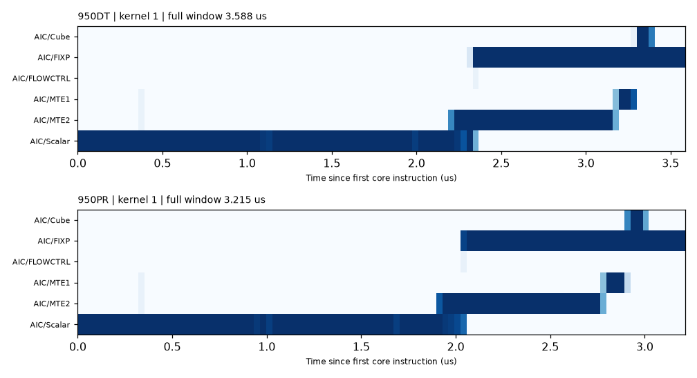

# Addmm 算例

输入轴顺序为 **M,N,K**。本例比较同一输入契约在 950DT、950PR 与假设的 970DT 上的设备指令窗口。

```python
from operator_model import estimate

shape = [16, 64, 256]
attrs = {'self_shape': [64], 'alpha': 1, 'beta': 1}
for chip in ('Ascend950DT_9582', 'Ascend950PR_957b', 'Ascend970DT'):
    r = estimate('addmm', shape, attrs, chip=chip, dtype='bf16', timing_mode='auto')
    print(r.latency_us, r.status, r.active_aic, r.active_aiv, r.work)
```

## 输入到工作量

该路线调用 CANN 9.2.1 的 ops-nn 算子族。实际调用接口为 `aclnnAddmm`。
工作量接口给出的 Cube 操作为 524,288，Vector 计数为 0。逻辑读/写分别为 41088 / 2048 B。此处 None 表示缺少计数；片外实际流量须另行观测，逻辑字节不含中间层重复搬运。

## 分块、资源和关键路径

输入 A[M,K]、B[K,N] 和列偏置 [N]。输出[M,N]共 1,024 项，每项含一次融合偏置加。主 tile=[16, 64, 256]、分支=dense、1 AIC、1 波。读处理量含偏置的 2·min(N,tileN) B。每队列服务用 950DT 单核 trace 区间拟合 a+bX（µs）。
| 队列 | X（读写 KiB、Cube 以 131072 ops 为一单位） | a (µs) | b (µs/单位) | 服务 (µs) |
|---|---:|---:|---:|---:|
| CUBE | 4.00000 | 0.06927 | 0.009539 | 0.10743 |
| MTE2 | 40.12500 | 0.83794 | 0.007047 | 1.12071 |
| MTE1 | 40.12500 | 0.02527 | 0.002445 | 0.12337 |
| FIXP | 2.00000 | 1.29390 | 0.053304 | 1.40051 |

控制底噪 2.10242 µs，核到达偏斜 0.04600·log₂(1)=0.00000 µs，额外队列暴露系数 η=0.10858。全时长=控制+偏斜+波数×最长服务+η(服务和−最长服务)=3.64968 µs。η 来自关键核 trace 上各队列活动并集，描述该实现的重叠程度。

Ascend950PR_957b 按目标频率、每核峰值、有限任务波数和访存压力缩放服务：CUBE=1.000，MTE2=1.005，MTE1=1.000，FIXP=1.000，SCALAR=1.000。重算最长队列后 control=2.102，queue_window=1.548 µs，总计 **3.65035 µs**。

Ascend970DT 按目标频率、每核峰值、有限任务波数和访存压力缩放服务：CUBE=0.915，MTE2=0.915，MTE1=0.917，FIXP=0.917，SCALAR=0.917。重算最长队列后 control=1.927，queue_window=1.418 µs，总计 **3.34530 µs**。

[DT 各阶段参数及训练 trace](../../results/v0.9/addmm/profile.json)

## 设备时间及误差

| 平台 | 模型 (µs) | CA (µs) | 有符号误差 | 预测 AIC / AIV | CA AIC / AIV |
|---|---:|---:|---:|---|---|
| 950DT | 3.64968 | 3.58788 | +1.72% | 1 / N/A | 1 / 0 |
| 950PR | 3.65035 | 3.21515 | +13.54% | 1 / 0 | 1 / 0 |
| 970DT 外推 | 3.34530 | N/A | N/A | 1 / 0 | N/A |

DT/PR 加速比取同形耗时之比，模型 0.9998×，CA 1.1159×。正时延误差为高估。

**950DT CA**　msopprof official full trace，角色 new paired DT CA；核名 `MatMulV3_ND_ND_ND_ND_BF16_BF16_BF16_BF16_high_performance_2`。该宿主的数值检查共 1 组；子算子切片共享宿主检查。各设备窗以最早到最晚核指令计，多 kernel 取串行窗之和。

**950PR CA**　msopprof official full trace，角色 frozen PR holdout；核名 `MatMulV3_ND_ND_ND_ND_BF16_BF16_BF16_BF16_high_performance_2`。该宿主的数值检查共 1 组；子算子切片共享宿主检查。各设备窗以最早到最晚核指令计，多 kernel 取串行窗之和。

## CA 流水与模型差距



横轴为每次 kernel 自身的设备时间，两端各自从零开始。每种核取最晚结束的一个核。每行按该队列有效指令区间的并集着色，100 个等宽时间格，深蓝表示格内占满。不同队列可重叠，行长不能相加。DMA/FIX 行表示描述符的在途窗口，可能包含等待依赖的时间；颜色深度不能直接换算 HBM 总线利用率。

950DT 第 1 段 3.5879 µs；所选核上占用最长的队列为 AIC/Scalar 2.3388 µs、AIC/FIXP 1.2612 µs、AIC/MTE2 0.9770 µs。
950PR 第 1 段 3.2152 µs；所选核上占用最长的队列为 AIC/Scalar 2.0400 µs、AIC/FIXP 1.1873 µs、AIC/MTE2 0.8818 µs。

PR 的模型与 CA 相差 +0.4352 µs。最长队列外的暴露比例来自 DT 关键核；固定比例只近似覆盖跨设备排队和尾波。上图给出可观测的队列活动；一次端到端差值无法唯一分摊到这些因素。

[总建模方法](../modeling-strategy.md) · [全部 shape 的误差](../error-analysis.md) · [970DT 配置与来源](../../configs/chips/Ascend970DT.json)
