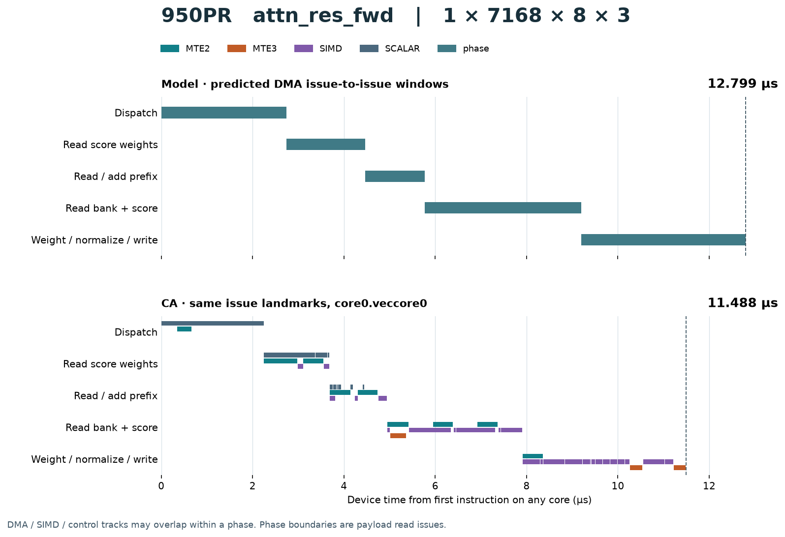

# Kimi AttnResFwd · 驻留 4 行的 decode

Kimi 的 [512,7168,8,1] 表示 512 个 token、7168 通道、8 个 bank 槽，其中 1 个有效。先将归一化 gamma 与分数权重读入，再按 token 计算 score 和加权输出。950DT、PR 每忙核分别处理 8、10 行，条件理想服务分别为 7.834、15.759 µs。公开耗时为 N/A，rsqrt、exp、控制和实际等待需由同一 kernel 的 CA 核验。[40021 分支、各项理想价格与预登记](../../results/v0.29/large/vector/report.md)



在 950PR 上，一个 7168 维 token、8 个 slot、3 行有效历史，模型给出 **12.799 µs**，CA 完整设备窗口 **11.488 µs**，偏高 **11.42%**。旧模型为 24.002 µs。上图两栏按同一组读请求划分阶段，起点为全芯片第一条指令；下栏还能看到每个阶段里 MTE2、SIMD 和写回的并行。保留每段边界、trace 和绘图输入以便核对。[图数据](../../results/v0.21/fusion/attn_res_fwd-figure.json)

```python
from operator_model import estimate

shape = (1, 7168, 8, 3)  # tokens, hidden, bank slots, valid history
attrs = dict(addend=True, write_idx=3, materialize=True, output_norm=True)
r = estimate('attn_res_fwd', shape, attrs, dtype='bf16', chip='Ascend950PR_957b')
print(r.latency_us, r.active_aiv, r.work, r.projection['stages_us'])
```

输入和输出为 BF16，输出同时包含归一化结果、前缀、物化中间值和 bank slot 写回。UB 为 253,952 B，容量公式给出 ⌊(253952−22×7168−32768)/(2×7168+4)⌋=4 行，正好放下三行历史和一行 prefix。宿主选择 40020，1 个 AIV，1 个 token/核。逻辑输入 114,688 B，写 57,344 B，Vector 计数 243,737 ops。实际库为 vLLM-Ascend 的自定义包，运行接口为 `aclnnAttnResFwd`，实测 kernel 为 `AttnResFwd_9dfad72fc51beb0819dd59ab91fb1abf_40020`，四组输出全部通过核验。

| 暴露阶段 µs | DT 预测 | DT CA | PR 预测 | PR CA |
|---|---:|---:|---:|---:|
| 启动至权重读 | 2.744 | 2.27 | 2.744 | 2.25 |
| 读权重与组合 | 1.710 | 1.49 | 1.718 | 1.44 |
| 前缀、加法和写回发起 | 1.299 | 1.33 | 1.304 | 1.26 |
| bank 行与打分 | 3.397 | 3.00 | 3.430 | 2.96 |
| 输出 gamma 发起至完成 | 3.551 | 3.48 | 3.603 | 3.58 |
| **设备总时间** | **12.701** | **11.572** | **12.799** | **11.488** |

最后一段用周期计价。设 L=⌈hidden/64⌉=112 为一行需要处理的 64 元素组数，B=valid+1=4 为加权行数，r 为参考/目标的每 AIV 每周期 FP32 峰值比。用 R 表示核内 MTE2 字节/周期，f 表示 GHz，则

$$
t_{tail}=\frac{2347.99+(20.308L+2.097LB)r+2H/R}{1000f}\quad(\mu s).
$$

2H 为一行 BF16 的字节数。固定项覆盖短指令、等待和尾部清空，20.308 周期/组包含只作用在一行输出上的归一化等工作，2.097 周期/组/行反映每条历史的加权累积。三项通过 9 个已有 DT 末段读指令界标的完整样本识别，设计矩阵满秩；它们是当前实现的暴露周期，不能解读成单条 ISA 指令延迟。旧方法把后两类工作合并后乘 B，在同一 H 上由 1 行历史变到 3 行时，仅尾段就多算 6.68 µs，而 DT 观测只增加 0.313 µs。修订后 PR 尾段与 CA 相差约 0.027 µs，剩余误差主要落在启动和较早读指令界标。970DT 用其自身频率和每核峰值外推 **11.639 µs**。多 token/核或需要重读 bank 的实现仍只返回工作量。[系数复算](../../development/validation/fusion21/prices.py) · [双芯片数据](../../results/v0.21/fusion/evaluation.json)

## 模型冻结后的新形状


将输入变为 `(2,4096,8,1)`、`write_idx=1`，两个 AIV 各处理一行。冻结后的 950PR 预测 **8.643 µs**，CA **7.984 µs**，v0.20 为 11.066 µs。图上可以检验改动影响的位置：gamma 请求至最终输出，预测 2.502 µs，实测 2.417 µs；启动至第一笔权重读，预测 2.744 µs，实测 2.415 µs。DT 同形预测 8.603 µs、CA 8.113 µs。970DT 外推 7.885 µs。此例中 PR 的 CA 略快，模型仍将 DT 排在前面。四组输出均通过 CPU 校验，两个设备窗口的留出采集分别耗费 229 秒和 413 秒。[独立流水图数据](../../results/v0.21/fusion/attn_res_fwd-independent-figure.json)
