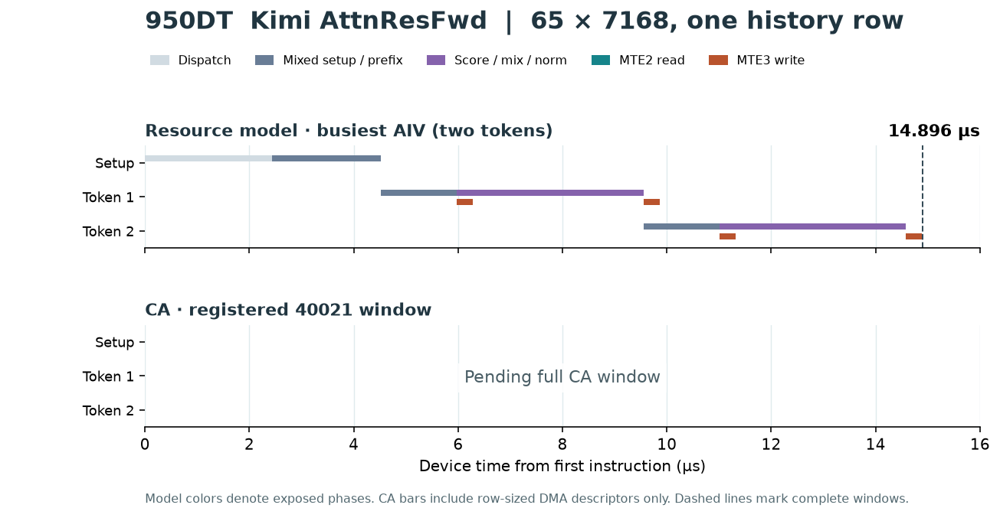

# Kimi AttnResFwd 算例 · prefill 驻留分支与 decode 对照

| 本页的两种调用 | 返回张量与 bank 行为 | 完整设备计时的证据 |
|---|---|---|
| Kimi prefill，`materialize=False, write_idx=-1` | 独立 prefixOut，materialized 与 Y 别名，bank 不变 | 950DT/PR 新 shape 已事前登记，结果及资格随合格回执更新；970DT 外推 |
| 旧 40020 单轮，`materialize=True, write_idx>=0` | 有独立 materialized 输出，写指定 bank slot，另写 Y 和 prefixOut | 950DT/PR 已有完整窗口；只能将共有指令阶段用于另一路线的参数迁移 |

v0.34.0 安装 wheel 已在源码目录外复核三个新 shape 在三个芯片上的 9 个冻结时延、资源分段、读写量、分核和状态。逐项数值完全一致；下文旧 40020 的 PR 算例另做回归核验。[安装版核验](../../results/v0.34/attn/wheel-check.json)

## Kimi prefill 的真实调用

单卡调度 512 个 token，hidden=7168、8 个残差 bank 槽、有效历史 N=1，对应 Kimi 1–11 层的 attention/FFN 普通位置。vLLM-Ascend 混合和输出归一化开启，prefix 与 addend 相加，返回 Y 和 prefixOut，materialized 与 Y 别名，write_idx=-1 保持整个 bank 不变。设备调用为固定 vLLM-Ascend 自定义 ACLNN 包的 `aclnnAttnResFwd`；它属于该框架扩展。950DT / 950PR / 970DT 公开入口预测 **45.078 / 55.623 / 27.478 µs**，返回 `extrapolated`；这次真正的 40021 独立全窗仍待采集。早先仅按峰值与理想端口算得的 7.834 / 15.759 µs 是有条件的服务估计。[框架源码与库对象登记](../../results/v0.19/workloads/attn-res-build.json) · [当前独立实测及预算](../../results/v0.34/attn/report.md)

```python
from operator_model import estimate

r = estimate("attn_res_fwd", [512, 7168, 8, 1], {
    "addend": True, "output_norm": True, "mix": True,
    "write_idx": -1, "materialize": False, "optimize_prefill": True,
}, dtype="bf16", chip="Ascend950DT_9582")
print(r.latency_us, r.status, r.work, r.active_aiv)
print(r.projection["timing_diagnostics"]["per_core_cycles"])
```

### 形状到工作量

令 T 是本次发起的 token 数，H 是通道数，C 是目标芯片的 AIV 数。实际发起 $L=\min(C,T)$ 个核，每个有数据的核最多处理 $R=\lceil T/L\rceil$ 行。有数据的核数为 $P=\lceil T/R\rceil$；最后几个已发起的核可以无 payload。每行 B=N+1 个 BF16 向量含 N 行历史和一个当前 prefix。UB 可驻留历史与 prefix 的最大行数按源码取 $\max(0, UB-22H-32768) \mathbin{//}(2H+4)$。缓存 output gamma 另检查对齐后的完整内存预留，并要求 R>1。950DT/PR 的 UB 均为 253952 B，在 H=7168 时最多 4 行，B=2 可驻留。DT 的 L/P/R=64/64/8，PR 为56/52/10。两个 SKU 都走 40021。[实际分核与 UB 公式](../../operator_model/attention_residual.py)

令 $U=2H=14336$ 字节为一行 BF16。每个 payload AIV 一次读两条打分权重、再将 output gamma 缓存于本地。每 token 读 prefix、addend 和 N 条历史；prefixOut 与最终 Y 各写一次。因此 DMA 读为 $U[3P+(2+N)T]$，写为 $2UT$。DT 分别为 24,772,608 B 和 14,680,064 B；PR 只需 52 份 setup 读，DMA 读为 24,256,512 B。逻辑字节仅对共享输入权重计一份，从片上重用和最终 HBM 流量之间还要区分。分块因目标配置重新计算：例如 [65,7168,8,1] 在两种 950 芯片上有33个 payload 核、每忙核两轮，选40021，而 970DT 有120个 AIV 可用，仅一轮、选40020。

### 工作量到时间

以下小写时间量以目标周期计价。$g=\lceil H/64\rceil$ 是 FP32 向量组数，$z=g$ 乘以「950DT 单核单周期 FP32 操作数 / 目标该值」。每核每周期操作数用整卡 TFLOP/s、AIV 数和频率反推。令 $d=U/b_r$，$s=284.982+U/b_w$，$b_r,b_w$ 是每 AIV 每周期读与写的字节数。若芯片配置提供相应端口带宽，则除以频率转为 B/cycle；缺失时使用已有 DT 估值 48.363 B/cycle 和 1024/16.01826 B/cycle。$s$ 中常数是可见写响应截距。

| 阶段 | 目标周期 | 含义 |
|---|---|---|
| dispatch | 4022 | 全核首条指令到临界核首笔打分权重读 |
| weights $w$ | $1784.834+0.985806z+2d$ | 两条打分权重读、转换、合并 |
| prefix $p$ | $1577.818+2.10455z+2d$ | prefix 与 addend 的读及 BF16 相加 |
| score/mix $a$ | $657.852+901.304B+8.91102zB+Nd$ | 驻留行的归一化打分、小 softmax 与加权累积，含本地 prefix |
| output norm $n$ | $446.295+6.20096z$ | 输出行 norm 与转换的可见周期 |
| gamma $q$ | $637.827+d$ | 缓存或流水发起的权重读响应 |
| drain | 10 | 最后输出写退休到最后退休指令 |

这些系数来自11个已测 DT、resident 40020 同源路径的真实时间界标。在旧路径中 materialized 会产生额外写及同步，bank 也会增加一次写回。采集脚本逐条对齐权重、prefix、历史行、materialized 和 Y；从 output-norm 段中剔除等 materialized 及 gamma 的门控时间。包含多个阶段时，回归特征是有物理意义的每行固定开销、每64元素工作量或每条真实 DMA，非线性指令和部分同步尚未单独辨识。取值和每个 trace 的样本角色见[参数生成](../../development/validation/attn34/phases.py)与[原始阶段数据](../../results/v0.34/attn/phase-calibration.json)。

在 40021 中初始化成本 $I=4022+w+q+H/v_{16}$，$v_{16}$ 是目标每核每周期的 BF16 峰值，最后一项按每元素一次本地复制估计。若使用同族单轮非缓存分支，初始化只算 $4022+w$，gamma 可与 score 时段并行。设 $b=\max(s,a+n)$ 为从 prefix 写发起到最终写可以发起的时间；非缓存时用 $\max(a,q)+n$ 替代 $a+n$。输出队列只有一槽，上一行的 Y 写可以与下一行 prefix 处理重叠，因此稳态每行间隔为 $\Delta=\max(p,s)+b$。临界核完成时间为

$$t_\mathrm{local}=I+p+b+(R-1)\Delta+s+10.$$

再取 $\max(t_\mathrm{local}/(1000f),T_\mathrm{cold},T_\mathrm{L2})$ 得设备微秒；$f$ 为 GHz。$T_\mathrm{cold}$ 采用独立输入读字节和 HBM 峰值，$T_\mathrm{L2}$ 按总 DMA 和配置给出的 L2 带宽，缺带宽时不施加相应约束。模型另返回冷读加全部输出均到 HBM 的情景。DT 的设备窗口拆成启动 2.438、初始化权重 2.083、首行 5.030、后7行 35.213、末写排空 0.315 µs，外部带宽没有再抬高该例的时间。PR 同一算法后续有9行。[排程实现](../../operator_model/attn_res_resident.py) · [分阶段输出与冻结预测](../../results/v0.34/attn/freeze.json)

在有完整指令窗但语义不同的旧 40020 归档上，迁移所用共同阶段的 WAPE 为 DT 回放 3.55%、PR 回放 3.55%。新 40021 端到端误差只能由真实 nonmaterialized、无 bank 写的独立测量计算。H=7168 的 valid 4–8 会走二次搬运 bank 的 reload 分支，仍只返回工作量。[每个受支持层组和双端进展](../../results/v0.34/attn/report.md)

### 跨过单轮边界的算例图



把 512 行缩至 65 行，64 个 AIV 发起，33 个核有数据，最忙核处理两行。上栏两行分别标出 prefix、打分/混合/归一化、prefixOut 写与 Y 写。第一行的 Y 写与第二行 prefix 部分重叠。横轴以全芯片第一条设备指令为零。下栏只从相同 shape、相同 flags 的合格 CA 读取最后退休核的整行 MTE2/MTE3 描述符，阶段尚不能识别时保留空栏。上栏紫色是含同步的暴露阶段成本。[绘图数据](../../results/v0.34/attn/timeline-65-dt.json) · [生成脚本](../../development/validation/attn34/figure.py)

## 已实际测量的 40020 decode 对照


在 950PR 上，一个 7168 维 token、8 个 slot、3 行有效历史，模型给出 **12.799 µs**，CA 完整设备窗口 **11.488 µs**，偏高 **11.42%**。旧模型为 24.002 µs。上图两栏按同一组读请求划分阶段，起点为全芯片第一条指令；下栏还能看到每个阶段里 MTE2、SIMD 和写回的并行。保留每段边界、trace 和绘图输入以便核对。[图数据](../../results/v0.21/fusion/attn_res_fwd-figure.json)

```python
from operator_model import estimate

shape = (1, 7168, 8, 3)  # tokens, hidden, bank slots, valid history
attrs = dict(addend=True, write_idx=3, materialize=True, output_norm=True)
r = estimate('attn_res_fwd', shape, attrs, dtype='bf16', chip='Ascend950PR_957b')
print(r.latency_us, r.active_aiv, r.work, r.projection['stages_us'])
```

输入和输出为 BF16，输出同时包含归一化结果、前缀、物化中间值和 bank slot 写回。UB 为 253,952 B，容量公式给出 ⌊(253952−22×7168−32768)/(2×7168+4)⌋=4 行，正好放下三行历史和一行 prefix。宿主选择 40020，1 个 AIV，1 个 token/核。逻辑输入 114,688 B，写 57,344 B，Vector 计数 243,737 ops。实际库为 vLLM-Ascend 的自定义包，运行接口为 `aclnnAttnResFwd`，实测 kernel 为 `AttnResFwd_9dfad72fc51beb0819dd59ab91fb1abf_40020`，四组输出全部通过核验。

| 暴露阶段 µs | DT 预测 | DT CA | PR 预测 | PR CA |
|---|---:|---:|---:|---:|
| 启动至权重读 | 2.744 | 2.27 | 2.744 | 2.25 |
| 读权重与组合 | 1.710 | 1.49 | 1.718 | 1.44 |
| 前缀、加法和写回发起 | 1.299 | 1.33 | 1.304 | 1.26 |
| bank 行与打分 | 3.397 | 3.00 | 3.430 | 2.96 |
| 输出 gamma 发起至完成 | 3.551 | 3.48 | 3.603 | 3.58 |
| **设备总时间** | **12.701** | **11.572** | **12.799** | **11.488** |

最后一段用周期计价。设 L=⌈hidden/64⌉=112 为一行需要处理的 64 元素组数，B=valid+1=4 为加权行数，r 为参考/目标的每 AIV 每周期 FP32 峰值比。用 R 表示核内 MTE2 字节/周期，f 表示 GHz，则

$$
t_{tail}=\frac{2347.99+(20.308L+2.097LB)r+2H/R}{1000f}\quad(\mu s).
$$

2H 为一行 BF16 的字节数。固定项覆盖短指令、等待和尾部清空，20.308 周期/组包含只作用在一行输出上的归一化等工作，2.097 周期/组/行反映每条历史的加权累积。三项通过 9 个已有 DT 末段读指令界标的完整样本识别，设计矩阵满秩；它们是当前实现的暴露周期，不能解读成单条 ISA 指令延迟。旧方法把后两类工作合并后乘 B，在同一 H 上由 1 行历史变到 3 行时，仅尾段就多算 6.68 µs，而 DT 观测只增加 0.313 µs。修订后 PR 尾段与 CA 相差约 0.027 µs，剩余误差主要落在启动和较早读指令界标。970DT 用其自身频率和每核峰值外推 **11.639 µs**。这一 materialized 且写 bank 的 decode 分支在每核多 token 或需要重读 bank 时仍只返回工作量。[系数复算](../../development/validation/fusion21/prices.py) · [双芯片数据](../../results/v0.21/fusion/evaluation.json)

## 模型冻结后的新形状


将输入变为 `(2,4096,8,1)`、`write_idx=1`，两个 AIV 各处理一行。冻结后的 950PR 预测 **8.643 µs**，CA **7.984 µs**，v0.20 为 11.066 µs。图上可以检验改动影响的位置：gamma 请求至最终输出，预测 2.502 µs，实测 2.417 µs；启动至第一笔权重读，预测 2.744 µs，实测 2.415 µs。DT 同形预测 8.603 µs、CA 8.113 µs。970DT 外推 7.885 µs。此例中 PR 的 CA 略快，模型仍将 DT 排在前面。四组输出均通过 CPU 校验，两个设备窗口的留出采集分别耗费 229 秒和 413 秒。[独立流水图数据](../../results/v0.21/fusion/attn_res_fwd-independent-figure.json)
