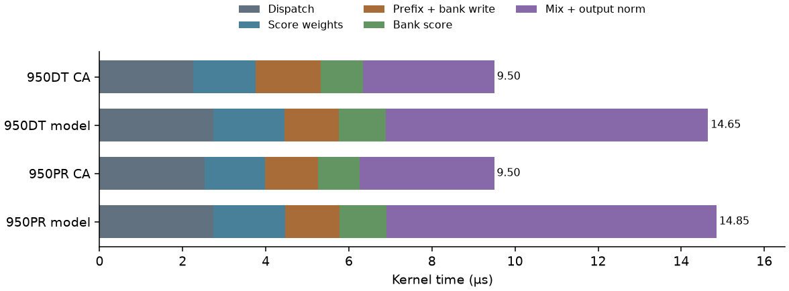

# Kimi K3 Attention Residual · 一个 decode token

一个本卡 token、H=7168、8 个 bank slot、其中 1 个有效，当前层融合 BF16 加法，将 raw prefix 写到 slot 1，同时保留加权输出并做输出 RMSNorm。

```python
from operator_model import estimate

r = estimate('attn_res_fwd', (1,7168,8,1), dtype='bf16', chip='Ascend950PR_957b',
             attrs={'addend':True, 'write_idx':1, 'materialize':True, 'output_norm':True})
print(r.latency_us, r.active_aiv, r.projection['stages_us'])
```

UB=253,952 B 允许 floor((253952−22×7168−32768)/(2×7168+4))=4 行驻留。1 个历史行加 1 行当前 prefix 共 2 行，于是 host 选 40020，1 个 AIV 做 1 个 token。该 AIV 读投影权重、打分 gamma、prefix、addend、bank 和输出 gamma 六行 BF16，各 14,336 B，共读 86,016 B。四次写为加法所得 prefix、bank slot 1、物化的混合向量、归一化输出，共 57,344 B。

模型在读权重、读 prefix、读 bank、读输出 gamma 的指令发起处分段。设 L=112 个 FP32 数据块，即 7168/64。DT 单核 FP32 每周期峰值为 27,000/(64×1.65)=255.68，PR 为 23,000/(56×1.65)=248.92。以读两种权重并组合为例，PR 使用 1746.59 + 112×4.3085×255.68/248.92 + 2×14336/48.36 = 约 2835 cycles，即 1.718 µs。下表逐段比较安装的原版 kernel 时间线。读和写可能跨段重叠，因此这里按指令起点之间的暴露墙钟记账。

| 阶段 µs | DT 预测 | DT CA | PR 预测 | PR CA |
|---|---:|---:|---:|---:|
| 启动至首笔投影读 | 2.744 | 2.253 | 2.744 | 2.534 |
| 权重读与组合 | 1.710 | 1.504 | 1.718 | 1.441 |
| 前缀读、加和发起写回 | 1.299 | 1.572 | 1.304 | 1.287 |
| bank 行及打分 | 1.132 | 1.007 | 1.143 | 0.992 |
| gamma 发起至输出完成 | 7.762 | 3.168 | 7.943 | 3.246 |
| **总时间** | **14.648** | **9.505** | **14.853** | **9.499** |



CA 通过四个输出组的数值核验，实际 kernel 为 vLLM Ascend 自定义包的 `AttnResFwd_9dfad72fc51beb0819dd59ab91fb1abf_40020`。PR 的主要偏差来自最后一段，归一化、softmax 加权和写回在该阶段内的贡献仍欠可辨识性。970DT 预测 13.418 µs，沿用相同 arch35 策略及启动和依赖的参考周期。把属性改为多 token/核、非物化或 RELOAD 时，可继续查询工作量和分块；这些分支的设备时间为 N/A。[公式与参数来源](../../results/v0.19/workloads/attention-residual.md) · [冻结、SHA、逐核观测和开销](../../results/v0.19/workloads/attn-res-evaluation.json)

## 同一 hidden 上增加有效历史行

将上述输入改为 `shape=(1,7168,8,3)`、`write_idx=3`，4 行刚好满足驻留条件，仍使用同一个 AIV。同一冻结版本给出 DT 23.593 µs、PR 24.002 µs，CA 分别为 11.572、11.488 µs，970DT 外推为 21.610 µs。两种 bank 深度的具体差别是，DT 上新增两行带来的整 kernel CA 增量为 2.067 µs，从输出 gamma 请求到最后输出的尾窗只增加 0.313 µs。模型尾窗却增加 6.681 µs，原因在于它将全部历史行的加权活动按小 H 拟得的斜率计入该窗口。实际时间线上，尾窗的 SIMD 活动并集仅从 2.622 增至 2.936 µs。

全部 10 个不同的驻留输入上，DT 设备时间 WAPE 29.95%、PR 33.10%，DT/PR 倍速 WAPE 4.24%。H=256～7168、每次 1～8 个有载荷的核。这 10 对都预测 DT 略快，CA 则均为 PR 略快。始终返回 1× 的倍速误差为 3.59%。该子集的 SKU 排序仍欠可靠。[逐 shape 双端实测、分组误差、采集开销](../../results/v0.19/workloads/attention-residual.md#同一冻结模型的两次独立验证)
