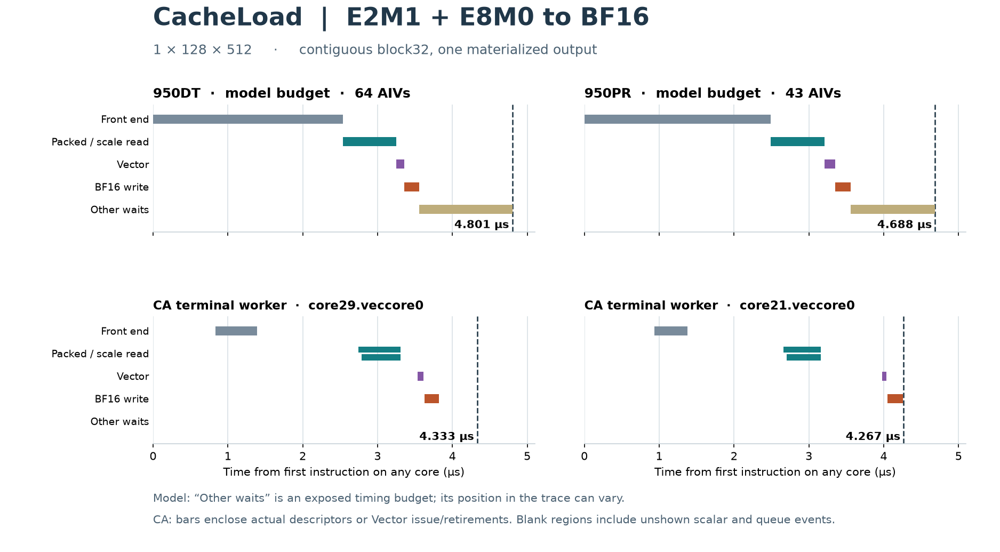

# CacheLoad · 将压缩缓存物化为 BF16

系统图的 `inference::cache_load` 读取当前有效的缓存行和对应 scale，生成一份 BF16 张量。工作量取决于**本次读出的逻辑形状**，包括本卡 batch、有效行、头或其它前缀维度以及尾轴宽度。已分配缓存的最大长度可能更大。物化意味着后续算子的正常输入读与本次算子的 BF16 输出写是两个接口事件，实际是否经过 HBM 取决于部署实现。

## 一次 Kimi 长上下文调用

```python
from operator_model import estimate

result = estimate(
    "cache_load", [64, 131081, 2, 16, 64],
    dtype="mxfp4", chip="Ascend950DT_9582",
    attrs={"storage_shape": [64, 131081, 2, 16, 32],
           "scale_shape": [64, 131081, 2, 16, 1, 2]},
)
print(result.status, result.latency_us)  # unavailable, None
print(result.work["logical_read_bytes"], result.work["logical_write_bytes"])
# 9127432192 34362097664
```

此形状取自系统框架 `0.1.0-preview.1` 的 950DT、Kimi、DP64/EP64、batch 64 的 rank-0 目标图。历史长度 131072，本次验证 9 个位置，因此有效行轴为 131081。同一目标图的按 shape 计数表有 10 次这样的调用。一次调用共有 R=64×131081×2×16=268453888 行，每行逻辑宽度 D=64，输出 E=R×D=17181048832 个元素。

| 一次调用的工作 | 计算 | 结果 |
|---|---|---:|
| 读 FP4 值 | 每两个值打包进一个 E2M1x2 字节，R×⌈D/2⌉ | 8,590,524,416 B |
| 读 E8M0 scale | 每 32 个值共用一因子，两个尺度成对存放，R×2×⌈D/64⌉ | 536,907,776 B |
| BF16 物化写 | E×2 B | 34,362,097,664 B |
| 缩放 | 每个有效输出应用一次其所属组的 scale | 17,181,048,832 次 |

每个元素满足 `Y[r,j] = BF16(decode(E2M1[r,j]) × scale[r,j//32])`。E8M0 表示 2 的整数次幂，真正的内核可以用指数调整。模型将数学上的缩放记入 `vec_ops_by_class["scale_application"]`，实际执行精度记作 `unspecified`，没有把它解释成具体条数的浮点乘指令。`input_value_decodes`、`bf16_result_values` 单列有效值数，可与字节数一同用于实现设计。

**奇数宽度和 scale 补齐。** 输入逻辑 [3,65] 时每行有 33 个 packed 字节，最后一个半字节为空。每行使用 3 个真实 scale，物理 scale 张量 [3,2,2] 每行有 4 槽。假设完整读取声明的有效行张量，值和 scale 共 99+12=111 B，输出 390 B。实现可能跳过无用槽；公开的 `physical_hbm_bytes` 为未知。

## FP8 路径

V4-Pro 目标图还出现一张 [1,1024,512] 的 E4M3FN 缓存，物理形状与 BF16 输出形状相同，FP32 scale 形状为 [1,1024]，每行一个。调用 `estimate("cache_load", [1,1024,512], dtype="fp8_e4m3fn")`，值占 524288 B，scale 占 4096 B，输出占 1048576 B；每次调用共缩放 524288 个值。FP8 缓存这里采用逐行 FP32；带 block32 E8M0 的 MXFP8 是另一份布局。FP8 图上的 `group_size=32` 只是同一生产器携带的元数据，FP8 路径的 scale 数始终按行推导。

## 系统图如何接入

1. 确认源节点为 `inference::cache_load`，出现两个输入、一个物化 BF16 输出。源代码在 BF16 缓存上直接返回原值。注意力或索引器直接消费低精度缓存时，应按对应融合实现计价。
2. 将 BF16 **输出**的本卡维度传给 `shape`。FP4 的值张量形状只在尾轴除以二。用源图的 `semantic.storage_precision` 及两输入 dtype 确认路径，将实际物理输入形状放入可选 `storage_shape`、`scale_shape` 可检查不一致。源适配器仅在 `storage_precision="fp4"` 时进入 packed 验证，其余路径验证 FP8 字节、逐行 FP32 scale 和 BF16 输出。API 当前支持 block32 FP4，源 builder 允许的其它分组需要单独定义合同。
3. 对发布快照的 `modeling-inputs.csv.gz` 按 27 个常规 run（历史 131072）统计，共 3,213 次 CacheLoad，其中 2,295 次为 E2M1x2/E8M0，918 次为 E4M3FN/FP32，输出都为 BF16。另一个历史 131198 的边界 run 单列，FP4 120 次、FP8 102 次。原始快照 SHA-256 为 `07e72a917a5553d1f152a53c54fb689633118f9113a90333c86607eaa1807102`。上述 Kimi 和 V4-Pro 两份目标图的按 shape 汇总表指纹分别以 `d0b413beb90b` 和 `bc100cfcb938` 开头。[固定版缓存布局](https://github.com/ZhanluModelSim/inference-models-simulator/blob/e09a6f866bb55c84455a905bf91421aa4b6291f2/src/inference_models/common/cache.py) · [有效行切片和源节点](https://github.com/ZhanluModelSim/inference-models-simulator/blob/e09a6f866bb55c84455a905bf91421aa4b6291f2/src/inference_models/layers/layout.py) · [实际语义适配器](https://github.com/ZhanluModelSim/operator-performance-models/blob/c266554fa186d82201f4acdd034dc7b228a07d3a/src/operator_performance_models/adaptors/vec/cache_io.py)

## 指定 FP4 库实现后怎样预测

调用者若将连续尾轴缓存交给 `aclnnAntiMxQuant`，可显式绑定这一个实现。以下两次调用几何相同。第一种按系统图语义返回工作量；第二种才返回 CANN 9.2.1 ops-nn 的设备估计。

```python
from operator_model import estimate

shape = (1, 128, 512)
logical = estimate("cache_load", shape, dtype="mxfp4")
native = estimate("cache_load", shape, dtype="mxfp4", chip="Ascend950DT_9582",
                  attrs={"implementation": "aclnnAntiMxQuant"})
print(logical.latency_us, native.latency_us, native.active_aiv)  # None, 4.8007…, 64
print(native.projection["target_plan"])
```

常规 27 个 run 中有 447 次 FP4 和 213 次 FP8 CacheLoad 形状为 [1,128,512]，两种格式的输入、scale 和输出在这组调用中均满足连续步长。对这些 run 的所有 CacheLoad 按物理形状和 stride（忽略长度 1 的轴）判断，FP4 有 1,659 次连续、636 次至少一张量不连续；FP8 分别为 732 和 186 次。显式 FP4 模型接受连续、非空、尾轴偶数、2–7 维的 E2M1 值和连续成对 E8M0 scale，输出为连续 BF16。上述奇数宽 [3,65] 仍可走无绑定的工作量入口。需要先压紧视图或随后复制到带步长目标时，应将复制单独计入。

### 从 [1,128,512] 到 4.801 µs

- **张量与流水。** R=128 行，D=512 列，读值 R×D/2=32,768 B，读 scale R×2×⌈D/64⌉=2,048 B，写 BF16 131,072 B。显式核用两条 MTE2 搬值和尺度，在 UB 将 E8M0、打包的 E2M1 转为 BF16，按 block32 广播做乘法，再经 MTE3 写出。数学账单是 65,536 个 BF16 乘法。向量解包、类型转换、寄存器重排和发射等待另入时间定价。实际跑到的唯一核为 `AntiMxQuant_e2m1tobf16_high_performance_0`。
- **分核。** Host 把 1 行 × 512 列作为外层切分单位，候选行分片 m 来自目标可用 AIV 数 A 的整商集合，列分片 n=⌊A/m⌋。候选须能放入 R×⌈D/512⌉ 网格，优先选尾部少的方案，相同成本时优先少切列。最终再按每核的整行、整列片长收拢未用核。这里 DT 的 64 AIV 各得两行；PR 先按 56 AIV 试分，每核 ⌈128/56⌉=3 行，实际 ⌈128/3⌉=43 AIV。两种分核数均与 CA 相符。
- **UB 与工作单元。** 512 元素需要双份（256 B 的值 + 16 B 的 scale + 1,024 B 的输出）和 32 B 的 BF16 临时 scale，共 2,624 B。每核最多存 16×⌊UB/2624⌋ 个 block32，950 配置的 253,952 B 得 1,536 个 block32。在 DT 的关键核，两行合并为一个 UB tile，读 544 B、写 2,048 B，包含 2 次 512 元素 data VF 循环与 1 次最多 256 个 E8M0 的 scale VF 循环。这里的“次”来自展开循环；trace 中退休的 RVECEX 事件另计。
- **启动与多核离散。** 从全片最早指令到末核发起 payload 读，预算为 `F=3413.5+749×log₂(A)/log₂(56)` 周期。设置独立的暴露等待 `J=1966×log₂(A)/log₂(56)`，涵盖同一末核在写前派发或写后退休可能遇到的长等待。A 是本次真实分核策略给出的工作核数。J 是从两种并发度拟定的尾部统计假设，未辨识其在极大核数下的分布。
- **核内与共享资源。** 单 UB tile 读服务为 `Lr + Br/qr`，写服务为 `Lw + Bw/qw`。DT 默认 qr=1024/18.39635、qw=1024/16.01826 B/核/周期；配置了 MTE 带宽时改用该核 GB/s 除 GHz。向量服务 = 47 周期交接 +（8×scale 循环 + 60×data 循环）×目标精度价格比。价格比是参考与目标每核每周期的 BF16 峰值之比。DT 本例读 1,174.55 周期，算 175，写 330.03，单 tile 顺序串接得到 1,679.58 周期。多 tile 对读、算、写分别累计，再取最大服务总量加首末填排，近似双缓冲的稳态。全片还计算受活动核发起能力、HBM 和 L2 限制的共享搬运下界，本例只占 18.13 周期。
- **合成与对照。** 整窗 `(F + max(核内流水, 共享搬运) + J + 23) / (1000×频率GHz)`。DT 得 (4,187.35+1,679.58+2,031.22+23)/1650 = **4.8007 µs**，CA **4.3327 µs**；PR 预测 **4.6878**，CA **4.2667 µs**。绝对设备时间略高估。DT 末核真实数据读在 4,523/4,598 周期发起，最后一次写在 6,301 周期退休，全核窗 7,149 周期；PR 对应读 4,394/4,467、写 7,025、全窗 7,040 周期。相同输出工作量，末核排队和标量收尾位置不同。970DT 情景可用 120 AIV，按每核两行收拢为 64 AIV，外推 **4.4005 µs**。



图中每一列采用该芯片全核首条指令为设备零点。上栏将 J 列作预算，实际等待可出现在 VF 发起前或最后一次写退休后。下栏的灰条仅表示 128 B 铺排读描述符，两条绿条分别表示 packed 值和 scale 的发起至退休。[从冻结与末核事件重绘](../../calibration/cache_load/plot.py)

### 价格从哪些观测得到

以下均为相对于全片首条指令的周期，取最后退休的物理核。用 [1,1,128] 和 [1,56,512]、每形双端一条，作为四个开发窗。第一个 128 B MTE2 是铺排元数据；下表取后面的实际值和 scale 读。两次读响应相互重叠，计算二者从首次发起到最后到达的并集外窗。[开发冻结、逐核收据和末核事件](../../calibration/cache_load/fp4-development.json.gz)

| 开发 shape · SKU | AIV | 首次值读 / 最后读退休 | 首次向量 / 最后向量退休 | 写发起 / 写退休 | 全窗退休 |
|---|---:|---:|---:|---:|---:|
| [1,1,128] · DT | 1 | 3475 / 4715 | 4737 / 4805 | 4830 / 5129 | 5144 |
| [1,1,128] · PR | 1 | 3352 / 4444 | 4466 / 4534 | 4559 / 4864 | 4895 |
| [1,56,512] · DT | 56 | 4615 / 5129 | 7066 / 7134 | 7159 / 7483 | 7498 |
| [1,56,512] · PR | 56 | 3710 / 4480 | 4502 / 4570 | 4595 / 4894 | 6942 |

单核首发 3,413.5=(3475+3352)/2，56 核的新增首发预算 749=((4615−3475)+(3710−3352))/2。单核读外窗均值 1166=((4715−3475)+(4444−3352))/2，减去 68 字节的传输价格，得 Lr=1164.78 周期。写外窗均值 302=((5129−4830)+(4864−4559))/2，减去 256 字节的传输价格，得 Lw=298.00 周期。单核读退休到写发起均为 115 周期，其中真实向量首末事件跨度 68，余下 47 记交接。68 的 scale/data 拆分 8/60 是依据首批 scale 变换与数据乘法事件次序的估计；开发窗无法独立测得两个 VF 的稳态发起间隔。单核写到 END 的尾部平均 23=(15+31)/2 周期。56 核最后完成的 DT 工作核在写前增加 1,915 周期，PR 工作核在写后增加 2,017 周期，均值 1,966 计入 J，避免把这两种互斥位置的等待重复计价。单核 MTE 吞吐复用原有读写价格，多核共享带宽沿用混合流量模型；本组短窗不足以拟合这些速率。[FP4 调度实现](../../src/operator_model/operators/vector/cache_load_antimx.py) · [MTE 参考价格](../../src/operator_model/operators/rmsnorm/resources.py) · [共享带宽模型](../../src/operator_model/scheduling/memory.py) · [固定源码的 host 规则](https://gitcode.com/cann/ops-nn/blob/602e4ad985da00aad28c16432841e9c5069e10de/quant/anti_mx_quant/op_host/arch35/anti_mx_quant_tail_axis_tiling_arch35.cpp) · [接口限制](https://gitcode.com/cann/ops-nn/blob/602e4ad985da00aad28c16432841e9c5069e10de/quant/anti_mx_quant/docs/aclnnAntiMxQuant.md)

若将 Kimi 前述超大形状先整理成满足显式实现合同的连续张量，DT/PR/970DT 分别外推 **19,386.69 / 31,001.40 / 9,469.02 µs**。这里 950 两端也已超开发范围；未采集该大窗，压紧复制另计。分核与 UB 采用最多四种普通/尾片的组合，在线预算随硬件候选切分数增长，无须遍历数百万行或逐条生成设备指令。

## FP8 逐行物化的实际 CA 参考

对同一实际几何 [1,128,512]，将连续 E4M3FN 缓存无复制视作 [128,512]、对应行 scale 视作 [128,1] FP32，`aclnnAscendAntiQuant` 选次尾轴广播，`offset=null`、`sqrtMode=false`、输出 BF16。输入包含 FP8 次正规数、非整数、最大有限值和负数，行尺度在 FP32 中变化；CPU 对每个乘积做 BF16 最近偶数舍入，双端各 65,536 个值全部相同。ACLNN 发起一次实际 `AscendAntiQuantV2_650baea70767c4bd7838a0d2f6bb5823_high_performance_2`，两端加载核相同，ELF SHA-256 为 `fd957736561503b1759d05faadda182d6ff4451748f25a549f1faa1612fc15ce`。

| SKU | AIV | 全部核最早 / 最晚 tick | CA 设备时间 | 采集墙钟 |
|---|---:|---:|---:|---:|
| 950DT | 64 | 7651 / 15157 | 4.5491 µs | 64.68 s |
| 950PR | 56 | 6379 / 13049 | 4.0424 µs | 61.46 s |

此处是原生候选实现的直接观测。系统节点的真实 dispatch 仍未知；每端一形没有约束 FP8 的分块和多轮流水。FP8 的 `estimate` 返回工作量；该形的模型误差、其它形状设备耗时、970DT 外推皆为 N/A。从仓根运行 `python -m calibration.cache_load.lookup --dtype fp8_e4m3fn --chip 950PR --shape 1 128 512` 可查实测并复核每核 END 和退休；输入不匹配会返回空结果。[FP8 双端全核证据](../../calibration/cache_load/fp8-smoke.json.gz) · [原生数值探针](../../calibration/cache_load/probe_fp8.cpp) · [采集与校验代码](../../calibration/cache_load/fp8_smoke.py) · [接口与精度约束](https://gitcode.com/cann/ops-nn/blob/602e4ad985da00aad28c16432841e9c5069e10de/quant/ascend_anti_quant_v2/docs/aclnnAscendAntiQuant.md)
