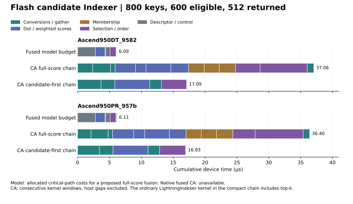

# Flash 候选索引：128 Ki token、一次校验 9 个 token，究竟要打多少分？

DeepSeek-V4.1-Flash 在本例中为 **1,179,729** 个 query–key 对打分，筛掉候选之外的位置后，剩 **147,421** 个有效对，最后每行输出 **512** 个位置。这三个数计的是不同阶段。950DT 上，模型为「全表打分再筛块」的假设融合实现预测 **414.976 µs**；另一种实现先收集候选再打分，预测 **41.099 µs**。两者均为外推；没有可用的 950 原生融合整窗能证明其中任何一个就是部署时延。

## 来源、边界与层映射

[DeepSeek 固定版本的 `Indexer.forward`、`select_candidate_blocks`](https://huggingface.co/deepseek-ai/DeepSeek-V4.1-Flash/blob/12b5c3a462cdaf73dfced279a50adc7c2bb4a9c1/inference/model.py) 给出了算法顺序：

1. 第 20 层先用自己的 Q、K 与头权重形成全表位置分。将每行每 8 个压缩位置取最大值，尾块用负无穷补齐；将最新可见块的块分置正无穷，按块分取前 C 个不同的块，丢掉不可达块。**不是**把已选 512 个位置除以 8 再去重。本例配置 C=2048；源码返回布尔掩码，系统捕获用块 ID 表示同一个集合。
2. 消费层取**本层**的 Q 和权重、共享 K；对每个位置，各头做点积、ReLU、乘权重，然后跨头求和。官方 TP 参考在头分片时还要 all-reduce，再按候选掩码置负无穷、取分数前 512、按位置升序、加偏移或写 −1。参考还包括 Q 的 FP4 假量化；源码没有要求 einsum 一律按 FP32 做。系统图的本节点已经取得 BF16 的 Q/K/W；我们按该接口建模，点积使用 BF16 Cube，头归约用 FP32 等效操作。投影、旋转、假量化、选择候选的生产节点和 HCCL 都在本节点之外。捕获中 H=32，未捕获本节点内的跨卡归约，因此结果仅对应这个系统图的 rank-local 口径。
3. 本次系统 Flash preset 在源层 20 和消费层 24/28/32/36 的压缩比为 **1**，不可从其他层套用 2。这四个 target 节点及 draft 的两个节点均读 2048 个块槽。每请求连续 9 个校验位置，target 的 L=131081，parallel draft 的 L=131090。`deepseek_v41/attention.py` 的上游 meta 节点只吃位置索引、只创建空的块 ID 张量，没有执行上文的源层算法。实际入选哪些块、相邻行是否选中同一块、真实设备会选哪个融合核，都不能从这次 capture 恢复。位置向量同样是 meta；连续因果后缀来自这批实验的 `position_ranges`。官方 demo 单 token decode 的标量可见长度不能直接套给 9 行。

## 调用及可辨识的工作量

```python
from operator_model import estimate

# B 每卡请求数，Q 每请求查询数，H 本地头数，D 头维，
# L 每请求 K 表长，C 候选块槽位，K 输出位置数；S=8 另传。
shape = (1, 9, 32, 128, 131081, 2048, 512)
attrs = {"implementation": "li_pipeline_projection", "block_size": 8}
for policy in ("full_scan", "candidate_first"):
    r = estimate("candidate_filtered_indexer", shape, {**attrs, "score_policy": policy},
                 dtype="bf16", chip="Ascend950DT_9582")
    print(r.status, r.latency_us, r.active_aic, r.active_aiv)
    print(r.projection["candidate_keys_per_request"], r.projection["stages_us"])
```

五个输入分别为 BF16 Q[9,32,128]、K表[1,131081,128]、头权重[9,32]，INT64 位置[9]，INT32 候选块号[9,2048]；输出 INT32[9,512]。对一行可见 v 个 key，最新块浪费 `pad=(−v) mod S` 个槽。只要可见块都有有限的分数、源层对不同块取 Top-C 且最新块必入选，有效数就等于 `k(v)=min(v, C×S−pad)`。这不依赖余下块的具体位置，数值输出和实际访存局部性却依赖它们。

本例各行 v 为 131073…131081，保留 16377、16378、16379、16380、16381、16382、16383、16384、16377 个。全扫描打分对数 `P=B×Q×L`；候选优先 `P=B×Σk(v)`。每对做 `2HD` 个乘加拆分 ops，同时有 `H + H + (H−1)` 个 ReLU、乘权、归约等效 ops。完整打分为 **9,664,339,968 / 112,074,255** 个 Cube / Vector ops；候选优先为 **1,207,672,832 / 14,004,995**。这些有用操作不含填充行、整数地址、筛选和排序，其成本另计。逻辑读为 `2BQH(D+1)+8BQ+4BQC + key字节`，写为 `4BQK`；全表 key 以张量一次读计 `2BLD`，候选收集以逐行读计 `2DP`。全扫描逻辑读/写 **33,704,840 / 18,432 B**；物理 HBM 计数未知。

| 调用选择 | 返回值及资格 |
|---|---|
| 只传 shape，或 `candidate_first` 只传 block_size | 兼容旧用法：返回结构工作量或上界，无时延；候选数未知时可用 `scored_keys_per_query` 传真实计数。 |
| `li_pipeline_projection` + `block_size` | 全扫描；选 `candidate_first` 才改为先收集。一律 `extrapolated`，`timing_mode="calibrated"` 无时延。支持 H=8/32、D=128、K=512。短后缀 Q≤17 每行需有至少 512 个有效位置；长 Q 全扫支持 L≥max(Q,512)，按组周期和尾块汇总，起始块允许掩码填充。candidate_first 保留短后缀约束。[长 prefill 算例](prefill-routes.md) |
| 系统 `estimate_features` | 仅匹配已知 Flash 来源、层位、dtype、布局、shape 与因果语义；默认用 `full_scan`。只凭这些 meta 无法检测调用者私下替换块策略或改用不等长历史，遇到这种图不能沿用此 preset。 |

## 用流水推到设备时间

[定价代码](../../src/operator_model/operators/attention/candidate_indexer.py) 将查询组派给 AIC 及其 AIV 伙伴。普通 950 LI 的 `InitTilingData` 在 K=512 时 `s1BaseSize=4`，`ServiceCube` 先把查询×头数对齐到 `2H` 再对齐到 16（[固定版本 arch35 内核](https://gitcode.com/cann/ops-transformer/blob/14d022b1a4c3df263bf697534e3c25c7c992ff5d/attention/lightning_indexer/op_kernel/arch35/lightning_indexer_service_cube_arch35.h)）。故全表每组最多四行，9 行成 4+4+1；实际发出 MMAD 的 M 取 `16×ceil(2H×ceil(组行数/2)/16)`，得 128、128、64。一个请求有 3 个工作 AIC，DT 上两组各用 2 个 AIV、尾组 1 个。候选优先的块表可逐行不同，假设每行单独收集，9 个工作组、物理 M 都为 64。芯片伙伴数取 `min(2,max(1,⌊AIV总数/AIC总数⌋))`。这是假设调度；在 970 单伙伴配置上每个查询组的归约/排序用时会变化，单卡总峰值提高并不保证 B=1 时更快。

对一个组，令 `r` 为行数、`a` 为可用 AIV 数、`g=ceil(r/a)`；n 为本组消费的 key 数（全扫描 L，候选优先取该行有效数）。Pₖ=ceil(n/128) 个键页，最后一页 t=(n−1) mod 128 + 1。以下每核价格都是**周期**，除以 `1000×主频(GHz)` 才得 µs。DT 单核 Cube 率 `R_c=432×1000/(32×1.65)=8181.82`，Vector 等效率 `R_v=27×1000/(64×1.65)=255.68` ops/cycle；目标芯片从自己的配置重算。

| 阶段 | 从工作量到周期：公式、来源与限制 | 本例 DT 全扫描关键组（r=4）µs |
|---|---|---:|
| 构造 membership | 全扫描用线性块 bitmap：每行清 `ceil(L/S)` 项，读并置 C 个标志，`g×(ceil(L/S)+2C)/R_v`。候选优先按 `2gC/R_v` 计地址生成；地址为 `块ID×S+块内偏移`，剩余读服务归入下方。均用整数指令折算 Vector 等效吞吐，未独立校准随机 scatter/gather。 | 0.0971 |
| 首 MMAD | 4587 cycles，来自普通 LI 的 CA 首发中位数。 | 2.7800 |
| 稳态 Pₖ−1 段 | 每间隔取三项最大：**搬运** `2×128×D×频率/MTE2带宽(GB/s)`，端口率缺失用普通 LI 稳态 416 cycles；**Cube** `2×M×128×D/R_c`；**Vector** `g×128×(3H−1+δ)/R_v`，全扫描 δ=2 表示 membership 与 causal 谓词，候选优先 δ=0。三个管线可重叠。本例 M=128、Pₖ=1025，Cube 项约 512.64 cycles 主导；1024 个间隔。 | 318.1457 |
| 尾页 | `66.8805 + 2MtD/R_c + g×t×(3H−1+δ)/R_v`：基础退休响应加末次乘加及向量工作，本例 t=9。 | 0.0665 |
| 进入排序 | 1160 cycles，来自普通 LI 的末 MMAD 至首 histogram 事件。 | 0.7030 |
| 按分数取 Top-K | `h=ceil(n/8192)` 次扫描，`u=ceil(n/256)+2(h−1)` 个 256-key 组（后续并入 512 个胜者）。末扫的组数 `w=ceil((((n−1) mod 8192)+1+512×I[h>1])/256)`。一行需 `(540h+48.75u)z + 925.333(h−1)+46.9167(u−w)z + 635.857+39.5357wz`；`z=255.6818/R_v`。依次是扫描、衔接、输出。每个 AIV 依次处理它分到的行，取最慢 AIV；本例两个 AIV 各两行。跨 8192 的衔接用不同行的交接做代理。 | 93.0150 |
| 按位置升序、恢复索引 | n₂ 为 K 上取二次幂，j=log₂n₂。Bitonic 共 j(j+1)/2 轮，每轮 n₂/2 对，故 512 项有 11,520 对。每对用比较+两次选择，各一等效 op；全表另计每位置 2 ops 的偏移/有效性判断，候选优先 4 ops 的局部 ID 到全局 ID 恢复及偏移。`g×(3×11520 + K×2 或 K×4)/R_v`。这是价格假设，非设备排序指令计数。 | 0.1687 |
| **整窗** | 取所有工作核累计时长的最大值，再与共享 HBM/L2 服务取最大。B=1 时 L2 可容纳 K 表，假设整表一次必读，HBM 约 8.431 µs；DT 未配置独立 L2 带宽。 | **414.9761** |

首发、页间隔、尾响应、直方图截距/斜率取自 [普通 LightningIndexer 四个 CA 数据库及逐项复算](lightning_indexer.md)。新增的 bitmap、等效谓词、随机块 gather 的事务效率、长扫描接力、位置重排均未从融合时延拟合。跨组按 round-robin 分配；不足 L2 驻留的密集请求按每组重读，候选优先不假设跨行重用。端口与芯片峰值只是服务上限，各自的瓶颈还要和局部排程比较。

| 128Ki、Q=9 的单节点场景，芯片使用仓库配置 | 950DT 全表 / 候选优先 µs | 950PR 全表 / 候选优先 µs | 970DT 全表 / 候选优先 µs |
|---|---:|---:|---:|
| 每卡 B=1 | 414.976 / 41.099 | 417.002 / 41.220 | 465.287 / 37.669 |
| 每卡 B=16 | 829.952 / 205.474 | 1152.420 / 433.215 | 465.287 / 75.333 |
| 每卡 B=64 | 2276.602 / 739.680 | 4609.680 / 1732.860 | 930.573 / 188.328 |

以上每个数都是**融合情景外推**。系统平台用其 hardware 配置覆盖峰值与带宽，结果以[27 配置在同图上的真实 DES 重放](../system-candidate-comparison.md)为准。本机传已加载的 DT 配置，200 个不同 L 的公开 `estimate` 调用（131081…131280），B=1/64 的墙钟中位数为 0.189/0.466 **ms**，P95 为 0.205/0.492 **ms**；这不是设备执行时间。

## 与真正能跑的 950 CA 对照



图为**诊断**：成组条是按模型排程的阶段，另两条路线是具体库组合的设备时窗。不能把组件内的真实指令当作整条融合的 trace。没有候选 consumer 的原生 ELFs：对应接口 `aclnnSparseLightningIndexer` / `aclnnQuantSparseLightningIndexer` 的产品表排除 950，V1/V2 普通 LI 的 `blockTable` 是物理分页映射，不能代替逐查询候选输入；source 侧的 PoolKeyIndexer/V3 也不能代替 consumer。

| 开发诊断：B=Q=1、H32/D128、全表→保留，按全局位置输出 | 融合预算 DT / PR µs | 实际可执行组合 DT / PR µs | 检查 |
|---|---:|---:|---|
| 800→600，全表打分再 mask | 6.094 / 6.111 | 37.057 / 36.402 | 13 次真实 kernel 的设备窗口和，512/512 个全局位置逐项一致 |
| 800→600，先 gather，仅对 600 个 key 打分 | 5.619 / 5.635 | 17.093 / 16.932 | 两次 GatherV2 → 普通 LI → GatherV2 重映射 → 升序 Sort，512/512 一致 |
| 4096→2048，先 gather | 8.718 / 8.742 | 19.773 / 20.038 | 同上，512/512 一致；普通 LI 子窗单列 |

全表探针显式转 FP32、物化 Matmul/ReLU/Mul/ReduceSum、按块号比较构造 mask，并做 TopK、排序和 Cast；紧凑探针把键/位置物化到连续缓冲，再调用普通 LI。串行 kernel 各自从首条指令到最后退休；未含两个 kernel 之间的派发等待。融合假设不收逐 API 的中间张量往返成本；普通 950 LI 的向量实现**实际**写 `scoreGm` 后再读去排序，不能拿「全程片上」当作已证实的驱动行为。`LiCalcWorkspaceSize` 在 arch35 为每核预留 `4×ceil(L/128)×128×4 B` 的 score 区；这是**容量**，不等于实际 HBM 事务。本例假定可按扫描区间复用/流水，未将这笔流量另加到 HBM 服务；若目标实现必须将完整 score 写回 HBM，需重新计价。安装包中普通 V1 `isLDOpen` 缺省 false；该路径按请求/查询组分核，长 L 本身不会自动让 8192-key scan 各占一核。假设的融合 consumer 是否另行按 key 切核，仍无已验证实现。

600-key 的普通 LI 单独观察到双方 5 条 MMAD 均 M=64；四个相邻发起间隔 DT 为 627/740/300/665、PR 为 585/750/300/785 cycles，并非四个恒定的 416。2048-key 子窗实测 DT/PR 8.016/7.905 µs；预先冻结的普通 LI **旧 H8 价格迁移**给出 8.524/8.544 µs（+6.33%/+8.08%，DT/PR 快慢方向也相反）。它是组件验证，不是表中整个 consumer，也不等于修订后的融合预算。新模型纠正了 M 分组，但没有根据这两个形状重拟合页间隔；缺少生产长度、逐行不同候选、尾块和全套流水的独立验证。**融合整窗的 DT/PR CA 及 WAPE 仍为 N/A；970DT 只外推。**

[CA 探针、ELF、计时、数值与复跑方式](../../calibration/candidate_indexer/README.md) · [逐算子误差页](../errors/candidate_filtered_indexer.md) · [公共接口](../../src/operator_model/system_adapter.py)
