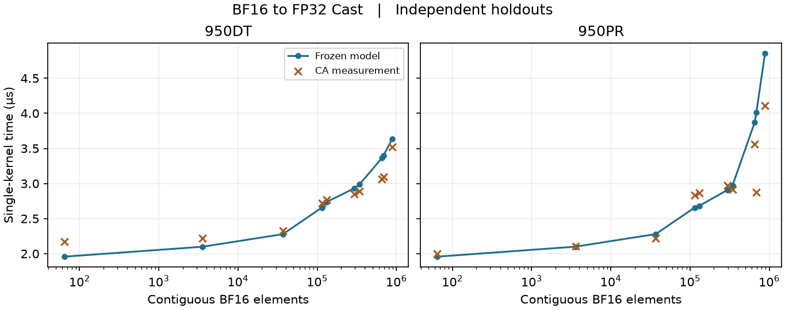

# Cast 算例 · [64,4096] 的 BF16 到 FP32 精确拓宽

DeepSeek-V4.1-Flash 的 950 路线会将归一化结果另行转换为 FP32 供路由使用。以下计时对应单独调用 CANN 9.2.1 ops-math 的 `aclnnCast`，本例 DT profiler 记录的 kernel 为 `Cast_b2717900ea7de2d41ea9c63d23aa269b_high_performance_0`。输入是连续的 BF16 ND 张量，输出同形 FP32。原 framework 的 `.float()` 与前一个归一化 kernel 的组合执行尚未采集。[模型源码及平台核验](../../results/v0.19/workloads/rmsnorm-cast-assessment.md)

```python
from operator_model import estimate

r = estimate('cast_bf16_fp32', [64,4096], chip='Ascend950DT_9582', dtype='bf16')
print(r.latency_us, r.active_aiv, r.work)
print(r.projection['stages_us'])
```

令 N=T×D=262,144。输入读 524,288 B，输出写 1,048,576 B，有 262,144 次元素类型转换。一次 BF16→FP32 拓宽只需转换 lane，不做乘加。当前模型将其列为 Vector 单通道等价操作，读取输出时应看 `vec_ops_by_class.bf16_to_fp32_conversion`。

分核用 A=min(C,⌈N/2048⌉)，其中 C 为本芯片 AIV 数。2048 是初版最小工作片假设，从 16,384 个元素启动 8 核的 CA 分配记录推得。将 N 个输入按每块 16 个元素对齐做均分，每核最多 X=min(N,16⌈⌈N/16⌉/A⌉) 个元素。DT 在这组实开 64 个 AIV，每核搬入 8192 B、写出 16,384 B。记录的每核读写指令均有独立的开始、结束和字节数；数值检查比较全部输出的 32 bit 位型。

| 终止核账目 | DT 观测 | 对应定价 |
|---|---:|---|
| 终止核启动到达 | 1035 周期 | (A−1)×1035/63，覆盖全片启动错峰 |
| 到输入搬运发起 | 1367 周期 | 固定前端控制，样本按终止核起点计 |
| 输入读 | 965 周期 | 817.829 周期 + 18.39635 周期/KiB × 8 KiB |
| Vector 实际在途 | 113 周期 | 64 个 64 元素组 × 113/64 周期 × 目标单核 FP32 周期比 |
| 输入读完至输出写发起的其余依赖 | 838 周期 | 两端 ISA 时刻之差再扣已在途的 Vector 工作 |
| 输出写完 | 455 周期 | 198.708 周期 + 16.01826 周期/KiB × 16 KiB |

总计 **4773 周期 / 1650 周期/µs = 2.893 µs**，与校准 trace 的全核窗口一致；该点用于取阶段价格。每 KiB 读写斜率借自 DT 的 RMSNorm 描述符，Cast 的单个完成样例不足以分别识别固定延迟与通道吞吐。输入分配记录能证实部分网格，不能证明所有 shape 的库分片完全一致。

目标配置若给出单核 MTE 带宽 B（GB/s），将相应字节价格替换为 1024f/B，f 为 GHz。全卡共享周期下界为 1753+6Nf/min(HBM 带宽,可用 L2 带宽)，1753 为实测整片首次输入读发起。总时间取单核依赖路径和该全卡窗口的最大值，最后除以 1000f。一个 UB 轮次的可容纳元素取 64⌊UB/(12×64)⌋，12 B 来自双缓冲的 (2+4) B 输入/输出。超过单轮的元素以读端口、写端口、SIMD 三者中最慢的稳态服务延长时间；实际库 UB 预留和多轮发起间隔仍待专门采集。

| 同一 [64,4096] | 设备时间 µs | CA µs | 活跃 AIV |
|---|---:|---:|---:|
| 950DT 开发校准 | 2.893 | 2.893 | 64 |
| 950PR 配置预测 | 2.861 | N/A | 56 |
| 970DT 外推 | 3.030 | N/A | 120 |

该例 970 预测较慢。当前假设在小工作量下启用更多核会增加尾核到达错峰，能否在 970 上观察到这一效应尚未验证。对于更大网格，模型可能改受冷字节的共享带宽下界约束。一次组件查询不包含前一层的调度开销或 PyTorch 图编译。[逐阶段指令与原始 trace SHA](../../results/v0.19/workloads/cast-phases.json) · [冻结预测与实测误差](../error-analysis.md)

冻结后 [32,4096] 的双端结果可以复核端到端误差。DT 预测 2.736 µs，CA 2.771 µs（−1.25%）；PR 预测 2.681 µs，CA 2.867 µs（−6.49%），实开核数分别为 64、56，与分核模型相符。这个样例的跨芯片时间比为实测 0.966、预测 1.021，小差异的方向仍有偏差；970DT 外推 2.508 µs。



十组独立输入的初次官方窗口全部通过数值和逐核时长核验，预测分核也达到 20/20 吻合。DT WAPE 4.99%、最大 9.89%，PR WAPE 9.75%、最大 39.55%，加速比 WAPE 7.01%。在 PR [96,7168] 上，模型 4.012 µs，初次 CA 2.875 µs。该端 56 个核的输入描述符覆盖全部 1,376,256 B，但仅 6 个核记录有效的输出 MTE3 复制，合计 294,912 B，逻辑输出为 2,752,512 B。该窗口可以复核官方时长和最终张量，不能用于推断全部写请求的实际退休周期。在另外 19 个输入端，输入/输出描述符的字节均吻合。单独复核使用相同冻结模型、输入和采集合同，保留初次统计。[全部逐形状窗口](../../results/v0.19/workloads/cast-qualified.json) · [全核 DMA 字节覆盖](../../results/v0.19/workloads/cast-dma-coverage.json)

同 shape 的 PR 复核在 72.04 秒后取得 56/56 核的完整搬出描述符。全核合计读 1,376,256 B、写 2,752,512 B，数值正确，CA **3.508 µs**，v0.19 的高估降到 **14.34%**。因此初次的 39.55% 不能全部归因为芯片带宽。仅用完整写回窗口替换这一个样例时，10 组的 PR WAPE 为 **7.36%**、最大 **18.08%**，跨芯片加速比 WAPE 为 **5.14%**。主评估仍保留原始预测与初次采集。共 26 次尝试含 1 个校准窗口、20 个独立窗口、1 次独立写回复核以及 4 次超时，合计历时 32.77 分钟、保留原始产物 1.67 GiB。[复核登记](../../results/v0.19/workloads/cast-dma-recheck-freeze.json) · [复核流水和时长](../../results/v0.19/workloads/cast-dma-recheck.json) · [两种口径及成本](../../results/v0.19/workloads/cast-evaluation.json)
