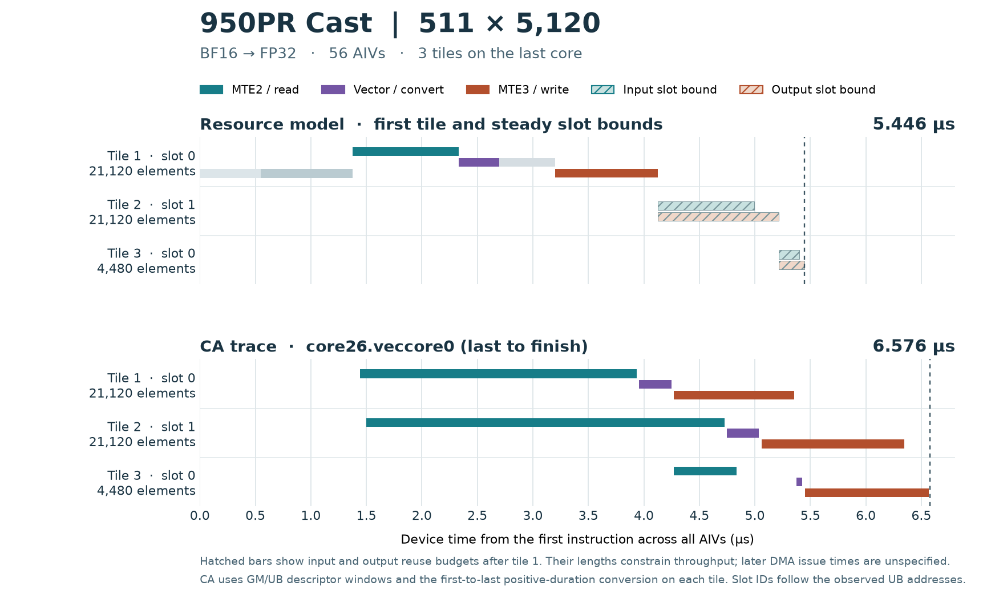
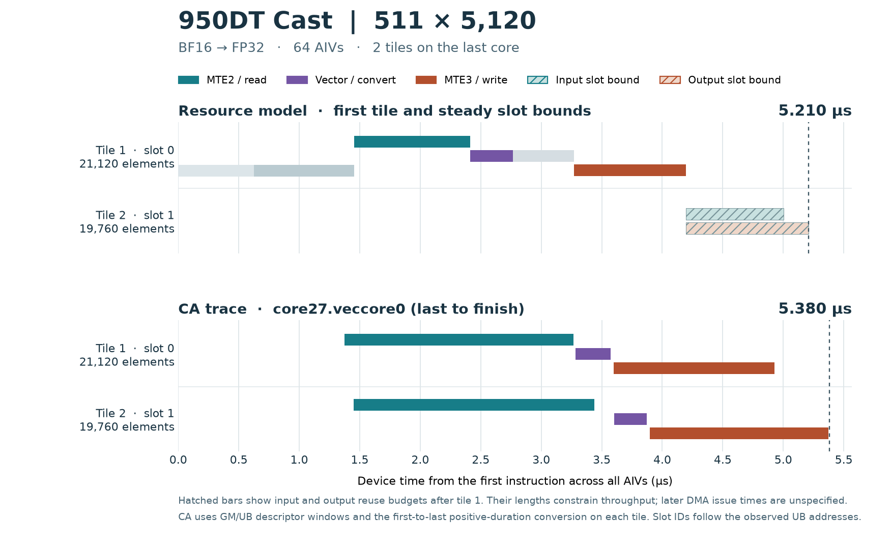
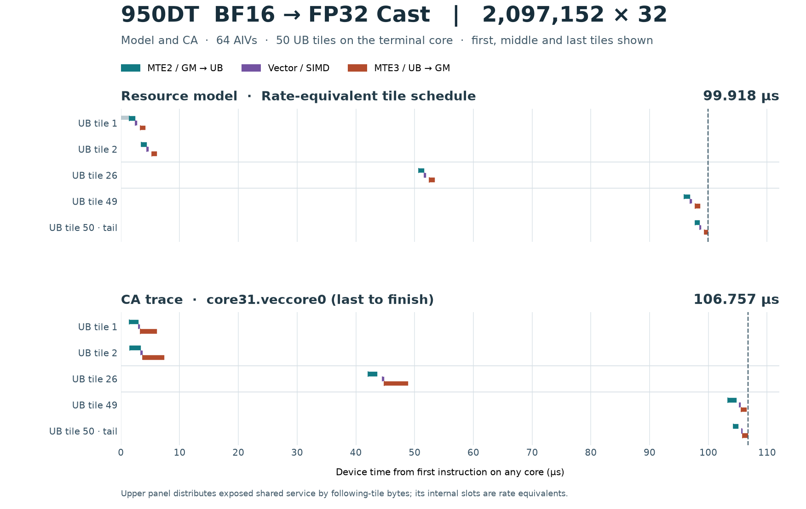
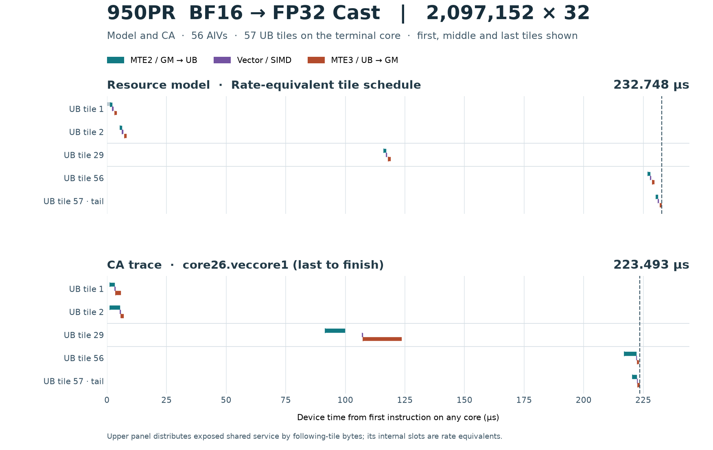

# BF16 → FP32 Cast · 从双缓冲到大 prefill

## 三个块怎样使用两对槽位

连续 BF16 矩阵 `[511,5120]` 共有 2,616,320 个元素。对调用方，输入包含芯片、dtype 和本卡 shape。返回值给出设备时间、活动 AIV、转换次数、5,232,640 B 逻辑读和 10,465,280 B 逻辑写。这个分块边界样本来自采集前冻结的六对前向验证。实际入口为 CANN 9.2.1 ops-math 的 `aclnnCast`，内核名为 `Cast_b2717900ea7de2d41ea9c63d23aa269b_high_performance_0`。DT、PR 两端全部 2,616,320 个 FP32 结果均正确。[冻结登记](../../results/cast-capacity/two-slot-freeze.json)

| 每卡 [511,5120] | 950DT | 950PR | 970DT 外推 |
|---|---:|---:|---:|
| 活动 AIV | 64 | 56 | 120 |
| 最长核上的块（元素数） | 21,120 + 19,760 | 21,120 + 21,120 + 4,480 | 21,120 + 688 |
| v0.21 → v0.22 预测 µs | 4.943 → 5.210 | 5.094 → 5.446 | 4.387（v0.22） |
| 完整 CA µs | **5.380** | **6.576** | N/A |
| v0.21 → v0.22 有符号误差 | −8.12% → −3.16% | −22.53% → −17.18% | N/A |



PR 的真实流水给出了分开建模读写槽的依据。在 `core26.veccore0`，第一块读入 UB 地址 0，写出时使用另一区域 84,480。第二块使用 42,240 和 168,960。第三块在 **4.271 µs** 就向已经释放的输入地址 0 发起读；第一块的输出写到 **5.356 µs** 才完成。第三块在 **5.452 µs** 才从输出地址 84,480 发起写。相同槽号在图中分别指输入和输出的轮转编号，两者拥有独立地址和生命周期。DT 最晚核只有两个块，展示两笔张量读和两笔张量写的交叠。[PR 逐块地址与时刻](../../results/v0.22/cast/slot-figure-pr.json) · [DT 逐块地址与时刻](../../results/v0.22/cast/slot-figure-dt.json)



### 从 46,720 个本核元素算出 5.446 µs

1. PR 有 56 个 AIV，按 16 个 BF16、即 32 B 粒度分配行展平后的元素。最长核有 `16 × ceil(ceil(2,616,320/16)/56) = 46,720` 个元素。在 253,952 B UB 内分配两个输入区和两个输出区，每元素合计 12 B，按 64 元素对齐后每整块容纳 21,120 个元素。
2. 取首个满块的读、转换和写服务为 `R = 0.956`、`V = 0.363`、`W = 0.921` µs。R 和 W 含端口固定成本与字节服务，V 按 330 组转换和目标每核算力计价。加上到达、控制和写依赖，首块累计为 4.124 µs。图中首块灰段是模型收取的这些开销。
3. 设 `a = 1.439418`、`b = 1.975050`，分别表示读和写的描述符响应与模型端口服务时间之比。它们取自更早的 DT `[262144,32]` 满块，所有芯片共用，读写与向量服务仍用目标芯片定价。一对输入槽允许平均每 `I_in=(aR+V)/2=0.869` µs 周转一个满块；一对输出槽相应为 `I_out=(bW+V)/2=1.091` µs。分母 2 是每个方向的两个可独立轮用的槽。这是可持续间隔的下界，不能直接给出后续各条指令的绝对发起时刻。
4. 剩余的 25,600 个元素相当于 1.212 个满块。将两条槽下界及纯读、写、向量吞吐下界取最大，在这个形状由输出槽给出 `1.091209 × 25,600 / 21,120 = 1.323` µs。首块加上这段后续预算得 **5.446 µs**，超过整片访存下界。图中的斜纹只标各块的周转预算，全部实测条带都来自下栏的设备 trace。上下时间零点相同，均对应全核首条指令。[实现与参数单位](../../operator_model/cast_resource.py) · [提取与重绘脚本](../../development/validation/cast22/slot_figure.py)

剩余误差主要可见于第一笔 MTE2。PR 首读的模型预算 0.956 µs，CA 从 1.442 到 3.938 µs，窗口达 2.496 µs。两者起点只差 0.066 µs，结束时刻却相差约 1.61 µs。描述符窗口含依赖等待和排队，现有证据无法把差额分解为实际 HBM 服务和共享排队。六对前向中，能区分两版的只有两个 shape，DT 的 WAPE 从 10.51% 降至 5.32%，PR 从 11.90% 降至 10.74%。970DT 的 4.387 µs 沿用上述响应比例。

## Flash indexer 每卡 8 × 256ki prefill

DeepSeek V4.1 Flash 的 indexer 投影给每个 token 产生 32 个复制系数。在 A5 的独立类型转换路径上，每卡 8 个请求、每请求一次提交 262,144 个 prefill token，得到连续 BF16 输入 [2,097,152,32]。对应的 FP32 输出形状相同。计时来自安装包 CANN 9.2.1 ops-math 的 aclnnCast。实际融合情况取决于部署，以下时间只覆盖此次单独调用。[模型调用路径、Pro 的 64 系数变体和包内实测](../../results/v0.20/large/report.md)



**DT 模型预测 99.918 µs，CA 为 106.757 µs，低估 6.4%。** v0.20 对同一 shape 的预测为 69.523 µs，低估 34.9%。本图保留首两轮、中间轮和末两轮的原始时间，省略的轮次仍计入总时长。上半图把共享资源约束下的额外服务按每块的有效字节分摊；下半图的搬运为实测描述符的发起与退休，转换为正时长的转换指令。模型给出持续平均速度，CA 中的相邻块还可出现成对提前发起。[DT 流水数值与哈希](../../results/v0.21/vector/cast-256ki-dt.json)



128ki 与 256ki 两个相邻长度都有原始控制器读写计数。DT 的物理写由 30.833 增至 169.716 MiB，增长 5.50 倍。末核允许新一轮读在较早块写完成前发起。v0.22 使用上节的分槽周转公式，这个大输入在两端仍由共享带宽约束，故全核时间与图上的 v0.21 预测一致。[读写证据与验证登记](../../results/cast-capacity/report.md)

## 从 dtype 和 shape 算出设备时间

```python
from operator_model import estimate

r = estimate('cast_bf16_fp32', [8*262144, 32], chip='Ascend950DT_9582', dtype='bf16')
print(r.latency_us, r.active_aiv, r.work['logical_read_bytes'], r.work['logical_write_bytes'])
print(r.projection['target_plan'], r.projection['timing_diagnostics'])
```

1. **字节和操作。** 元素数 N=67,108,864。BF16 的输入 X=2N=128 MiB，FP32 的输出 Y=4N=256 MiB，共 N 次转换，Cube 工作量为零。系统可同时获得逻辑字节以及预计的外存服务字节。
2. **分核。** 此连续内核最小网格粒度取 2,048 个元素，来自 16,384 元素/8 AIV 的分核证据。A=min(AIV,⌈N/2048⌉)=64。每一块输入按 32 B，即 16 个 BF16 对齐，最长核处理 16⌈⌈N/16⌉/A⌉=1,048,576 元素。双缓冲输入输出每元素需 2×(2+4)=12 B UB。253,952 B UB 按 64 元素整组能放 u=21,120 元素/块，共 49 个满块及一个 13,696 元素尾块。DT 实际 64 核运行，末核共有 50 个张量读和 50 个张量写。
3. **单核工作。** 到达和控制开销源于 DT 校准窗口，分别是 1035(A−1)/63 与 1367 周期。首轮读/写按固定首部加 B₂/B₃ 端口服务计算。端口缺省价分别为 18.39635、16.01826 周期/KiB，覆盖 DT [64,4096] 中 8 KiB 读的 965 周期及 16 KiB 写的 455 周期，因此固定首部分别为 965−8×18.39635 与 455−16×16.01826 周期。Vector 每 64 组（每组 64 个转换）累计 113 周期，按每核每周期目标 Vector 吞吐缩放，向写发同步需 838 周期。其余元素定价时将读、写、转换吞吐和两对槽位周转一起比较。DT 后续块合计 52.852 µs，单核路径为 57.046 µs，仍低于整片外存服务时间。
4. **共享外存。** 工作集为 384 MiB。DT 128 MiB L2 中估计输出份额为 2/3，即 85.33 MiB，留下约 170.67 MiB 脏写。加上 128 MiB 冷读，外存 E≈298.67 MiB。同一正式运行的 128 个控制器报告 297.76 MiB。以每核发起 30 B/周期计算，有效外存带宽 min(4 TB/s, 64×1.65 GHz×30 B/周期)=3.168 TB/s。外存部分 E/B=98.856 µs，加上最早一核冷读前 1753 周期/1650=1.062 µs，共 99.918 µs。若配置了 L2 带宽，同时约束全部逻辑地址的 L2 服务；总时间取整片与单核路径的较大者。[资源公式与参数来源](../../results/v0.21/vector/method.md)
5. **双端和外推。** PR 使用 56 核、112 MiB L2、1.4 TB/s 外存，最长 57 轮。模型 232.748 µs，CA 223.493 µs，高估 4.1%。在部分仅略超 L2 的 PR 输入，比例留驻估计使模型高估约 30%；PR 的物理写回事务计数尚未取得。970DT 的 120 AIV、200 MB L2、14.4 TB/s 外存按继承发起率与本卡频率估计 42.536 µs，属于外推。按这些假设，970DT 对 DT 的加速比为 2.35 倍。970DT 全片 MTE 并发发起上限为 120×1.8×30=6.48 TB/s，先于 14.4 TB/s 的外存上限饱和；200 MB L2 也可保留更多输出。[PR 流水数据](../../results/v0.21/vector/cast-256ki-pr.json)

校准用的 [64,4096] 小 shape 以及旧版完整 prefill CA 在本轮用于开发回放，独立验证另取 10 个展平数据量，全量对照包含旧版预测、当前预测和每端 CA。[逐形状误差表](../../results/v0.21/vector/report.md) · [v0.19 小输入校准与复核](../../results/v0.19/workloads/cast-evaluation.json)

[冻结后的独立长 shape 逐块对照](../../results/v0.21/vector/independent-figures.md)
