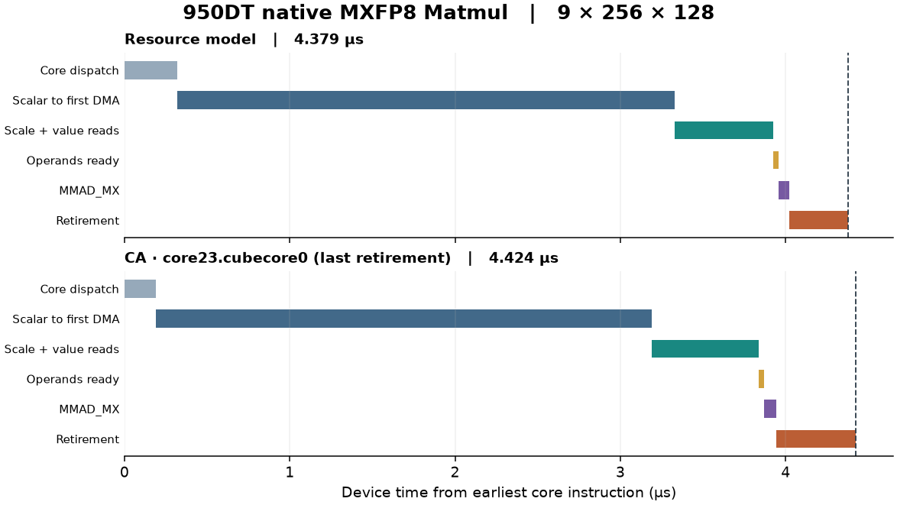

# 从单头投影到批乘和专家融合

扩展预设里，DeepSeek 的吸收式注意力显式发出按头批乘，Qwen、GLM 等预设还会发出按专家计数的融合 MLP。定价输入包括本卡物理张量、逻辑 shape、dtype、scale 轴、stride、专家直方图、目标芯片及 Vector 策略。输出有设备微秒数、分精度 Cube/Vector 工作量、逻辑读写字节、并行核数和分块计划。精度标签本身不能决定执行单元。[实现](../../src/operator_model/system_routes/catalog_cube.py)

## 一个完整小例

取 BF16 BMM 的三个轴顺序为头、token、通道。激活 A[12,1,128] 的 stride 为 [192,2304,1]，权重 W[12,128,512] 连续，输出 Y[12,1,512] 连续。每个头有独立权重。输入检查要求这些实际视图无重叠，并有连续方向供分块搬运。下面采用 950DT 模板，频率 1.65 GHz、32 AIC。

1. 记 G=12、M=1、K=128、N=512。每个输出是 K 项点积，有用 Cube 运算量为 2GMNK = 1,572,864 ops。BF16 每项两个字节，逻辑读取 2GK(M+N) = 1,575,936 B，写回 2GMN = 12,288 B。这里的总量不包括搬运重放。
2. 模型按 16 对齐忙核计算的 M 尾行，以核数、N 方向可并行 tile 数确定 N 切分，依据两页 L0A、L0B 与 L1 的容量限制 K 页。本例块为 16×128×128。每头沿 N 切四块，共 48 个输出块，32 核处理两波。有效计算率来自卡级 BF16 峰值除以核数和频率，为每核 8,181.82 ops/cycle。
3. 每波 Cube 需求是 2×16×128×128 / 8181.82 再加一页的 32 cycle 发起成本，两波共 192.16 cycles。两波的本地输入需求为 2×(1+128)×128×2 / 128 = 516 cycles；分母是每核每周期板内搬运预算。整片冷读写下界为 (1,575,936 + 12,288) × 1.65 / 4000 = 655.14 cycles，其中 4000 为模板 HBM GB/s，核数较少时还受每核端口总量限制。
4. 同一批分块的 Cube 和搬运可重叠。借用已观测 BF16 MM 的首发和退休价格 1,794、520 cycles，本次设备预测为 (1794 + max(192.16,516,655.14) + 520) / 1650 = **1.7995 µs**。这个忙核/分页方案是假设，库可以先物化不连续输入或另选分块。对应的 950PR 模板预测 2.5369 µs，970DT 模板预测 1.3958 µs，后者为外推。

## 精度和融合怎样改变这条时间线

| 合同 | 分块工作与服务阶段 | 证据范围 |
|---|---|---|
| FP32 普通 BMM | 每头独立 M/N tile；使用严格 FP32 MMAD 发起与计算率，尾波按输出块而非头数确定 | 单个 FP32 MM 阶段有历史依据，BMM 整窗外推 |
| FP8 行 scale 批乘 | A 以 [G,M]、B 以 [G,K] 保存 FP32 scale。B 的 scale 随规约下标变化，方案在 UB 中转换并乘 scale，随后做 BF16 Cube 点积。模型分别记录 FP8 存储、BF16 计算、页间 Vector 以及重复解包。transpose 变体把 [M,G,K] 映射到相同头分组 | 捕获声明探索性程序 |
| FP8 token/channel 投影 | A 的 scale 随 M，W 的 scale 随 N；点积内可提出二者。用 FP8 Cube 计算 2MNK，输出执行 2MN 次乘法和 MN 次转换。首个 tile 执行完才能缩放，续波允许重叠。分头投影用每组 M 的真实计数与仅活跃组权重 | 解析程序；普通 FP8 的 FP32 行/通道 scale 与 MXFP8 的 E8M0 有独立合同 |
| 双方 MXFP4 的 K 补齐 | 按物理形状把 K 向上取整到 32 的倍数。例如 K=80 时真实使用 48 个 packed 字节槽，等效 K=96。按 96 给 A4W4 内核定价，对外报 2MN×80 有用运算，并记录 issued_k=96。| A4W4 调用参考已有库模型；这个 padding 合同是外推 |
| 分组 SwiGLU / SiTU MLP | 专家 e 有 m_e 行，门控投影 K→2H，再经逐项激活/相乘、下投影 H→N。总 Cube 工作 2(Σm_e)H(2K+N)。只为 m_e>0 的专家读权重。BF16、原生 MXFP4、普通 FP8 分别使用对应 Cube 率，低精度方案在中间就地再量化。两次 Cube 争用同一引擎，VF 仅能与其它波重叠，单波计串行依赖。 | 捕获标为假想融合；片上交接是理想方案，未知临时空间可能产生额外 HBM 流量 |

表中 G 为头或批矩阵数，M/N/K 分别为输出行、输出列、规约维度，H 为专家中间宽度。所有推演都可在新芯片模板上重算。对全新融合路径，`auto` 使用分指令类别的 Vector 估算；显式原法可用于判断对 VF 估价的敏感性。

同一族的大形状例取 G=12、M=16,384、K=128、N=512，来自每卡 B=4、prefill chunk=4,096 的 16,384 行。捕获给出两张逐行 FP32 scale，模型先在 UB 展开 FP8 操作数再做 BF16 计算。其 Cube 工作量为 25,769,803,776 ops，输入与 scale 占 26,744,832 B，BF16 输出占 201,326,592 B。950DT 使用 32 AIC，显式原法预测 68.677 µs，默认及显式指令法预测 68.774 µs。该形状没有同实现 CA 真值。

## 真 MXFP8 × MXFP8 稠密 Matmul

通过 `estimate("matmul", (M,N,K), {"weight_dtype":"mxfp8"}, dtype="mxfp8", chip=...)` 调用。A、W 的数值均为 E4M3FN，每个操作数沿 K 每 32 项共享一个 E8M0 指数；库的 ND 布局以每 64 项一对指数存放。按位宽计，值读取为 (M+N)K 字节，scale 读取为 2(M+N)⌈K/64⌉ 字节，BF16 输出写回 2MN 字节。共有 2MNK 次 FP8 Cube 运算；FP32 累加，scale 由原生 MX Cube 消费。这样不需额外 VF 扩展，显式原法和指令法给出相同时间。系统入口要求权重转置和两份 E8M0 的类型、形状、布局均吻合。普通 FP8 激活行及权重通道采用 FP32 scale，另有上述输出缩放阶段。[原生 MXFP8 模型](../../src/operator_model/operators/matmul/mx8_native.py)

### 分块、首片和剩余工作怎样合成设备时间

在本例中，M/N/K 是输出行数、输出列数和规约深度，bₘ/bₙ/bₖ 表示忙核办理的输出块与单页深度。模型优先令 bₘ 为 16 对齐且不超过 128，按可用 AIC 数在 N 方向分摊输出工作，再约束 FP32 累加器能装入 L0C。两页 A、B 值和指数要能装入 L1，各自两页也要满足 L0A/B 容量。记 W 为最长核领取的输出块数，P = ⌈K/bₖ⌉ 为每块页数。整个程序用下面四步求解。

1. **计算首片的有效负载。** 第一页深度 u = min(K,bₖ)。一片的搬运字节 B(u) = [min(M,bₘ)+min(N,bₙ)] × [u+2⌈u/64⌉]。第二项含每 64 个值随行读取的两个 E8M0 指数。每核 MTE2 端口为 p 字节/周期，当前模板以 128 B/cycle 封顶，芯片带宽配置还可以把它压低。首片服务用 d₁ = B(u)/p。设 r 为单核 FP8 ops/cycle，由芯片 FP8 峰值除以 AIC 数及频率得到。首片 Cube 服务 c₁ = 2 bₘ bₙ × 32⌈u/32⌉ / r + 32，最后的 32 周期为同族矩阵页的发起预算。
2. **测可串行辨识的首发依赖。** 复用 950DT 的 [9,256,128] 开发 trace。每核有四个 scale/值 DMA 描述符和一次 MMAD_MX。在 16 份物理核轨迹上，以各核首条指令、最早 DMA、最晚首片 DMA 完成、MMAD 发起与退休、该核最后一条指令退休为界取差，再取各核中位数。标量设置为 4963.5 周期，模型取 4964。四个首描述符的等待及服务共 985 周期。扣掉本形状 d₁ = 25.78，得到首 DMA 额外响应约 959 周期。DMA 就绪到发起为 56 周期。MMAD 首片实测 109 周期，扣掉 c₁ ≈ 36，得到指令响应约 73 周期。MMAD 退休到核最后一条指令的中位数为 585.5，模型取 586。不同核起跑相差最多 525 周期。以 a 表示模型活动 AIC 数，采用 D = 525 × min(1,(a−1)/15) 近似发核散布，在唯一已观测的 16 核后封顶。端口、页间 32 周期与发核散布曲线仍含假设。[逐核时间戳、范围与哈希](../../results/v2.5/mx8-development-phases.json)
3. **让重复页依约束重叠。** 忙核跨波搬运服务为 d = W B(K)/p，跨波计算服务为 c = W × [2 bₘ bₙ × 32⌈K/32⌉ / r + 32P]。首片就绪后，之后的预取与上一片计算可以并行。余量 R = max(0,d−d₁,c−c₁)。若调用方给出峰值 HBM 带宽 H（GB/s）及频率 f（GHz），芯片读写至少占 h = (输入与输出总字节) × f / min(H,a p f) 周期。以活动核端口之和限制可达带宽。在首片涉及冷读时，两项约束同时存在。
4. **整窗与单位。** 有序的本地依赖长度 L = (959+d₁) + 56 + (73+c₁) + R。模型耗时 T = [D + 4964 + max(L,h) + 586] / (1000f)，单位 µs。对 [9,256,128]，DT 的块为 [16,16,128]，16 核、单波、单页。代入首 DMA 984.78、后继 56、首 MMAD 109.00、R=0、h=19.33，可得 (525+4964+1149.78+586)/1650 = **4.379 µs**。同一安装库的完整 CA 为 4.424 µs（−1.02%）。这个形状提供了阶段参数，归入开发回放。v2.4 在这里借用了 BF16 首发，只得到 1.424 µs，实际第一条 MMAD_MX 到第 5943 周期才发出。[开发窗与安装库核验](../../results/v2.4/catalog/cube-ca.json)

图中两栏共享首条核指令的设备零点及横轴。“Scalar to first DMA” 是从核启动到首个搬运描述符之间的经过时间，含控制与等待。“Scale + value reads” 是四个读描述符的包络。开发形状只有一个矩阵片，可以从物理核事件直接辨认阶段。[画图程序](../../calibration/mx8_refinement/plot.py)

### 每种 950 配置十种冻结后新几何

用同一个 `aclnnQuantMatmulV5` 驱动分别验证 E4M3FN × E4M3FN、两侧 E8M0、BF16 输出。每个 M×N 输出都与独立 CPU 逐位核验。两种 SKU 分别检查实际加载的内存模型、安装包 ops_nn/quant_batch_matmul_v3 对应 ELF 指纹、每个物理核的 END 和 profiler 退休时间。前四种几何在查看首批结果前登记。后六种几何在首批揭盲后选取，用同一预测源码哈希再次冻结，两批均先保存旧、新逐形价格再做 CA。最后一行使用系统捕获中路由器的实际矩阵尺寸，输入与权重改为双 MXFP8。当前系统捕获的此路由器采用 BF16 输入与 FP32 输出，应使用另一条精度合同计价。[系统捕获规格](../system-workload-coverage.md)

| [M,N,K] | 950DT µs | 950PR µs | DT 活动 AIC | PR 活动 AIC | 970DT 外推 µs |
|---|---:|---:|---:|---:|---:|
| [1,128,64] | 1.423 / 4.197 / 3.969 (+5.75%) | 1.423 / 4.197 / 3.883 (+8.10%) | 8 / 8 | 8 / 8 | 3.848 |
| [16,256,1024] | 1.562 / 4.530 / 4.621 (-1.97%) | 1.613 / 4.530 / 4.360 (+3.91%) | 16 / 16 | 16 / 16 | 4.153 |
| [128,128,256] | 1.582 / 4.410 / 4.191 (+5.22%) | 1.582 / 4.410 / 4.062 (+8.55%) | 8 / 32 | 8 / 16 | 4.042 |
| [256,128,512] | 1.762 / 4.759 / 4.585 (+3.81%) | 1.762 / 4.759 / 4.371 (+8.89%) | 16 / 32 | 16 / 24 | 4.363 |
| [1,1024,128] | 1.437 / 4.386 / 4.183 (+4.85%) | 1.501 / 4.399 / 3.999 (+9.98%) | 32 / 32 | 22 / 22 | 4.009 |
| [9,512,1024] | 1.542 / 4.495 / 4.697 (-4.29%) | 1.802 / 4.585 / 4.297 (+6.70%) | 32 / 32 | 16 / 16 | 4.121 |
| [11,1024,256] | 1.476 / 4.424 / 4.360 (+1.47%) | 1.614 / 4.449 / 4.002 (+11.16%) | 32 / 32 | 22 / 22 | 4.033 |
| [128,256,512] | 1.762 / 4.759 / 4.535 (+4.96%) | 1.762 / 4.759 / 4.124 (+15.42%) | 16 / 32 | 16 / 24 | 4.363 |
| [2176,320,64] | 1.792 / 4.810 / 5.823 (-17.39%) | 2.515 / 4.811 / 5.430 (-11.41%) | 32 / 32 | 28 / 28 | 4.074 |
| [9,896,7168] | 3.079 / 5.815 / 7.113 (-18.25%) | 6.192 / 8.472 / 8.585 (-1.32%) | 28 / 28 | 28 / 28 | 4.808 |

两列 950 时间依次为 v2.4 / 当前模型 / 实测，括号内是有符号误差（预测÷实测−1）；两列活动 AIC 为模型 / 实测。970DT 列仅给外推。DT WAPE 从 63.77% 降至 7.73%，PR 从 53.80% 降至 7.90%；合计 20 窗为 58.83% → 7.82%。WAPE 为绝对时间误差总和除以 CA 时间总和。20 个分核预测中 14 个与实际一致。[逐窗结果、实际 MMAD 形状直方图及核级 trace 指纹](../../results/v2.5/mx8-validation.json)

**误差集中在哪里？** DT 最大绝对误差出现在 [9,896,7168]。两端均预测并实测 28 AIC，实际每核发出 7 次 [9,32,1024] 的矩阵指令；冻结方案将 K 切成 14 页，且将短首片估计沿用到这次长读。DT 首个 MMAD 在第 8,278 周期发起，PR 在 9,202 周期，对比开发形状的 DT 5,943 周期，首个矩阵工作变晚。此外模型给出 DT/PR 时延比 0.686，实际为 0.829。其余九个形状的 CA 都显示 PR 略快（DT/PR = 1.022–1.100），模型却给两卡相近或 DT 稍快；共用首发价尚未捕捉这部分 SKU 差异。

PR 最大误差在 [128,256,512]（+15.42%）。模型调度 16 个 AIC，实测使用 24 个，矩阵指令为 20 条 [32,48,512] 加 4 条 [32,16,512]。较大的 [2176,320,64] 两端核数都对，模型在 DT 采用两个输出波，实际 DT 每核只发一次 MMAD，16 个核工作块为 [144,160,64]，另 16 个为 [128,160,64]。说明模型按 128 切 M 的策略遗漏了库可选择的高块。该形状两端分别低估 17.39%/11.41%。首发校正的时间收益与当前 tiling 的适用边界可从这些对照分别核验。

在线耗时取预热 Python 进程轮换调用前 4 个 shape 和两种芯片，160 次公开 `estimate` 的中位数 68.6 µs、P95 为 87.1 µs。离线 CA 各用约 52–101 秒，20 次加总 1330.75 秒，DT、PR 各自串行。970DT 使用其自身核数、FP8 峰值、端口和带宽重算工作，首发等依赖周期沿用 950，尚缺 970 对应实现及真值。以更大几何 [11,8192,1536]、[512,2048,7168] 为例，DT 外推为 6.975、23.046 µs，PR 为 13.092、41.551 µs，970DT 为 4.656、10.848 µs。这两个几何覆盖宽 N 和更多页，目前只有预测。[采集与复现](../../calibration/mx8_refinement/README.md)

### BF16 分头 BMM 的计时边界

对开头的 G=12、M=1、K=128、N=512 样例，DT 和 PR 均逐位验证了 6,144 个输出。库命中 ops_math 的 Slice ELF，证实非连续输入会先物化。逐核详细采集曾在 Slice 阶段超时，缺少覆盖后续计算的完整复合窗口。当前模型给出 DT 1.799 µs、PR 2.537 µs，这两个时间仍属外推。实际库路径与理想面板读取的差别会引入额外搬运。[逐次采集状态](../../results/v2.4/catalog/cube-ca.json) · [BMM 探针](../../calibration/system_cube_ca/bmm.cpp)
