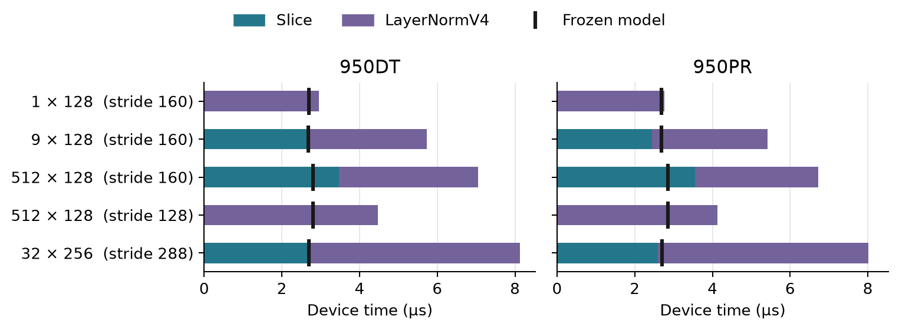

# Indexer LayerNorm 的 950DT / 950PR 校准对照

GLM-5.3 Flash 将投影输出分割为 key 与权重，key 的逻辑 shape 为 [R,128]，物理行步长为 160 个 BF16 元素。gamma 与 beta 各为 128 个 BF16，输出仅为连续 BF16 的 Y。源捕获声明 epsilon=1e-6。实验用 CANN 9.2.1 的 `aclnnLayerNorm`，显式传入同一行步长、同精度的输入、gamma、beta 和空的可选 mean/rstd 输出。探针给行尾填充不同值，并按行变换输入符号模式，逐元素核对 Y。DeepSeek 只有在上述合同也匹配时才可复用这组对照。

## 当前模型如何由布局与分核推导设备时间

令 R 为行数、D 为行宽、s 为物理行步长（元素），f 为 GHz 单位的主频。对于末轴连续、BF16 输入及 BF16 的连续一维 gamma/beta、连续 Y，只有 R>1 且 s>D 时，先执行一次 Slice。连续行、单行以及空操作各按自己的输入合同。其他精度、布局和多维输入沿用通用 Vector 估计，未在本页评分。

1. **分核。** LayerNorm 让每个 AIV 处理完整的行，忙核行数 b=ceil(R/min(R,AIV))，实占核数 ceil(R/b)。Slice 以约 1 KiB 输出为任务粒度，先算每任务 g=max(1,floor(1024/(2D))) 行，再分发 ceil(R/g) 个任务。旧 trace 中 [9,128] 的 Slice 启动 3 核，[32,256] 启动 16 核，符合这个粒度；它是对已观测 tiling 的近似。行数与端口速率分别控制并行程度与独立任务的成本。
2. **物化。** 记 A=min(AIV,ceil(R/g))，忙核负载 L=ceil(R/A)×2D 字节。Slice 周期预算为 `3720 + 22A + max(L/rd + L/wr, 4RD/B)`，其中 rd、wr 为 MTE2/MTE3 单核 B/cycle，B 为整片 HBM B/cycle。按芯片配置从 GB/s 除以 GHz 得到。截距表示 tiling 读取、第一次源搬运和写回退休，随核数的项是多核发起偏移和竞争的近似。开发集中，末核两次 MTE2 完成之后约两个周期开始 MTE3，有效窗口支持单次串联传输的建法。
3. **读取与归约。** norm 首读周期预算为 `H + 140 log2(min(R,AIV)) + (2D)(b+2)/rd`。H 在连续冷输入时取 3670，前序 Slice 产生输入时取 2740。H 和 140 是双 SKU 开发窗的取整初值；末核四个读描述符在单行冷输入约 3616–3944 周期结束，在 [9,128] 有 Slice 时约 3674–3852 周期结束。不能仅由整窗唯一拟合冷/热命中率、参数到达时间及核间偏移。归约按每行两次 reduction、一次 rsqrt、读取、乘加及写回估计。每个 UB tile 另计 `90+8 ceil(log2 D)` 周期的发起和树规约交接。tile 最多容纳 `max(1,floor((UB-8192)/(16D)))` 行，16 B/元素预算覆盖多个 FP32 暂存；8 KiB 留给控制区。
4. **写回。** DT、PR 的 LayerNormV4 追踪中，虽然 ACLNN 只请求 Y，忙核实际还有两个统计量的 MTE3 描述符。[32,256] 时每个核各写两个 4 B 元素和一个 512 B 输出，末核从第一写发起至最后退休约 5,080 周期；[512,128] 时每个核拥有更多相邻行，这段明显缩短。假设统计量以 128 B cache line 服务，预计同一行的并发写者 `U=min(min(R,AIV),ceil(128/(4b)))`，预算 `780+134(U-1)+b(2D+8)/wr` 周期。780 和 134 是以开发窗的写回跨度约束的基数、附加竞争预算，实际仲裁顺序仍未知。
5. **整窗。** norm 周期取“读+归约+写”的候选关键路径与整片带宽下界中的较大值，再加上前置 Slice 周期。总周期除以 1000f 即 µs，按实际 kernel 个数加配置的 kernel_overhead_us。空配置继承现有端口与 UB 预算。在资源架构外推时频率、带宽、AIV 数、UB 容量与 SIMD 峰值可替换；相同 ELF 的 cacheline 与控制路径属于额外假设。

在这五个开发输入上回放，当前默认的 WAPE / 最大相对误差为 DT 8.36% / 17.93%、PR 4.73% / 10.72%。开发数据用于选择上述参数，独立验证另列。开发集物理 trace 的输入摘要、末核、读写时刻和写描述符大小见[末核证据](../../results/v2.5/layer-norm-development.json)。例如 DT [32,256] 的末核在第 3,400 周期完成末次读、第 3,888 周期发起首写、第 8,976 周期退休，两份统计与 Y 写入顺序可从原始描述符验证。

这些常数在新形状采集前共同冻结，未按 width、shape 或 SKU 直接查时延。对于 VF 的两种选择，原法用芯片 FP32 单核吞吐为行内工作估时，指令类法用同一组行/UB 任务计指令发起和端口时间。开发窗本身不能证明选择哪一种更准。继续沿用该系统合同在 v2.4 的默认指令类法。冻结文件的显式两列都在采集前生成；其中名为 `auto` 的试验列最初指向 `calibrated`，发布版的 `release_model_us.auto` 逐项等于预冻 `instruction_classes` 列。

忙核处理 E=bD 个元素时，指令计数的输入为 3E 次 load、6E 次算术、2E 次归约、b 次 rsqrt、E 次 store。它们来自读取 X/仿射参数、中心化与平方差、两次行归约、输出缩放与平移的设计预算。每类次数除以 FP32 寄存器 lane 数并向上取整；默认 256 B 寄存器相当于 64 个 FP32 lane。把各类次数分别乘发起间隔，计算每类资源、双发射总宽度、UB 端口、算术端口的占用周期，取最大值作为 VF 周期。在默认指令档，归约、rsqrt 的发起间隔分别为 2 和 4 周期，其余在本例为 1。原法的对照将同样的工作视为 `(8E+3b)/v` 个周期，其中 `v=1000×FP32 吞吐(TOPS)/(2×AIV数×f)` 是每核每周期等效乘加数。两法都另外计算搬运、全核争用和 UB tile 开销。行内指令配比仍是算法估计，现有整窗只能校验整个执行时间。

**怎样读懂单例差距。** 行数 2、行宽 128、步长 160 时，Slice 分到 1 核，LayerNorm 分到 2 核，每核一行。把 128 个元素的各类访问除以 64 并取整，得到 6 个 load、12 个算术、4 个规约、1 个 rsqrt、2 个 store。双发射带宽给出 25/2=12.5 周期。加上 146 周期的 tile 控制，归约预算为 158.5 周期。模型的首读、写回分别为 2,895.9、922.2 周期，故 norm 预算为 (2895.9+158.5+922.2)/1650=2.410 µs，加上 Slice 的 2.284 µs 得 4.694 µs。DT 实际两段为 2.638、3.732 µs，PR 为 2.395、3.898 µs。剩余的主要低估集中在少量行时的归一化启动与退休。两个 kernel 之间的实测窗口支持这个归因到阶段，无法单独辨别冷启动、统计量写回等待或 cache 仲裁各自的贡献。

在 63×384 连续输入上，DT 可供 64 AIV，按每核一行分给 63 核；PR 可供 56 AIV，忙核两行，分给 ceil(63/2)=32 核。两侧实测核数与该预测一致，PR 繁忙核增长一行但同时写统计量的核变少，归一化实测 4.57 µs，快于 DT 的 6.34 µs。新模型也预测这一方向；旧版预测方向相反。相对于 LayerNormV4，Slice 的 tiling 识别更粗，8 行、宽 192、跨步 224 的两张芯片实际都是 3 个 Slice AIV，模型为 4 个。独立数据只用于评估。

**跨芯片加速比的边界。** 以 DT 耗时/PR 耗时定义 PR 加速比。63×384 连续输入预测 1.275×、实测 1.387×，128×128/160 预测 1.062×、实测 1.156×。1024×128/160 仍判反，预测 0.974×、实测 1.142×。DT 的 Slice 和归一化分别实测 3.973 和 3.539 µs，预测 3.239 和 3.067 µs；PR 实测 3.321 和 3.258 µs，预测 3.376 和 3.097 µs。DT 端两段均低估，物化段差约 0.73 µs。目前的带宽下界及线性并发项对不同芯片满载时的等待描述仍不充分。

**970DT 是外推。** 同一个默认入口按 970DT 配置得到 2×128/160 为 4.303 µs、63×384/384 为 5.395 µs、1024×128/160 为 6.531 µs。增加 AIV 可能让同一 cache line 的统计量有更多写者，同时改变 Slice 的发起规模；小块无法线性享受全芯片峰值带宽。970DT 缺少与本合同对应的 CA，假设 950 版统计量写出及物化策略延续，跨代误差未知。

## 冻结后独立验证

每端 10 个新 shape，用同一输入比较 v2.4 与当前模型。6 组跨步输入包含 Slice，4 组连续输入只含 LayerNormV4。宽度 128、步长 160 来自 GLM-5.3 的 Indexer 布局，其余宽度与布局检验分配边界。每个结果均核对 Y 数值、安装包 ELF 和所有活跃核的退休时刻；设备时间为此次 API 顺序启动的各 kernel 活跃窗之和。

| 行×宽 / 步长 | DT 旧预测 | DT 当前 | DT CA | DT 误差 | PR 旧预测 | PR 当前 | PR CA | PR 误差 |
|---|---:|---:|---:|---:|---:|---:|---:|---:|
| 2×128 / 160 | 2.686 | 4.694 | 6.370 | -26.3% | 2.686 | 4.694 | 6.293 | -25.4% |
| 4×128 / 128 | 2.685 | 3.221 | 3.430 | -6.1% | 2.685 | 3.221 | 3.443 | -6.4% |
| 8×192 / 224 | 2.692 | 5.415 | 5.716 | -5.3% | 2.692 | 5.415 | 5.535 | -2.2% |
| 16×128 / 160 | 2.683 | 6.142 | 6.214 | -1.2% | 2.683 | 6.142 | 6.019 | +2.0% |
| 31×256 / 256 | 2.699 | 5.691 | 6.068 | -6.2% | 2.699 | 5.691 | 5.996 | -5.1% |
| 48×256 / 320 | 2.699 | 7.869 | 8.087 | -2.7% | 2.703 | 7.872 | 8.100 | -2.8% |
| 63×384 / 384 | 2.715 | 5.886 | 6.335 | -7.1% | 2.763 | 4.618 | 4.567 | +1.1% |
| 128×128 / 160 | 2.699 | 6.700 | 7.229 | -7.3% | 2.715 | 6.308 | 6.252 | +0.9% |
| 257×256 / 256 | 2.827 | 3.954 | 4.388 | -9.9% | 2.855 | 3.938 | 4.422 | -11.0% |
| 1024×128 / 160 | 2.922 | 6.305 | 7.512 | -16.1% | 3.042 | 6.472 | 6.579 | -1.6% |

旧预测和当前预测均按各自默认入口，单位为 µs。误差为 100 ×（当前预测 / CA − 1）。正值表示预测偏慢，负值表示预测偏快。

| SKU | v2.4 WAPE / 最大 | 当前默认指令类 WAPE / 最大 | 当前显式原法 WAPE / 最大 |
|---|---:|---:|---:|
| 950DT | 55.49% / 66.62% | 8.92% / 26.31% | 9.08% / 26.35% |
| 950PR | 51.89% / 66.64% | 5.76% / 25.41% | 5.87% / 25.45% |

WAPE 是各 shape 绝对设备时间偏差之和除以对应 CA 设备时间之和，最大值为单 shape 最大绝对相对误差。对照列“当前显式原法”保留新的 Slice/写回模型，只改 VF 估时，故能区分布局修正与 VF 方法的收益。

完整的 20 次采集合计 1299.4 秒进程墙钟，最多并发两项。系统入口使用已准备好的张量特征各调用 101 次，丢弃首次后，每个 shape 的查询中位数范围 53.3–66.7 µs，最慢单组 P95 为 83.7 µs。该数字描述常驻 Python 解释器、已加载芯片配置的在线成本。

[采集前冻结的两种显式方法与旧版预测](../../results/v2.5/layer-norm-freeze.json) · [双端逐 shape 与分段窗口、校验及查询成本](../../results/v2.5/layer-norm-independent.json)

## v2.4 基线如何计算

设备模型将每行分成两个规约和一遍仿射，计每行约 8D+3 个 Vector 运算，其中 D 是最后一维宽度。默认 VF 方法把读取、两次规约、倒平方根、乘加与输出写回折为指令类发起数。例中 D=128、9 行，scale 和 bias 的逻辑读为 2×128×2=512 B；X 和 Y 各为 9×128×2=2304 B。公式取实际的行数和宽度，当前模型未单列跨步输入物化的启动。预测在采集前冻结。实际生产宽度 128 选取 decode 1 行、推测校验 9 行和 prefill 512 行。额外比较 512 行连续输入与 32 行、宽 256 的设计敏感性，后一项是合成形状。

每个 CA 窗要求所有已启动核出现 END 并与 profiler 的逐核时间一致，设备时间取最后一个核退休减最早一个核首次发起；每个 ELF 须与已安装 OPP 对象的 SHA-256 一致。多 kernel 调用按顺序累加各自活跃窗，这个数不包含 kernel 间启动空隙及 host API 耗时。计算意义与完整服务延迟不同。

[冻结的 10 次逐模式预测](../../results/v2.4/layer-norm-freeze.json) · [ACLNN 探针与张量步长](../../calibration/catalog_ca/layer_norm.cpp) · [采集命令实现](../../calibration/catalog_ca/layer_norm.py) · [逐核校验实现](../../calibration/catalog_ca/layer_norm_receipt.py)

## v2.4 冻结预测对比（现作 v2.5 开发数据）

| SKU | 行×宽 / 行步长 | 自动预测 µs | Slice µs | LayerNormV4 µs | 设备窗合计 µs | 有符号误差 |
|---|---|---:|---:|---:|---:|---:|
| 950DT | 1×128 / 160 | 2.689 | 无此启动 | 2.958 | 2.958 | -9.07% |
| 950PR | 1×128 / 160 | 2.689 | 无此启动 | 2.754 | 2.754 | -2.35% |
| 950DT | 9×128 / 160 | 2.684 | 2.686 | 3.042 | 5.728 | -53.15% |
| 950PR | 9×128 / 160 | 2.684 | 2.441 | 2.975 | 5.416 | -50.45% |
| 950DT | 512×128 / 160 | 2.795 | 3.468 | 3.573 | 7.042 | -60.31% |
| 950PR | 512×128 / 160 | 2.854 | 3.555 | 3.174 | 6.728 | -57.58% |
| 950DT | 512×128 / 128 | 2.795 | 无此启动 | 4.470 | 4.470 | -37.49% |
| 950PR | 512×128 / 128 | 2.854 | 无此启动 | 4.125 | 4.125 | -30.81% |
| 950DT | 32×256 / 288 | 2.699 | 2.680 | 5.440 | 8.120 | -66.76% |
| 950PR | 32×256 / 288 | 2.699 | 2.591 | 5.420 | 8.011 | -66.31% |

误差 = 100 ×（预测/设备窗合计 − 1）。Slice 只在需要物化跨步输入时出现。一次行宽为 128 的单行输入即使带有 160 的行步长，也能直接传入 LayerNormV4。此表按已知 ABI、dtype、形状和物理布局计分；正确性核对的是声明的唯一输出 Y。

- Ascend950DT_9582 的 5 个窗口，默认 WAPE 51.76%，最大绝对误差 66.76%；仅 3 个实际捕获布局时 WAPE 为 48.07%。
- Ascend950PR_957b 的 5 个窗口，默认 WAPE 49.03%，最大绝对误差 66.31%；仅 3 个实际捕获布局时 WAPE 为 44.78%。

预测在多行时漏记了 Slice 窗口。连续 512 行对照仍有误差，说明剩余差距还包含归一化内核本身的阶段定价。相同行宽下，物化后的 LayerNormV4 与直接连续输入的运行窗也会不同，已有窗口无法独立识别缓存初态与核调度各自的影响。没有把窗口用于回调参数。
10 个合格窗口的离线 CA 墙钟和为 1857.8 秒。 部分首次受共享主机竞争触发 5 分钟保护，改为低并发的多 kernel 采集并沿用冻结预测。失败尝试未计入该成功窗口费用。
[实际对象、各核时标摘要、预测与数值核对](../../results/v2.4/layer-norm-qualified.json)

条长为实际 Slice 和 LayerNormV4 各自核窗之和；黑线为冻结预测。相同的 512×128 输入仅改变行步长，安装包的核序列就发生了变化。

## 复现

在已安装 CANN 9.2.1、支持 950DT/PR 的 CA 包和已加载 OPP 的主机上，先激活 CANN 环境，再从仓库根目录运行下列命令。示例变量 `CANN_ARCH_DIR` 指向带 `include/`、`lib64/` 的 CANN 架构目录。`--workers 1` 适合共享主机。如采集环境另由 shell 脚本激活，可将 `OPERATOR_SIM_CANN_LAUNCHER` 设为该脚本的绝对路径，脚本应将参数作为命令执行。使用发布的冻结文件，原始输出目录请选新的本地路径。

~~~bash
g++ -O2 -std=c++17 -I"$CANN_ARCH_DIR/include" calibration/catalog_ca/layer_norm.cpp \
    -L"$CANN_ARCH_DIR/lib64" -Wl,--allow-shlib-undefined -lascendcl -lopapi -lnnopbase -o /tmp/layer_norm_probe
PYTHONPATH=src:. python -m calibration.catalog_ca.layer_norm collect \
    --raw /tmp/layer_norm_frozen --probe /tmp/layer_norm_probe --workers 1
PYTHONPATH=src:. python -m calibration.catalog_ca.layer_norm_receipt \
    --raw /tmp/layer_norm_frozen \
    --opp "$ASCEND_OPP_PATH/built-in/op_impl/ai_core/tbe/kernel/ascend950" \
    --out /tmp/layer_norm_verified.json
~~~

复现 v2.5 独立对照时仍使用同一个探针，将新的原始数据和评分摘要写入单独目录。

~~~bash
PYTHONPATH=src:. python -m calibration.catalog_ca.layer_norm_holdout collect \
    --raw /tmp/layer_norm_holdout --probe /tmp/layer_norm_probe --workers 1
PYTHONPATH=src:. python -m calibration.catalog_ca.layer_norm_holdout score \
    --raw /tmp/layer_norm_holdout \
    --opp "$ASCEND_OPP_PATH/built-in/op_impl/ai_core/tbe/kernel/ascend950" \
    --out /tmp/layer_norm_holdout_verified.json
~~~
