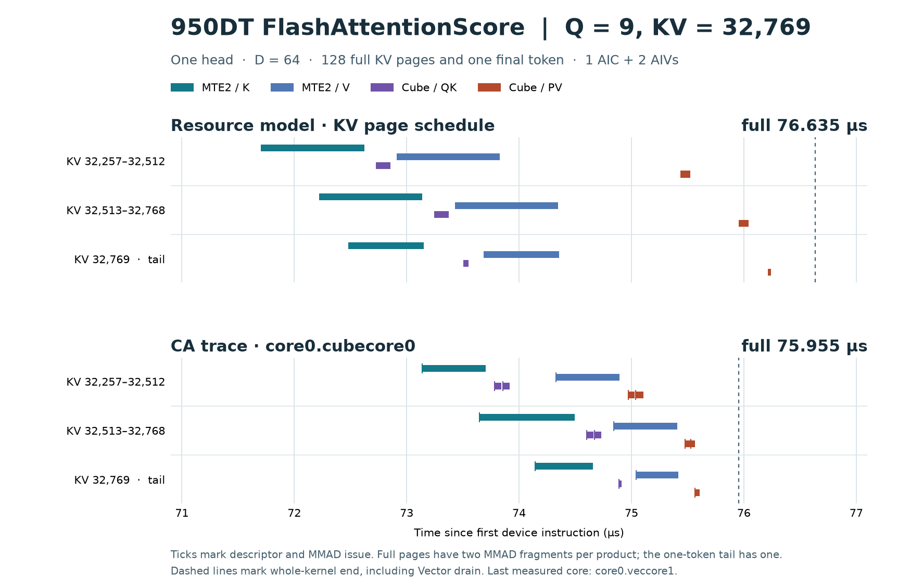
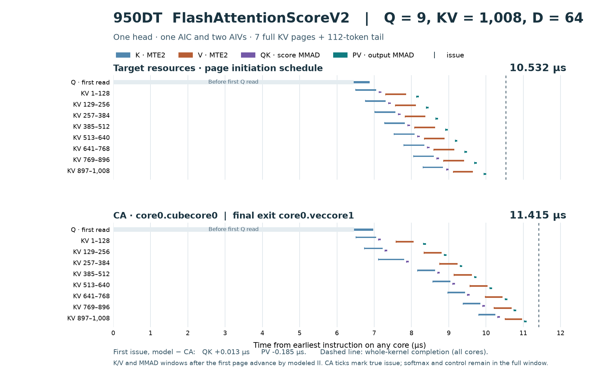
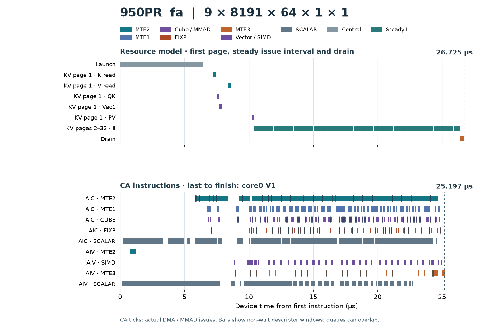
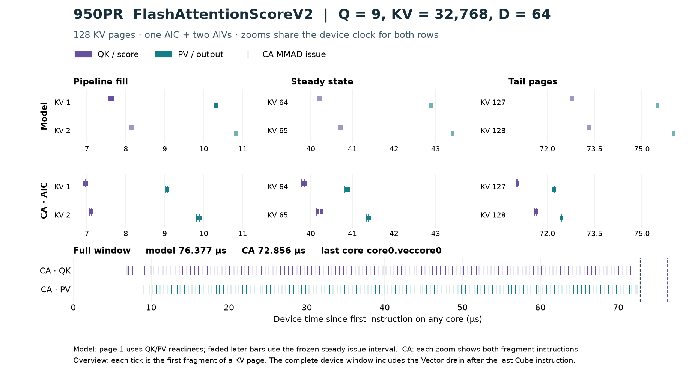
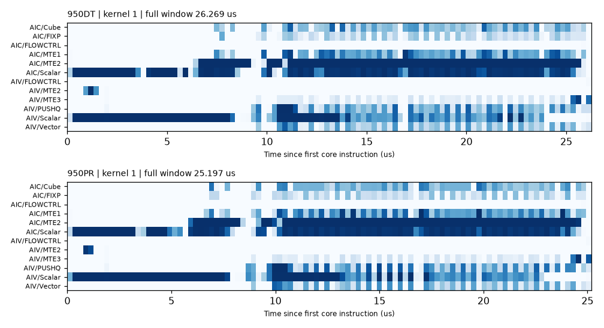

# FlashAttentionScoreV2 算例

长 KV 的 SBH 对照使用 [Q,KV,D,B,H]=[9,131072,64,1,1]。DT 的资源模型需要 512 个 KV 页，给出 274.987 µs，compact CA 完整指令窗口为 274.821 µs。相同输入 PR 的预测为 274.988 µs，已在同侧配置发起官方全核 CA。256Ki 和 512Ki 各自翻倍页数，在新的设备时间返回前只列预测。此合同是独立稠密 attention，模型中实际稀疏、压缩和 MLA 路线单独列出。[逐页数、双卡状态与原始协议](../../results/v0.29/large/fa/report.md)


## 32Ki 加一个 token，尾页还有多少工作



这里的 Q=9 对应一次校验 8 个推测 token，输入契约为单头 BF16 稠密 SBH，`[Q,KV,D,B,H]=[9,32769,64,1,1]`。在 950DT 上是 1 AIC 和 2 AIV。页长 256，前 128 页的 QK 与 PV 各拆成两个 128-token 片，最后一页各一片。全核预测和实测同为 $128×4+2=514$ 条 MMAD。每个满页的 K 和 V 各读 $256×64×2=32768$ B，尾页各读 128 B。库在最后一页分别发出维度 (9,1,64)、(9,64,1) 的 MMAD。完整页第二条 PV 在导出中省略了尺寸，用相同程序计数器、小片顺序、首片尺寸和每页总条数核对。

稳态 QK 发起间隔预测 **0.517 µs**，实测中位 **0.501 µs**。到最后一页，模型的 QK 发起为 **73.503 µs**，实测 **74.888 µs**；PV 发起为 **76.213 / 75.565 µs**。模型整窗 **76.635 µs**，CA **75.955 µs**，偏差 **+0.90%**。QK、PV 发起偏差方向相反，整窗较接近。下栏画 AIC 的真实 MMAD 和输入读，虚线包含随后最后退出的 core0.veccore1。970DT 根据资源配置外推 **70.270 µs**。该库算例用于检验页边界，DeepSeek 稀疏 DSA 和 Kimi KDA 有各自的实现。[各页时刻、尺寸和核身份](../../results/v0.27/fa-32769-dt-tail.json) · [库调用与 576 个输出数值核验](../../results/v0.25/coverage/supplement/fa-supp-Ascend950DT_9582-9-32769-64-1-1.json)

同一库输入在 950PR 上的预测为 76.636 µs，完整 CA 为 72.912 µs，高估 5.11%。两卡都能从 MMAD 条数识别单 token 尾页，稳态与首发时间仍影响跨卡快慢判断。[950PR 末三页](../../results/v0.27/fa-32769-pr-tail.png) · [各页指令时间](../../results/v0.27/fa-32769-pr-tail.json)

这里可以解释一个跨芯片误判。模型给 DT 和 PR 的启动、首 tile、稳态阶段均为 **6.479、3.877、65.945 µs**。库中两卡的首次 QK 实际在 7.176 / 6.792 µs，首次 PV 在 9.751 / 8.983 µs。128 个 QK 发起间隔的中位数非常接近（0.501 / 0.501 µs），但第 95 百分位为 0.807 / 0.670 µs，全部间隔之和为 67.712 / 64.988 µs。模型用相同的稳态间隔压缩长循环，遗漏了这一部分累计等待差。尚无法把每个长间隔单独归到外存或核间交接，因此这组差值保留用于诊断。[DT 页级时间](../../results/v0.27/fa-32769-dt-tail.json) · [PR 页级时间](../../results/v0.27/fa-32769-pr-tail.json)

## 八个 KV 页，误差从哪一页开始积累



BF16，单卡 B=H=1，主模型校验 Q=9，KV=1008，D=64，dense 非因果。目标路线按 128 token 一页切出七个整页和一个 112-token 尾页，模型、CA 都有 16 次 MMAD。紫色是 QK，绿色是 PV；短竖线标发起。首个 QK 的模型仅晚 0.013 µs，首个 PV 早 0.185 µs。继续往下看，第八页 PV 已经早 1.080 µs。模型整窗 10.532 µs，CA 为 11.415 µs，低估 7.73%。最后退出的是 AIV，预测与实测两栏均给全核整窗，图中也按地址、有效页长配对了 K/V 的 MTE2 搬运；其余控制和 softmax 时间包含在整窗内。[逐页起止、真实库和原始指纹](../../results/v0.25/coverage/fa-dt-1008-pages.json) · [双端三形冻结验证](../../results/v0.25/coverage/report.md) · [补齐十形的独立登记及逐形预测](../../results/v0.25/coverage/supplement/register.json)

## 首个 KV 页与后续 31 次发起间隔



本卡 shape 为 `[9, 8191, 64, 1, 1]`，950PR 模型 **26.725 µs**，完整 CA **25.197 µs**，有符号误差 +6.06%。上栏展开首个 KV 页的 K/V 字节服务、QK、Vector 更新和 PV，然后逐格显示 31 次发起间隔。下栏分别选最后完成的 AIC 和 AIV。两者保留同一全核时间原点，可以读出首次 MMAD 和末次写回；稳态白刻度是模型的 II，CA 侧黑刻度是描述符或 MMAD 的实际发起。 [图上每段的时间与 trace 指纹](../../results/v0.20/examples/fa-pr.json) · [同一 shape 的 950DT 图](figures/fa-dt-pipeline.png)

## 32k 长循环的逐页对照



输入 `[Q,KV,D,B,H]=[9,32768,64,1,1]`，对应一个 dense、非因果的长 KV 校验算例。每个 256-token 页的 QK 与 PV 分别拆成两个 128-token MMAD，128 页共 512 条。下栏按两个实际程序计数器分别归组，利用带参数的指令确认 QK 是 [9,128,64]、PV 是 [9,64,128]。部分 PV 的第二条描述符没有 m/n/k，图上按同一程序计数器和每页两个片段的发起顺序对齐。最晚完成的是 core0.veccore0，图底部给出含该核排空的全片窗口。

模型预测 76.377 µs，完整 CA 为 72.856 µs（+4.83%）。模型给出的稳态发起间隔为 0.5172 µs，CA 中段每一页首条 QK、PV 的间隔中位数分别为 0.4973、0.4955 µs。0.02 µs 的单页差异连续累积逾百次，体现在右侧末页图。上栏首个 QK/PV 由就绪约束直接计算，后续浅色条表示按稳态间隔平移得到的页级服务窗。下栏有每条实际 MMAD 的起止。该 dense 算例与三份目标模型实际的稀疏注意力、KDA 和 MLA 分别建模。[逐页数据与指令证据](../../results/v0.20/examples/fa-pr-32k-pages.json) · [重画与验证脚本](../../development/validation/sku20/fa_pages.py)

### 950DT · KV=131,072 的 512 个页


在相同 Q=9、D=64 的 950DT 128k 算例，当前资源模型为 **274.987 µs**，归档 CA 窗口为 **274.821 µs**（+0.06%）。数据库含 1,239,488 个已执行事件，其中 2,048 条 MMAD 正好组成 512 个 KV 页。按 1,650 tick/µs 换算，全核共同原点为 tick 6202，最后一个 AIV 在 tick 459657 退休。原采集 576 个 BF16 注意力输出全部通过 FP64 参考检查。本次重用旧数据库，属于开发回放。

首条 QK 在 CA 的 7.315 µs 发起，模型为 7.558 µs；最后一页 QK 的实际起点为 273.460 µs，模型为 271.855 µs。逐页首个 PV 的全程平均间隔 0.5181 µs，而中段中位数仅 0.4924 µs，较长的间隙同样进入总窗口。冻结的稳态间隔为 0.5172 µs，解释了整窗接近但中间某些页仍错位的现象。这份 SQLite 原生 trace 用 `entry_kernel_2050000040140220` 标识实际 kernel，采用旧设备采集链路。[全部页区间与 DB 指纹](../../results/v0.20/examples/fa-dt-128k-pages.json) · [原始 CA 结果和数值门槛](../../results/v0.5/evaluation.json)

输入轴顺序为 **Q,KV,D,B,H**。本例比较同一输入契约在 950DT、950PR 与假设的 970DT 上的设备指令窗口。

```python
from operator_model import estimate

shape = [9, 8191, 64, 1, 1]
attrs = {}
for chip in ('Ascend950DT_9582', 'Ascend950PR_957b', 'Ascend970DT'):
    r = estimate('fa', shape, attrs, chip=chip, dtype='bf16', timing_mode='resource')
    print(r.latency_us, r.status, r.active_aic, r.active_aiv, r.work)
```

## 输入到工作量

该路线调用 CANN 9.2.1 的 ops-transformer 算子族。实际调用接口为 `aclnnFlashAttentionScoreV2`。
工作量接口给出的 Cube 操作为 18,872,064，Vector 计数为 442,296。逻辑读/写分别为 2098048 / 1728 B。此处 None 表示缺少计数；片外实际流量须另行观测，逻辑字节不含中间层重复搬运。

## 分块、资源和关键路径

Q、K、V 为 BF16 稠密 SBH。QK 与 PV 各需 2BHQ·KV·D，合计 18,872,064 个有用 Cube ops。模型按实际尾块与 16 对齐计算硬件工作。

#### Ascend950DT_9582 的首块、循环和排空

主 tile [Q,KV]=[64, 256]；并行任务 B·H·ceil(Q/tq)=1，1 波，每波遍历 ceil(KV/tk)=32 块。AIC/AIV=1/2。Cube 8181.818 ops/(cycle·AIC)，Vector 的 softmax 指令混合折合 20.185 等效操作/(cycle·AIV)，由 DT 指令流校准后按目标 FP32 每核峰值缩放。

这一类波重复 1 次；每块 9 个 Q 行，每个活跃 AIC 配 2.00 AIV，K 读 32,768 B、V 同量。每核可用读带宽 min(本地 MTE2, 共享带宽/占用核)=80.068 B/cycle。首读基准延迟 1106.18 cycles，Q 和 K 就绪后再搬 L0。K/V 首就绪 1607.43/3599.93 cycles；首次 QK/PV 开始 1781.43/6252.43 cycles。首块结束为 PV 开始加 145.00 cycles。

每个完整 KV 块各资源的发起服务（cycles）为 cube=356.000，vector=364.625，k_v_read=818.500，mte1=463.672，fix=178.031，issue_control=853.405。II=max(这些服务)=853.40 cycles，受 issue_control 限制；尾块 II=853.40。首块之后累计 max(0,32−2)×完整块 II 加一个尾块 II（仅当有第二块）。写侧按输出 1728 B / 80.068 B/cycle 加末次 Vector 和控制排空。

launch=6.479，first_tile=3.877，steady=16.034，drain=0.334 µs，相加为 **26.72393 µs**。

#### Ascend970DT 的首块、循环和排空

主 tile [Q,KV]=[64, 256]；并行任务 B·H·ceil(Q/tq)=1，1 波，每波遍历 ceil(KV/tk)=32 块。AIC/AIV=1/1。Cube 8194.444 ops/(cycle·AIC)，Vector 的 softmax 指令混合折合 20.210 等效操作/(cycle·AIV)，由 DT 指令流校准后按目标 FP32 每核峰值缩放。

这一类波重复 1 次；每块 9 个 Q 行，每个活跃 AIC 配 1.00 AIV，K 读 32,768 B、V 同量。每核可用读带宽 min(本地 MTE2, 共享带宽/占用核)=80.068 B/cycle。首读基准延迟 1106.18 cycles，Q 和 K 就绪后再搬 L0。K/V 首就绪 1607.43/3599.93 cycles；首次 QK/PV 开始 1781.43/6252.43 cycles。首块结束为 PV 开始加 144.90 cycles。

每个完整 KV 块各资源的发起服务（cycles）为 cube=355.803，vector=655.509，k_v_read=818.500，mte1=463.672，fix=178.031，issue_control=853.405。II=max(这些服务)=853.40 cycles，受 issue_control 限制；尾块 II=853.40。首块之后累计 max(0,32−2)×完整块 II 加一个尾块 II（仅当有第二块）。写侧按输出 1728 B / 80.068 B/cycle 加末次 Vector 和控制排空。

launch=5.939，first_tile=3.554，steady=14.698，drain=0.327 µs，相加为 **24.51796 µs**。

[DT 指令发起、读延迟和队列吞吐参数](../../results/v0.16/fa.json) · [改变绑定方式及 Q、KV 后的瓶颈](../../results/v0.17/fa-scenarios.md)

## 设备时间及误差

| 平台 | 模型 (µs) | CA (µs) | 有符号误差 | 预测 AIC / AIV | CA AIC / AIV |
|---|---:|---:|---:|---|---|
| 950DT | 26.72393 | 26.26909 | +1.73% | 1 / 2 | 1 / 2 |
| 950PR | 26.72471 | 25.19697 | +6.06% | 1 / 2 | 1 / 2 |
| 970DT 外推 | 24.51796 | N/A | N/A | 1 / 1 | N/A |

DT/PR 加速比取同形耗时之比，模型 1.0000×，CA 1.0425×。正时延误差为高估。

**950DT CA**　msopprof official full trace，角色 new paired DT CA；核名 `FlashAttentionScore_50348df09d0b3ee451d3693a6b2ab3f5_2328361008425599520_mix_aic`。该宿主的数值检查共 1 组；子算子切片共享宿主检查。各设备窗以最早到最晚核指令计，多 kernel 取串行窗之和。

**950PR CA**　msopprof official full trace，角色 frozen PR holdout；核名 `FlashAttentionScore_50348df09d0b3ee451d3693a6b2ab3f5_2328361008425599520_mix_aic`。该宿主的数值检查共 1 组；子算子切片共享宿主检查。各设备窗以最早到最晚核指令计，多 kernel 取串行窗之和。

## CA 流水与模型差距



横轴为每次 kernel 自身的设备时间，两端各自从零开始。每种核取最晚结束的一个核。每行按该队列有效指令区间的并集着色，100 个等宽时间格，深蓝表示格内占满。不同队列可重叠，行长不能相加。DMA/FIX 行表示描述符的在途窗口，可能包含等待依赖的时间；颜色深度不能直接换算 HBM 总线利用率。

950DT 第 1 段 26.2691 µs；所选核上占用最长的队列为 AIC/Scalar 21.6212 µs、AIC/MTE2 18.3370 µs、AIV/Scalar 17.8661 µs。
950PR 第 1 段 25.1970 µs；所选核上占用最长的队列为 AIC/Scalar 20.9818 µs、AIC/MTE2 17.8224 µs、AIV/Scalar 17.3721 µs。

**950DT 发起与完成**　取 core0.cubecore0。全核 MMAD 计数为 128。

| 队列 | 指令及程序计数器 | 临界核次数 | 首次发起距全核起点 (µs) | 描述符中位持续 (µs) | 相邻发起中位间隔 |
|---|---|---:|---:|---:|---|
| CUBE | `MMAD` @ `0x9156267f94` | 64 | 7.4909 | 0.0600 | 0.0970 µs |
| CUBE | `MMAD` @ `0x91562687ac` | 64 | 9.7994 | 0.0600 | 0.1067 µs |
| MTE2 | `MOV_OUT_TO_L1_MULTI_ND2NZ` @ `0x9156267a20` | 32 | 6.5436 | 0.5761 | 0.4976 µs |
| MTE2 | `MOV_OUT_TO_L1_MULTI_ND2NZ` @ `0x9156268624` | 32 | 7.6133 | 0.5685 | 0.5036 µs |
| MTE2 | `MOV_OUT_TO_L1_MULTI_ND2NZ` @ `0x9156269034` | 1 | 6.4879 | 0.7400 | N/A（只有一次） |

模型对本次调用的全核 MMAD 预计 128 次。在有多核重叠时，全核次数用于核对分块，时间取设备窗。

到首次 QK 的模型时间为启动 6.4788 µs 加本波 QK 就绪 1.0797 µs。首个满 KV tile 的稳态间隔为 0.5172 µs；它应与同一 K 或 V 读程序计数器的连续发起间隔比较。

**950PR 发起与完成**　取 core0.cubecore0。全核 MMAD 计数为 128。

| 队列 | 指令及程序计数器 | 临界核次数 | 首次发起距全核起点 (µs) | 描述符中位持续 (µs) | 相邻发起中位间隔 |
|---|---|---:|---:|---:|---|
| CUBE | `MMAD` @ `0x9156267f94` | 64 | 6.8188 | 0.0600 | 0.0988 µs |
| CUBE | `MMAD` @ `0x91562687ac` | 64 | 9.0582 | 0.0600 | 0.0988 µs |
| MTE2 | `MOV_OUT_TO_L1_MULTI_ND2NZ` @ `0x9156267a20` | 32 | 5.9103 | 0.5664 | 0.4976 µs |
| MTE2 | `MOV_OUT_TO_L1_MULTI_ND2NZ` @ `0x9156268624` | 32 | 6.9291 | 0.5688 | 0.5000 µs |
| MTE2 | `MOV_OUT_TO_L1_MULTI_ND2NZ` @ `0x9156269034` | 1 | 5.8545 | 0.7012 | N/A（只有一次） |

模型对本次调用的全核 MMAD 预计 128 次。在有多核重叠时，全核次数用于核对分块，时间取设备窗。

到首次 QK 的模型时间为启动 6.4788 µs 加本波 QK 就绪 1.0797 µs。首个满 KV tile 的稳态间隔为 0.5172 µs；它应与同一 K 或 V 读程序计数器的连续发起间隔比较。

PR 的模型与 CA 相差 +1.5277 µs。只有工作量大到出现重复 KV 块时，发起间隔才会主导。首 MMAD 就绪、Vector 交接、K/V 的真实 cache 重用与读队列延迟仍可改变总时长。上图给出可观测的队列活动；一次端到端差值无法唯一分摊到这些因素。

[总建模方法](../modeling-strategy.md) · [全部 shape 的误差](../error-analysis.md) · [970DT 配置与来源](../../configs/chips/Ascend970DT.json)
