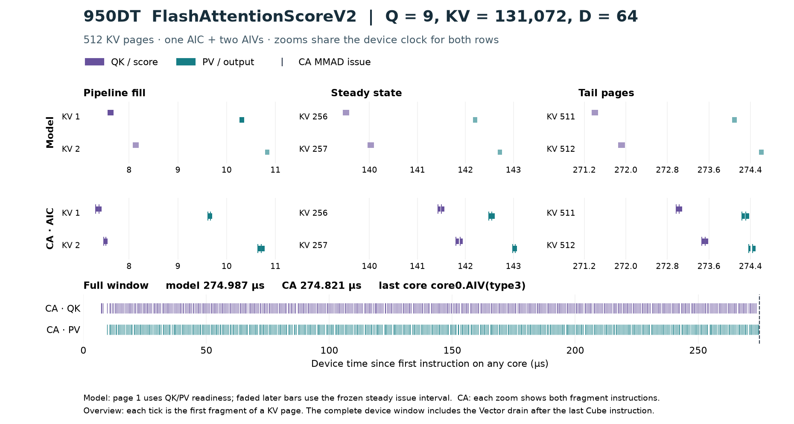

# FA · 128Ki KV 的九行主模型校验

一次主模型校验 Q=9 行、L=131072 个 KV、D=64、B=H=1。K、V 各 16 MiB。QK 和 PV 的有效算术各有 2×9×131072×64=150,994,944 ops。

## 单卡输入与调用

```python
from operator_model import estimate

shape = [9, 131072, 64, 1, 1]
attrs = {}
result = estimate('fa', shape, attrs, chip='Ascend950PR_957b')
print(result.latency_us, result.active_aic, result.active_aiv)
print(result.work["logical_read_bytes"], result.work["logical_write_bytes"])
```

## 从工作量到设备时间

Q 仅一个任务，在两个 950 上各为 1 AIC+2 AIV。每页 256 个 key，512 页。每页 QK/PV 各两段 128 个 key，因此全核共 2048 条 MMAD。首轮在 K/V 发起后等待数据，之后只对每页付一次稳态 II，末页再排空。

公开工作量统计为 Cube **301,989,888**、Vector **7,077,870** 个有用标量等效操作。逻辑读 **33,555,584 B**、写 **1,728 B**。片外实际流量取决于重用与缓存。

DT 的 256 个 KV 位置对应参考控制发起预算 853.40 tick，即 0.5172 µs（1650 tick/µs）。页间取各资源下界的最大值，只有当前实例确由控制发起限制时这一数值才等于稳态 II。 [参数及单位](../../src/operator_model/data/parameters/attention_resources.json)

下表取 950PR 的公开阶段分账。各段已处理模型可辨识的重叠，数值保留三位小数。

| 阶段字段 | 暴露时间 µs |
|---|---:|
| `launch` | 6.479 |
| `first_tile` | 3.877 |
| `steady` | 264.297 |
| `drain` | 0.335 |
| **整窗** | **274.988** |

## 本例各阶段怎样定价

一个 query tile 独占一组 AIC/AIV，循环 512 页；不把相邻页的启动响应重复 512 次。下列周期价格按目标吞吐换算，首发与发起间隔沿用 950DT 的关键事件观测。

- 起步为 10690/1650 = 6.479 µs。Q/K/V 的第一次可用时刻分别为 1120.57、1607.43、3599.93 周期。QK 发起要等 Q、K、公共读端口及 L0 就绪，得到 1781.43；PV 发起取 max(V 就绪, QK 发起+QK 服务+softmax 服务)+交接，得到 6252.43，再加 PV 的 145 周期，首块 6397.43/1650 = 3.877 µs。
- 其余 511 页可重叠。在本例一页的 Cube、Vector、K/V 读、MTE1、FIX、发起控制需求依次为 356.00、374.53、818.50、463.67、178.03、853.40 周期。取最大约束 853.4047，得到 511×853.4047/1650 = 264.297 µs。
- 排空时做末次向量工作、写前控制和 1728 B 输出，48.852+482.36+1728/80.068 ≈ 552.79 周期 = 0.335 µs。闭式加总为 **274.988 µs**。

每页的 QK 和 PV 分别包含两个 128 列碎片，合计四次 MMAD。发起控制是关键路径上多项控制与依赖的合并价格；源码中的 `ii_cycles` 表示可持续的页启动间隔。

[页首依赖与稳态需求](../../src/operator_model/operators/attention/resources.py) · [FA 阶段周期](../../src/operator_model/data/parameters/attention_resources.json)

## 与完整 CA 核对

| 目标 | 公开预测 µs | 完整 CA µs | 有符号误差 | 预测有效 AIC / AIV |
|---|---:|---:|---:|---:|
| Ascend950DT_9582 | 274.987 | 274.821 | +0.06% | 1 / 2 |
| Ascend950PR_957b | 274.988 | 265.893 | +3.42% | 1 / 2 |
| Ascend970DT（外推） | 252.093 | N/A | N/A | 1 / 1 |

DT 首个 QK 模型 7.558 µs、CA 7.315 µs。末页模型 271.855 µs、CA 273.460 µs。全窗很近仍包含相互抵消的阶段差别。970DT 的 1:1 配置给该任务 1 个 AIV。

示例收据的调用为 `aclnnFlashAttentionScoreV2`，provider 为 CANN 9.2.1 ops-transformer，实际记录的 kernel 为 `FlashAttentionScore_50348df09d0b3ee451d3693a6b2ab3f5_2328361008425599520_mix_aic`。



图选首、中、尾页对比，同一小窗内两栏采用同一尺度，未画出的中间页保留在数据中。 [图上使用的数值](assets/fa.json)

复核时，在逐窗记录中筛选 `contract=fa`、此页 shape 和属性。有多个前序的样本逐窗保留。示例用于解释该次计算。校准统计、冻结后独立样本数及完整误差范围以总报告为准。[逐窗数据](../../calibration/reference/windows.jsonl) · [模型实现](../../src/operator_model/operators/attention/resources.py) · [总建模方法](../modeling-strategy.md) · [误差分析](../error-analysis.md)
