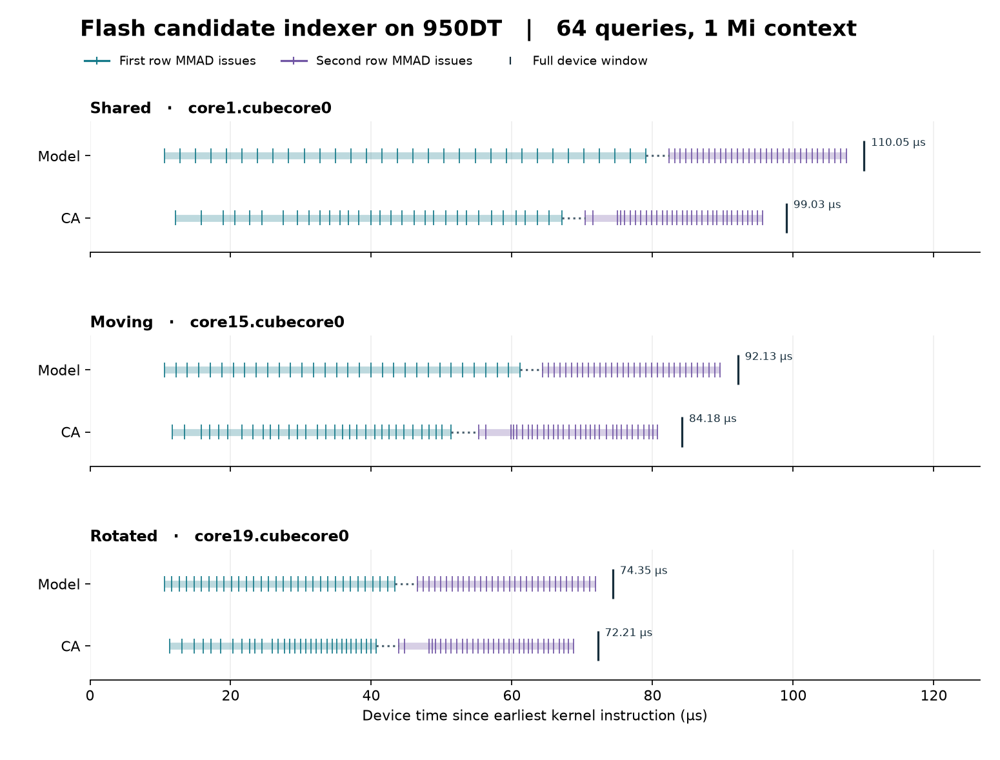
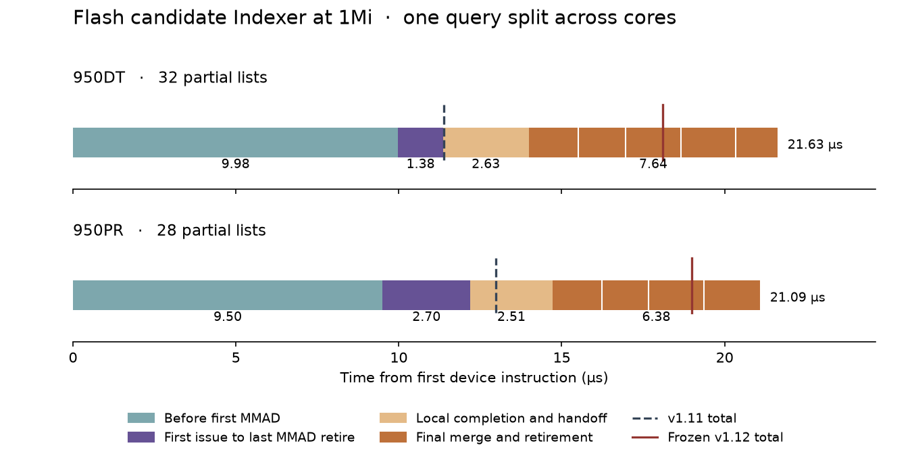

# Flash 的 A5 候选 Indexer · 1Mi prefill 末块

这里计算第 24 层的一个 consumer。第 28、32、36 层各做一次相同形状的计算。第 20 层生成候选，要扫描可见的键，四个消费层复用它选出的块。索引头 H=32、D=128，区别于主 attention 的头。A5 调用的是 `quant_sparse_lightning_indexer`，传入每个 query 的块 ID、有效块数、打包的 Q 与 scale、折叠 K、头权重。源码、wheel 指纹、可执行物与层映射见[实现核查](../../calibration/candidate_indexer/source-audit.md)。

## 一个 query 算多少个 key

本卡 B=1、Q=4,096、L=1,048,576。query 从 0 编号，第 i 行可见 v=L−Q+i+1 个位置。源层返回 c=min(2048,⌈v/8⌉) 个块，每个块 8 个 key。源层保留未满的因果末块。因此有效行数是 u=8c−((−v) mod 8)，Cube 的实际逻辑 tile 数却是 t=⌈c/64⌉。一块 Cube tile 用 32 行 Q 对 512 行 K 作长度 128 的点积。填充和因果掩码使 512t 可以大于 u；top-512 是最终输出宽度。

| 同一消费层 | 第一个 query | 最后一个 query | 全部 4096 个 query |
|---|---:|---:|---:|
| 可见位置 v | 1,044,481 | 1,048,576 | 4,286,580,736 |
| 候选块数 c | 2,048 | 2,048 | 8,388,608 |
| 有效候选 key 数 u | 16,377 | 16,384 | 67,094,528 |
| Cube tile 的 key 槽数 512t | 16,384 | 16,384 | 67,108,864 |
| 输出位置数 | 512 | 512 | 2,097,152 |

历史 BF16 参考按矩形键表执行 4,096×1,048,576=4,294,967,296 个 query–key 对的打分。A5 消费层从 GM 取出候选块之后才计算点积。四层复用候选块 ID，每一层仍需自己的 QK 分数。

## 输入、资源和时间

```python
from operator_model import estimate

result = estimate("candidate_filtered_indexer",
                  (1, 4096, 32, 128, 1048576, 2048, 512),
                  {"implementation": "a5_qsli_projection", "pa_block_size": 128,
                   "table_pages": 8201},
                  chip="Ascend950DT_9582", dtype="mxfp4")
print(result.status, result.latency_us, result.active_aic, result.active_aiv)
print(result.work["cube_ops"], result.projection["tile_service_cycles"])
```

1. **取数和分核。** 每个候选块含 8×(128/2+4)=544 B。64 个块构成一个 34,816 B 的 tile。每个 AIC 的两个 AIV 各收集半个 tile 到 UB，然后发布到 GM 四槽环形缓冲。AIC 从环形缓冲装入 L1、L0。按打包 K 被访问的次数计，每层要收集 131,072×34,816=4,563,402,752 B。GM staging 还要写、读各一次。物理 HBM 量受缓存复用影响，当前没有同窗控制器计数。
2. **点积和头归约。** Cube 的一个 tile 有 2×32×512×128 个 MXFP4 ops，2 表示 FMA。E8M0 每 32 个元素一组，Cube 累加到 FP32。FIX 将结果拆给两个 AIV，Vector 以 BF16 做 ReLU、权重乘加、头归约并选 top-k。模型对有效结果记 `2HDΣu` 和 `3HΣu` 个 Cube、Vector ops。定价时对实际发出的完整 tile 计价。
3. **一个 tile 的服务时间。** 设 X=34,816 B，a=32 是每个 AIV 的候选记录数，r 为单端口读服务字节/周期。收集需求为 X/(2r)+aλ，发布为 X/(2r)，AIC 连续读为 X/r。λ 是每个 AIV 查一条候选物理地址的暴露周期，仅对超过 2,048 列 UB 页表的标量路径计入。2,048 是实现阈值；页大小由部署给出，实验按 128，宽度按各任务实际预留 KV 容量推算。64 周期是单条查表的情景输入。宽表 CA 可以标定同一行的有效循环间隔，单条查表对整窗的净等待仍不可单独辨识。地址路径使用传入页表的列数，不能只看当前 token 数。
4. **Cube、FIX、Vector 的周期。** 令 r₄、r₁₆ 为每 AIC 的 MXFP4 峰值和每 AIV 的 BF16 峰值，均以 ops/cycle 表示，用芯片总 TOP/s 除以对应核数和频率换算。Cube 花费 2×32×512×128/r₄；FIX 交接花费 2×32×512/r𝒇，2 是 BF16 字节数；两个 AIV 共同处理一页，Vector 花费 3×32×512/(2r₁₆)。r 默认 80.07 B/cycle、r𝒇 默认 115.04 B/cycle，借自 950 的 FA 供数和 FIX 阶段。发布端口采用相同的单端口服务假设。可配置 MTE2 带宽会替换默认读率。
5. **分核。** 131,072 个 tile 分给 32 个 AIC，每团队依次完成 128 行、4,096 个 tile，没有跨核拆行。按 PR 的 28 个团队划分则每团队 4,681 或 4,682 个 tile，并产生 27 条需要归并的行。这里采用发布包的主机参考算法核对分核。单个短尾 tile 的工作权重采用满 tile 近似。[原厂分核表回放](../../calibration/candidate_indexer/prefill-metadata.json)
6. **设备窗。** 在内置 DT 上，六段首 tile 服务合计 S=2265.41+217.41+434.83+128.01+284.85+48.06=3378.58 周期。各项分别按第 3、4 步计算。团队从行首齐步，φ=1；生产者未提供候选 ID，默认 r=0.5，p=φr=0.5。首次行内 I₁=2691.98、后续行内 I₂=1343.61、换行 J=5334.75 周期。每行 32 个 tile 有 31 个行内间隔。末行 top-k 收尾 H=(540+2×32×48.75)×s=3660 周期（该 DT 的倍率 s=1）；540 是普通 LI 的固定直方图成本，48.75 是每 256 项成本，32 是末行 tile 数。前一行的选位和下一行的预取已经进入换行间隔。于是最慢团队花 S+31I₁+127×31I₂+127J+H。加一次首发控制 14,536.34，除以 1650 cycles/µs，得到 **3680.21 µs/层**。在系统图使用的芯片配置下为 **3681.86 µs/层**，四个消费层共 **14.727 ms**。当前默认 1Mi 末块整图 **458.229 ms**，属于外推。AICPU 元数据生成、生产折叠 K cache、返回后整理索引均在这个 kernel 设备窗之外。

### 用同一公式计算一个可在 CA 上测的例子

把查询数改为 64，每个团队只负责两行，此时设备时间（µs）为 **(14536.34+S+31I₁+31I₂+J+H)/1650**。取 r=1（相同候选表及顺序），I₁=3645.97、I₂=1343.61，算得 110.053 µs。保持分核和集合，按行轮转候选，只固定因果末页，r=1/256，I₁=1745.44、I₂=1343.61，算得 74.346 µs。只移动半数页、保留序号时 r=1/2，模型为 92.129 µs。三种输入的每条点积、每个 tile 和输出规模都一样。各项系数如何从旧 trace 取得、对外推有何限制，见[模型参数推导](../modeling-strategy.md#多团队如何给-flash-候选循环定价)与[三臂的逐窗误差](../errors/flash-a5-qsli.md)。

950DT 原生 CA 在三种输入上分别用 99.027 µs（同序）、72.210 µs（轮转）、84.182 µs（移动半数页）。仅改变候选访问顺序，首行 MMAD 窗口的核间中位从 55.10 降到 29.01 µs，第二行则为 24.81、24.94 µs。两个端点使我们撤掉了初冻模型给预取续行的重复地址罚时。移动半数页在第二次冻结后才揭盲，预测高估 7.947 µs（9.44%）。初冻与终版分别有模型及输入哈希。[逐地址与阶段实测](../../calibration/candidate_indexer/v113_control.md)



每幅图共享设备首条指令零点与横轴。上栏为终版均匀发起间隔推导的排程，下栏取最后退休 MMAD 的 AIC；短竖线是该团队 64 条 MMAD 的发起，深色终点是全设备整窗。团队首条 MMAD 可能晚于全局首发；末行排空还包括伙伴 AIV。三张图演示的是同一 shape，只有移动半数页一张是终版盲测。[保留的时标](../../calibration/candidate_indexer/v113_example_issues.json) · [重绘脚本](../../calibration/candidate_indexer/v113_example_plot.py)

已有每行有效候选 ID 时，可以一次把它们转换为模型需要的统计量。对不同请求分别统计，需要合并时用 `matching_pairs` 之和除以 `comparable_pairs` 之和。序号未对齐、仅集合相同的记录不会被视为同一序号的复用。

```python
from operator_model import summarize_candidate_layout

# 两行都访问物理页 5 和 7，只有最后一个有效序号拿到同一条 544 B 记录。
layout = summarize_candidate_layout([[0, 16, 1], [16, 0, 1]], page_table=[5, 7])
assert layout["candidate_order_overlap"] == 1 / 3
# 对真实输入先去掉 padding，按同一方式离线汇总，然后传给 estimate。
attrs = {"implementation": "a5_qsli_projection", "table_pages": 8201,
         "candidate_order_overlap": layout["candidate_order_overlap"]}
```

只有一个有效 query 时，比例无定义，返回 `None`。不传 PA 表时返回逻辑地址口径；有物理别名的部署应带上 PA 映射。离线统计工作量与有效候选数成正比。优化后的离线统计按有效行数变化分段累计可比较行对。64 行、每行 2048 个候选块并查 PA 表时，同序和错序样例的提取中位分别为 74.82、76.82 ms。[新旧 CPU 同集对照](../../calibration/candidate_indexer/layout-prepare-benchmark.json)。线上 `estimate` 只接收一个数，按少量 tile 分段和活动核计算。[公开预测入口与实现](../../src/operator_model/operators/attention/flash_sparse.py) · [离线统计实现](../../src/operator_model/operators/attention/candidate_layout.py)

## 旧实验如何定位循环问题

### 单团队 trace

强制把一个 query 的 32 个 tile 放在一个 AIC 和两个 AIV 上，其他团队空闲。这种人为分核用来观察一整行，独立性与发布 metadata 的单行验证分开。CA 窗 83.282 µs，原预测 52.021 µs。第一条 MMAD 于 13.081 µs 发起，最后一条于 79.596 µs 退休，末尾还有 3.686 µs 用于局部选位、映射和写出。前 8、中 7、后 16 个间隔的中位数分别为 5,428、2,749、2,459 cycles。单团队路径使用全行有效均值，末 16 个间隔能更好地描述这一次的热态。[完整指令时间戳](../../calibration/candidate_indexer/qsli-one-team.json)


### v1.11–v1.12 的单波外推对照

保留单团队校准得到的 3,534.03 周期，冻结后用原厂分核表同时发起 32 行，每 AIC 负责一整行。模型按一次启动 5.193 µs 加最慢团队 70.663 µs 得到 **75.856 µs**。32 个物理 AIC 各发出 32 条 MMAD，CA 的完整窗是 **84.792 µs**，模型低估 10.54%。16,384 个输出位置全部对上。32 行共享候选块位置，每行的因果边界和正确输出分别检查。并发发起和内存竞争使一个强制单团队窗不能充分确定满芯片开销。[核时间戳与逐行分配](../../calibration/candidate_indexer/prefill-wave.json)

4,096/32=128 波。若每波都支付完整设备窗，单层为 128×84.792=10,853.4 µs；若后续每波省去一次模型启动代理，单层为 10,853.4−127×5.193=10,193.9 µs。将两种单层价格分别写回末块原图的四个 consumer，DES 给出 **0.487 s、0.484 s**，模型逐 tile 排程得到 **0.481 s**。真实请求的不同行可能取不同页，跨波缓存、流水和外层调度也会改变时间。这两次重放只检验量级，整块误差仍未知。[同图重放收据](../../calibration/candidate_indexer/wave-chunk.json)

### v1.12 的两波独立验证

取 Q=64，沿用 1Mi、每行 32 个 tile 和 32 个团队。团队各做两个连续 query。没有拆行，模型的两波冻结价格为 **146.518 µs**。独立 CA 是 **80.133 µs**，发出了全部 2,048 条 MMAD，32,768 个位置均正确。相邻行共用 208/256 页，64 行的并集是 2,176 个页；原 Q32 对照的所有行都读同一组 256 页。DT 同核相邻发起间隔从中位 2,863.5 cycles 变为 1,295.5 cycles。工作量翻倍后实测反而略短，直接用行数倍增时间无法解释这个样本。

复算末块时，若每 64 行都支付该次整窗，单层为 64×80.132727=5,128.495 µs；若后续 63 组各省去模型的普通启动代理 8,568/1,650 µs，便得到 4,801.353 µs。单层价各写回原图的四个消费层，DES 分别为 **0.464015 s、0.462707 s**。两种部署假设只改四个节点。页重用、地址顺序与跨行重叠在两个样本里一起变化，无法用两个窗标定真实 4,096 行的稳态斜率。[DT 两波指令与地址收据](../../calibration/candidate_indexer/v112_wave_dt.json) · [同图重放](../../calibration/candidate_indexer/v112_context_multiwave.csv)

## 单 query 如何支付跨核归并

将同一末块的 Q 从 4,096 改为 1，其余输入相同。一个 query 仍打分 32 个 tile。DT 分给 32 个团队；PR 的 28 个团队中，24 个各做 1 个 tile，4 个各做 2 个。每个团队写出一份 512 项的临时列表。发布内核随后由归并 AIV 每轮最多读入七份新列表；从第二轮开始还要读回前一轮的 512 个结果。DT 五轮各输入 3,584、4,096、4,096、4,096、2,560 项。PR 用四轮，依次输入 3,584、4,096、4,096、4,096 项。

| 阶段 | 周期公式 | 参数的来源和含义 |
|---|---|---|
| 所有分片准备好 | 取最慢团队。拆行采用 11,064.844 周期的启动控制预算。对拆开的行片段，还要补足 2,862 周期的单 tile 收尾预算 | 前者取两端六个已有窗「第一条 MMAD 发起时间减去首轮 gather、发布和读」的中位数；后者取最后 MMAD 退休到最晚局部分片写退休的中位数。已计过的 FIX、Vector 和局部选位时间予以扣除。 |
| 归并交接 | 加 1,129 周期 | 六窗内，最后局部分片写退休到归并 AIV 第一笔分片读发起的中位数，含等待和准备。 |
| 读列表 | R×228.430 + 6E/r | P 为该行分片数，R=⌈P/7⌉，E=(P+R−1)×512。每项 6 B 是 INT32 位置加 BF16 分数。r 为目标核端口字节/周期。228.430 是每轮实测读取窗扣除字节服务后的中位剩余周期。 |
| radix 选位与索引重映射 | (1,427R + 16.2×E/256)×s | 从该轮最后一笔列表读退休，到第一笔输出写发起。按不同输入长度先取中位数，再由各长度间斜率的中位数估计每 256 项的周期，截距为每轮固定开销。s 是参考到目标的每核 Vector 费率比。 |
| 写回并供下一轮使用 | R×(151.633 + 6×512/r) | 每轮均发布 512 个位置和相应分数。151.633 是每轮的写回窗扣除字节服务的中位剩余周期。八列表容量中有一份留给上一轮输出。 |

DT 上 P=32、R=5、E=18,432、r≈80.07 B/cycle。读、选位、写分别约为 2,523、8,301、950 周期，加交接后共 **12,904 周期，即 7.820 µs**。再加启动 6.706 µs 和最慢团队的 3.580 µs，得到 **18.107 µs**。CA 全窗为 **21.630 µs**。PR 上 P=28、R=4、E=15,872，模型与 CA 分别为 **18.997 / 21.092 µs**。同一行的归并轮次是串行的；若有多行可同时归并，当前近似取最慢归并链。970DT 沿用该算法并以目标频率、每核速率和端口重算，单行 **16.557 µs** 为外推。



横轴以同一次采集的所有物理核第一条指令为零点。紫色为全芯片最早 MMAD 发起至最晚 MMAD 退休，区间内各核可能空闲。浅橙包含局部选位、写回与交接，深橙从首笔归并读开始，白线标出各轮首笔读。两条竖线只表示模型的总窗。窗口中仍未对齐的主要部分是首轮供数和归并读取随并发变化的时间。[双端逐轮指令证据](../../calibration/candidate_indexer/v112_merge.json) · [冻结价格](../../calibration/candidate_indexer/v112_frozen.json)
