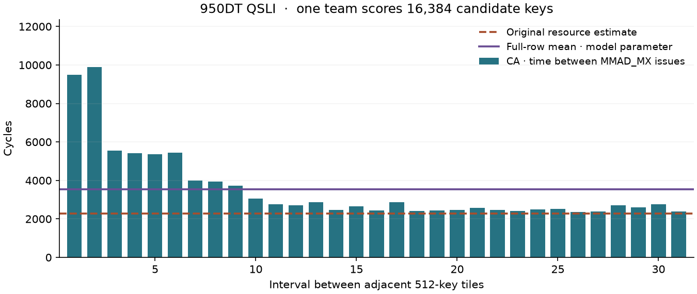

# Flash 的 A5 候选 Indexer · 1Mi prefill 末块

这里计算第 24 层的一个 consumer。第 28、32、36 层各做一次相同形状的计算。第 20 层生成候选，要扫描可见的键，四个消费层复用它选出的块。索引头 H=32、D=128，区别于主 attention 的头。A5 调用的是 `quant_sparse_lightning_indexer`，传入每个 query 的块 ID、有效块数、打包的 Q 与 scale、折叠 K、头权重。源码、wheel 指纹、可执行物与层映射见[实现核查](../../calibration/candidate_indexer/source-audit.md)。

## 一个 query 算多少个 key

本卡 B=1、Q=4,096、L=1,048,576。query 从 0 编号，第 i 行可见 v=L−Q+i+1 个位置。源层返回 c=min(2048,⌈v/8⌉) 个块，每个块 8 个 key。源层保留未满的因果末块。因此有效行数是 u=8c−((−v) mod 8)，Cube 的实际逻辑 tile 数却是 t=⌈c/64⌉。一块 Cube tile 用 32 行 Q 对 512 行 K 作长度 128 的点积。填充和因果掩码使 512t 可以大于 u；top-512 是最终输出宽度。

| 同一消费层 | 第一个 query | 最后一个 query | 全部 4096 个 query |
|---|---:|---:|---:|
| 可见位置 v | 1,044,481 | 1,048,576 | 4,286,580,736 |
| 候选块数 c | 2,048 | 2,048 | 8,388,608 |
| 有效候选 key 数 u | 16,377 | 16,384 | 67,094,528 |
| Cube tile 的 key 槽数 512t | 16,384 | 16,384 | 67,108,864 |
| 输出位置数 | 512 | 512 | 2,097,152 |

历史 BF16 参考按矩形键表执行 4,096×1,048,576=4,294,967,296 个 query–key 对的打分。A5 消费层从 GM 取出候选块之后才计算点积。四层复用候选块 ID，每一层仍需自己的 QK 分数。

## 输入、资源和时间

```python
from operator_model import estimate

result = estimate("candidate_filtered_indexer",
                  (1, 4096, 32, 128, 1048576, 2048, 512),
                  {"implementation": "a5_qsli_projection", "pa_block_size": 128,
                   "table_pages": 8201},
                  chip="Ascend950DT_9582", dtype="mxfp4")
print(result.status, result.latency_us, result.active_aic, result.active_aiv)
print(result.work["cube_ops"], result.projection["tile_service_cycles"])
```

1. **取数和分核。** 每个候选块含 8×(128/2+4)=544 B。64 个块构成一个 34,816 B 的 tile。每个 AIC 的两个 AIV 各收集半个 tile 到 UB，然后发布到 GM 四槽环形缓冲。AIC 从环形缓冲装入 L1、L0。按打包 K 被访问的次数计，每层要收集 131,072×34,816=4,563,402,752 B。GM staging 还要写、读各一次。物理 HBM 量受缓存复用影响，当前没有同窗控制器计数。
2. **点积和头归约。** Cube 的一个 tile 有 2×32×512×128 个 MXFP4 ops，2 表示 FMA。E8M0 每 32 个元素一组，Cube 累加到 FP32。FIX 将结果拆给两个 AIV，Vector 以 BF16 做 ReLU、权重乘加、头归约并选 top-k。模型对有效结果记 `2HDΣu` 和 `3HΣu` 个 Cube、Vector ops。定价时对实际发出的完整 tile 计价。
3. **一个 tile 的服务时间。** 设 X=34,816 B，a=32 是每个 AIV 的候选记录数，r 为单端口读服务字节/周期。收集需求为 X/(2r)+aλ，发布为 X/(2r)，AIC 连续读为 X/r。λ 是每个 AIV 查一条候选物理地址的暴露周期，仅对超过 2,048 列 UB 页表的标量路径计入。2,048 是实现阈值；页大小由部署给出，实验按 128，宽度按各任务实际预留 KV 容量推算。64 周期是单条查表的情景输入。宽表 CA 可以标定同一行的有效循环间隔，单条查表对整窗的净等待仍不可单独辨识。地址路径使用传入页表的列数，不能只看当前 token 数。
4. **Cube、FIX、Vector 的周期。** 令 r₄、r₁₆ 为每 AIC 的 MXFP4 峰值和每 AIV 的 BF16 峰值，均以 ops/cycle 表示，用芯片总 TOP/s 除以对应核数和频率换算。Cube 花费 2×32×512×128/r₄；FIX 交接花费 2×32×512/r𝒇，2 是 BF16 字节数；两个 AIV 共同处理一页，Vector 花费 3×32×512/(2r₁₆)。r 默认 80.07 B/cycle、r𝒇 默认 115.04 B/cycle，借自 950 的 FA 供数和 FIX 阶段。发布端口采用相同的单端口服务假设。可配置 MTE2 带宽会替换默认读率。
5. **流水与 top-k。** 六项最大值是无流水标定时的间隔。对宽页表同一行内相邻 tile，采用 DT 实测的有效循环间隔 I=109,555/31=3,534.03 周期，再检查目标芯片的吞吐下界。首个 tile 仍计完整充排；对一个团队分到的 n 个 tile、f 个行片段，模型计 (n−f)I+fΣ阶段，再加局部直方图选位。显式传入 `scalar_lookup_cycles=64` 可重放原先验。局部选位代理用 (540f+48.75×2n)×s cycles，其中每个 tile 有两组 256 个位置，540 和 48.75 来自普通 LI 的固定与逐组 AIV 窗，s 是参考与目标每核向量费率的换算。跨核拆行时再估算局部 top-512 的合并。原生 metadata 按行与尾块权重划连续工作区间；在线模型按等份 tile 近似该区间，源层、部分行与 LD 归并有独立误差。本例 131,072 tiles 平均落在 32 个 AIC，每核 4,096 tiles、128 整行，恰好没有跨核拆行。使用发布包的 metadata 主机算法重放全部 4,096 行，得到相同的 32 个连续区间。按 PR 的 28 个团队划分则每团队 4,681 或 4,682 tiles，并产生 27 条 LD 记录。[整块的官方分核表回放](../../calibration/candidate_indexer/prefill-metadata.json)
6. **得到设备时间。** 启动代理 8,568 周期取自普通 MXFP4 QLI 在 950DT 首条 MMAD 的时刻，全窗只加一次。取最慢团队，加跨核合并，再与逻辑冷 I/O、已配置时的 L2 服务下界取最大值。内置 DT 上算得 **9.050 ms/消费层**，系统 950DT 的 Vector 峰值配置不同，同层为 **9.262 ms**。实图上的四层合计 **37.048 ms**。AICPU 生成 metadata、上游打包/维护折叠 cache，以及返回后整理位置的调用在本次替换计时边界之外，详细成本尚未独立标定。970DT 采用同算法移植的资源情景，原发布 AOT 的 36 核 ABI 上限不能直接套用到未来硬件。

宽表重复 tile 的间隔来自原生 QSLI。其余代理系数来自普通 QLI、普通 LI、FA 或显式假设。A5 源码能确认工作量、分工与分块；单用源码无法得到标量页表等待和不规则 gather 的绝对时长。源实现允许 AIV 重叠预取下一行，当前的逐行充排代理也可能高估。运行例子会返回这些成本及单位。[模型代码](../../src/operator_model/operators/attention/flash_sparse.py) · [组件 CA 与逐窗误差](../errors/candidate_filtered_indexer.md) · [同图端到端重放与敏感性](../../calibration/candidate_indexer/context-sensitivity.md)


## 用单团队 trace 核对循环间隔

强制把一个 query 的 32 个 tile 放在一个 AIC 和两个 AIV 上，其他团队空闲。这种人为分核用来观察一整行，独立性与发布 metadata 的单行验证分开。CA 窗 83.282 µs，原预测 52.021 µs。第一条 MMAD 于 13.081 µs 发起，最后一条于 79.596 µs 退休，末尾还有 3.686 µs 用于局部选位、映射和写出。前 8、中 7、后 16 个间隔的中位数分别为 5,428、2,749、2,459 cycles。默认使用全行有效均值，末 16 个间隔能更好地描述这一次的热态。[完整指令时间戳](../../calibration/candidate_indexer/qsli-one-team.json)



### 用独立的 32 行 CA 波次核对 4,096 行外推

保留单团队校准得到的 3,534.03 周期，冻结后用原厂分核表同时发起 32 行，每 AIC 负责一整行。模型按一次启动 5.193 µs 加最慢团队 70.663 µs 得到 **75.856 µs**。32 个物理 AIC 各发出 32 条 MMAD，CA 的完整窗是 **84.792 µs**，模型低估 10.54%。16,384 个输出位置全部对上。32 行共享候选块位置，每行的因果边界和正确输出分别检查。并发发起和内存竞争使一个强制单团队窗不能充分确定满芯片开销。[核时间戳与逐行分配](../../calibration/candidate_indexer/prefill-wave.json)

4,096/32=128 波。若每波都支付完整设备窗，单层为 128×84.792=10,853.4 µs；若后续每波省去一次模型启动代理，单层为 10,853.4−127×5.193=10,193.9 µs。将两种单层价格分别写回末块原图的四个 consumer，DES 给出 **0.487 s、0.484 s**，模型逐 tile 排程得到 **0.481 s**。真实请求的不同行可能取不同页，跨波缓存、流水和外层调度也会改变时间。这两次重放只检验量级，整块误差仍未知。[同图重放收据](../../calibration/candidate_indexer/wave-chunk.json)
