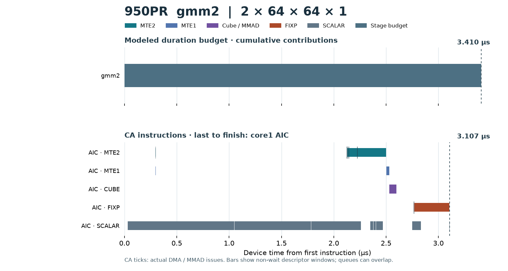
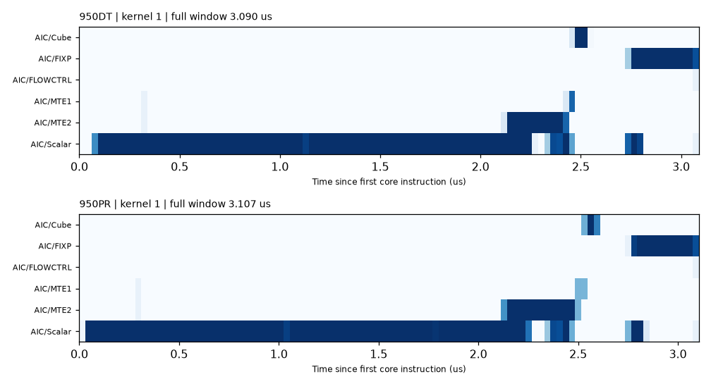

# GroupedMatmulV5（GMM2） 算例

## 模型与实际库流水对照



本卡 shape 为 `[2, 64, 64, 1]`，950PR 模型 **3.410 µs**，完整 CA **3.107 µs**，有符号误差 +9.76%。上栏画出当前预测器能够辨识的阶段时长。只返回一个阶段的路线保留整段预测；多个暴露阶段按贡献累计，模型尚未辨识它们的具体指令发起点。下栏用实际库 trace 的最后完成核逐队列展开，黑色刻度来自真实 DMA 或 MMAD 发起。 [图上每段的时间与 trace 指纹](../../results/v0.20/examples/gmm2-pr.json)

输入轴顺序为 **T,K,F（SwiGLU 中间宽度）,E**。本例比较同一输入契约在 950DT、950PR 与假设的 970DT 上的设备指令窗口。

```python
from operator_model import estimate

shape = [2, 64, 64, 1]
attrs = {'expert_counts': [2]}
for chip in ('Ascend950DT_9582', 'Ascend950PR_957b', 'Ascend970DT'):
    r = estimate('gmm2', shape, attrs, chip=chip, dtype='fp8_e4m3fn', timing_mode='auto')
    print(r.latency_us, r.status, r.active_aic, r.active_aiv, r.work)
```

## 输入到工作量

该路线调用 CANN 9.2.1 的 ops-transformer 算子族。实际调用接口为 `aclnnGroupedMatmulV5`。
工作量接口给出的 Cube 操作为 16,384，Vector 计数为 0。逻辑读/写分别为 4364 / 256 B。此处 None 表示缺少计数；片外实际流量须另行观测，逻辑字节不含中间层重复搬运。

## 分块、资源和关键路径

该例为 `gmm2[2, 64, 64, 1]`，dtype=fp8_e4m3fn，属性 `{'expert_counts': [2]}`。按每个本地专家所分配的有效行数求和，点积共 2×2×64×64 次标量运算。读字节=(2+1×64)×(64+2⌈64/64⌉)+8×1，依次包含输入、非空专家权重、每 64 个归约元素的两字节 scale，以及专家分组表。BF16 写回 2×2×64 字节。有用 Cube 运算 {'fp8_e4m3fn': 16384}、Vector 运算 {} （FMA 算 2），逻辑读/写 4364/256 B。字节数不含缓存重读。

DT 为 32/64 个 C/V 核、1.65 GHz，970 为 120/120、1.8 GHz。对固定参考库路线，计算价用每核峰值比 × 目标/参考波数比；控制价用时钟比 1.65/1.8=0.91667。搬运价=(1−p)·本地价+p·4000/14400，缺 MTE 带宽时用时钟与波数作本地价。只有 Cube/Vector 总峰值且可比时才用其比值；混合 dtype 以各自工作量加权。该路线没有直接定价 970 的 L2 命中或重新编译 tiling；970 时间是 DT 阶段模板外推，不是独立的目标硬件资源仿真。

**gmm2：从输入到阶段净时延**

1 个本地专家，token 行数 [2]，和为 2；每专家各自按 16 行补块，合计 1 个行块。输出列=64、归约宽=64，Cube jobs=1×⌈64/128⌉=1；DT 波 w=⌈jobs/32⌉=1，Cube 单位 w×⌈64/64⌉，SIMD 模板单位 ⌈Σ⌈行数×64/256⌉/64⌉=1。空专家不产生数学工作；GMM2 可能仍有向量样式的队列代理，此数不是 SIMD 指令计数。

本例工作代理按 `CUBE / SIMD / MTE1 / MTE2 / MTE3 / FIXP / SCALAR / IDLE` 排列为 `1, 1, 1, 1, 1, 1, 1, 1`。SCALAR/IDLE 按波计。这是队列工作单位，而非有用运算数。

分配代理 Cube/Vector jobs=1/0，Cube 波 1→1，Vector 波 0→0；970 活跃核代理 (C,V)=(1, 0)。逻辑读写 4620 B，阶段 DT 时间 3.40970 µs，外存权重 p=min(1,4620/(1000×4000×3.40970))=0.00034。目标时价系数 `CUBE / SIMD / MTE1 / MTE2 / MTE3 / FIXP / SCALAR / IDLE` = `0.91631 / 0.91667 / 0.91667 / 0.91645 / 0.91645 / 0.91667 / 0.91667 / 0.91667`。 cube 参考/目标每核峰值比（整片 TOPS÷同类核数）：fp8_e4m3fn (865/32)/(3540/120)=0.91631。

对每个 DT 参考 trace 的每个核，把队列活动集合不变的时间段记作 (S,h)，其中 h 是实测微秒。设 U 是本例的队列工作、U₀ 是表中参考工作，f 是上面目标时价（DT 时全取 1）。一个时间段耗时 h·max(q∈S){Uq/U₀q·fq}；同一核逐段相加、同一模板取最晚核、多个模板取中位数，偶数个取中间两值的平均。以下是实际参与该次计算的全部模板，序号按参数原顺序，核索引从 0 开始。

| 模板 / DT 参考 shape / DB SHA 前12位 | 参考 U₀（同上队列顺序） | DT 最晚核 / µs | 970 最晚核 / µs |
|---|---|---:|---:|
| 0 / [2, 64, 64, 1] / `5d807ce297ef` | 1, 1, 1, 1, 1, 1, 1, 1 | 0 / 3.24788 | 0 / 2.97718 |
| 1 / [2, 64, 128, 1] / `383d7fa64f66` | 2, 1, 2, 2, 1, 1, 1, 1 | 0 / 3.33970 | 0 / 3.06134 |
| 2 / [4, 128, 64, 2] / `321369f9d63f` | 1, 1, 1, 1, 1, 1, 1, 1 | 0 / 3.70667 | 0 / 3.39769 |
| 3 / [6, 128, 128, 2] / `31855cc022da` | 2, 1, 2, 2, 1, 1, 1, 1 | 0 / 3.47970 | 0 / 3.18968 |

<details><summary>展开各模板在 970 关键核上的实际并发项</summary>


模板 0，970 核 0 的逐项 (h × 最大缩放)，µs：

`IDLE` 0.21212×0.91667；`SCALAR` 2.21758×0.91667；`MTE1+MTE2+SCALAR` 0.00242×0.91667；`MTE2+SCALAR` 0.24545×0.91667；`MTE2` 0.10848×0.91645；`MTE1` 0.02909×0.91667；`CUBE` 0.06000×0.91631；`FIXP+SCALAR` 0.07030×0.91667；`FIXP` 0.30242×0.91667，和为 **2.97718**。

模板 1，970 核 0 的逐项 (h × 最大缩放)，µs：

`IDLE` 0.20727×0.91667；`SCALAR` 2.31030×0.91667；`MTE1+MTE2+SCALAR` 0.00242×0.91667；`MTE2+SCALAR` 0.24667×0.91667；`MTE2` 0.30242×0.45823；`MTE1` 0.03818×0.45833；`CUBE` 0.07091×0.45816；`FIXP+SCALAR` 0.07030×0.91667；`FIXP` 0.29697×0.91667，和为 **3.06134**。

模板 2，970 核 0 的逐项 (h × 最大缩放)，µs：

`IDLE` 0.23576×0.91667；`SCALAR` 2.44788×0.91667；`MTE1+MTE2+SCALAR` 0.00242×0.91667；`MTE2+SCALAR` 0.12424×0.91667；`MTE2` 0.42061×0.91645；`MTE1+SCALAR` 0.03697×0.91667；`MTE1` 0.00667×0.91667；`CUBE+SCALAR` 0.06000×0.91667；`CUBE` 0.00121×0.91631；`FIXP+SCALAR` 0.06727×0.91667；`FIXP` 0.30364×0.91667，和为 **3.39769**。

模板 3，970 核 0 的逐项 (h × 最大缩放)，µs：

`IDLE` 0.28485×0.91667；`SCALAR` 2.32424×0.91667；`MTE1+MTE2+SCALAR` 0.00242×0.91667；`MTE2+SCALAR` 0.25758×0.91667；`MTE2` 0.38364×0.45823；`MTE1` 0.03818×0.45833；`CUBE` 0.01273×0.45816；`CUBE+SCALAR` 0.01394×0.91667；`CUBE+FIXP+SCALAR` 0.04242×0.91667；`FIXP+SCALAR` 0.02788×0.91667；`FIXP` 0.30909×0.91667，和为 **3.18968**。

</details>

DT 候选中位数 3.40970 µs，目标候选中位数 3.12551 µs。参考价格、每个核的活动集合及完整 DB SHA 在 `results/v0.8/fusion/model.json → templates.gmm2`。

按实际阶段顺序相加：DT 3.40970 = **3.40970 µs**；970 3.12551 = **3.12551 µs**。窗口只含本 rank 的单个库 kernel。

## 设备时间及误差

| 平台 | 模型 (µs) | CA (µs) | 有符号误差 | 预测 AIC / AIV | CA AIC / AIV |
|---|---:|---:|---:|---|---|
| 950DT | 3.40970 | 3.09030 | +10.34% | N/A / N/A | 32 / 0 |
| 950PR | 3.40983 | 3.10667 | +9.76% | 1 / 0 | 28 / 0 |
| 970DT 外推 | 3.12551 | N/A | N/A | 1 / 0 | N/A |

DT/PR 加速比取同形耗时之比，模型 1.0000×，CA 0.9947×。正时延误差为高估。

**950DT CA**　msopprof official full trace，角色 new paired DT CA；核名 `GroupedMatmul_037cec40685a17f15b75759e999767c3_0`。该宿主的数值检查共 3 组；子算子切片共享宿主检查。各设备窗以最早到最晚核指令计，多 kernel 取串行窗之和。

**950PR CA**　msopprof official full trace，角色 frozen PR holdout；核名 `GroupedMatmul_037cec40685a17f15b75759e999767c3_0`。该宿主的数值检查共 3 组；子算子切片共享宿主检查。各设备窗以最早到最晚核指令计，多 kernel 取串行窗之和。

## CA 流水与模型差距



横轴为每次 kernel 自身的设备时间，两端各自从零开始。每种核取最晚结束的一个核。每行按该队列有效指令区间的并集着色，100 个等宽时间格，深蓝表示格内占满。不同队列可重叠，行长不能相加。DMA/FIX 行表示描述符的在途窗口，可能包含等待依赖的时间；颜色深度不能直接换算 HBM 总线利用率。

950DT 第 1 段 3.0903 µs；所选核上占用最长的队列为 AIC/Scalar 2.3842 µs、AIC/FIXP 0.3473 µs、AIC/MTE2 0.3097 µs。
950PR 第 1 段 3.1067 µs；所选核上占用最长的队列为 AIC/Scalar 2.4254 µs、AIC/MTE2 0.3782 µs、AIC/FIXP 0.3388 µs。

PR 的模型与 CA 相差 +0.3032 µs。本路线使用 DT 的队列重叠或阶段模板；目标芯片的实际发起、核间同步和尾部任务分布可变。上图给出可观测的队列活动；一次端到端差值无法唯一分摊到这些因素。

[总建模方法](../modeling-strategy.md) · [全部 shape 的误差](../error-analysis.md) · [970DT 配置与来源](../../configs/chips/Ascend970DT.json)
