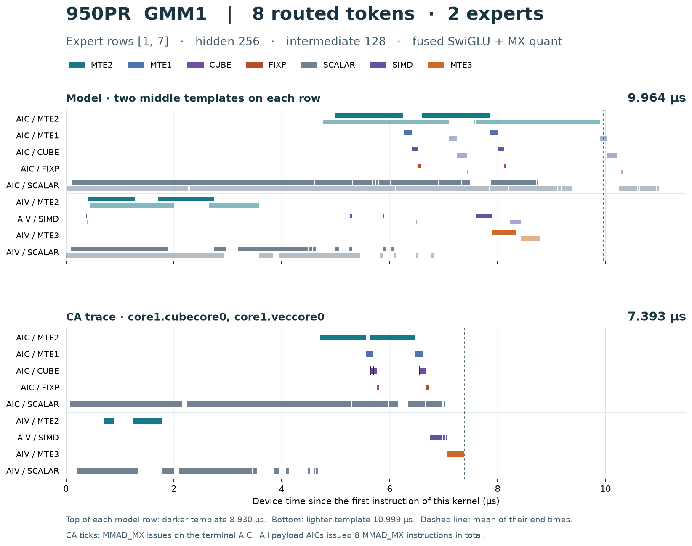

# GMM1 · 两个专家的上投影和量化

8 个 token 分配为 [1,7]。hidden K=256，中间宽 F=128。两路上投影合计 4×8×256×128=1,048,576 算术操作，随后做 SwiGLU 并写 1024 个 FP8 值、32 个 scale。

## 单卡输入与调用

```python
from operator_model import estimate

shape = [8, 256, 128, 2]
attrs = {'expert_counts': [1, 7]}
result = estimate('grouped_matmul_swiglu_quant_v2', shape, attrs, chip='Ascend950PR_957b')
print(result.latency_us, result.active_aic, result.active_aiv)
print(result.work["logical_read_bytes"], result.work["logical_write_bytes"])
```

## 从工作量到设备时间

每个专家独立生成行块。参考阶段按两组 16 行粒度尾块定价，再与向量激活和量化重叠。PR 的两个中位候选排程分别为 8.930 和 10.999 µs，默认时间取两者均值。

公开工作量统计为 Cube **1,048,576**、Vector **5,120** 个有用标量等效操作。逻辑读 **137,296 B**、写 **1,056 B**。片外实际流量取决于重用与缓存。

参数表为每一参考 shape、每一种核及同时活跃的队列集合记录持续时间（µs）。按该块实际的 Cube、搬运和 SwiGLU/量化工作比伸缩各个区间，再取最慢核。中间两份模板的不同首发位置在图中保留。 [参数及单位](../../src/operator_model/data/parameters/fusion_overlap.json)

下表取 950PR 的公开阶段分账。各段已处理模型可辨识的重叠，数值保留三位小数。

| 阶段字段 | 暴露时间 µs |
|---|---:|
| `grouped_matmul_swiglu_quant_v2` | 9.964 |
| **整窗** | **9.964** |

### 从专家分配到两个中位模板

**先算张量。** 每个活跃专家权重有 `2F=256` 行，每行 `K=256` 个 FP8，加 `2⌈256/64⌉=8` B 的 E8M0。激活有 8 行，权重有 `2×256` 行，另有 2 个 8 B 的专家元数据，读 `(8+2×256)(256+8)+16=137296` B。输出是 `8×128=1024` 个 FP8 和 `8×2⌈128/64⌉=32` B 的 scale。门控激活的每个输出统计 negate、exp、add、divide、multiply 各一次，故 Vector 的有用工作为 `5×1024=5120`。指令打包和量化转换次数未由这个数给出。

**再算关键波需要几份工作。** 16 行分块给 `⌈1/16⌉+⌈7/16⌉=2` 个专家行块；在 `2F` 上有 `⌈256/128⌉=2` 个列块，共 4 个 Cube 任务。参考有 32 个 AIC，关键波数 `u_c=⌈4/32⌉=1`，沿 K 需 `⌈256/64⌉=4` 份归约。Vector 任务按每个专家分别取整，为 `⌈1×128/256⌉+⌈7×128/256⌉=1+4=5` 个，在 64 AIV 上也是一波。于是 Cube、MTE1 和 MTE2 各 4 个工作单位，FIXP、SIMD、MTE3、SCALAR、IDLE 各 1 个。这里的单位用于和旧模板的同类单位比较。PR 有 28 AIC、56 AIV，任务仍各一波，公开计划返回 4/5 个有效核。

**资源倍率来自芯片和参考窗。** FP8 Cube 每核速度的时间倍率是 `(865/32)/(756/28)=1.001157`；FP32 SIMD 是 `(27/64)/(23/56)=1.027174`。分子、分母分别是 DT、PR 的整片峰值除以相应核数。两芯片均 1.65 GHz，控制倍率和缺省本地端口倍率为 1。参考模型先算出该输入在 DT 的 `T_0=9.940909` µs，由此 `p=(137296+1056)/(4000×1000×T_0)=0.003479`，MTE2/3 跨芯片倍率为 `(1-p)×1+p×4000/1400=1.006462`。此 `p` 是逻辑读写量占参考窗内 HBM 带宽预算的比例；集合内哪个引擎实际等待、物理 HBM 字节占几成，无法只靠整窗分别测出。

每份模板对 CA 中的每类核取最后退休的一个核。由全片首条指令起，对该核全部计时指令的起止排序，相邻边界之间记录活跃资源，完全空闲的间隔记为 IDLE。同一资源集合的 cycles 相加再除以 1650 得到 `t_ref`（µs）。[原始参数提取程序](https://github.com/Runze-Lin/operator_sim/blob/e99f2eb6e645de0e6e187379ba7f9d89d05d3297/scripts/fusion-v8-freeze.py)

对模板 `j`、代表核 `c` 和集合 `S`，取

`T[j,c] = Σ_S (t_ref[j,c,S] × max(q∈S, (W[q]/W_ref[j,q]) × f[q]))`

`W[q]` 是上面的当前工作单位，`W_ref[j,q]` 是模板中保存的参考单位，`f[q]` 是 PR/DT 服务时间倍率。同一集合内只取最慢缩放，随后在代表核间取最大值。以模板 1 为例，原始 `MTE2+SCALAR` 占 0.99333 µs，模板的 MTE2 单位为 1，当前为 4，该项变为 `0.99333×max(4×1.006462,1)=3.99901` µs。下表把最慢代表核的全部区间按最终乘数分组，因此能从原始时间重算两个中位候选。模板编号是参数文件中的顺序。

| 候选 | 基准 µs × 对应倍率，按等倍率合并 | 代表核预测 µs | 取最大值 |
|---|---|---|---:|
| 1 | `5.683636×1 + 1.16×(4×1.006462) + 0.070303×4 + 0.090909×(4×1.001157)` | 10.99889、8.79923、8.32664 | 10.99889 |
| 4 | `5.866061×1 + 1.254545×(2×1.006462) + 0.149091×2 + 0.12×(2×1.001157)` | 8.92982、8.35369、8.09743 | 8.92982 |

其他两份候选窗是 11.13200 和 8.69526 µs。排序后取中间两项平均 `(8.92982+10.99889)/2=9.96436` µs。中位值表示模板中的稳定位置，不对应一条已观测的指令排程。[输入账本](../../src/operator_model/workload.py) · [分块单位](../../src/operator_model/operators/fused/templates.py) · [重定价计算](../../src/operator_model/scheduling/projection.py) · [原始模板区间](../../src/operator_model/data/parameters/fusion_overlap.json)

### 每份时间模板用的是哪一次观测

四份参考窗全部来自 950DT 的真实双 kernel 调用中的第一个 kernel。下面左列为 [T,D,F,E] 和各专家 token 数。ID 是指令数据库 SHA-256 的前 12 位。每个类型单独保留最后退休的核，每格是从全片零点到该代表核结束的 cycles。它们是同一段工作并发的三个视角，取最大预测窗；三个核窗不相加。

| shape / counts | 数据库 ID | 代表核窗（AIC、AIV 类型 2、类型 3） |
|---|---|---:|
| [2,64,64,1] / [2] | `13cae4827228` | 11558、11382、11112 |
| [2,64,128,1] / [2] | `848bc7c3d94e` | 12012、11860、11771 |
| [4,128,64,2] / [1,3] | `fcdcf6d69b84` | 12150、12135、11968 |
| [6,128,128,2] / [1,5] | `b2fafc5ae696` | 12193、12178、12038 |

第 1 份的 AIC 是 CoreTypeId=1、core_id=0。按起止事件扫描其指令数据库，仅保留 `ExecInstrIsDurationExcluded=0`。从全片最早指令开始，每遇到指令开始或结束便更新活跃队列计数；仅 SCALAR 和 MTE2 同时活跃的 1273 段总共 1639 cycles，最早三段为 [7814,7815)、[7815,7816)、[7816,7817)。因此归档的该项为 1639/1650=0.993333 µs。若第三个引擎同期活跃，归入三引擎的另一组。不同核在同一时段并行执行，统计时分别保留。形状归一化里的 16 行、128 列、K64 和向量 256 元素是模型的任务单位，缺少证据把这些数解读成该二进制的精确 tile；5 次有用 Vector 操作来自算术记账。投影给 PR 的倍率取芯片配置，四份 DT 模板对本例的预测再等权取中位。第 4 份在更早一轮命名为 holdout，自用于建模起属于开发证据。[含 shape 和数据库指纹的冻结模板](https://github.com/Runze-Lin/operator_sim/blob/e99f2eb6e645de0e6e187379ba7f9d89d05d3297/results/v0.8/fusion/model.json) · [按指令边界提取不重叠区间](https://github.com/Runze-Lin/operator_sim/blob/e99f2eb6e645de0e6e187379ba7f9d89d05d3297/scripts/fusion-v8-freeze.py)

## 与完整 CA 核对

| 目标 | 公开预测 µs | 完整 CA µs | 有符号误差 | 预测有效 AIC / AIV |
|---|---:|---:|---:|---:|
| Ascend950DT_9582 | 9.941 | 7.489 | +32.74% | — / — |
| Ascend950PR_957b | 9.964 | 7.393 | +34.79% | 4 / 5 |
| Ascend970DT（外推） | 9.104 | N/A | N/A | 4 / 5 |

核数字段的 “—” 表示该参考路径未返回这一项。

PR 全核实测只有 2 个 AIC 各发 4 条 MMAD_MX，两个参考模板的 Cube 首发都较晚。这解释了本例明显高估的一个来源，也说明核数预测只是使用范围的近似。

示例收据的调用为 `aclnnGroupedMatmulSwigluQuantV2`，provider 为 CANN 9.2.1 ops-transformer，实际记录的 kernel 为 `GroupedMatmulSwigluQuantV2_201ac99772cea936e22117f5ac241d38_0_mix_aic`。



两条上栏模板各自保留资源重叠。虚线是二者得到的公开点估计，尚无依据将它视为唯一物理排程。 [图上使用的数值](assets/gmm1.json)

复核时，在逐窗记录中筛选 `contract=grouped_matmul_swiglu_quant_v2`、此页 shape 和属性。有多个前序的样本逐窗保留。示例用于解释该次计算。校准统计、冻结后独立样本数及完整误差范围以总报告为准。[逐窗数据](../../calibration/reference/windows.jsonl) · [模型实现](../../src/operator_model/operators/fused/templates.py) · [总建模方法](../modeling-strategy.md) · [误差分析](../error-analysis.md)
