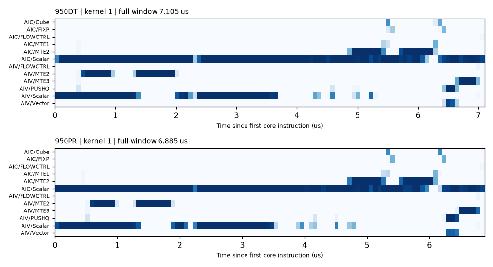

# GroupedMatmulSwigluQuantV2（GMM1） 算例

## 同一批两个专家的预测流水与真实指令


`[总 token, hidden, intermediate, 本地专家]=[8,256,128,2]`，专家分别收到 1、7 个 token。GMM1 将每个专家的 256 维输入投影为 2×128 列，随后 AIV 做 SwiGLU 与 MX 量化。安装包接口为 `aclnnGroupedMatmulSwigluQuantV2`，实际 kernel 是 `GroupedMatmulSwigluQuantV2_201ac99772cea936e22117f5ac241d38_0_mix_aic`。模型 **9.964 µs**，950PR CA **7.393 µs**，有符号误差 **+34.79%**。CA 只取该 kernel 的全核首指令至末指令，两个算例在真实 MoE 串行调用中采集，计时均排除宿主间隙。

上栏的每行有深浅两条，表示四个 DT 模板在目标芯片上重算后位于中间的两条真实参考排程，分别为 **8.930、10.999 µs**。公开模型返回两者末时刻的算术平均，图中的虚线标出这个均值。每条排程内，资源同时活动的原始区间按其中最慢的资源倍率定价。下栏是相同队列上的实测活动，Cube 行深色短线对应末核 `core1.cubecore0` 发起的 4 条 `MMAD_MX`。扫描全部 AIC 的原始事件，共数到 **8 条 MX 乘加，分布在 2 个核**。若解析器只匹配普通助记符 `MMAD`，该计数将返回 0。

两条模板的最迟 AIC 分别为 8.930、10.999 µs，对应最迟 AIV 为 8.354、8.799 µs；CA 观察到最迟 AIC 与 AIV 在 7.393、7.385 µs 收尾。两条参考排程的 Cube 起始都晚，且它们的 AIC 终点相差 2.069 µs，这正是均值掩盖的阶段不确定性。本次沿用历史数值回执，GMM1 输出及 MX scale、GMM2 输出均完成比较，三项 bad 均为 0。[两个中位模板、逐核 MX 次数、完整时间窗与 SHA](../../results/v0.21/fusion/gmm1-two-experts-pr.json) · [复算与重绘](../../development/validation/fusion21/moe_queue_figures.py)

## 单专家小形状的三端算例

输入轴顺序为 **T,K,F（SwiGLU 中间宽度）,E**。本例比较同一输入契约在 950DT、950PR 与假设的 970DT 上的设备指令窗口。

```python
from operator_model import estimate

shape = [2, 64, 64, 1]
attrs = {'expert_counts': [2]}
for chip in ('Ascend950DT_9582', 'Ascend950PR_957b', 'Ascend970DT'):
    r = estimate('grouped_matmul_swiglu_quant_v2', shape, attrs, chip=chip, dtype='fp8_e4m3fn', timing_mode='auto')
    print(r.latency_us, r.status, r.active_aic, r.active_aiv, r.work)
```

## 输入到工作量

该路线调用 CANN 9.2.1 的 ops-transformer 算子族。实际调用接口为 `aclnnGroupedMatmulSwigluQuantV2`。
工作量接口给出的 Cube 操作为 32,768，Vector 计数为 640。逻辑读/写分别为 8588 / 132 B。此处 None 表示缺少计数；片外实际流量须另行观测，逻辑字节不含中间层重复搬运。

## 分块、资源和关键路径

该例为 `grouped_matmul_swiglu_quant_v2[2, 64, 64, 1]`，dtype=fp8_e4m3fn，属性 `{'expert_counts': [2]}`。按每个本地专家所分配的有效行数求和，点积共 2×2×64×128 次标量运算。读字节=(2+1×128)×(64+2⌈64/64⌉)+8×1，依次包含输入、非空专家权重、每 64 个归约元素的两字节 scale，以及专家分组表。SwiGLU 五种逐元素算术共 5×2×64 次；写出 FP8 和 scale，共 2×64+2×2⌈64/64⌉ 字节。有用 Cube 运算 {'fp8_e4m3fn': 32768}、Vector 运算 {'fp32': 640} （FMA 算 2），逻辑读/写 8588/132 B。字节数不含缓存重读。

DT 为 32/64 个 C/V 核、1.65 GHz，970 为 120/120、1.8 GHz。对固定参考库路线，计算价用每核峰值比 × 目标/参考波数比；控制价用时钟比 1.65/1.8=0.91667。搬运价=(1−p)·本地价+p·4000/14400，缺 MTE 带宽时用时钟与波数作本地价。只有 Cube/Vector 总峰值且可比时才用其比值；混合 dtype 以各自工作量加权。该路线没有直接定价 970 的 L2 命中或重新编译 tiling；970 时间是 DT 阶段模板外推，不是独立的目标硬件资源仿真。

**grouped_matmul_swiglu_quant_v2：从输入到阶段净时延**

1 个本地专家，token 行数 [2]，和为 2；每专家各自按 16 行补块，合计 1 个行块。输出列=128、归约宽=64，Cube jobs=1×⌈128/128⌉=1；DT 波 w=⌈jobs/32⌉=1，Cube 单位 w×⌈64/64⌉，SIMD 模板单位 ⌈Σ⌈行数×64/256⌉/64⌉=1。空专家不产生数学工作；GMM2 可能仍有向量样式的队列代理，此数不是 SIMD 指令计数。

本例工作代理按 `CUBE / SIMD / MTE1 / MTE2 / MTE3 / FIXP / SCALAR / IDLE` 排列为 `1, 1, 1, 1, 1, 1, 1, 1`。SCALAR/IDLE 按波计。这是队列工作单位，而非有用运算数。

分配代理 Cube/Vector jobs=1/1，Cube 波 1→1，Vector 波 1→1；970 活跃核代理 (C,V)=(1, 1)。逻辑读写 8720 B，阶段 DT 时间 7.27212 µs，外存权重 p=min(1,8720/(1000×4000×7.27212))=0.00030。目标时价系数 `CUBE / SIMD / MTE1 / MTE2 / MTE3 / FIXP / SCALAR / IDLE` = `0.91631 / 0.91553 / 0.91667 / 0.91648 / 0.91648 / 0.91667 / 0.91667 / 0.91667`。 cube 参考/目标每核峰值比（整片 TOPS÷同类核数）：fp8_e4m3fn (865/32)/(3540/120)=0.91631。 vector 参考/目标每核峰值比（整片 TOPS÷同类核数）：fp32 (27/64)/(55.296/120)=0.91553。

对每个 DT 参考 trace 的每个核，把队列活动集合不变的时间段记作 (S,h)，其中 h 是实测微秒。设 U 是本例的队列工作、U₀ 是表中参考工作，f 是上面目标时价（DT 时全取 1）。一个时间段耗时 h·max(q∈S){Uq/U₀q·fq}；同一核逐段相加、同一模板取最晚核、多个模板取中位数，偶数个取中间两值的平均。以下是实际参与该次计算的全部模板，序号按参数原顺序，核索引从 0 开始。

| 模板 / DT 参考 shape / DB SHA 前12位 | 参考 U₀（同上队列顺序） | DT 最晚核 / µs | 970 最晚核 / µs |
|---|---|---:|---:|
| 0 / [2, 64, 64, 1] / `13cae4827228` | 1, 1, 1, 1, 1, 1, 1, 1 | 0 / 7.00485 | 0 / 6.42106 |
| 1 / [2, 64, 128, 1] / `848bc7c3d94e` | 1, 1, 1, 1, 1, 1, 1, 1 | 0 / 7.28000 | 0 / 6.67329 |
| 2 / [4, 128, 64, 2] / `fcdcf6d69b84` | 2, 1, 2, 2, 1, 1, 1, 1 | 0 / 7.27545 | 0 / 6.66915 |
| 3 / [6, 128, 128, 2] / `b2fafc5ae696` | 2, 1, 2, 2, 1, 1, 1, 1 | 0 / 7.26879 | 0 / 6.66303 |

<details><summary>展开各模板在 970 关键核上的实际并发项</summary>


模板 0，970 核 0 的逐项 (h × 最大缩放)，µs：

`IDLE` 0.12182×0.91667；`SCALAR` 5.49273×0.91667；`MTE1+MTE2+SCALAR` 0.00242×0.91667；`MTE2+SCALAR` 0.99333×0.91667；`MTE2` 0.16424×0.91648；`MTE1+SCALAR` 0.03515×0.91667；`CUBE+SCALAR` 0.04545×0.91667；`FIXP+SCALAR` 0.06788×0.91667；`MTE1` 0.03515×0.91667；`CUBE` 0.04545×0.91631；`FIXP` 0.00121×0.91667，和为 **6.42106**。

模板 1，970 核 0 的逐项 (h × 最大缩放)，µs：

`IDLE` 0.17515×0.91667；`SCALAR` 5.75152×0.91667；`MTE1+MTE2+SCALAR` 0.00242×0.91667；`MTE2+SCALAR` 0.94727×0.91667；`MTE2` 0.12970×0.91648；`MTE1+SCALAR` 0.04727×0.91667；`CUBE+SCALAR` 0.05030×0.91667；`FIXP+SCALAR` 0.07758×0.91667；`MTE1` 0.04727×0.91667；`CUBE` 0.05030×0.91631；`FIXP` 0.00121×0.91667，和为 **6.67329**。

模板 2，970 核 0 的逐项 (h × 最大缩放)，µs：

`IDLE` 0.42667×0.91667；`SCALAR` 5.54848×0.91667；`MTE1+MTE2+SCALAR` 0.00242×0.91667；`MTE2+SCALAR` 1.03758×0.91667；`MTE2` 0.07576×0.45824；`MTE1+SCALAR` 0.05030×0.91667；`CUBE+SCALAR` 0.05030×0.91667；`FIXP+SCALAR` 0.07030×0.91667；`MTE1` 0.05030×0.45833；`CUBE` 0.05030×0.45816；`FIXP` 0.00121×0.91667，和为 **6.66915**。

模板 3，970 核 0 的逐项 (h × 最大缩放)，µs：

`IDLE` 0.29515×0.91667；`SCALAR` 5.48727×0.91667；`MTE1+MTE2+SCALAR` 0.00242×0.91667；`MTE2+SCALAR` 1.03394×0.91667；`MTE2` 0.21818×0.45824；`MTE1+SCALAR` 0.12970×0.91667；`CUBE+SCALAR` 0.11576×0.91667；`FIXP+SCALAR` 0.08000×0.91667；`MTE1` 0.01939×0.45833；`CUBE` 0.00424×0.45816；`FIXP` 0.00364×0.91667，和为 **6.66303**。

</details>

DT 候选中位数 7.27212 µs，目标候选中位数 6.66609 µs。参考价格、每个核的活动集合及完整 DB SHA 在 `results/v0.8/fusion/model.json → templates.grouped_matmul_swiglu_quant_v2`。

按实际阶段顺序相加：DT 7.27212 = **7.27212 µs**；970 6.66609 = **6.66609 µs**。窗口只含本 rank 的单个库 kernel。

## 设备时间及误差

| 平台 | 模型 (µs) | CA (µs) | 有符号误差 | 预测 AIC / AIV | CA AIC / AIV |
|---|---:|---:|---:|---|---|
| 950DT | 7.27212 | 7.10485 | +2.35% | N/A / N/A | 32 / 64 |
| 950PR | 7.27218 | 6.88485 | +5.63% | 1 / 1 | 28 / 56 |
| 970DT 外推 | 6.66609 | N/A | N/A | 1 / 1 | N/A |

DT/PR 加速比取同形耗时之比，模型 1.0000×，CA 1.0320×。正时延误差为高估。

**950DT CA**　msopprof official full trace，角色 new paired DT CA；核名 `GroupedMatmulSwigluQuantV2_201ac99772cea936e22117f5ac241d38_0_mix_aic`。该宿主的数值检查共 3 组；子算子切片共享宿主检查。各设备窗以最早到最晚核指令计，多 kernel 取串行窗之和。

**950PR CA**　msopprof official full trace，角色 frozen PR holdout；核名 `GroupedMatmulSwigluQuantV2_201ac99772cea936e22117f5ac241d38_0_mix_aic`。该宿主的数值检查共 3 组；子算子切片共享宿主检查。各设备窗以最早到最晚核指令计，多 kernel 取串行窗之和。

## CA 流水与模型差距



横轴为每次 kernel 自身的设备时间，两端各自从零开始。每种核取最晚结束的一个核。每行按该队列有效指令区间的并集着色，100 个等宽时间格，深蓝表示格内占满。不同队列可重叠，行长不能相加。DMA/FIX 行表示描述符的在途窗口，可能包含等待依赖的时间；颜色深度不能直接换算 HBM 总线利用率。

950DT 第 1 段 7.1048 µs；所选核上占用最长的队列为 AIC/Scalar 6.7570 µs、AIV/Scalar 3.2230 µs、AIV/MTE2 1.1927 µs。
950PR 第 1 段 6.8848 µs；所选核上占用最长的队列为 AIC/Scalar 6.5945 µs、AIV/Scalar 3.1273 µs、AIC/MTE2 1.1545 µs。

PR 的模型与 CA 相差 +0.3873 µs。本路线使用 DT 的队列重叠或阶段模板；目标芯片的实际发起、核间同步和尾部任务分布可变。上图给出可观测的队列活动；一次端到端差值无法唯一分摊到这些因素。

[总建模方法](../modeling-strategy.md) · [全部 shape 的误差](../error-analysis.md) · [970DT 配置与来源](../../configs/chips/Ascend970DT.json)
