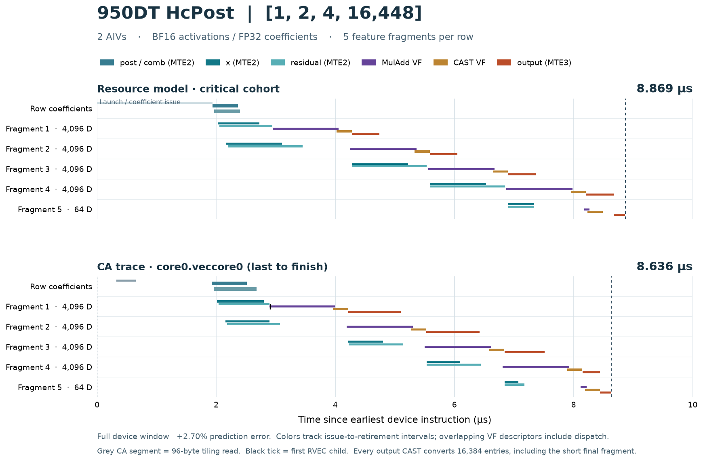
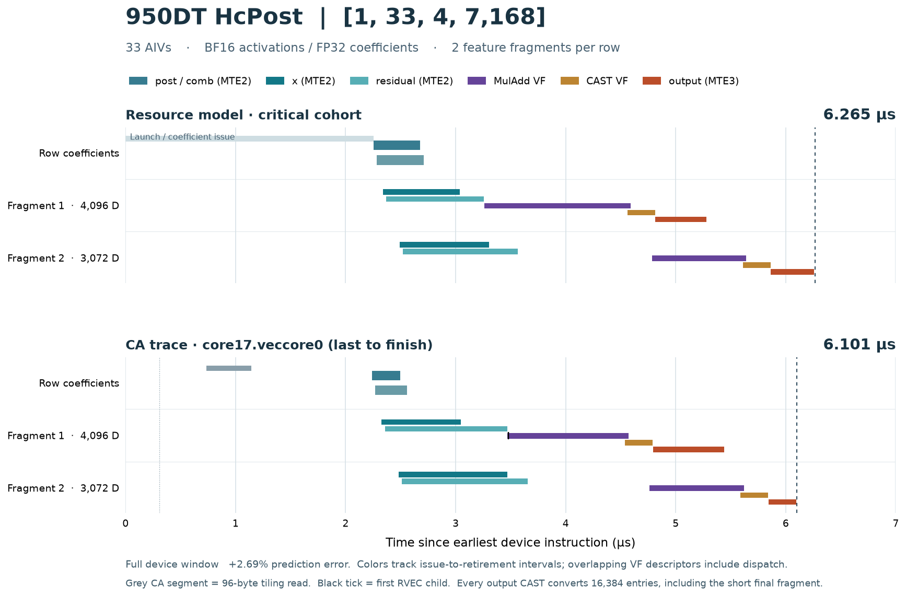

# DeepSeek 的 vLLM HcPost

DeepSeek V4.1 Flash 与 V4 Pro 的 attention 和 FFN 输出进入 `torch.ops._C_ascend.npu_hc_post`，由 vLLM Ascend 绑定调用 `aclnnHcPost`。这里使用锁定提交的 arch35 分核、核函数和生成的 ACLNN 库，通过私有 OPP 载入 CANN 9.2.1；BF16 激活搭配 FP32 post/comb。另一个可单独调用的库算子 `aclnnMhcPost` 有自己的分核和计时模型。[锁定的调用绑定](https://github.com/vllm-project/vllm-ascend/blob/c09d3e20b9c45c80b34ae3781440d90904a44023/csrc/torch_binding.cpp#L1434-L1444) · [arch35 host tiling](https://github.com/vllm-project/vllm-ascend/blob/c09d3e20b9c45c80b34ae3781440d90904a44023/csrc/moe/hc_post/op_host/hc_post_tiling_arch35.h) · [CANN MhcPost 算例](mhc_post.md)

## 从三个 token 算到张量工作量

```python
from operator_model import estimate
r = estimate("mhc_post", [1, 3, 4, 5120], {"implementation": "vllm_hc_post"},
             chip="Ascend950DT_9582", dtype="bf16")
print(r.active_aiv, r.work["vec_ops"], r.work["logical_read_bytes"], r.work["logical_write_bytes"])
# 3 552960 153840 122880
print(r.status, round(r.latency_us, 3))  # extrapolated 5.084
```

1. 输入 x 为 [1,3,5120]，残差为 [1,3,4,5120]，系数 post 为 [1,3,4]、comb 为 [1,3,4,4]。记 T=B×S 为提交的 token 数，H=4 为残差路数，D 为通道宽度。对每个 token 和输出路 j，逐通道计算 `out[j] = x × post[j] + Σᵢ residual[i] × comb[i,j]`。每个输出通道共 5 次乘和 4 次加，有效 FP32 算术量为 THD(2H+1)。例中 61,440 个 BF16 输出，共 552,960 个 FP32 算术操作，另有类型转换。
2. 逻辑读字节为 `2TD(1+H)+4T(H+H²)`，写字节为 `2THD`。2 和 4 为 BF16 与 FP32 字节数。post 和 comb 的系数在一个 token 的所有 D 分块间复用。三个 token 合计读 153,840 B、写 122,880 B。核内实际搬运还包括元数据和片上寄存器传输。
3. 每个 AIV 领取完整 token，使用 `A=min(T,AIV数)` 个核；每核 `⌊T/A⌋` 或 `⌈T/A⌉` 行。每行先读两份系数，再按源代码固定的 4096 通道拆 D。5120 拆为 4096+1024，分别搬运 x、四路残差和输出。3 个 AIV 共 6 组 D 分块、6 笔系数读、12 笔激活读和 6 笔数据写，0 次 Cube 指令。源码的尾块写回用有效元素数，BF16 转换指令按分配的整块区域执行，不能仅用有效输出字节推断整个 VF 时长。[BF16 核函数](https://github.com/vllm-project/vllm-ascend/blob/c09d3e20b9c45c80b34ae3781440d90904a44023/csrc/moe/hc_post/op_kernel/hc_post_bfloat16.h)
4. DT 与 PR 的公开设备窗口分别为 **5.122 和 5.024 µs**。两边都实际运行 3 个 AIV，61,440 个输出逐元素与 FP64 参考舍入的 BF16 位值相等。设备代码段 SHA256 一致，逐核核验物理 END、结束标记、官方时长和汇总 trace 中的同步事件。公开接口用冻结的逐片资源排程给 DT 5.084 µs、PR 5.136 µs，同一 [1,3,4,5120] 到 970DT 的外推为 4.658 µs。可从 `projection["pipeline"]` 读取首 VF、首笔与末笔写的发起周期。[DT 原始计时回执](../../results/v0.23/hc-post/Ascend950DT_9582-3-5120.json) · [PR 原始计时回执](../../results/v0.23/hc-post/Ascend950PR_957b-3-5120.json)

Flash 每卡 B8×32k 整批会给绑定传 [1,262144,4,5120]，首维 1 来自模型把本卡 token 展平后补维。DT 按 64 个 AIV 每核 4096 行，每行两块；PR 最忙核 4682 行。Pro 同样有 4 路残差，但 D=7168，每行拆成 4096+3072。970DT 在相同实现假设下按 120 个 AIV 最多分 2185 行/核。Flash [1,262144,4,5120] 的 DT、PR、970DT 预测依次为 10.660、17.188、5.211 ms。这些大 shape 的分核来自源码，尚无对应整批 HcPost CA。[可复算实现](../../operator_model/hc_post_layout.py) · [全部校准输入与源码哈希](../../results/v0.23/hc-post/development.json)

## 第五个块为何还有这么多 Vector 工作



开发样本 [1,2,4,16448] 有两个 token，各用一个 AIV。沿通道拆成 4096、4096、4096、4096、64 五片。最后一片只写 4×64 个有效 BF16；这条内核的 CAST 仍覆盖按满块分配的 4×4096 个位置。因此，相同的内存写字节数不能解释整个 VF 的时长。CA 中，从第三片开始，读 x 在前前片的输出写**发起**后两个周期发起，随后两个周期开始读残差；对应输入槽已可用。两段相邻 VF 的启动与收尾也可重叠，建模需分别计读发起、响应、转换和写出。上栏是冻结的分阶段候选，8.869 µs；下栏是正式扩展的完整 CA，8.636 µs，误差 +2.70%。这是开发回放。独立新形状另有预登记，主 API 的工作量合同保持可直接调用。[逐片时间戳](../../results/v0.23/hc-timing/dt-16448-timeline.json) · [独立与开发分列的校准结果](../../results/v0.23/hc-timing/comparison.md)

## 冻结后在 Pro 的 7168 通道上对照



[1,33,4,7168] 恰好给 33 个 AIV 各一行。第一片的读残差实际完成得更晚，MulAdd VF 的实际发起也随之后移。两片的写回在 CA 中长短不同，整窗仍只差 0.164 µs（模型 6.265，CA 6.101，+2.69%）。这是冻结后采集的独立形状。[模型与实际末核的所有起止周期](../../results/v0.23/hc-timing/dt-7168-independent.json) · [两端全量逐形结果](../../results/v0.23/hc-timing/comparison.md)

在 [1,7,4,4112] 上，两端对 115,136 个输出的逐元素 BF16 核验均有 333 个不等。最后一片只有 16 列，源码在四路输出循环内复用剩余掩码计数；按原输入模拟预计各路分别错 0、112、111、110 个元素。实测只记录错值总数。公开工具因此对短于 64 列的末片保留分核和工作量，耗时返回 `None`。对正常路径，UB 至少需要 213,184 B，MTE 字节成本可由目标卡显式端口带宽缩放；固定发起间隔与响应截距继承 950。系统可按 `projection["warnings"]` 查看具体外推条件。[掩码及逐流推导](../../results/v0.23/hc-timing/failed-tail-mask.json) · [分阶段公式、参数单位和来源](../../results/v0.23/hc-timing/method.md)

独立采集共尝试 11 种形状。首批 10 形里有 9 形双端数值合格，后续单列的 [1,9,4,4160] 刚好留下 64 列，两端也通过了完整校验。在这 10 个可用形状上，DT 的 WAPE / 最大误差是 2.72% / 5.33%，PR 为 2.90% / 5.59%。十对芯片快慢方向只命中五对，970DT 全部为外推。[原十形、补充形状及加速比](../../results/v0.23/hc-timing/comparison.md)

在 DT 上放大至 [1,1024,4,5120] 后，每个 AIV 处理 16 行。20,971,520 个输出均通过，逐核时间线及二进制性能表均只在 61/64 个核记录了 END。已观察指令从第 6,511 周期持续到第 69,519 周期；为两个端点的取整共留一个周期，完整设备时间至少为 (69,519−6,511−1)/1,650 = **38.186 µs**。按热块读响应修订的候选预测 36.884 µs，至少低估 1.302 µs（3.41%）。公开模型给出 45.169 µs，其偏差方向仍无法判断。缺失完整退休的这次采集只提供下界，正式误差表中没有使用这个数。[部分 trace 与冻结预测](../../results/v0.33/hcpost/partial.json)
