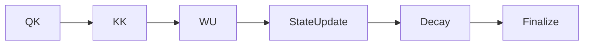

# Chunk KDA 算例

## 融合 V1 的计时资格

Kimi 的变长 T2/H1 在正式 FLA 26.10.0 重新采集。四个输出均正确，安装包和执行符号匹配，但 32 个 AIC 均在本核首次 WAIT 之前对 M→MTE1 的事件 0、1、2 重复 SET。整次有 167 条异常。观察到的 104.252 µs 仅用于定位，融合 V1 的设备性能为 N/A。显式选 FLA 26.9.1 V2 才适用下列三段校准。使用真实编译器的六组资源生命周期对照及官方版本差异见[同步与编译复核](../../results/v0.25/kda-v1/README.md)。


## 对齐到一个 head 的每个状态块


输入 [1,80,1,1,128,128]，逐块更新 128×128 状态，第二块只有 16 个有效 token。W 与 U 的生产者是 Prepare，下一块读这两份输入时有机会与前块重叠。H 来自前块的写回，因此必须等待。冻结排程把 DT 的 FwdH 从 9.411 µs 修正为 8.244 µs，独立 CA 为 7.708 µs。完整的三段分别计入，在这个输入合计为 31.751 / 30.882 µs。上栏把各阶段排到资源与依赖就绪时刻，下栏按 GM/片上地址对应每一块。970DT 仍是按配置外推。[两端逐块公式、参数和未建分支](../../results/v0.24/kda-prefetch/method.md) · [三块的 PR 图](../../results/v0.24/kda-prefetch/pr-129-fwdh.png)

默认融合 V1 在 DT 与 PR 的 T2/H1 都取得四组逐字节相同的正确回读，但两端均在相同的 42 个指令地址报重复 SET_FLAG。该库的正常利用率和时延仍缺合格测量。[数值及同步检查](../../results/v0.24/kda-v1/README.md)

输入轴顺序为 **B,T,Hq,Hv,K,V**。本例比较同一输入契约在 950DT、950PR 与假设的 970DT 上的设备指令窗口。

## 三段 V2 的冻结独立对比


同一输入 B=1、T=5、Hq=Hv=2、K=V=128。三个 kernel 各自以全核首指令为零；上方对应最忙工作组，下方各自取最后完成的物理工作组。这张历史图中 DT 的总和为 v0.23 模型 22.275 µs、CA 22.822 µs，v0.24 同形为 22.024 µs。单看总数只差约半个微秒，但 Prepare 低估 1.491 µs、FwdH 高估 0.976 µs。在 PR 上 v0.23 总预测 22.306 µs、v0.24 为 22.056 µs，CA 22.397 µs。这次 PR 实际略快，模型预计略慢。该例直接选择 V2 ABI，生产小 shape 的自动分派另见下文。[950PR 同形对照](../../results/kda-resource23/950pr-t5-holdout-comparison.png) · [DT 每段时间戳与 trace SHA](../../results/kda-resource23/950dt-t5-holdout-comparison.json)

```python
from operator_model import estimate
r = estimate("kda_chunk", [1,5,2,2,128,128], {"implementation":"fla_26_9_1_v2"},
             chip="Ascend950DT_9582", dtype="bf16")
print(r.status, r.latency_us)
for stage in r.projection["target_plan"]["stages"]:
    print(stage["family"], stage["active_aic"], stage["device_us"], stage["dma_bytes"])
```

同一源码合同还可传入 [8,32768,12,12,128,128]。DT、PR、970DT 分别给出约 33.16、39.40、16.45 ms，三者都属于未取得同形 CA 的工作负载预测，970DT 同时还有跨代外推的不确定性。[每一段公式、参数与来源](../../results/kda-resource23/modeling.md) · [独立样本和剩余误差](../../results/kda-resource23/report.md)

## Kimi 的实际分派与校准边界

FLA 26.9.1 的 A5 包同时发布融合 `aclnnChunkKdaFwd` 和三段 `aclnnChunkKdaFwdV2`。对 Kimi 默认 BF16、64-token 块与 128 维 QK/V，把每条序列在本次调用的 token 长度记作 $S_i$、本卡 value 头数记作 $H_v$，工作项数为 $H_v\sum_i\lceil S_i/64\rceil$。达到 4096 项时进入 Prepare、FwdH、Finalize 三段。B8 每条 32k、TP8 后 12 个 value 头，共 49,152 项；若每条本次只交 512 token，则为 768 项。直接调 V2 在 DT 测得 `[1,2,1,1,128,128]` 三段依次 15.281、4.739、3.221 µs，合计 23.241 µs；每段均有独立库 ELF、完整全核窗口和数值金标，下面的 V1 接口仅展示工作量。正式 FLA V1 主核到达设备任务终点，但出现重复置位，整个调用未返回四组数值金标，不能把局部主核窗标成 Kimi prefill 耗时。[发行版分派源码、实际绑定与设备记录](../../results/chunk-recovery/fla2691/report.md)

```python
from operator_model import estimate

shape = [1, 64, 2, 2, 128, 128]
attrs = {'dtype': 'bf16', 'beta_dtype': 'fp32', 'use_gate_in_kernel': True, 'output_final_state': True, 'chunk_size': 64, 'safe_gate': True, 'lower_bound': -0.03125, 'export_gk': True}
for chip in ('Ascend950DT_9582', 'Ascend950PR_957b', 'Ascend970DT'):
    r = estimate('kda_chunk', shape, attrs, chip=chip, dtype='bf16', timing_mode='auto')
    print(r.latency_us, r.status, r.active_aic, r.active_aiv, r.work)
```

## 输入到工作量

该路线调用 CANN 9.2.1 的 ops-transformer 算子族。实际调用接口为 `aclnnChunkKdaFwd`。
工作量接口给出的 Cube 操作为 20,971,520，Vector 计数为 32,768。逻辑读/写分别为 None / 262144 B。此处 None 表示缺少计数；片外实际流量须另行观测，逻辑字节不含中间层重复搬运。

## 分块、资源和关键路径

块长 64，每序列 1 块，B×Hv=1×2=2 条独立状态链。每条链的 FP32 状态为 K×V，总状态 131,072 B。实块长 L=64 时，每头保留下三角 QK 点积 L(L+1)/2、严格下三角 KK 点积 L(L−1)/2，各点积 2K 次操作。

| 阶段 | 依赖 | 资源 | 本例工作（标量等效 ops） |
|---|---|---|---:|
| qk | 输入 | cube_bf16 | 1,064,960 |
| kk | qk | cube_bf16 | 1,032,192 |
| wu | kk | cube_bf16 | 4,194,304 |
| state_update | wu | cube_bf16 | 8,388,608 |
| state_decay | state_update | vector_alu | 32,768 |
| finalize | state_decay | cube_bf16 | 6,291,456 |

其中 WU 和 finalize 是稠密等效工作。状态跨块串行；三角求逆等未取得执行级映射。依赖图可以输出，设备时间、实际分核、稳态发起间隔和计时误差均为 N/A。



[归档结构与验证证据](../../results/v0.8/cube/chunk-structure-validation.json)

## 设备时间及误差

| 平台 | 模型 (µs) | CA (µs) | 有符号误差 | 预测 AIC / AIV | CA AIC / AIV |
|---|---:|---:|---:|---|---|
| 950DT | N/A | N/A | N/A | N/A / N/A | N/A |
| 950PR | N/A | N/A | N/A | N/A / N/A | N/A |
| 970DT 外推 | N/A | N/A | N/A | N/A / N/A | N/A |

## CA 流水与模型差距

本次 PR 尝试：ValueError('process/budget: CA synchronization/instruction failure')。实际宿主开启 safe gate、lower_bound=−0.03125 并导出 GK；冻结清单遗漏了这些属性，默认门控不同。上面的结构演算采用宿主实际属性。950DT 的同类同步失败已归档。两端没有通过正确性与完整窗口检查的本例 trace；无法画出合格流水图或计算误差。

[总建模方法](../modeling-strategy.md) · [全部 shape 的误差](../error-analysis.md) · [970DT 配置与来源](../../configs/chips/Ascend970DT.json)

## Kimi-K3 prefill 的实际输入

Kimi-K3 配置给出 96 个 KDA 头、每头 128 维、gate 下界 −5。Attention TP=8 时，单卡持有 12 个头。vLLM Ascend 的 prefill 传入累计序列长度和规范顺序的 chunk 下标，读取 VK 顺序的状态。例中 q/k/v 和原始 gate 取 BF16，beta、A_log、dtBias 与状态取 FP32。Q/K 归一化在调用前完成。以上属性采用配置及前端源码核对，未包含整网实跑的 dispatch 证明。[模型配置](../../configs/models/Kimi-K3.json) · [前端源码锁](../../results/v0.20/workloads/source-lock.json)

```python
from operator_model import estimate

lengths = [32768] * 8
from itertools import accumulate
cu = [0, *accumulate(lengths)]
shape = [1, cu[-1], 12, 12, 128, 128]
attrs = dict(cu_seqlens=cu, chunk_size=64, gate_dtype="bf16", beta_dtype="fp32",
             use_gate_in_kernel=True, safe_gate=True, lower_bound=-5, dt_bias=True,
             initial_state=True, state_v_first=True, output_final_state=True, export_gk=False)
r = estimate("kda_chunk", shape, attrs, chip="Ascend950DT_9582")
print(r.status, r.latency_us, r.work["logical_read_bytes"], r.work["logical_write_bytes"])
# unavailable None 3240106032 1616904192
```

每条请求各自从 chunk 0 开始，长度为 32,768 时每条有 512 个 chunk，8 条序列共 4,096 个 chunk。12 个本地头对应 49,152 个 chunk-head 任务。状态沿每一条「请求、头」链传递，共 96 条链。对任一实际长度为 ℓ 的 chunk，将前文的 L 替换为 ℓ 后累加，这也覆盖非整块的尾段。FP32 A_log 和 dtBias 在所有请求之间共享，逻辑读中各计一次。Aqk 和 Akk 每个 token、每个头都输出两行宽 64 的 BF16 系数。表中的读写是公开张量的逻辑字节，CA 中内部转置、重读及缓存写回仍待测。

| 每卡 prefill | 累计 token | chunk-head 任务 | Cube 等效操作数 | 逻辑读 B | 逻辑写 B |
|---|---:|---:|---:|---:|---:|
| 8 × 32k | 262,144 | 49,152 | 515,396,075,520 | 3,240,106,032 | 1,616,904,192 |
| 8 × 128k | 1,048,576 | 196,608 | 2,061,584,302,080 | 12,941,531,184 | 6,448,742,400 |
| 8 × 256k | 2,097,152 | 393,216 | 4,123,168,604,160 | 25,876,764,720 | 12,891,193,344 |

以 8 × 32k 为例，令 T=262,144 为累计 token 数，H=12 为本地头数，K=V=128，C=64。Q、K、V 合计读入 6THK=2,415,919,104 B；BF16 gate 占 2THK=805,306,368 B，FP32 beta 占 4TH=12,582,912 B。共享 A_log、dtBias 合计 4H(1+K)=6,192 B，8 条序列各自的初始状态合计 4×8×H×K×V=6,291,456 B，五项之和为 3,240,106,032 B。输出 O 占 2THV=805,306,368 B，两个三角输出的分配形状均为 [1,H,T,C]，合计 4THC=805,306,368 B，最终状态占 6,291,456 B。

每个 shape 用相同的 API 在三张卡的配置上各查询一次。工作量计算按不同请求长度汇总，无需遍历每个 token。设备时延、CA 误差和 970DT 加速比仍为 N/A。[含逐次墙钟的计算结果](../../results/v0.21/chunk/kimi-workloads.json)

### 950PR 指令证据

下图取先前固定长度、FP32 raw gate、2 个头的失败对照。主 kernel 的 core0.cubecore0 在第 15,781 至 15,787 周期将事件 0、1、2 发给 MTE1，在第 32,080 至 32,085 周期又发了一遍。两个 SET 之间该 core 的退休指令记录中没有同管线对、同 ID 的 WAIT。三个报错 PC 均与原始 SET 记录一致。ELF 未提供源码行，现有证据无法把故障归因到某一行 kernel 源码。该例只有辅助转置成功，主 kernel 的计时与数值正确性均未通过。下图的横轴表示留存的部分周期。[指令、ELF 与日志摘要](../../results/v0.21/chunk/pr-flag-audit.json)


同一固定长度对照在 950DT compact 采集中也报出了完全相同的三个 PC；主 kernel 数据库有表结构，已提交的指令行数为 0。950PR 的原始退休记录及安装包对应的 ELF 代码段 SHA-256 一致。Kimi 上游的 BF16 raw gate 与 FP32 gate 在安装包中有不同 dispatch 名，但在 FP32 beta 条件下两份 ELF 的整个代码段逐字节一致；具体控制流还由调用参数和 tiling 决定。上述固定长度证据不能替代 Kimi 变长合同的计时。[双端对照与二进制哈希](../../results/v0.21/chunk/pr-flag-audit.json)

对 Kimi-K3 的 12 头 BF16 gate 合同，新的 950DT/PR 尝试分别用了 1,802.0/1,755.6 秒。DT 记录到两个完整辅助窗口 3.674 和 6.558 µs；PR 只记录到第一个转置。两个主算子都没有取得数值校验和完整窗口。另一个 DT 单 token 尾块在主算子中复现重复 SET。这些采集在误差表计为 0 个合格样本。[逐次合同与终态](../../results/v0.21/chunk/report.md)

## 为什么 CA 栏只有失败前的事件

在 950PR 的 BF16 MIX 主核中，退休记录显示 AIC 对同一 M→MTE1 本地事件重复发出 SET，直至停止都没有完整的 MMAD 窗口。图下栏的短段可以定位同步异常，无法用于校准整算子耗时。包内核名、ELF 身份、已退休指令与静态反汇编分别保留；950DT 的 FP16 generic 分支在登记的 25 分钟内报告 116 次重复 SET，涉及 25 个 PC，缺少数值回执与完整设备窗。[二进制、源码版本及跨分派核查](../../results/chunk-recovery/report.md)

最终两份冻结清单共 10 个不同 shape，DT 的 WAPE / 最大为 3.84% / 7.87%，PR 为 2.48% / 6.99%。T=129、H=3 时有三个时间块，DT 与 PR 的 CA 分别为 34.128 和 34.527 µs。十对 DT/PR 比值的 WAPE 为 1.88%，快慢方向只命中 4 对。该误差统计适用于显式三段 V2 的实测域；B8×长上下文仍为外推。[完整逐形设备与指令窗](../../results/kda-v23/mechanisms.md)


FwdH 在 head 2 的工作组上依次处理 64、64、1 个有效 token。两次 32,768 B 中间状态写入后，下一块的状态读取命中相同 GM 地址。末块 MMAD 的有效行与物理发射几何不同。图中 v0.23 的 FwdH 为 13.329 µs，CA 11.079 µs（+20.3%）；v0.24 重排后为 11.459 µs（+3.4%）；全算子还包含 Prepare 和 Finalize。图只复用已归档的独立窗口。[每一块的真实地址、队列、指令与设备时钟](../../results/v0.23/kda-multiblock/950pr-t129-h3-fwdh.json)
