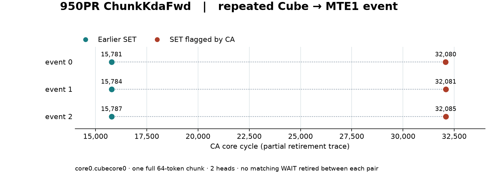

# Chunk KDA 算例

输入轴顺序为 **B,T,Hq,Hv,K,V**。本例比较同一输入契约在 950DT、950PR 与假设的 970DT 上的设备指令窗口。

```python
from operator_model import estimate

shape = [1, 64, 2, 2, 128, 128]
attrs = {'dtype': 'bf16', 'beta_dtype': 'fp32', 'use_gate_in_kernel': True, 'output_final_state': True, 'chunk_size': 64, 'safe_gate': True, 'lower_bound': -0.03125, 'export_gk': True}
for chip in ('Ascend950DT_9582', 'Ascend950PR_957b', 'Ascend970DT'):
    r = estimate('kda_chunk', shape, attrs, chip=chip, dtype='bf16', timing_mode='auto')
    print(r.latency_us, r.status, r.active_aic, r.active_aiv, r.work)
```

## 输入到工作量

该路线调用 CANN 9.2.1 的 ops-transformer 算子族。实际调用接口为 `aclnnChunkKdaFwd`。
工作量接口给出的 Cube 操作为 20,971,520，Vector 计数为 32,768。逻辑读/写分别为 None / 262144 B。此处 None 表示缺少计数；片外实际流量须另行观测，逻辑字节不含中间层重复搬运。

## 分块、资源和关键路径

块长 64，每序列 1 块，B×Hv=1×2=2 条独立状态链。每条链的 FP32 状态为 K×V，总状态 131,072 B。实块长 L=64 时，每头保留下三角 QK 点积 L(L+1)/2、严格下三角 KK 点积 L(L−1)/2，各点积 2K 次操作。

| 阶段 | 依赖 | 资源 | 本例工作（标量等效 ops） |
|---|---|---|---:|
| qk | 输入 | cube_bf16 | 1,064,960 |
| kk | qk | cube_bf16 | 1,032,192 |
| wu | kk | cube_bf16 | 4,194,304 |
| state_update | wu | cube_bf16 | 8,388,608 |
| state_decay | state_update | vector_alu | 32,768 |
| finalize | state_decay | cube_bf16 | 6,291,456 |

其中 WU 和 finalize 是稠密等效工作。状态跨块串行；三角求逆等未取得执行级映射。依赖图可以输出，设备时间、实际分核、稳态发起间隔和计时误差均为 N/A。


[归档结构与验证证据](../../results/v0.8/cube/chunk-structure-validation.json)

## 设备时间及误差

| 平台 | 模型 (µs) | CA (µs) | 有符号误差 | 预测 AIC / AIV | CA AIC / AIV |
|---|---:|---:|---:|---|---|
| 950DT | N/A | N/A | N/A | N/A / N/A | N/A |
| 950PR | N/A | N/A | N/A | N/A / N/A | N/A |
| 970DT 外推 | N/A | N/A | N/A | N/A / N/A | N/A |

## CA 流水与模型差距

本次 PR 尝试：ValueError('process/budget: CA synchronization/instruction failure')。实际宿主开启 safe gate、lower_bound=−0.03125 并导出 GK；冻结清单遗漏了这些属性，默认门控不同。上面的结构演算采用宿主实际属性。950DT 的同类同步失败已归档。两端没有通过正确性与完整窗口检查的本例 trace；无法画出合格流水图或计算误差。

[总建模方法](../modeling-strategy.md) · [全部 shape 的误差](../error-analysis.md) · [970DT 配置与来源](../../configs/chips/Ascend970DT.json)

## Kimi-K3 prefill 的实际输入

Kimi-K3 配置给出 96 个 KDA 头、每头 128 维、gate 下界 −5。Attention TP=8 时，单卡持有 12 个头。vLLM Ascend 的 prefill 传入累计序列长度和规范顺序的 chunk 下标，读取 VK 顺序的状态。例中 q/k/v 和原始 gate 取 BF16，beta、A_log、dtBias 与状态取 FP32。Q/K 归一化在调用前完成。以上属性采用配置及前端源码核对，未包含整网实跑的 dispatch 证明。[模型配置](../../configs/models/Kimi-K3.json) · [前端源码锁](../../results/v0.20/workloads/source-lock.json)

```python
from operator_model import estimate

lengths = [32768] * 8
from itertools import accumulate
cu = [0, *accumulate(lengths)]
shape = [1, cu[-1], 12, 12, 128, 128]
attrs = dict(cu_seqlens=cu, chunk_size=64, gate_dtype="bf16", beta_dtype="fp32",
             use_gate_in_kernel=True, safe_gate=True, lower_bound=-5, dt_bias=True,
             initial_state=True, state_v_first=True, output_final_state=True, export_gk=False)
r = estimate("kda_chunk", shape, attrs, chip="Ascend950DT_9582")
print(r.status, r.latency_us, r.work["logical_read_bytes"], r.work["logical_write_bytes"])
# unavailable None 3240106032 1616904192
```

每条请求各自从 chunk 0 开始，长度为 32,768 时每条有 512 个 chunk，8 条序列共 4,096 个 chunk。12 个本地头对应 49,152 个 chunk-head 任务。状态沿每一条「请求、头」链传递，共 96 条链。对任一实际长度为 ℓ 的 chunk，将前文的 L 替换为 ℓ 后累加，这也覆盖非整块的尾段。FP32 A_log 和 dtBias 在所有请求之间共享，逻辑读中各计一次。Aqk 和 Akk 每个 token、每个头都输出两行宽 64 的 BF16 系数。表中的读写是公开张量的逻辑字节，CA 中内部转置、重读及缓存写回仍待测。

| 每卡 prefill | 累计 token | chunk-head 任务 | Cube 等效操作数 | 逻辑读 B | 逻辑写 B |
|---|---:|---:|---:|---:|---:|
| 8 × 32k | 262,144 | 49,152 | 515,396,075,520 | 3,240,106,032 | 1,616,904,192 |
| 8 × 128k | 1,048,576 | 196,608 | 2,061,584,302,080 | 12,941,531,184 | 6,448,742,400 |
| 8 × 256k | 2,097,152 | 393,216 | 4,123,168,604,160 | 25,876,764,720 | 12,891,193,344 |

以 8 × 32k 为例，令 T=262,144 为累计 token 数，H=12 为本地头数，K=V=128，C=64。Q、K、V 合计读入 6THK=2,415,919,104 B；BF16 gate 占 2THK=805,306,368 B，FP32 beta 占 4TH=12,582,912 B。共享 A_log、dtBias 合计 4H(1+K)=6,192 B，8 条序列各自的初始状态合计 4×8×H×K×V=6,291,456 B，五项之和为 3,240,106,032 B。输出 O 占 2THV=805,306,368 B，两个三角输出的分配形状均为 [1,H,T,C]，合计 4THC=805,306,368 B，最终状态占 6,291,456 B。

每个 shape 用相同的 API 在三张卡的配置上各查询一次。工作量计算按不同请求长度汇总，无需遍历每个 token。设备时延、CA 误差和 970DT 加速比仍为 N/A。[含逐次墙钟的计算结果](../../results/v0.21/chunk/kimi-workloads.json)

### 950PR 指令证据

下图取先前固定长度、FP32 raw gate、2 个头的失败对照。主 kernel 的 core0.cubecore0 在第 15,781 至 15,787 周期将事件 0、1、2 发给 MTE1，在第 32,080 至 32,085 周期又发了一遍。两个 SET 之间该 core 的退休指令记录中没有同管线对、同 ID 的 WAIT。三个报错 PC 均与原始 SET 记录一致。ELF 未提供源码行，现有证据无法把故障归因到某一行 kernel 源码。该例只有辅助转置成功，主 kernel 的计时与数值正确性均未通过。下图的横轴表示留存的部分周期。[指令、ELF 与日志摘要](../../results/v0.21/chunk/pr-flag-audit.json)



同一固定长度对照在 950DT compact 采集中也报出了完全相同的三个 PC；主 kernel 数据库有表结构，已提交的指令行数为 0。950PR 的原始退休记录及安装包对应的 ELF 代码段 SHA-256 一致。Kimi 上游的 BF16 raw gate 与 FP32 gate 在安装包中有不同 dispatch 名，但在 FP32 beta 条件下两份 ELF 的整个代码段逐字节一致；具体控制流还由调用参数和 tiling 决定。上述固定长度证据不能替代 Kimi 变长合同的计时。[双端对照与二进制哈希](../../results/v0.21/chunk/pr-flag-audit.json)

对 Kimi-K3 的 12 头 BF16 gate 合同，新的 950DT/PR 尝试分别用了 1,802.0/1,755.6 秒。DT 记录到两个完整辅助窗口 3.674 和 6.558 µs；PR 只记录到第一个转置。两个主算子都没有取得数值校验和完整窗口。另一个 DT 单 token 尾块在主算子中复现重复 SET。这些采集在误差表计为 0 个合格样本。[逐次合同与终态](../../results/v0.21/chunk/report.md)
