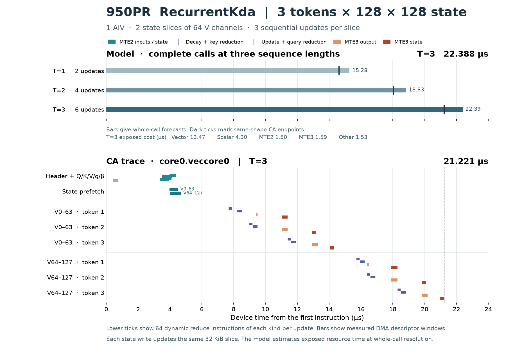
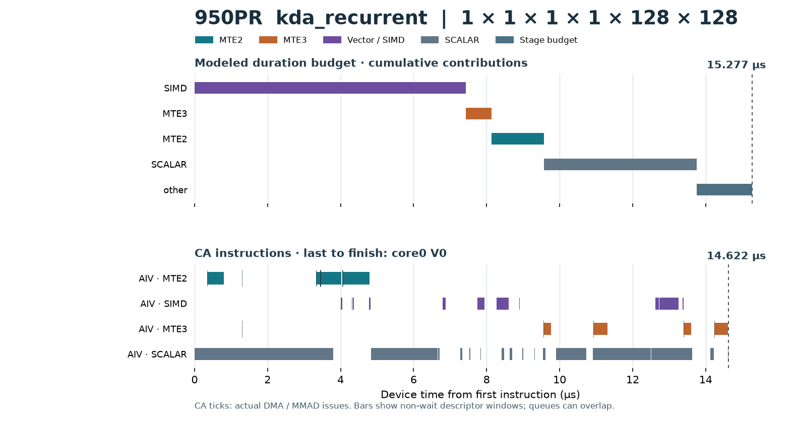
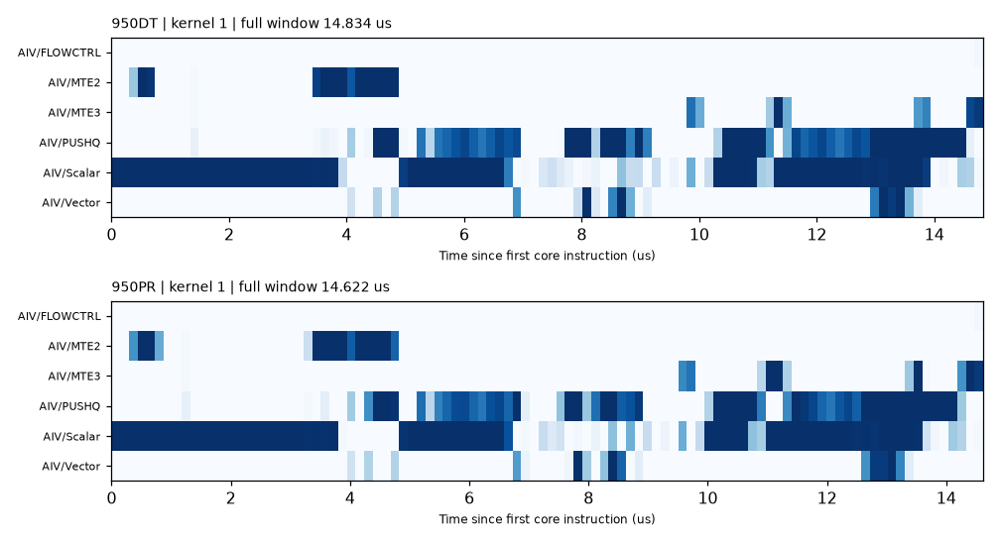

# Recurrent KDA 算例

## 三个 token 怎样更新两个状态半片



[B,T,Hq,Hv,K,V]=[1,3,1,1,128,128] 使用一个 AIV。上栏给出 T=1、2、3 各自完整的预测，T=3 预测 22.388 µs，实测 21.221 µs。下栏按 V 方向的两个 64 列状态半片，再按三个 token 展开。读取的两个状态片各为 32 KiB；六笔状态写回比接口逻辑输出多 128 KiB。这个差额是 DMA 描述符负载，实际进入 HBM 的字节量还取决于缓存。模型给出了各资源的耗时预算，六次更新的实测发起位置可以用来检验下一步的逐步预测。[状态地址、归约指令与全部校验](../../results/v0.21/recurrent-example/report.md)


## 模型与实际库流水对照



本卡 shape 为 `[1, 1, 1, 1, 128, 128]`，950PR 模型 **15.277 µs**，完整 CA **14.622 µs**，有符号误差 +4.48%。上栏画出当前预测器能够辨识的阶段时长。只返回一个阶段的路线保留整段预测；多个暴露阶段按贡献累计，模型尚未辨识它们的具体指令发起点。下栏用实际库 trace 的最后完成核逐队列展开，黑色刻度来自真实 DMA 或 MMAD 发起。 [图上每段的时间与 trace 指纹](../../results/v0.20/examples/kda_recurrent-pr.json)

输入轴顺序为 **B,T,Hq,Hv,K,V**。本例比较同一输入契约在 950DT、950PR 与假设的 970DT 上的设备指令窗口。

```python
from operator_model import estimate

shape = [1, 1, 1, 1, 128, 128]
attrs = {'layout': 'BSND', 'dtype': 'BF16', 'gate_dtype': 'FP32', 'state_dtype': 'FP32', 'state_v_first': False, 'use_gate_in_kernel': False, 'chunk_size': None, 'output_final_state': True, 'export_gk': False}
for chip in ('Ascend950DT_9582', 'Ascend950PR_957b', 'Ascend970DT'):
    r = estimate('kda_recurrent', shape, attrs, chip=chip, dtype='BF16', timing_mode='auto')
    print(r.latency_us, r.status, r.active_aic, r.active_aiv, r.work)
```

## 输入到工作量

该路线调用 CANN 9.2.1 的 ops-transformer 算子族。实际调用接口为 `aclnnRecurrentKda`。
工作量接口给出的 Cube 操作为 0，Vector 计数为 114,944。逻辑读/写分别为 66820 / 65792 B。此处 None 表示缺少计数；片外实际流量须另行观测，逻辑字节不含中间层重复搬运。

## 分块、资源和关键路径

一条状态链占一个 AIV。每 token 更新 128×128 状态，1 个 token 顺序执行。128×128 作为一个工作单位，U=1×128×128/16384=1。除 arrival=log₂(1)=0，计算和控制阶段都用 U，搬运用 U·log₂(1+1)=U。

三个 DT 开发 DB 取临界 AIV 暴露时间，分别拟合非负截距 a 和斜率 b；a 单位 µs，b 单位 µs/状态工作单位，arrival 用 µs/log₂(核数)。此模型的截距包含在整次调用内，只支付一次。来源 results/v0.8/vector/profile.json。

| 阶段 | a µs | b µs/单位 | X | a+bX µs |
|---|---|---|---|---|
| arrival | 0.00000 | 0.00000 | 0.00000 | 0.00000 |
| SCALAR | 4.11182 | 0.06377 | 1.00000 | 4.17558 |
| SIMD | 4.30242 | 2.93740 | 1.00000 | 7.23983 |
| MTE2 | 1.41485 | 0.02602 | 1.00000 | 1.44087 |
| MTE3 | 0.24121 | 0.44823 | 1.00000 | 0.68944 |
| other | 1.52586 | 0.00000 | 1.00000 | 1.52586 |

970DT 的算子实现与分片延用 DT 模板。先算 DT 各段的暴露时间，共 15.07157 µs。设备配置取 configs/chips/Ascend970DT.json。目标有 120 个 AIV、1.8 GHz，本例预计用 1 核。控制与到达按频率比 1.65/1.8=0.91667；SIMD 按实际 dtype 的每核峰值比及波数，倍率 0.91553。

每次调用逻辑总读写 132612 B，芯片级带宽占比代理 p=min(1,132612/(1000×4000×15.07157))=0.00220。MTE2/MTE3 倍率是 (1−p)×局部价格比+p×4000/14400，得到 0.91526/0.91526；局部部分在未指定两端 MTE 速率时取频率比×波数比。该项使用全片逻辑读写量作代理。

| 阶段 | DT 暴露 µs | 目标价格倍率 | 970 外推 µs |
|---|---|---|---|
| arrival | 0.00000 | 0.91667 | 0.00000 |
| SCALAR | 4.17558 | 0.91667 | 3.82762 |
| SIMD | 7.23983 | 0.91553 | 6.62826 |
| MTE2 | 1.44087 | 0.91526 | 1.31877 |
| MTE3 | 0.68944 | 0.91526 | 0.63102 |
| other | 1.52586 | 0.91667 | 1.39870 |

六段相加得到 DT 15.07157 µs、970DT 13.80437 µs。arrival 是最晚结束核的到达偏移，other 是未归入已知流水的区间；DT 原始重叠已按 SIMD→MTE3→MTE2→SCALAR 唯一归属，合计时只算一次。

## 设备时间及误差

| 平台 | 模型 (µs) | CA (µs) | 有符号误差 | 预测 AIC / AIV | CA AIC / AIV |
|---|---:|---:|---:|---|---|
| 950DT | 15.07157 | 14.83394 | +1.60% | N/A / 1 | 0 / 1 |
| 950PR | 15.27701 | 14.62242 | +4.48% | 0 / 1 | 0 / 1 |
| 970DT 外推 | 13.80437 | N/A | N/A | 0 / 1 | N/A |

DT/PR 加速比取同形耗时之比，模型 0.9866×，CA 1.0145×。正时延误差为高估。

**950DT CA**　msopprof official full trace，角色 new paired DT CA；核名 `RecurrentKda_06bba6860f70bfd6aa54df1d4ed1928e_0`。该宿主的数值检查共 3 组；子算子切片共享宿主检查。各设备窗以最早到最晚核指令计，多 kernel 取串行窗之和。

**950PR CA**　msopprof official full trace，角色 frozen PR holdout；核名 `RecurrentKda_06bba6860f70bfd6aa54df1d4ed1928e_0`。该宿主的数值检查共 3 组；子算子切片共享宿主检查。各设备窗以最早到最晚核指令计，多 kernel 取串行窗之和。

## CA 流水与模型差距



横轴为每次 kernel 自身的设备时间，两端各自从零开始。每种核取最晚结束的一个核。每行按该队列有效指令区间的并集着色，100 个等宽时间格，深蓝表示格内占满。不同队列可重叠，行长不能相加。DMA/FIX 行表示描述符的在途窗口，可能包含等待依赖的时间；颜色深度不能直接换算 HBM 总线利用率。

950DT 第 1 段 14.8339 µs；所选核上占用最长的队列为 AIV/Scalar 9.7545 µs、AIV/PUSHQ 6.9442 µs、AIV/MTE2 1.8042 µs。
950PR 第 1 段 14.6224 µs；所选核上占用最长的队列为 AIV/Scalar 9.6685 µs、AIV/PUSHQ 6.8624 µs、AIV/MTE2 1.9000 µs。

PR 的模型与 CA 相差 +0.6546 µs。时序状态更新串行，关键核 Vector 和标量控制不随整芯片核数成比例加速。上图给出可观测的队列活动；一次端到端差值无法唯一分摊到这些因素。

[总建模方法](../modeling-strategy.md) · [全部 shape 的误差](../error-analysis.md) · [970DT 配置与来源](../../configs/chips/Ascend970DT.json)

## Kimi decode：1,536 条独立状态链（v0.31 冻结外推）

**调用合同。** Kimi K3 的线性注意力有 96 个头、每头 128 维，attention TP8 后每卡有 12 个头。单卡 B128、每请求校验 1 个 token 时，shape 为 `[128,1,12,12,128,128]`，依次是 B/S/Hq/Hv/K/V。这个算例只对 `aclnnRecurrentKda` 的稠密 BSND 入口计时：BF16 Q/K/V、预激活 FP32 gate、FP32 beta 和 KV 顺序的 FP32 状态，返回 BF16 attention 与 FP32 最终状态。Kimi serving 的分页状态、gather/scatter、VK 转置和融合 gate 不在这个时间内。这个入口的 S 上限是 8；开 MTP 8 的主模型 Q9 需要确认实际路由。

```python
from operator_model import estimate_recurrent_chains

r = estimate_recurrent_chains([128, 1, 12, 12, 128, 128], chip="Ascend950PR_957b")
# r['latency_us'] 是条件外推；r['work'] 给出向量操作和逻辑字节，
# r['active_aiv']、r['chains_per_busiest_aiv']、r['tiling'] 解释如何分配。
```

1. **算工作、分核。** 每个 `(batch,value head)` 更新一块独立的 `128×128` 状态，共 `J=128×12=1536` 条。每个 token 的主要递推工作为 `7KV+2V`，整卡 176,553,984 个计入的 FP32 向量操作；非线性门、寻址和控制另计。已安装 arch35 设备循环按 `core_id + j × block_dim` 依次取链；公开同代宿主参考的 A5 分支取 `A=min(J,目标 AIV 数)`。最忙核 `W=ceil(J/A)` 条。DT 的 64 个核每核 24 条；PR 的 56 个核中，24 个核各 28 条，另 32 个核各 27 条。970DT 假设保留同一策略，120 核中有 96 个核各 13 条，其余各 12 条。
2. **由 UB 决定怎样切状态。** 宿主的计算以字节计：把头数、K、V 对齐到 16 得到 `h=16,k=v=128`；原始输入/标量/保留区 `F=8(8k+2v)+8×4h+64+2048=12864`，完整工作区 `U=F+8(4v+12k+4h)=29760`。8 是该实现预留的最大 token 步数，不是本例的 S。试 `(状态输出,attention 输出)` 队列深度 `(1,1)/(1,2)/(2,2)`；每列还需 `4k(2+1+状态输出深度)+2×attention输出深度+(4k+8)` 字节，分别对应两个输入状态槽、KV 转置槽、状态输出槽、BF16 attention 输出与计算临时空间。用 `UB-U` 除以每列字节、向下对齐 16，按最少轮次/最大队列深度/最大列片排序，再平分 V，得到每核两块 64 列、输出队列深度各 2。每条链的两块各顺序执行 S 个 token；已安装的循环还允许前一条链提前发下一条链的**第一块**状态读。改变 UB 使这些槽位或分块不同，接口返回几何信息和 `unpriced_tiling`，不复用这个价格。
3. **把一次性与反复工作分开。** 闭式近似为 `T=max(P + W×(T₁−P−D) + D, T_mem)`，单位 µs。`T₁` 是同一目标、同一 S 的单链参考流水，DT 15.072、PR 15.277、970DT 13.804；其 Vector 价格按每核吞吐，标量按频率迁移。`P=5650/(1000 f)`、`D=10/(1000 f)`，`f` 为 GHz。5650 是 DT 单链完整 trace 从首指令到第一个 beta 搬运发起的周期数；10 是最后一次状态写描述符结束到最后指令的周期数。`T₁−P−D` 给出每条额外链的初始估计，DT 11.641、PR 11.847、970DT 10.660 µs。**这里有不可辨识性：** 5650 周期包含首条任务准备，不一定全部只发生一次。所以同时把 `P` 改到元数据搬运完成的 1218 周期，或把每次换链能隐藏的首个状态搬运取 `0…887` 周期来检查敏感性。887 是单链 DT 第一块状态读的描述符长度，不是已测得的多链节省。950PR 单链对应四个里程碑实际是 5502、10、1329、871 周期；这组仅用来检查可迁移性。敏感性范围**不是**时间上下界或置信区间。
4. **独立检查共享带宽。** 冷读/最终写排至 HBM 的情景，本例读 102,635,520 B（含 100,663,296 B 初始状态），写 101,056,512 B。两端的状态读写不是每个核每轮都享有整卡峰值。整卡服务下界 `T_mem=(r×读字节+w×写字节)/(1000×η×目标 HBM GB/s)` 与端到端本地路径取 `max`，不会把能重叠的 DMA、启动和排空再加一遍。`r,w∈[0,1]` 是访问外存的比例、`η∈(0,1]` 是可达到带宽占峰值的比例；无观测时展示 `r=w=η=1` 的条件值，并可显式改变。对 S>1，向 GM 的状态写描述符可能反复覆盖同一地址，不能据此认定每次落 HBM。模型没有把 HBM 情景当作实测 HBM 字节或证明其为瓶颈。未识别的核间发起偏移、L2/端口竞争、布局/库变更会影响结果。

| 平台 | 最忙核链数 | 冷 HBM 服务情景 (µs) | 重付每轮冷启动 (µs) | 改为只付一次 (µs) | 机制敏感性 (µs) | B128 完整 CA |
|---|---:|---:|---:|---:|---:|---|
| 950DT | 24 | 50.92 | 361.72 | 282.82 | 270.46–344.60 | 见下方冻结对照；登记时 N/A |
| 950PR | 28 | 145.49 | 427.76 | 335.14 | 320.62–407.66 | 登记时 N/A |
| 970DT | 13 | 14.15 | 179.46 | 141.72 | 135.81–171.27 | 无 CA，外推 |

以上数值对应普通 `estimate("kda_recurrent", shape, chip=...)` 的多链外推，也可用 `estimate_recurrent_chains` 查看驻留与带宽敏感性；没有用多链数据拟合，也不能用单链的误差证明多链准确。B128 的 DT/PR 采集沿用已经登记的大形任务，新加的唯一诊断形状是 B6/H12（72 链）：DT 有 8 个核处理两条链、PR 有 16 个核处理两条链，其余每核只有一条，可在同一 kernel 里从 beta 命令的次数与相邻发起间隔区分“冷启动”和“下一轮”。单核算例的实测图只演示单链流水，没有拿它代替多链 CA。

[目标芯片冻结、带宽情景和查询开销](../../results/v0.31/recurrent/freeze.json) · [按形状与芯片列出的预测及合格 CA](../../results/v0.31/recurrent/score.json) · [真实库/开源源文件与核验口径](../../results/v0.31/recurrent/method.md)

系统仿真器使用普通 `estimate("kda_recurrent", shape, chip=...)` 时，该多链合同在 `auto`/`resource` 返回同一数值并标记 `extrapolated`；`calibrated` 模式不返回多链时长。单次预测为上面冻结表中首次 0.20–2.32 ms、热态中位数 0.16–0.21 ms（同进程；不含 CANN 或 CA），并未枚举 1,536 条链。
