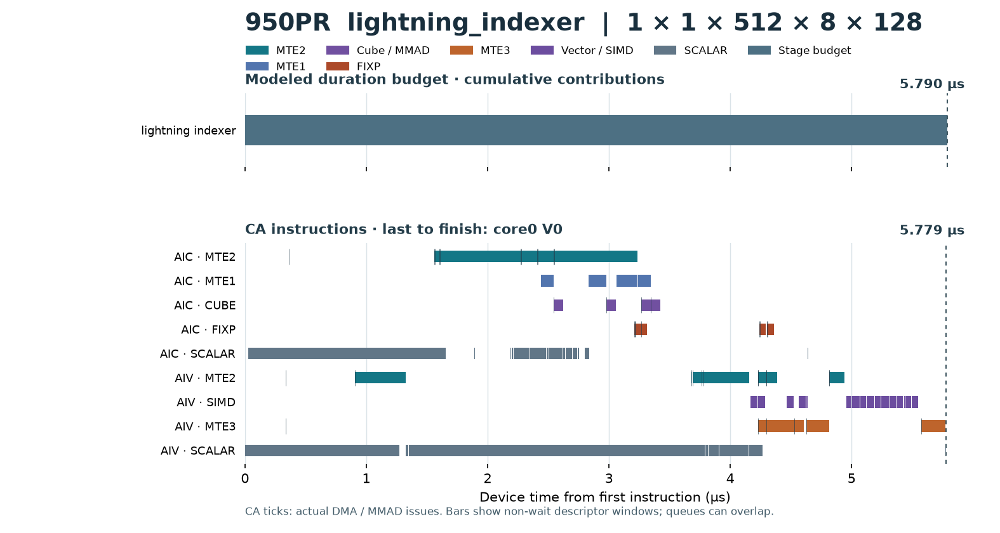
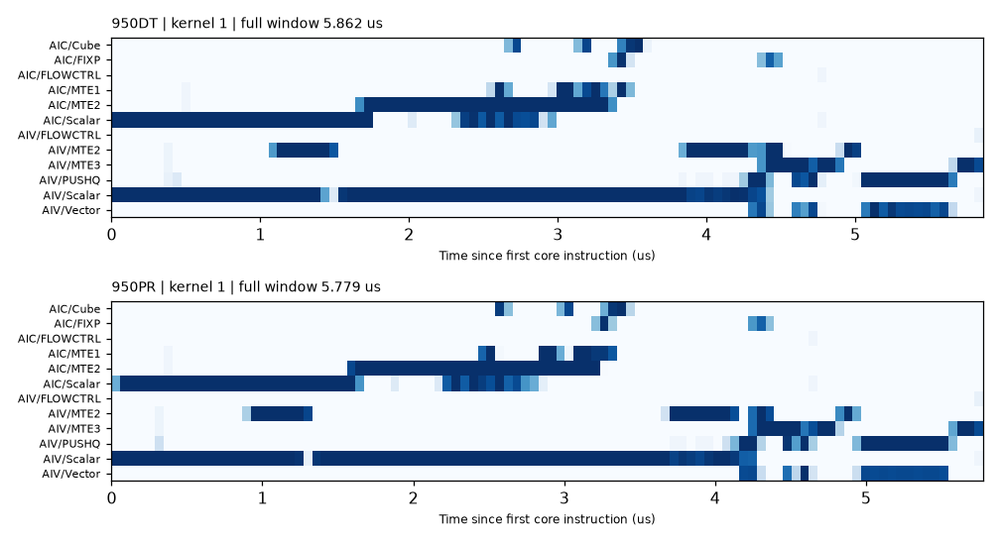

# Lightning Indexer 算例

## 模型与实际库流水对照



本卡 shape 为 `[1, 1, 512, 8, 128]`，950PR 模型 **5.790 µs**，完整 CA **5.779 µs**，有符号误差 +0.20%。上栏画出当前预测器能够辨识的阶段时长。只返回一个阶段的路线保留整段预测；多个暴露阶段按贡献累计，模型尚未辨识它们的具体指令发起点。下栏用实际库 trace 的最后完成核逐队列展开，黑色刻度来自真实 DMA 或 MMAD 发起。 [图上每段的时间与 trace 指纹](../../results/v0.20/examples/lightning_indexer-pr.json)

输入轴顺序为 **B,Q,KV,查询头数,D**。本例比较同一输入契约在 950DT、950PR 与假设的 970DT 上的设备指令窗口。

```python
from operator_model import estimate

shape = [1, 1, 512, 8, 128]
attrs = {'dtype': 'bf16', 'layout': 'BSND', 'sparse_count': 512, 'sparse_mode': 3, 'return_values': False}
for chip in ('Ascend950DT_9582', 'Ascend950PR_957b', 'Ascend970DT'):
    r = estimate('lightning_indexer', shape, attrs, chip=chip, dtype='bf16', timing_mode='auto')
    print(r.latency_us, r.status, r.active_aic, r.active_aiv, r.work)
```

## 输入到工作量

该路线调用 CANN 9.2.1 的 ops-transformer 算子族。实际调用接口为 `aclnnLightningIndexer`。
工作量接口给出的 Cube 操作为 1,048,576，Vector 计数为 11,776。逻辑读/写分别为 133136 / 2048 B。此处 None 表示缺少计数；片外实际流量须另行观测，逻辑字节不含中间层重复搬运。

## 分块、资源和关键路径

该例为 `lightning_indexer[1, 1, 512, 8, 128]`，dtype=bf16，属性 `{'layout': 'BSND', 'sparse_count': 512, 'sparse_mode': 3, 'return_values': False}`。右下对齐因果掩码覆盖 512 个有效 Q/K 对；点积 2×512×8×128。8 个头分别执行 ReLU 与乘权，求和还需 7 次加法；每对合计 23 次向量通道运算。有用 Cube 运算 {'bf16': 1048576}、Vector 运算 {'fp32': 11776} （FMA 算 2），逻辑读/写 133136/2048 B。字节数不含缓存重读。

DT 为 32/64 个 C/V 核、1.65 GHz，970 为 120/120、1.8 GHz。对固定参考库路线，计算价用每核峰值比 × 目标/参考波数比；控制价用时钟比 1.65/1.8=0.91667。搬运价=(1−p)·本地价+p·4000/14400，缺 MTE 带宽时用时钟与波数作本地价。只有 Cube/Vector 总峰值且可比时才用其比值；混合 dtype 以各自工作量加权。该路线没有直接定价 970 的 L2 命中或重新编译 tiling；970 时间是 DT 阶段模板外推，不是独立的目标硬件资源仿真。

**lightning_indexer：从输入到阶段净时延**

Q=1 路、每路 8 个 Query 头，头维 128，KV 长度 512。DT 调度波 w=⌈1/32⌉=1，读/矩阵按 ⌈512/128⌉=4 块，top512 按 ⌈512/512⌉=1 块；Cube 代理 w·⌈L/128⌉·⌈G/16⌉，SIMD 代理 w·⌈L/512⌉。未建模依赖数据值的 top-k 比较路径。

本例工作代理按 `CUBE / SIMD / MTE1 / MTE2 / MTE3 / FIXP / SCALAR / IDLE` 排列为 `4, 1, 4, 4, 1, 1, 1, 1`。SCALAR/IDLE 按波计。这是队列工作单位，而非有用运算数。

分配代理 Cube/Vector jobs=1/2，Cube 波 1→1，Vector 波 1→1；970 活跃核代理 (C,V)=(1, 2)。逻辑读写 135184 B，阶段 DT 时间 5.77121 µs，外存权重 p=min(1,135184/(1000×4000×5.77121))=0.00586。目标时价系数 `CUBE / SIMD / MTE1 / MTE2 / MTE3 / FIXP / SCALAR / IDLE` = `0.91525 / 0.91553 / 0.91667 / 0.91293 / 0.91293 / 0.91667 / 0.91667 / 0.91667`。 cube 参考/目标每核峰值比（整片 TOPS÷同类核数）：bf16 (432/32)/(1770/120)=0.91525。 vector 参考/目标每核峰值比（整片 TOPS÷同类核数）：fp32 (27/64)/(55.296/120)=0.91553。

对每个 DT 参考 trace 的每个核，把队列活动集合不变的时间段记作 (S,h)，其中 h 是实测微秒。设 U 是本例的队列工作、U₀ 是表中参考工作，f 是上面目标时价（DT 时全取 1）。一个时间段耗时 h·max(q∈S){Uq/U₀q·fq}；同一核逐段相加、同一模板取最晚核、多个模板取中位数，偶数个取中间两值的平均。以下是实际参与该次计算的全部模板，序号按参数原顺序，核索引从 0 开始。

| 模板 / DT 参考 shape / DB SHA 前12位 | 参考 U₀（同上队列顺序） | DT 最晚核 / µs | 970 最晚核 / µs |
|---|---|---:|---:|
| 0 / [1, 1, 512, 8, 128] / `ca20856c04c9` | 4, 1, 4, 4, 1, 1, 1, 1 | 1 / 6.09333 | 1 / 5.58219 |
| 1 / [1, 1, 1024, 8, 128] / `eb58dd4e7557` | 8, 2, 8, 8, 2, 1, 1, 1 | 1 / 5.77121 | 1 / 5.28803 |
| 2 / [1, 2, 768, 8, 128] / `7c872260a8de` | 6, 2, 6, 6, 2, 1, 1, 1 | 1 / 5.56515 | 1 / 5.09921 |

<details><summary>展开各模板在 970 关键核上的实际并发项</summary>


模板 0，970 核 1 的逐项 (h × 最大缩放)，µs：

`IDLE` 0.01515×0.91667；`SCALAR` 3.81697×0.91667；`SCALAR+SIMD` 0.05515×0.91667；`MTE2+MTE3+SCALAR+SIMD` 0.04545×0.91667；`MTE2+SCALAR` 0.61333×0.91667；`MTE2+SCALAR+SIMD` 0.07030×0.91667；`MTE2` 0.14121×0.91293；`MTE2+SIMD` 0.00242×0.91553；`SIMD` 0.64545×0.91553；`MTE2+MTE3+SIMD` 0.02000×0.91553；`MTE2+MTE3` 0.09273×0.91293；`MTE3` 0.41333×0.91293；`MTE3+SIMD` 0.16182×0.91553，和为 **5.58219**。

模板 1，970 核 1 的逐项 (h × 最大缩放)，µs：

`IDLE` 0.01576×0.91667；`SCALAR` 3.41576×0.91667；`SCALAR+SIMD` 0.07879×0.91667；`MTE2+MTE3+SCALAR+SIMD` 0.17879×0.91667；`MTE2+SCALAR` 0.89273×0.91667；`MTE2` 0.23879×0.45646；`MTE2+SCALAR+SIMD` 0.04606×0.91667；`MTE2+SIMD` 0.00303×0.45776；`MTE2+MTE3+SIMD` 0.07939×0.45776；`MTE2+MTE3+SCALAR` 0.13212×0.91667；`MTE2+MTE3` 0.14606×0.45646；`MTE3+SCALAR` 0.02545×0.91667；`MTE3+SCALAR+SIMD` 0.01576×0.91667；`MTE3+SIMD` 0.07636×0.45776；`MTE3` 0.49394×0.45646；`SIMD` 0.90242×0.45776，和为 **5.28803**。

模板 2，970 核 1 的逐项 (h × 最大缩放)，µs：

`IDLE` 0.01455×0.91667；`SCALAR` 3.56242×0.91667；`SCALAR+SIMD` 0.08727×0.91667；`MTE2+MTE3+SCALAR+SIMD` 0.07818×0.91667；`MTE2+SCALAR` 0.68848×0.91667；`MTE2+SCALAR+SIMD` 0.00970×0.91667；`MTE2` 0.15576×0.60862；`SIMD` 0.79212×0.45776；`MTE2+MTE3+SIMD` 0.06424×0.60862；`MTE2+MTE3+SCALAR` 0.08000×0.91667；`MTE3+SCALAR+SIMD` 0.01697×0.91667；`MTE3+SCALAR` 0.12303×0.91667；`MTE3+SIMD` 0.13515×0.45776；`MTE3` 0.46485×0.45646；`MTE2+MTE3` 0.09273×0.60862，和为 **5.09921**。

</details>

DT 候选中位数 5.77121 µs，目标候选中位数 5.28803 µs。参考价格、每个核的活动集合及完整 DB SHA 在 `results/v0.8/fusion/model.json → templates.lightning_indexer`。

按实际阶段顺序相加：DT 5.77121 = **5.77121 µs**；970 5.28803 = **5.28803 µs**。窗口只含本 rank 的单个库 kernel。

## 设备时间及误差

| 平台 | 模型 (µs) | CA (µs) | 有符号误差 | 预测 AIC / AIV | CA AIC / AIV |
|---|---:|---:|---:|---|---|
| 950DT | 5.77121 | 5.86242 | -1.56% | N/A / N/A | 32 / 64 |
| 950PR | 5.79041 | 5.77879 | +0.20% | 1 / 2 | 28 / 56 |
| 970DT 外推 | 5.28803 | N/A | N/A | 1 / 2 | N/A |

DT/PR 加速比取同形耗时之比，模型 0.9967×，CA 1.0145×。正时延误差为高估。

**950DT CA**　msopprof official full trace，角色 new paired DT CA；核名 `LightningIndexer_2517851d7f53b28f971ff94bfa4b7037_203547_mix_aic`。该宿主的数值检查共 1 组；子算子切片共享宿主检查。各设备窗以最早到最晚核指令计，多 kernel 取串行窗之和。

**950PR CA**　msopprof official full trace，角色 frozen PR holdout；核名 `LightningIndexer_2517851d7f53b28f971ff94bfa4b7037_203547_mix_aic`。该宿主的数值检查共 1 组；子算子切片共享宿主检查。各设备窗以最早到最晚核指令计，多 kernel 取串行窗之和。

## CA 流水与模型差距



横轴为每次 kernel 自身的设备时间，两端各自从零开始。每种核取最晚结束的一个核。每行按该队列有效指令区间的并集着色，100 个等宽时间格，深蓝表示格内占满。不同队列可重叠，行长不能相加。DMA/FIX 行表示描述符的在途窗口，可能包含等待依赖的时间；颜色深度不能直接换算 HBM 总线利用率。

950DT 第 1 段 5.8624 µs；所选核上占用最长的队列为 AIV/Scalar 4.3127 µs、AIC/Scalar 2.3200 µs、AIC/MTE2 1.7188 µs。
950PR 第 1 段 5.7788 µs；所选核上占用最长的队列为 AIV/Scalar 4.1830 µs、AIC/Scalar 2.1861 µs、AIC/MTE2 1.6733 µs。

PR 的模型与 CA 相差 +0.0116 µs。本路线使用 DT 的队列重叠或阶段模板；目标芯片的实际发起、核间同步和尾部任务分布可变。上图给出可观测的队列活动；一次端到端差值无法唯一分摊到这些因素。

[总建模方法](../modeling-strategy.md) · [全部 shape 的误差](../error-analysis.md) · [970DT 配置与来源](../../configs/chips/Ascend970DT.json)
