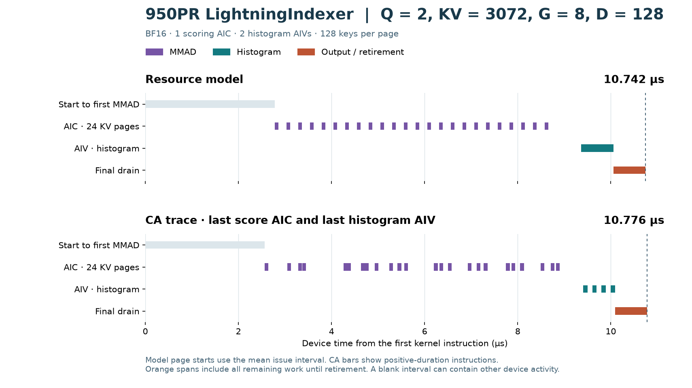

# Lightning Indexer 算例

同一行 query 需要先给所有可见 key 打分，再选 512 个下标。CANN 9.2.1 的普通 BF16 BSND 单波实现把最多四行 query 交给一个 AIC。一个 query 再长，它的 128-key 页仍依次经过该组。因此短 query 的时延主要随 KV 页数增长；增加芯片总核数对这一条链帮助很小。

## 从输入到预测

取 `[B,Q,L,G,D]=[1,2,3072,8,128]`，右下对齐因果掩码，Top-512，只返回 int32 下标。安装包接口是 `aclnnLightningIndexer`，PR 导出的入口是 `LightningIndexer_2517851d7f53b28f971ff94bfa4b7037_203547_mix_aic`。

```python
from operator_model import estimate

for chip in ("Ascend950DT_9582", "Ascend950PR_957b", "Ascend970DT"):
    x = estimate("lightning_indexer", [1, 2, 3072, 8, 128],
                 {"layout": "BSND", "sparse_count": 512, "sparse_mode": 3,
                  "return_values": False}, chip=chip, dtype="bf16")
    print(x.latency_us, x.active_aic, x.active_aiv, x.work, x.projection["stages_us"])
```

1. 两行分别可见 3,071 和 3,072 个 key，共 6,143 对。有效 Cube 运算为 $2×6143×8×128=12,580,864$ FLOP。每对有 8 次 ReLU、8 次乘权、7 次加法，共 141,289 次向量运算。这个有用工作量单列于 TopK 的实际指令数。输入逻辑读 790,560 B，输出写 $2×512×4=4096$ B。读量只对 key 张量计一次。
2. 两行属于同一 query 组，由 **1 个 AIC** 和 **2 个做直方图的 AIV** 处理，两条 AIV 各管一行。组内矩阵的 M 为 $2×8=16$，K 为 128，沿 key 方向有 $3072/128=24$ 页。两卡都实际执行了 24 条 16×128×128 MMAD。PR 启动了 28 个 AIC 和 56 个 AIV。
3. 临界 AIC 的首条 MMAD 在模型的第 4,587 周期发出。取 DT 三槽预取实测的平均页间隔 416 周期，与目标芯片按单核峰值计算的 24 页 MMAD 发起需求比较，取较慢限制。这里中间 **23 个间隔**合计 $23×416/1650=5.799$ µs。最后一次 MMAD 的响应含 66.88 个固定周期和目标单核运算时间，在 PR 为 0.079 µs。预测 Cube 完成为 $2.780+5.799+0.079=8.658$ µs。
4. 最后一页打分后，到直方图处理约需 $1160/1650=0.703$ µs。每行有 $\lceil3072/256\rceil=12$ 个分组，每组 8 条直方图指令，合计 **192 条**。两行同时工作，关键路径承担一行。每行排序跨度用 DT 标定的 $540+48.75×12$ 周期按目标向量吞吐折算，随后按 $635.86+39.54×12$ 的固定与可缩放部分计输出与退休。两段在 PR 合计 1.381 µs。三个系数族分别来自单行大小对照、相邻行交接和末组至 END，不依赖目标芯片实测。[全部标定阶段与输入](../../development/validation/indexer34/prices.py)
5. PR 的整条局部链为 **10.742 µs**。独立输入按目标 HBM 峰值的最低服务时间约 0.568 µs，本例处在单组流水约束下。硬件配置给出 L2 带宽时，另约束各 AIC 的 key 读总量。970DT 在相同库分组的假设下得到 **9.822 µs**。

## 模型与真实流水



| 全核首条指令起算，µs | 950DT 模型 | 950DT CA | 950PR 模型 | 950PR CA |
|---|---:|---:|---:|---:|
| 首条 MMAD | 2.780 | 2.731 | 2.780 | 2.561 |
| 最后一条 MMAD 退休 | 8.658 | 9.235 | 8.658 | 8.901 |
| 最晚排序核首条直方图执行 | 9.361 | 9.753 | 9.361 | 9.410 |
| 全窗 | **10.716** | **11.101** | **10.742** | **10.776** |

PR 上首发预测晚 0.219 µs，平均页间隔又抹平了实际三槽取数的节奏，使末 MMAD 预测早 0.243 µs。完整窗口仅差 −0.034 µs（−0.32%），有一部分来自阶段误差抵消。DT 完整窗偏低 3.47%。模型把 PR 判为略慢，CA 为 PR 快约 2.9%；该例继续用于检验小幅跨卡差异。下栏直方图显示有实际跨度的执行记录，官方导出还在相同核、相同 PC 各有等数的零时长记录。算例只用一次 CA 的时钟原点。所有 24 份回放的 MMAD 尺寸、数量和直方图执行数均可交叉核对。[13 份原生库 AIC/AIV 机器码匹配](../../results/v0.34/indexer/identity.json) · [逐窗指令与原档 SHA](../../results/v0.34/indexer/physical.json) · [绘图程序](../../development/validation/indexer34/figure.py)

## 长 KV 和外推边界

Q=9 时，四行、四行和一行组成三个 query 组，3 个 AIC 做矩阵乘，5 个 AIV 做直方图。对 L=8192，两个满组的 MMAD 为 32×128×128，尾组为 16×128×128，全片共 192 条。模型预测 DT / PR / 970DT 为 24.653 / 24.768 / 22.594 µs（取整）；前两端已冻结采集，970DT 为外推。每请求 32Ki 经过 4:1 压缩也可形成 8192 个候选位置；paged、量化或其它 head 布局仍须确认具体库入口。长度超过 8192 后，每个后续排序片要再处理前一片的 512 个候选，片间等待使用相邻行交接作代理，尚缺独立长形整窗。[冻结与双端资格](../../results/v0.34/indexer/score.json) · [总建模方法](../modeling-strategy.md) · [逐算子误差](../error-analysis.md)
