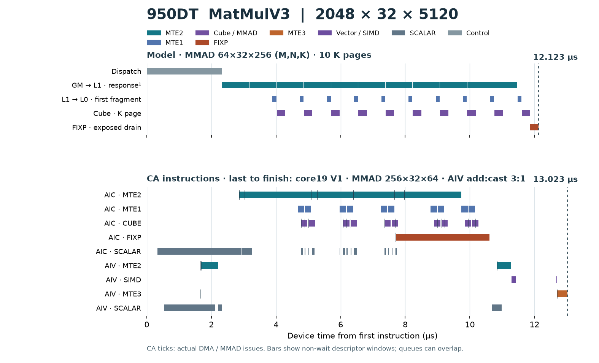
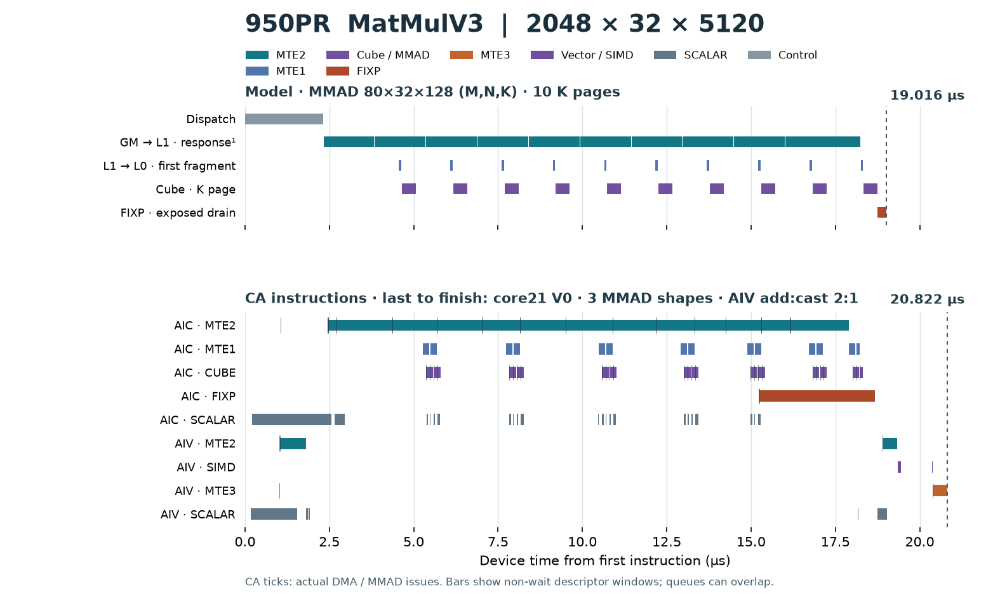

# DeepSeek V4.1 Flash indexer 权重投影的 Cube 对照

取单卡 prefill 8 个请求，每请求本步推进 256 个 token，得到 M=2,048。Flash 的 hidden_size=5,120、index_n_heads=32；weights_proj 是无 bias、无量化配置的 ReplicatedLinear，TP8 后本地输出仍有 32 列。前后分别是 [2048,5120] BF16 和 [2048,32] BF16，后续升精度与缩放是另外的操作。这是完整 hidden 通道的一个 prefill chunk。[模型配置](../../configs/models/DeepSeek-V4.1-Flash.json) · [weights_proj 定义](https://github.com/vllm-project/vllm-ascend/blob/c09d3e20b9c45c80b34ae3781440d90904a44023/vllm_ascend/models/deepseek_v41/indexer.py#L56-L73) · [调用位置](https://github.com/vllm-project/vllm-ascend/blob/c09d3e20b9c45c80b34ae3781440d90904a44023/vllm_ascend/models/deepseek_v41/indexer.py#L165-L175)

**对照合同。** 源程序权重为 [out,in]=[32,5120]，Ascend 无量化方法通过 unquantized_gemm 调用 torch.nn.functional.linear；权重加载还能根据平台策略保留 ND 或转格式。本实验使用 CANN 的 aclnnMatmul，一次提交 BF16 ND X[2048,5120]、已按 [K,N] 连续存储的 BF16 ND B[5120,32]，输出 Y[2048,32]。两者有相同的逻辑收缩，部署中的权重 packing、转置开销、融合与实际 kernel 选择仍需服务端 trace。下文的误差只适用于此次独立 ACLNN 对照。[Ascend 无量化线性层](https://github.com/vllm-project/vllm-ascend/blob/c09d3e20b9c45c80b34ae3781440d90904a44023/vllm_ascend/ops/linear.py#L100-L141)

## 从形状算到时间

1. 每个输入元素占 2 B，因此冷输入读取为 2K(M+N)=21,299,200 B，结果写回 2MN=131,072 B；有用 Cube 工作量是 2MNK=671,088,640 FLOP。权重在不同输出 tile 间的片上重复读取计入 L2→L1，此模型为 31,457,280 B。输出能在 L2 保留时，这次设备窗内暴露的 HBM 写可为零，后续逐出仍会发生。
2. 950DT 资源模型给出 32 个 [64,32] 输出块、32 个 AIC、一波。每核将 K=5,120 分成 10 个深度 512 的 L1 页；每页 2 个深度 256 的 MMAD，预测全芯片 640 次。块大小来自目标芯片的 L0 容量、流水和分核策略；跨芯片时重新选块。
3. 设 L 是 dispatch 延迟，R 是首个 K 页读响应时间，U 是首个 L0 fragment 的引导时间，I 是稳态 K 页发起间隔，C 是末页 MMAD 服务，W 是写回尾部。此 shape 各页深度相同，一波完成；T=L+R+U+9I+C+W。资源模型把共享 HBM、L2、每核 MTE 和 Cube 服务分别计价，I 取相互重叠流水的约束最大值。用本次冻结值代入，得到 2.326+1.554+0.130+9×0.842+0.275+0.256 ≈ **12.123 µs**。公式各资源率、周期与目标配置记录在冻结文件内。[冻结的逐芯片工作与阶段成本](../../results/v0.20/matmul-prefill/freeze.json)

**如何核算参数。** DT 为 1.65 GHz，每微秒 1,650 周期。dispatch 的参考截距 3,381.33 周期，加每次核数翻倍 91.25 周期的到达跨度，得到 L=(3381.33+91.25×log₂32)/1650。MTE2 服务率取 47.15 B/核/周期；512 深的页在最忙输入端搬运 2×512×64 B，得到 1,390.00 周期，超过此页在共享 HBM/L2 的摊销时间。首个读响应额外有 1,173.46 周期，所以 R=(1390.00+1173.46)/1650。两个页可以同时在途；间隔取本地搬运时间、双页在途上限 R/2、发起端口间隔和 Cube 页服务的最大值，故 I=1390.00/1650。L0 端用 180.65 B/核/周期计价首个 256 深 fragment，加 33.69 周期响应，故 U≈0.130 µs。Cube 从目标 BF16 算力反推每核每周期 8,181.82 FLOP，给 MMAD 的发起/完成另加 97.92/99.92 周期。写端取片内每核与共享带宽约束的较大值，再加 381.81 周期排空。这里的端口服务率和流水常数来自已归档的小规模 950 校准，新的 chunk 未参与参数估计；共享链路和 Cube 算力来自目标芯片配置。[校准参数](../../results/v0.16/matmul.json) · [DT 芯片参数](../../configs/chips/Ascend950DT_9582.json)

| 单卡调度 token 数 | 950DT 单次预测 µs | 950PR 单次预测 µs | 970DT 单次外推 µs |
|---:|---:|---:|---:|
| 2,048 | 12.123 | 19.016 | 7.287 |
| 262,144 | 1,082.452 | 1,921.347 | 273.952 |
| 1,048,576 | 4,317.432 | 8,214.865 | 1,067.624 |
| 2,097,152 | 8,630.654 | 16,399.797 | 2,117.578 |

后三行代表 8 个请求一次性分别输入 32k、128k、256k 的几何外推。32k 全量的设备时间不等于 128 个 2,048-token chunk 的时间之和。每次单独启动与 K/V 缓存状态会改变系统事件；这个投影本身的 M 取本次实际调度 token 数。

## CA 对照与误差来源

同一 shape 的 950DT CA 完整设备窗为 **13.023 µs**，预测 12.123 µs，有符号误差 **-6.91%**。本次捕获未设置 launch-count 过滤；完成了 1 个数值检查组，全 65,536 个元素均按 BF16 位相等。实际 kernel 为 `MatMulV3_ND_ND_ND_ND_BF16_BF16_BF16_BF16_high_performance_4098_mix_aic`；最后结束的核为 `core19.veccore1`，真实活动 AIC/AIV 为 32/64。采用全部核首条至末条指令的设备窗。合格采集墙钟 799.9 秒，原始峰值 290.3 MiB。[数值与完整窗记录](../../results/v0.20/matmul-prefill/ca.json)

¹ 上图首个读取响应用冻结模型的 R，后续每页按同一 R 并以 I 错开，是等页稳态重建。图中这些响应窗可重叠。L0 行只显示模型可辨识的首 fragment 引导，Cube 行显示每页的服务。下图由实际终端核非等待指令的起止时间构造，竖线为记录到的 DMA/MMAD 发起。CA descriptor 包含就绪等待的可能性，两图相应横条的宽度不能直接换算为链路带宽。[时间轴与 trace 哈希](../../results/v0.20/matmul-prefill/timeline.json)

选取最后结束的 AIC 内的第一个 MMAD 与最后一个非等待 Cube 指令的结束时刻，从全核起点开始分解误差。这个核的边界把设备窗分成三段，它可能先于其他核结束。

| 阶段 | 预测 µs | CA µs | 预测减 CA µs |
|---|---:|---:|---:|
| 到该核首个 MMAD | 4.010 | 4.778 | -0.768 |
| 到该核末个 Cube 指令结束 | 7.857 | 5.490 | +2.367 |
| 此后至全算子结束 | 0.256 | 2.756 | -2.500 |

实际全核有 **640** 次 MMAD，模型为 640 次。CA 的最后 AIC core17.cubecore0 记录 20 个 MMAD。模型假设每核 10 页 × 2 条 MMAD、纯 AIC 流水；CA 的队列、AIC/AIV 参与数和算子结束时刻可用于检查这项假设。只凭一次完整窗无法反推出 vLLM 权重打包或物理带宽。

**总次数正确的原因可以从指令参数查明。** CA 全部 640 条 MMAD 均为 [M,N,K]=[256,32,64]，每个 AIC 20 条；模型的单条形状是 [64,32,256]。两者单条有用 FLOP 相同，覆盖的输出行和 K 深度却相反。就每个真实 AIC 而言，20×64=1,280，仅覆盖完整 K 的四分之一；32 个 AIC 可以解释为 8 个 256 行输出块各配 4 份 K 部分和。64 个 AIV 的 trace 共记录 6,144 条 RV_VADD、2,048 条 RV_VCVT_F2F，3:1 的比例与合并四份 FP32 部分和再转 BF16 一致。四路分 K 是基于完整指令尺寸、总工作和 AIV 操作的解释；部署中 workspace 的具体寻址仍需额外证据。这个例子的改进方向是根据输出块数量、K 深度、暂存带宽和目标 AIC/AIV 比，显式比较空间切块与分 K 归并两条策略。970DT 的 120 AIC/120 AIV 会改变两条路径的成本，因此本次 DT 结果无法直接验证其未来选择。

**4098 属于哪种实现。** 实际 ELF 同时包含 4098 的 mix_aic 与 mix_aiv 符号。安装包 arch35 模板头声明各字段从低位依次占 4、2、2、4、4、4、4 位；4098=0x1002 解码得到 API_LEVEL=2（Tensor）、A_TRANS=B_TRANS=BATCH_MODEL=0、MODEL=1（STREAM_K）、FULL_LOAD=L0C2OUT_MODEL=0。设备入口用 workspaceGM 启动 Stream-K。这个分类由已安装包的位域、枚举和实测 kernel 名交叉核对；本次 profiler dump 仅保存 ELF 和 pc_start_addr.txt，没有原始 host tilingData，可从指令重构分块几何。[安装包路径、校验和和解码](../../results/v0.20/matmul-prefill/key-and-sources.json)

**为什么可能选中 Stream-K。** 固定版本 ops-nn 的 DAV_3510 host 参考实现先比较 align_up(K,256) 与 max(8192,256×AIC数)/输入元素字节。32 AIC、BF16 对应门槛 4,096，本例 K=5,120 通过。该参考实现随后检查常规输出 tile 能否在一波内完成、是否已受 Cube 限制，再为候选分 K 数 s 比较 max(T_MTE2(s),T_Cube(s))+T_fixup(s)。末项包括 Vector 归并与部分和写读的成本。若把入口门槛原样套入 120 AIC 的 970DT 配置，阈值变为 15,360，K=5,120 连这一道检查都无法通过。这说明工作量不变时调度选择可以改变。固定源码与安装包 host 二进制的逐行同一性未验证，970DT 的实际实现也未知；本例保留已冻结的三端预测。下一轮可把参考选择器的资源竞争项按芯片配置参数化，再用冻结新样本校准。[host 候选比较与 DAV_3510 入口](https://gitcode.com/cann/ops-nn/blob/602e4ad985da00aad28c16432841e9c5069e10de/matmul/mat_mul_v3/op_host/op_tiling/arch35/matmul_v3_basic_streamk_tiling.cpp)

首次隔离环境下的尝试耗费 176.4 秒，profiler 本地 IPC 未连接，运行时回退到默认 SKU，未产生合格指令窗；表格及误差只使用随后正确标识 DT 的记录。[首次尝试记录](../../results/v0.20/matmul-prefill/sandbox-attempt.json)

**正确性构造。** X 的 K 轴周期为 [+,+,+,−]，B 的 K 轴周期为 [+,+,+,+,+,−,−,−]，再分别按 X 行和 B 列翻转符号。每 8 个乘积之和为 ±2，故每个 Y 的独立精确值为 ±1,280。输入是结构化稠密测试值，输出预填 NaN 位型，以 CPU 按位置检查所有元素。工作负载不需要下载模型权重。[采集程序](../../development/validation/matmul_prefill20/matmul.cpp)

## 同形 950PR 配对验证

PR 预测在 DT 第一次采集前已冻结为 19.016 µs。查看同形 DT 的 Stream-K 证据后才决定补测 PR，沿用同一测试二进制、输入、golden 与全核指令窗口径。此样本用于核对跨 SKU 的实际调度和速度比。[PR 预算与角色登记](../../results/v0.20/matmul-prefill/pr-registration.json)

| 芯片 | 单次预测 µs | CA 完整窗 µs | 有符号误差 | 实际 / 预测 AIC | 实际 / 预测 AIV | 实际 / 预测 MMAD |
|---|---:|---:|---:|---:|---:|---:|
| DT | 12.123 | 13.023 | -6.91% | 32/32 | 64/0 | 640/640 |
| PR | 19.016 | 20.822 | -8.67% | 28/26 | 56/0 | 648/1040 |
| 970DT | 7.287（外推） | — | — | — | — | — |

DT/PR 定义为 DT 耗时除以 PR 耗时。实际比值 **0.625×**，冻结预测 **0.638×**，速度比相对误差 **+1.93%**。预测更快的是 **DT**，CA 更快的是 **DT**。970DT 预测 7.287 µs，沿用 950 系列的服务成本假设，缺少同形 CA。 [两端数值与速度比](../../results/v0.20/matmul-prefill/pair.json)

DT 与 PR 捕获的 ELF SHA-256 一致；平台日志分别加载 HBM3 与 LPDDR5。相同的 API、kernel 名和输入也允许两端选择不同的 tilingData，所以按芯片逐条检查 MMAD。

PR 实际 kernel 为 `MatMulV3_ND_ND_ND_ND_BF16_BF16_BF16_BF16_high_performance_4098_mix_aic`，最后结束的是 `core21.veccore0`。逐条读取全部 AIC 的 MMAD 参数，归并得到 **256×32×42** 有 8 条，**256×32×43** 有 16 条，**256×32×64** 有 624 条。每核 MMAD 数的分布为 24 个核各 27 条。全部 AIV 的 RV_VADD 为 4,192 条，RV_VCVT_F2F 为 2,096 条。以下按终端 AIC core24.cubecore0 与整算子结束点切分冻结模型误差。[PR 时间轴和指令几何](../../results/v0.20/matmul-prefill/timeline-pr.json)

| PR 阶段 | 预测 µs | CA µs | 预测减 CA µs |
|---|---:|---:|---:|
| 到该核首个 MMAD | 4.631 | 5.370 | -0.739 |
| 到该核末个 Cube 指令结束 | 14.125 | 12.942 | +1.183 |
| 此后至全算子结束 | 0.260 | 2.510 | -2.251 |

PR 采集墙钟 468.8 秒，峰值原始目录 189.4 MiB；所有 65,536 个 BF16 输出逐位通过。配对结果只覆盖这一完整通道 chunk 的 ND 单算子，整批 32k 至 256k 仍是冻结外推。[PR 数值、时窗及开销](../../results/v0.20/matmul-prefill/ca-pr.json)
