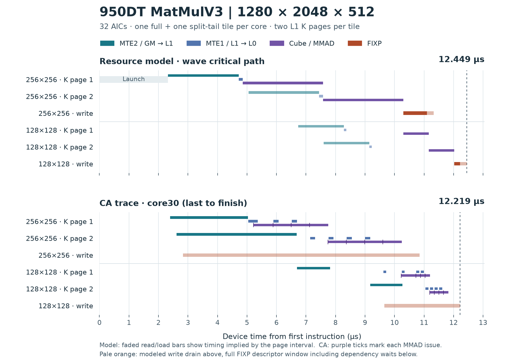

# Matmul · 两波输出块与 K 页

A[1280,512]、B[512,2048]、Y[1280,2048] 均为 BF16。有用 FLOP 为 2×1280×2048×512=2,684,354,560，输入总计 3,407,872 B。

## 单卡输入与调用

```python
from operator_model import estimate

shape = [1280, 2048, 512]
attrs = {}
result = estimate('matmul', shape, attrs, chip='Ascend950PR_957b')
print(result.latency_us, result.active_aic, result.active_aiv)
print(result.work["logical_read_bytes"], result.work["logical_write_bytes"])
```

## 从工作量到设备时间

950DT 将输出切为 5×8 个 256×256 母块。32 个首波整块之后，8 个母块各切四个 128×128 子块，形成 32 个尾块。每个块沿 K 分成两页，每页四条 K=64 的 MMAD。预计全片 32×2×2×4=512 条，与 CA 相符。PR 的余下 12 个母块各拆两块，尾波 24 个块，整次实测 416 条 MMAD。

公开工作量统计为 Cube **2,684,354,560**、Vector **0** 个有用标量等效操作。逻辑读 **3,407,872 B**、写 **5,242,880 B**。片外实际流量取决于重用与缓存。

首读的参考固定响应约 1173.46 tick，连续请求的参考发起成本为 15 tick。两者从 DT 的整页读与相邻描述符量出。另有参考持续 47.15 B/tick 的 MTE2，目标可覆盖该端口。单页 MMAD 的逻辑发起与实际计算依赖各自计价。 [参数及单位](../../src/operator_model/data/parameters/matmul_resources.json)

下表取 950PR 的公开阶段分账。各段已处理模型可辨识的重叠，数值保留三位小数。

| 阶段字段 | 暴露时间 µs |
|---|---:|
| `read_fill` | 2.396 |
| `l0_lead` | 0.130 |
| `page_intervals` | 2.724 |
| `last_mmad` | 2.724 |
| `write_tail` | 1.026 |
| `additional_output_waves` | 2.711 |
| `shared_link_floor` | 0.000 |
| `launch` | 2.315 |
| **整窗** | **14.027** |

## 与完整 CA 核对

| 目标 | 公开预测 µs | 完整 CA µs | 有符号误差 | 预测有效 AIC / AIV |
|---|---:|---:|---:|---:|
| Ascend950DT_9582 | 12.449 | 12.219 | +1.89% | 32 / 0 |
| Ascend950PR_957b | 14.027 | 13.218 | +6.12% | 28 / 0 |
| Ascend970DT（外推） | 6.350 | N/A | N/A | 117 / 0 |

DT 的首波 MTE2 在 2.326 µs 发起，Cube 在 4.852 µs 可用。模型先对下一页取数，再等已有 MMAD 占用释放。尾读可与首波重叠。模型只承诺页级时序。CA 中 FIXP 整条描述符可以很早发起并等待生产者。

示例收据的调用为 `aclnnMatmul`，provider 为 CANN 9.2.1 ops-nn，实际记录的 kernel 为 `MatMulV3_ND_ND_ND_ND_BF16_BF16_BF16_BF16_high_performance_2`。



浅色页段是由发起间隔推断的服务。CA 的深色小刻度表示实际 MMAD 发起。 [图上使用的数值](assets/matmul.json)


## 从单卡 batch 到 Matmul 的 M

以下例子使用 DeepSeek Flash 的一个单本地头投影，N=128、K=512。decode 按本次打包进同一个调用的 token 计算 M=BQ。普通 decode 的 Q=1，MTP 推测 8 时主模型一次最多校验 Q=9。单请求校验 9 个位置和 9 个请求各执行 1 个位置都映射为 M=9，可以复用这一条 Matmul 实测。它们的注意力缓存和整网耗时仍随请求划分变化。

| 请求数 B | 每请求位置 Q | M | 950DT 预测 / CA µs | 950PR 预测 / CA µs | 970DT 外推 µs |
|---:|---:|---:|---:|---:|---:|
| 1 | 1 | 1 | 4.230 / 4.161 | 4.230 / 4.030 | 3.877 |
| 1 / 9 | 9 / 1 | 9 | 4.234 / 4.325 | 4.234 / 4.127 | 3.881 |
| 11 | 1 | 11 | 4.235 / 4.310 | 4.235 / 4.137 | 3.882 |
| 16 | 1 | 16 | 4.237 / 4.371 | 4.237 / 4.186 | 3.884 |
| 9 | 9 | 81 | 4.380 / 4.402 | 4.380 / 4.290 | 4.015 |
| 11 | 9 | 99 | 4.392 / 4.568 | 4.392 / 4.332 | 4.026 |
| 16 | 9 | 144 | 4.412 / 4.479 | 4.413 / 4.530 | 4.045 |

同一投影在 prefill 时取本次真正交给 kernel 的 M。下表假设 8 个等长请求在一个调用中打包，未启用 chunked prefill。若 scheduler 每次只安排 2048 个 token，应给本次 Matmul 传 M=2048。

| 单请求输入 tokens | 整批 M | 950DT 预测 / CA µs | 950PR 预测 / CA µs | 970DT 外推 µs |
|---:|---:|---:|---:|---:|
| 32 Ki | 262,144 | 85.246 / 85.993 | 176.124 / 174.953 | 25.617 |
| 64 Ki | 524,288 | 167.563 / N/A | 368.529 / N/A | 44.067 |
| 128 Ki | 1,048,576 | 409.270 / 405.617 | 847.926 / 804.867 | 87.608 |
| 256 Ki | 2,097,152 | 892.683 / N/A | 1806.823 / N/A | 180.829 |

从 32 Ki 到 128 Ki，工作量增为 4 倍，DT 的完整 CA 时间增为 4.72 倍，PR 增为 4.60 倍。长 M 中每核做多轮，B 可驻留时能跨轮复用，输入与输出的有效工作集增大后共享链路仍可能变成主限制。对 256 Ki 的数值应按外推解释。 [大形对照数据](../../calibration/reference/large-shapes.json)

复核时，在逐窗记录中筛选 `contract=matmul`、此页 shape 和属性。有多个前序的样本逐窗保留。示例用于解释该次计算。校准统计、冻结后独立样本数及完整误差范围以总报告为准。[逐窗数据](../../calibration/reference/windows.jsonl) · [模型实现](../../src/operator_model/operators/matmul/dispatch.py) · [总建模方法](../modeling-strategy.md) · [误差分析](../error-analysis.md)
