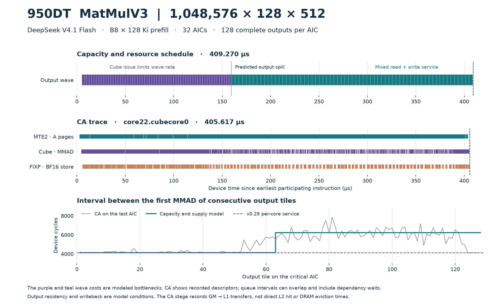
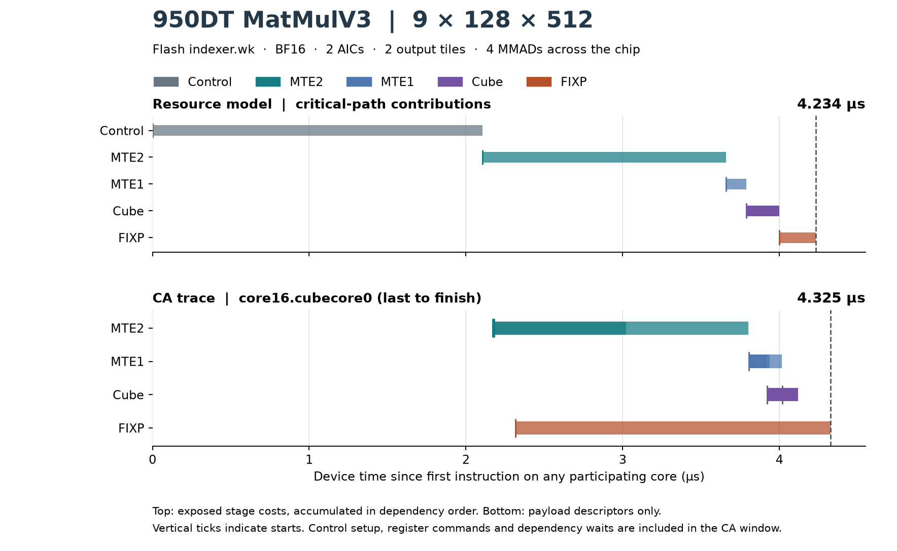
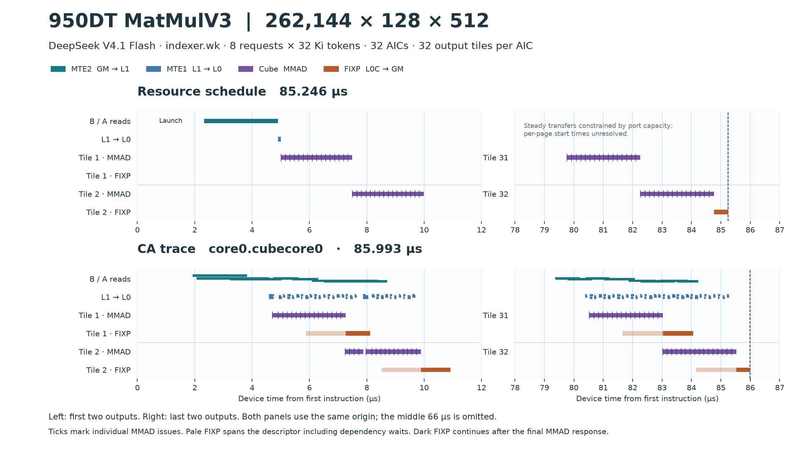

# MatMulV3 算例

## 从同一权重看 decode 和长 prefill

Flash 的 indexer.wk 在 TP8 场景中使用 K=512、N=128。单请求 MTP8 校验与九请求普通 decode 都给 [9,128,512]；B8×128Ki 的整批输入给 [1048576,128,512]。输入 $X[M,512]$，输出 $Y[M,128]$，逻辑工作为 $2M×512×128$ FLOP。长输入用 32 AIC，每核一次装入权重，处理 128 个输出块。L2 放不下全部脏输出后，A 的读和 C 的写共享外存服务，关键核的后半段出现页首空泡。950DT 的容量候选 409.270 µs，完整 CA 405.617 µs。图的上半是根据容量算出的排程，下半是最后完成的 core22；下方同时给出逐块发起间隔。



[逐步公式、参数溯源及可重绘数据](../../results/v0.30/matmul/report.md) · [三模型 decode 与大形](../../results/v0.30/matmul-dispatch/report.md) · [PR/DT 速度比](../../results/v0.30/matmul/comparison.md)

同一权重的普通 B9 或单请求 MTP8 输入为 [9,128,512]。输出沿 N 分到两个 AIC，每个算 9×64 个有效元素，每次乘加深度 256，每核两次 MMAD。全片有用计算量为 1,179,648 FLOP。DT 的独立设备窗为 4.325 µs，PR 为 4.127 µs；冻结预测各为 4.234 µs。图中 FIXP 的实测长条包含等待乘加结果的时间。模型只在临界路径上额外支付写回尾段。 [各条指令的起止时间](../../results/v0.30/matmul-dispatch/device/mtp8_example.json) · [同一投影的独立留出误差](../../results/v0.30/matmul-dispatch/device/report.md)

在这个 M=9 的 DT 例子上，4.234 µs 由启动 2.105、首笔输入填充 1.554、L0 提前量 0.130、最后一组乘加 0.209 和写回尾段 0.236 µs 组成。M、N、K 及目标芯片是在线输入。每条 MMAD 的部分和和搬运 overlap 已在临界贡献中处理。实际关键核为 core16，两条 MMAD 对应同一个 9×64 输出块的两段 K；PR/DT 小形的残差可按同一组四个事件界标核对。[相同 N、K 的逐阶段实测](../../results/v0.30/matmul-dispatch/device/phases.md)




同一 Flash 投影的整批 B8 从 32Ki 扩至 128Ki 后，在 950DT 上两次都一次装入 B，依次计算 32 和 128 个输出块/核。CA 为 85.993 和 405.617 µs，候选为 85.246 和 324.490 µs。可从对照图逐块追踪为何小形的稳态斜率到后半段失效。[完整计算与两种长度的同轴图](../../results/v0.29/matmul/full-load/report.md)


B8×128Ki 的 DT 大形也可以低开销回查工作量。从各个 AIC 的指令汇总按实际执行次数求和，只需读 6.32 MiB，得到 65,536 次 MMAD，与已核验的 3.094 GiB 全片时间线完全一致。定位哪个读页迟到时仍须返回末核的逐条时间线。[逐核计数和耗时](../../results/v0.30/matmul-dispatch/device/census.md)

## 一行的 decode 与三万多行的 prefill

Pro 的 indexer.weights_proj 每个 token 将 7168 个通道投影到 64 个系数。普通 decode 在单卡 B=1、9、11、16 时就是 [B,64,7168]；一个请求开 MTP8 也可产生 [9,64,7168]。B=1 时只有 917,504 个有用 FLOP，权重却有 917,504 B。原先冻结的普通排程只分配 1 个 AIC、顺序算 14 个 K 页，给出 15.126 µs。库的 tiling key 4098 实际沿 K 分片，在 DT 用 32 AIC / 64 AIV、32 条 MMAD，PR 用 28 / 56、28 条 MMAD，完成时间为 **5.585 / 5.467 µs**。图示的普通输出 tile 排程只适用于对应分支。[逐芯片冻结、核数和流水](../../results/v0.28/matmul/report.md)

默认 `estimate("matmul",[1,64,7168],chip=...)` 已能选择单输出分 K。要看普通与分 K 的分账，在 Pro 的目标配置上试 `from operator_model import estimate_matmul_splitk`。输入 `[1,64,7168]` 时，DT 的 32 个核实际各自承担连续 224 个 K 元素，预算为向上对齐的 256。模型分账为启动 2.326 µs、部分积流水 1.594 µs、去重输入带宽下界 0.233 µs、AIV 合并 1.775 µs，得到 2.326+max(1.594,0.233)+1.775=**5.695 µs**。PR 的 28 个核各承担 256 个元素，预测为 **5.573 µs**。M=1 已用于提出机制；M=16 的两端结果才是完全独立对照。[四个 M 的全部预测、真实 MMAD 和对照](../../results/v0.28/matmul/streamk-analysis.md) · [不同投影宽度的六个新形](../../results/v0.28/matmul/narrow/report.md)

另一个 Pro 例为 [144,64,7168]。普通分核给出多个输出块，但 CA 中 DT 的 32 个 AIC 各算完整 [144,64]，每核的 224 深 K 又分为 64+64+64+32。真正的 Flash [9,1280,5120] 则有 5 个宽 256 的输出矩形，各分 6 个 K 段。两者需在选择 K 切分后重算能放入 L0C、L0A/B、L1 的块；“普通分块有几个输出矩形”无法区分这两种执行。新预测覆盖 Pro [72,64,7168] 与 Flash [36,1280,5120]，本版先保留登记。[新形、资源容量和验证门槛](../../results/v0.28/matmul/multi/freeze.json)


上图候选 7.080 µs，下图实测 7.378 µs。上栏的向量归并是聚合服务估计，下栏的队列条包含依赖等待。原普通排程为 15.309 µs；该形已用于开发，不能计作重选块的独立留出。[逐条时刻和资源预算](../../results/v0.28/matmul/multi/dt-144-retile.json)

Flash 的 indexer.wk 输入 512、输出 128。完整的单请求 32Ki prefill 得到 [32768,128,512]，DT 实际走纯 AIC 的 key 131074；预测 / 实测 19.153 / 15.562 µs。8 个请求同一次提交则有 262144 行；每请求再增至 128Ki、256Ki 时 M 为 1048576、2097152。每行的 K 和 N 保持该投影的真实宽度。[B8 的 128Ki、256Ki 双端采集](../../results/v0.28/matmul/long-prefill/report.md)

### 固定 N、K，行数加倍后会怎样

对同一 Flash 投影固定 $N=128,K=512$。公开 v0.28 排程选 $512×128$ 的输出块。下表记录该预测，波数等于输出块数除以各自 AIC 数后向上取整。设备时间以 µs 表示。CA 指令确认两款 950 的该模板实际使用 $256×128$ 输出块。[逐形预测、CA 与回执](../../results/v0.28/matmul/README.md)

| 单卡一次提交 | M | 输出块数 | 模型波数 DT / PR | DT 预测 | PR 预测 | 970DT 外推 |
|---|---:|---:|---:|---:|---:|---:|
| B1 × 32Ki | 32,768 | 64 | 2 / 3 | 19.153 | 28.820 | 7.777 |
| B8 × 32Ki | 262,144 | 512 | 16 / 19 | 113.505 | 206.156 | 31.871 |
| B8 × 128Ki | 1,048,576 | 2,048 | 64 / 74 | 437.251 | 1155.000 | 114.805 |
| B8 × 256Ki | 2,097,152 | 4,096 | 128 / 147 | 868.573 | 2304.688 | 226.799 |

在 B8×32Ki 的 950DT 完整窗，预测 113.505 µs，实测 **85.993 µs**。可直接从输出反算核内工作。总共 262144/256=1024 个输出块，32 个 AIC 各算 32 块。一块有 512/32=16 条 MMAD，全片 16,384 条。每核只读入一份 512×128×2=131,072 B 的 B；每次输出再读四块 256×128×2=65,536 B 的 A。临界核在稳态每 4,112 周期发起下一个输出块，平均每条 MMAD 257 周期。在同几何的 PR 单请求窗，28 个核一轮的 A 输入就需要约 8,651 周期的全片带宽，临界核的 A 发起间隔中位数约 8,650 周期，瓶颈会随芯片改变。单请求到八请求的 DT 设备耗时实测为 15.562→85.993 µs，行数增加 8 倍而耗时增加 5.53 倍。[DT 完整窗和末核](../../results/v0.28/matmul/262144-128-512-dt-drain.json) · [单请求 PR](../../results/v0.28/matmul/32768-128-512-pr-drain.json)

按 B 常驻重新定价，DT 的 B8×32Ki 变为 **85.246 µs（−0.87%）**。下图把同一个末核的首尾四个输出块对齐。模型用首轮填充、每块 4112 周期发起、末次排空来预测；图中的实测读写保留其异步在途区间。B1 32Ki 在 PR 的候选为 28.310 µs、CA 为 26.690 µs（+6.07%）。这三条是开发窗，其余长形按是否在冻结时已开采分别计分。[每一项参数、双端逐核证明和三种长序列](../../results/v0.29/matmul/full-load/report.md)



B8 同形在 PR 的冻结预测 **196.082 µs**、随后才读取的 CA **174.953 µs**。16 个 AIC 各做 37 块、12 个各做 36 块。全片 FIXP 队列 2048 个事件中有 1024 个寄存器设置和 1024 个真正写出。相同 16,384 条 MMAD 并不能证明耗时会按核数比例缩放。PR 从设备窗反算的冷读所需带宽高于配置的 1.4 TB/s。若带宽假设准确，至少约 23.6 MB 的 A+B 可由缓存提供；另一种可能是模拟器的实际有效带宽高于该配置。下一批未读的 PR 长 shape 已给出两种初态的条件价。[全核地址核验](../../results/v0.29/matmul/full-load/pr32-geometry.json) · [剩余流水偏差](../../results/v0.29/matmul/full-load/pr32-residual.json)

进入多波稳态后，首次填充只付一次；每增加一个完整波，增加一个发起间隔。相同分块和流量假设下，可写为 $T≈T_{启动}+T_{首波}+(W-1)I+\Delta_{尾波}$。$W$ 是波数，$I$ 是读、乘加、写出和双缓冲约束决定的稳态间隔，最后一项校正未填满的尾波。128Ki 到 256Ki 输入行数翻倍，DT、PR 的**预测**耗时分别变成 1.99 和 2.00 倍。这一斜率仍待双端大形 CA 检验。

跨过 L2 容量阈值时，同一个斜率可能失效。例如 PR 在 128Ki 的行数是 32Ki 的 4 倍，预测却是 5.60 倍。模型的容量检查 $2(M+N)K_{page}$ 从约 64 MiB 增到 256 MiB，越过该配置的 112 MiB。此时模型把跨输出块的重复读也计入 HBM，并让更多输出写回显露在设备时间内。这是能用大形结果检验的缓存假设。当前已实测的 B1×32Ki，DT/PR 分别为 15.562 / 26.690 µs。

## 两波、两页 K 在 950DT 上怎样重叠


本卡 BF16 的 $[M,N,K]=[1280,2048,512]$。输入 A 为 $1280×512$，B 为 $512×2048$。在 32 个 AIC 上，按 $256×256$ 切出 $5×8=40$ 个母块。首波每核一个整块，余下 8 个母块各拆为四个 $128×128$ 子块，次波每核再算一个。每块 K 分两页，每页 K=256，再分成四条 K=64 的 MMAD。全片是 $32×2×2×4=512$ 条 MMAD，CA 记录同为 512。输入/输出逻辑字节分别是 3,407,872 / 5,242,880 B，有用计算量 $2MNK=2,684,354,560$ ops。

上图按当前芯片的读、L0、乘加、写出和缓冲依赖放置各页。首波首读约在 2.326 µs 发起，Cube 在 4.852 µs 开算；尾波首读在 6.735 µs 已可发起，尾波 Cube 等前波资源释放。下图从所有核的首条指令对齐零点，选最后退休的 core30，把读 A/B、L0 搬入和每次 MMAD 的原始起止放回对应页。浅橙是整条 FIXP 描述符的在途区间，内含等待。两图的紫色短线和浅色预测有不同精度，模型只给出页级服务。

| 单次调用 | 设备窗口 | 判据 |
|---|---:|---|
| 950DT 模型 | 12.449 µs | 第二波写出排空 |
| 950DT 完整 CA | 12.219 µs | 32 核全窗，模型高 0.230 µs（+1.89%） |
| 950PR 模型 / 完整 CA | 14.027 / 13.218 µs | 28 核全窗，模型高 0.808 µs（+6.12%） |
| 970DT 外推 | 6.350 µs | 来自独立情景配置 |

### 同一输入换到 950PR


PR 有 28 个 AIC，首波处理 28 个 256×256 母块。余下 12 个母块各拆成两个 128×256 矩形，所以尾波只有 24 个块。CA 的全部输出地址、52 笔块写和 416 条 MMAD 均符合预测。两卡有用的乘加总量相同。PR 关键路径上，第一页的首条 MMAD 预测只晚 0.059 µs，到了尾块最后一页首发已晚 0.586 µs，末笔写完成晚 0.808 µs。DT/PR 耗时比预测 0.8875，实测 0.9244。[相同刻度的 DT 与 PR 并排图](figures/matmul-tile-pages-dt-pr.png) · [PR 各页偏差、逐核分块、全部输出校验](../../results/v0.21/matmul-pages-pr/report.md)

### 逐页核对偏差

每行对应上图同一个输出块、同一个 K 页。所有数值从全片第一条指令起算，单位为 µs。读列记录模型给出的页级读起点和 CA 中 A/B 描述符最早的发起。计算列记录模型的页级 Cube 起点和该页第一条真实 MMAD 的发起。最后一列取预测减 CA。

| 输出块 | K 页 | 读起点 模型 / CA | Cube 起点 模型 / CA | Cube 起点偏差 |
|---|---:|---:|---:|---:|
| 256×256 | 1 | 2.326 / 2.395 | 4.852 / 5.215 | −0.362 |
| 256×256 | 2 | 5.050 / 2.608 | 7.576 / 7.743 | −0.167 |
| 128×128 | 1 | 6.735 / 6.692 | 10.299 / 10.228 | +0.071 |
| 128×128 | 2 | 7.595 / 9.177 | 11.159 / 11.190 | −0.031 |

偏差最大的是整块第二页的读起点，模型比实测晚 2.442 µs。图中这个浅色块的位置由页间隔反推；CA 中第二页读描述符几乎紧接第一页发起，随后可以与前页的搬入和计算重叠。到了该页首次 MMAD，模型却比实测早 0.167 µs。因此只看整窗的 +1.89% 会掩盖预取顺序的偏差。尾块写排空再把最终预测推高 0.230 µs。[分块与原始指令区间](../../results/v0.20/examples/matmul-tile-pages.json)

采集使用安装包的 `aclnnMatmul`，kernel 为 `MatMulV3_ND_ND_ND_ND_BF16_BF16_BF16_BF16_high_performance_2`，2,621,440 个输出全部通过数值检查。CA 墙钟 329 秒。发布的 JSON 带每个核的 tile 核对、图上时间戳、冻结预测和 trace 哈希。[图数据](../../results/v0.20/examples/matmul-tile-pages.json) · [从时间戳重画](../../development/validation/sku20/matmul_figure.py) · [用原始 trace 复核 32 个核的页地址、L0A/L0B 装载、累加初始化和逐条 MMAD](../../development/validation/sku20/audit_matmul_pages.py)

同样是 MatMulV3，Flash indexer 的窄输出、长 K 投影会启动 AIC 和 AIV。该例把模型的输出块与实际 MMAD 的 m/n/k 和末端 Vector 归并逐项对齐。[Flash 投影的混合核算例](matmul-prefill.md)

## 不同核数的短 K 例子

输入轴顺序为 **M,N,K**。本例比较同一输入契约在 950DT、950PR 与假设的 970DT 上的设备指令窗口。

```python
from operator_model import estimate

shape = [1536, 1792, 16]
attrs = {}
for chip in ('Ascend950DT_9582', 'Ascend950PR_957b', 'Ascend970DT'):
    r = estimate('matmul', shape, attrs, chip=chip, dtype='bf16', timing_mode='resource')
    print(r.latency_us, r.status, r.active_aic, r.active_aiv, r.work)
```

## 输入到工作量

该路线调用 CANN 9.2.1 的 ops-nn 算子族。实际调用接口为 `aclnnMatmul`。
工作量接口给出的 Cube 操作为 88,080,384，Vector 计数为 0。逻辑读/写分别为 106496 / 5505024 B。此处 None 表示缺少计数；片外实际流量须另行观测，逻辑字节不含中间层重复搬运。

## 分块、资源和关键路径

每个输出是一行 A 和一列 B 的点积。有用工作 2MNK=2×1536×1792×16=88,080,384 ops。每个 BF16 元素占 2 B。先用目标核数选择 ASW 主块，再按真实边界拆最后一波；每个输出子块独立遍历 K。

950DT 指令 trace 定价的首读、搬入 L0、末条 MMAD、排空分别为 1173.46、33.69、99.92、381.81 cycles；读和 MMAD 发起下限分别 15.00、97.92 cycles。各芯片继承这些周期；按目标的频率和每核 BF16 峰值重算服务。

#### Ascend950PR_957b 的输出网格与搬运

主块 [256, 256, 16]，父块 42 个，分给 28 AIC，共 2 波。最后一波沿 M/N 切数 [2, 1]，实际子块 [M,N,重复数] 为 [[128, 256, 28]]。全程 56 次 MMAD，每个输出块分 1 个读页。

目标吞吐为 mte2=47.148，mte1=180.655，write=158.298，l2=2800.000，hbm=848.485，cube=8181.818。前三项是每核 B/cycle，L2、HBM 为全片 B/cycle，Cube 为每核 ops/cycle。每波读取按 max(最重本地描述符字节/MTE2，各核合计 L2 字节/L2，暴露的 HBM 字节/HBM)；Cube 操作数按 16 对齐后除每核算力。写出同样取本地 FIX、L2、暴露的 HBM 中最慢者。全程 L2 读 802,816 B、HBM 场景读 106,496 B，输出 5,505,024 B，其中预计本次设备窗内 HBM 写 0 B。输出驻留比例上限 1.0；实际 cache 命中率未知。

R/L 分别为首读和 L0 准备，P 为随后页的累计间隔，C 为末页计算，W 为写完成；Ri/Ci/Wi 分别为连续读、计算、写的服务间隔，单位周期。

full 波：R=1347.207，L=79.032，P=0.000，C=356.239，W=1692.530，Ri=173.750，Ci=354.239，Wi=1310.720。

tail 波：R=1347.207，L=79.032，P=0.000，C=228.080，W=1037.170，Ri=173.750，Ci=226.080，Wi=655.360。

后波最早计算=max(本波就绪，上波计算资源可用)，最早写=max(本波计算完成，上波写端口可用)。两预取槽还限制读间隔≥(R+L)/2。下表各项已折成 µs，共享链路仅计超过流水的差额。read_fill=0.816，l0_lead=0.048，page_intervals=0.000，last_mmad=0.216，write_tail=1.026，additional_output_waves=0.397，shared_link_floor=0.000，launch=2.315；相加为 **4.81841 µs**。有效 HBM payload 22.10 GB/s，占标称 1.58%。

#### Ascend970DT 的输出网格与搬运

主块 [192, 128, 16]，父块 112 个，分给 112 AIC，共 1 波。最后一波沿 M/N 切数 [1, 1]，实际子块 [M,N,重复数] 为 [[192, 128, 112]]。全程 112 次 MMAD，每个输出块分 1 个读页。

目标吞吐为 mte2=47.148，mte1=180.655，write=158.298，l2=16666.667，hbm=8000.000，cube=8194.444。前三项是每核 B/cycle，L2、HBM 为全片 B/cycle，Cube 为每核 ops/cycle。每波读取按 max(最重本地描述符字节/MTE2，各核合计 L2 字节/L2，暴露的 HBM 字节/HBM)；Cube 操作数按 16 对齐后除每核算力。写出同样取本地 FIX、L2、暴露的 HBM 中最慢者。全程 L2 读 1,146,880 B、HBM 场景读 106,496 B，输出 5,505,024 B，其中预计本次设备窗内 HBM 写 0 B。输出驻留比例上限 1.0；实际 cache 命中率未知。

R/L 分别为首读和 L0 准备，P 为随后页的累计间隔，C 为末页计算，W 为写完成；Ri/Ci/Wi 分别为连续读、计算、写的服务间隔，单位周期。

tail 波：R=1303.769，L=67.695，P=0.000，C=195.892，W=712.112，Ri=130.313，Ci=193.892，Wi=330.301。

后波最早计算=max(本波就绪，上波计算资源可用)，最早写=max(本波计算完成，上波写端口可用)。两预取槽还限制读间隔≥(R+L)/2。下表各项已折成 µs，共享链路仅计超过流水的差额。read_fill=0.724，l0_lead=0.038，page_intervals=0.000，last_mmad=0.109，write_tail=0.396，additional_output_waves=0.000，shared_link_floor=0.000，launch=2.224；相加为 **3.48999 µs**。有效 HBM payload 30.51 GB/s，占标称 0.21%。

[参数及原始 DT trace 来源](../../results/v0.16/matmul-dt-provenance.json) · [末波调度和参数敏感性](../../results/v0.17/matmul-method.md)

## 设备时间及误差

| 平台 | 模型 (µs) | CA (µs) | 有符号误差 | 预测 AIC / AIV | CA AIC / AIV |
|---|---:|---:|---:|---|---|
| 950DT | 4.68012 | 4.43818 | +5.45% | 32 / 0 | 32 / 0 |
| 950PR | 4.81841 | 4.54000 | +6.13% | 28 / 0 | 28 / 0 |
| 970DT 外推 | 3.48999 | N/A | N/A | 112 / 0 | N/A |

DT/PR 加速比取同形耗时之比，模型 0.9713×，CA 0.9776×。正时延误差为高估。

**950DT CA**　msopprof official full trace，角色 new paired DT CA；核名 `MatMulV3_ND_ND_ND_ND_BF16_BF16_BF16_BF16_high_performance_2`。该宿主的数值检查共 1 组；子算子切片共享宿主检查。各设备窗以最早到最晚核指令计，多 kernel 取串行窗之和。

**950PR CA**　msopprof official full trace，角色 frozen PR holdout；核名 `MatMulV3_ND_ND_ND_ND_BF16_BF16_BF16_BF16_high_performance_2`。该宿主的数值检查共 1 组；子算子切片共享宿主检查。各设备窗以最早到最晚核指令计，多 kernel 取串行窗之和。

## CA 流水与模型差距


横轴为每次 kernel 自身的设备时间，两端各自从零开始。每种核取最晚结束的一个核。每行按该队列有效指令区间的并集着色，100 个等宽时间格，深蓝表示格内占满。不同队列可重叠，行长不能相加。DMA/FIX 行表示描述符的在途窗口，可能包含等待依赖的时间；颜色深度不能直接换算 HBM 总线利用率。

950DT 第 1 段 4.4382 µs；所选核上占用最长的队列为 AIC/Scalar 2.4570 µs、AIC/FIXP 2.0624 µs、AIC/MTE2 0.8224 µs。
950PR 第 1 段 4.5400 µs；所选核上占用最长的队列为 AIC/Scalar 2.4067 µs、AIC/FIXP 2.1891 µs、AIC/MTE2 0.8455 µs。

**950DT 发起与完成**　取 core27.cubecore0。全核 MMAD 计数为 62。

| 队列 | 指令及程序计数器 | 临界核次数 | 首次发起距全核起点 (µs) | 描述符中位持续 (µs) | 相邻发起中位间隔 |
|---|---|---:|---:|---:|---|
| CUBE | `MMAD` @ `0x9000d219f8` | 2 | 3.0436 | 0.3818 | 0.1970 µs |
| MTE2 | `MOV_OUT_TO_L1_MULTI_ND2NZ` @ `0x9000d218b0` | 2 | 2.2648 | 0.5364 | 0.3430 µs |
| MTE2 | `MOV_OUT_TO_L1_MULTI_ND2NZ` @ `0x9000d218ec` | 2 | 2.2739 | 0.5870 | 0.3430 µs |

模型对本次调用的全核 MMAD 预计 62 次。在有多核重叠时，全核次数用于核对分块，时间取设备窗。

**950PR 发起与完成**　取 core19.cubecore0。全核 MMAD 计数为 56。

| 队列 | 指令及程序计数器 | 临界核次数 | 首次发起距全核起点 (µs) | 描述符中位持续 (µs) | 相邻发起中位间隔 |
|---|---|---:|---:|---:|---|
| CUBE | `MMAD` @ `0x9000d219f8` | 2 | 3.0164 | 0.4264 | 0.2030 µs |
| MTE2 | `MOV_OUT_TO_L1_MULTI_ND2NZ` @ `0x9000d218b0` | 2 | 2.2400 | 0.5385 | 0.3430 µs |
| MTE2 | `MOV_OUT_TO_L1_MULTI_ND2NZ` @ `0x9000d218ec` | 2 | 2.2491 | 0.5973 | 0.3430 µs |

模型对本次调用的全核 MMAD 预计 56 次。在有多核重叠时，全核次数用于核对分块，时间取设备窗。

PR 的模型与 CA 相差 +0.2784 µs。末波切分、FIX 写回完成和 L2 驻留决定多波误差。CA 指令窗口可用于识别重叠；仅凭 FIX 的忙时无法识别片外实际写入字节。上图给出可观测的队列活动；一次端到端差值无法唯一分摊到这些因素。

[总建模方法](../modeling-strategy.md) · [全部 shape 的误差](../error-analysis.md) · [970DT 配置与来源](../../configs/chips/Ascend970DT.json)
