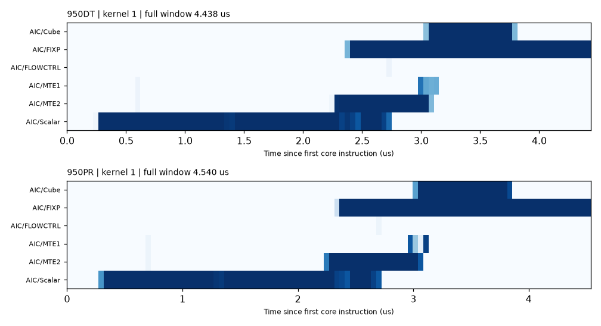

# MatMulV3 算例

## 两波、两页 K 在 950DT 上怎样重叠


本卡 BF16 的 $[M,N,K]=[1280,2048,512]$。输入 A 为 $1280×512$，B 为 $512×2048$。在 32 个 AIC 上，按 $256×256$ 切出 $5×8=40$ 个母块。首波每核一个整块，余下 8 个母块各拆为四个 $128×128$ 子块，次波每核再算一个。每块 K 分两页，每页 K=256，再分成四条 K=64 的 MMAD。全片是 $32×2×2×4=512$ 条 MMAD，CA 记录同为 512。输入/输出逻辑字节分别是 3,407,872 / 5,242,880 B，有用计算量 $2MNK=2,684,354,560$ ops。

上图按当前芯片的读、L0、乘加、写出和缓冲依赖放置各页。首波首读约在 2.326 µs 发起，Cube 在 4.852 µs 开算；尾波首读在 6.735 µs 已可发起，尾波 Cube 等前波资源释放。下图从所有核的首条指令对齐零点，选最后退休的 core30，把读 A/B、L0 搬入和每次 MMAD 的原始起止放回对应页。浅橙是整条 FIXP 描述符的在途区间，内含等待。两图的紫色短线和浅色预测有不同精度，模型只给出页级服务。

| 单次调用 | 设备窗口 | 判据 |
|---|---:|---|
| 950DT 模型 | 12.449 µs | 第二波写出排空 |
| 950DT 完整 CA | 12.219 µs | 32 核全窗，模型高 0.230 µs（+1.89%） |
| 950PR 模型 | 14.027 µs | 该 shape 缺配对 CA |
| 970DT 外推 | 6.350 µs | 来自独立情景配置 |

### 逐页核对偏差

每行对应上图同一个输出块、同一个 K 页。所有数值从全片第一条指令起算，单位为 µs。读列记录模型给出的页级读起点和 CA 中 A/B 描述符最早的发起。计算列记录模型的页级 Cube 起点和该页第一条真实 MMAD 的发起。最后一列取预测减 CA。

| 输出块 | K 页 | 读起点 模型 / CA | Cube 起点 模型 / CA | Cube 起点偏差 |
|---|---:|---:|---:|---:|
| 256×256 | 1 | 2.326 / 2.395 | 4.852 / 5.215 | −0.362 |
| 256×256 | 2 | 5.050 / 2.608 | 7.576 / 7.743 | −0.167 |
| 128×128 | 1 | 6.735 / 6.692 | 10.299 / 10.228 | +0.071 |
| 128×128 | 2 | 7.595 / 9.177 | 11.159 / 11.190 | −0.031 |

偏差最大的是整块第二页的读起点，模型比实测晚 2.442 µs。图中这个浅色块的位置由页间隔反推；CA 中第二页读描述符几乎紧接第一页发起，随后可以与前页的搬入和计算重叠。到了该页首次 MMAD，模型却比实测早 0.167 µs。因此只看整窗的 +1.89% 会掩盖预取顺序的偏差。尾块写排空再把最终预测推高 0.230 µs。[分块与原始指令区间](../../results/v0.20/examples/matmul-tile-pages.json)

采集使用安装包的 `aclnnMatmul`，kernel 为 `MatMulV3_ND_ND_ND_ND_BF16_BF16_BF16_BF16_high_performance_2`，2,621,440 个输出全部通过数值检查。CA 墙钟 329 秒。发布的 JSON 带每个核的 tile 核对、图上时间戳、冻结预测和 trace 哈希。[图数据](../../results/v0.20/examples/matmul-tile-pages.json) · [从时间戳重画](../../development/validation/sku20/matmul_figure.py) · [用原始 trace 复核 32 个核的页地址、L0A/L0B 装载、累加初始化和逐条 MMAD](../../development/validation/sku20/audit_matmul_pages.py)

同样是 MatMulV3，Flash indexer 的窄输出、长 K 投影会启动 AIC 和 AIV。该例把模型的输出块与实际 MMAD 的 m/n/k 和末端 Vector 归并逐项对齐。[Flash 投影的混合核算例](matmul-prefill.md)

## 不同核数的短 K 例子

输入轴顺序为 **M,N,K**。本例比较同一输入契约在 950DT、950PR 与假设的 970DT 上的设备指令窗口。

```python
from operator_model import estimate

shape = [1536, 1792, 16]
attrs = {}
for chip in ('Ascend950DT_9582', 'Ascend950PR_957b', 'Ascend970DT'):
    r = estimate('matmul', shape, attrs, chip=chip, dtype='bf16', timing_mode='resource')
    print(r.latency_us, r.status, r.active_aic, r.active_aiv, r.work)
```

## 输入到工作量

该路线调用 CANN 9.2.1 的 ops-nn 算子族。实际调用接口为 `aclnnMatmul`。
工作量接口给出的 Cube 操作为 88,080,384，Vector 计数为 0。逻辑读/写分别为 106496 / 5505024 B。此处 None 表示缺少计数；片外实际流量须另行观测，逻辑字节不含中间层重复搬运。

## 分块、资源和关键路径

每个输出是一行 A 和一列 B 的点积。有用工作 2MNK=2×1536×1792×16=88,080,384 ops。每个 BF16 元素占 2 B。先用目标核数选择 ASW 主块，再按真实边界拆最后一波；每个输出子块独立遍历 K。

950DT 指令 trace 定价的首读、搬入 L0、末条 MMAD、排空分别为 1173.46、33.69、99.92、381.81 cycles；读和 MMAD 发起下限分别 15.00、97.92 cycles。各芯片继承这些周期；按目标的频率和每核 BF16 峰值重算服务。

#### Ascend950PR_957b 的输出网格与搬运

主块 [256, 256, 16]，父块 42 个，分给 28 AIC，共 2 波。最后一波沿 M/N 切数 [2, 1]，实际子块 [M,N,重复数] 为 [[128, 256, 28]]。全程 56 次 MMAD，每个输出块分 1 个读页。

目标吞吐为 mte2=47.148，mte1=180.655，write=158.298，l2=2800.000，hbm=848.485，cube=8181.818。前三项是每核 B/cycle，L2、HBM 为全片 B/cycle，Cube 为每核 ops/cycle。每波读取按 max(最重本地描述符字节/MTE2，各核合计 L2 字节/L2，暴露的 HBM 字节/HBM)；Cube 操作数按 16 对齐后除每核算力。写出同样取本地 FIX、L2、暴露的 HBM 中最慢者。全程 L2 读 802,816 B、HBM 场景读 106,496 B，输出 5,505,024 B，其中预计本次设备窗内 HBM 写 0 B。输出驻留比例上限 1.0；实际 cache 命中率未知。

R/L 分别为首读和 L0 准备，P 为随后页的累计间隔，C 为末页计算，W 为写完成；Ri/Ci/Wi 分别为连续读、计算、写的服务间隔，单位周期。

full 波：R=1347.207，L=79.032，P=0.000，C=356.239，W=1692.530，Ri=173.750，Ci=354.239，Wi=1310.720。

tail 波：R=1347.207，L=79.032，P=0.000，C=228.080，W=1037.170，Ri=173.750，Ci=226.080，Wi=655.360。

后波最早计算=max(本波就绪，上波计算资源可用)，最早写=max(本波计算完成，上波写端口可用)。两预取槽还限制读间隔≥(R+L)/2。下表各项已折成 µs，共享链路仅计超过流水的差额。read_fill=0.816，l0_lead=0.048，page_intervals=0.000，last_mmad=0.216，write_tail=1.026，additional_output_waves=0.397，shared_link_floor=0.000，launch=2.315；相加为 **4.81841 µs**。有效 HBM payload 22.10 GB/s，占标称 1.58%。

#### Ascend970DT 的输出网格与搬运

主块 [192, 128, 16]，父块 112 个，分给 112 AIC，共 1 波。最后一波沿 M/N 切数 [1, 1]，实际子块 [M,N,重复数] 为 [[192, 128, 112]]。全程 112 次 MMAD，每个输出块分 1 个读页。

目标吞吐为 mte2=47.148，mte1=180.655，write=158.298，l2=16666.667，hbm=8000.000，cube=8194.444。前三项是每核 B/cycle，L2、HBM 为全片 B/cycle，Cube 为每核 ops/cycle。每波读取按 max(最重本地描述符字节/MTE2，各核合计 L2 字节/L2，暴露的 HBM 字节/HBM)；Cube 操作数按 16 对齐后除每核算力。写出同样取本地 FIX、L2、暴露的 HBM 中最慢者。全程 L2 读 1,146,880 B、HBM 场景读 106,496 B，输出 5,505,024 B，其中预计本次设备窗内 HBM 写 0 B。输出驻留比例上限 1.0；实际 cache 命中率未知。

R/L 分别为首读和 L0 准备，P 为随后页的累计间隔，C 为末页计算，W 为写完成；Ri/Ci/Wi 分别为连续读、计算、写的服务间隔，单位周期。

tail 波：R=1303.769，L=67.695，P=0.000，C=195.892，W=712.112，Ri=130.313，Ci=193.892，Wi=330.301。

后波最早计算=max(本波就绪，上波计算资源可用)，最早写=max(本波计算完成，上波写端口可用)。两预取槽还限制读间隔≥(R+L)/2。下表各项已折成 µs，共享链路仅计超过流水的差额。read_fill=0.724，l0_lead=0.038，page_intervals=0.000，last_mmad=0.109，write_tail=0.396，additional_output_waves=0.000，shared_link_floor=0.000，launch=2.224；相加为 **3.48999 µs**。有效 HBM payload 30.51 GB/s，占标称 0.21%。

[参数及原始 DT trace 来源](../../results/v0.16/matmul-dt-provenance.json) · [末波调度和参数敏感性](../../results/v0.17/matmul-method.md)

## 设备时间及误差

| 平台 | 模型 (µs) | CA (µs) | 有符号误差 | 预测 AIC / AIV | CA AIC / AIV |
|---|---:|---:|---:|---|---|
| 950DT | 4.68012 | 4.43818 | +5.45% | 32 / 0 | 32 / 0 |
| 950PR | 4.81841 | 4.54000 | +6.13% | 28 / 0 | 28 / 0 |
| 970DT 外推 | 3.48999 | N/A | N/A | 112 / 0 | N/A |

DT/PR 加速比取同形耗时之比，模型 0.9713×，CA 0.9776×。正时延误差为高估。

**950DT CA**　msopprof official full trace，角色 new paired DT CA；核名 `MatMulV3_ND_ND_ND_ND_BF16_BF16_BF16_BF16_high_performance_2`。该宿主的数值检查共 1 组；子算子切片共享宿主检查。各设备窗以最早到最晚核指令计，多 kernel 取串行窗之和。

**950PR CA**　msopprof official full trace，角色 frozen PR holdout；核名 `MatMulV3_ND_ND_ND_ND_BF16_BF16_BF16_BF16_high_performance_2`。该宿主的数值检查共 1 组；子算子切片共享宿主检查。各设备窗以最早到最晚核指令计，多 kernel 取串行窗之和。

## CA 流水与模型差距



横轴为每次 kernel 自身的设备时间，两端各自从零开始。每种核取最晚结束的一个核。每行按该队列有效指令区间的并集着色，100 个等宽时间格，深蓝表示格内占满。不同队列可重叠，行长不能相加。DMA/FIX 行表示描述符的在途窗口，可能包含等待依赖的时间；颜色深度不能直接换算 HBM 总线利用率。

950DT 第 1 段 4.4382 µs；所选核上占用最长的队列为 AIC/Scalar 2.4570 µs、AIC/FIXP 2.0624 µs、AIC/MTE2 0.8224 µs。
950PR 第 1 段 4.5400 µs；所选核上占用最长的队列为 AIC/Scalar 2.4067 µs、AIC/FIXP 2.1891 µs、AIC/MTE2 0.8455 µs。

**950DT 发起与完成**　取 core27.cubecore0。全核 MMAD 计数为 62。

| 队列 | 指令及程序计数器 | 临界核次数 | 首次发起距全核起点 (µs) | 描述符中位持续 (µs) | 相邻发起中位间隔 |
|---|---|---:|---:|---:|---|
| CUBE | `MMAD` @ `0x9000d219f8` | 2 | 3.0436 | 0.3818 | 0.1970 µs |
| MTE2 | `MOV_OUT_TO_L1_MULTI_ND2NZ` @ `0x9000d218b0` | 2 | 2.2648 | 0.5364 | 0.3430 µs |
| MTE2 | `MOV_OUT_TO_L1_MULTI_ND2NZ` @ `0x9000d218ec` | 2 | 2.2739 | 0.5870 | 0.3430 µs |

模型对本次调用的全核 MMAD 预计 62 次。在有多核重叠时，全核次数用于核对分块，时间取设备窗。

**950PR 发起与完成**　取 core19.cubecore0。全核 MMAD 计数为 56。

| 队列 | 指令及程序计数器 | 临界核次数 | 首次发起距全核起点 (µs) | 描述符中位持续 (µs) | 相邻发起中位间隔 |
|---|---|---:|---:|---:|---|
| CUBE | `MMAD` @ `0x9000d219f8` | 2 | 3.0164 | 0.4264 | 0.2030 µs |
| MTE2 | `MOV_OUT_TO_L1_MULTI_ND2NZ` @ `0x9000d218b0` | 2 | 2.2400 | 0.5385 | 0.3430 µs |
| MTE2 | `MOV_OUT_TO_L1_MULTI_ND2NZ` @ `0x9000d218ec` | 2 | 2.2491 | 0.5973 | 0.3430 µs |

模型对本次调用的全核 MMAD 预计 56 次。在有多核重叠时，全核次数用于核对分块，时间取设备窗。

PR 的模型与 CA 相差 +0.2784 µs。末波切分、FIX 写回完成和 L2 驻留决定多波误差。CA 指令窗口可用于识别重叠；仅凭 FIX 的忙时无法识别片外实际写入字节。上图给出可观测的队列活动；一次端到端差值无法唯一分摊到这些因素。

[总建模方法](../modeling-strategy.md) · [全部 shape 的误差](../error-analysis.md) · [970DT 配置与来源](../../configs/chips/Ascend970DT.json)
