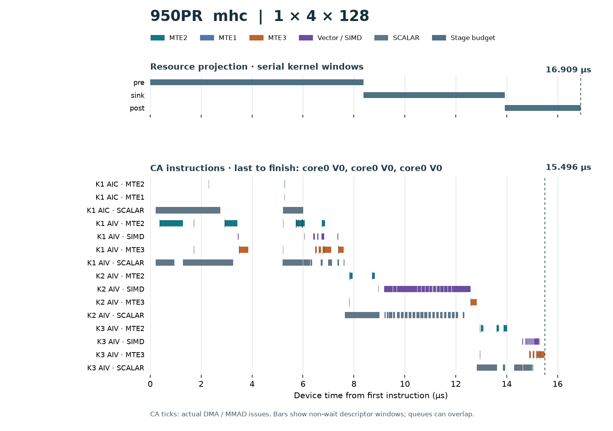
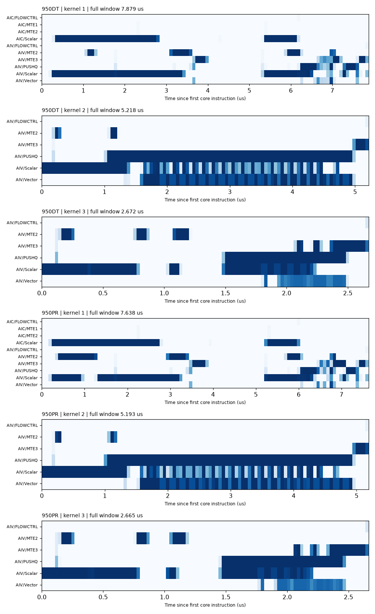

# mHC 三段链 算例

## 模型与实际库流水对照



本卡 shape 为 `[1, 4, 128]`，950PR 模型 **16.909 µs**，完整 CA **15.496 µs**，有符号误差 +9.12%。上栏按三个串行 kernel 分别给出预测。下栏拼接三个真实设备窗口，每段均从该 kernel 最早指令到最晚退休，保留各段尾核的活动。调用之间的 host 间隔单独由系统仿真器处理。 [图上每段的时间与 trace 指纹](../../results/v0.20/examples/mhc-pr.json)

输入轴顺序为 **T,N,D**。本例比较同一输入契约在 950DT、950PR 与假设的 970DT 上的设备指令窗口。

```python
from operator_model import estimate

shape = [1, 4, 128]
attrs = {'dtype': 'bf16', 'implementation': 'split', 'num_iters': 20}
for chip in ('Ascend950DT_9582', 'Ascend950PR_957b', 'Ascend970DT'):
    r = estimate('mhc', shape, attrs, chip=chip, dtype='bf16', timing_mode='auto')
    print(r.latency_us, r.status, r.active_aic, r.active_aiv, r.work)
```

## 输入到工作量

该路线调用 CANN 9.2.1 的 ops-transformer 算子族。实际调用接口为 `aclnnMhcPre + aclnnMhcSinkhorn + aclnnMhcPost`。
工作量接口给出的 Cube 操作为 24,576，Vector 计数为 8,466。逻辑读/写分别为 51708 / 1540 B。此处 None 表示缺少计数；片外实际流量须另行观测，逻辑字节不含中间层重复搬运。

## 分块、资源和关键路径

该例为 `mhc[1, 4, 128]`，dtype=bf16，属性 `{'implementation': 'split', 'num_iters': 20}`。Pre 投影把宽 512 的残差映到 24 个系数，HF32 计算量 2×1×512×24。有用 Cube 运算 {'fp32': 24576}、Vector 运算 {'fp32': 8466} （FMA 算 2），逻辑读/写 51708/1540 B。字节数不含缓存重读。

DT 为 32/64 个 C/V 核、1.65 GHz，970 为 120/120、1.8 GHz。对固定参考库路线，计算价用每核峰值比 × 目标/参考波数比；控制价用时钟比 1.65/1.8=0.91667。搬运价=(1−p)·本地价+p·4000/14400，缺 MTE 带宽时用时钟与波数作本地价。只有 Cube/Vector 总峰值且可比时才用其比值；混合 dtype 以各自工作量加权。该路线没有直接定价 970 的 L2 命中或重新编译 tiling；970 时间是 DT 阶段模板外推，不是独立的目标硬件资源仿真。

**pre：从输入到阶段净时延**

阶段 `pre`、分支 `mk`。K=N·D=512；K≥512 的 MK 分支按 Kc=256⌈K/(32×256)⌉=256，单核计算代理 ⌈T/16⌉⌈Kc/32⌉；K<512 的 ND 分支则用 ⌈T/32⌉⌈K/256⌉。向量 ⌈T/64⌉⌈D/256⌉；流量 [4K(N²+2N)+2TK]/1024 KiB；控制 ⌈T/16⌉。

分配代理 Cube/Vector jobs=2/1，Cube 波 1→1，Vector 波 1→1；970 活跃核代理 (C,V)=(2, 1)。逻辑读写 50736 B，阶段 DT 时间 8.37761 µs，外存权重 p=min(1,50736/(1000×4000×8.37761))=0.00151。目标时价系数 `CUBE / SIMD / MTE1 / MTE2 / MTE3 / FIXP / SCALAR / IDLE` = `0.91667 / 0.91553 / 0.91667 / 0.91570 / 0.91570 / 0.91667 / 0.91667 / 0.91667`。 vector 参考/目标每核峰值比（整片 TOPS÷同类核数）：fp32 (27/64)/(55.296/120)=0.91553。 有缺项时按相同每核每周期处理量回退：cube fp32。

下表每行的截距 a（µs）是可见固定成本；b（µs/单位）乘对应工作 x。DT 项=a+bx；970 项=a·fSCALAR+bx·f队列。各行对应互斥时间，不能再取最大值。

| 资源项 / 目标队列 | x | a | b | DT µs | 970 µs |
|---|---:|---:|---:|---:|---:|
| compute / CUBE | 8 | 0.000000 | 0.000000 | 0.00000 | 0.00000 |
| vector / SIMD | 1 | 0.998017 | 0.000000 | 0.99802 | 0.91485 |
| traffic / MTE2 | 49 | 2.314089 | 0.002312 | 2.42736 | 2.22497 |
| control / SCALAR | 1 | 3.699636 | 1.252606 | 4.95224 | 4.53956 |

参考参数：`results/v0.9/mhc/model.json → stages.pre.mk`，归档窗口及身份见同目录 `freeze.json`。本段加和 DT 8.37761、970 7.67937 µs。0 斜率只说明独占阶段未识别出这一项；依赖 Cube 的等待可以被计入控制。

**sink：从输入到阶段净时延**

阶段 `sink`、分支 `sink`。固定 20 轮，向量代理 ⌈T/64⌉·20N²，搬运 4TN²/1024 KiB，控制 ⌈T/64⌉。

分配代理 Cube/Vector jobs=0/1，Cube 波 0→0，Vector 波 1→1；970 活跃核代理 (C,V)=(0, 1)。逻辑读写 128 B，阶段 DT 时间 5.54002 µs，外存权重 p=min(1,128/(1000×4000×5.54002))=0.00001。目标时价系数 `CUBE / SIMD / MTE1 / MTE2 / MTE3 / FIXP / SCALAR / IDLE` = `0.91667 / 0.91553 / 0.91667 / 0.91666 / 0.91666 / 0.91667 / 0.91667 / 0.91667`。 vector 参考/目标每核峰值比（整片 TOPS÷同类核数）：fp32 (27/64)/(55.296/120)=0.91553。

下表每行的截距 a（µs）是可见固定成本；b（µs/单位）乘对应工作 x。DT 项=a+bx；970 项=a·fSCALAR+bx·f队列。各行对应互斥时间，不能再取最大值。

| 资源项 / 目标队列 | x | a | b | DT µs | 970 µs |
|---|---:|---:|---:|---:|---:|
| compute / CUBE | 0 | 0.000000 | 0.000000 | 0.00000 | 0.00000 |
| vector / SIMD | 320 | 3.928485 | 0.000000 | 3.92848 | 3.60111 |
| traffic / MTE2 | 0.0625 | 0.549632 | 0.204962 | 0.56244 | 0.51557 |
| control / SCALAR | 1 | 1.049091 | 0.000000 | 1.04909 | 0.96167 |

参考参数：`results/v0.9/mhc/model.json → stages.sink.sink`，归档窗口及身份见同目录 `freeze.json`。本段加和 DT 5.54002、970 5.07835 µs。0 斜率只说明独占阶段未识别出这一项；依赖 Cube 的等待可以被计入控制。

**post：从输入到阶段净时延**

阶段 `post`、分支 `split`。短 token 沿 D 方向按 2 的幂切 1 份，w=⌈T×1/64⌉=1；向量 w⌈D/(64×1)⌉N(N+1)，搬运 4TND/1024 KiB，控制 w。

分配代理 Cube/Vector jobs=0/1，Cube 波 0→0，Vector 波 1→1；970 活跃核代理 (C,V)=(0, 1)。逻辑读写 2384 B，阶段 DT 时间 2.98577 µs，外存权重 p=min(1,2384/(1000×4000×2.98577))=0.00020。目标时价系数 `CUBE / SIMD / MTE1 / MTE2 / MTE3 / FIXP / SCALAR / IDLE` = `0.91667 / 0.91553 / 0.91667 / 0.91654 / 0.91654 / 0.91667 / 0.91667 / 0.91667`。 vector 参考/目标每核峰值比（整片 TOPS÷同类核数）：fp32 (27/64)/(55.296/120)=0.91553。

下表每行的截距 a（µs）是可见固定成本；b（µs/单位）乘对应工作 x。DT 项=a+bx；970 项=a·fSCALAR+bx·f队列。各行对应互斥时间，不能再取最大值。

| 资源项 / 目标队列 | x | a | b | DT µs | 970 µs |
|---|---:|---:|---:|---:|---:|
| compute / CUBE | 0 | 0.000000 | 0.000000 | 0.00000 | 0.00000 |
| vector / SIMD | 40 | 0.995960 | 0.005010 | 1.19636 | 1.09644 |
| traffic / MTE2 | 2 | 0.649866 | 0.002193 | 0.65425 | 0.59973 |
| control / SCALAR | 1 | 1.135152 | 0.000000 | 1.13515 | 1.04056 |

参考参数：`results/v0.9/mhc/model.json → stages.post.split`，归档窗口及身份见同目录 `freeze.json`。本段加和 DT 2.98577、970 2.73672 µs。0 斜率只说明独占阶段未识别出这一项；依赖 Cube 的等待可以被计入控制。

按实际阶段顺序相加：DT 8.37761 + 5.54002 + 2.98577 = **16.90340 µs**；970 7.67937 + 5.07835 + 2.73672 = **15.49444 µs**。组合只含本 rank 的库 kernel 时间；跨卡通信与 kernel 之间的主机开销不在窗口内。

## 设备时间及误差

| 平台 | 模型 (µs) | CA (µs) | 有符号误差 | 预测 AIC / AIV | CA AIC / AIV |
|---|---:|---:|---:|---|---|
| 950DT | 16.90340 | 15.76849 | +7.20% | N/A / N/A | 32 / 64 |
| 950PR | 16.90916 | 15.49636 | +9.12% | 2 / 1 | 28 / 56 |
| 970DT 外推 | 15.49444 | N/A | N/A | 2 / 1 | N/A |

DT/PR 加速比取同形耗时之比，模型 0.9997×，CA 1.0176×。正时延误差为高估。

**950DT CA**　msopprof official full trace，角色 new paired DT CA；核名 `MhcPre_52e042c374f575edbe357a32523dba2c_2_mix_aic+MhcSinkhorn_8997d9c5c22e82688b98bc25d8daa9cd_0+MhcPost_59130ccee6717ff2c0f15b485e731162_5`。该宿主的数值检查共 9 组；子算子切片共享宿主检查。各设备窗以最早到最晚核指令计，多 kernel 取串行窗之和。

**950PR CA**　msopprof official full trace，角色 frozen PR holdout；核名 `MhcPre_52e042c374f575edbe357a32523dba2c_2_mix_aic+MhcSinkhorn_8997d9c5c22e82688b98bc25d8daa9cd_0+MhcPost_59130ccee6717ff2c0f15b485e731162_5`。该宿主的数值检查共 9 组；子算子切片共享宿主检查。各设备窗以最早到最晚核指令计，多 kernel 取串行窗之和。

## CA 流水与模型差距



横轴为每次 kernel 自身的设备时间，两端各自从零开始。每种核取最晚结束的一个核。每行按该队列有效指令区间的并集着色，100 个等宽时间格，深蓝表示格内占满。不同队列可重叠，行长不能相加。DMA/FIX 行表示描述符的在途窗口，可能包含等待依赖的时间；颜色深度不能直接换算 HBM 总线利用率。

950DT 第 1 段 7.8788 µs；所选核上占用最长的队列为 AIV/Scalar 4.7018 µs、AIC/Scalar 3.3242 µs、AIV/MTE2 1.2182 µs。
950DT 第 2 段 5.2182 µs；所选核上占用最长的队列为 AIV/PUSHQ 3.9588 µs、AIV/Scalar 3.4333 µs、AIV/Vector 3.1612 µs。
950DT 第 3 段 2.6715 µs；所选核上占用最长的队列为 AIV/Scalar 1.6127 µs、AIV/PUSHQ 1.0188 µs、AIV/Vector 0.4491 µs。
950PR 第 1 段 7.6376 µs；所选核上占用最长的队列为 AIV/Scalar 4.1436 µs、AIC/Scalar 3.3370 µs、AIV/MTE2 1.9097 µs。
950PR 第 2 段 5.1933 µs；所选核上占用最长的队列为 AIV/PUSHQ 3.9509 µs、AIV/Scalar 3.4103 µs、AIV/Vector 3.1612 µs。
950PR 第 3 段 2.6655 µs；所选核上占用最长的队列为 AIV/Scalar 1.6145 µs、AIV/PUSHQ 1.0182 µs、AIV/MTE3 0.4509 µs。

PR 的模型与 CA 相差 +1.4128 µs。本路线使用 DT 的队列重叠或阶段模板；目标芯片的实际发起、核间同步和尾部任务分布可变。上图给出可观测的队列活动；一次端到端差值无法唯一分摊到这些因素。

[总建模方法](../modeling-strategy.md) · [全部 shape 的误差](../error-analysis.md) · [970DT 配置与来源](../../configs/chips/Ascend970DT.json)
