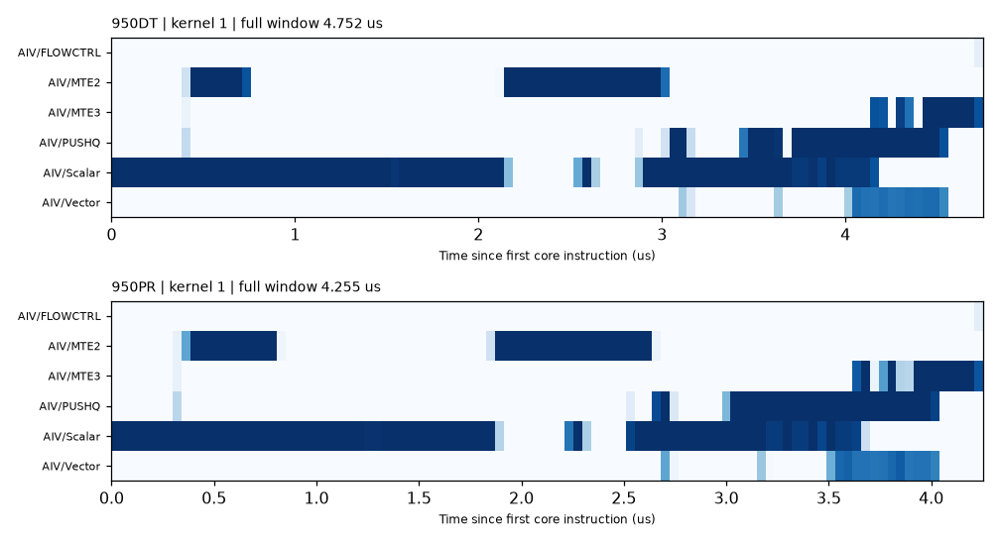

# mHC Post 算例

## 模型与实际库流水对照


本卡 shape 为 `[1, 4, 128]`，950PR 模型 **4.167 µs**，完整 CA **4.255 µs**，有符号误差 -2.05%。上栏画出当前预测器能够辨识的阶段时长。只返回一个阶段的路线保留整段预测；多个暴露阶段按贡献累计，模型尚未辨识它们的具体指令发起点。下栏用实际库 trace 的最后完成核逐队列展开，黑色刻度来自真实 DMA 或 MMAD 发起。 [图上每段的时间与 trace 指纹](../../results/v0.20/examples/mhc_post-pr.json)

输入轴顺序为 **T,N,D**。本例比较同一输入契约在 950DT、950PR 与假设的 970DT 上的设备指令窗口。

```python
from operator_model import estimate

shape = [1, 4, 128]
attrs = {'dtype': 'bf16', 'has_h_res': True}
for chip in ('Ascend950DT_9582', 'Ascend950PR_957b', 'Ascend970DT'):
    r = estimate('mhc_post', shape, attrs, chip=chip, dtype='bf16', timing_mode='auto')
    print(r.latency_us, r.status, r.active_aic, r.active_aiv, r.work)
```

## 输入到工作量

该路线调用 CANN 9.2.1 的 ops-transformer 算子族。实际调用接口为 `aclnnMhcPost`。
工作量接口给出的 Cube 操作为 0，Vector 计数为 5,120。逻辑读/写分别为 1360 / 1024 B。此处 None 表示缺少计数；片外实际流量须另行观测，逻辑字节不含中间层重复搬运。

## 分块、资源和关键路径

按每核 W=ceil(1/64)=1 行分配。T<32 时从 J=1 起，只要 ceil(D/J)>256 且 T·J≤32 就把 J 翻倍。此例 J=1，A=J·ceil(T/W)=1 个 AIV，每片 d=ceil(128/1)=128 列。每条 64 列向量组要做 N 路残差混合与一路外部贡献。SIMD 单位 W·ceil(d/64)·N(N+1)=40，每核主读 2WNd/1024=1.0000 KiB。

从 DT 最晚结束的 AIV 取各阶段暴露时间。43 个开发 shape 按分支校准，逐阶段作非负 soft-L1 拟合（转折 0.1 µs）。三截距 b 对应首次、扩核、复用，单位 µs，s 为 µs/工作单位，e 为 µs/多一行。每格使用 b+sX+e(W−1)。参数来自 results/v0.12/post/profile.json。

| 阶段 | b 首 / 扩 / 热 (µs) | s | X 与单位 | e | 本例阶段 µs |
|---|---|---|---|---|---|
| arrival | 0.05221 / 0.70092 / 0.02598 | 0.000000 | 0.0000 log₂(A) | 0.00000 | 0.70092 |
| SCALAR | 1.95783 / 1.62016 / 0.97661 | 0.000000 | 0.0000 每核额外行 | 0.00000 | 1.62016 |
| SIMD | 1.15195 / 0.76710 / 0.56852 | 0.001675 | 40.0000 向量工作组 | 0.00000 | 0.83409 |
| MTE2 | 1.22703 / 0.72395 / 0.34292 | 0.000000 | 1.0000 每核主输入 KiB | 0.00000 | 0.72395 |
| MTE3 | 0.25624 / 0.25624 / 0.25624 | 0.000000 | 1.0000 全片主输出 KiB | 0.00000 | 0.25624 |
| other | 0.00910 / 0.00910 / 0.00910 | 0.000000 | 0.0000 无可变单位 | 0.00000 | 0.00910 |

首/扩/热总设备时间分别 4.7213、4.1445、2.2464 µs。该分组首/扩/热的观察次数为 4/2/2，按状态总时长排序取频数加权中位数，选中 expand。

970DT 的算子实现与分片延用 DT 模板。先算 DT 各段的暴露时间，共 4.14446 µs。设备配置取 configs/chips/Ascend970DT.json。目标有 120 个 AIV、1.8 GHz，本例预计用 1 核。控制与到达按频率比 1.65/1.8=0.91667；SIMD 按实际 dtype 的每核峰值比及波数，倍率 0.91553。

每次调用逻辑总读写 2384 B，芯片级带宽占比代理 p=min(1,2384/(1000×4000×4.14446))=0.00014。MTE2/MTE3 倍率是 (1−p)×局部价格比+p×4000/14400，得到 0.91657/0.91657；局部部分在未指定两端 MTE 速率时取频率比×波数比。该项使用全片逻辑读写量作代理。

| 阶段 | DT 暴露 µs | 目标价格倍率 | 970 外推 µs |
|---|---|---|---|
| arrival | 0.70092 | 0.91667 | 0.64251 |
| SCALAR | 1.62016 | 0.91667 | 1.48514 |
| SIMD | 0.83409 | 0.91553 | 0.76363 |
| MTE2 | 0.72395 | 0.91657 | 0.66355 |
| MTE3 | 0.25624 | 0.91657 | 0.23486 |
| other | 0.00910 | 0.91667 | 0.00834 |

六段相加得到 DT 4.14446 µs、970DT 3.79804 µs。arrival 是最晚结束核的到达偏移，other 是未归入已知流水的区间；DT 原始重叠已按 SIMD→MTE3→MTE2→SCALAR 唯一归属，合计时只算一次。

## 设备时间及误差

| 平台 | 模型 (µs) | CA (µs) | 有符号误差 | 预测 AIC / AIV | CA AIC / AIV |
|---|---:|---:|---:|---|---|
| 950DT | 4.14446 | 4.75212 | -12.79% | N/A / 1 | 0 / 1 |
| 950PR | 4.16738 | 4.25455 | -2.05% | 0 / 1 | 0 / 1 |
| 970DT 外推 | 3.79804 | N/A | N/A | 0 / 1 | N/A |

DT/PR 加速比取同形耗时之比，模型 0.9945×，CA 1.1170×。正时延误差为高估。

**950DT CA**　msopprof official full trace，角色 new paired DT CA；核名 `MhcPost_59130ccee6717ff2c0f15b485e731162_5`。该宿主的数值检查共 1 组；子算子切片共享宿主检查。各设备窗以最早到最晚核指令计，多 kernel 取串行窗之和。

**950PR CA**　msopprof official full trace，角色 frozen PR holdout；核名 `MhcPost_59130ccee6717ff2c0f15b485e731162_5`。该宿主的数值检查共 1 组；子算子切片共享宿主检查。各设备窗以最早到最晚核指令计，多 kernel 取串行窗之和。

## CA 流水与模型差距



横轴为每次 kernel 自身的设备时间，两端各自从零开始。每种核取最晚结束的一个核。每行按该队列有效指令区间的并集着色，100 个等宽时间格，深蓝表示格内占满。不同队列可重叠，行长不能相加。DMA/FIX 行表示描述符的在途窗口，可能包含等待依赖的时间；颜色深度不能直接换算 HBM 总线利用率。

950DT 第 1 段 4.7521 µs；所选核上占用最长的队列为 AIV/Scalar 3.5261 µs、AIV/MTE2 1.2285 µs、AIV/PUSHQ 1.2067 µs。
950PR 第 1 段 4.2545 µs；所选核上占用最长的队列为 AIV/Scalar 3.1085 µs、AIV/MTE2 1.2303 µs、AIV/PUSHQ 1.1412 µs。

PR 的模型与 CA 相差 -0.0872 µs。小 token、宽通道的首次、扩核与热态首发控制不同；未提供 resident_aiv 时输出为多个状态的综合估计。上图给出可观测的队列活动；一次端到端差值无法唯一分摊到这些因素。

[总建模方法](../modeling-strategy.md) · [全部 shape 的误差](../error-analysis.md) · [970DT 配置与来源](../../configs/chips/Ascend970DT.json)
