# mHC Post 算例

给定同一个 [1,4,192]，950DT 的首次与紧邻复跑分别实测 4.528、1.742 µs。复跑时通道片两笔有效输入是 384 与 1536 B，四笔 384 B 输出分别归属四路残差。条件接口 `estimate_post_history([1,4,192]).scenarios["repeat"].latency_us` 给出 1.889 µs。已有服务日志可通过 `expected_us` 传入不同前序的频率求系统平均。[逐笔读写、条件公式及价格来源](../../results/v0.28/post/report.md)

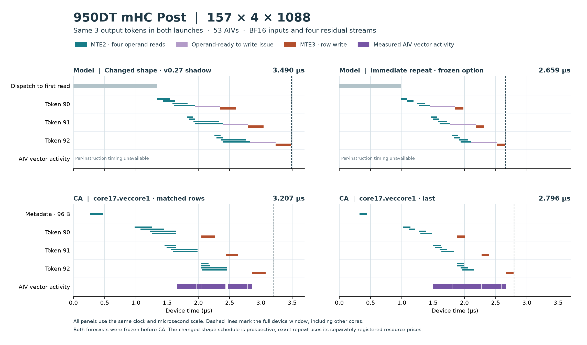

在 [157,4,1088] 上，末三行的窗口可以区分普通换形与同形紧邻重复。图中比较同一物理核的 token 90–92，活动 AIV 均为 53。两种前序分别得到 **3.490 / 3.207 µs** 和 **2.659 / 2.796 µs**（冻结预测 / CA）。换形的右端终点取全核中最后退出的 core25.veccore0。[逐行地址和两份冻结依据](../../results/v0.27/post/unseen-same-token.json)

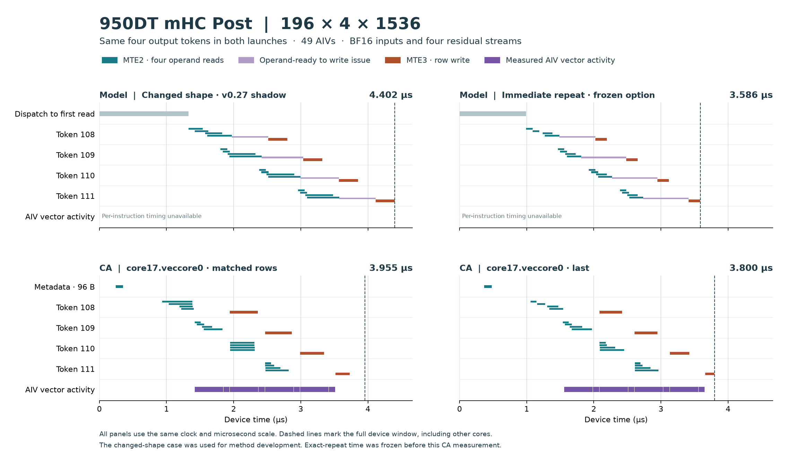

950DT 上的内置 Post `[196,4,1536]`，左右画同一个 core17.veccore0、同样的 token 108–111。左边前一次输入为 [181,4,1024]，属于普通换形，开发回放预测 **4.402 µs**、CA **3.955 µs**；右边是紧邻同形的事前预测 **3.586 µs**、CA **3.800 µs**。两列都用所有核决定结束，左列最后退出的是 core11.veccore1，右列才是图示核。普通换形首行到次行读发起间隔为 **0.476 / 0.484 µs**（模型 / CA）。[同一地址上的读写与前序证据](../../results/v0.27/post/same-token-history.json) · [参数与各组误差](../../results/v0.27/post/report.md)

## 5120 列为什么要拆两片

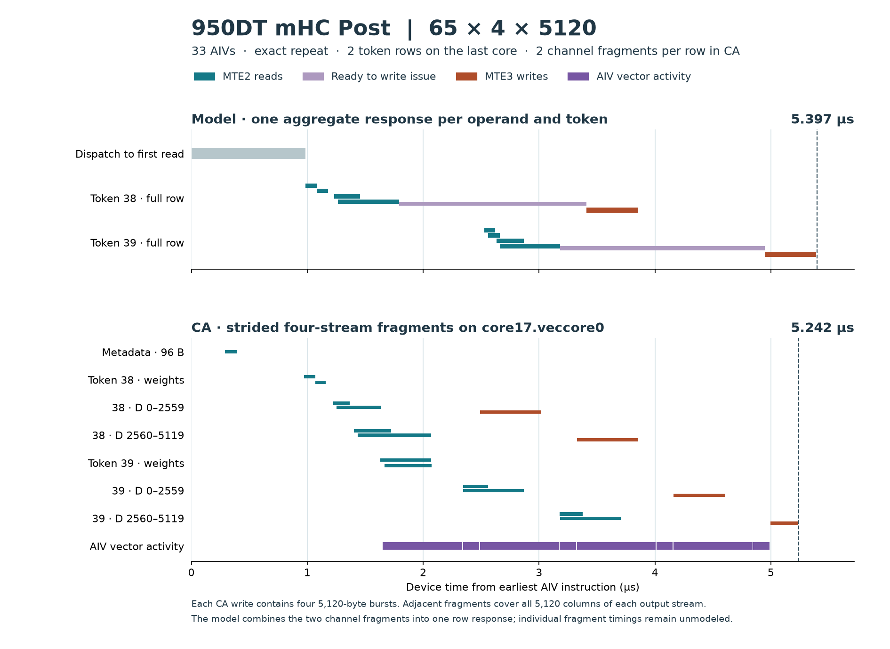

两次连续执行 BF16 [65,4,5120]。温态重复在 DT 的可选模型 / CA 为 5.397 / 5.242 µs，在 PR 为 5.481 / 5.278 µs。上栏只能给每 token 的聚合排程，下栏可按实际写地址识别两片。若前一次是 [121,4,1216]，同一输入的旧 MTE2 互斥价格在 DT 多算 2.513 µs，在 PR 多算 2.629 µs。这部分依然影响普通热态。[如何使用有序前序及阶段计算](../../results/v0.26/post/report.md) · [两端 MTE2、SIMD 等逐项偏差](../../results/v0.26/post/wide-stages.md)

## 末核上的四个连续 token

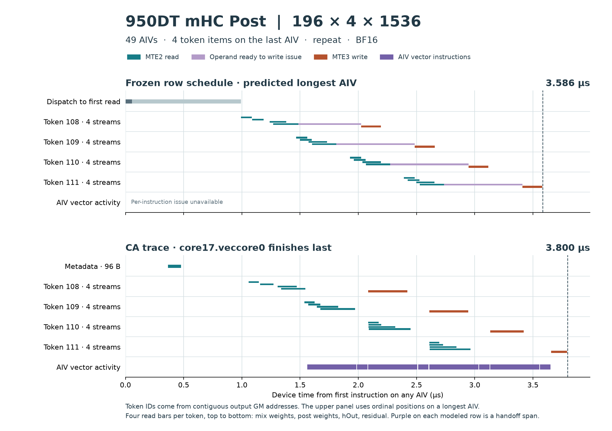

[196,4,1536] 由 49 个 AIV 分担，同形紧邻重复时，core17.veccore0 最后退休。该核处理第 108–111 个 token，四行的 16 个输入 DMA 和 4 笔输出可按 GM 地址一一配对。候选预测 3.586 µs，CA 为 3.800 µs（−5.62%）。同形重复可观察到稳态的读写发起间隔，其它前序另行比较。[逐 token 地址与各阶段时间](../../results/v0.25/post/four-token-repeat.json) · [已冻结的部署条件](../../results/v0.25/post/repeat-policy.md)

## 每核处理两个 token 时，第二个读能否盖住前一个写

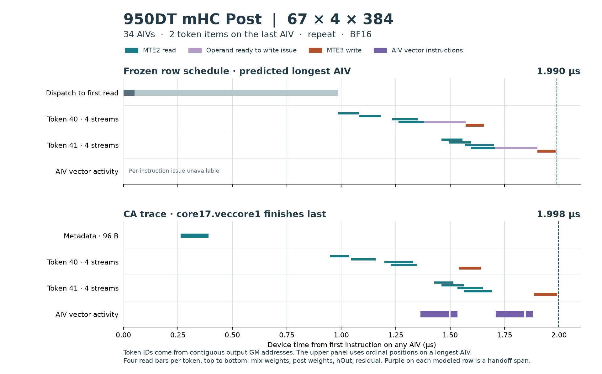

950DT，内置 `aclnnMhcPost`，BF16 输入 [67,4,384]。末核的两个 token 对应第 40、41 行。每一行的四组读是 64 B、16 B、768 B 和 3072 B，写 3072 B。把每轮读至写的响应时间简单求和，会重复计算仍在途的描述符。逐行候选分开估读发起间隔、返回延迟和末笔写完成，在紧邻同形重复的这一窗给出 1.990 µs，实测 1.998 µs。普通复用时，同一 shape 却是 3.071 / 2.407 µs。两种前序各自进入冻结统计，候选资格及其余 shape 在明细表更新。[逐行地址和时间](../../results/v0.25/post/two-token-repeat.json) · [公开模型和候选的同集对照](../../results/v0.25/post/report.md)


## 同一个 token 的四条输出流

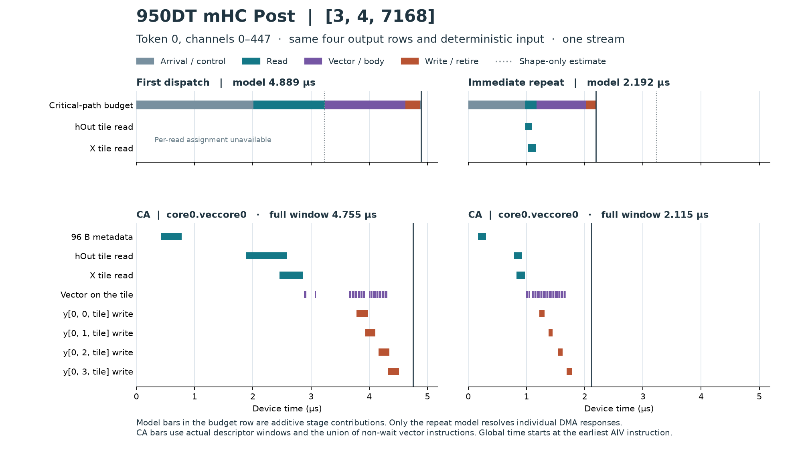

[3,4,7168] 中间轴是 4 条残差流，末轴用实际模型的 7,168 个通道。在 CA 中按四笔 MTE3 目标地址还原 y[0,0…3,0:448]，上栏也对应这同一片。首次原模型 / 候选 / CA 为 4.889 / 4.889 / 4.755 µs；同形立即重复时，候选 / CA 为 2.192 / 2.115 µs。两次调用之间只隔同一流的完成边界。上栏空行表示该分支没有建到该指令的细度。公开模型与冻结候选的独立同集数据见本轮报告。[核地址、阶段与证据](../../results/v0.24/post/report.md) · [较小的 192 列对照](../../results/v0.24/post/post-small-pipeline.png)


### 五个 token 连续跑时，误差集中在哪两条流水

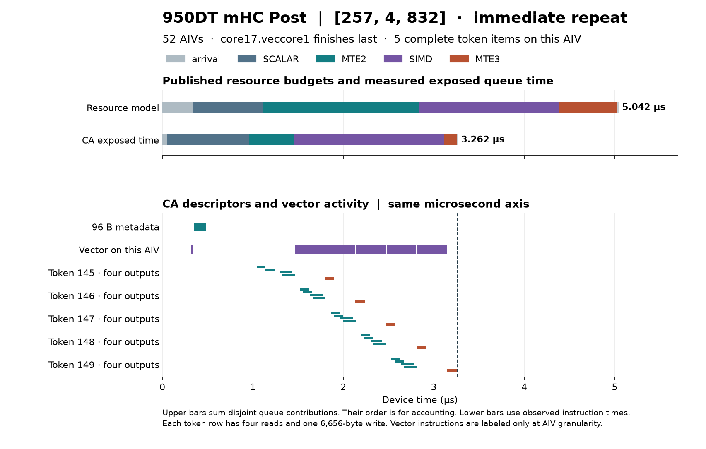

950DT [257,4,832] 热重复。上栏是各队列的累计分账，不提供单轮起止；下栏才是五轮的实际发起和完成时标。实际末核 core17.veccore1 负责 token 145–149，各有四笔读、一笔 6,656 B 写。第二轮在 1.524 µs 已读，第一轮的写直到 1.898 µs 才结束。全核预测 5.042 µs，CA 3.262 µs（+54.57%）。按公开模型同一套队列归属规则拆分，MTE2 多计 1.234 µs、MTE3 多计 0.502 µs。这个样本说明多轮情况下，读、写能否交错比一个统一的热启动常数更重要。[五轮地址、发起间隔与同口径误差表](../../results/v0.24/post/multirow.md)

## 同一个库调用连续派发两次

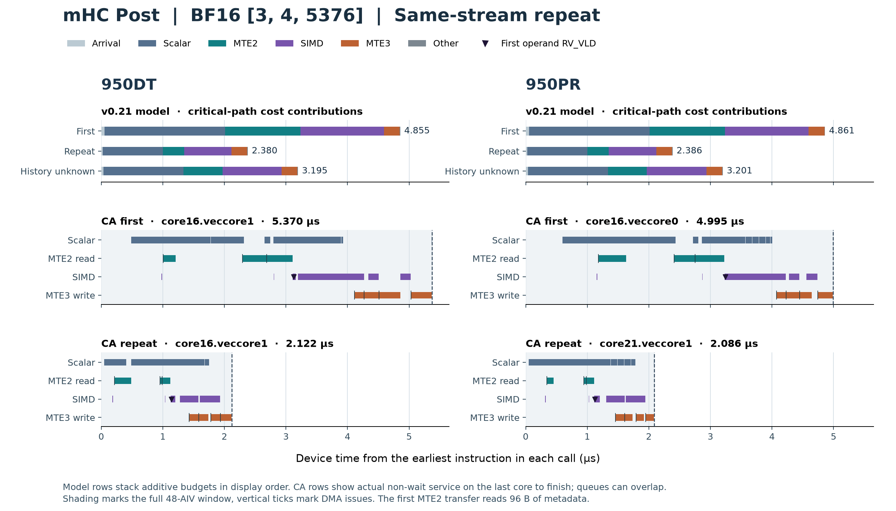

BF16 [3,4,5376] 在同一流上连续运行两次，输入的值、布局与属性相同。每次重新分配张量。四个窗口都调用同一 ELF，使用 48 个 AIV，64,512 个输出全部通过数值检查。DT 首次和第二次实测分别为 5.370 和 2.122 µs；PR 为 4.995 和 2.086 µs。设两次实测分别为长窗 L、短窗 S。只输入 shape、dtype 和芯片，模型给两次同一预测；其最大相对误差的理论最小值是 (L−S)/(L+S)，在 DT 为 43.34%，PR 为 41.08%。任何同时包含这两个点的验证集都继承这一最大误差下界。其他 shape 加入后，整组 WAPE 需要重新计算。

系统仿真按真实顺序调用 `OperatorStream.advance` 时，首次/第二次的有符号误差在 DT 降至 −9.58% / +12.15%，在 PR 为 −2.68% / +14.37%。此输入可以直接从系统已维护的派发顺序得到。[逐核流水、可行预测区间与实测](../../results/post-candidate/paired-result.md) · [系统调用方法](../integration.md#从系统的调用顺序恢复启动状态)


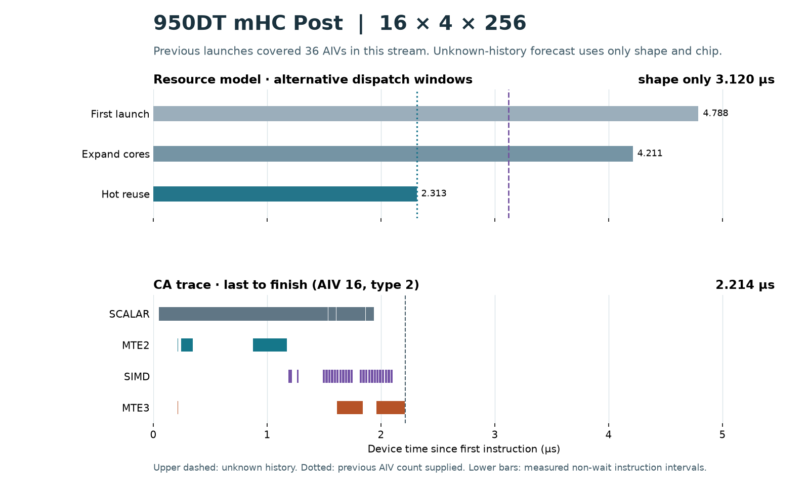

取同一个 BF16 调用 [16,4,256]。16 个 token 按 16 个 AIV 各一行分配，通道宽恰为 256，每核有 4×4×5=80 个 64-lane 向量工作组。DT、PR 的整形逻辑读 42,240 B、写 32,768 B。已测接口是 ops-transformer 的 `aclnnMhcPost`。DT 旧序列的先前覆盖为 36 AIV，此次复用；PR 的正式进程中它是首次调用。形状相同，两种调度状态在 CA 中分别耗时 2.214 和 4.255 µs。上栏对照可由 shape 得到的三种候选时间，不同颜色的线分别表示未知历史及已知历史预测。下栏为真实退休指令区间。[图上时间与 DB 指纹](../../results/v0.21/dispatch/mhc_post-state.json)

```python
from operator_model import estimate
r = estimate('mhc_post', [16,4,256], chip='Ascend950DT_9582')
print(r.work, r.projection['timing_diagnostics']['context_predictions_us'])
warm = estimate('mhc_post', [16,4,256], {'resident_aiv':36}, chip='Ascend950DT_9582')
```

在 DT 上，给出历史时热态点值 2.313 µs，未知历史时初次与热态估计 4.788、2.313 µs，调和中心为 3.120 µs，对该热窗仍高估 40.9%。PR 无提示为 3.124 µs，指定首发则为 4.792 µs；970DT 无提示为 2.859 µs，只有外推。相同 shape 的实际首发与热态之比是一个可检验的限制。把输入固定后，无状态预测器有最小可能最大误差 (最大窗−最小窗)/(最大窗+最小窗)；较早的首发与生产链配对中，DT 和 PR 各有一对达到 28.03%、22.96%。同流 Post→Post 新实测给出了更高的下界，见本页首图。系统知道调度顺序时可用 OperatorStream，仅已提交的调用更新状态。[成对指令、冷暖窗口与下界](../../results/v0.21/dispatch/post-identifiability.json) · [流式调用方法](../integration.md#从系统的调用顺序恢复启动状态)

## 第一条读发起以后，时间差落在哪里

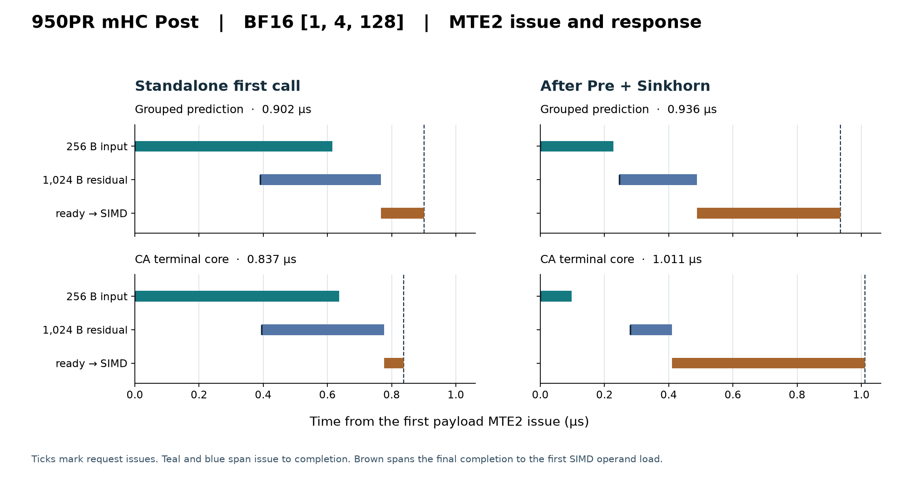

取 950PR 的 [1,4,128]，按该核的首条操作数 DMA 发起对齐。独立首发时，两笔操作数读相隔 0.395 µs；接在 Pre 和 Sinkhorn 后是 0.279 µs。第二种情形读响应较快，但最后一次读完成到首条向量装载中间的间隔却从 0.060 增到了 0.601 µs。图中的局部时标揭示这两项作用方向相反。总耗时仍用全核首指令至末指令的窗口计分。[不同协议的全窗与候选预测](../../results/post-candidate/issue-response.md)

## v0.20 阶段校准的历史算例


## 模型与实际库流水对照

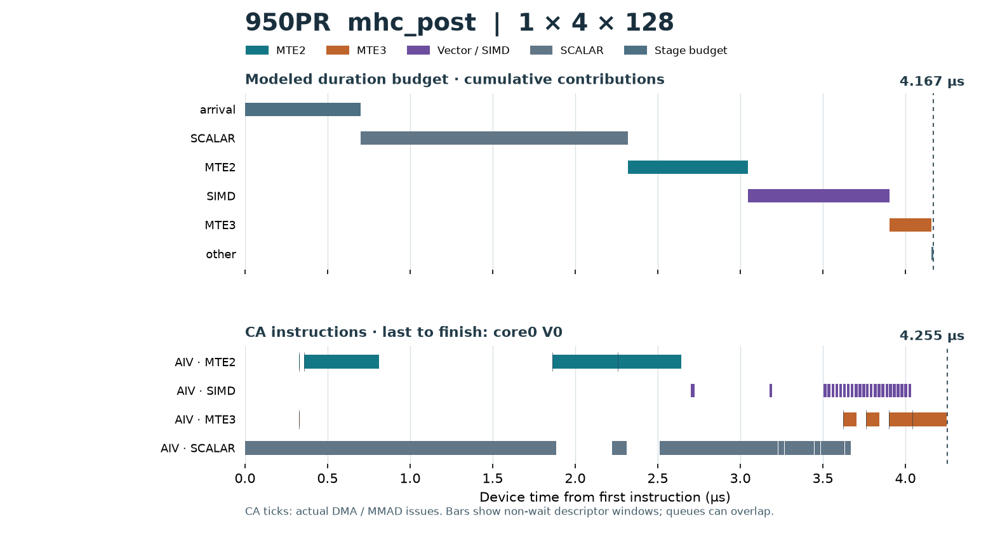

本卡 shape 为 `[1, 4, 128]`，950PR 模型 **4.167 µs**，完整 CA **4.255 µs**，有符号误差 -2.05%。上栏画出当前预测器能够辨识的阶段时长。只返回一个阶段的路线保留整段预测；多个暴露阶段按贡献累计，模型尚未辨识它们的具体指令发起点。下栏用实际库 trace 的最后完成核逐队列展开，黑色刻度来自真实 DMA 或 MMAD 发起。 [图上每段的时间与 trace 指纹](../../results/v0.20/examples/mhc_post-pr.json)

输入轴顺序为 **T,N,D**。本例比较同一输入契约在 950DT、950PR 与假设的 970DT 上的设备指令窗口。

```python
from operator_model import estimate

shape = [1, 4, 128]
attrs = {'dtype': 'bf16', 'has_h_res': True}
for chip in ('Ascend950DT_9582', 'Ascend950PR_957b', 'Ascend970DT'):
    r = estimate('mhc_post', shape, attrs, chip=chip, dtype='bf16', timing_mode='auto')
    print(r.latency_us, r.status, r.active_aic, r.active_aiv, r.work)
```

## 输入到工作量

该路线调用 CANN 9.2.1 的 ops-transformer 算子族。实际调用接口为 `aclnnMhcPost`。
工作量接口给出的 Cube 操作为 0，Vector 计数为 5,120。逻辑读/写分别为 1360 / 1024 B。此处 None 表示缺少计数；片外实际流量须另行观测，逻辑字节不含中间层重复搬运。

## 分块、资源和关键路径

按每核 W=ceil(1/64)=1 行分配。T<32 时从 J=1 起，只要 ceil(D/J)>256 且 T·J≤32 就把 J 翻倍。此例 J=1，A=J·ceil(T/W)=1 个 AIV，每片 d=ceil(128/1)=128 列。每条 64 列向量组要做 N 路残差混合与一路外部贡献。SIMD 单位 W·ceil(d/64)·N(N+1)=40，每核主读 2WNd/1024=1.0000 KiB。

从 DT 最晚结束的 AIV 取各阶段暴露时间。43 个开发 shape 按分支校准，逐阶段作非负 soft-L1 拟合（转折 0.1 µs）。三截距 b 对应首次、扩核、复用，单位 µs，s 为 µs/工作单位，e 为 µs/多一行。每格使用 b+sX+e(W−1)。参数来自 results/v0.12/post/profile.json。

| 阶段 | b 首 / 扩 / 热 (µs) | s | X 与单位 | e | 本例阶段 µs |
|---|---|---|---|---|---|
| arrival | 0.05221 / 0.70092 / 0.02598 | 0.000000 | 0.0000 log₂(A) | 0.00000 | 0.70092 |
| SCALAR | 1.95783 / 1.62016 / 0.97661 | 0.000000 | 0.0000 每核额外行 | 0.00000 | 1.62016 |
| SIMD | 1.15195 / 0.76710 / 0.56852 | 0.001675 | 40.0000 向量工作组 | 0.00000 | 0.83409 |
| MTE2 | 1.22703 / 0.72395 / 0.34292 | 0.000000 | 1.0000 每核主输入 KiB | 0.00000 | 0.72395 |
| MTE3 | 0.25624 / 0.25624 / 0.25624 | 0.000000 | 1.0000 全片主输出 KiB | 0.00000 | 0.25624 |
| other | 0.00910 / 0.00910 / 0.00910 | 0.000000 | 0.0000 无可变单位 | 0.00000 | 0.00910 |

首/扩/热总设备时间分别 4.7213、4.1445、2.2464 µs。该分组首/扩/热的观察次数为 4/2/2，按状态总时长排序取频数加权中位数，选中 expand。

970DT 的算子实现与分片延用 DT 模板。先算 DT 各段的暴露时间，共 4.14446 µs。设备配置取 configs/chips/Ascend970DT.json。目标有 120 个 AIV、1.8 GHz，本例预计用 1 核。控制与到达按频率比 1.65/1.8=0.91667；SIMD 按实际 dtype 的每核峰值比及波数，倍率 0.91553。

每次调用逻辑总读写 2384 B，芯片级带宽占比代理 p=min(1,2384/(1000×4000×4.14446))=0.00014。MTE2/MTE3 倍率是 (1−p)×局部价格比+p×4000/14400，得到 0.91657/0.91657；局部部分在未指定两端 MTE 速率时取频率比×波数比。该项使用全片逻辑读写量作代理。

| 阶段 | DT 暴露 µs | 目标价格倍率 | 970 外推 µs |
|---|---|---|---|
| arrival | 0.70092 | 0.91667 | 0.64251 |
| SCALAR | 1.62016 | 0.91667 | 1.48514 |
| SIMD | 0.83409 | 0.91553 | 0.76363 |
| MTE2 | 0.72395 | 0.91657 | 0.66355 |
| MTE3 | 0.25624 | 0.91657 | 0.23486 |
| other | 0.00910 | 0.91667 | 0.00834 |

六段相加得到 DT 4.14446 µs、970DT 3.79804 µs。arrival 是最晚结束核的到达偏移，other 是未归入已知流水的区间；DT 原始重叠已按 SIMD→MTE3→MTE2→SCALAR 唯一归属，合计时只算一次。

## 设备时间及误差

| 平台 | 模型 (µs) | CA (µs) | 有符号误差 | 预测 AIC / AIV | CA AIC / AIV |
|---|---:|---:|---:|---|---|
| 950DT | 4.14446 | 4.75212 | -12.79% | N/A / 1 | 0 / 1 |
| 950PR | 4.16738 | 4.25455 | -2.05% | 0 / 1 | 0 / 1 |
| 970DT 外推 | 3.79804 | N/A | N/A | 0 / 1 | N/A |

DT/PR 加速比取同形耗时之比，模型 0.9945×，CA 1.1170×。正时延误差为高估。

**950DT CA**　msopprof official full trace，角色 new paired DT CA；核名 `MhcPost_59130ccee6717ff2c0f15b485e731162_5`。该宿主的数值检查共 1 组；子算子切片共享宿主检查。各设备窗以最早到最晚核指令计，多 kernel 取串行窗之和。

**950PR CA**　msopprof official full trace，角色 frozen PR holdout；核名 `MhcPost_59130ccee6717ff2c0f15b485e731162_5`。该宿主的数值检查共 1 组；子算子切片共享宿主检查。各设备窗以最早到最晚核指令计，多 kernel 取串行窗之和。

## CA 流水与模型差距


横轴为每次 kernel 自身的设备时间，两端各自从零开始。每种核取最晚结束的一个核。每行按该队列有效指令区间的并集着色，100 个等宽时间格，深蓝表示格内占满。不同队列可重叠，行长不能相加。DMA/FIX 行表示描述符的在途窗口，可能包含等待依赖的时间；颜色深度不能直接换算 HBM 总线利用率。

950DT 第 1 段 4.7521 µs；所选核上占用最长的队列为 AIV/Scalar 3.5261 µs、AIV/MTE2 1.2285 µs、AIV/PUSHQ 1.2067 µs。
950PR 第 1 段 4.2545 µs；所选核上占用最长的队列为 AIV/Scalar 3.1085 µs、AIV/MTE2 1.2303 µs、AIV/PUSHQ 1.1412 µs。

PR 的模型与 CA 相差 -0.0872 µs。小 token、宽通道的首次、扩核与热态首发控制不同；未提供 resident_aiv 时输出为多个状态的综合估计。上图给出可观测的队列活动；一次端到端差值无法唯一分摊到这些因素。

[总建模方法](../modeling-strategy.md) · [全部 shape 的误差](../error-analysis.md) · [970DT 配置与来源](../../configs/chips/Ascend970DT.json)

同样的宽度，两次换形和紧邻重复的实测设备时间相差不到 0.3 µs。普通换形若使用已冻结的普通热态阶段价格和跨行重叠排程，[65,4,5120] 的开发回放由 DT +58.52% 降为 +10.75%、PR +57.22% 降为 +10.16%。现有队列将对其余符合条件的换形独立打分；这组候选单独保留。[相同实际窗口、预测输入和前序合同](../../results/v0.26/post/warm-schedule.md)
