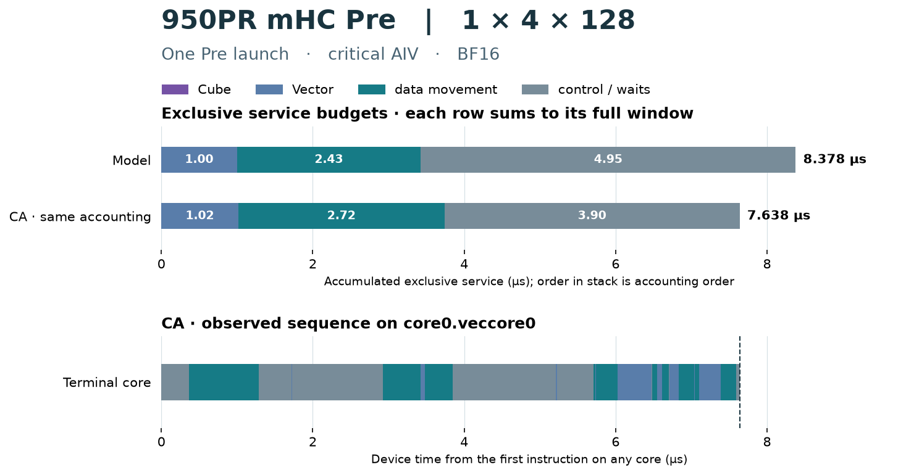
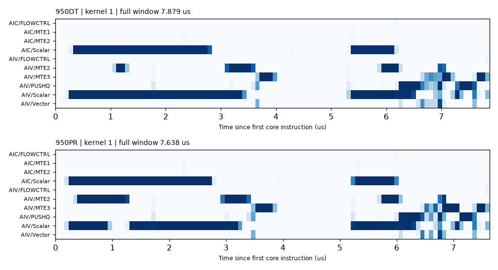

# mHC Pre 算例

Flash D=5120、T=512 时，950DT 将 FP32 投影分配到 2 个 M 组和 16 个 K 组。每 AIC 处理局部 256 行与 K=1280，后继 AIV 每忙核最多归约 8 行。公开全量缩放 2512.514 µs，源码和旧指令驱动的阶段候选 56.427 µs，当前大形仍待 CA。[逐组分核、阶段参数和双端检查](../../results/v0.29/large/fusion/report.md)

## 关键核的资源分摊与实际指令顺序



BF16 `[T,N,D]=[1,4,128]`，950PR 预测 **8.378 µs**，CA **7.638 µs**，高估 **0.740 µs（9.69%）**。上图把模型和 CA 都按四类互斥成本划分，上栏的横轴是累计占用时间；下栏才是按实际发起时间排列的指令窗。当前 Pre 模型对每类时长给出估计，尚无单条指令的排程。库接口为 `aclnnMhcPre`，实际执行 `MhcPre_52e042c374f575edbe357a32523dba2c_2_mix_aic`。测量取 mHC 链第一项 Pre 的整窗。

| 末核独占时间 µs | 模型 | CA | 模型减 CA |
|---|---:|---:|---:|
| Cube | 0.000 | 0.000 | 0.000 |
| Vector | 0.998 | 1.015 | −0.017 |
| 数据搬运 | 2.428 | 2.725 | −0.297 |
| 控制与等待 | 4.952 | 3.898 | +1.055 |

CA 上最后完成的是 AIV `core0.veccore0`。从所有核的共同起点开始，若该核多个流水同时执行，先计 Cube，再计 SIMD，再计 MTE/FIXP，其余时间归控制及等待。全芯片实测还有 16 条 MMAD，末核的 Cube 独占时间为零。10 个缺少队列分类的 trace 事件按剩余控制处理，对该分摊的时长影响上限 0.0031 µs。模型在控制与等待上多计约 1.06 µs，部分抵消了搬运的低估。[互斥区间、总窗、指纹与参数](../../results/v0.21/fusion/mhc-pre-exclusive-pr.json) · [复算与重绘](../../development/validation/fusion21/pre_budget_figure.py)

输入轴顺序为 **T,N,D**。本例比较同一输入契约在 950DT、950PR 与假设的 970DT 上的设备指令窗口。

```python
from operator_model import estimate

shape = [1, 4, 128]
attrs = {'dtype': 'bf16', 'alpha_count': 3, 'has_gamma': False, 'return_intermediates': True}
for chip in ('Ascend950DT_9582', 'Ascend950PR_957b', 'Ascend970DT'):
    r = estimate('mhc_pre', shape, attrs, chip=chip, dtype='bf16', timing_mode='auto')
    print(r.latency_us, r.status, r.active_aic, r.active_aiv, r.work)
```

## 输入到工作量

该路线调用 CANN 9.2.1 的 ops-transformer 算子族。实际调用接口为 `aclnnMhcPre`。
工作量接口给出的 Cube 操作为 24,576，Vector 计数为 2,010。逻辑读/写分别为 50284 / 452 B。此处 None 表示缺少计数；片外实际流量须另行观测，逻辑字节不含中间层重复搬运。

## 分块、资源和关键路径

该例为 `mhc_pre[1, 4, 128]`，dtype=bf16，属性 `{'alpha_count': 3, 'has_gamma': False, 'return_intermediates': True}`。Pre 投影把宽 512 的残差映到 24 个系数，HF32 计算量 2×1×512×24。有用 Cube 运算 {'fp32': 24576}、Vector 运算 {'fp32': 2010} （FMA 算 2），逻辑读/写 50284/452 B。字节数不含缓存重读。

DT 为 32/64 个 C/V 核、1.65 GHz，970 为 120/120、1.8 GHz。对固定参考库路线，计算价用每核峰值比 × 目标/参考波数比；控制价用时钟比 1.65/1.8=0.91667。搬运价=(1−p)·本地价+p·4000/14400，缺 MTE 带宽时用时钟与波数作本地价。只有 Cube/Vector 总峰值且可比时才用其比值；混合 dtype 以各自工作量加权。该路线没有直接定价 970 的 L2 命中或重新编译 tiling；970 时间是 DT 阶段模板外推，不是独立的目标硬件资源仿真。

**pre：从输入到阶段净时延**

阶段 `pre`、分支 `mk`。K=N·D=512；K≥512 的 MK 分支按 Kc=256⌈K/(32×256)⌉=256，单核计算代理 ⌈T/16⌉⌈Kc/32⌉；K<512 的 ND 分支则用 ⌈T/32⌉⌈K/256⌉。向量 ⌈T/64⌉⌈D/256⌉；流量 [4K(N²+2N)+2TK]/1024 KiB；控制 ⌈T/16⌉。

分配代理 Cube/Vector jobs=2/1，Cube 波 1→1，Vector 波 1→1；970 活跃核代理 (C,V)=(2, 1)。逻辑读写 50736 B，阶段 DT 时间 8.37761 µs，外存权重 p=min(1,50736/(1000×4000×8.37761))=0.00151。目标时价系数 `CUBE / SIMD / MTE1 / MTE2 / MTE3 / FIXP / SCALAR / IDLE` = `0.91667 / 0.91553 / 0.91667 / 0.91570 / 0.91570 / 0.91667 / 0.91667 / 0.91667`。 vector 参考/目标每核峰值比（整片 TOPS÷同类核数）：fp32 (27/64)/(55.296/120)=0.91553。 有缺项时按相同每核每周期处理量回退：cube fp32。

下表每行的截距 a（µs）是可见固定成本；b（µs/单位）乘对应工作 x。DT 项=a+bx；970 项=a·fSCALAR+bx·f队列。各行对应互斥时间，不能再取最大值。

| 资源项 / 目标队列 | x | a | b | DT µs | 970 µs |
|---|---:|---:|---:|---:|---:|
| compute / CUBE | 8 | 0.000000 | 0.000000 | 0.00000 | 0.00000 |
| vector / SIMD | 1 | 0.998017 | 0.000000 | 0.99802 | 0.91485 |
| traffic / MTE2 | 49 | 2.314089 | 0.002312 | 2.42736 | 2.22497 |
| control / SCALAR | 1 | 3.699636 | 1.252606 | 4.95224 | 4.53956 |

参考参数：`results/v0.9/mhc/model.json → stages.pre.mk`，归档窗口及身份见同目录 `freeze.json`。本段加和 DT 8.37761、970 7.67937 µs。0 斜率只说明独占阶段未识别出这一项；依赖 Cube 的等待可以被计入控制。

按实际阶段顺序相加：DT 8.37761 = **8.37761 µs**；970 7.67937 = **7.67937 µs**。窗口只含本 rank 的单个库 kernel。

## 设备时间及误差

| 平台 | 模型 (µs) | CA (µs) | 有符号误差 | 预测 AIC / AIV | CA AIC / AIV |
|---|---:|---:|---:|---|---|
| 950DT | 8.37761 | 7.87879 | +6.33% | N/A / N/A | 32 / 64 |
| 950PR | 8.37793 | 7.63758 | +9.69% | 2 / 1 | 28 / 56 |
| 970DT 外推 | 7.67937 | N/A | N/A | 2 / 1 | N/A |

DT/PR 加速比取同形耗时之比，模型 1.0000×，CA 1.0316×。正时延误差为高估。

**950DT CA**　msopprof official full trace，角色 new paired DT CA；核名 `MhcPre_52e042c374f575edbe357a32523dba2c_2_mix_aic`。该宿主的数值检查共 9 组；子算子切片共享宿主检查。各设备窗以最早到最晚核指令计，多 kernel 取串行窗之和。

**950PR CA**　msopprof official full trace，角色 frozen PR holdout；核名 `MhcPre_52e042c374f575edbe357a32523dba2c_2_mix_aic`。该宿主的数值检查共 9 组；子算子切片共享宿主检查。各设备窗以最早到最晚核指令计，多 kernel 取串行窗之和。

## CA 流水与模型差距



横轴为每次 kernel 自身的设备时间，两端各自从零开始。每种核取最晚结束的一个核。每行按该队列有效指令区间的并集着色，100 个等宽时间格，深蓝表示格内占满。不同队列可重叠，行长不能相加。DMA/FIX 行表示描述符的在途窗口，可能包含等待依赖的时间；颜色深度不能直接换算 HBM 总线利用率。

950DT 第 1 段 7.8788 µs；所选核上占用最长的队列为 AIV/Scalar 4.7018 µs、AIC/Scalar 3.3242 µs、AIV/MTE2 1.2182 µs。
950PR 第 1 段 7.6376 µs；所选核上占用最长的队列为 AIV/Scalar 4.1436 µs、AIC/Scalar 3.3370 µs、AIV/MTE2 1.9097 µs。

PR 的模型与 CA 相差 +0.7404 µs。本路线使用 DT 的队列重叠或阶段模板；目标芯片的实际发起、核间同步和尾部任务分布可变。上图给出可观测的队列活动；一次端到端差值无法唯一分摊到这些因素。

[总建模方法](../modeling-strategy.md) · [全部 shape 的误差](../error-analysis.md) · [970DT 配置与来源](../../configs/chips/Ascend970DT.json)
