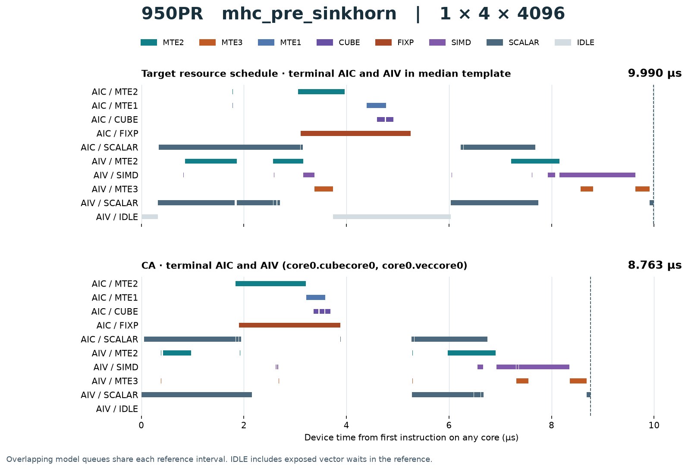

# mHC PreSinkhorn · 950PR 的 22 组 K 分块



一个 BF16 token，4 个通道，每通道宽 4096。模型预测 950PR **9.990 µs**，实际 `aclnnMhcPreSinkhorn` 的 CA 窗口 **8.763 µs**，高估 **14.00%**。上栏保留 DT 校准核各指令队列的相对重叠，用目标 tile 工作量和芯片资源重新计价；下栏分别取 PR 最晚结束的 AIC 和 AIV。两栏都从各自设备首条指令起算。[图数据、参考 DB 与 PR trace 指纹](../../results/v0.21/fusion/mhc_pre_sinkhorn-figure.json)

```python
from operator_model import estimate
r = estimate('mhc_pre_sinkhorn', (1,4,4096), {'num_iters':20, 'need_backward':False},
             dtype='bf16', chip='Ascend950PR_957b')
print(r.latency_us, r.active_aic, r.active_aiv, r.projection['target_plan'], r.work)
```

Pre 将 K=4×4096=16384 维映射为 N²+2N=24 个系数，逻辑 Cube 计算量为 2×1×16384×24=786,432 ops。后续归一化和 Sinkhorn 拥有 62,866 个逻辑 Vector 操作，整个调用读 1,605,740 B、写 8,272 B。HF32 内部计算受库实现影响。PR 实际 kernel 为 `MhcPreSinkhorn_bd8e37c67f2294e1437f03bb2bace96c_1000_mix_aic`，数值核验通过。

按 arch35 的非确定性推理 M/K tiling，M 方向组数 G=min(AIC,⌈T/256⌉)，本例 G=1；每核 M 对齐至 16。候选 K 组数 floor(AIC/G)，每核 K 取 256×⌈K/(256×候选组数)⌉。DT 分成 32 个 K512；PR 为 21 个 K768 加一个 K256 尾片。第二段 token 数少，1:2 MIX 调度的启动块数由第一段决定，实际 DT 启动 32 AIC/64 AIV，PR 启动 22/44；执行第二段 token 负载的 AIV 只有 1 个。970 的 1:1 实现假设沿用源码另一调度分支，报出 120/120 个启动核，第一段最多有 64 个 K256 数据块。参考分核源码固定在 ops-transformer 提交 14d022b1，arch35 tiling 文件的 Git blob 为 c4f0a7e6；安装包实际启动的核数由 CA 表核验。[分核实现](../../operator_model/mhc_sink_resource.py)

每个 DT 参考模板保存三类核的队列重叠。若长度 h 的区间内队列集合为 S，目标时长取 h×max(q∈S) r_q。r_Cube 随局部 M×K 和每核 Cube 吞吐变化，r_MTE1 随局部片与时钟，r_FIXP 随输出片，r_SIMD 随每核行数和每核 FP32 峰值。缺少 HF32 峰值时现用两卡的 16-bit 峰值比作代理；两张 950 卡每 AIC 16-bit 峰值相同。等待和控制按时钟比；MTE2/3 的参考重叠按每个 AIV 的行工作量近似。每个核对这些区间相加、模板取最大核、三个模板取中位数，再施加冷启动逻辑数据的带宽下限。这里 HBM 下限未超过计算窗口。这些移植假设在新代际上仍需验证，尤其是 1:1 MIX 模板和 HF32 吞吐。

| 平台 | 设备预测 µs | CA µs | 误差 | 启动 AIC / AIV |
|---|---:|---:|---:|---|
| 950DT | 9.939 | 10.108 | −1.67% | 32 / 64 |
| 950PR | 9.990 | 8.763 | +14.00% | 22 / 44 |
| 970DT 外推 | 9.109 | N/A | N/A | 120 / 120 |

旧模型把 64 个假想等长任务再除以全片核数，PR 为 11.872 µs。实际缩小的核网格改变 K 尾片和发动的工作组，只有局部片中相关资源的阶段增加。剩余约 1.23 µs 也包括从 DT 搬到 PR 的等待和线程启动差异。[全量回放及冻结留出](../../results/v0.21/fusion/evaluation.json)
