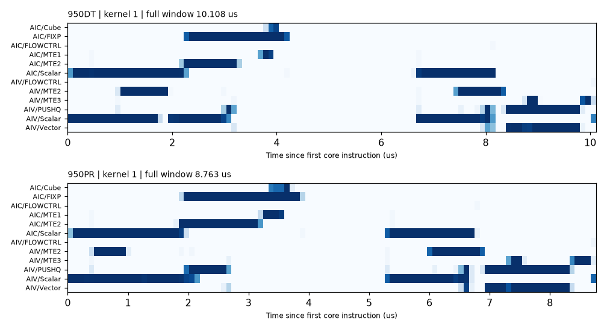

# mHC Pre Sinkhorn 算例

输入轴顺序为 **T,N,D**。本例比较同一输入契约在 950DT、950PR 与假设的 970DT 上的设备指令窗口。

```python
from operator_model import estimate

shape = [1, 4, 4096]
attrs = {'dtype': 'bf16', 'num_iters': 20, 'need_backward': False}
for chip in ('Ascend950DT_9582', 'Ascend950PR_957b', 'Ascend970DT'):
    r = estimate('mhc_pre_sinkhorn', shape, attrs, chip=chip, dtype='bf16', timing_mode='auto')
    print(r.latency_us, r.status, r.active_aic, r.active_aiv, r.work)
```

## 输入到工作量

该路线调用 CANN 9.2.1 的 ops-transformer 算子族。实际调用接口为 `aclnnMhcPreSinkhorn`。
工作量接口给出的 Cube 操作为 786,432，Vector 计数为 62,866。逻辑读/写分别为 1605740 / 8272 B。此处 None 表示缺少计数；片外实际流量须另行观测，逻辑字节不含中间层重复搬运。

## 分块、资源和关键路径

该例为 `mhc_pre_sinkhorn[1, 4, 4096]`，dtype=bf16，属性 `{'num_iters': 20, 'need_backward': False}`。Pre 投影把宽 16384 的残差映到 24 个系数，HF32 计算量 2×1×16384×24。有用 Cube 运算 {'fp32': 786432}、Vector 运算 {'fp32': 62866} （FMA 算 2），逻辑读/写 1605740/8272 B。字节数不含缓存重读。

DT 为 32/64 个 C/V 核、1.65 GHz，970 为 120/120、1.8 GHz。对固定参考库路线，计算价用每核峰值比 × 目标/参考波数比；控制价用时钟比 1.65/1.8=0.91667。搬运价=(1−p)·本地价+p·4000/14400，缺 MTE 带宽时用时钟与波数作本地价。只有 Cube/Vector 总峰值且可比时才用其比值；混合 dtype 以各自工作量加权。该路线没有直接定价 970 的 L2 命中或重新编译 tiling；970 时间是 DT 阶段模板外推，不是独立的目标硬件资源仿真。

**mhc_pre_sinkhorn：从输入到阶段净时延**

T=1, N=4, D=4096。工作按 w=1 个 DT 波归一化。投影按 ⌈ND/128⌉=128。通道处理按 ⌈D/128⌉=32。20 次 Sinkhorn 是所选合同的一部分，模板未区分任意迭代数。

本例工作代理按 `CUBE / SIMD / MTE1 / MTE2 / MTE3 / FIXP / SCALAR / IDLE` 排列为 `128, 32, 128, 32, 32, 1, 1, 1`。SCALAR/IDLE 按波计。这是队列工作单位，而非有用运算数。

分配代理 Cube/Vector jobs=64/1，Cube 波 2→1，Vector 波 1→1；970 活跃核代理 (C,V)=(64, 1)。逻辑读写 1614012 B，阶段 DT 时间 9.93939 µs，外存权重 p=min(1,1614012/(1000×4000×9.93939))=0.04060。目标时价系数 `CUBE / SIMD / MTE1 / MTE2 / MTE3 / FIXP / SCALAR / IDLE` = `0.45833 / 0.91553 / 0.45833 / 0.45100 / 0.45100 / 0.45833 / 0.91667 / 0.91667`。 vector 参考/目标每核峰值比（整片 TOPS÷同类核数）：fp32 (27/64)/(55.296/120)=0.91553。 有缺项时按相同每核每周期处理量回退：cube fp32。

对每个 DT 参考 trace 的每个核，把队列活动集合不变的时间段记作 (S,h)，其中 h 是实测微秒。设 U 是本例的队列工作、U₀ 是表中参考工作，f 是上面目标时价（DT 时全取 1）。一个时间段耗时 h·max(q∈S){Uq/U₀q·fq}；同一核逐段相加、同一模板取最晚核、多个模板取中位数，偶数个取中间两值的平均。以下是实际参与该次计算的全部模板，序号按参数原顺序，核索引从 0 开始。

| 模板 / DT 参考 shape / DB SHA 前12位 | 参考 U₀（同上队列顺序） | DT 最晚核 / µs | 970 最晚核 / µs |
|---|---|---:|---:|
| 0 / [1, 4, 4096] / `fef139c03eef` | 128, 32, 128, 32, 32, 1, 1, 1 | 1 / 9.70061 | 1 / 8.68358 |
| 1 / [4, 4, 4096] / `75824a4e69e0` | 128, 32, 128, 32, 32, 1, 1, 1 | 2 / 9.93939 | 2 / 8.44980 |
| 2 / [2, 4, 4096] / `22de1f91593a` | 128, 32, 128, 32, 32, 1, 1, 1 | 2 / 10.64848 | 2 / 8.62822 |

<details><summary>展开各模板在 970 关键核上的实际并发项</summary>


模板 0，970 核 1 的逐项 (h × 最大缩放)，µs：

`IDLE` 3.54364×0.91667；`SCALAR` 2.39212×0.91667；`SCALAR+SIMD` 0.14061×0.91667；`MTE2+MTE3+SCALAR+SIMD` 0.00606×0.91667；`MTE2+SCALAR` 1.19394×0.91667；`SIMD` 1.58303×0.91553；`MTE3` 0.21030×0.45100；`MTE2+SCALAR+SIMD` 0.17212×0.91667；`MTE2` 0.23333×0.45100；`MTE2+SIMD` 0.00121×0.91553；`MTE3+SIMD` 0.22424×0.91553，和为 **8.68358**。

模板 1，970 核 2 的逐项 (h × 最大缩放)，µs：

`IDLE` 2.63455×0.91667；`SCALAR` 2.45455×0.91667；`SCALAR+SIMD` 0.01818×0.91667；`MTE2+MTE3+SCALAR+SIMD` 0.00606×0.91667；`MTE2+SCALAR` 1.58303×0.91667；`MTE2` 0.78000×0.45100；`MTE2+SCALAR+SIMD` 0.03515×0.91667；`SIMD` 1.42061×0.91553；`MTE3` 0.63576×0.45100；`MTE2+SIMD` 0.13818×0.91553；`MTE3+SIMD` 0.23333×0.91553，和为 **8.44980**。

模板 2，970 核 2 的逐项 (h × 最大缩放)，µs：

`IDLE` 2.32061×0.91667；`SCALAR` 2.17879×0.91667；`SCALAR+SIMD` 0.01818×0.91667；`MTE2+MTE3+SCALAR+SIMD` 0.00606×0.91667；`MTE2+SCALAR` 1.87939×0.91667；`MTE2` 0.93273×0.45100；`MTE2+SCALAR+SIMD` 0.03515×0.91667；`SIMD` 1.30788×0.91553；`MTE3` 1.49576×0.45100；`MTE2+SIMD` 0.13818×0.91553；`MTE3+SIMD` 0.33576×0.91553，和为 **8.62822**。

</details>

DT 候选中位数 9.93939 µs，目标候选中位数 8.62822 µs。参考价格、每个核的活动集合及完整 DB SHA 在 `results/v0.8/fusion/model.json → templates.mhc_pre_sinkhorn`。

按实际阶段顺序相加：DT 9.93939 = **9.93939 µs**；970 8.62822 = **8.62822 µs**。窗口只含本 rank 的单个库 kernel。

## 设备时间及误差

| 平台 | 模型 (µs) | CA (µs) | 有符号误差 | 预测 AIC / AIV | CA AIC / AIV |
|---|---:|---:|---:|---|---|
| 950DT | 9.93939 | 10.10848 | -1.67% | N/A / N/A | 32 / 64 |
| 950PR | 11.87221 | 8.76303 | +35.48% | 28 / 1 | 22 / 44 |
| 970DT 外推 | 8.62822 | N/A | N/A | 64 / 1 | N/A |

DT/PR 加速比取同形耗时之比，模型 0.8372×，CA 1.1535×。正时延误差为高估。

**950DT CA**　msopprof official full trace，角色 new paired DT CA；核名 `MhcPreSinkhorn_bd8e37c67f2294e1437f03bb2bace96c_1000_mix_aic`。该宿主的数值检查共 3 组；子算子切片共享宿主检查。各设备窗以最早到最晚核指令计，多 kernel 取串行窗之和。

**950PR CA**　msopprof official full trace，角色 frozen PR holdout；核名 `MhcPreSinkhorn_bd8e37c67f2294e1437f03bb2bace96c_1000_mix_aic`。该宿主的数值检查共 3 组；子算子切片共享宿主检查。各设备窗以最早到最晚核指令计，多 kernel 取串行窗之和。

## CA 流水与模型差距



横轴为每次 kernel 自身的设备时间，两端各自从零开始。每种核取最晚结束的一个核。每行按该队列有效指令区间的并集着色，100 个等宽时间格，深蓝表示格内占满。不同队列可重叠，行长不能相加。DMA/FIX 行表示描述符的在途窗口，可能包含等待依赖的时间；颜色深度不能直接换算 HBM 总线利用率。

950DT 第 1 段 10.1085 µs；所选核上占用最长的队列为 AIV/Scalar 4.4503 µs、AIC/Scalar 3.7552 µs、AIC/FIXP 1.9885 µs。
950PR 第 1 段 8.7630 µs；所选核上占用最长的队列为 AIV/Scalar 3.5970 µs、AIC/Scalar 3.3733 µs、AIV/PUSHQ 2.3455 µs。

PR 的模型与 CA 相差 +3.1092 µs。本路线使用 DT 的队列重叠或阶段模板；目标芯片的实际发起、核间同步和尾部任务分布可变。上图给出可观测的队列活动；一次端到端差值无法唯一分摊到这些因素。

[总建模方法](../modeling-strategy.md) · [全部 shape 的误差](../error-analysis.md) · [970DT 配置与来源](../../configs/chips/Ascend970DT.json)
