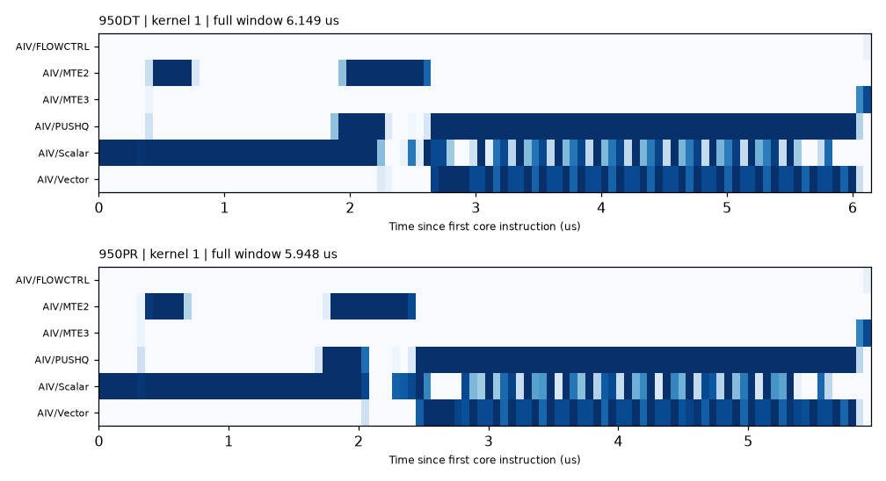

# mHC Sinkhorn 算例

输入轴顺序为 **T,N**。本例比较同一输入契约在 950DT、950PR 与假设的 970DT 上的设备指令窗口。

```python
from operator_model import estimate

shape = [1, 4]
attrs = {'dtype': 'fp32', 'num_iters': 20, 'return_intermediates': False}
for chip in ('Ascend950DT_9582', 'Ascend950PR_957b', 'Ascend970DT'):
    r = estimate('mhc_sinkhorn', shape, attrs, chip=chip, dtype='fp32', timing_mode='auto')
    print(r.latency_us, r.status, r.active_aic, r.active_aiv, r.work)
```

## 输入到工作量

该路线调用 CANN 9.2.1 的 ops-transformer 算子族。实际调用接口为 `aclnnMhcSinkhorn`。
工作量接口给出的 Cube 操作为 0，Vector 计数为 1,336。逻辑读/写分别为 64 / 64 B。此处 None 表示缺少计数；片外实际流量须另行观测，逻辑字节不含中间层重复搬运。

## 分块、资源和关键路径

1 个 token 的 4×4 FP32 矩阵独立，20 轮归一化存在顺序依赖。W=ceil(1/64)=1 行/最忙核，A=ceil(1/1)=1 核。SIMD 单位为 20×ceil(16×1/64)=20 个矩阵向量组。MTE2 取 1×64/1024=0.0625 KiB/核，MTE3 取 1×64/1024=0.0625 KiB/芯片。arrival 用 log₂(A)，SCALAR 用 W−1，other 为常数。

13 个旧 DT shape 的每阶段暴露时长单独拟合 a+bX，a 单位 µs，b 分别是 µs/向量组、µs/KiB 等对应单位。采用非负 soft-L1（转折 0.15 µs），输入工作长期不变时令 b=0、a 取阶段中位数。来源 results/v0.9/vector/profile.json。

| 阶段 | a µs | b µs/单位 | X | a+bX µs |
|---|---|---|---|---|
| arrival | 0.07890 | 0.04244 | 0.00000 | 0.07890 |
| SCALAR | 1.39672 | 0.00000 | 0.00000 | 1.39672 |
| SIMD | 0.59884 | 0.15283 | 20.00000 | 3.65548 |
| MTE2 | 0.45365 | 0.00000 | 0.06250 | 0.45365 |
| MTE3 | 0.19476 | 0.00000 | 0.06250 | 0.19476 |
| other | 0.00606 | 0.00000 | 0.00000 | 0.00606 |

970DT 的算子实现与分片延用 DT 模板。先算 DT 各段的暴露时间，共 5.78557 µs。设备配置取 configs/chips/Ascend970DT.json。目标有 120 个 AIV、1.8 GHz，本例预计用 1 核。控制与到达按频率比 1.65/1.8=0.91667；SIMD 按实际 dtype 的每核峰值比及波数，倍率 0.91553。

每次调用逻辑总读写 128 B，芯片级带宽占比代理 p=min(1,128/(1000×4000×5.78557))=0.00001。MTE2/MTE3 倍率是 (1−p)×局部价格比+p×4000/14400，得到 0.91666/0.91666；局部部分在未指定两端 MTE 速率时取频率比×波数比。该项使用全片逻辑读写量作代理。

| 阶段 | DT 暴露 µs | 目标价格倍率 | 970 外推 µs |
|---|---|---|---|
| arrival | 0.07890 | 0.91667 | 0.07232 |
| SCALAR | 1.39672 | 0.91667 | 1.28033 |
| SIMD | 3.65548 | 0.91553 | 3.34669 |
| MTE2 | 0.45365 | 0.91666 | 0.41584 |
| MTE3 | 0.19476 | 0.91666 | 0.17853 |
| other | 0.00606 | 0.91667 | 0.00556 |

六段相加得到 DT 5.78557 µs、970DT 5.29927 µs。arrival 是最晚结束核的到达偏移，other 是未归入已知流水的区间；DT 原始重叠已按 SIMD→MTE3→MTE2→SCALAR 唯一归属，合计时只算一次。

## 设备时间及误差

| 平台 | 模型 (µs) | CA (µs) | 有符号误差 | 预测 AIC / AIV | CA AIC / AIV |
|---|---:|---:|---:|---|---|
| 950DT | 5.78557 | 6.14909 | -5.91% | N/A / 1 | 0 / 1 |
| 950PR | 5.88491 | 5.94848 | -1.07% | 0 / 1 | 0 / 1 |
| 970DT 外推 | 5.29927 | N/A | N/A | 0 / 1 | N/A |

DT/PR 加速比取同形耗时之比，模型 0.9831×，CA 1.0337×。正时延误差为高估。

**950DT CA**　msopprof official full trace，角色 new paired DT CA；核名 `MhcSinkhorn_8997d9c5c22e82688b98bc25d8daa9cd_0`。该宿主的数值检查共 1 组；子算子切片共享宿主检查。各设备窗以最早到最晚核指令计，多 kernel 取串行窗之和。

**950PR CA**　msopprof official full trace，角色 frozen PR holdout；核名 `MhcSinkhorn_8997d9c5c22e82688b98bc25d8daa9cd_0`。该宿主的数值检查共 1 组；子算子切片共享宿主检查。各设备窗以最早到最晚核指令计，多 kernel 取串行窗之和。

## CA 流水与模型差距



横轴为每次 kernel 自身的设备时间，两端各自从零开始。每种核取最晚结束的一个核。每行按该队列有效指令区间的并集着色，100 个等宽时间格，深蓝表示格内占满。不同队列可重叠，行长不能相加。DMA/FIX 行表示描述符的在途窗口，可能包含等待依赖的时间；颜色深度不能直接换算 HBM 总线利用率。

950DT 第 1 段 6.1491 µs；所选核上占用最长的队列为 AIV/Scalar 4.2836 µs、AIV/PUSHQ 3.8273 µs、AIV/Vector 3.1612 µs。
950PR 第 1 段 5.9485 µs；所选核上占用最长的队列为 AIV/Scalar 4.1200 µs、AIV/PUSHQ 3.7812 µs、AIV/Vector 3.1612 µs。

PR 的模型与 CA 相差 -0.0636 µs。打包行数、循环与尾核决定关键核工作；标量启动和小数据量下的搬运占比较高。上图给出可观测的队列活动；一次端到端差值无法唯一分摊到这些因素。

[总建模方法](../modeling-strategy.md) · [全部 shape 的误差](../error-analysis.md) · [970DT 配置与来源](../../configs/chips/Ascend970DT.json)
