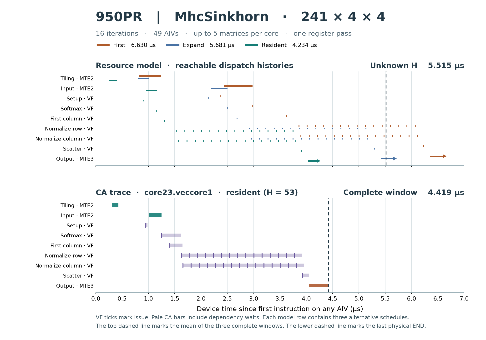
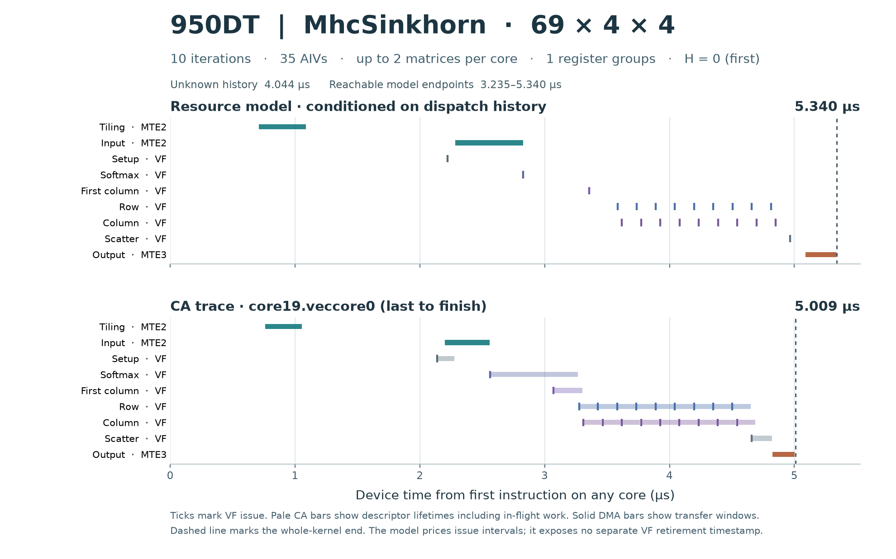
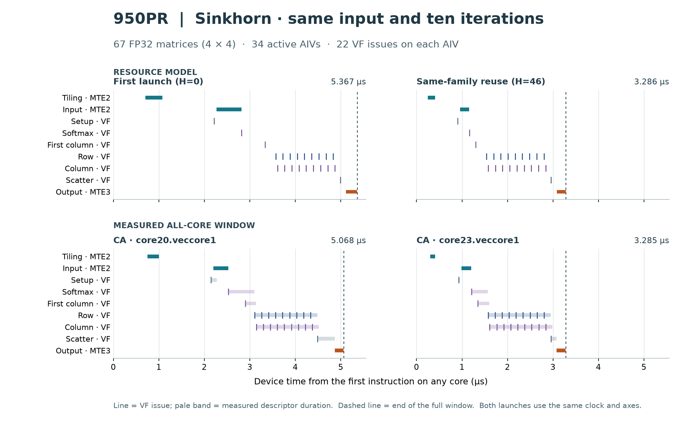

# mHC Sinkhorn · 跨过 950PR 分核边界

## 缺少前序时怎样给一个点预测

PR 上 T=241、N=4、I=16 的形状在最忙 AIV 上只需一组寄存器。旧模型预测 7.991 µs；新版把可行首次、扩核与热态分别定价后，未知前序点预测为 5.515 µs。已知该次是热态时预测 4.234 µs，CA 完整窗为 4.419 µs。上方保留三种物理排程，等权均值只作为总时长标记。下方显示最后一核的 34 次 VF 和三笔 DMA。[计算过程、参数与误差](../../results/v0.30/sink/report.md)



DT T=65、66、68 且迭代十次时，shape-only 三窗 WAPE 为 25.64%，按真实首发顺序回放为 3.89%。T=512 的 20 次迭代仍可在源码推导的每核行数及寄存器组上给出冷态资源情景，T=262144 则须跨越多个 UB 块。公开入口与这些条件值在表内分别展示。[有序流的十形独立验收](../../results/v0.29/sink/report.md) · [整批 Sinkhorn 工作与条件预测](../../results/v0.29/large/fusion/report.md)

以 T=69、四条流、10 次迭代为例。DT 首次运行，最忙核 2 行，占 1 组寄存器。有同族前序信息的专项模型预测 5.340 µs，CA 为 5.009 µs；完全未知前序的折中值为 4.044 µs。更宽的 T=4097 在 PR 上有十组寄存器，函数只发起一次，每额外一组单独付组内工作。前序可见性与寄存器组数在算式里各算一次。



[参数、组内工作和两芯片回放](../../results/v0.28/fusion/report.md) · [相同模型在全新几何上的比较](../../results/v0.28/fusion/forward.md)

T=241、I=16 的 PR 临界核分到 5 行。旧无前序预测按每 4 行分组，收了两次组内工作；库指令中一次 VF 足以处理 8 行。在已有窗将组数改成 1，预测从 7.991 降至 5.479 µs，CA 为 4.419 µs。T=233 的新形会在 PR 再次触发这一分歧，同时检验 64 AIV 的 DT 对照。[逐条发起图、DT/PR 冻结及实测结果](../../results/v0.28/fusion/eligibility.md)

同一个 T=67、I=10 的输入，前序决定了第一次 VF 的接手时间。传入同一家族的 `resident_aiv=0` 表示首次，950DT 预测 **5.319 µs**，CA 为 **5.232 µs**。完整算例可逐项复核发起、迭代、写回和 PR 的同形差值。[公开接口与逐阶段计算](../../results/v0.27/fusion/public-sink.md)



固定 FP32 输入 `[67,4,4]` 和 10 轮迭代。950PR 首次设备窗为 **5.068 µs**，同族已有 46 个 AIV 驻留时为 **3.285 µs**。冻结候选在给出各自的前序后得到 **5.367、3.286 µs**。每栏的总时长按全核退出，真实末核的循环按对应行与列规约标出；两次同形只算一个不同形状。[950DT 同形图](../../results/v0.27/fusion/950dt-same-input.png) · [PR 逐轮源数据](../../results/v0.27/fusion/950pr-same-input.json) · [候选与公开模型的同集误差](../../results/v0.27/fusion/report.md)

## T=67、I=10 的首次发起

![950DT 新形，[67,4] 的首次发起，阶段逐项与末核实测对齐](../../results/v0.26/sink/independent-950dt-67-first.png)

输入是 67 个 FP32 的 4×4 矩阵。64 个物理 AIV 每核最多 2 行，实际使用 34 个。每核 22 条 VF，预测与实测一致。已知首次的候选 5.319 µs，CA 5.232 µs；只给 shape 的同一候选为 4.408 µs。970DT 首发外推 5.508 µs。此路径的固定准备与同时启动的 AIV 数有关，增加总核数不保证缩短首发。[同形前序、公式、参数和后续更大新形](../../results/v0.26/sink/report.md)


64 个 token 各含一张 FP32 4×4 矩阵，做 20 次迭代。950PR 模型给出 **6.081 µs**，CA **6.533 µs**，偏低 **6.92%**。同 shape 的旧预测为 10.543 µs。上栏按累计顺序显示模型可识别的独占成本；下栏给出最后完成的 AIV 上逐指令的实际重叠。上栏中一个队列的横坐标仅表示成本在和式中的位置。[逐段图数据](../../results/v0.21/fusion/mhc_sinkhorn-figure.json)

```python
from operator_model import estimate
r = estimate('mhc_sinkhorn', (64,4), {'num_iters':20}, dtype='fp32', chip='Ascend950PR_957b')
print(r.latency_us, r.active_aiv, r.work, r.projection['stages_us'])
```

若全片有 V 个 AIV，每核处理 r=⌈T/V⌉ 行，实际有载荷的核为 ⌈T/r⌉。64 个 token 在 56-AIV PR 上排成 32 核各两行，在 64-AIV DT 上各一行。每行 16 个 FP32 元素；每个向量工作组有 64 元素，所以每个关键核每次迭代处理的工作组数 g=⌈16r/64⌉，两卡都是 1。实际 PR 窗口也报告 32 个 AIV。输入和输出各 4096 B、计数 Vector 运算 85,504。该 FP32 输入路径不使用 Cube。

对各资源 q，使用独占阶段窗口 t_q = a_q·f_DT/f_target + b_q·u_q·ρ_q。a 是 DT 上的固定微秒，b 是每单位变量工作的微秒；u 分别代表 SIMD 工作 g×迭代数、读写 KiB 或 log₂(活动核数)。SIMD 的 ρ 是两卡每核 FP32 峰值比，MTE 的 ρ 是两卡本地带宽之比，缺省采用时钟比。系数来自 v0.9 的临界核独占区间。PR 上算得启动到达 0.291、标量 1.397、SIMD 3.739、MTE2 0.454、MTE3 0.195、其余 0.006 µs。全算子耗时是这些独占区间之和。核数跨过 V 会改变每核行数；只有打包组数真正增加时才多算整轮 SIMD。[阶段校准参数](../../results/v0.9/vector/profile.json)

| 芯片 | 预测 µs | CA µs | 相对误差 | 有载荷 AIV 预测 / CA |
|---|---:|---:|---:|---|
| 950DT | 6.040 | 7.598 | −20.50% | 64 / 64 |
| 950PR | 6.081 | 6.533 | −6.92% | 32 / 32 |
| 970DT 外推 | 5.533 | N/A | N/A | 64 / N/A |

PR 上用安装包 `aclnnMhcSinkhorn` 调用 `MhcSinkhorn_8997d9c5c22e82688b98bc25d8daa9cd_0`，DT 原留出为 npusim 的 `entry_kernel_0`。数值核验通过。DT 启动上下文和 PR 独立进程不同，两端速度比包含此差异。此例用于开发回放；两端新独立进程的留出另列。[误差与采集记录](../../results/v0.21/fusion/evaluation.json)
