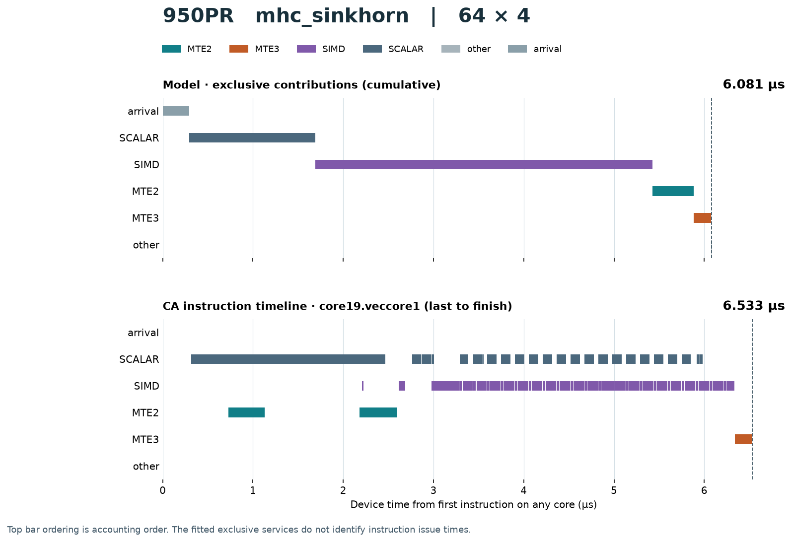

# mHC Sinkhorn · 跨过 950PR 分核边界



64 个 token 各含一张 FP32 4×4 矩阵，做 20 次迭代。950PR 模型给出 **6.081 µs**，CA **6.533 µs**，偏低 **6.92%**。同 shape 的旧预测为 10.543 µs。上栏按累计顺序显示模型可识别的独占成本；下栏给出最后完成的 AIV 上逐指令的实际重叠。上栏中一个队列的横坐标仅表示成本在和式中的位置。[逐段图数据](../../results/v0.21/fusion/mhc_sinkhorn-figure.json)

```python
from operator_model import estimate
r = estimate('mhc_sinkhorn', (64,4), {'num_iters':20}, dtype='fp32', chip='Ascend950PR_957b')
print(r.latency_us, r.active_aiv, r.work, r.projection['stages_us'])
```

若全片有 V 个 AIV，每核处理 r=⌈T/V⌉ 行，实际有载荷的核为 ⌈T/r⌉。64 个 token 在 56-AIV PR 上排成 32 核各两行，在 64-AIV DT 上各一行。每行 16 个 FP32 元素；每个向量工作组有 64 元素，所以每个关键核每次迭代处理的工作组数 g=⌈16r/64⌉，两卡都是 1。实际 PR 窗口也报告 32 个 AIV。输入和输出各 4096 B、计数 Vector 运算 85,504。该 FP32 输入路径不使用 Cube。

对各资源 q，使用独占阶段窗口 t_q = a_q·f_DT/f_target + b_q·u_q·ρ_q。a 是 DT 上的固定微秒，b 是每单位变量工作的微秒；u 分别代表 SIMD 工作 g×迭代数、读写 KiB 或 log₂(活动核数)。SIMD 的 ρ 是两卡每核 FP32 峰值比，MTE 的 ρ 是两卡本地带宽之比，缺省采用时钟比。系数来自 v0.9 的临界核独占区间。PR 上算得启动到达 0.291、标量 1.397、SIMD 3.739、MTE2 0.454、MTE3 0.195、其余 0.006 µs。全算子耗时是这些独占区间之和。核数跨过 V 会改变每核行数；只有打包组数真正增加时才多算整轮 SIMD。[阶段校准参数](../../results/v0.9/vector/profile.json)

| 芯片 | 预测 µs | CA µs | 相对误差 | 有载荷 AIV 预测 / CA |
|---|---:|---:|---:|---|
| 950DT | 6.040 | 7.598 | −20.50% | 64 / 64 |
| 950PR | 6.081 | 6.533 | −6.92% | 32 / 32 |
| 970DT 外推 | 5.533 | N/A | N/A | 64 / N/A |

PR 上用安装包 `aclnnMhcSinkhorn` 调用 `MhcSinkhorn_8997d9c5c22e82688b98bc25d8daa9cd_0`，DT 原留出为 npusim 的 `entry_kernel_0`。数值核验通过。DT 启动上下文和 PR 独立进程不同，两端速度比包含此差异。此例用于开发回放；两端新独立进程的留出另列。[误差与采集记录](../../results/v0.21/fusion/evaluation.json)
