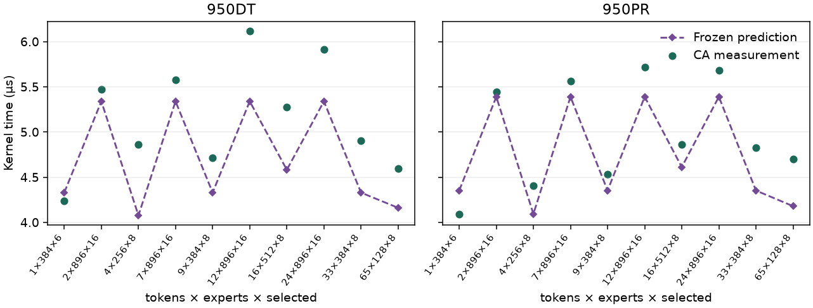

# MoE Gating Top-K 算例 · Kimi 的两个 token

输入为 FP32 路由 logits `[T=2,E=896]` 和 FP32 修正偏置 `[896]`。每行选 K=16 个全局专家，返回 `[2,16]` 的 FP32 权重与 int32 专家 ID。只测试一个专家组、sigmoid 激活、偏置参与排名、被选中的原始分数归一化、缩放系数 1、eps 为 1e-20 的分支。该样例来自冻结后的独立验证集。

```python
from operator_model import estimate

for chip in ('Ascend950DT_9582', 'Ascend950PR_957b', 'Ascend970DT'):
    result = estimate('moe_gating_top_k', (2, 896, 16), dtype='fp32', chip=chip)
    print(result.chip_name, result.latency_us, result.work, result.projection['stages_us'])
```

## 工作量和分核

令 `p[i,e] = sigmoid(logits[i,e])`，按 `p[i,e] + bias[e]` 从大到小取 K 个专家 ID，对应权重为 `p[i,e] / (Σ_selected p + eps)`。算法逻辑上读 `4(TE+E) = 10,752 B`，写 `8TK = 256 B`。每行 E 个 sigmoid 按负号、exp、加一、倒数四个标量步骤计，另有 E 个偏置加法、K−1 个归约加法、一个 eps 加法及 K 个归一化，合计 `5TE+2TK = 9,024` 个 FP32 标量等价操作。排名比较和索引重排不计作 FLOP，其成本进入 Vector 阶段。

设 V 为目标 AIV 数，最忙核的行数为 `r=ceil(T/V)`，有效核数 `A=ceil(T/r)`，每行 `b=ceil(E/64)` 个 64 元素块。这里 A=2、r=1、b=14；两端 CA 都由 2 个 AIV 执行。峰值指令宽度与芯片代际或 dtype 变化时需重估分块。

## 怎样从工作量得到设备微秒

四个相继发生的边界为首条 logits/bias DMA 发起、两者均就绪、第一条结果写回发起、末条指令完成。用单行旧校准 trace 在这些边界做差。DT 的 `[1,128,8]` 和 `[1,896,16]` 四段分别为 **4207/1232/556/311 cycles** 和 **4195/1254/3056/312 cycles**。设备频率 1.65 GHz，转换系数每微秒 1650 cycles。该校准只识别整个 rank 阶段，exp、排序和重排的单指令吞吐不能单独由两条 trace 求出。

设 `f=1000×频率(GHz)` 为 cycles/µs，`P=FP32 Vector TOPS×10⁶/V` 为每核的峰值 ops/µs。每核 DMA 上限 `D=min(32f, HBM_GB/s×1000/A)` 以 B/µs 表示；32 B/cycle 属于继承的实现假设。一次读包括 r 行 logits 和一次核内重用的 bias，写回由两组 K 个 4 B 结果组成。

| 阶段 | 公式，结果单位 µs | 950DT 算例 |
|---|---|---:|
| 启动、解析 tiling 到首次 payload 发起 | 两条 DT trace 的对应均值 `4201/f` | 2.546 |
| logits 与 bias 到达 | `max(1243/f, 4E(r+1)/D)`，延迟与带宽下限取大 | 0.753 |
| sigmoid、TopK、归一化 | `r×(139.33+208.33b)×P₀/(1650P)`，P₀ 为 DT 每核 FP32 峰值 421875 ops/µs | 1.852 |
| 权重与 ID 的写回收尾 | `max(311.5/f, 8Kr/D)` | 0.189 |

Vector 的 139.33 cycles/行和 208.33 cycles/块由两个“读就绪到首条写”窗口解得。P₀/(1650P) 将 DT cycles 换算为目标每核的时间。由此得到的 781,364 ops/行是把设备窗口写成可换算的峰值等价工作，只用于定价。应用层返回的有用 Vector 工作仍是两行合计 9,024 ops。这个外推保留排序实现与 FP32 峰值的相对效率。K 的影响只进入输出传输，较大 K、更换排序算法和多轮的流水交叠均有误差风险。

## 与 CA 对齐

| 芯片 | 模型 µs | CA µs | 相对误差 | 最晚核 CA 的控制 / 读 / 排名 / 写回 µs |
|---|---:|---:|---:|---|
| 950DT | 5.340 | 5.472 | −2.40% | 2.538 / 0.753 / 1.841 / 0.339 |
| 950PR | 5.391 | 5.446 | −1.02% | 2.458 / 0.788 / 1.827 / 0.373 |
| 970DT | 4.893 | N/A | N/A | 芯片配置驱动的外推 |

同一输入在两端实际调用 CANN 9.2.1 ops-transformer 的 `aclnnMoeGatingTopK`，运行时 kernel 名都是 `MoeGatingTopK_4ca391a7fc5a94c6f1e7d38c9bb0fa20_10005`。两组输出的全部 32 个位置都通过独立 CPU golden。DT 的剩余低估主要来自写回，PR 的写回也低估，同时控制和排名时间略高估。实测 DT/PR=1.005×，模型=0.991×，此例的接近持平区域快慢方向仍判反。最终的误差统计使用所有合格留出样例。[冻结合同和预测](../../results/v0.19/workloads/router-holdout-freeze.json) · [全量误差分析](../error-analysis.md)

十个冻结形状中，DT 与 PR 耗时的 WAPE 分别为 **9.08%** 和 **5.72%**，DT/PR 倍速 WAPE 为 **4.60%**。20 次的活动核数全部命中。DT 误差最大的是 [4,256,8]，预测 4.078 µs、实测 4.865 µs。末核距全片首次指令约 0.118 µs 才到达，两条结果写请求至末条指令用了 0.920 µs；模型分别给了 0 和 0.189 µs。CA 观测支持写回窗口变长，未单独证明具体的片上仲裁原因。[逐例预测与测量](../../results/v0.19/workloads/router-evaluation.json)

17 个芯片侧样本由 msopprof 正常结束并完整导出。另 3 个超限样本已经生成厂商内部全核 trace 和完整数值校验。离线复查每个核的首条指令 MOV_XD_SPR、末条指令 END_LABEL、每核 duration 与厂商表（容许 0.011 µs 显示舍入）、实际二进制和输入。相同读取器在 17 个正常样本上与正式核窗、trace SHA256 全部相同。这三个样本的设备时间计入独立比较，外层采集超时仍单记。没有重跑。 [恢复与对照](../../results/v0.19/workloads/router-window-recovery.json)


