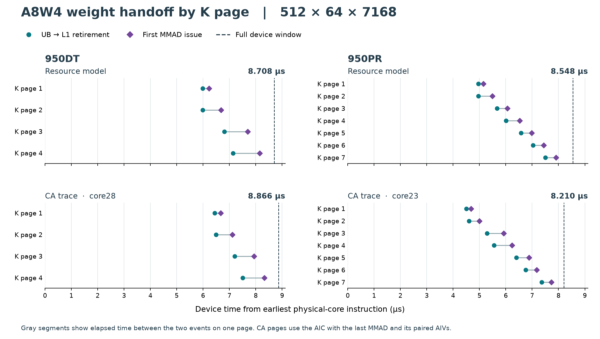
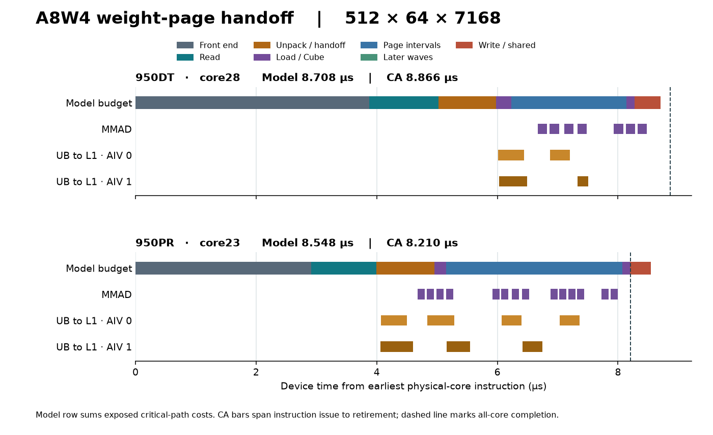

# A8W4 多 K 页的权重交接

以 `M=512,N=64,K=7168` 为例。同一个 AIV 可以提前读取、展开下一页权重。能把该页送到哪一个 L1 槽，还取决于 AIC 何时用完旧页。950PR 虽然要处理七页，950DT 只要四页，实测却是 PR 先完成。这个例子展示如何从分核与指令发起推到整窗。

```python
from operator_model import estimate

for chip in ("Ascend950DT_9582", "Ascend950PR_957b", "Ascend970DT"):
    r = estimate("matmul", [512, 64, 7168], dtype="fp8_e4m3fn",
                 attrs={"weight_dtype": "mxfp4"}, chip=chip)
    print(chip, r.latency_us, r.projection["target_plan"], r.work)
```

输入 A 为 ND E4M3FN，W 以 ND E2M1 存成 [64,7168]，转置后参与乘法。两侧各有一份 E8M0 scale，每 32 个 K 值一组。输出是 [512,64] BF16。逻辑乘加为 $2MNK=469,762,048$ 次操作。A、W 及两份 scale 分别读取 3,670,016、229,376、114,688、14,336 B，输出写 65,536 B。公共接口另外给出 tile、工作核、页数及估算的片上重复搬运。

| 设备 | AIC / 启动 AIV / 生产 AIV | 输出块 | L1 页深 / L0 片深 | 每块页数 / MMAD 数 | 模型 µs | 完整 CA µs | 误差 |
|---|---:|---|---:|---:|---:|---:|---:|
| 950DT | 32 / 64 / 64 | 32×32 | 2048 / 1024 | 4 / 7 | 8.708 | 8.866 | −1.78% |
| 950PR | 16 / 32 / 32 | 32×64 | 1024 / 512 | 7 / 14 | 8.548 | 8.210 | +4.11% |
| 970DT | 64 / 64 / 64 | 16×32 | 2048 / 1024 | 4 / 7 | 6.668 | N/A | N/A |

两端 CA 使用 CANN 9.2.1 `aclnnQuantMatmulV5`，内核为 ops-nn 的 `QuantBatchMatmulV4_ND_ND_float8_e4m3fn_float4_e2m1_out_bf16_high_performance_17_mix_aic`。两端各 32,768 个输出和 CPU golden 逐位相等。该几何属于本模型的开发回放。970DT 使用其芯片配置及 1:1 AIC/AIV 假设。

## 从一页估算到整窗

1. **分工与数据量。** SWAT 按芯片的 AIC 数和本地存储限制生成矩形。两槽版本让子核 0 和 1 交替处理完整 L1 页，四槽版本在 N 方向划分每页，取较重的有效子块。给定一个工作块的高 $h$、宽 $w$、页深 $d$，每个生产者的有效宽记为 $u$。AIC 要读 $h(d+2\lceil d/64\rceil)+2w\lceil d/64\rceil$ B，包括 A 和两份比例因子。AIV 要读 $u\lceil d/2\rceil$ B 的压缩权重，再向 L1 送出 $ud$ B。不同输出块可能各自展开同一部分 W。两端该例全核合计 UB→L1 均为 7,340,032 B。
2. **Vector 服务。** 源码的行循环迭代 $u$ 次。一次 256 B 寄存器加载最多装 512 个 FP4，每行需 $r=\lceil d/512\rceil$ 次。模型的 VF 成本为 $T_{vf}=50+u\max(11,7.5r)\times512/P_v$ cycles，$P_v$ 是目标芯片每 AIV 每周期的 8 位标称操作数，由总 Vector 峰值、核数、主频换算。512 是 950 的标称参考值。50 cycles 是既有 VF 启动价。11 cycles/行与 7.5 cycles/重复来自两款 950 的旧 VF 描述符。比如 DT 上 $u=64,d=512$ 和 $u=128,d=512$ 的实测为 0.465、0.892 µs，按 1.65 GHz 换算约 11 cycles/新增行。$u=32,d=2048$ 的整页约 0.596 µs，扣掉固定开销后约 7.3 cycles/寄存器重复。两种约束取较大者。两代 ISA 如果改变 VF 寄存器宽度或位运算发射能力，需要另定这个先验。该例首张完整页的 VF 预测分别为 0.613 和 0.616 µs。
3. **首次到达。** 在已有启动成本后加 $2680(a-1)/\max(1,C-1)$ cycles。$a$ 是活跃 AIC 数，$C$ 是芯片 AIC 总数。2680 是两款 950 共 14 个旧多页窗口中，末完成 AIC 的同簇首次权重 payload 读发起时刻减去启动价、按活跃比例归一后的中位量级；包含宿主库发射和核心前导代码造成的设备内分散。满占用近似与启动宽度成比例是假设。单次搬运再取本地 MTE2、共享 L2 和外存分摊三项所需周期的最大值。首轮 A 响应使用既有冷读价。首次槽复用后，A 响应残余取冷读价和 150 cycles 的较小者。后一数值来自九个至少三页的旧窗口，取末次 A 读描述符长度减去按本地端口计算的数据服务并截到非负，中位约 150 cycles。它只解释有效等待。模型保留全芯片总字节的带宽下界。
4. **生产者与消费者。** 用 $F_s$ 记录 L1 槽 $s$ 的最早可复用时刻。生产者从对应 AIV 的读、VF 两条队列得到 $V_i$（第 $i$ 页展开完毕）。向 L1 的搬运从 $\max(V_i,F_s,T_{\mathrm{MTE3,free}})$ 开始，再加交接描述符延迟与 $ud/B_{\mathrm{MTE3}}$ 得到 $H_i$。$B_{\mathrm{MTE3}}$ 单位为 B/cycle；交接固定价 157.81 cycles 沿用早期 950 单页 trace。AIC 在该页 A 和 W 都准备好后装入 L0。相关目标时刻满足 $I_i=\max(I_{\mathrm{next}},\max(A_i,H_i)+L_{\mathrm{L0}}+D_{\mathrm{L0}})$。$A_i$ 是该页 A 的读完成时间，$I_i$ 是首个 MMAD 发起时刻，$D_{\mathrm{L0}}$ 是其第一片用 MTE1 搬运 A、W 和 scale 的时间，$L_{\mathrm{L0}}$ 为固有延迟；$I_{\mathrm{next}}$ 来自上一片的发射约束。
5. **释放与退休。** 同一页后续 MMAD 的最小间隔取 L0 装载服务、目标 Cube 服务及描述符发起间隔的最大值。最后一片发起时更新 $F_s$。CA 的一个可查证事件出现在 PR 的 core23：第一页末个 MMAD 在 4.827 µs 发起，使用同槽的第三页 UB→L1 在 4.835 µs 发起。最后一个 MMAD 仍需完成计算与退休，之后结算输出写尾。多个输出波使用满波循环服务和最后子矩形的尾波近似；有限槽内的多页调度则按确定的事件方程计算。对超长 K，完整槽环的重复转移采用 max-plus 矩阵幂，与逐页执行同解，查询工作随页数的对数增长。

## 逐页对照



两列分别为 950DT 和 950PR，上排为模型，下排为该芯片最晚发起 MMAD 的 AIC 及其配对 AIV。横轴均以全核最早指令为 0，虚线标出该窗的整片结束时刻。每行代表一张 K 页。圆点是 UB→L1 描述符退休，菱形是该页第一次 MMAD 发起。两点之间的连线表示经过时间，其中可能同时有 A 读、L0 装载与前页计算。页号按这次单输出波的 K 顺序对齐，DT 每页对应 2、2、2、1 次 MMAD，PR 每页 2 次。[模型逐页时刻](assets/mx-k-handoff-pages.json) · [CA 指令区间与整窗](assets/mx-k-handoff.json)

下表每格依次为模型和 CA，单位 µs。CA 交接退休按同簇 AIV 的描述符发起时间加持续时间取值，与图使用同一零点。

| 页（从 1 计） | DT 交接退休 | DT 首 MMAD | PR 交接退休 | PR 首 MMAD |
|---:|---:|---:|---:|---:|
| 1 | 5.981 / 6.442 | 6.229 / 6.668 | 4.956 / 4.502 | 5.147 / 4.680 |
| 2 | 5.981 / 6.492 | 6.683 / 7.108 | 4.956 / 4.599 | 5.487 / 4.990 |
| 3 | 6.803 / 7.200 | 7.690 / 7.931 | 5.664 / 5.282 | 6.061 / 5.917 |
| 4 | 7.131 / 7.507 | 8.144 / 8.324 | 6.004 / 5.552 | 6.521 / 6.241 |
| 5 | — | — | 6.577 / 6.401 | 6.982 / 6.882 |
| 6 | — | — | 7.038 / 6.748 | 7.443 / 7.176 |
| 7 | — | — | 7.499 / 7.365 | 7.904 / 7.730 |

### 阶段预算和描述符区间



每个芯片的第一行按关键路径分摊模型预算，随后各行画出同簇 AIC/AIV 已识别描述符的发起与退休；条宽也包含等数据或跨核标志的时间。[绘图脚本](../../calibration/mx_matmul/plot_schedule.py)

从仓库根目录可以用保留的事件数据重绘逐页图。

```bash
python -m calibration.mx_matmul.plot_schedule docs/examples/assets/mx-k-handoff.json \
    /tmp/mx-k-handoff-pages.png --pages docs/examples/assets/mx-k-handoff-pages.json
```

DT 末核的首次 MMAD 在 6.668 µs 发起，比 PR 晚 1.988 µs；PR 后续多三页，把差距缩到整窗的 0.656 µs。模型给出的整窗差为 0.160 µs。它恢复了本例的方向，对 PR 第一次交接约高估 0.45 µs，对 DT 约低估 0.46 µs。每核页到达仍用总体活跃比例近似，无法给出单个物理核真实的启动排位。更多同集指标见总误差表。[误差分析](../error-analysis.md) · [SWAT 分核](mxfp4-design.md)
