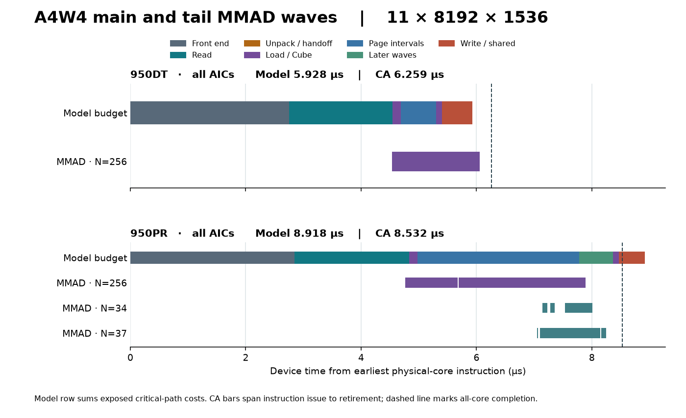

# A4W4 原生 Matmul 的完整算例

DeepSeek-V4-Pro 的 `dsa.wq_b` 投影在这个 TP8 decode 场景中一次处理 11 个 token。本例沿用其每卡几何，假设 A、W 都采用 MXFP4 E2M1，独立运行厂商的 V5 接口。该精度配置用于比较硬件，不代表 checkpoint 实际采用 A4W4。

```python
from operator_model import estimate

for chip in ("Ascend950DT_9582", "Ascend950PR_957b", "Ascend970DT"):
    r = estimate("matmul", (11, 8192, 1536), dtype="mxfp4", chip=chip)
    print(chip, r.status, r.latency_us, r.active_aic,
          r.projection["target_plan"]["native_asw"]["rectangles"])
```

| 每卡 dense ND 输入及输出 | 数量或配置 |
|---|---|
| A 与转置存储的 W | A[11,1536]，W[8192,1536]，均为 FP4，每字节两个值 |
| A/W 两组 E8M0 | 每行每 64 个 K 存两个 scale，分别 528 B、393,216 B |
| 输出 | BF16 [11,8192]，FP32 累加，无 bias，180,224 B |
| 逻辑读和计算 | A 8,448 B、W 6,291,456 B；连同 scale 共 6,693,648 B。计算 $2MNK=276,824,064$ ops |
| 实现 | 单次 `aclnnQuantMatmulV5`，CANN 9.2.1 的 `QuantBatchMatmulV3_ND_ND_mxfp4e2m1_mxfp4e2m1_float8_e8m0_bf16_high_performance`；FP4×FP4 `MMAD_MX`，生产 AIV 为零 |

## 输出归属和 K 深度

V3 的候选基础矩形以 16 对齐，本例在两种 950 上均为 16×256，有效行数是 11。默认网格共有 $G=\lceil M/16\rceil\lceil N/256\rceil=32$ 块。32 AIC 的 DT 刚好一轮。28 AIC 的 PR 先处理 28 个主块，还剩四块 256 列。host 的尾窗划分把每块交给 $s=\min(\lfloor 28/4\rfloor,\lfloor 256/16\rfloor)=7$ 个 AIC。前六个宽 $\lceil256/7\rceil=37$，最后一个宽 $256-6\times37=34$。核间独立续做自己的下一块。不能用两次等宽矩形代表最慢核。较宽的载荷在 AIC 之间错峰，两个波次可以同时有 MMAD 在途。

$K_0$ 是一条矩阵片计算的深度，$K_1$ 是搬进 L1 的一页深度。两端共有 32 个初始块，V3 的默认 FP4 $K_0=256$，每个输出矩形有 $1536/256=6$ 个 K 片。若初始网格用不满 AIC，模型按主块两条 L0 端口的双缓冲尺寸重新选 $K_0$。以 128 B 对齐 packed ND 行，即以 256 个 FP4 值为单位向下取能容纳的深度。超过 4095 的配置再减半、对齐。这些都是实现选择，FP4 的每核算力由芯片配置单独决定。

在 DT 上，L1 可容纳本例四个 K 片组成的一页。首个 B 载荷 $256\times1024/2=131,072$ B，最后一个是 65,536 B。PR 只有一个 M 方向块，多轮且 A 可驻留，主块和尾块可用同一份 A。V3 给 B 选取可容纳的传输大小，以 32 KiB 为目标，并在空间充足时至少一次准备两个 K 片。这里 $K_1=512$，主块的三个 B 载荷各 65,536 B。旧 trace 可按每核 `MOV_OUT_TO_L1_MULTI_ND2NZ` 的字节数复核这两个深度。保守模型只在单 M 块网格启用 A 驻留。多 M 块的滑窗和重新均衡仍属于近似范围。

| 可复核的实现工作 | 950DT 模型 / CA | 950PR 模型 / CA | 970DT 外推 |
|---|---|---|---|
| 有效 AIC 数、输出矩形 | 32；32×(11,256) / 相同 | 28；28×(11,256)、24×(11,37)、4×(11,34) / 相同 | 103；102×(11,80)、1×(11,32) |
| 单条 K、全片 MMAD 次数 | 256、192 / 相同 | 256、336 / 相同 | 768、206（候选） |
| 进入各 AIC 的总输入字节、含 scale | 6,971,904 / 6,971,904 | 6,936,000 / 6,936,000 | 7,609,200（候选） |

PR 的搬运字节可直接验算。28 个 AIC 各自消费 11 行 A 和 scale，所有主、尾块合计消费 8192 行 B 和 scale，每行是 $1536/2+2\lceil1536/64\rceil=816$ B，故 $(28\times11+8192)\times816=6,936,000$ B。这是进入核的字节量。模型对冷 HBM 使用 6,693,648 B 的场景，CA 指令的描述符仅给出核侧搬运量。

## 资源定价和流水时间

对任一矩形 $h\times w$ 与深度 $d$，每行搬运 $b(d)=\lceil d/2\rceil+2\lceil d/64\rceil$ B。若当前 A 已驻留，则第二个矩形只需重新搬 $wb(d)$；否则用 $x=(h+w)b(d)$。以下公式均用设备周期。

- **读服务** $R(x)=\max(x/P_2, Cx/P_{L2}, Cx\rho/P_{HBM})$。$C$ 为活跃 AIC 数，$P_2$ 是每 AIC 的 MTE2 定价，$P_{L2}$ 和 $P_{HBM}$ 是目标芯片每周期总吞吐。$\rho$ 为冷 HBM 读量与 L2 总读量的比。首次依赖另付读响应 $L_r$。多页的 $P_2=87.228$ B/(AIC·cycle)，来自旧 DT/PR 两页传输。每核取第二页 A+B 数据字节除以相邻两页的最后数据退休之差，以设备时钟折为周期，先取每个 shape/SKU 的核间中位数，再对 7 个端点取中位数。七个结果分别为 68.3、92.7、97.9、87.2、75.1、104.0、54.3。该值包含已有排程中的等待，作为持续服务的代理。单页沿用既有端口预算，配置 `details.mte2_bandwidth_gbs` 可在新芯片上覆盖两者。
- **片内搬运与计算。** 传入 L0 的服务 $D=(h+w)b(d)/P_1$，$P_1$ 是每核 MTE1 的 B/cycle。Cube 服务 $F=2\lceil h\rceil_{16}\lceil w\rceil_{16}\lceil d\rceil_{64}/P_c$，$\lceil x\rceil_a$ 表示向上对齐到 $a$，$P_c=1000\,\text{FP4 TOPS}/(f_{GHz}\,\text{AIC数})$ 是每 AIC 每周期 ops。连续 MMAD 的发起还受 $I_c$ 约束，$I_c$ 以 cycles/issue 计。末片加上各自依赖时延 $L_0,L_c$。其校准值分别来自 MX 小例的 MTE1、MMAD 阶段，稳定发起间隔和端口采用公开模型参数中的已有校准。
- **重叠。** 记 $R_1,R_T$ 为首 L1 页与整个矩形的读服务，$D_T,D_e$ 为全矩形与末 K 片的 L0 搬运，$F_1$ 为首片 Cube 服务，$q=\lceil K/K_0\rceil$。主要部分预算为 $\max(R_T, R_1+\max(D_T-D_e,(q-1)\max(F_1,I_c)))$。相当于让后续 L1 读与前面的 L0/Cube 工作并行。首次响应和末片之后的退休另计。附加满波或尾波只增加本核继续工作所需的最大读、L0、Cube、发起或写服务。输出端最后再检查全片总字节是否触及共享端口下界。这里的阶段表示关键路径的可加预算；CA 各引擎描述符可同时等待其他引擎。
- **首发和写尾。** 最早有效载荷之前的固定启动、活跃核到达时差、末写服务及流水排空沿用两种 950 的旧小样本阶段计价，均以设备周期存储。在 970DT 上使用合并的启动与依赖周期，按新频率换算。每个芯片每微秒的周期数是 $1000f_{GHz}$。

| 模型预算（µs） | 950DT | 950PR | 970DT 外推 |
|---|---:|---:|---:|
| 启动 + 核到达差 | 2.438 + 0.316 | 2.334 + 0.507 | 2.199 + 0.500 |
| 首读响应与服务 | 1.791 | 1.990 | 1.433 |
| 分页 / 后续片的暴露服务 | 0.609 | 2.803 | 0.114 |
| 末 L0 搬运与依赖 | 0.145 | 0.145 | 0.136 |
| 末 Cube 与退休 | 0.104 | 0.104 | 0.076 |
| 尾波额外服务 | 0 | 0.583 | 0 |
| 写回与排空 | 0.524 | 0.452 | 0.412 |
| **总计** | **5.928** | **8.918** | **4.870** |
| **完整 CA 设备窗** | **6.259** | **8.532** | **N/A** |
| **有符号误差** | **−5.29%** | **+4.53%** | **N/A** |

## 读图与剩余误差



上栏各阶段给出模型的周期预算。下栏是全片对应矩形的首 MMAD 发起至末条退休时间范围，零点取所有核最早的指令。PR 主块从 4.761 µs 延续到 7.887 µs，尾块的首条在 7.046 µs 发起，到 8.243 µs 退休。两段有 0.841 µs 重叠，最后一个 FIX 在 8.528 µs 退休，所有指令结束于 8.532 µs。模型捕捉各核间的独立续做，用归并的端口服务来估算尾波暴露，未预测 0.841 µs 这一具体重叠。DT 的首次 MMAD 为 4.537 µs，末次退休在 6.053 µs，FIX 结束于 6.255 µs。

这两条 CA 都用于本轮机制开发。PR 原先把整条满宽第二波计入 4.445 µs，现在用窄尾块继续执行的 0.583 µs。剩余误差包含实际发起时差、流水中可见的等待和缓存服务份额。单个 trace 无法分别识别每次 HBM 命中、片上仲裁和服务时间。970DT 的矩形、流水和耗时都基于相同实现策略的假设。

V3 几何和 buffer 的参考来自 CANN 9.2.1 同版 ops-nn 源码。实际 kernel 身份和时序取自上面的 CA。完整硬件和阶段参数见仓库内的模型数据。[固定版本 host 源码](https://gitcode.com/cann/ops-nn/tree/28d19e078fd2d4144a681eb20ed3261047256d0c/matmul/quant_batch_matmul_v3/op_host/op_tiling/arch35) · [MX 阶段参数](../../src/operator_model/data/parameters/mx_matmul_phases.json) · [流水对照](../pipeline-comparisons.md)
