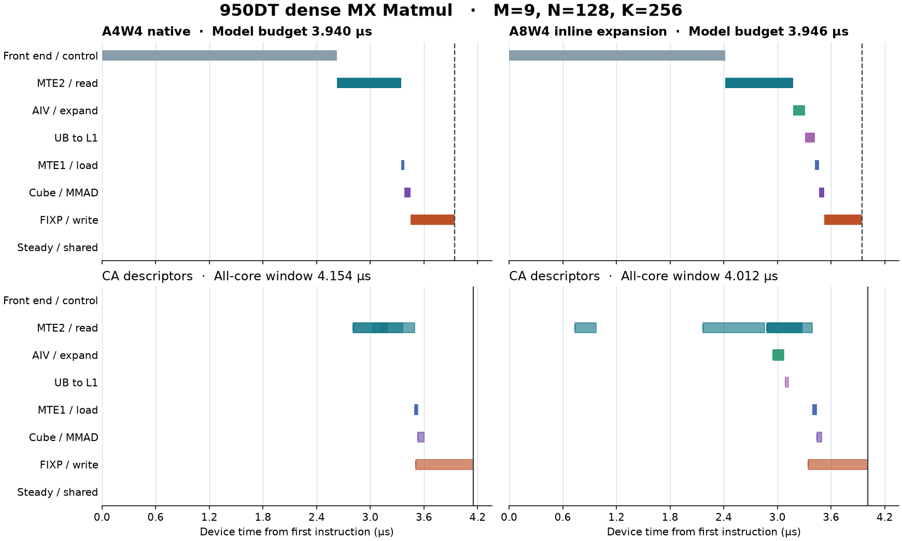
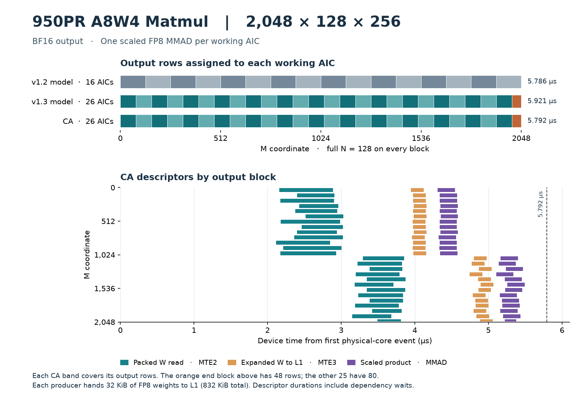

# 稠密 MX Matmul · 原生 A4W4 与在线展开 A8W4

同一个无 bias 的线性层，系统侧传本卡 `(M,N,K)`。M 是本次发给 kernel 的 token 行数，N 是本卡输出宽，K 是本卡点积长度。下面的 M=9 可以表示单请求、推测 8 个 token 后的一次主模型校验；M=2048 可以表示一次 prefill chunk。张量从已量化、已打包的状态开始计时。

```python
from operator_model import estimate, load_chip

pr = load_chip("Ascend950PR_957b")
for m in (9, 2048):
    native = estimate("matmul", (m, 128, 256), dtype="mxfp4", chip=pr)
    mixed = estimate("matmul", (m, 128, 256), {"weight_dtype": "mxfp4"},
                     dtype="fp8_e4m3fn", chip=pr)
    for result in (native, mixed):
        print(result.status, result.latency_us, result.active_aic, result.active_aiv,
              result.work["cube_ops"], result.work["logical_read_bytes"])
```

分阶段展开见 [A4W4 窄尾波](mx-native-tail.md) 和 [A8W4 多 K 页](mx-handoff.md)。两个算例均给出参数来源、芯片资源、完整 CA 时间和 970DT 外推。

### 从打包数据到工作量

计算式为 $Y_{ij}=\mathrm{BF16}(\sum_g s^A_{ig}s^W_{jg}\sum_{t\in g} A_{it}W_{jt})$。每个 K 组最多 32 项，组内值用 E2M1 或 E4M3FN，两个尺度均为 E8M0，累加按 FP32 建模。A 的物理形状为 [M,K]，W 以 [N,K] 的 ND 存储并在乘法中转置。两份 scale 的物理形状分别为 [M,⌈K/64⌉,2] 与 [N,⌈K/64⌉,2]；K 尾部不足两个组仍为该行分配两个槽。

以 M=9、N=128、K=256 为例，两种实现均有 $2MNK=589,824$ 个有用 Cube 运算，输出写 $2MN=2,304$ B。原生路线 A 的 payload 占 1,152 B，混合路线占 2,304 B。两者 W 都为 16,384 B，A/W 两份 scale 分别占 72 B、1,024 B，因此总逻辑读分别为 **18,632 B** 与 **19,784 B**。这些是张量读写量；不同输出块重复取 W、L2 命中以及 UB 中间交接另算。

| 路线 | 首个 Cube 操作之前的依赖 | 资源定价依据 |
|---|---|---|
| 原生 A4W4 | 将打包的 A、W 和 scale 搬入 L1，装载 L0 后发射带 scale 的 MX 乘加 | 4-bit Cube、MTE2/MTE1、写回 |
| A8W4 | AIV 取打包 W，在片上展开为 FP8 并交接到 L1；AIC 等待对应页后用 FP8 乘加 | 8-bit Cube、AIV 转换、UB→L1 端口、交接与写回 |

两路都只计一次融合 kernel 发射。A8W4 的片上中间权重占用局部传输和缓冲；无需在框架计算图中再加一次独立反量化。950 的稠密实现使用 ops-nn 的 QuantBatchMatmulV3 和 QuantBatchMatmulV4，入口同为 `aclnnQuantMatmulV5`。不同量化粒度、权重的 NZ 布局、带 bias 或 MoE 的 grouped 算子是不同合同。[上游 V5 参数与精度组合](https://gitcode.com/cann/ops-nn/blob/28d19e078fd2d4144a681eb20ed3261047256d0c/matmul/quant_batch_matmul_v4/docs/aclnnQuantMatmulV5.md)

### 逐页算例与完整设备窗

以 950DT 的 M=9 为例。下表从本次公开查询的分块计划、整窗关键路径与 v1.2 已采的完整 CA 窗取数；该窗在当前版本计入开发回放。周期价格按 1.65 GHz 换成设备微秒。

| 设备或流水量 | 原生 A4W4 | 核内展开 A8W4 |
|---|---:|---:|
| 忙核输出块 M×N、K 页深 | 16 × 16 × 256 | 16 × 16 × 256 |
| 活动 AIC / 已分配 AIV | 8 / 0 | 8 / 16 |
| 忙核输出块数 × 每块 K 页数 | 1 × 1 | 1 × 1 |
| 每个 AIC 每周期的 Cube 操作数 | 32,765 | 16,383 |
| 算子边界读 / 写 B | 18,632 / 2,304 | 19,784 / 2,304 |
| 首发 µs | 2.4385 | 2.2479 |
| 核间到达差 µs | 0.1896 | 0.1670 |
| 读响应和页服务 µs | 0.7193 | 0.7586 |
| AIV 净展开 µs | 0.0000 | 0.1371 |
| UB→L1 交接 µs | 0.0000 | 0.1113 |
| 末页装载 µs | 0.0347 | 0.0439 |
| 末页乘加 µs | 0.0673 | 0.0551 |
| 输出完成 µs | 0.4909 | 0.4248 |
| 预测整窗 µs | 3.9403 | 3.9457 |
| 真实 CA 整窗 µs | 4.1539 | 4.0115 |
| 预测误差 | -5.14% | -1.64% |



上栏按模型给出的首发、读响应、交接、乘加和写尾分解整窗，横向位置表示可加的关键路径预算。下栏按同一设备零点、同一刻度画最晚退休 AIC 与同核簇执行权重交接的 AIV，实线标全核完成时间。下栏只画有载荷的搬运、计算和写回，标量控制段留白。短竖线是指令发起，色带包括到退休的依赖等待；FIXP 可以在 MMAD 完成前就登记写描述符。比较两栏时，应按同类阶段核对发起、交接和最后退休。原生 FP4×FP4 的 Cube 直接消耗打包权重，混合路径的 AIV 展开和片上交接在图中单列。[绘图数值与 trace 指纹](assets/mx-matmul.json) · [分块与周期价格的来源](../modeling-strategy.md#稠密-mx-matmul--乘加与权重展开)

#### 如何重算表里每个阶段

在 950DT 上 $f=1.65$ GHz，$1$ µs 是 $1000f=1650$ tick。一个有用输出块为 $h=9,w=16$，K 深 $k=256$，每行 8 个 scale；全片有 $C=8$ 个活跃 AIC。下表数字均为 tick，逐列相加后除以 1650 即得上表的设备时间。输入张量与片上搬运按实际 $h,w$，硬件 Cube 工作按 16 对齐计，故每块有 $F=2×16×16×256=131072$ 个标量等效操作。

| 阶段及由来 | 原生 A4W4 | 展开 A8W4 |
|---|---:|---:|
| 首发。取开发 trace 首次有载荷描述符之前的启动周期 $L_s$ | 4023.5 | 3709.0 |
| 末核到达。每级延迟 $d$ 来自开发窗首末 MMAD 的发起差，单页原生用 $d\log_2 C$，混合用 $d(C-1)$ | $104.30×3$ | $39.36×7$ |
| 读。固定首响应 $L_r$ 加慢端口的字节服务。本例由单核 MTE2 决定：原生 A、W 和 scale 共 3400 B；混合的 AIC/AIV 可并读，取较大的 2376 B | $1114.68+3400/47.15$ | $1201.33+2376/47.15$ |
| 解包与交接。每个混合块生产 $wk=4096$ 个 FP8 权重。短页共用开发窗的 50 tick 启动、23.24 值/tick 的等效展开速率。交接将 4096 B 写往 L1 | 0 | $(50+4096/23.24)+(157.81+4096/158.30)$ |
| L1→L0 装载。固定装载延迟 $L_0$ 加载荷/端口。本例原生装载 3400 B，混合装载激活、展开后 W 及 scale 共 6600 B | $38.51+3400/180.65$ | $35.82+6600/180.65$ |
| 最后一次乘加。固定退休延迟 $L_c$ 加 $F/q$，$q$ 由对应精度 Cube 峰值除以核数和主频得到，单位 ops/tick | $107+131072/32765.15$ | $82.99+131072/16382.58$ |
| 写尾。BF16 输出 $2hw=288$ B，写端口价格另加从末次退休校准的排空周期 $L_d$ | $808.16+288/158.30$ | $699.16+288/158.30$ |

两路都只有一波、一页，因此后续页间隔和追加波次均为零。47.15、180.65、158.30 分别为此配置下 MTE2、MTE1、写端口的有效字节/tick，来自已有 950 搬运资源校准；若共享 L2/HBM 先饱和，则取较慢约束。$L_s,L_r,L_0,L_c,L_d$ 是从完整开发窗的阶段边界分离出的周期预算；它们包含尚未分辨的等待。长 K 在多槽中运行时需按页追踪生产与消费。[短窗参数及来源](../../src/operator_model/data/parameters/mx_matmul_phases.json) · [多 K 页算例](mx-handoff.md)

### 大 M 与 970DT 外推

保持 N=128、K=256，将 M 从单请求校验扩大到 2048 行的 prefill chunk。下表的 950 结果在限定几何内返回 `estimated`，970DT 返回 `extrapolated`。

| 路线、M | DT 预测 / CA µs | PR 预测 / CA µs | 970DT 外推 µs |
|---|---:|---:|---:|
| A4W4，9 | 3.940 / 4.154 | 3.803 / 3.835 | 3.521 |
| A8W4，9 | 3.946 / 4.012 | 3.616 / 3.946 | 3.457 |
| A4W4，2048 | 4.608 / 4.336 | 4.595 / 4.219 | 3.986 |
| A8W4，2048 | 5.965 / 5.845 | 5.921 / 5.792 | 6.169 |

以整卡 8×32Ki token、不分 chunk 的 [262144,128,512] 投影形状做精度情景推演。若这一投影改用上述打包格式，970DT 上 A4W4 和 A8W4 分别预测 **15.56 / 24.64 µs**。线上框架采用 chunk 时应按每次真实发射的 M 查询。这个大几何未做 MX 的 CA 计时，970DT 的数值还依赖 1:1 核配比、假设的实现和片上端口。[逐形误差及证据](../error-analysis.md#稠密-mx-matmul--双端同形验证)

### 为什么 950PR 上 [2048,128,256] 是 26 核

以 A8W4 为例，输入模型的是 28 个可用 AIC、56 个 AIV 和本卡 M、N、K。初始输出分为八个 256×128 的块，N 方向只有一列。SWAT host tiling 先把可用核预算分给行，再将子块宽度对齐：$m_b=16\lceil\lceil2048/28\rceil/16\rceil=80$ 行。于是共有 $\lceil2048/80\rceil=26$ 块，包括 25 个 80×128 和最后一个 48×128。继续把这波一分为二会需要 52 个 AIC，故在此停止。这个推导只依赖几何、对齐和核预算。

26 个 AIC 各需 [128,256] 的展开权重页。K=256 时每个核簇的一个 AIV 足以生产该页，两个 AIV 均随内核启动。预测和 CA 同为 **26 个计算 AIC、52 个已启动 AIV、26 个生产 AIV**。交接共 $26×128×256=851,968$ B。旧模型切成 16 个 128 行块，只算了 524,288 B。当前整窗 5.921 µs，CA 5.792 µs；旧估 5.786 µs。计时偏差与分核偏差应分别解读。



图上半按输出行对齐，图下半按同一个全核设备时钟显示各行块对应的 CA 事件；FIXP 目的地址用于识别哪一个核写哪片输出。色带包含从发起到退休的等待。26 个核簇的交接分先后出现，现有证据还不能把两批到达归因到某一个端口。[图数据及指令来源](assets/mx-pr-tiling.json) · [实际 SWAT 分块规则](../../src/operator_model/operators/matmul/mx_swat.py)

### 多 K 页 decode · Flash 的第一条投影

DeepSeek-V4.1-Flash 的 `dsa.wkv` 每卡 K=5120、N=512。一个请求进一个 token 给出 M=1。在 A8W4 情景中，模型输入为 FP8 激活、FP4 权重和两份 E8M0 scale；输出 512 个 BF16。Cube 要做 $2×1×512×5120=5,242,880$ 个有用运算，读张量 1,397,920 B、写 1,024 B。

| A8W4 阶段 | 950DT | 950PR |
|---|---:|---:|
| 行列块 / L1 页深 / MMAD K 深 | 16×16 / 4096 / 2048 | 16×32 / 2048 / 1024 |
| 忙核 L1 页数 / AIC / 生产 AIV | 2 / 32 / 64 | 3 / 16 / 32 |
| 首发 + 核间到达差 µs | 3.872 | 2.911 |
| 首次读、展开、UB→L1 µs | 2.109 | 2.044 |
| 流水间隔预算 µs | 0.241 | 0.477 |
| 装载、乘加收尾与写尾 µs | 0.636 | 0.559 |
| 模型整窗 / CA 整窗 µs | 6.857 / 6.679 | 5.991 / 5.857 |
| CA 首条 MMAD 发起 / 最末 MMAD 退休 µs | 4.447 / 6.369 | 4.138 / 5.779 |

冻结模型给出的 DT/PR 耗时比为 1.145，实测 1.140。DT 从最后 MMAD 退休至整窗完成还需 0.310 µs，PR 为 0.078 µs。970DT 的 1:1 核配比情景预测 4.988 µs。每页如何消耗解包端口、何时能覆盖旧槽，以及时间预算的来源见[多页模型公式与对照图](mx-handoff.md)。
