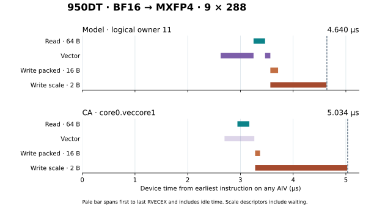

# DynamicMxQuant · BF16 → packed MXFP4 E2M1

一份 `[9,288]` 的 decode 输入只含 2,592 个值。950DT 的实现把每行分给两个 AIV，其中一个仅处理 32 列。这个小核最后退休，原因有两处：为了补齐 scale，它在装入输入前清零 UB；写回时，它的 2 B scale 与其他核的输出共用一个 32 B 区间。下面从工作量算到这一个核，再与完整的 CA 窗口核对。该形状在 DeepSeek-V4.1-Flash 的系统捕获中有实际连续输入。[系统形状清单](../system-quant-shapes.md)

```python
from operator_model import estimate

q = estimate("quant_mxfp4", [9, 288], {"group_size": 32, "round_mode": "round"},
             dtype="bf16", chip="Ascend950DT_9582")
print(q.latency_us, q.active_aiv, q.active_aic)       # 4.640306…, 18, 0
print(q.work["packed_shape"], q.work["scale_shape"])  # [9, 144], [9, 5, 2]
print(q.projection["critical_wave"]["cols"])           # 32
```

接口接收连续 BF16，1–7 维，末维为 ≥32 的偶数。该实现取末轴、每组 32、`round`、OCP (`scale_alg=0`)。系统导出提供了分组、舍入与输出精度；其未记录的 `scale_alg` 按 OCP 解释。FP8 输出使用单独的 `quant`。设备时间以最早设备指令为零点；可配的 `kernel_overhead_us` 只进入系统调度时间。

## 从输入算到 [9,288] 的 4.640 µs

下列带宽为单核 **B/cycle**，时间先用 **cycle**，950DT 的每微秒有 1,650 个周期。所有公式先随目标芯片重新分核，再按当前核价、芯片频率和共享带宽重算。

| 步骤 | 公式、含义与本例代入 |
|---|---|
| 逻辑张量 | `R=前导各维乘积，C=末维，X=R×C，G=R×ceil(C/32)`。输入 `2X=5184 B`， packed 输出 `X/2=1296 B`，E8M0 输出 `2R×ceil(C/64)=90 B`。每行 9 个有效组和 1 个补位；`G=81`。指数提取、组内比较、缩放和转换共 `4X−G=10287` 次有用 lane 操作。 |
| 行列归属 | host 用 `R×ceil(C/512)` 与 `0.75×AIV数` 选 256/512 列的候选粒度，再枚举行列切分减少空洞。`9≤48`，得到每行 `256+32`，共 18 个 AIV。UB 能放 `8×floor((253952−2048)/1360)=1480` 个 block32；1360 B 包含 256 个位置的双槽输入/packed 输出 `256×5` 和 8 个组的两槽中间量 `8×2×5`。每个活跃核一轮。 |
| 清零与读 | 某核的块高 `h`、宽 `w`，读 `B=2hw`。`clear=odd×1029.5×UB组数/1480÷v`，`odd=ceil(w/32) mod 2`，`v` 为每周期可发起源码 Reg 调用数（DT 假设 1）。64–256 B 之间对小描述符响应系数 `f` 从 0.365 线性上升至 1，两端夹紧。`read=clear+0.956×SKU读延迟×f+B/读带宽`；发起间隔另为 `B/发起带宽`。尾片 `h=1,w=32,B=64`，合计 `1029.5+0.956×1029.740×0.365+64/48.363=1390.141`，发起间隔 `64/68.913=0.929`。 |
| Vector | 补偶组数 `g=2h×ceil(w/64)`。归约和打包每 256 输入有 `6+9` 个内层 Reg 调用，计算 scale/倒数每 128 个 scale 有 16 个。`calls=15×ceil(g/8)+16×ceil(g/128)`；尾核 `g=2`，共 31。`vector=134.5+31/v=165.5`。未来 SKU 的 `v` 由每 AIV、每周期的 16 bit 峰值相对 DT 伸缩。源码调用数与 CA 解码出的 RVECEX 条数口径不同。 |
| 两张输出 | `payload=hw/2=16 B`，`scale=g=2 B`。各自就绪后的服务为 `242.510+16/92.027=242.684` 和 `560+2/92.027=560.022`。按每行实际内存 pitch 枚举边界上的 32 B 区间，多个核写同一区间时，`本次scale退休=max(本核scale就绪,前一请求退休+II)`。通常 `II=172`；当 packed 流也共享边界区间时，`II=310`，本地首次等待再加 310。最后这个附加项是竞争假设。第 11 号逻辑 owner 的 scale 队列另占 `884.156` 周期。 |
| 合成 | 首发 `0.781×4686.5=3660.157`。到达跨度 `1.13×219.921×log₂(18)` 按 owner 序号分配，第 11 号到达偏移 `670.529`。排完 18 个核，选择最后退休者，输出取 `max(packed退休,scale退休)`。DT 总时间 `(3660.157+670.529+1390.141+165.500+560.022+310+884.156+16)/1650=4.640306 µs`。此例全芯片 HBM/L2 下限均可隐藏。 |

若最忙核每轮只用一个 UB 块，上述排程比较主核和尾核。多 UB 块时，重复读→Vector→写，输入发起间隔和读响应分别限制发起与消费，双缓冲的复用依赖限制已占槽位。以 max-plus 重复平方法合并长循环；当前多轮路径使用最忙核的规则块拓扑，没有逐轮构造全芯片跨核 scale 队列。最后取核内流水与有效 HBM/L2 服务下限的较大值。增加核数可能改变切块、竞争模式、利用率和内存下限。[FP4 分核与调度代码](../../src/operator_model/operators/quant/mxfp4.py) · [单轮退休规则](../../src/operator_model/operators/quant/fp4_wave.py) · [多核带宽与共享资源](../../src/operator_model/scheduling/memory.py)

## 哪些参数来自哪里

- **实现与芯片配置**。block32、paired E8M0、UB 预算、奇数组清零与 V→MTE2 等待、两次输出拷贝和 Reg 循环来自 ops-nn arch35 源码。芯片配置提供 AIV 数、UB 容量和频率；每核 MTE 吞吐已知时用显式配置，否则沿用 950 的读/写斜率。950DT 的 `48.363/68.913/92.027 B/cycle` 分别为读响应、读发起、写吞吐，来自已有量化校准。[host 划分](https://gitcode.com/cann/ops-nn/blob/602e4ad985da00aad28c16432841e9c5069e10de/quant/dynamic_mx_quant/op_host/arch35/dynamic_mx_quant_tail_axis_tiling_arch35.cpp) · [FP4 kernel 循环](https://gitcode.com/cann/ops-nn/blob/602e4ad985da00aad28c16432841e9c5069e10de/quant/dynamic_mx_quant/op_kernel/arch35/dynamic_mx_quant_tail_axis.h) · [参考斜率与周期](../../src/operator_model/data/parameters/quant_resources.json) · [DT 配置](../../src/operator_model/data/chips/Ascend950DT_9582.json)
- **阶段观测**。开发集是四个几何 `[9,128]`、`[9,288]`、`[9,7168]`、`[576,128]` 在 DT 和 PR 的 8 个完整窗口。对每个物理 AIV 区分 160 B 的 tiling 读取、BF16 输入读取、packed 和 scale 两个写描述符，读取真实地址、指令类别及首发/退休 tick。例：`[9,288]` 尾核中 `RV_PLT` 有 742 条，规则核少于 100 条；同一形状中两类核的 payload 首读取中位时刻之差为 DT 1029、PR 1030 个周期，取中位得清零代理 `1029.5`。这包含调度和同步，代表可见延迟。[逐核提取](../../calibration/quant_update/phases.py)
- **阶段统计**。每 shape/SKU 按未清零的核提取最早 payload 读、最迟和最早之差、描述符响应扣除传输量，以及 `packed写发起−输入读退休−源码调用数/v`。先按 shape 等权汇总，再取两 SKU 中位数。首发比 `(0.76315+0.79920)/2→0.781`，到达跨度比 `(1.21167+1.04675)/2→1.13`，读响应比 `(1.00708+0.90527)/2→0.956`，Vector 剩余周期 `(138.5+130.5)/2=134.5`。64 B 尾读的响应比为 0.3632，发布取 0.365，线性插值属假设。写 scale 的低竞争样本扣除字节输运得到 `560.457→560` 周期。在至多 8 B 的短 scale 描述符中，按起始 32 B 区间将不同核的退休时刻排序，相邻差中位数 `171.5→172`、`310.5→310`。这些值未分离 cache coherence、队列、公平性和实际内存事务。970DT 继承的服务成本会随假设变动。[可执行统计规则](../../calibration/quant_update/fit.py) · [输入观测及冻结收据](../../calibration/quant_update/calibration.json.gz)

## CA 对照与误差定位

单个连续输入实际调用 CANN 9.2.1 `aclnnDynamicMxQuant`。执行的 `DynamicMxQuant_bf16toe2m1_high_performance_33_mix_aiv` 与安装包中 `ops_nn/dynamic_mx_quant/DynamicMxQuant_bf16toe2m1_high_performance.o` 的 SHA256 一致。计时检查全物理核 roster、各核唯一 END 与退休 tick，并核对工具的核级时长。独立 CPU golden 校验每个输出 nibble 和每个 scale。图中上栏为算法的末退休逻辑分块，下栏是 CA 真实末核，两栏使用同一个横轴刻度，各自从全核最早指令起算。



`[9,288]` DT 的 `core0.veccore1` 发起 64 B 读的时刻为 `4856/1650=2.943 µs`，读退休 3.168 µs。packed 写 `5410–5563` tick，scale 写 `5411–8290` tick，几乎同时开始。2 B scale 描述符的 2879 周期内含等待；最后 16 周期退休，全核窗 `8306/1650=5.034 µs`。模型将尾核清零、短读、两张输出和等待分开后，预测 4.640 µs，仍低估 7.82%。CA 浅色 Vector 条是首条到末条 RVECEX 的包络，包含间隙。模型的清零代理也包含进入对应阶段的等待。两条 Vector 横条的长度不能用于计算指令吞吐。[重绘脚本](../../calibration/quant_update/plot.py)

| 开发几何（连续） | 950DT 旧预测 → 当前 / CA，µs | 950PR 旧预测 → 当前 / CA，µs | 970DT 外推，µs |
|---|---:|---:|---:|
| [9,128] | 4.129 → 3.997 / 3.912 | 3.836 → 3.748 / 3.862 | 3.664 |
| [9,288] | 4.266 → 4.640 / 5.034 | 3.977 → 4.399 / 4.890 | 4.254 |
| [9,7168] | 4.556 → 4.218 / 4.453 | 4.225 → 3.869 / 3.760 | 3.866 |
| [576,128] | 4.572 → 4.323 / 4.390 | 4.271 → 4.060 / 4.193 | 4.133 |

以上 8 条原始收据用于阶段校准，计入开发回放，DT WAPE 4.39%、PR 5.06%。原先同集分别为 7.14%、8.87%。`[9,7168]` 的 DT 和 `[9,128]` 的 PR 仍可看到整窗或局部误差变大的情况。冻结后的不同输入单独列出。[逐形状误差与独立验证](../errors/quant_mxfp4.md)

## 同一形状的连续张量与真实视图

在 Kimi-K3.1 的 128Ki decode 系统模拟中，单卡 batch=1、TP8/EP32、校验长度 9 的 `[9,128]` 捕获视图，其元素 stride=`[6288,1]`、storage offset=`6144`，背后分配 `9×6288×2=113184 B`。上述 `[9,128]` 的连续校准只验证紧凑布局。把真实 offset 与 stride 交给原生 BF16 ACL descriptor，并采集该 API 的所有设备 launch 后，得到如下时段。连续与视图输出均用全量数值校验。

| 视图 SKU | 实际先后执行 | Slice 窗，µs | 量化窗，µs | 两者间隔，µs | 全设备跨度，µs |
|---|---|---:|---:|---:|---:|
| 950DT | ops_math `Slice`（3 AIV）→ ops_nn `DynamicMxQuant`（9 AIV） | 2.808 | 3.366 | 0.928 | 7.103 |
| 950PR | ops_math `Slice`（3 AIV）→ ops_nn `DynamicMxQuant`（9 AIV） | 2.736 | 3.384 | 0.860 | 6.980 |

两段的计时单位来自同一次 CA 运行的共同设备时钟，最后一列包含两次 launch 之间可见的空档，排除 API 调用之前和最后退休之后的 host 开销。单独相加会漏掉空档。原生输出 1152 个 FP4 值与 36 个 E8M0 均通过。首次 DT 探测只采到首个 Slice，耗时 61.0 s，该次为部分证据，以上数字来自记录全部 launch 的重采。`estimate(..., attrs={"input_stride":[6288,1]})` 对该路仍返回逻辑工作量、设备时间 N/A；推广到不同 stride/offset 需要为 Slice 与跨 kernel 调度建立独立价格。[视图 DT 收据](../../calibration/quant_update/strided-950dt.json) · [视图采集、共同零点和 OPP 核验](../../calibration/quant_update/view_receipt.py)

## 远大于 CA 验证范围的单卡实例

| 实际系统账单的连续输入 | 每轮 target 次数 | 逻辑读 / 写（B） | DT / PR / 970DT 资源外推（µs） |
|---|---:|---:|---:|
| DeepSeek-V4-Pro B16 · 16×32770×512 | 30 | 536903680 / 142615040 | 207.39 / 469.37 / 100.02 |
| Kimi-K3.1 B16 · 16×131081×576 | 24 | 2416084992 / 641772576 | 1337.48 / 2168.18 / 655.26 |

两行来自 128Ki decode 的缓存物化。随行数增大，固定几何的 tile 重复，steady state 可逐步接近线性；当切块、有效带宽或缓存层次改变时斜率会变。第一行 DT 的核内流水和到达跨度为 169.85 µs，共享搬运额外暴露 35.75 µs。第二行 DT 的核内流水占 1335.70 µs，PR 的共享搬运额外暴露 632.78 µs。这两种大张量都缺同几何 CA。970DT 没有本地 CA；所有 970 数值均采用其配置和明示的片内继承假设。

## 重放、拟合和查询成本

在系统导出的 102 个连续几何上，对 DT、PR、970DT 的公共 `estimate` 各调用 3 次。先预热模块和芯片配置，保留完整的在线分核与价格计算。918 次调用的主机墙钟中位数 1.26 ms，P99 为 16.84 ms，最大 18.16 ms（970DT `[1232,3072]`）；同机任务和解释器会影响这些数值。

在仓根执行下列命令可重放完整窗口。`independent` 行绑定到采集之前的冻结，`development` 行保留原采集和本次重放的两个指纹。归档包括每条数值检查、分核/END、trace/ELF 指纹、末核阶段、采集墙钟、外推与查询开销。原始指令 shard 留在本地 `runs/`。真实设备微秒数与模拟器的分钟级墙钟分开统计。

```bash
python -m calibration.quant_update.bundle --rows development
python -m calibration.quant_update.bundle --rows independent
python -m calibration.quant_update.plot
```

有旧 raw 时，执行 `python -m calibration.quant_update.phases runs/quant4-system /tmp/fp4-cores.json`，再执行 `python -m calibration.quant_update.fit /tmp/fp4-cores.json`，可重算上述阶段参数。数值探测器用逻辑 FP4 tensor descriptor，底层两值一字节。输入每组含不同符号和已知的二次幂尺度，依照 CPU 计算验证所有输出。探测器沿用仓内示例的编译和链接参数，把输入源改为 `calibration/quant_mxfp4.cpp`。[C++ 探测器](../../calibration/quant_mxfp4.cpp) · [完整连续窗口校验](../../calibration/quant_mxfp4.py) · [构建示例](../../calibration/mx_matmul/README.md)

10 个冻结后的连续新形在 DT/PR 各测一窗，范围包含 [2,3584]、[144,288]、[576,7168] 和 [576,12288]。同集旧价 WAPE 11.29%/10.69%，当前 7.85%/9.70%。[逐形计分与最大误差](../errors/quant_mxfp4.md) · [真实视图的双端收据](../errors/measured-only.md)
